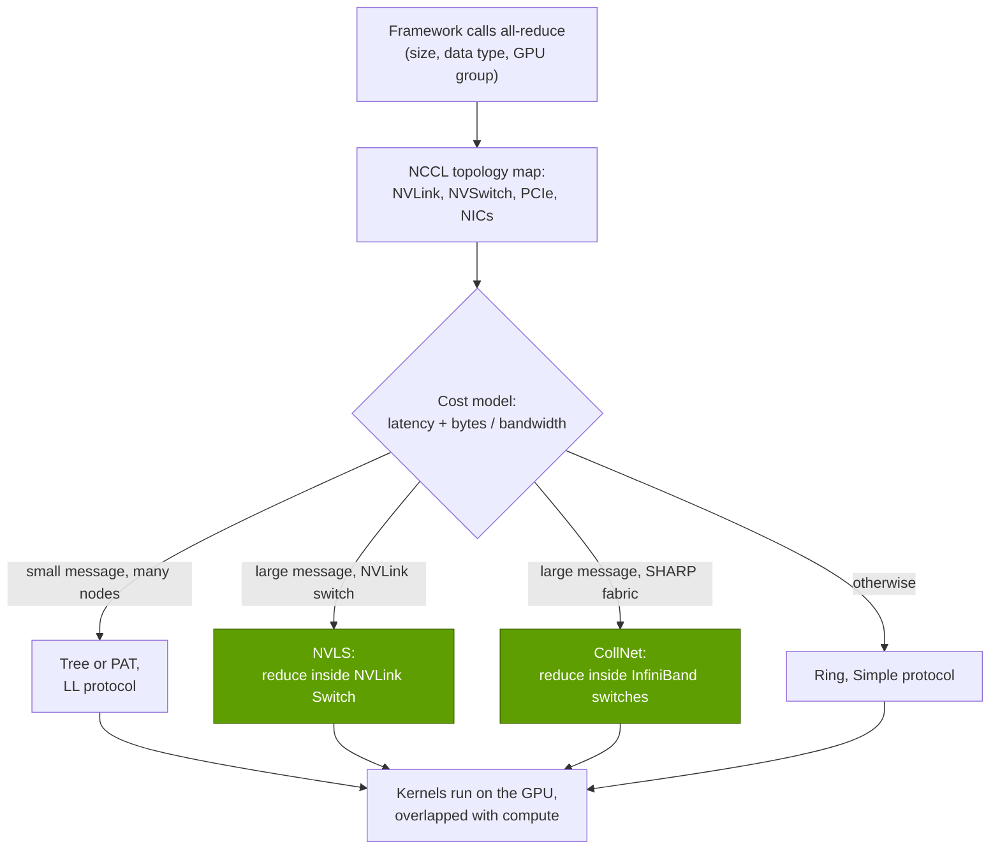

# NCCL: the hidden glue of multi-GPU AI

Layer 10 · Libraries (CUDA-X) · ~12 min read · Last verified: 2026-11-05

## ⚡ The Executive Take

- **[NCCL](../../glossary.md#nccl) (pronounced "nickel") moves data between GPUs.** It runs all-reduce, all-gather, reduce-scatter, broadcast and send/receive patterns over PCIe, NVLink, NVSwitch, InfiniBand and TCP/IP sockets, in one server or across thousands [[S10000]](../../sources/bibliography.md#s10000).
- **It is topology-aware.** NCCL detects the links between GPUs and NICs, then picks an algorithm (ring, tree, CollNet/SHARP, NVLS, PAT) and a protocol from a built-in cost model [[S10001]](../../sources/bibliography.md#s10001).
- **In-switch reduction is NVIDIA's hardware-software edge.** With [SHARP](../../glossary.md#sharp) in InfiniBand switches or [NVLink SHARP](../../glossary.md#nvlink-sharp) (NVLS) in NVLink switches, each GPU sends its data about once instead of about twice. An ideal 70B gradient all-reduce on a GB200 NVL72 drops from 0.31 s to 0.16 s [[S34011]](../../sources/bibliography.md#s34011)[[S200]](../../sources/bibliography.md#s200).
- **Latency, not bandwidth, binds at scale and in inference.** In NCCL's own cost model, a ring's fixed latency reaches ~11 ms at 2,048 nodes versus ~0.12 ms for a [tree](../../glossary.md#tree-all-reduce) [[S10001]](../../sources/bibliography.md#s10001). In the decode example below, small all-reduces take ~14% of each token's time.
- **NCCL moves fast:** 2.13 (July 2022) to 2.32 (September 2026) is 19 minor versions in 50 months, adding symmetric-memory kernels and GPU-initiated networking [[S10038]](../../sources/bibliography.md#s10038)[[S10007]](../../sources/bibliography.md#s10007).
- **The code is open, and rivals use it.** NCCL's source carries an Apache-2.0 tag [[S10000]](../../sources/bibliography.md#s10000). AMD's [RCCL](../../glossary.md#rccl) is built from NCCL's code and keeps its API [[S10002]](../../sources/bibliography.md#s10002), and Microsoft's [MSCCL++](../../glossary.md#msccl) claims up to 2.8× NCCL's speed on small messages (🟡 vendor benchmark) [[S10004]](../../sources/bibliography.md#s10004). The co-design with NVIDIA's switches is harder to copy.

## What NCCL does

**Analogy.** Picture a potluck with 72 cooks. In an [all-reduce](../../glossary.md#all-reduce), everyone brings a dish and leaves with the combined meal (data-parallel gradients). In an [all-gather](../../glossary.md#all-gather), everyone leaves with a copy of every dish (sharded weights). In a [reduce-scatter](../../glossary.md#reduce-scatter), each cook leaves with one finished course. An [all-to-all](../../glossary.md#all-to-all) is a postal sort: every cook sends different items to every other cook, as when mixture-of-experts tokens go to their experts. Primer [P4](../../primers/P4-parallelism-explained.md) maps each parallelism strategy to its collective. The chart below shows why the volumes differ so much:

**Topology awareness.** At start-up NCCL maps which GPUs share an NVLink switch, which NIC is closest to each GPU and how many network rails exist. It builds parallel rings and trees ("channels") so every link carries traffic at once, and prices each call as latency plus bytes divided by bandwidth for every algorithm and protocol. The cheapest wins [[S10001]](../../sources/bibliography.md#s10001).

> [!TIP]
> **Worked example — why inference all-reduces are latency-bound.** Serve a 70B model (80 layers, hidden size 8,192) with 8-way tensor parallelism on one NVLink 5 server. Megatron-style tensor parallelism needs two all-reduces per layer per forward pass [[S34001]](../../sources/bibliography.md#s34001). Decoding one token for a batch of 64 users makes each message 64 × 8,192 × 2 bytes ≈ 1 MB. The ring's bandwidth term is 1.75 × 1 MB ÷ 900 GB/s ≈ 2 µs [[S200]](../../sources/bibliography.md#s200). Its latency term, from NCCL's default constants for the LL protocol over NVLink, is 6.6 + 14 × 0.6 ≈ 15 µs [[S10001]](../../sources/bibliography.md#s10001). So ~17 µs per all-reduce, nearly 90% of it fixed latency. Over 160 all-reduces per token that is ~2.7 ms, about 14% of a 20 ms token at 50 tokens/s per user. **Conclusion:** for inference, NCCL's microseconds matter more than its GB/s, hence the low-latency symmetric-memory kernels in NCCL 2.27 [[S10044]](../../sources/bibliography.md#s10044).

## Ring vs tree vs in-switch reduction

| Algorithm | How it works | Data each GPU sends | Latency grows with | Best for |
|---|---|---|---|---|
| **[Ring](../../glossary.md#ring-all-reduce)** | Chunks pass around a loop, summed on the way, then circulated back [[S34011]](../../sources/bibliography.md#s34011) | ~2× the message | Number of GPUs (2(N−1) hops) | Large messages, modest scale |
| **[Tree](../../glossary.md#tree-all-reduce)** | Sum up a tree, broadcast down; NCCL uses two complementary trees [[S10041]](../../sources/bibliography.md#s10041) | ~2× the message | log2(N) | Small messages at large scale |
| **CollNet / SHARP** | InfiniBand switches add the data in flight [[S34024]](../../sources/bibliography.md#s34024) | ~1× | Switch hops | Large clusters on SHARP-capable fabrics |
| **NVLS** | The NVLink Switch reduces and multicasts inside the scale-up domain [[S10042]](../../sources/bibliography.md#s10042) | ~1× | Flat (~25 µs model term) [[S10001]](../../sources/bibliography.md#s10001) | Large messages within an NVL8 or NVL72 domain |
| **[PAT](../../glossary.md#pat-algorithm)** | Logarithmic schedule for all-gather and reduce-scatter (NCCL 2.23) [[S10043]](../../sources/bibliography.md#s10043) | Same as ring | log2(N) | Very large jobs with small per-GPU shards |

The first chart shows the bandwidth side (in-network reduction halves what each GPU sends), the second the latency side (ring latency grows with every node).

> [!TIP]
> **Worked example — a 70B gradient all-reduce, ring vs NVLink SHARP.** 70B parameters × 2 bytes (BF16) = 140 GB of gradients. *Ring across a GB200 NVL72:* each GPU sends 2 × 71/72 × 140 ≈ 276 GB at 900 GB/s per direction (NVLink 5) [[S200]](../../sources/bibliography.md#s200), which takes **0.31 s**. *NVLS on the same rack:* each GPU sends its 140 GB once and the switch returns the sum, which takes 140 ÷ 900 = **0.16 s**. Across 64 GPUs on 800 Gb/s InfiniBand (100 GB/s), the same pair is 2.8 s vs 1.4 s with SHARP [[S251]](../../sources/bibliography.md#s251). **Conclusion:** in-switch reduction is worth about a 2× faster link, with no extra NIC or switch port. Real runs are slower, hide much of this behind the backward pass, and shard the volume (FSDP) ([P4](../../primers/P4-parallelism-explained.md)).

🔧 Under the hood: protocols, channels and the device API

- **Protocols.** *LL* (low latency) attaches a flag to every 4 bytes so receivers can poll without separate synchronization: lowest latency, about half the bandwidth. *LL128* does the same per 128 bytes; *Simple* uses large buffers and fences for peak bandwidth [[S10001]](../../sources/bibliography.md#s10001).
- **Channels.** A message is split across several rings or trees, each driven by its own thread block, to fill every NVLink and NIC rail.
- **Bus bandwidth.** nccl-tests reports [bus bandwidth](../../glossary.md#bus-bandwidth) = algorithm bandwidth × 2(N−1)/N for all-reduce, so results can be compared with link speed [[S34012]](../../sources/bibliography.md#s34012).
- **Device API (2.28).** Kernels issue communication themselves: load/store over NVLink, multimem through NVLink SHARP, and [GPU-initiated networking](../../glossary.md#gpu-initiated-networking) (GIN) over InfiniBand/RoCE. It targets MoE dispatch, where CPU round trips cost too much [[S10007]](../../sources/bibliography.md#s10007)[[S10008]](../../sources/bibliography.md#s10008).

## Why NCCL performance is a de facto benchmark

**[Q2 · Metrics that matter]** Two NCCL numbers summarize a whole fabric for a cluster buyer: all-reduce bus bandwidth at large messages and latency at small ones. Clouds and their customers run `nccl-tests` before accepting a cluster. One published validation guide targets ~400–450 GB/s of all-reduce bus bandwidth for H100 nodes with NVLink and 400G InfiniBand [[S10022]](../../sources/bibliography.md#s10022). Every major framework reaches the network through NCCL or an NCCL-API clone, so the results map directly to training time, and NVIDIA owns both the library and the hardware it is measured on.

**[Q3 · Generational progress]** NCCL has tracked the hardware roadmap: NVLink SHARP support by 2.19 (October 2023) [[S10042]](../../sources/bibliography.md#s10042), 🟡 PAT in 2.23 [[S10043]](../../sources/bibliography.md#s10043) and symmetric-memory kernels in 2.27 [[S10044]](../../sources/bibliography.md#s10044) (blog dates recalled, not re-fetched), and the device API with GPU-initiated networking in 2.28 [[S10008]](../../sources/bibliography.md#s10008):

## The alternatives

| Library | Owner | What it is | Verdict vs NCCL |
|---|---|---|---|
| **RCCL** | AMD | Collectives for Instinct GPUs: ring and tree, optional MSCCL++ paths; LICENSE credits NVIDIA code [[S10002]](../../sources/bibliography.md#s10002) | 🟨 Same API by design; tuned for AMD's links, no in-switch reduction listed |
| **MSCCL++** | Microsoft | GPU-driven one-sided primitives for custom collectives on NVIDIA and AMD GPUs [[S10003]](../../sources/bibliography.md#s10003); claims up to 2.8× (small) and 2.4× (large messages) over NCCL [[S10004]](../../sources/bibliography.md#s10004) | 🟦 A toolkit for custom algorithms; strongest on small messages |
| **[Gloo](../../glossary.md#gloo)** | Meta (PyTorch) | Collectives over TCP, mainly for CPU tensors [[S10006]](../../sources/bibliography.md#s10006) | 🟥 Not a GPU-speed rival; a fallback |
| **[MPI](../../glossary.md#mpi) / [UCC](../../glossary.md#ucc)** | Open standards / UCF consortium | HPC message passing; UCC puts hardware collectives first [[S10005]](../../sources/bibliography.md#s10005); NCCL runs inside MPI programs [[S10000]](../../sources/bibliography.md#s10000) | 🟦 Complements in HPC centers |
| **Google ICI collectives** | Google | XLA schedules collectives on the TPU torus, 4,096 chips per v4 pod [[S236]](../../sources/bibliography.md#s236)[[S237]](../../sources/bibliography.md#s237) | 🟦 Compiler-scheduled, tied to TPUs |
| **DeepEP** | DeepSeek | Open MoE all-to-all kernels: ~153 GB/s within an NVLink node vs ~43–58 GB/s over RDMA on H800 [[S5005]](../../sources/bibliography.md#s5005) | 🟦 A specialist alongside NCCL |

> [!NOTE]
> **🐂 Bull view:** NCCL is open, yet its best paths (NVLS, CollNet/SHARP, GPU-initiated networking) need NVIDIA switches and NICs, so each release raises the hardware bar for rivals [[S10001]](../../sources/bibliography.md#s10001)[[S10007]](../../sources/bibliography.md#s10007).

> [!WARNING]
> **🐻 Bear view:** collectives are a well-studied problem. RCCL already reuses NCCL's code and API [[S10002]](../../sources/bibliography.md#s10002), MSCCL++ reports beating NCCL [[S10004]](../../sources/bibliography.md#s10004), and DeepSeek wrote its own MoE kernels [[S5005]](../../sources/bibliography.md#s5005). Open scale-up fabrics (UALink, ESUN) give rivals hardware to target. If the collective library becomes interchangeable, NCCL's moat shrinks to NVIDIA's switches. See [Competition](competition.md).

## 🎯 Corp Dev Lens

1. **The API is the standard.** RCCL keeps NCCL's interface [[S10002]](../../sources/bibliography.md#s10002). A new accelerator needs an NCCL-compatible library on day one: build it, license it, or adopt MSCCL++ or UCC?
2. **In-network compute is the defensible part.** The library code is open [[S10000]](../../sources/bibliography.md#s10000); the value sits in switch silicon that reduces data (NVLink Switch, Quantum, Spectrum-X). Which merchant switch vendors could offer equivalent reduction for UALink or ESUN fabrics? See [layer 06](../06-scale-out-scale-across-networking/index.md).
3. **Inference shifts the metric to microseconds.** Small-message latency now matters as much as bandwidth, so teams with low-latency collective IP (MoE dispatch kernels, GPU-initiated networking) are potential acqui-hire targets.
4. **Qualcomm question (public information only):** AI300 is described with UALink and ESUN scale-up [[S90060]](../../sources/bibliography.md#s90060). Which collective library will sit on that fabric, and does it need in-switch reduction to be competitive on 70B-class all-reduces?

## 📚 Sources

<!-- Auto-generated from the [S…] citations on this page by `make build`. Edit sources/registry/*.csv, not this list. -->

- [**S200**](../../sources/bibliography.md#s200) NVIDIA, *NVIDIA NVLink and NVLink Switch (product page with NVLink and NVLink Switch specification tables)*, 2026-09. [Link](https://www.nvidia.com/en-us/data-center/nvlink/)
- [**S236**](../../sources/bibliography.md#s236) Google Cloud, *TPU v4 - Cloud TPU documentation*, 2022. [Link](https://docs.cloud.google.com/tpu/docs/v4)
- [**S237**](../../sources/bibliography.md#s237) arXiv (Norman P. Jouppi et al.), *TPU v4: An Optically Reconfigurable Supercomputer for Machine Learning with Hardware Support for Embeddings (ISCA 2023)*, 2023-04. [Link](https://arxiv.org/abs/2304.01433)
- [**S251**](../../sources/bibliography.md#s251) InfiniBand Trade Association, *InfiniBand Roadmap: charting speeds for future needs*, 2023. [Link](https://www.infinibandta.org/infiniband-roadmap-charting-speeds-for-future-needs)
- [**S5005**](../../sources/bibliography.md#s5005) DeepSeek-AI (GitHub) (DeepSeek-AI), *DeepEP: an efficient expert-parallel communication library (README v1.2.1)*, 2025. [Link](https://github.com/deepseek-ai/DeepEP/blob/v1.2.1/README.md)
- [**S10000**](../../sources/bibliography.md#s10000) NVIDIA (GitHub: NVIDIA/nccl), *NCCL README and makefiles/version.mk (master)*, 2026-11. [Link](https://github.com/NVIDIA/nccl/blob/master/README.md)
- [**S10001**](../../sources/bibliography.md#s10001) NVIDIA (GitHub: NVIDIA/nccl), *NCCL source: default tuner constants (src/tuning/cost_model.cc) and algorithm list (src/include/device.h)*, 2026-11. [Link](https://github.com/NVIDIA/nccl/blob/master/src/tuning/cost_model.cc)
- [**S10002**](../../sources/bibliography.md#s10002) AMD (GitHub: ROCm/rccl), *RCCL README and LICENSE (develop branch)*, 2026-11. [Link](https://github.com/ROCm/rccl/blob/develop/README.md)
- [**S10003**](../../sources/bibliography.md#s10003) Microsoft (GitHub: microsoft/mscclpp), *MSCCL++ README*, 2026-11. [Link](https://github.com/microsoft/mscclpp/blob/main/README.md)
- [**S10004**](../../sources/bibliography.md#s10004) arXiv:2504.09014 (Microsoft Research and collaborators), *MSCCL++: Rethinking GPU Communication Abstractions for AI Inference*, 2025-04. [Link](https://arxiv.org/abs/2504.09014)
- [**S10005**](../../sources/bibliography.md#s10005) UCF / OpenUCX (GitHub: openucx/ucc), *Unified Collective Communication (UCC) README*, 2026-11. [Link](https://github.com/openucx/ucc/blob/master/README.md)
- [**S10006**](../../sources/bibliography.md#s10006) Meta / PyTorch (GitHub: pytorch/gloo), *Gloo README*, 2026-11. [Link](https://github.com/pytorch/gloo/blob/main/README.md)
- [**S10007**](../../sources/bibliography.md#s10007) arXiv:2511.15076 (NVIDIA authors), *GPU-Initiated Networking for NCCL*, 2025-11. [Link](https://arxiv.org/abs/2511.15076)
- [**S10008**](../../sources/bibliography.md#s10008) NVIDIA Docs, *NCCL User Guide: Device-Initiated Communication (2.28.3 and 2.32.3 archives)*, 2025-09. [Link](https://docs.nvidia.com/deeplearning/nccl/archives/nccl_2283/user-guide/docs/usage/deviceapi.html)
- [**S10022**](../../sources/bibliography.md#s10022) Saturn Cloud, *Crusoe NCCL cluster validation (guide)*, 2025. [Link](https://saturncloud.io/blog/crusoe-nccl-cluster-validation/)
- [**S10038**](../../sources/bibliography.md#s10038) Python Package Index, *PyPI JSON release histories for NVIDIA library packages (nvidia-nccl-cu11/cu12/cu13, cudf-cu12, cudf-polars-cu12, cuml-cu12, cugraph-cu12, cuvs-cu12, warp-lang, cuquantum-python, cuda-quantum, cudaq, cuopt-cu12, nvidia-cutlass-dsl, earth2studio, nvmath-python, cuequivariance, nvidia-cudss-cu12, nvidia-modulus, nvidia-physicsnemo)*, 2026-11-05. [Link](https://pypi.org/)
- [**S10041**](../../sources/bibliography.md#s10041) NVIDIA Technical Blog, *Massively Scale Your Deep Learning Training with NCCL 2.4*, 2019-02. [Link](https://developer.nvidia.com/blog/massively-scale-deep-learning-training-nccl-2-4/)
- [**S10042**](../../sources/bibliography.md#s10042) NVIDIA Docs, *NCCL Release Notes (2.19.3)*, 2023-10. [Link](https://docs.nvidia.com/deeplearning/nccl/archives/nccl_2193/pdf/NCCL-Release-Notes.pdf)
- [**S10043**](../../sources/bibliography.md#s10043) NVIDIA Technical Blog, *New Scaling Algorithm and Initialization with NVIDIA Collective Communications Library 2.23*, 2024-09. [Link](https://developer.nvidia.com/blog/new-scaling-algorithm-and-initialization-with-nvidia-collective-communications-library-2-23/)
- [**S10044**](../../sources/bibliography.md#s10044) NVIDIA Technical Blog, *Enabling Fast Inference and Resilient Training with NCCL 2.27*, 2025-06. [Link](https://developer.nvidia.com/blog/enabling-fast-inference-and-resilient-training-with-nccl-2-27/)
- [**S34001**](../../sources/bibliography.md#s34001) arXiv:1909.08053 (Mohammad Shoeybi, Mostofa Patwary, Raul Puri et al. (NVIDIA)), *Megatron-LM: Training Multi-Billion Parameter Language Models Using Model Parallelism*, 2019-09-17. [Link](https://arxiv.org/abs/1909.08053)
- [**S34011**](../../sources/bibliography.md#s34011) Journal of Parallel and Distributed Computing (Pitch Patarasuk, Xin Yuan), *Bandwidth optimal all-reduce algorithms for clusters of workstations*, 2009-02. [Link](https://doi.org/10.1016/j.jpdc.2008.09.002)
- [**S34012**](../../sources/bibliography.md#s34012) NVIDIA (GitHub), *NCCL Tests — Performance reported (algbw vs busbw)*, 2024. [Link](https://github.com/NVIDIA/nccl-tests/blob/master/doc/PERFORMANCE.md)
- [**S34024**](../../sources/bibliography.md#s34024) NVIDIA Docs, *NVIDIA Scalable Hierarchical Aggregation and Reduction Protocol (SHARP) documentation*, 2024. [Link](https://docs.nvidia.com/networking/display/sharpv3)
- [**S90060**](../../sources/bibliography.md#s90060) Qualcomm, *Qualcomm Dragonfly AI300 (product page)*, 2026-06. [Link](https://www.qualcomm.com/data-center/products/qualcomm-dragonfly-ai300)
