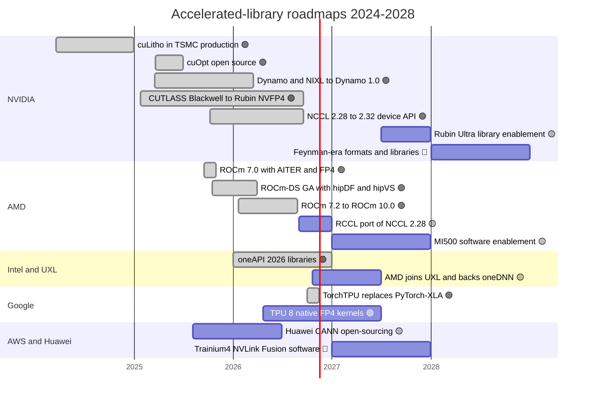
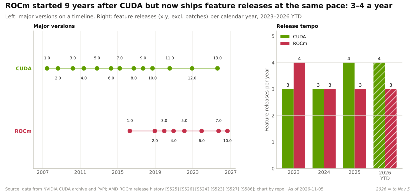

# Libraries (CUDA-X): Roadmap

Layer 10 · Libraries (CUDA-X) · ~9 min read · Last verified: 2026-11-05

## ⚡ The Executive Take

- **NVIDIA's library roadmap follows the silicon.** CUTLASS 4.8.0 and NCCL 2.32.3 both added initial Rubin support on 2026-09-17, about six weeks after Rubin production shipments began 🟢 [[S10010]](../../sources/bibliography.md#s10010)[[S10507]](../../sources/bibliography.md#s10507)[[S500]](../../sources/bibliography.md#s500).
- **NCCL is turning into an inference and MoE library:** a device API and copy-engine collectives (2.28, October 2025), [GPU-initiated networking](../../glossary.md#gpu-initiated-networking), an expert-parallel package (June 2026) and a Compute Fabric Transport (2.31, August 2026) 🟢 [[S10507]](../../sources/bibliography.md#s10507).
- **Serving software is productised:** Dynamo reached 1.0 at GTC 2026, and v1.5.1 (October 2026) was its first Enterprise Support release 🟢 [[S90066]](../../sources/bibliography.md#s90066)[[S521]](../../sources/bibliography.md#s521).
- **AMD ships as often as NVIDIA but follows:** ROCm 7.0 (September 2025) to ROCm 10.0 (August 2026), yet its RCCL still matched NCCL 2.27 when NCCL was at 2.29 🟢 [[S586]](../../sources/bibliography.md#s586)[[S10509]](../../sources/bibliography.md#s10509)[[S10506]](../../sources/bibliography.md#s10506).
- **Google is retiring PyTorch/XLA** for a native TorchTPU stack (open-sourced October 2026; repository archived 2026-11-15), and its eighth-generation TPUs run FP4 natively 🟢 [[S553]](../../sources/bibliography.md#s553)[[S595]](../../sources/bibliography.md#s595)[[S552]](../../sources/bibliography.md#s552).
- **[Q7 · Roadmap & what changes the picture]** The picture changes if ports reach near-zero lag or compilers make libraries optional; it holds if NVIDIA keeps day-one support for Rubin Ultra (2027) and Feynman (2028) 🟡 [[S507]](../../sources/bibliography.md#s507)[[S90004]](../../sources/bibliography.md#s90004).

## Roadmap 2024–2028

🟢 company-confirmed · 🟡 reported or timing uncertain · 🔴 repo inference. Bars are approximate windows. Sources per row in the table below; bars not in it: cuLitho in TSMC production [[S10031]](../../sources/bibliography.md#s10031), ROCm-DS GA [[S10511]](../../sources/bibliography.md#s10511).

| Item | Window | Status | Confidence | Source |
|---|---|---|---|---|
| CUTLASS 4.8 and NCCL 2.32: initial Rubin support | Sep 2026 | shipped | 🟢 | [[S10010]](../../sources/bibliography.md#s10010)[[S10507]](../../sources/bibliography.md#s10507) |
| CuTe DSL (Python) leaves public beta | targeted end of summer 2026; still beta in Oct 2026 | slipped | 🟡 | [[S10009]](../../sources/bibliography.md#s10009) |
| NCCL device API, GIN, copy-engine collectives | Oct 2025 – Aug 2026 | shipped | 🟢 | [[S10507]](../../sources/bibliography.md#s10507)[[S10007]](../../sources/bibliography.md#s10007) |
| Dynamo 1.0 to 1.5.1 (first Enterprise Support release) | Mar – Oct 2026 | shipped | 🟢 | [[S90066]](../../sources/bibliography.md#s90066)[[S521]](../../sources/bibliography.md#s521) |
| CUDA-Q with NVQLink (17 quantum builders) | from Oct 2025 | rolling out | 🟢 | [[S10519]](../../sources/bibliography.md#s10519) |
| Rubin Ultra library support | H2 2027 | planned; Kyber slip reported, NVIDIA denies | 🟡 | [[S507]](../../sources/bibliography.md#s507)[[S508]](../../sources/bibliography.md#s508) |
| Feynman-era formats | 2028 | roadmap | 🔴 | [[S90004]](../../sources/bibliography.md#s90004) |
| ROCm 10.0 Core SDK | Aug 2026 | shipped | 🟢 | [[S586]](../../sources/bibliography.md#s586) |
| RCCL matching NCCL 2.28.3 | listed for ROCm 7.11; not in the changelog as of 2026-11-05 | pending | 🟡 | [[S10509]](../../sources/bibliography.md#s10509) |
| AMD MI500 (2027) and MI600 (2028) software | 2027 – 2028 | chips on roadmap | 🟢 chips / 🔴 software | [[S538]](../../sources/bibliography.md#s538)[[S541]](../../sources/bibliography.md#s541) |
| AMD joins UXL; oneDNN as PyTorch x86 default | Oct 2026 | reported | 🟡 | [[S10542]](../../sources/bibliography.md#s10542) |
| TorchTPU replaces PyTorch/XLA | Oct – Nov 2026 | done | 🟢 | [[S553]](../../sources/bibliography.md#s553)[[S595]](../../sources/bibliography.md#s595) |
| Huawei CANN open source | from Aug 2025 | in progress | 🟡 | [[S10537]](../../sources/bibliography.md#s10537) |
| Trainium4 with NVLink Fusion | undated | announced | 🔴 timing | [[S90034]](../../sources/bibliography.md#s90034) |

> [!TIP]
> **Worked example — how fast "day one" really is.** Rubin's production shipments started in early August 2026 [[S500]](../../sources/bibliography.md#s500). Taking mid-August as the reference, CUTLASS and NCCL Rubin support arrived ~33 days later (2026-09-17) [[S10010]](../../sources/bibliography.md#s10010)[[S10507]](../../sources/bibliography.md#s10507). If Rubin Ultra ships in H2 2027 as planned, the same ~1-month gap would put its libraries in late 2027; a reported Kyber slip to 2028 would move both together [[S507]](../../sources/bibliography.md#s507).

## Spec progression: release velocity and the follower gap

NCCL moved from 2.13 (2022-07-11) to 2.32 (2026-09-17): 19 minor versions in ~50 months, one every ~2.6 months [[S10506]](../../sources/bibliography.md#s10506). Recent releases target inference and [mixture-of-experts](../../glossary.md#mixture-of-experts) traffic: GPU kernels that start network transfers themselves, copy-engine collectives that free compute units, elastic communicators and an expert-parallel package [[S10507]](../../sources/bibliography.md#s10507) (mechanics in [NCCL, the hidden glue](nccl-the-hidden-glue.md)). AMD now ships ROCm feature releases as often as NVIDIA ships CUDA's, 3–4 a year, but much of the content is a port of what NVIDIA shipped months earlier [[S586]](../../sources/bibliography.md#s586)[[S10509]](../../sources/bibliography.md#s10509).

> [!TIP]
> **Worked example — the follower gap in calendar time.** ROCm 7.2.0 (2026-01-21) still shipped RCCL matching NCCL 2.27.7, tagged 2025-07-24: 181 days earlier, while NCCL had already released 2.28 and 2.29 [[S10509]](../../sources/bibliography.md#s10509)[[S10506]](../../sources/bibliography.md#s10506)[[S586]](../../sources/bibliography.md#s586). With a 12-month GPU cycle, a 98-day lag (ROCm 7.1) leaves AMD customers without a new collective feature for ~27% of each cycle; a 30-day lag would cut that to ~8%.

🔧 Under the hood: what "initial Rubin support" contains

CUTLASS 4.8.0 targets Rubin as SM107 and adds FP8 and FP4 matrix paths plus a new UE5M3 scale-factor type (an unsigned 8-bit format with 5 exponent and 3 mantissa bits) for NVFP4 block scaling; 4.8.1 already lists known Rubin code-generation issues [[S10010]](../../sources/bibliography.md#s10010). NCCL 2.32.3 adds Rubin platform detection and ConnectX-9 rail and plane detection [[S10507]](../../sources/bibliography.md#s10507). "Initial" matters: tuned kernels for every model shape usually follow over several releases, which is why same-hardware software gains keep arriving after launch.

## What would change the picture

- 🟡 **Ports reach near-zero lag.** If AMD co-maintains upstream code (as RCCL already does with NCCL's licence and API), collectives stop differentiating [[S10002]](../../sources/bibliography.md#s10002).
- 🟡 **Compilers make libraries optional.** TorchTPU, Triton backends and Qualcomm's Modular acquisition (Mojo, MAX; closed 2026-07-29 [[S9511]](../../sources/bibliography.md#s9511)) push kernel choice into compilers [[S553]](../../sources/bibliography.md#s553)[[S578]](../../sources/bibliography.md#s578)[[S90057]](../../sources/bibliography.md#s90057).
- 🟡 **Data platforms adopt GPUs by default.** Snowflake ML already ships cuML and cuDF in its default GPU runtime; Databricks and AWS defaults would widen NVIDIA's non-AI pull-through [[S10521]](../../sources/bibliography.md#s10521)[[S10522]](../../sources/bibliography.md#s10522).
- 🔴 **A rival enters a domain NVIDIA alone covers** (lithography, optimization, genomics) with a partner such as an EDA vendor.
- 🟢 **NVIDIA keeps one-month day-one support** for Rubin Ultra and Feynman: the gap persists.

> [!TIP]
> **Worked example — how fast a compiler stack can switch.** Google open-sourced TorchTPU in October 2026 and will archive PyTorch/XLA on 2026-11-15, about six weeks later; vLLM and SGLang already list TorchTPU back ends [[S553]](../../sources/bibliography.md#s553)[[S595]](../../sources/bibliography.md#s595)[[S581]](../../sources/bibliography.md#s581)[[S582]](../../sources/bibliography.md#s582). A library port of comparable importance (RCCL) has needed 98–296 days per release since 2024 [[S10509]](../../sources/bibliography.md#s10509)[[S10506]](../../sources/bibliography.md#s10506). Compiler-first vendors change course in weeks; porters run months behind every release.

**[Q7 · Roadmap & what changes the picture]** Through 2028 NVIDIA's roadmap is tied to annual GPU launches and to inference-era features in NCCL and Dynamo; AMD is converging on cadence but not yet on timing. The biggest swing factor is whether compilers (XLA/TorchTPU, Triton, Mojo) take over the AI-critical kernels, which would shrink the moat to non-AI domains.

## 🎯 Corp Dev Lens

1. NCCL's 2025–26 features target MoE and inference traffic. Does that make collectives more, or less, important for an inference-first entrant?
2. ROCm releases as often as CUDA but trails by 1–4 NCCL versions. What would it cost to staff a zero-lag port, and is co-maintaining upstream an option?
3. Google retired PyTorch/XLA for TorchTPU within a year. How quickly can a compile-first stack (e.g. Modular's MAX) reach production on new silicon?
4. Which roadmap milestone (Rubin Ultra libraries, UXL adoption, CANN open-sourcing) would most change a build-versus-partner decision for libraries?

## 📚 Sources

<!-- Auto-generated from the [S…] citations on this page by `make build`. Edit sources/registry/*.csv, not this list. -->

- [**S500**](../../sources/bibliography.md#s500) NVIDIA Corporation, *NVIDIA Q2 Fiscal 2027 Quarterly Presentation (CFO commentary deck)*, 2026-08-26. [Link](https://s201.q4cdn.com/141608511/files/doc_financials/2027/Q227/NVDA-F2Q27-Quarterly-Presentation-final-1.pdf)
- [**S507**](../../sources/bibliography.md#s507) Tom's Hardware, *Nvidia's Kyber rack for Rubin Ultra slips to 2028*, 2026-07-06. [Link](https://www.tomshardware.com/pc-components/gpus/nvidias-kyber-rack-for-rubin-ultra-slips-to-2028)
- [**S508**](../../sources/bibliography.md#s508) Wccftech, *NVIDIA Quashes Rubin & Kyber Rack Delay Rumors, Says 'Chip Roadmap Is Intact'*, 2026-07. [Link](https://wccftech.com/nvidia-quashes-rubin-kyber-rack-delay-rumors-says-chip-roadmap-is-intact/)
- [**S521**](../../sources/bibliography.md#s521) NVIDIA Docs, *NVIDIA Dynamo release notes*, 2026-10. [Link](https://docs.nvidia.com/dynamo/zh-CN/latest/reference/releases)
- [**S538**](../../sources/bibliography.md#s538) AMD Investor Relations, *AAI 2026: AMD Delivers Full-Stack Compute for the Agentic AI Era*, 2026-07-23. [Link](https://ir.amd.com/news-events/press-releases/detail/1294/aai-2026-amd-delivers-full-stack-compute-for-the-agentic-ai-era)
- [**S541**](../../sources/bibliography.md#s541) PC Games Hardware, *CDNA 6 und CDNA Next: AMD kündigt Instinct MI500 für 2027 und MI600 für 2028 an*, 2026-07. [Link](https://www.pcgameshardware.de/Grafikkarten-Grafikkarte-97980/News/AMD-Instinct-MI500-MI600-Roadmap-CDNA-6-CDNA-Next-1549244/)
- [**S552**](../../sources/bibliography.md#s552) Google Cloud Blog (Karan Batta), *Bringing Google TPUs to Oracle Cloud Infrastructure*, 2026-10-27. [Link](https://cloud.google.com/blog/products/infrastructure/bringing-google-tpus-to-oracle-cloud-infrastructure)
- [**S553**](../../sources/bibliography.md#s553) Google Cloud Blog (Alex Barrett), *What's new in AI infrastructure and orchestration in October*, 2026-11. [Link](https://cloud.google.com/blog/topics/ai-infrastructure/whats-new-in-ai-infrastructure-this-month)
- [**S578**](../../sources/bibliography.md#s578) OpenAI Triton (GitHub), *Triton (triton-lang/triton) README — supported hardware*, 2026-11. [Link](https://github.com/triton-lang/triton/blob/main/README.md)
- [**S581**](../../sources/bibliography.md#s581) vLLM project (GitHub), *vLLM hardware plugin repositories (tpu-inference/vLLM JAX, vllm-gaudi, vllm-ascend, vllm-neuron)*, 2026-11. [Link](https://github.com/vllm-project)
- [**S582**](../../sources/bibliography.md#s582) SGLang project (GitHub: sgl-project/sglang), *SGLang README — supported hardware*, 2026-11. [Link](https://github.com/sgl-project/sglang/blob/main/README.md)
- [**S586**](../../sources/bibliography.md#s586) AMD (GitHub: ROCm/ROCm docs), *ROCm documentation sources: release history, AI-ecosystem compatibility matrix, consolidated changelog*, 2026-08-26. [Link](https://github.com/ROCm/ROCm/blob/develop/docs/release/versions.rst)
- [**S595**](../../sources/bibliography.md#s595) PyTorch (GitHub: pytorch/xla), *PyTorch/XLA README (deprecation notice)*, 2026-11. [Link](https://github.com/pytorch/xla/blob/master/README.md)
- [**S9511**](../../sources/bibliography.md#s9511) Nasdaq (Qualcomm press release), *Qualcomm Completes Acquisition of Modular*, 2026-07-29. [Link](https://www.nasdaq.com/press-release/qualcomm-completes-acquisition-modular-2026-07-29)
- [**S10002**](../../sources/bibliography.md#s10002) AMD (GitHub: ROCm/rccl), *RCCL README and LICENSE (develop branch)*, 2026-11. [Link](https://github.com/ROCm/rccl/blob/develop/README.md)
- [**S10007**](../../sources/bibliography.md#s10007) arXiv:2511.15076 (NVIDIA authors), *GPU-Initiated Networking for NCCL*, 2025-11. [Link](https://arxiv.org/abs/2511.15076)
- [**S10009**](../../sources/bibliography.md#s10009) NVIDIA (GitHub: NVIDIA/cutlass), *CUTLASS README (4.8.1)*, 2026-10. [Link](https://github.com/NVIDIA/cutlass/blob/main/README.md)
- [**S10010**](../../sources/bibliography.md#s10010) NVIDIA (GitHub: NVIDIA/cutlass), *CUTLASS CHANGELOG*, 2026-10-15. [Link](https://github.com/NVIDIA/cutlass/blob/main/CHANGELOG.md)
- [**S10031**](../../sources/bibliography.md#s10031) NVIDIA Newsroom, *TSMC and Synopsys Bring Breakthrough NVIDIA Computational Lithography Platform to Production*, 2024-03-18. [Link](https://nvidianews.nvidia.com/news/tsmc-synopsys-nvidia-culitho)
- [**S10506**](../../sources/bibliography.md#s10506) GitHub (NVIDIA), *NVIDIA/nccl tags*, 2026-09-17. [Link](https://github.com/NVIDIA/nccl/tags)
- [**S10507**](../../sources/bibliography.md#s10507) GitHub (NVIDIA), *NVIDIA/nccl releases (release notes v2.28.3 to v2.32.3)*, 2026-09-17. [Link](https://github.com/NVIDIA/nccl/releases)
- [**S10509**](../../sources/bibliography.md#s10509) GitHub (ROCm/rccl), *RCCL CHANGELOG*, 2026. [Link](https://github.com/ROCm/rccl/blob/develop/CHANGELOG.md)
- [**S10511**](../../sources/bibliography.md#s10511) AMD ROCm Documentation, *ROCm-DS 25.10 release notes*, 2025-10. [Link](https://rocm.docs.amd.com/projects/rocm-ds/en/latest/about/release-notes.html)
- [**S10519**](../../sources/bibliography.md#s10519) NVIDIA Newsroom, *NVIDIA Introduces NVQLink — Connecting Quantum and GPU Computing for 17 Quantum Builders and Nine Scientific Labs*, 2025-10-28. [Link](https://nvidianews.nvidia.com/news/nvidia-nvqlink-quantum-gpu-computing)
- [**S10521**](../../sources/bibliography.md#s10521) Snowflake via Business Wire, *Snowflake Supercharges Machine Learning for Enterprises with Native Integration of NVIDIA CUDA-X Libraries*, 2025-11-18. [Link](https://www.businesswire.com/news/home/20251118211131/en/Snowflake-Supercharges-Machine-Learning-for-Enterprises-with-Native-Integration-of-NVIDIA-CUDA-X-Libraries)
- [**S10522**](../../sources/bibliography.md#s10522) NVIDIA Blog, *Every Company's Data Is Their 'Gold Mine,' NVIDIA CEO Says at Databricks Data + AI Summit*, 2024-06. [Link](https://blogs.nvidia.com/?p=72122)
- [**S10537**](../../sources/bibliography.md#s10537) TrendForce, *Huawei Open-Sources CANN Toolkit for Ascend AI GPUs, Taking Aim at NVIDIA's CUDA*, 2025-08-07. [Link](https://www.trendforce.com/news/2025/08/07/news-huawei-open-sources-cann-toolkit-for-ascend-ai-gpus-taking-aim-at-nvidias-cuda/)
- [**S10542**](../../sources/bibliography.md#s10542) Crypto Briefing, *AMD joins UXL Foundation as steering member, backs oneDNN for PyTorch*, 2026-10-20. [Link](https://cryptobriefing.com/amd-joins-uxl-foundation-onednn-pytorch/)
- [**S90004**](../../sources/bibliography.md#s90004) TrendForce, *Key GTC takeaways: how Samsung, Micron, Intel and more power NVIDIA's Vera Rubin and Feynman*, 2026-03-17. [Link](https://www.trendforce.com/news/2026/03/17/news-key-gtc-takeaways-how-samsung-micron-intel-more-power-nvidias-vera-rubin-and-feynman/)
- [**S90034**](../../sources/bibliography.md#s90034) NAND Research, *AWS releases Trainium3, teases Trainium4*, 2025-12. [Link](https://nand-research.com/research-note-aws-releases-trainium3-teases-trainium4/4/)
- [**S90057**](../../sources/bibliography.md#s90057) StorageReview, *Qualcomm unveils Dragonfly data center roadmap: C1000 CPU, AI300 accelerator and Modular acquisition*, 2026-06-24. [Link](https://www.storagereview.com/es/news/qualcomm-unveils-dragonfly-data-center-roadmap-c1000-cpu-ai300-accelerator-and-modular-acquisition)
- [**S90066**](../../sources/bibliography.md#s90066) HPCwire (NVIDIA press release), *NVIDIA enters production with Dynamo, the broadly adopted inference operating system for AI factories*, 2026-03-17. [Link](https://www.hpcwire.com/aiwire/tag/dynamo-1-0/)
