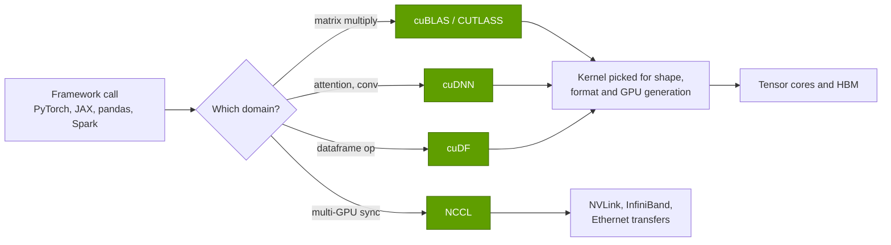
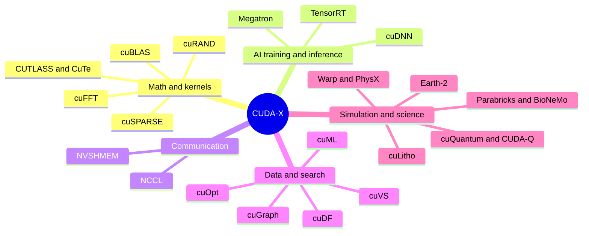

# The CUDA-X catalog: what each library does

Layer 10 · Libraries (CUDA-X) · ~12 min read · Last verified: 2026-11-05

## ⚡ The Executive Take

- **CUDA-X is a catalog of pre-tuned engines,** each packaging years of GPU tuning for one domain. NVIDIA cites "hundreds" [[S10047]](../../sources/bibliography.md#s10047); about 20 carry most of the commercial weight, and they are listed below.
- **The AI core is small and mostly closed.** [cuBLAS](../../glossary.md#cublas) (matrix math) and [cuDNN](../../glossary.md#cudnn) (neural-network layers) ship under proprietary licences [[S10038]](../../sources/bibliography.md#s10038). [CUTLASS](../../glossary.md#cutlass), the open template kit for custom kernels, gained a Python DSL in version 4.0 (June 2025) [[S10010]](../../sources/bibliography.md#s10010).
- **Library quality is money.** Lifting a 70B training run from 41% to 52% of peak FLOPS (Meta's Llama 3 vs NVIDIA's Megatron benchmark) [[S34006]](../../sources/bibliography.md#s34006)[[S34002]](../../sources/bibliography.md#s34002), saves ~0.4M B200-hours on a 15T-token run.
- **The newer libraries serve customers outside AI.** TSMC runs [cuLitho](../../glossary.md#culitho) in production [[S10031]](../../sources/bibliography.md#s10031). A peer-reviewed study measured [Parabricks](../../glossary.md#parabricks) germline calling up to 65× faster than CPU [[S10033]](../../sources/bibliography.md#s10033).
- **Speed-ups vary, and the largest come from NVIDIA's own tests.** NVIDIA's cudf.pandas test shows ~150× [[S10014]](../../sources/bibliography.md#s10014); an independent re-test found 50–70× [[S10046]](../../sources/bibliography.md#s10046). cuML's zero-code-change mode has a ~5.8× median, and a low-rank PCA runs 2× *slower* [[S10015]](../../sources/bibliography.md#s10015).
- **Licensing is moving toward open source at the edges.** cuDF, cuOpt and Warp are now Apache 2.0 [[S10011]](../../sources/bibliography.md#s10011)[[S10026]](../../sources/bibliography.md#s10026)[[S10028]](../../sources/bibliography.md#s10028), while the hardest-won tuning stays closed and NVIDIA-only.

![Horizontal log-scale bar chart of published runtime speedups for CUDA-X libraries, colored by who ran the test. NVIDIA or NVIDIA-partner figures: cudf.pandas about 150x, cuLitho 45x, Polars GPU engine up to 13x, cuml.accel 5.8x median and 0.48x (slower) for a low-rank PCA. Third-party, customer or peer-reviewed figures: Parabricks germline calling up to 65x (BMC Bioinformatics) and 24x (Terra), an independent cudf.pandas re-test ~60x, FINRA Spark 14x, cuVS CAGRA index build 12.3x vs CPU HNSW (Meta), cuVS IVF 4.7x vs older GPU code, and an AWS Spark TPC-DS-derived run at 1.06x vs native Spark and 0.63x vs Velox.](../../assets/charts/10-published-library-speedups.svg)

## How a library sits between the framework and the silicon

**Analogy.** CUDA ([layer 09](../09-cuda-and-system-software/index.md)) is a machine shop where anyone can cut parts from raw steel; CUDA-X is the catalog of pre-machined parts. A PyTorch user multiplying two matrices never writes GPU code: PyTorch calls cuBLAS, which picks from hundreds of hand-tuned [GPU kernels](../../glossary.md#gpu-kernel) the one that best fits this matrix shape, number format and GPU generation. The same pattern repeats for convolutions and attention (cuDNN), communication (NCCL) and inference engines (TensorRT).

**[Q1 · Job & failure mode]** The library layer's job is to close the gap between peak and delivered performance. When it is weak, hardware sits idle (a GPU whose kernels reach half of peak is, economically, half a GPU) and new features stay dark: low-precision formats, sparsity and in-switch reduction pay off only once a library uses them.

> [!TIP]
> **Worked example — what 11 points of efficiency are worth.** A Llama-3-style 70B model trained on 15T tokens needs about 6 × 70B × 15T ≈ 6.3 × 10²⁴ FLOPs. A B200 peaks at 2,250 dense BF16 TFLOPS [[S33003]](../../sources/bibliography.md#s33003). At the 41% of peak ([MFU](../../glossary.md#mfu)) Meta reported for Llama 3 405B [[S34006]](../../sources/bibliography.md#s34006), each GPU delivers ~920 TFLOPS and the run takes ~1.9M B200-hours. At the 52% NVIDIA reported for its Megatron 1T benchmark [[S34002]](../../sources/bibliography.md#s34002), it takes ~1.5M. **Conclusion:** the ~0.4M GPU-hours saved are worth ~$2M at an illustrative $5 per GPU-hour [[S395]](../../sources/bibliography.md#s395). Parallelism choices explain part of the gap; tuned kernels and collectives explain most of the rest.

## The catalog at a glance

| Library | What it does, in one analogy | Who uses it · why it matters commercially |
|---|---|---|
| **cuBLAS** (2007) | The GPU's calculator for matrix multiplication ([GEMM](../../glossary.md#gemm)), the arithmetic inside every transformer | Every AI framework; proprietary [[S10038]](../../sources/bibliography.md#s10038) |
| **cuDNN** (2014) | A cookbook of neural-network layers (convolution, attention, normalization) [[S10039]](../../sources/bibliography.md#s10039) | PyTorch, TensorFlow, JAX; tuned for each generation's tensor cores |
| **CUTLASS / CuTe** (2017; DSL 2025) | A kit of interchangeable parts for building your own matrix kernels; CuTe describes how data is tiled | Labs writing custom kernels; the [CuTe](../../glossary.md#cute) DSL brings this to Python; 🟡 still beta in October 2026, past its end-of-summer exit target [[S10009]](../../sources/bibliography.md#s10009) |
| **[cuSPARSE](../../glossary.md#cusparse)** (2010) | Matrix math that skips the zeros | Simulation, graph analytics, recommendation models |
| **[cuFFT](../../glossary.md#cufft)** (2007) | Splits a signal into its frequencies | Imaging, seismic, radar, 5G/6G signal processing |
| **[cuRAND](../../glossary.md#curand)** (2010) | A fast dice-roller | Monte Carlo risk models in finance, physics simulation |
| **NCCL** (2015) | The switchboard that keeps every GPU's copy of a model in sync | Every multi-GPU job; see [NCCL, the hidden glue](nccl-the-hidden-glue.md) |
| **TensorRT** (2016) | A compiler that shrink-wraps a trained model for one GPU; now at version 11 [[S10045]](../../sources/bibliography.md#s10045) | Inference serving ([layer 11](../11-inference-and-ai-software/index.md)) |
| **[cuDF](../../glossary.md#cudf) / RAPIDS** (2018) | pandas on a GPU; also the engine under Spark, Polars and Dask back ends [[S10011]](../../sources/bibliography.md#s10011) | Data engineering and [ETL](../../glossary.md#etl) |
| **[cuML](../../glossary.md#cuml)** (2018) | scikit-learn on a GPU, now runnable without code changes [[S10015]](../../sources/bibliography.md#s10015) | Fraud, churn and forecasting models; data-science teams |
| **[cuGraph](../../glossary.md#cugraph)** (2019) | Map navigation for networks with billions of links | Fraud rings, cybersecurity, supply-chain graphs |
| **[cuOpt](../../glossary.md#cuopt)** (open source 2025) | A dispatcher for routing and [linear programs](../../glossary.md#linear-programming); MIP in beta [[S10026]](../../sources/bibliography.md#s10026) | Logistics and planning; Apache 2.0 and hosted with COIN-OR [[S10027]](../../sources/bibliography.md#s10027) |
| **[cuQuantum](../../glossary.md#cuquantum) / [CUDA-Q](../../glossary.md#cuda-q)** (2022–23) | A flight simulator for quantum computers; CUDA-Q programs QPUs, GPUs and CPUs together [[S10030]](../../sources/bibliography.md#s10030) | Quantum-hardware start-ups and labs |
| **cuLitho** (2023) | Pre-distorts chip masks so patterns print correctly ([computational lithography](../../glossary.md#computational-lithography)) | TSMC and Synopsys in production since 2024 [[S10031]](../../sources/bibliography.md#s10031); a GPU sale into NVIDIA's own supply chain |
| **[NVIDIA Warp](../../glossary.md#nvidia-warp)** (2022) | Writes physics simulations in plain Python and compiles them to GPU kernels [[S10028]](../../sources/bibliography.md#s10028) | Robotics and simulation researchers; Apache 2.0 since 2025 |
| **Parabricks** (Clara) | Runs standard genome pipelines ([variant calling](../../glossary.md#variant-calling)) in minutes instead of hours [[S10033]](../../sources/bibliography.md#s10033) | Sequencing labs, hospitals, pharma |
| **[BioNeMo](../../glossary.md#bionemo)** | Training recipes and checkpoints for protein and DNA models [[S10037]](../../sources/bibliography.md#s10037) | Drug-discovery teams fine-tuning biology foundation models |
| **[Earth-2](../../glossary.md#earth-2)** | A weather lab in a Python package (Earth2Studio) [[S10036]](../../sources/bibliography.md#s10036) | Weather agencies, insurers, energy traders |
| **[Omniverse](../../glossary.md#omniverse) / [PhysX](../../glossary.md#physx)** (PhysX 2008) | A shared 3D world with real physics; PhysX is open source [[S10035]](../../sources/bibliography.md#s10035) | Factory and robot digital twins; DSX blueprint for AI data centers [[S90063]](../../sources/bibliography.md#s90063) |
| **cuVS** (2024) | A librarian that finds the nearest meaning among billions of [embeddings](../../glossary.md#vector-search) | Vector databases (Faiss, Milvus) behind RAG and recommendations [[S10025]](../../sources/bibliography.md#s10025) |

*Years are the first verifiable public release in `data/l10_library_timeline.csv`; see that file for sources and caveats.*

## The AI core: math, kernels and inference

Four libraries carry almost all AI arithmetic: cuBLAS and cuDNN hold the general kernels, TensorRT assembles them into an engine, and CUTLASS is how NVIDIA and outsiders build kernels that do not exist yet. They decide how fast customers can use each new number format. CUTLASS today covers FP64 down to block-scaled NVFP4, MXFP4, MXFP6 and MXFP8 from Volta to Blackwell [[S10009]](../../sources/bibliography.md#s10009).

> [!TIP]
> **Worked example — why a new number format is worth nothing until the libraries catch up.** A Rubin GPU is listed at 35 PFLOPS dense FP4 versus 4 PFLOPS dense BF16 [[S100]](../../sources/bibliography.md#s100), a factor of 8.75. A model served in BF16 uses 4 PFLOPS of that silicon. Only after cuBLAS, CUTLASS and TensorRT ship FP4 kernels, and the model is quantized without losing accuracy, does the other 31 PFLOPS become usable. **Conclusion:** at the format level, the library is the gate between data-sheet compute and revenue. See [number formats](../02-gpu-silicon/number-formats-and-precision.md).

Kernels also have to be rewritten for each generation. FlashAttention-2 reached 50–73% of an A100's peak but only 35% of an H100's, until the Hopper-specific FlashAttention-3 reached 75% [[S9002]](../../sources/bibliography.md#s9002)[[S9003]](../../sources/bibliography.md#s9003). FlashAttention-4, written in CuTe DSL for Blackwell, reaches 71% of B200 BF16 peak, up to 1.3× faster than NVIDIA's cuDNN 9.13 and 2.7× faster than Triton [[S9004]](../../sources/bibliography.md#s9004). The fastest attention kernel on NVIDIA's flagship came from outside NVIDIA's library team, built with NVIDIA's tools.

🔧 Under the hood: how a kernel library chooses what to run

A GEMM call carries a shape (M, N, K), data types and memory layouts. cuBLAS keeps many pre-compiled kernels per GPU architecture (different tile sizes, pipeline depths and work splits across SMs), and a heuristic or autotuning pass picks one. Follow-on operations (bias, activation, scaling) can be fused into the kernel's epilogue so results never round-trip through HBM. CUTLASS exposes the same building blocks as templates, and CuTe's layout algebra describes which thread owns which element of a tile. The CUTLASS 4 Python DSL drops the C++ templates and promises far faster compiles [[S10009]](../../sources/bibliography.md#s10009). Rival kernel languages (OpenAI's [Triton](../../glossary.md#triton), Modular's [Mojo](../../glossary.md#mojo)) target the same job portably.

## Beyond AI: data, simulation and science

Most libraries launched since 2018 target workloads that ran on CPUs. The method is always the same: find the hot loop that eats most of the CPU time, rebuild it as a parallel GPU kernel, and keep the interface users already know. Data loading is the classic example inside AI itself. NVIDIA's [DALI](../../glossary.md#dali) library moved JPEG decoding onto the GPUs of a DGX-2 and raised ResNet-50 training from 56% to 93% of the GPUs' ceiling [[S4017]](../../sources/bibliography.md#s4017):

> [!TIP]
> **Worked example — cuLitho's server arithmetic.** At its 2023 launch NVIDIA claimed 500 DGX H100 systems could do the lithography work of 40,000 CPU systems [[S10032]](../../sources/bibliography.md#s10032); by the 2024 production announcement the figure was 350 [[S10031]](../../sources/bibliography.md#s10031). That is ~114 CPU systems replaced per GPU system. **Conclusion:** cuLitho turns NVIDIA into a supplier to its own supplier, and TSMC's adoption [[S10031]](../../sources/bibliography.md#s10031) makes it a reference for every other fab.

> [!WARNING]
> **Myth vs. reality: "GPU libraries make everything 10–100× faster."** The large figures are vendor tests of compute-heavy kernels; independent results are smaller and sometimes negative. cuml.accel's low-rank PCA runs at 0.48× because data movement outweighs the math [[S10015]](../../sources/bibliography.md#s10015). GPU somatic variant callers in the BMC study cost *more* on cloud than CPU runs [[S10033]](../../sources/bibliography.md#s10033). Polars' own documentation says I/O-bound queries run about the same on GPU and CPU [[S10017]](../../sources/bibliography.md#s10017).

## 🎯 Corp Dev Lens

1. **Which families are defensible?** The proprietary AI core (cuBLAS, cuDNN, TensorRT) is what every rival targets first; the long tail (cuLitho, Parabricks, cuOpt, Earth-2) is less contested but serves smaller markets.
2. **Supplier-customer loops.** cuLitho at TSMC and Synopsys [[S10031]](../../sources/bibliography.md#s10031) embeds NVIDIA GPUs in the fab and EDA flow. Are there similar loops in other supply chains (EDA simulation, telecom signal processing) that a rival could seed first?
3. **Open-sourcing as a land grab.** cuOpt joined COIN-OR under Apache 2.0 [[S10027]](../../sources/bibliography.md#s10027) and Warp relicensed to Apache 2.0 [[S10028]](../../sources/bibliography.md#s10028). Could a rival fork these projects for its own hardware, or would it fall behind NVIDIA's release pace?

## 📚 Sources

<!-- Auto-generated from the [S…] citations on this page by `make build`. Edit sources/registry/*.csv, not this list. -->

- [**S100**](../../sources/bibliography.md#s100) NVIDIA Technical Blog, *Inside the NVIDIA Vera Rubin Platform: Six New Chips, One AI Supercomputer*, 2026-01-05. [Link](https://developer.nvidia.com/blog/inside-the-nvidia-rubin-platform-six-new-chips-one-ai-supercomputer/)
- [**S395**](../../sources/bibliography.md#s395) Lambda, *Lambda GPU cloud pricing*, 2025. [Link](https://lambda.ai/pricing)
- [**S4017**](../../sources/bibliography.md#s4017) NVIDIA Technical Blog, *Case Study: ResNet50 with DALI*, 2019. [Link](https://developer.nvidia.com/blog/case-study-resnet50-dali/)
- [**S9002**](../../sources/bibliography.md#s9002) arXiv:2307.08691 (ICLR 2024) (Tri Dao), *FlashAttention-2: Faster Attention with Better Parallelism and Work Partitioning*, 2023-07-17. [Link](https://arxiv.org/abs/2307.08691)
- [**S9003**](../../sources/bibliography.md#s9003) arXiv:2407.08608 (NeurIPS 2024) (Jay Shah, Ganesh Bikshandi, Ying Zhang, Vijay Thakkar, Pradeep Ramani, Tri Dao), *FlashAttention-3: Fast and Accurate Attention with Asynchrony and Low-precision*, 2024-07-11. [Link](https://arxiv.org/abs/2407.08608)
- [**S9004**](../../sources/bibliography.md#s9004) arXiv:2603.05451 (Zadouri, Hoehnerbach, Shah, Liu, Thakkar, Dao), *FlashAttention-4: Algorithm and Kernel Pipelining Co-Design for Asymmetric Hardware Scaling*, 2026-03. [Link](https://arxiv.org/abs/2603.05451)
- [**S10009**](../../sources/bibliography.md#s10009) NVIDIA (GitHub: NVIDIA/cutlass), *CUTLASS README (4.8.1)*, 2026-10. [Link](https://github.com/NVIDIA/cutlass/blob/main/README.md)
- [**S10010**](../../sources/bibliography.md#s10010) NVIDIA (GitHub: NVIDIA/cutlass), *CUTLASS CHANGELOG*, 2026-10-15. [Link](https://github.com/NVIDIA/cutlass/blob/main/CHANGELOG.md)
- [**S10011**](../../sources/bibliography.md#s10011) NVIDIA RAPIDS (GitHub: rapidsai/cudf), *cuDF README*, 2026-11. [Link](https://github.com/rapidsai/cudf/blob/main/README.md)
- [**S10014**](../../sources/bibliography.md#s10014) NVIDIA Technical Blog, *RAPIDS cuDF Accelerates pandas Nearly 150x with Zero Code Changes*, 2023-11. [Link](https://developer.nvidia.com/blog/rapids-cudf-accelerates-pandas-nearly-150x-with-zero-code-changes/)
- [**S10015**](../../sources/bibliography.md#s10015) NVIDIA RAPIDS (GitHub: rapidsai/cuml docs), *cuml.accel overview and benchmarks*, 2026. [Link](https://github.com/rapidsai/cuml/blob/main/docs/source/cuml-accel/benchmarks.rst)
- [**S10017**](../../sources/bibliography.md#s10017) Polars (GitHub: pola-rs/polars docs), *Polars user guide: GPU Support [Open Beta]*, 2026-11. [Link](https://github.com/pola-rs/polars/blob/main/docs/source/user-guide/gpu-support.md)
- [**S10025**](../../sources/bibliography.md#s10025) Engineering at Meta, *Accelerating GPU indexes in Faiss with NVIDIA cuVS*, 2025-05-08. [Link](https://engineering.fb.com/2025/05/08/data-infrastructure/accelerating-gpu-indexes-in-faiss-with-nvidia-cuvs/)
- [**S10026**](../../sources/bibliography.md#s10026) NVIDIA (GitHub: NVIDIA/cuopt), *cuOpt README and LICENSE*, 2026-11. [Link](https://github.com/NVIDIA/cuopt/blob/main/README.md)
- [**S10027**](../../sources/bibliography.md#s10027) It's FOSS News, *NVIDIA cuOpt goes open source (with COIN-OR)*, 2025-03-19. [Link](https://news.itsfoss.com/nvidia-cuopt-open-source/)
- [**S10028**](../../sources/bibliography.md#s10028) NVIDIA (GitHub: NVIDIA/warp), *NVIDIA Warp README and CHANGELOG*, 2026-11-02. [Link](https://github.com/NVIDIA/warp/blob/main/CHANGELOG.md)
- [**S10030**](../../sources/bibliography.md#s10030) NVIDIA (GitHub: NVIDIA/cuda-quantum), *CUDA-Q repository README*, 2026-11. [Link](https://github.com/NVIDIA/cuda-quantum/blob/main/README.md)
- [**S10031**](../../sources/bibliography.md#s10031) NVIDIA Newsroom, *TSMC and Synopsys Bring Breakthrough NVIDIA Computational Lithography Platform to Production*, 2024-03-18. [Link](https://nvidianews.nvidia.com/news/tsmc-synopsys-nvidia-culitho)
- [**S10032**](../../sources/bibliography.md#s10032) AnandTech, *NVIDIA's 'cuLitho' Computational Lithography Adopted By TSMC and Synopsys For Production Use*, 2024-03-18. [Link](https://www.anandtech.com/show/21309/nvidias-culitho-gains-support-from-tsmc-and-synopsys)
- [**S10033**](../../sources/bibliography.md#s10033) BMC Bioinformatics (PMC open access), *Accelerating genomic workflows using NVIDIA Parabricks*, 2023-05. [Link](https://www.ncbi.nlm.nih.gov/pmc/articles/PMC10230726/)
- [**S10035**](../../sources/bibliography.md#s10035) NVIDIA (GitHub: NVIDIA-Omniverse/PhysX), *NVIDIA PhysX SDK README*, 2025. [Link](https://github.com/NVIDIA-Omniverse/PhysX/blob/main/README.md)
- [**S10036**](../../sources/bibliography.md#s10036) NVIDIA (GitHub: NVIDIA/earth2studio), *NVIDIA Earth2Studio README*, 2026-11. [Link](https://github.com/NVIDIA/earth2studio/blob/main/README.md)
- [**S10037**](../../sources/bibliography.md#s10037) NVIDIA (GitHub: NVIDIA/bionemo-framework), *BioNeMo Recipes README (bionemo-framework)*, 2026-11. [Link](https://github.com/NVIDIA/bionemo-framework/blob/main/README.md)
- [**S10038**](../../sources/bibliography.md#s10038) Python Package Index, *PyPI JSON release histories for NVIDIA library packages (nvidia-nccl-cu11/cu12/cu13, cudf-cu12, cudf-polars-cu12, cuml-cu12, cugraph-cu12, cuvs-cu12, warp-lang, cuquantum-python, cuda-quantum, cudaq, cuopt-cu12, nvidia-cutlass-dsl, earth2studio, nvmath-python, cuequivariance, nvidia-cudss-cu12, nvidia-modulus, nvidia-physicsnemo)*, 2026-11-05. [Link](https://pypi.org/)
- [**S10039**](../../sources/bibliography.md#s10039) arXiv:1410.0759 (Sharan Chetlur, Cliff Woolley, Philippe Vandermersch et al. (NVIDIA)), *cuDNN: Efficient Primitives for Deep Learning*, 2014-10. [Link](https://arxiv.org/abs/1410.0759)
- [**S10045**](../../sources/bibliography.md#s10045) NVIDIA (GitHub: NVIDIA/TensorRT), *TensorRT Open Source Software README and CHANGELOG*, 2026-11. [Link](https://github.com/NVIDIA/TensorRT/blob/main/README.md)
- [**S10046**](../../sources/bibliography.md#s10046) Daily Dose of Data Science, *NVIDIA's latest update can make your pandas workflow 150x faster*, 2023-11. [Link](https://blog.dailydoseofds.com/p/nvidias-latest-update-can-make-your)
- [**S10047**](../../sources/bibliography.md#s10047) NVIDIA Developer, *NVIDIA CUDA-X Libraries (developer page)*, 2026. [Link](https://developer.nvidia.com/cuda/cuda-x-libraries)
- [**S33003**](../../sources/bibliography.md#s33003) Lenovo Press, *ThinkSystem NVIDIA B200 180GB 1000W GPU product guide*, 2025. [Link](https://lenovopress.lenovo.com/lp2226-thinksystem-nvidia-b200-180gb-1000w-gpu)
- [**S34002**](../../sources/bibliography.md#s34002) arXiv:2104.04473 (SC21) (Deepak Narayanan, Mohammad Shoeybi, Jared Casper et al. (NVIDIA; Stanford; Microsoft)), *Efficient Large-Scale Language Model Training on GPU Clusters Using Megatron-LM*, 2021-04-09. [Link](https://arxiv.org/abs/2104.04473)
- [**S34006**](../../sources/bibliography.md#s34006) arXiv:2407.21783 (Llama Team (AI @ Meta)), *The Llama 3 Herd of Models*, 2024-07-31. [Link](https://arxiv.org/abs/2407.21783)
- [**S90063**](../../sources/bibliography.md#s90063) Converge Digest, *The megawatt shift: NVIDIA's 800 VDC strategy*, 2026. [Link](https://convergedigest.com/the-megawatt-shift-nvidias-800-vdc-strategy/)
