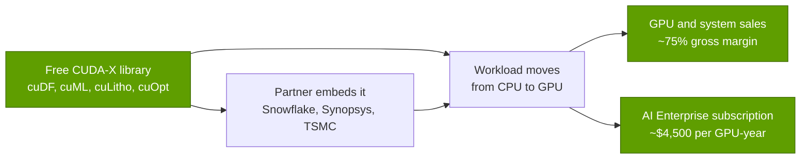

# Libraries (CUDA-X): Value chain and corp dev angles

Layer 10 · Libraries (CUDA-X) · ~10 min read · Last verified: 2026-11-05

## ⚡ The Executive Take

- **Libraries are a free product that sells hardware.** NVIDIA's paid layer, [NVIDIA AI Enterprise](../../glossary.md#nvidia-ai-enterprise), listed at ~$4,500 per GPU per year in 2024 [[S10526]](../../sources/bibliography.md#s10526); everything else earns through [hardware pull-through](../../glossary.md#pull-through).
- **Direct software revenue is small:** a ~$1B run rate in early 2024, guided toward ~$2B by the end of 2024, about 1.5% of FY2025 revenue of $130.5B; no newer figure was found [[S10525]](../../sources/bibliography.md#s10525)[[S10527]](../../sources/bibliography.md#s10527)[[S2]](../../sources/bibliography.md#s2).
- **Pull-through outside AI is real but early:** Snowflake ML ships cuML and cuDF by default (November 2025), Databricks announced GPU work on Photon (2024), and TSMC runs cuLitho in production [[S10521]](../../sources/bibliography.md#s10521)[[S10522]](../../sources/bibliography.md#s10522)[[S10031]](../../sources/bibliography.md#s10031).
- **EDA and simulation are consolidating around GPUs:** Synopsys closed its $35B Ansys deal in July 2025 and NVIDIA bought a $2B Synopsys stake in December 2025 [[S10524]](../../sources/bibliography.md#s10524)[[S471]](../../sources/bibliography.md#s471).
- **Bear evidence:** GPUs often make analytics cheaper rather than faster. In an AWS 1 TB Spark test the GPU run was 1.06× faster but ~80% cheaper; an NVIDIA Databricks case found RAPIDS only ~6% cheaper than Photon [[S10020]](../../sources/bibliography.md#s10020)[[S10523]](../../sources/bibliography.md#s10523).
- **M&A:** of 12 chip-vendor software acquisitions since 2022 sampled here, 6 have public prices, led by Qualcomm's announced $3.9B Modular deal, ~5.6× NVIDIA's ~$0.7B Run:ai [[S90057]](../../sources/bibliography.md#s90057)[[S476]](../../sources/bibliography.md#s476)[[S10531]](../../sources/bibliography.md#s10531).
- **[Q8 · Value pools & M&A angles]** Hardware pull-through in analytics, EDA, quantum and engineering simulation; NVIDIA invests in, rather than buys, the private companies there (PhysicsX, Quantinuum, PsiQuantum) [[S10564]](../../sources/bibliography.md#s10564)[[S10566]](../../sources/bibliography.md#s10566).

![Log-scale horizontal bar chart of a sample of library, AI-software and tools deals by chip vendors: 13 acquisitions since 2022, 7 with public prices. NVIDIA's pending $12,930M Hugging Face acquisition (announced Sep 2026, close targeted H1 2027) is the largest. Qualcomm's announced $3,900M Modular acquisition (2026) is ~5.6x the largest earlier one, NVIDIA's $700M Run:ai (2024, reported); then $400M CentML, $300M Deci, $250M OctoAI and $88M mental images; AMD's $665M Silo AI (2024); NVIDIA's $2,000M Synopsys equity stake (2025, not an acquisition). AMD's Mipsology, Nod.ai and Brium, Intel's Codeplay and NVIDIA's Ageia, PGI, Bright Computing and Excelero were undisclosed.](../../assets/charts/10-software-deal-values.svg)

## Who captures the dollars

A library is like a free power adapter that only fits one brand of appliance: it earns nothing itself, but it decides which appliance the customer buys. NVIDIA's dollars arrive as GPU and system revenue at a ~75% GAAP gross margin (Q2 FY2027), plus a thin layer of subscriptions [[S3]](../../sources/bibliography.md#s3)[[S90013]](../../sources/bibliography.md#s90013).

| Tier | Examples | Price | How NVIDIA earns | Source |
|---|---|---|---|---|
| Open source | NCCL (Apache 2.0), cuOpt (Apache 2.0), CUTLASS (BSD-3), Warp (Apache 2.0) | $0 | Pull-through; ecosystem | [[S10507]](../../sources/bibliography.md#s10507)[[S10026]](../../sources/bibliography.md#s10026)[[S10038]](../../sources/bibliography.md#s10038)[[S10028]](../../sources/bibliography.md#s10028) |
| Free, proprietary binaries | cuBLAS, cuDNN | $0 | Pull-through; best kernels stay on NVIDIA | [[S10038]](../../sources/bibliography.md#s10038) |
| Subscription | NVIDIA AI Enterprise (support, certified builds) | ~$4,500 per GPU per year (2024) | Software revenue | [[S10526]](../../sources/bibliography.md#s10526) |

| Disclosure | Software, SaaS and support run rate | Source |
|---|---|---|
| Q3 FY2024 call (Nov 2023) | on track to exit the year at ~$1B | [[S10528]](../../sources/bibliography.md#s10528) |
| Q4 FY2024 call (Feb 2024) | ~$1B reached | [[S10525]](../../sources/bibliography.md#s10525) |
| Q2 FY2025 call (Aug 2024) | approaching ~$2B by year-end | [[S10527]](../../sources/bibliography.md#s10527) |

> [!TIP]
> **Worked example — why NVIDIA does not need to charge for libraries.** One 72-GPU rack at list price would pay 72 × $4,500 = $324,000 a year for AI Enterprise [[S10526]](../../sources/bibliography.md#s10526). Even 10,000 fully licensed racks would bring ~$3.2B a year, ~3.4% of a single quarter's revenue ($96.2B in Q2 FY2027) [[S3]](../../sources/bibliography.md#s3). Actual software revenue was ~$2B a year in late 2024 [[S10527]](../../sources/bibliography.md#s10527). The library's value is the GPU it sells.

## Partners and pull-through markets

| Partner | Library | What it unlocks | Status | Source |
|---|---|---|---|---|
| Snowflake | cuML, cuDF in Snowflake ML | GPU ML with no code changes | default GPU runtime, Nov 2025 🟢 | [[S10521]](../../sources/bibliography.md#s10521) |
| Databricks | Spark GPU plugin; Photon GPU work | ETL on GPUs | announced Jun 2024; 2026 status not found 🟡 | [[S10522]](../../sources/bibliography.md#s10522)[[S10523]](../../sources/bibliography.md#s10523) |
| TSMC, Synopsys | cuLitho in Synopsys Proteus | mask synthesis 45–60× faster (vendor) | production since Mar 2024 🟢 | [[S10031]](../../sources/bibliography.md#s10031) |
| Synopsys (incl. Ansys) | CUDA-X EDA and simulation | GPU-accelerated EDA and multiphysics | $2B NVIDIA stake, Dec 2025 🟢 | [[S471]](../../sources/bibliography.md#s471)[[S10524]](../../sources/bibliography.md#s10524) |
| Quantum builders (17) | CUDA-Q, [NVQLink](../../glossary.md#nvqlink) | GPU control and error correction for QPUs | from Oct 2025 🟢 | [[S10519]](../../sources/bibliography.md#s10519) |
| Meta (Faiss) | cuVS | 12.3× faster index builds than CPU HNSW | Faiss 1.10, May 2025 🟢 | [[S10025]](../../sources/bibliography.md#s10025) |

> [!TIP]
> **Worked example — what lithography pull-through looks like.** NVIDIA says 350 H100 systems do the computational-lithography work of 40,000 CPU systems at TSMC, ~114 CPU systems per GPU system, with 45–60× faster flows [[S10031]](../../sources/bibliography.md#s10031). Every fab or mask shop that adopts the flow buys NVIDIA systems; no other accelerator vendor has a lithography library to offer.

> [!WARNING]
> **Myth vs. reality:** "GPU analytics is always faster." In AWS's 1 TB Spark benchmark, native Spark took 1.7 h and $31.28, the cuDF plugin on four L4 GPUs 1.6 h and $6.27, and a vectorised CPU engine (Velox) 1.0 h and $18.40 [[S10020]](../../sources/bibliography.md#s10020). The case for GPUs here is cost, and CPU engines keep improving.

## Private companies worth knowing (public information only)

| Company | What it does | Last public funding | Why it matters | Source |
|---|---|---|---|---|
| PhysicsX | AI physics simulation for engineering | $300M Series C at $2.4B (Jun 2026); NVIDIA and Siemens among investors | AI-native CAE that runs on GPUs | [[S10564]](../../sources/bibliography.md#s10564) |
| Luminary Cloud | GPU-native physics simulation and AI | $72M Series B (Sep 2025), NVentures participating | Same pull-through in CAE | [[S10565]](../../sources/bibliography.md#s10565) |
| Quantinuum | Trapped-ion quantum computers | $600M at $10B pre-money (2025), NVentures | NVQLink partner | [[S10566]](../../sources/bibliography.md#s10566)[[S10519]](../../sources/bibliography.md#s10519) |
| PsiQuantum | Photonic quantum computers | $1B at $7B (2025), NVentures | CUDA-Q ecosystem anchor | [[S10566]](../../sources/bibliography.md#s10566) |
| QuEra | Neutral-atom quantum computers | $230M round with NVentures (2025) | NVQLink supporter | [[S10566]](../../sources/bibliography.md#s10566)[[S10520]](../../sources/bibliography.md#s10520) |
| Voltron Data | Theseus GPU SQL engine, NVIDIA or AMD | Accenture Ventures stake (Feb 2025, undisclosed) | Vendor-neutral GPU analytics | [[S10561]](../../sources/bibliography.md#s10561)[[S10560]](../../sources/bibliography.md#s10560) |
| Anyscale | Ray distributed computing | $100M Series C at $1B (2021) | Ray schedules NVIDIA, AMD, TPU, Neuron and Ascend devices | [[S10562]](../../sources/bibliography.md#s10562)[[S584]](../../sources/bibliography.md#s584) |
| Coiled | Managed Dask | $5M seed (2020); later rounds not verified | Dask runs cuDF on GPUs | [[S10563]](../../sources/bibliography.md#s10563)[[S10011]](../../sources/bibliography.md#s10011) |

> [!TIP]
> **Worked example — what a quantum round implies.** Quantinuum raised $600M at a $10B pre-money valuation [[S10566]](../../sources/bibliography.md#s10566): post-money is $10.6B, so the new investors together own ~5.7% (600 ÷ 10,600). NVentures' share is undisclosed and financially small for NVIDIA; the point is position, since Quantinuum is one of NVQLink's 17 launch builders and every such machine needs GPU-side control and simulation [[S10519]](../../sources/bibliography.md#s10519).

## M&A history in the layer

NVIDIA's library-layer deals were small tuck-ins: mental images (2007, ~$88M), Ageia/PhysX (2008), The Portland Group compilers (2013), then Bright Computing and Excelero (2022) [[S484]](../../sources/bibliography.md#s484)[[S478]](../../sources/bibliography.md#s478)[[S10534]](../../sources/bibliography.md#s10534). Its 2024–25 AI-software buys were each reported at ~$0.7B or less [[S479]](../../sources/bibliography.md#s479)[[S476]](../../sources/bibliography.md#s476); the exception came in September 2026, when it agreed to buy Hugging Face for ~$12.9B (close targeted H1 2027), its largest deal since Mellanox [[S11500]](../../sources/bibliography.md#s11500)[[S90084]](../../sources/bibliography.md#s90084). AMD bought four AI-software teams in 2023–25 and Intel bought Codeplay for SYCL tools (2022) [[S10529]](../../sources/bibliography.md#s10529)[[S10530]](../../sources/bibliography.md#s10530)[[S10531]](../../sources/bibliography.md#s10531)[[S10532]](../../sources/bibliography.md#s10532)[[S10533]](../../sources/bibliography.md#s10533). NVIDIA's largest library-adjacent commitment is equity (Synopsys, $2B), not an acquisition [[S471]](../../sources/bibliography.md#s471).

> [!TIP]
> **Worked example — buying time.** This repo estimates an AI-core library stack at ~$3B over 5 years, ~$0.6B a year 🔴 ([history](history-and-how-built.md)). Qualcomm's announced $3.9B for Modular equals ~6.5 years of that build budget [[S90057]](../../sources/bibliography.md#s90057). The premium buys a working, hardware-portable stack and its team now, rather than five years of hiring and tuning.

**[Q8 · Value pools & M&A angles]** The value pool is not library revenue (~$2B a year at last disclosure) but the GPU demand libraries create in analytics, EDA and lithography, quantum and engineering simulation [[S10527]](../../sources/bibliography.md#s10527)[[S10521]](../../sources/bibliography.md#s10521)[[S10031]](../../sources/bibliography.md#s10031)[[S10519]](../../sources/bibliography.md#s10519). NVIDIA secures it mostly with partnerships and minority stakes rather than acquisitions [[S471]](../../sources/bibliography.md#s471)[[S10564]](../../sources/bibliography.md#s10564)[[S10566]](../../sources/bibliography.md#s10566); the pending ~$12.9B Hugging Face purchase, one layer up at the model hub, is the exception [[S11500]](../../sources/bibliography.md#s11500). For rivals the angle is the opposite: buy compiler and kernel teams (Silo AI, Brium, Modular) to shorten the years needed to match the AI core.

🔧 Under the hood: why partners embed NVIDIA libraries

An ISV or data platform that adopts cuDF or cuML gets years of tuning without hiring GPU specialists, and zero-code-change modes mean its users do not rewrite pandas or scikit-learn code [[S10521]](../../sources/bibliography.md#s10521)[[S10011]](../../sources/bibliography.md#s10011). The cost is dependence: AMD's hipDF tracks cuDF's API, but ROCm-DS lists no cuML equivalent, so a platform that wants a second GPU source must maintain two paths [[S10511]](../../sources/bibliography.md#s10511)[[S10512]](../../sources/bibliography.md#s10512).

## 🎯 Corp Dev Lens

1. NVIDIA monetises libraries through hardware, not licences. Could an entrant price software separately at all, or must it also give libraries away?
2. The non-AI pull-through markets (analytics, EDA, quantum, CAE) each rest on one or two partners. Which partner relationships are contestable, and on what terms?
3. NVIDIA takes minority stakes in CAE and quantum start-ups rather than buying them. What does an investor learn from those cap tables (PhysicsX, Quantinuum, PsiQuantum)?
4. Qualcomm's Modular deal (closed 2026-07-29, public information) [[S9511]](../../sources/bibliography.md#s9511) buys a portable stack: which [CUDA-X](../../glossary.md#cuda-x) domains would it still need partners for?
5. Vendor-neutral companies (Voltron Data, Anyscale, Coiled) sit between libraries and users. Are they partners, acquisition targets, or both, for a second GPU source?

## 📚 Sources

<!-- Auto-generated from the [S…] citations on this page by `make build`. Edit sources/registry/*.csv, not this list. -->

- [**S2**](../../sources/bibliography.md#s2) U.S. Securities and Exchange Commission (EDGAR), *NVIDIA Corporation Form 10-K annual reports FY2020–FY2025 (filing index)*, 2025-02-26. [Link](https://www.sec.gov/cgi-bin/browse-edgar?action=getcompany&CIK=0001045810&type=10-K&dateb=&owner=include&count=40)
- [**S3**](../../sources/bibliography.md#s3) StorageNewsletter, *NVIDIA Q2 Fiscal 2027 results coverage: revenue $96.2B*, 2026-08-27. [Link](https://www.storagenewsletter.com/2026/08/27/nvidia-fiscal-2q27-financial-results/)
- [**S471**](../../sources/bibliography.md#s471) NVIDIA Newsroom, *NVIDIA and Synopsys strategic partnership; NVIDIA $2B investment in Synopsys common stock*, 2025-12-01. [Link](https://nvidianews.nvidia.com/)
- [**S476**](../../sources/bibliography.md#s476) NVIDIA Blog, *NVIDIA to Acquire GPU Orchestration Software Provider Run:ai*, 2024-04-24. [Link](https://blogs.nvidia.com/blog/runai/)
- [**S478**](../../sources/bibliography.md#s478) NVIDIA, *NVIDIA Blog and Newsroom acquisition announcements (Cumulus, SwiftStack, DeepMap, Bright Computing, Excelero, Shoreline, Brev.dev, OctoAI, VinBrain, Gretel, Lepton AI, CentML, SchedMD)*, 2025-12. [Link](https://blogs.nvidia.com/)
- [**S479**](../../sources/bibliography.md#s479) Various (press), *Reporting on NVIDIA tuck-in acquisition prices (Run:ai, Deci, Shoreline, OctoAI, Gretel, Lepton, CentML) — The Information, Calcalist, Reuters, CNBC*, 2025-06. [Link](https://www.reuters.com/technology/)
- [**S484**](../../sources/bibliography.md#s484) NVIDIA press releases as summarised in NVIDIA 10-K filings and contemporaneous press, *History of NVIDIA acquisitions 2000–2013 (3dfx assets, MediaQ, ULi, Hybrid Graphics, PortalPlayer, mental images, Ageia, Icera, The Portland Group)*, 2013-07. [Link](https://en.wikipedia.org/wiki/Nvidia)
- [**S584**](../../sources/bibliography.md#s584) Ray project (GitHub: ray-project/ray), *Ray accelerator managers (python/ray/_private/accelerators)*, 2026-11. [Link](https://github.com/ray-project/ray/blob/master/python/ray/_private/accelerators/__init__.py)
- [**S9511**](../../sources/bibliography.md#s9511) Nasdaq (Qualcomm press release), *Qualcomm Completes Acquisition of Modular*, 2026-07-29. [Link](https://www.nasdaq.com/press-release/qualcomm-completes-acquisition-modular-2026-07-29)
- [**S10011**](../../sources/bibliography.md#s10011) NVIDIA RAPIDS (GitHub: rapidsai/cudf), *cuDF README*, 2026-11. [Link](https://github.com/rapidsai/cudf/blob/main/README.md)
- [**S10020**](../../sources/bibliography.md#s10020) AWS Labs (GitHub: awslabs/data-on-eks), *Apache Spark with NVIDIA RAPIDS GPU Acceleration Benchmarks (data-on-eks)*, 2026-01-12. [Link](https://github.com/awslabs/data-on-eks/blob/main/website/docs/benchmarks/spark-rapids-gpu-benchmark.md)
- [**S10025**](../../sources/bibliography.md#s10025) Engineering at Meta, *Accelerating GPU indexes in Faiss with NVIDIA cuVS*, 2025-05-08. [Link](https://engineering.fb.com/2025/05/08/data-infrastructure/accelerating-gpu-indexes-in-faiss-with-nvidia-cuvs/)
- [**S10026**](../../sources/bibliography.md#s10026) NVIDIA (GitHub: NVIDIA/cuopt), *cuOpt README and LICENSE*, 2026-11. [Link](https://github.com/NVIDIA/cuopt/blob/main/README.md)
- [**S10028**](../../sources/bibliography.md#s10028) NVIDIA (GitHub: NVIDIA/warp), *NVIDIA Warp README and CHANGELOG*, 2026-11-02. [Link](https://github.com/NVIDIA/warp/blob/main/CHANGELOG.md)
- [**S10031**](../../sources/bibliography.md#s10031) NVIDIA Newsroom, *TSMC and Synopsys Bring Breakthrough NVIDIA Computational Lithography Platform to Production*, 2024-03-18. [Link](https://nvidianews.nvidia.com/news/tsmc-synopsys-nvidia-culitho)
- [**S10038**](../../sources/bibliography.md#s10038) Python Package Index, *PyPI JSON release histories for NVIDIA library packages (nvidia-nccl-cu11/cu12/cu13, cudf-cu12, cudf-polars-cu12, cuml-cu12, cugraph-cu12, cuvs-cu12, warp-lang, cuquantum-python, cuda-quantum, cudaq, cuopt-cu12, nvidia-cutlass-dsl, earth2studio, nvmath-python, cuequivariance, nvidia-cudss-cu12, nvidia-modulus, nvidia-physicsnemo)*, 2026-11-05. [Link](https://pypi.org/)
- [**S10507**](../../sources/bibliography.md#s10507) GitHub (NVIDIA), *NVIDIA/nccl releases (release notes v2.28.3 to v2.32.3)*, 2026-09-17. [Link](https://github.com/NVIDIA/nccl/releases)
- [**S10511**](../../sources/bibliography.md#s10511) AMD ROCm Documentation, *ROCm-DS 25.10 release notes*, 2025-10. [Link](https://rocm.docs.amd.com/projects/rocm-ds/en/latest/about/release-notes.html)
- [**S10512**](../../sources/bibliography.md#s10512) AMD ROCm Documentation, *ROCm-DS 26.03 release notes*, 2026-03. [Link](https://rocm.docs.amd.com/projects/rocm-ds/en/docs-26.03/about/release-notes.html)
- [**S10519**](../../sources/bibliography.md#s10519) NVIDIA Newsroom, *NVIDIA Introduces NVQLink — Connecting Quantum and GPU Computing for 17 Quantum Builders and Nine Scientific Labs*, 2025-10-28. [Link](https://nvidianews.nvidia.com/news/nvidia-nvqlink-quantum-gpu-computing)
- [**S10520**](../../sources/bibliography.md#s10520) Quantum Computing Report, *NVIDIA's NVQLink unites quantum ecosystem for real-time error correction*, 2025-10. [Link](https://quantumcomputingreport.com/nvidias-nvqlink-unites-quantum-ecosystem-for-real-time-error-correction/)
- [**S10521**](../../sources/bibliography.md#s10521) Snowflake via Business Wire, *Snowflake Supercharges Machine Learning for Enterprises with Native Integration of NVIDIA CUDA-X Libraries*, 2025-11-18. [Link](https://www.businesswire.com/news/home/20251118211131/en/Snowflake-Supercharges-Machine-Learning-for-Enterprises-with-Native-Integration-of-NVIDIA-CUDA-X-Libraries)
- [**S10522**](../../sources/bibliography.md#s10522) NVIDIA Blog, *Every Company's Data Is Their 'Gold Mine,' NVIDIA CEO Says at Databricks Data + AI Summit*, 2024-06. [Link](https://blogs.nvidia.com/?p=72122)
- [**S10523**](../../sources/bibliography.md#s10523) NVIDIA Technical Blog, *GPUs for ETL? Run Faster, Less Costly Workloads with NVIDIA RAPIDS Accelerator for Apache Spark and Databricks*, . [Link](https://developer.nvidia.com/blog/gpus-for-etl-run-faster-less-costly-workloads-with-nvidia-rapids-accelerator-for-apache-spark-and-databricks/)
- [**S10524**](../../sources/bibliography.md#s10524) DatacenterDynamics, *Synopsys closes $35bn acquisition of Ansys*, 2025-07-17. [Link](https://www.datacenterdynamics.com/en/news/synopsys-closes-35bn-acquisition-of-ansys/)
- [**S10525**](../../sources/bibliography.md#s10525) The Motley Fool, *Here's Nvidia's Newest $1 Billion Business*, 2024-02-28. [Link](https://www.fool.com/investing/2024/02/28/heres-nvidias-newest-1-billion-business-and-ceo-je)
- [**S10526**](../../sources/bibliography.md#s10526) Benzinga, *Jensen Huang Predicts Every Enterprise On The Planet Will Eventually Run On Nvidia's 'Operating System For AI'*, 2024-02. [Link](https://in.benzinga.com/markets/equities/24/02/37255204/jensen-huang-predicts-every-enterprise-on-the-planet-will-eventually-run-on-nvidias-operating-sy)
- [**S10527**](../../sources/bibliography.md#s10527) AlphaSpread (transcript), *NVIDIA Q2 fiscal 2025 earnings call*, 2024-08-28. [Link](https://www.alphaspread.com/security/nasdaq/nvda/investor-relations/earnings-call/q2-2025)
- [**S10528**](../../sources/bibliography.md#s10528) Insider Monkey, *NVIDIA Corporation (NASDAQ:NVDA) Q3 2024 Earnings Call Transcript*, 2023-11-21. [Link](https://insidermonkey.com/blog/nvidia-corporation-nasdaqnvda-q3-2024-earnings-call-transcript-1227317/7)
- [**S10529**](../../sources/bibliography.md#s10529) CB Insights, *Mipsology company profile*, 2023-08. [Link](https://www.cbinsights.com/company/mipsology)
- [**S10530**](../../sources/bibliography.md#s10530) PrivSource, *AMD Acquires Nod.ai*, 2023-10-10. [Link](https://www.privsource.com/acquisitions/deal/bWSr8y)
- [**S10531**](../../sources/bibliography.md#s10531) Converge Digest, *AMD completes $665 million acquisition of Silo AI*, 2024-08-12. [Link](https://convergedigest.com/amd-completes-665-million-acquisition-of-silo-ai/?amp=1)
- [**S10532**](../../sources/bibliography.md#s10532) I-Connect007, *AMD Acquires Brium to Strengthen Open AI Software Ecosystem*, 2025-06-05. [Link](https://iconnect007.com/article/145627/amd-acquires-brium-to-strengthen-open-ai-software-ecosystem/145624)
- [**S10533**](../../sources/bibliography.md#s10533) Phoronix, *Intel Makes Another Exciting Software Acquisition (Codeplay)*, 2022-06. [Link](https://www.phoronix.com/news/Intel-Acquires-Codeplay)
- [**S10534**](../../sources/bibliography.md#s10534) Blocks and Files, *Nvidia buys Excelero to speed GPU cluster block data access*, 2022-03-07. [Link](https://blocksandfiles.com/2022/03/07/nvidia-buys-excelero-to-speed-gpu-cluster-block-data-access/)
- [**S10560**](../../sources/bibliography.md#s10560) The Register, *Voltron Data's Theseus GPU SQL engine on AMD (article; title paraphrased)*, 2025-06-18. [Link](https://assets.theregister.com/2025/06/18/voltron_amd_sql/)
- [**S10561**](../../sources/bibliography.md#s10561) FinSMEs, *Voltron Data receives investment from Accenture Ventures*, 2025-02. [Link](https://finsmes.com/2025/02/voltron-data-receives-investment-from-accenture-ventures.html)
- [**S10562**](../../sources/bibliography.md#s10562) Fenwick, *Fenwick represents Anyscale in $100 million Series C financing*, 2021-12. [Link](https://www.fenwick.com/insights/experience/fenwick-represents-anyscale-in-100-million-series-c-financing)
- [**S10563**](../../sources/bibliography.md#s10563) Coiled via PR Newswire, *Coiled Announces $5M Seed Funding to Meet the Needs of Modern Data Teams*, 2020. [Link](https://prnewswire.com/news-releases/coiled-announces-5m-seed-funding-to-meet-the-needs-of-modern-data-teams-301139759.html)
- [**S10564**](../../sources/bibliography.md#s10564) Tech.eu, *PhysicsX raises $300M at $2.4BN valuation*, 2026-06-08. [Link](https://tech.eu/2026/06/08/physicsx-raises-300m-at-24bn-valuation/)
- [**S10565**](../../sources/bibliography.md#s10565) Built In, *Luminary Cloud Raises $72M to Develop Physics-Based AI Tools for Engineers*, 2025-09-17. [Link](https://builtin.com/articles/luminary-cloud-raises-72-million-20250917)
- [**S10566**](../../sources/bibliography.md#s10566) Global Venturing, *Nvidia backs three quantum startups amid investment boom*, 2025-09. [Link](https://globalventuring.com/corporate/investment/nvidia-backs-three-quantum-startups-amid-investment-boom/)
- [**S11500**](../../sources/bibliography.md#s11500) TechRadar Pro, *'The planets aligned': Nvidia confirms $12.9bn Hugging Face deal in potentially huge AI shake-up*, 2026-09-03. [Link](https://techradar.com/pro/the-planets-aligned-nvidia-confirms-usd12-9bn-hugging-face-deal-in-potentially-huge-ai-shake-up)
- [**S90013**](../../sources/bibliography.md#s90013) Quartr, *NVIDIA (NVDA) Q2 2027 earnings summary*, 2026-08-26. [Link](https://quartr.com/events/nvidia-corporation-nvda-q2-2027_33dRoFp6)
- [**S90057**](../../sources/bibliography.md#s90057) StorageReview, *Qualcomm unveils Dragonfly data center roadmap: C1000 CPU, AI300 accelerator and Modular acquisition*, 2026-06-24. [Link](https://www.storagereview.com/es/news/qualcomm-unveils-dragonfly-data-center-roadmap-c1000-cpu-ai300-accelerator-and-modular-acquisition)
- [**S90084**](../../sources/bibliography.md#s90084) Advanced Television, *Nvidia acquires Hugging Face for $12.9bn*, 2026-09-04. [Link](https://www.advanced-television.com/2026/09/04/nvidia-acquires-hugging-face-for-12-9bn/)
