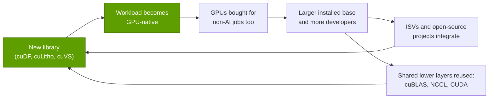

# Why library breadth compounds

Layer 10 · Libraries (CUDA-X) · ~11 min read · Last verified: 2026-11-05

## ⚡ The Executive Take

- **Each library turns another workload into GPU work.** Of the 18 libraries in this repo's sample launched since 2018, 12 target markets other than AI models (chart below).
- **The Spark example shows cost winning over speed.** In an AWS-run 1 TB test derived from [TPC-DS](../../glossary.md#tpc-ds), NVIDIA's cuDF plugin for [Apache Spark](../../glossary.md#apache-spark) ran only 1.06× faster than plain Spark and slower than a vectorized CPU engine. It still cut job cost ~80%, from $31.28 to $6.27 [[S10020]](../../sources/bibliography.md#s10020). 🟡 FINRA reported 14× faster runs and 90% savings on GPU Spark, per a third-party session recap [[S10021]](../../sources/bibliography.md#s10021).
- **Demand now comes from outside AI.** Customers include TSMC (cuLitho in production) [[S10031]](../../sources/bibliography.md#s10031), Meta (cuVS inside Faiss) [[S10025]](../../sources/bibliography.md#s10025), genomics labs (Parabricks up to 65× in a peer-reviewed study) [[S10033]](../../sources/bibliography.md#s10033) and logistics planners (cuOpt, open-sourced with COIN-OR) [[S10027]](../../sources/bibliography.md#s10027).
- **Integration beats invention.** pandas, scikit-learn, Polars, Spark and Faiss users can now switch to GPUs without rewriting code [[S10013]](../../sources/bibliography.md#s10013)[[S10015]](../../sources/bibliography.md#s10015)[[S10017]](../../sources/bibliography.md#s10017)[[S10019]](../../sources/bibliography.md#s10019)[[S10025]](../../sources/bibliography.md#s10025). CPU fallback removes the adoption risk.
- **NVIDIA's own counts rose, then stalled.** GPU-accelerated applications grew from 2,000 (2021) to 3,000 (2023) [[S537]](../../sources/bibliography.md#s537)[[S533]](../../sources/bibliography.md#s533), and NVIDIA now cites "hundreds" of [CUDA-X](../../glossary.md#cuda-x) libraries [[S10047]](../../sources/bibliography.md#s10047), but the developer count has been flat at ~6M since 2025 [[S528]](../../sources/bibliography.md#s528).
- **Bear case:** breadth adds demand at the margin; AI compute drives revenue, and outside AI the GPU win depends on prices and workload shape (I/O-bound queries gain little) [[S10017]](../../sources/bibliography.md#s10017).

## The compounding loop

A library creates a new reason to buy a GPU, and each GPU sold widens the base the next library can target:

The loop gets cheaper over time because new libraries reuse old ones: cuDF's core uses Apache Arrow-compliant [dataframe](../../glossary.md#dataframe) structures and powers Spark, Polars, Dask, Velox and DuckDB extensions [[S10011]](../../sources/bibliography.md#s10011). And each integration puts NVIDIA inside a framework whose users never chose NVIDIA directly.

> [!TIP]
> **Worked example — what turning a Spark ETL job into GPU work does to the bill.** In AWS's January 2026 test, eight c5d.12xlarge CPU nodes at $2.30 per hour needed 1.7 hours ($31.28) for 104 queries × 3 runs over 1 TB. Four g6.2xlarge nodes, each with one L4 GPU at $0.98 per hour, needed 1.6 hours ($6.27) [[S10020]](../../sources/bibliography.md#s10020). A team running that pipeline 30 times a day (900 runs a month) would pay ~$28,200 a month on CPUs and ~$5,600 on GPUs. That saves ~$22,500 a month and moves ~5,800 instance-hours of work onto NVIDIA GPUs. **Conclusion:** in [ETL](../../glossary.md#etl), GPUs win on cost per job more than on speed. A vectorized CPU engine (Gluten + Velox) was the fastest of the three [[S10020]](../../sources/bibliography.md#s10020), so the GPU's case depends on GPU hourly prices.

## Demand outside AI

**[Q1 · Job & failure mode]** Outside AI, the library layer's job is to win buyers who have never purchased a GPU; a library slower or costlier than the incumbent CPU tool fails, however good the hardware.

| Domain | Library | Published evidence | Who pays |
|---|---|---|---|
| Data analytics | cuDF plugin for Spark, cudf.pandas, Polars GPU engine | ~5× cheaper Spark job [[S10020]](../../sources/bibliography.md#s10020); up to 13× on Polars PDS-H queries (vendor) [[S10018]](../../sources/bibliography.md#s10018) | Enterprises with large ETL bills |
| Vector search | cuVS | Index build 12.3× faster than CPU HNSW (Meta) [[S10025]](../../sources/bibliography.md#s10025) | Search, RAG and recommendation teams |
| Optimization | cuOpt | LP, QP and routing; MIP still in beta [[S10026]](../../sources/bibliography.md#s10026) | Logistics, energy and supply-chain planners |
| Lithography | cuLitho | ~45× on curvilinear flows; 350 H100 systems replace 40,000 CPU systems [[S10031]](../../sources/bibliography.md#s10031) | Foundries and EDA vendors |
| Genomics | Parabricks | Up to 65× germline calling (peer-reviewed) [[S10033]](../../sources/bibliography.md#s10033); up to 24× on Terra [[S10034]](../../sources/bibliography.md#s10034) | Sequencing centers, hospitals, pharma |
| Climate | Earth-2 (Earth2Studio) | Open Python package for AI weather models [[S10036]](../../sources/bibliography.md#s10036) | Weather agencies, insurers, energy traders |
| Quantum | cuQuantum, CUDA-Q | Simulation libraries and hybrid QPU-GPU platform [[S10029]](../../sources/bibliography.md#s10029)[[S10030]](../../sources/bibliography.md#s10030) | Quantum-hardware companies and labs |
| Simulation | Warp, PhysX, Omniverse | Open-source physics in Python and C++ [[S10028]](../../sources/bibliography.md#s10028)[[S10035]](../../sources/bibliography.md#s10035) | Robotics, industrial digital twins |

> [!TIP]
> **Worked example — why speed is not the buying criterion in genomics.** The BMC Bioinformatics study cut GATK HaplotypeCaller from 36 hours on CPUs to 24 minutes on a DGX and 33–35 minutes on AWS or GCP GPU instances [[S10033]](../../sources/bibliography.md#s10033). The same study found that somatic callers on cloud GPUs cost more than CPU runs, even when faster [[S10033]](../../sources/bibliography.md#s10033). **Conclusion:** a domain library wins when it lowers cost per sample (germline calling), not merely time per sample (somatic calling).

## Plugging into other people's frameworks

Since 2023 NVIDIA has mostly stopped asking data scientists to learn a new API and instead intercepts the one they already use. [cudf.pandas](../../glossary.md#cudf-pandas) supports "100% of the pandas API": supported operations run on the GPU and the rest fall back to normal pandas [[S10013]](../../sources/bibliography.md#s10013). The same proxy pattern now covers scikit-learn, Polars, Spark and Faiss. NVIDIA calls this [zero-code-change acceleration](../../glossary.md#zero-code-change).

| Framework | NVIDIA engine underneath | Code change needed | Available since | What the evidence says |
|---|---|---|---|---|
| pandas | cudf.pandas | None: `%load_ext cudf.pandas` | Open beta 2023, GA 2024 [[S10014]](../../sources/bibliography.md#s10014) | ~150× (NVIDIA); 50–70× independent [[S10046]](../../sources/bibliography.md#s10046) |
| scikit-learn, UMAP, HDBSCAN | cuml.accel | None: `python -m cuml.accel` | cuML 25.04, 2025 [[S10016]](../../sources/bibliography.md#s10016) | Full scikit-learn gallery runs; ~5.8× median [[S10015]](../../sources/bibliography.md#s10015) |
| Polars | cudf-polars | `pip install polars[gpu]`, GPU engine flag | Open beta 2024 [[S10018]](../../sources/bibliography.md#s10018) | Wins on joins, aggregations [[S10017]](../../sources/bibliography.md#s10017) |
| Apache Spark | cuDF plugin for Spark | Cluster configuration | 2020 (as RAPIDS Accelerator) [[S10019]](../../sources/bibliography.md#s10019) | 1.06× faster, ~5× cheaper in AWS's test [[S10020]](../../sources/bibliography.md#s10020) |
| Faiss | cuVS back end | Choose a cuVS index | Faiss 1.10, 2025 [[S10025]](../../sources/bibliography.md#s10025) | IVF build 4.7× faster than Faiss's older GPU code [[S10025]](../../sources/bibliography.md#s10025) |
| Velox, DuckDB (Sirius) | cuDF | Engine extension | Listed in cuDF README, 2026 [[S10011]](../../sources/bibliography.md#s10011) | No independent benchmarks found |

> [!TIP]
> **Worked example — where zero-code-change breaks even.** cuML's own benchmark holds a 61,035 × 4,096 matrix fixed and varies PCA's output rank. At 128 components the GPU takes 2.97 s against 1.42 s on CPU (0.48×). At 512 it is 1.12×, and at 1,024 components 2.62× [[S10015]](../../sources/bibliography.md#s10015). **Conclusion:** small jobs lose to the cost of moving data. Zero-code-change tools make the GPU a free option: users profile, keep what wins and fall back on the rest.

🔧 Under the hood: how "zero code change" works

The accelerator loads before `import pandas` (or `sklearn`) and installs proxy objects that mimic the original classes. Each call goes to the GPU library when the operation, data types and parameters are supported, otherwise to the CPU library, with data moved as needed [[S10013]](../../sources/bibliography.md#s10013)[[S10015]](../../sources/bibliography.md#s10015). The costs are hidden transfers and occasional behavioral differences, which is why cuML documents per-estimator fallback conditions and provides profiling tools [[S10015]](../../sources/bibliography.md#s10015). Polars takes a different route: its query planner hands the whole optimized plan to the GPU engine, which declines unsupported plans up front [[S10017]](../../sources/bibliography.md#s10017).

## How the CUDA-X count has grown

**[Q3 · Generational progress]** NVIDIA publishes no comparable library series. In 2022 it cited 550 "SDKs and AI models", mixing libraries with models [[S532]](../../sources/bibliography.md#s532), and it announced 60 updates to CUDA-X libraries in a single GTC [[S530]](../../sources/bibliography.md#s530). Today it refers to "hundreds of libraries" [[S10047]](../../sources/bibliography.md#s10047). This repo therefore dated a sample of 29 major libraries and five integrations from changelogs, PyPI and press releases (`data/l10_library_timeline.csv`).

![Stacked step chart of a sample of 29 major CUDA-X libraries by first public release year. 11 appeared from 2007 to 2017 (cuBLAS, cuFFT, cuSPARSE, cuRAND, cuDNN, NCCL, TensorRT, CUTLASS and others) and 18 from 2018 to 2025, of which 12 target data analytics, optimization, vector search, simulation, lithography, climate or quantum rather than AI models. 5 zero-code-change integrations (Spark, pandas, Polars, scikit-learn, Faiss) arrived from 2020 to 2025. NVIDIA itself cites hundreds of libraries; this is a dated sample.](../../assets/charts/10-cuda-x-library-timeline.svg)

> [!TIP]
> **Worked example — reading the sample.** The sample grows from 2 libraries in 2007 (cuBLAS, cuFFT) to 11 by 2017 and 29 by 2025. Before 2018, 10 of 11 were math, AI or communication libraries; since 2018, 12 of 18 (67%) serve other markets. **Conclusion:** NVIDIA's library investment shifted from "make GPUs usable" to "make GPUs necessary in new industries", while ~6M registered developers remained the reported base [[S528]](../../sources/bibliography.md#s528).

> [!NOTE]
> **🐂 Bull view:** each library is cheap relative to the GPU demand it unlocks, rivals must match dozens of domains, and lithography, genomics and analytics budgets do not follow AI spending cycles.

> [!WARNING]
> **🐻 Bear view:** the non-AI domains are small next to AI, which drives most of Data Center revenue ($193.7B of NVIDIA's $215.9B in FY2026) [[S402]](../../sources/bibliography.md#s402)[[S401]](../../sources/bibliography.md#s401) (see [Layer 13](../13-ecosystem-gtm-and-capital/index.md)). In the one independent Spark test, CPUs with Velox were faster [[S10020]](../../sources/bibliography.md#s10020). A challenger can ignore the long tail and win the few kernels that dominate [LLM](../../glossary.md#llm) serving. See [Competition](competition.md).

## 🎯 Corp Dev Lens

1. **Non-AI demand as a hedge.** ETL, lithography and genomics libraries tie GPU demand to budgets outside AI capex. How large is this demand, and does any NVIDIA disclosure size it?
2. **Integration partners as kingmakers.** Framework owners (Meta for Faiss, the Polars team, Spark platforms, AWS EMR) decide which accelerator users get by default; those partnerships may matter more than library count.
3. **Cost per job is the opening for rivals.** The AWS test shows GPUs winning on price, not speed [[S10020]](../../sources/bibliography.md#s10020). A cheaper accelerator with an NCCL-like and cuDF-like stack could compete on the same metric, but only if it ships zero-code-change integrations.
4. **Qualcomm question (public information only):** would partnering with an open data engine (Velox, DuckDB, Polars) be a cheaper entry point to non-AI datacenter workloads than building domain libraries one at a time?

## 📚 Sources

<!-- Auto-generated from the [S…] citations on this page by `make build`. Edit sources/registry/*.csv, not this list. -->

- [**S401**](../../sources/bibliography.md#s401) NVIDIA Corporation via SEC EDGAR, *NVIDIA Corporation Form 10-K for fiscal year ended January 25, 2026*, 2026-02-25. [Link](https://www.sec.gov/Archives/edgar/data/1045810/000104581026000021/nvda-20260125.htm)
- [**S402**](../../sources/bibliography.md#s402) NVIDIA Corporation via SEC EDGAR (Colette Kress), *CFO Commentary on Fourth Quarter and Fiscal 2026 Results (Form 8-K exhibit 99.2)*, 2026-02-25. [Link](https://www.sec.gov/Archives/edgar/data/1045810/000104581026000019/q4fy26cfocommentary.htm)
- [**S528**](../../sources/bibliography.md#s528) NVIDIA Developer Forums, *20 Years of CUDA: Honoring the Architects of the Accelerated Age*, 2026-03. [Link](https://forums.developer.nvidia.com/t/20-years-of-cuda-honoring-the-architects-of-the-accelerated-age/364654)
- [**S530**](../../sources/bibliography.md#s530) NVIDIA press release via Stockhouse, *NVIDIA Introduces 60 Updates to CUDA-X Libraries, Opening New Science and Industries to Accelerated Computing*, 2022-03-22. [Link](https://stockhouse.com/news/press-releases/2022/03/22/nvidia-introduces-60-updates-to-cuda-x-libraries-opening-new-science-and)
- [**S532**](../../sources/bibliography.md#s532) NVIDIA, *NVIDIA GTC 2022 Fall Highlights*, 2022-09-20. [Link](https://images.nvidia.com/nvimages/gtc/pdf/NVIDIA_GTC2022_Fall_Highlights.pdf)
- [**S533**](../../sources/bibliography.md#s533) TechCrunch, *Jensen Huang at Nvidia's Computex 2023 keynote*, 2023-05-29. [Link](https://techcrunch.com/?p=2549988)
- [**S537**](../../sources/bibliography.md#s537) NVIDIA press release via Yahoo Finance, *NVIDIA Announces CPU for Giant AI and High Performance Computing Workloads*, 2021-04-12. [Link](https://sg.finance.yahoo.com/news/nvidia-announces-cpu-giant-ai-161900753.html)
- [**S10011**](../../sources/bibliography.md#s10011) NVIDIA RAPIDS (GitHub: rapidsai/cudf), *cuDF README*, 2026-11. [Link](https://github.com/rapidsai/cudf/blob/main/README.md)
- [**S10013**](../../sources/bibliography.md#s10013) NVIDIA RAPIDS (GitHub: rapidsai/cudf docs), *cudf.pandas documentation (index and benchmarks)*, 2026-11. [Link](https://github.com/rapidsai/cudf/blob/main/docs/cudf/source/cudf_pandas/index.rst)
- [**S10014**](../../sources/bibliography.md#s10014) NVIDIA Technical Blog, *RAPIDS cuDF Accelerates pandas Nearly 150x with Zero Code Changes*, 2023-11. [Link](https://developer.nvidia.com/blog/rapids-cudf-accelerates-pandas-nearly-150x-with-zero-code-changes/)
- [**S10015**](../../sources/bibliography.md#s10015) NVIDIA RAPIDS (GitHub: rapidsai/cuml docs), *cuml.accel overview and benchmarks*, 2026. [Link](https://github.com/rapidsai/cuml/blob/main/docs/source/cuml-accel/benchmarks.rst)
- [**S10016**](../../sources/bibliography.md#s10016) NVIDIA RAPIDS (GitHub: rapidsai/cuml), *cuML CHANGELOG (to 25.06)*, 2025-06-05. [Link](https://github.com/rapidsai/cuml/blob/branch-25.06/CHANGELOG.md)
- [**S10017**](../../sources/bibliography.md#s10017) Polars (GitHub: pola-rs/polars docs), *Polars user guide: GPU Support [Open Beta]*, 2026-11. [Link](https://github.com/pola-rs/polars/blob/main/docs/source/user-guide/gpu-support.md)
- [**S10018**](../../sources/bibliography.md#s10018) NVIDIA Technical Blog, *Polars GPU Engine Powered by RAPIDS cuDF Now Available in Open Beta*, 2024-09. [Link](https://developer.nvidia.com/blog/polars-gpu-engine-powered-by-rapids-cudf-now-available-in-open-beta/)
- [**S10019**](../../sources/bibliography.md#s10019) NVIDIA (GitHub: NVIDIA/cudf-spark), *NVIDIA cuDF plugin for Apache Spark README and docs index*, 2026-11. [Link](https://github.com/NVIDIA/cudf-spark/blob/main/README.md)
- [**S10020**](../../sources/bibliography.md#s10020) AWS Labs (GitHub: awslabs/data-on-eks), *Apache Spark with NVIDIA RAPIDS GPU Acceleration Benchmarks (data-on-eks)*, 2026-01-12. [Link](https://github.com/awslabs/data-on-eks/blob/main/website/docs/benchmarks/spark-rapids-gpu-benchmark.md)
- [**S10021**](../../sources/bibliography.md#s10021) DEV Community, *AWS re:Invent 2025 - FINRA: accelerate massive data processing with NVIDIA on AWS EMR (AIM279), session recap*, 2025-12. [Link](https://dev.to/kazuya_dev/aws-reinvent-2025-finra-accelerate-massive-data-processing-with-nvidia-on-aws-emr-aim279-4cae)
- [**S10025**](../../sources/bibliography.md#s10025) Engineering at Meta, *Accelerating GPU indexes in Faiss with NVIDIA cuVS*, 2025-05-08. [Link](https://engineering.fb.com/2025/05/08/data-infrastructure/accelerating-gpu-indexes-in-faiss-with-nvidia-cuvs/)
- [**S10026**](../../sources/bibliography.md#s10026) NVIDIA (GitHub: NVIDIA/cuopt), *cuOpt README and LICENSE*, 2026-11. [Link](https://github.com/NVIDIA/cuopt/blob/main/README.md)
- [**S10027**](../../sources/bibliography.md#s10027) It's FOSS News, *NVIDIA cuOpt goes open source (with COIN-OR)*, 2025-03-19. [Link](https://news.itsfoss.com/nvidia-cuopt-open-source/)
- [**S10028**](../../sources/bibliography.md#s10028) NVIDIA (GitHub: NVIDIA/warp), *NVIDIA Warp README and CHANGELOG*, 2026-11-02. [Link](https://github.com/NVIDIA/warp/blob/main/CHANGELOG.md)
- [**S10029**](../../sources/bibliography.md#s10029) NVIDIA (GitHub: NVIDIA/cuQuantum), *cuQuantum repository README*, 2026-11. [Link](https://github.com/NVIDIA/cuQuantum/blob/main/README.md)
- [**S10030**](../../sources/bibliography.md#s10030) NVIDIA (GitHub: NVIDIA/cuda-quantum), *CUDA-Q repository README*, 2026-11. [Link](https://github.com/NVIDIA/cuda-quantum/blob/main/README.md)
- [**S10031**](../../sources/bibliography.md#s10031) NVIDIA Newsroom, *TSMC and Synopsys Bring Breakthrough NVIDIA Computational Lithography Platform to Production*, 2024-03-18. [Link](https://nvidianews.nvidia.com/news/tsmc-synopsys-nvidia-culitho)
- [**S10033**](../../sources/bibliography.md#s10033) BMC Bioinformatics (PMC open access), *Accelerating genomic workflows using NVIDIA Parabricks*, 2023-05. [Link](https://www.ncbi.nlm.nih.gov/pmc/articles/PMC10230726/)
- [**S10034**](../../sources/bibliography.md#s10034) Terra (Broad Institute / Verily / Microsoft), *NVIDIA's Clara Parabricks workflows in Terra bring GPU acceleration to genomic analysis*, 2022. [Link](https://terra.bio/nvidias-clara-parabricks-workflows-in-terra-bring-gpu-acceleration-to-genomic-analysis)
- [**S10035**](../../sources/bibliography.md#s10035) NVIDIA (GitHub: NVIDIA-Omniverse/PhysX), *NVIDIA PhysX SDK README*, 2025. [Link](https://github.com/NVIDIA-Omniverse/PhysX/blob/main/README.md)
- [**S10036**](../../sources/bibliography.md#s10036) NVIDIA (GitHub: NVIDIA/earth2studio), *NVIDIA Earth2Studio README*, 2026-11. [Link](https://github.com/NVIDIA/earth2studio/blob/main/README.md)
- [**S10046**](../../sources/bibliography.md#s10046) Daily Dose of Data Science, *NVIDIA's latest update can make your pandas workflow 150x faster*, 2023-11. [Link](https://blog.dailydoseofds.com/p/nvidias-latest-update-can-make-your)
- [**S10047**](../../sources/bibliography.md#s10047) NVIDIA Developer, *NVIDIA CUDA-X Libraries (developer page)*, 2026. [Link](https://developer.nvidia.com/cuda/cuda-x-libraries)
