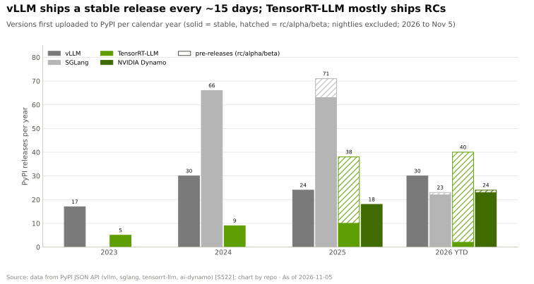
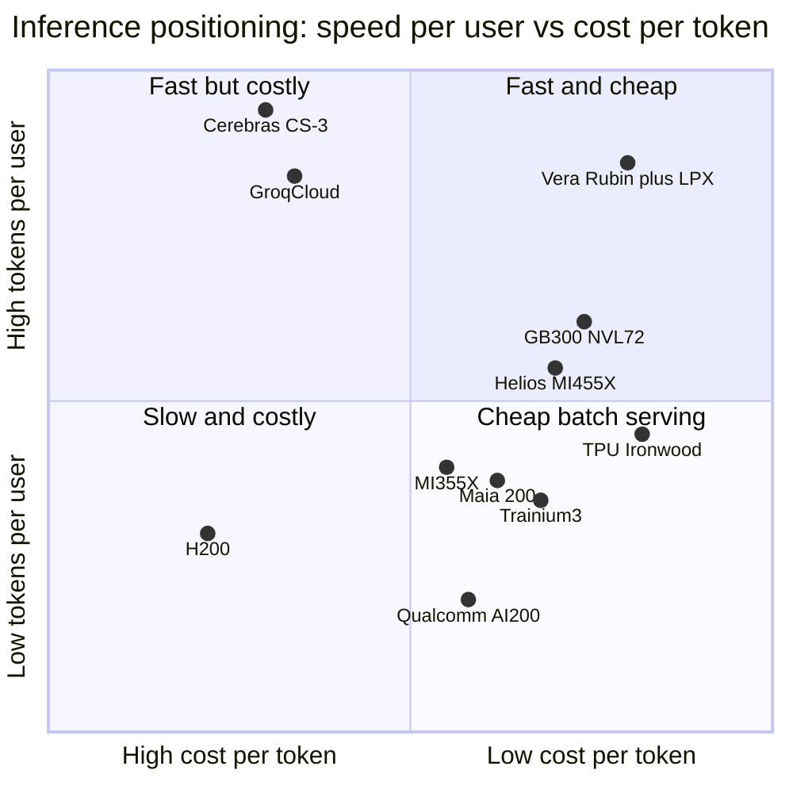

# Inference and AI software: Competition

Layer 11 · Inference and AI software · ~14 min read · Last verified: 2026-11-05

## ⚡ The Executive Take

- **NVIDIA leads on delivered cost:** at 50 [tokens](../../glossary.md#token)/s per user, a GB300 NVL72 serves DeepSeek-R1 for ~$0.10 per million tokens vs ~$0.56 on MI355X and ~$1.10 on H200 (Est.) [[S621]](../../sources/bibliography.md#s621)[[S622]](../../sources/bibliography.md#s622).
- **Open-source serving breaks lock-in:** [vLLM](../../glossary.md#vllm), [SGLang](../../glossary.md#sglang) and [llm-d](../../glossary.md#llm-d) run on seven hardware families; vLLM shipped 30 stable releases so far in 2026 vs 2 for [TensorRT-LLM](../../glossary.md#tensorrt-llm) [[S580]](../../sources/bibliography.md#s580)[[S581]](../../sources/bibliography.md#s581)[[S596]](../../sources/bibliography.md#s596)[[S522]](../../sources/bibliography.md#s522).
- **NVIDIA co-opted it:** [Dynamo](../../glossary.md#dynamo) drives vLLM and SGLang, and the pending ~$12.9B Hugging Face deal brings transformers, TGI and llama.cpp in-house 🟡 [[S11001]](../../sources/bibliography.md#s11001)[[S11500]](../../sources/bibliography.md#s11500)[[S11539]](../../sources/bibliography.md#s11539).
- **TPU is the cost challenger:** Ironwood serves Qwen3.5 397B ~18% cheaper than B200 ($0.181 vs $0.222 per million tokens) [[S625]](../../sources/bibliography.md#s625).
- **AMD closed the per-GPU gap, not the rack gap:** MLPerf Llama 2 70B parity with B200, yet up to 5× costlier at 150 tokens/s per user on GLM 5.3 [[S602]](../../sources/bibliography.md#s602)[[S636]](../../sources/bibliography.md#s636).
- **SRAM chips win on speed, not cost:** Cerebras signed OpenAI for up to 750 MW; Groq's design ships inside NVIDIA's Groq 3 LPX rack [[S11523]](../../sources/bibliography.md#s11523)[[S114]](../../sources/bibliography.md#s114).
- **[Q5 · Strongest challenger]** On cost, TPU and captive ASICs; on lock-in, open-source serving. Chip specs have converged; rack-scale serving has not.

![Heatmap of eight inference challengers on five dimensions. Open-source serving (vLLM, SGLang, llm-d) is at parity on speed, cost and maturity and leads on model coverage and hardware breadth (seven hardware families). Google TPU leads on throughput per dollar (~18% below B200 per token); Cerebras and Groq lead on tokens per second per user thanks to on-chip SRAM but trail on cost; AMD is at parity on cost and model coverage but behind on interactivity and software; 6 of 7 hardware challengers are behind on software maturity; AWS, Microsoft and Qualcomm lack public benchmarks and are mostly 'different approach' or 'behind'.](../../assets/charts/11-inference-challenger-heatmap.svg)

## How the inference contest is scored

A buyer of [inference](../../glossary.md#inference) weighs five things: **[interactivity](../../glossary.md#interactivity)** (tokens/s per user: does an agent feel instant?), **throughput per dollar** (the seller's gross margin), **software maturity** (engineers needed), **model coverage** (does next week's model run on launch day?) and **deployment flexibility** (buy it, or only rent it from its owner?). The first two trade off along a [Pareto frontier](../../glossary.md#pareto-frontier), like a bus versus a taxi ([the inference shift](the-inference-shift.md)).

| Challenger (basis) | Tokens/s per user | Throughput per $ | Software maturity | Model coverage | Deployment flexibility |
|---|---|---|---|---|---|
| Open-source serving (vLLM, SGLang, llm-d) | 🟨 wide-EP on NVL72 too | 🟨 same GPUs | 🟨 ~2 releases a month | 🟩 day-0 open models | 🟩 7 hardware families |
| AMD MI355X → MI455X | 🟥 8-GPU domain until Helios | 🟨 up to 29.6% cheaper | 🟥 ROCm 7, no Dynamo twin | 🟨 vLLM/SGLang native | 🟨 merchant |
| Google TPU Ironwood → 8i | 🟦 9,216-chip pods | 🟩 ~18% below B200 | 🟥 TorchTPU since Oct 2026 | 🟥 Gemini, Anthropic | 🟦 Google Cloud, OCI |
| AWS Trainium / Inferentia | 🟥 no public results | 🟦 captive pricing | 🟥 vLLM plugin beta | 🟥 Claude, selected | 🟦 AWS only |
| Microsoft Maia 200 | 🟦 SRAM + HBM3E | 🟦 internal claims | 🟥 no public stack | 🟥 Copilot, OpenAI | 🟦 Azure only |
| Cerebras CS-3 | 🟩 beyond GPU nodes | 🟥 44 GB per system | 🟦 API-first | 🟥 curated | 🟦 cloud, on-prem |
| Groq (GroqCloud) | 🟩 SRAM-speed decode | 🟥 many chips per model | 🟥 founders left | 🟥 curated | 🟦 API cloud |
| Qualcomm AI 100 / AI200 / AI250 | 🟥 LPDDR 0.55 TB/s | 🟦 768 GB capacity bet | 🟥 vLLM + Modular | 🟥 no public results | 🟨 merchant |

Verdict = challenger vs NVIDIA GB300 / Vera Rubin NVL72 with Dynamo and TensorRT-LLM; repo judgement 🔴 from [[S621]](../../sources/bibliography.md#s621)[[S630]](../../sources/bibliography.md#s630)[[S637]](../../sources/bibliography.md#s637)[[S636]](../../sources/bibliography.md#s636)[[S625]](../../sources/bibliography.md#s625)[[S553]](../../sources/bibliography.md#s553)[[S581]](../../sources/bibliography.md#s581)[[S158]](../../sources/bibliography.md#s158)[[S634]](../../sources/bibliography.md#s634)[[S167]](../../sources/bibliography.md#s167)[[S172]](../../sources/bibliography.md#s172)[[S173]](../../sources/bibliography.md#s173)[[S596]](../../sources/bibliography.md#s596)[[S9511]](../../sources/bibliography.md#s9511)[[S602]](../../sources/bibliography.md#s602). Data: `l11_inference_verdicts.csv`.

> [!TIP]
> **Worked example — what the cost gap means for a provider.** Serving one trillion DeepSeek-R1 tokens (10⁶ million) at 50 tokens/s per user costs ~$100K on GB300 NVL72, ~$560K on MI355X and ~$1.1M on H200 at owner [TCO](../../glossary.md#tco) (Est.) [[S621]](../../sources/bibliography.md#s621)[[S622]](../../sources/bibliography.md#s622). At Google's October 2025 volume of over 1.3 quadrillion tokens a month, a $0.46 gap per million is ~$600M a month [[S32020]](../../sources/bibliography.md#s32020).

🔧 Under the hood: why benchmarks disagree

[MLPerf](../../glossary.md#mlperf) is audited but periodic; [InferenceX](../../glossary.md#inferencex) re-runs nightly across interactivity levels, priced with a TCO model ($2.31 per GB300 GPU-hour, $1.50 per MI355X, $1.21 per TPU7x) [[S622]](../../sources/bibliography.md#s622). AMD looks best on dense or small-active-parameter models offline, NVIDIA on large [mixture-of-experts](../../glossary.md#mixture-of-experts) models at high interactivity, where the 72-GPU [NVLink](../../glossary.md#nvlink) domain carries expert traffic [[S630]](../../sources/bibliography.md#s630)[[S636]](../../sources/bibliography.md#s636).

## Open-source serving: the lock-in question

The [serving engine](../../glossary.md#serving-engine) is where model, hardware and customer meet. vLLM, a 2023 Berkeley paper [[S32011]](../../sources/bibliography.md#s32011), runs natively on CUDA, ROCm and Intel GPUs, with [hardware plugins](../../glossary.md#hardware-plugin) for TPU, Gaudi, AWS Neuron (beta) and Ascend, plus a Qualcomm container [[S580]](../../sources/bibliography.md#s580)[[S581]](../../sources/bibliography.md#s581)[[S596]](../../sources/bibliography.md#s596). SGLang lists NVIDIA, AMD, TPU and Ascend [[S582]](../../sources/bibliography.md#s582). Ray covers 13 device families and llama.cpp about ten, including Snapdragon [[S584]](../../sources/bibliography.md#s584)[[S579]](../../sources/bibliography.md#s579). Hugging Face put its TGI engine into maintenance mode, pointing users to vLLM and SGLang [[S11502]](../../sources/bibliography.md#s11502). llm-d 1.0 (October 2026; founded by Red Hat, Google, IBM, CoreWeave and NVIDIA) adds routing and prefill/decode splitting, validated on NVIDIA, AMD, Intel and TPU [[S11503]](../../sources/bibliography.md#s11503).

> [!TIP]
> **Worked example — the licence open source avoids.** A 10,000-GPU fleet running [NIM](../../glossary.md#nim) in production needs [NVIDIA AI Enterprise](../../glossary.md#ai-enterprise) at a $4,500 list per GPU per year: $45M a year [[S9515]](../../sources/bibliography.md#s9515)[[S11013]](../../sources/bibliography.md#s11013). On vLLM or SGLang it pays no licence, and moving from H200 to MI355X changes a container, not the application; TensorRT-LLM runs on NVIDIA GPUs only [[S589]](../../sources/bibliography.md#s589).

> [!WARNING]
> **Myth vs reality: "open source erases NVIDIA's edge."** Open engines tune hardest for NVIDIA: one SGLang release lifted the same B200 pool from 508 to 907 tokens/s per GPU [[S629]](../../sources/bibliography.md#s629). AMD gains too (MI355X 1.3K → 6.4K on Qwen3.5 in three months) [[S632]](../../sources/bibliography.md#s632). Open serving lowers switching cost; it does not equalise silicon.

## Challenger by challenger

### AMD: closest merchant rival

MI355X matches B200 on MLPerf Llama 2 70B and beats B300 per GPU on gpt-oss-120b (15,227 vs 14,321 tokens/s), helped by 288 GB of [HBM](../../glossary.md#hbm) at 8 TB/s [[S602]](../../sources/bibliography.md#s602)[[S603]](../../sources/bibliography.md#s603). Its share of closed MLPerf inference results rose from 2% to 20% in 18 months [[S600]](../../sources/bibliography.md#s600)[[S603]](../../sources/bibliography.md#s603). Its wins are mostly inference: OpenAI (6 GW from H2 2026), Oracle (50,000 MI450), Meta, and Anthropic (up to 2 GW of Helios) [[S90020]](../../sources/bibliography.md#s90020)[[S90022]](../../sources/bibliography.md#s90022)[[S546]](../../sources/bibliography.md#s546)[[S9538]](../../sources/bibliography.md#s9538)[[S90023]](../../sources/bibliography.md#s90023). **Best argument:** MI455X brings 432 GB at 19.6 TB/s per GPU, more than Rubin's 288 GB at 19.2 TB/s [[S144]](../../sources/bibliography.md#s144)[[S90006]](../../sources/bibliography.md#s90006). **Gap:** Helios's 72-GPU domain reaches volume only in Q2 2027 (SemiAnalysis), so NVIDIA keeps the high-interactivity MoE frontier until then 🟡 [[S624]](../../sources/bibliography.md#s624).

### Google TPU, AWS and Microsoft: captive cost

Ironwood, Google's first TPU "for the age of inference", has 192 GB of HBM3E and 9,216-chip pods [[S151]](../../sources/bibliography.md#s151). TPU 8i (late 2026) triples on-chip SRAM for the [KV cache](../../glossary.md#kv-cache) [[S550]](../../sources/bibliography.md#s550). Anthropic has over 1M TPUs (~400K bought, ~600K rented), Meta rents Ironwood and Oracle Cloud adds TPUs in 2027 [[S625]](../../sources/bibliography.md#s625)[[S90025]](../../sources/bibliography.md#s90025)[[S552]](../../sources/bibliography.md#s552). AWS shipped Trainium3 (December 2025) and Project Rainier (~500K Trainium2) for Anthropic; its vLLM plugin is still beta [[S90034]](../../sources/bibliography.md#s90034)[[S581]](../../sources/bibliography.md#s581). Microsoft's Maia 200 (216 GB HBM3E, 272 MB SRAM, >10 PFLOPS FP4, 750 W) runs Copilot; Maia 300 follows in 2027 [[S158]](../../sources/bibliography.md#s158)[[S90044]](../../sources/bibliography.md#s90044)[[S90046]](../../sources/bibliography.md#s90046). **Best argument:** no merchant margin; against NVIDIA's ~75% gross margin, an owner of its own [ASIC](../../glossary.md#asic) starts with a large price cushion [[S3]](../../sources/bibliography.md#s3).

### SRAM speed specialists

![Log-log scatter of inference chips by memory capacity and bandwidth. SRAM designs sit top-left: NVIDIA's Groq 3 LPU holds 0.5 GB at 150 TB/s (~300,000 full reads per second), Groq LPU v1 0.23 GB at 80 TB/s, d-Matrix Corsair 2 GB at 150 TB/s and Cerebras WSE-3 44 GB at 21,000 TB/s. HBM GPUs and cloud ASICs cluster in the middle at 80-432 GB and 3-20 TB/s (25-70 reads per second): Rubin 288 GB at 19.2 TB/s, MI455X 432 GB at 19.6 TB/s, Ironwood 192 GB at 7.4 TB/s, Maia 200 216 GB at 7 TB/s. LPDDR cards sit bottom-right: Qualcomm AI 100 Ultra 128 GB at 0.548 TB/s (~4 reads per second) and the AI200 with 768 GB per card (bandwidth not disclosed).](../../assets/charts/11-inference-memory-tradeoff.svg)

[Decode](../../glossary.md#decode) re-reads the weights for every token: bandwidth sets the speed ceiling, capacity the chip count. Cerebras's wafer holds 44 GB of [SRAM](../../glossary.md#sram) at 21 PB/s [[S634]](../../sources/bibliography.md#s634); OpenAI agreed to buy up to 750 MW of its capacity through 2028 [[S11523]](../../sources/bibliography.md#s11523)[[S11524]](../../sources/bibliography.md#s11524). Groq's [LPU](../../glossary.md#lpu) founder and team moved to NVIDIA with the licence; GroqCloud continues [[S90018]](../../sources/bibliography.md#s90018). Etched ($10.3B), Positron ($5B) and d-Matrix ($2B) are still pre-scale [[S2507]](../../sources/bibliography.md#s2507)[[S11521]](../../sources/bibliography.md#s11521)[[S2511]](../../sources/bibliography.md#s2511); see [value chain](value-chain-and-corp-dev.md).

> [!TIP]
> **Worked example — why SRAM is fast but costly.** A 70B-parameter model at FP8 is ~70 GB. One Rubin GPU (288 GB, 19.2 TB/s) holds it and can stream it ~274 times a second, the ceiling for one user [[S90006]](../../sources/bibliography.md#s90006). Groq 3 LPUs hold 0.5 GB each, so the weights need ~140 chips, over half a 256-LPU LPX rack [[S114]](../../sources/bibliography.md#s114). Each re-reads its slice ~300,000 times a second, so links, not memory, set the ceiling: far more speed per user, far more chips per user.

### Qualcomm (public information only)

The Cloud AI 100 Ultra is a 150 W card with 128 GB of [LPDDR](../../glossary.md#lpddr) at 548 GB/s [[S172]](../../sources/bibliography.md#s172). AI200 (2026) puts 768 GB of LPDDR on each card in 160 kW liquid-cooled racks; AI250 (2027) adds [near-memory compute](../../glossary.md#near-memory-compute) for a claimed >10× effective bandwidth; HUMAIN plans 200 MW [[S173]](../../sources/bibliography.md#s173)[[S90030]](../../sources/bibliography.md#s90030). The 2028 AI300 claims 54× AI200's bandwidth via [High Bandwidth Compute](../../glossary.md#high-bandwidth-compute) [[S90060]](../../sources/bibliography.md#s90060), and Modular closed on 2026-07-29 [[S9511]](../../sources/bibliography.md#s9511). No AI200 volume shipment, MLPerf datacenter or InferenceX result was public by 2026-11-05 🔴 [[S90028]](../../sources/bibliography.md#s90028)[[S602]](../../sources/bibliography.md#s602)[[S620]](../../sources/bibliography.md#s620).

Repo positioning 🔴, anchored on [[S621]](../../sources/bibliography.md#s621)[[S625]](../../sources/bibliography.md#s625)[[S634]](../../sources/bibliography.md#s634); Helios, LPX and AI200 are unbenchmarked.

> [!NOTE]
> **🐂 Bull view.** NVIDIA owns the delivered-cost frontier on reasoning-scale MoE models ($0.10 per million tokens at 50 tokens/s per user), runs open engines best, adds SRAM decode (Groq 3 LPX) and is buying distribution (Hugging Face) 🟡 [[S621]](../../sources/bibliography.md#s621)[[S114]](../../sources/bibliography.md#s114)[[S11500]](../../sources/bibliography.md#s11500).

> [!WARNING]
> **🐻 Bear view.** Inference rewards cost, not flexibility: TPUs are ~18% cheaper on some workloads and AMD matches B200 per GPU [[S625]](../../sources/bibliography.md#s625)[[S602]](../../sources/bibliography.md#s602). Open engines make switching a container swap, and frontier labs now split inference across TPU, AMD, Trainium and Cerebras [[S90026]](../../sources/bibliography.md#s90026)[[S90020]](../../sources/bibliography.md#s90020)[[S11523]](../../sources/bibliography.md#s11523).

**[Q5 · Strongest challenger]** On cost per token: Google's TPU, the one captive ASIC with third-party cost data showing a lead (~18% vs B200) and outside customers [[S625]](../../sources/bibliography.md#s625)[[S552]](../../sources/bibliography.md#s552). On lock-in: open-source serving, which lets any challenger inherit [day-0 model support](../../glossary.md#day-zero-support). The gap has closed on per-chip specs (MI455X matches Rubin bandwidth) but not on rack-scale serving, where NVIDIA was up to 5× cheaper at 150 tokens/s per user [[S90006]](../../sources/bibliography.md#s90006)[[S636]](../../sources/bibliography.md#s636).

## 🎯 Corp Dev Lens

1. If open engines commoditise serving, does value shift to whoever owns distribution ([model hubs](../../glossary.md#model-hub), APIs), and what does NVIDIA's Hugging Face deal mean for neutral hubs?
2. SRAM owns ultra-low latency and NVL72 the middle: is there room for a capacity-first design (768 GB per card) in long-context, cost-sensitive serving?
3. How much public benchmark evidence does a new entrant need before buyers commit volume, and what does it cost to produce?
4. Which large token buyers (sovereigns, model labs) lack their own silicon and might co-design with a merchant partner?

## 📚 Sources

<!-- Auto-generated from the [S…] citations on this page by `make build`. Edit sources/registry/*.csv, not this list. -->

- [**S3**](../../sources/bibliography.md#s3) StorageNewsletter, *NVIDIA Q2 Fiscal 2027 results coverage: revenue $96.2B*, 2026-08-27. [Link](https://www.storagenewsletter.com/2026/08/27/nvidia-fiscal-2q27-financial-results/)
- [**S114**](../../sources/bibliography.md#s114) StorageReview, *NVIDIA Groq 3 LPX: Everything we know*, 2026-03. [Link](https://www.storagereview.com/news/nvidia-groq-3-lpx-everything-we-know)
- [**S144**](../../sources/bibliography.md#s144) AMD Newsroom, *AMD Unveils Vision for an Open AI Ecosystem, Detailing New Silicon, Software and Systems at Advancing AI 2025*, 2025-06-12. [Link](https://www.amd.com/en/newsroom/press-releases/2025-6-12-amd-unveils-vision-for-an-open-ai-ecosystem-detai.html)
- [**S151**](../../sources/bibliography.md#s151) Google Blog (Amin Vahdat), *Ironwood: The first Google TPU for the age of inference*, 2025-04-09. [Link](https://blog.google/products/google-cloud/ironwood-tpu-age-of-inference/)
- [**S158**](../../sources/bibliography.md#s158) Microsoft, *Maia 200: Microsoft's AI accelerator built for inference*, 2026-01. [Link](https://blogs.microsoft.com/blog/2026/01/26/maia-200-the-ai-accelerator-built-for-inference/)
- [**S167**](../../sources/bibliography.md#s167) ISCA 2022 (ACM) (Dennis Abts et al.), *A Software-defined Tensor Streaming Multiprocessor for Large-scale Machine Learning (Groq)*, 2022-06. [Link](https://dl.acm.org/doi/10.1145/3470496.3527405)
- [**S172**](../../sources/bibliography.md#s172) Qualcomm, *Qualcomm Cloud AI 100 (incl. Cloud AI 100 Ultra)*, 2023-11. [Link](https://www.qualcomm.com/products/technology/processors/cloud-artificial-intelligence/cloud-ai-100)
- [**S173**](../../sources/bibliography.md#s173) Qualcomm, *Qualcomm Unveils AI200 and AI250 - Redefining Rack-Scale Data Center Inference*, 2025-10-27. [Link](https://www.qualcomm.com/news/releases/2025/10/qualcomm-unveils-ai200-and-ai250-redefining-rack-scale-data-cent)
- [**S522**](../../sources/bibliography.md#s522) Python Package Index, *PyPI JSON API release histories (vllm, sglang, tensorrt-llm, ai-dynamo, torch-npu, jax-rocm7-plugin, tensorflow-rocm, intel-extension-for-tensorflow, onnxruntime-cann, onnxruntime-migraphx, torch-xla, torch-tpu)*, 2026-11-05. [Link](https://pypi.org/)
- [**S546**](../../sources/bibliography.md#s546) TechWire Asia, *AMD Advancing AI 2026: Helios, OpenAI, Meta, Anthropic*, 2026-07. [Link](https://techwireasia.com/2026/07/amd-advancing-ai-2026-helios-openai-meta-anthropic/)
- [**S550**](../../sources/bibliography.md#s550) SiliconANGLE, *Google Cloud unveils eighth-generation TPUs (TPU 8t and TPU 8i)*, 2026-04-22. [Link](https://siliconangle.com/?p=740999)
- [**S552**](../../sources/bibliography.md#s552) Google Cloud Blog (Karan Batta), *Bringing Google TPUs to Oracle Cloud Infrastructure*, 2026-10-27. [Link](https://cloud.google.com/blog/products/infrastructure/bringing-google-tpus-to-oracle-cloud-infrastructure)
- [**S553**](../../sources/bibliography.md#s553) Google Cloud Blog (Alex Barrett), *What's new in AI infrastructure and orchestration in October*, 2026-11. [Link](https://cloud.google.com/blog/topics/ai-infrastructure/whats-new-in-ai-infrastructure-this-month)
- [**S579**](../../sources/bibliography.md#s579) ggml-org (GitHub), *llama.cpp README — supported backends*, 2026-11. [Link](https://github.com/ggml-org/llama.cpp/blob/master/README.md)
- [**S580**](../../sources/bibliography.md#s580) vLLM project (GitHub), *vLLM README and installation docs — supported hardware*, 2026-11. [Link](https://github.com/vllm-project/vllm/blob/main/docs/getting_started/installation/README.md)
- [**S581**](../../sources/bibliography.md#s581) vLLM project (GitHub), *vLLM hardware plugin repositories (tpu-inference/vLLM JAX, vllm-gaudi, vllm-ascend, vllm-neuron)*, 2026-11. [Link](https://github.com/vllm-project)
- [**S582**](../../sources/bibliography.md#s582) SGLang project (GitHub: sgl-project/sglang), *SGLang README — supported hardware*, 2026-11. [Link](https://github.com/sgl-project/sglang/blob/main/README.md)
- [**S584**](../../sources/bibliography.md#s584) Ray project (GitHub: ray-project/ray), *Ray accelerator managers (python/ray/_private/accelerators)*, 2026-11. [Link](https://github.com/ray-project/ray/blob/master/python/ray/_private/accelerators/__init__.py)
- [**S589**](../../sources/bibliography.md#s589) NVIDIA (GitHub: NVIDIA/TensorRT-LLM), *TensorRT-LLM README*, 2026-11. [Link](https://github.com/NVIDIA/TensorRT-LLM/blob/main/README.md)
- [**S596**](../../sources/bibliography.md#s596) Qualcomm (GitHub: quic), *Qualcomm Cloud AI SDK and Efficient Transformers repositories*, 2026-11. [Link](https://github.com/quic/cloud-ai-sdk)
- [**S600**](../../sources/bibliography.md#s600) MLCommons, *MLPerf Inference v5.0 results (summary_results.json and per-submitter logs)*, 2025-04-02. [Link](https://github.com/mlcommons/inference_results_v5.0)
- [**S602**](../../sources/bibliography.md#s602) MLCommons, *MLPerf Inference v6.0 results (summary_results.json and per-submitter logs)*, 2026-04-01. [Link](https://github.com/mlcommons/inference_results_v6.0)
- [**S603**](../../sources/bibliography.md#s603) MLCommons, *MLPerf Inference v6.1 results (summary.csv and per-submitter logs)*, 2026-09. [Link](https://github.com/mlcommons/inference_results_v6.1)
- [**S620**](../../sources/bibliography.md#s620) SemiAnalysis, *SemiAnalysis InferenceX (formerly InferenceMAX) open-source benchmark repository*, 2026-11. [Link](https://github.com/SemiAnalysisAI/InferenceX)
- [**S621**](../../sources/bibliography.md#s621) SemiAnalysis (InferenceX-app repository), *InferenceX public API snapshot (benchmarks.json and benchmarks-history.json fixtures)*, 2026-10-17. [Link](https://github.com/SemiAnalysisAI/InferenceX-app/tree/main/packages/app/cypress/fixtures/api)
- [**S622**](../../sources/bibliography.md#s622) SemiAnalysis (InferenceX-app repository), *InferenceX hardware registry: TCO per GPU-hour by SKU (SemiAnalysis July 2026 pricing surveys and AI Cloud TCO Model)*, 2026-07. [Link](https://github.com/SemiAnalysisAI/InferenceX-app/blob/main/packages/constants/src/gpu-keys.ts)
- [**S624**](../../sources/bibliography.md#s624) SemiAnalysis, *InferenceX v2: NVIDIA Blackwell Vs AMD vs Hopper - Formerly InferenceMAX*, 2026-02-16. [Link](https://github.com/SemiAnalysisAI/InferenceX-app/blob/main/packages/app/content/blog/inferencex-v2-nvidia-blackwell-vs-amd-vs-hopper.mdx)
- [**S625**](../../sources/bibliography.md#s625) SemiAnalysis, *TPU Inference Externalization Full Steam Ahead*, 2026-09-07. [Link](https://github.com/SemiAnalysisAI/InferenceX-app/blob/main/packages/app/content/blog/tpu-inferencex-full-steam.mdx)
- [**S629**](../../sources/bibliography.md#s629) SemiAnalysis, *SGLang 0.5.6 on B200 DeepSeek R1 FP4: Up to 1.8x at Low Concurrency*, 2026-05-02. [Link](https://github.com/SemiAnalysisAI/InferenceX-app/blob/main/packages/app/content/blog/sglang-0-5-6-b200-deepseek-r1-fp4-up-to-1-8x.mdx)
- [**S630**](../../sources/bibliography.md#s630) SemiAnalysis, *GB200 NVL72 vs B200 on Kimi K2.5: 3.1x from Wide EP vLLM*, 2026-04-23. [Link](https://github.com/SemiAnalysisAI/InferenceX-app/blob/main/packages/app/content/blog/gb200-nvl72-kimi-k2-5-vllm-wide-ep-3x-vs-b200.mdx)
- [**S632**](../../sources/bibliography.md#s632) SemiAnalysis, *AMD MI355X Qwen3.5 397B-A17B Inference: Up to 19x Throughput per GPU in 3 Months on SGLang FP8*, 2026-05-25. [Link](https://github.com/SemiAnalysisAI/InferenceX-app/blob/main/packages/app/content/blog/mi355x-qwen3-5-sglang-v0-5-12-up-to-17x.mdx)
- [**S634**](../../sources/bibliography.md#s634) SemiAnalysis, *Ultra-High Interactivity on NVIDIA GPUs? TileRT on InferenceX*, 2026-08-10. [Link](https://github.com/SemiAnalysisAI/InferenceX-app/blob/main/packages/app/content/blog/ultra-high-interactivity-on-nvidia.mdx)
- [**S636**](../../sources/bibliography.md#s636) SemiAnalysis, *GLM 5.3 on AgentX: NVIDIA Is Up to 5x Cheaper per Token at 150 tok/s/user*, 2026-08-25. [Link](https://github.com/SemiAnalysisAI/InferenceX-app/blob/main/packages/app/content/blog/glm-5-3-agentx-nvidia-vs-amd-sglang-150-toks.mdx)
- [**S637**](../../sources/bibliography.md#s637) SemiAnalysis, *AMD MI355X GLM-5 Inference: Up to 29.6% Lower Cost per Million Tokens than B200 on SGLang FP8*, 2026-05-25. [Link](https://github.com/SemiAnalysisAI/InferenceX-app/blob/main/packages/app/content/blog/mi355x-glm5-fp8-sglang-40-cheaper-than-b200.mdx)
- [**S2507**](../../sources/bibliography.md#s2507) AI Weekly, *Etched closes $300M Series C at $10.3B led by Sequoia, books ~$1B in pre-orders for Sohu*, 2026-07. [Link](https://aiweekly.co/alerts/etched-closes-300m-series-c-at-103b-led-by-sequoia-books-1b-in-pre-orders-for)
- [**S2511**](../../sources/bibliography.md#s2511) Converge Digest, *d-Matrix raises $275 million to accelerate the age of AI inference*, 2025-11-12. [Link](https://convergedigest.com/d-matrix-raises-275-million-to-accelerate-the-age-of-ai-inference/)
- [**S9511**](../../sources/bibliography.md#s9511) Nasdaq (Qualcomm press release), *Qualcomm Completes Acquisition of Modular*, 2026-07-29. [Link](https://www.nasdaq.com/press-release/qualcomm-completes-acquisition-modular-2026-07-29)
- [**S9515**](../../sources/bibliography.md#s9515) The Register (Tobias Mann), *Nvidia's software empire (NVIDIA AI Enterprise licensing)*, 2024-08-06. [Link](https://www.theregister.com/2024/08/06/nvidia_software_empire/)
- [**S9538**](../../sources/bibliography.md#s9538) The Next Web, *AMD is investing $5 billion in Anthropic and deploying 2 gigawatts of Helios GPUs to run Claude*, 2026. [Link](https://thenextweb.com/news/amd-anthropic-5-billion-investment-2gw-helios-mi450)
- [**S11001**](../../sources/bibliography.md#s11001) NVIDIA (GitHub), *NVIDIA Dynamo README (ai-dynamo/dynamo)*, 2026-11. [Link](https://github.com/ai-dynamo/dynamo/blob/main/README.md)
- [**S11013**](../../sources/bibliography.md#s11013) NVIDIA (docs.api.nvidia.com), *NVIDIA NIM FAQ*, 2025. [Link](https://docs.api.nvidia.com/nim/docs/faq)
- [**S11500**](../../sources/bibliography.md#s11500) TechRadar Pro, *'The planets aligned': Nvidia confirms $12.9bn Hugging Face deal in potentially huge AI shake-up*, 2026-09-03. [Link](https://techradar.com/pro/the-planets-aligned-nvidia-confirms-usd12-9bn-hugging-face-deal-in-potentially-huge-ai-shake-up)
- [**S11502**](../../sources/bibliography.md#s11502) Hugging Face (GitHub: huggingface/text-generation-inference), *Text Generation Inference (TGI) README: maintenance-mode notice*, 2026-11. [Link](https://github.com/huggingface/text-generation-inference/blob/main/README.md)
- [**S11503**](../../sources/bibliography.md#s11503) llm-d project (GitHub: llm-d/llm-d), *llm-d README (distributed inference on Kubernetes)*, 2026-11. [Link](https://github.com/llm-d/llm-d/blob/main/README.md)
- [**S11521**](../../sources/bibliography.md#s11521) Latham & Watkins, *Latham & Watkins advises Positron AI on Series C*, 2026-09. [Link](https://www.lw.com/en/news/2026/09/latham-watkins-advises-positron-ai-on-series-c)
- [**S11523**](../../sources/bibliography.md#s11523) DatacenterDynamics, *OpenAI signs $10 billion deal with Cerebras with 750MW of big chip compute*, 2026-01-14. [Link](https://www.datacenterdynamics.com/en/news/openai-signs-10-billion-deal-with-cerebras-with-750mw-of-big-chip-compute/)
- [**S11524**](../../sources/bibliography.md#s11524) TechCrunch, *OpenAI signs deal reportedly worth $10 billion for compute from Cerebras*, 2026-01-14. [Link](https://techcrunch.com/2026/01/14/openai-signs-deal-reportedly-worth-10-billion-for-compute-from-cerebras/)
- [**S11539**](../../sources/bibliography.md#s11539) ggml-org/llama.cpp (GitHub) (Georgi Gerganov), *ggml.ai joins Hugging Face to ensure the long-term progress of Local AI (discussion #19759)*, 2026-02-20. [Link](https://github.com/ggml-org/llama.cpp/discussions/19759)
- [**S32011**](../../sources/bibliography.md#s32011) SOSP 2023 (arXiv 2309.06180) (Kwon et al.), *Efficient Memory Management for Large Language Model Serving with PagedAttention (vLLM)*, 2023-09. [Link](https://arxiv.org/abs/2309.06180)
- [**S32020**](../../sources/bibliography.md#s32020) Alphabet / Google (The Keyword) (Sundar Pichai), *Alphabet CEO remarks on token volume (October 2025)*, 2025-10. [Link](https://blog.google/inside-google/message-ceo/alphabet-earnings-q3-2025/)
- [**S90006**](../../sources/bibliography.md#s90006) TweakTown, *Nvidia cuts Vera Rubin's memory bandwidth by up to 26% and AMD's Helios now leads in memory bandwidth*, 2026-10. [Link](https://www.tweaktown.com/news/114304/nvidia-cuts-vera-rubins-memory-bandwidth-by-up-to-26-percent-and-amds-helios-now-leads-in-memory-bandwidth/index.html)
- [**S90018**](../../sources/bibliography.md#s90018) Constellation Research, *Nvidia's Groq deal: acquisition, acquihire or creative licensing deal?*, 2025-12. [Link](https://www.constellationr.com/insights/news/nvidias-groq-deal-acquisition-acquihire-or-creative-licensing-deal)
- [**S90020**](../../sources/bibliography.md#s90020) Shacknews, *AMD Helios AI rack system on track for initial shipments in Q3 2026*, 2026. [Link](https://www.shacknews.com/article/150249/amd-helios-ai-system-shipping-q3-2026)
- [**S90022**](../../sources/bibliography.md#s90022) Tom's Hardware, *AMD and Oracle partner to deploy 50,000 MI450 Instinct GPUs*, 2025-10. [Link](https://www.tomshardware.com/tech-industry/artificial-intelligence/amd-and-oracle-partner-to-deploy-50-000-mi450-instinct-gpus-in-new-ai-superclusters-deployment-of-expansion-set-for-2026-powered-by-amds-helios-rack)
- [**S90023**](../../sources/bibliography.md#s90023) Wccftech, *AMD has begun sampling MI450 GPUs and engaged with customers on MI500*, 2026. [Link](https://wccftech.com/amd-sampling-mi450-gpus-engaged-with-customers-on-mi500-largest-ai-deployments-are-for-inference/)
- [**S90025**](../../sources/bibliography.md#s90025) SiliconANGLE, *Google and Meta reportedly strike new multibillion-dollar AI chip deal*, 2026-02-26. [Link](https://siliconangle.com/2026/02/26/google-meta-reportedly-strike-new-multibillion-dollar-ai-chip-deal/)
- [**S90026**](../../sources/bibliography.md#s90026) Maginative, *Anthropic secures 1M Google TPUs while keeping Amazon as primary training partner*, 2025-10. [Link](https://www.maginative.com/anthropic-secures-1m-google-tpus-while-keeping-amazon-as-primary-training-partner)
- [**S90028**](../../sources/bibliography.md#s90028) TechRepublic, *Qualcomm unveils AI chips to rival Nvidia, AMD*, 2025-10-27. [Link](https://techrepublic.com/article/news-qualcomm-unveils-ai-chips-to-rival-nvidia-amd)
- [**S90030**](../../sources/bibliography.md#s90030) Morningstar, *Qualcomm: Humain deal provides some AI upside*, 2025-10. [Link](https://www.morningstar.com/stocks/qualcomm-humain-deal-provides-some-ai-upside)
- [**S90034**](../../sources/bibliography.md#s90034) NAND Research, *AWS releases Trainium3, teases Trainium4*, 2025-12. [Link](https://nand-research.com/research-note-aws-releases-trainium3-teases-trainium4/4/)
- [**S90044**](../../sources/bibliography.md#s90044) eWeek, *Microsoft introduces Maia 200, its most powerful AI chip yet*, 2026-01-27. [Link](https://www.eweek.com/news/microsoft-maia-200-ai-chip/)
- [**S90046**](../../sources/bibliography.md#s90046) IT Brief UK, *Microsoft unveils Maia 300 for 2027 AI deployments*, 2026-10. [Link](https://itbrief.co.uk/story/microsoft-unveils-maia-300-for-2027-ai-deployments)
- [**S90060**](../../sources/bibliography.md#s90060) Qualcomm, *Qualcomm Dragonfly AI300 (product page)*, 2026-06. [Link](https://www.qualcomm.com/data-center/products/qualcomm-dragonfly-ai300)
