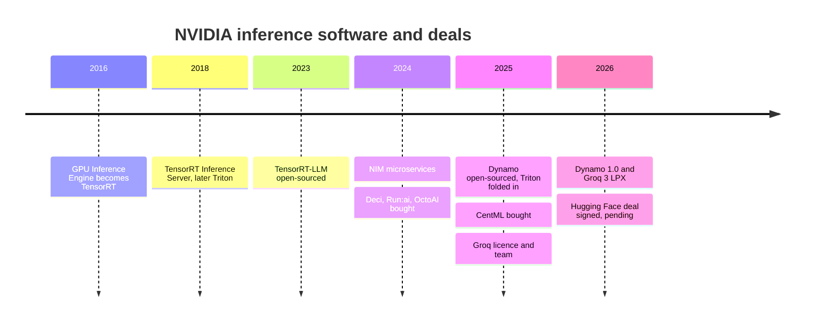
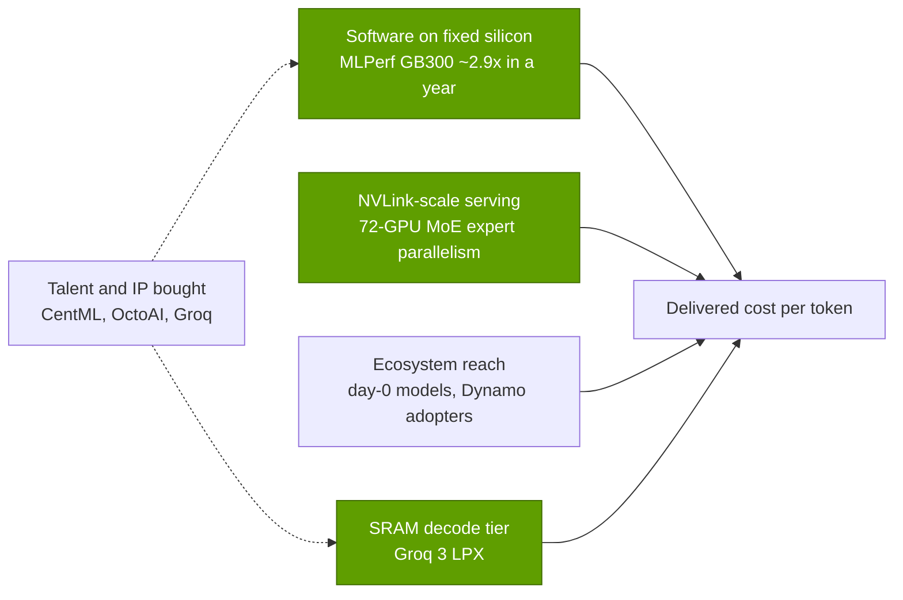

# Inference and AI software: History and how NVIDIA built it

Layer 11 · Inference and AI software · ~11 min read · Last verified: 2026-11-05

## ⚡ The Executive Take

- **Four moves in ten years:** TensorRT (2016), Triton (2018), TensorRT-LLM and NIM (2023–24), then Dynamo (2025; 1.0 in March 2026) [[S11505]](../../sources/bibliography.md#s11505)[[S11009]](../../sources/bibliography.md#s11009)[[S522]](../../sources/bibliography.md#s522)[[S11014]](../../sources/bibliography.md#s11014)[[S32015]](../../sources/bibliography.md#s32015)[[S90066]](../../sources/bibliography.md#s90066).
- **Talent bought where short:** Deci, Run:ai, OctoAI and CentML, ~$1.65B in 14 months 🟡 [[S478]](../../sources/bibliography.md#s478)[[S476]](../../sources/bibliography.md#s476)[[S11510]](../../sources/bibliography.md#s11510)[[S11509]](../../sources/bibliography.md#s11509).
- **A hardware hedge:** the ~$20B Groq licence and team became the Groq 3 LPX decode rack, in production from August 2026 [[S90019]](../../sources/bibliography.md#s90019)[[S506]](../../sources/bibliography.md#s506).
- **Distribution:** a ~$12.9B Hugging Face agreement (September 2026) awaits regulatory review 🟡 [[S11026]](../../sources/bibliography.md#s11026)[[S11500]](../../sources/bibliography.md#s11500).
- **[Q4 · Source of advantage]** Integration and speed: software lifted GB300 NVL72's MLPerf DeepSeek-R1 Server result ~2.9× in a year, and 72-GPU NVLink domains serve giant MoE models [[S601]](../../sources/bibliography.md#s601)[[S603]](../../sources/bibliography.md#s603).
- **[Q6 · Replication cost]** 🔴 Est. ~3–5 years, ~$1–3B and ~500–1,000 engineers on new silicon that rides open engines; rack-scale serving adds hardware years.

## From one fast GPU to an inference factory

**Phase 1 (2016–2022): one fast GPU.** The GPU Inference Engine (mid-2016), renamed TensorRT that September, compiles a trained network into a tuned runtime [[S11505]](../../sources/bibliography.md#s11505); it reached version 11.4 in October 2026 [[S11504]](../../sources/bibliography.md#s11504). A model server (TensorRT Inference Server, later Triton) followed; it even serves CPUs and AWS Inferentia [[S11009]](../../sources/bibliography.md#s11009)[[S11506]](../../sources/bibliography.md#s11506). **Phase 2 (2023–2024): fast, packaged LLMs.** TensorRT-LLM (2023) added LLM batching and [quantization](../../glossary.md#quantization) [[S522]](../../sources/bibliography.md#s522)[[S589]](../../sources/bibliography.md#s589); [NIM](../../glossary.md#nim) packaged models as containers sold through [AI Enterprise](../../glossary.md#ai-enterprise) [[S11014]](../../sources/bibliography.md#s11014)[[S11015]](../../sources/bibliography.md#s11015). **Phase 3 (2025–): the rack as one machine.** [Dynamo](../../glossary.md#dynamo) splits [prefill](../../glossary.md#prefill) from [decode](../../glossary.md#decode) and routes by [KV cache](../../glossary.md#kv-cache) across an NVL72; Triton became Dynamo-Triton [[S32015]](../../sources/bibliography.md#s32015)[[S11010]](../../sources/bibliography.md#s11010). Mechanics: [TensorRT-LLM and Dynamo](tensorrt-llm-and-dynamo.md).

| Date | Decision | Why it mattered | Source |
|---|---|---|---|
| 2016-09 | GIE renamed TensorRT | Inference became a product, not a by-product of training | [[S11505]](../../sources/bibliography.md#s11505) |
| 2018 | Open model server (Triton) | Owned the serving API, even for CPUs and Inferentia | [[S11009]](../../sources/bibliography.md#s11009)[[S11506]](../../sources/bibliography.md#s11506) |
| 2023 | TensorRT-LLM open-sourced | Answered vLLM; NVIDIA-only by design | [[S522]](../../sources/bibliography.md#s522)[[S589]](../../sources/bibliography.md#s589) |
| 2024-03 | NIM in AI Enterprise | Turned software into a per-GPU licence ($4,500 list) | [[S11014]](../../sources/bibliography.md#s11014)[[S9515]](../../sources/bibliography.md#s9515) |
| 2024-04 → 2025-06 | Deci, Run:ai, OctoAI, CentML | Bought compiler, scheduling and serving teams | [[S478]](../../sources/bibliography.md#s478)[[S476]](../../sources/bibliography.md#s476)[[S11510]](../../sources/bibliography.md#s11510)[[S11509]](../../sources/bibliography.md#s11509) |
| 2025-03-18 | Dynamo open-sourced (Apache 2.0) | Sits above vLLM and SGLang instead of fighting them | [[S32015]](../../sources/bibliography.md#s32015)[[S11001]](../../sources/bibliography.md#s11001) |
| 2025-12-24 | Groq licence + team (~$20B) | SRAM decode tier without merger review | [[S90018]](../../sources/bibliography.md#s90018)[[S90019]](../../sources/bibliography.md#s90019) |
| 2026-03-16 | Dynamo 1.0; Groq 3 LPX unveiled | Production "inference OS" plus a decode rack | [[S90066]](../../sources/bibliography.md#s90066)[[S90003]](../../sources/bibliography.md#s90003) |
| 2026-09-03 | Hugging Face (~$12.9B, pending) | Owns the hub where open models are found | [[S11026]](../../sources/bibliography.md#s11026)[[S11500]](../../sources/bibliography.md#s11500) |

> [!TIP]
> **Worked example — buy vs build, in R&D terms.** Deci, OctoAI and CentML cost ~$950M combined (press-reported) [[S478]](../../sources/bibliography.md#s478)[[S11510]](../../sources/bibliography.md#s11510)[[S11509]](../../sources/bibliography.md#s11509), about 5% of NVIDIA's $18.5B FY2026 R&D budget [[S401]](../../sources/bibliography.md#s401). The Groq deal (~$20B) equals ~1.1 years of that R&D [[S90019]](../../sources/bibliography.md#s90019). Small teams sped up software NVIDIA was building anyway; the big cheques bought hardware and distribution it lacked.

![Log-scale horizontal bar chart of inference-related deals. NVIDIA: Groq licence and team (~$20,000M reported, Dec 2025), Hugging Face ($12,930M announced Sep 2026, pending, close expected H1 2027), Run:ai (~$700M, 2024), CentML (up to ~$400M incl. earn-outs, 2025), Deci (~$300M, 2024), OctoAI (~$250M, 2024). Qualcomm: Modular ($3,900M, 2026). AMD: Silo AI ($665M, 2024) plus undisclosed Nod.ai, Brium, the Untether AI team and MK1. Intel's ~$1.6B SambaNova talks did not complete; Red Hat's Neural Magic purchase was undisclosed (5 deals in total without a price).](../../assets/charts/11-inference-deal-values.svg)

🔧 Under the hood: why a "licence plus team" instead of an acquisition

The Groq deal was a non-exclusive licence plus hiring (founder Jonathan Ross, president Sunny Madra and much of the team); Groq kept GroqCloud under a new CEO [[S90018]](../../sources/bibliography.md#s90018). Analysts read it as a way to get technology and people without a merger review [[S90019]](../../sources/bibliography.md#s90019)[[S474]](../../sources/bibliography.md#s474); former Groq engineers later sued Groq's board [[S118]](../../sources/bibliography.md#s118). Hugging Face, by contrast, is a full acquisition awaiting approval, expected to close in H1 2027 [[S11026]](../../sources/bibliography.md#s11026)[[S11027]](../../sources/bibliography.md#s11027).

## [Q4 · Source of advantage] Same hardware, more tokens

Three sources compound. **Software on fixed silicon:** the same GB300 NVL72 went from 2,907 to 8,291 tokens/s per GPU on MLPerf DeepSeek-R1 Server between September 2025 and September 2026 [[S601]](../../sources/bibliography.md#s601)[[S603]](../../sources/bibliography.md#s603). **NVLink-scale serving:** wide [expert parallelism](../../glossary.md#expert-parallelism) across a 72-GPU domain lifted Kimi K2.5 throughput ~3.1× over B200 nodes on the same vLLM engine [[S630]](../../sources/bibliography.md#s630). **Ecosystem reach:** Dynamo 1.0 launched with adopters from CoreWeave and Together AI to ByteDance and PayPal [[S90066]](../../sources/bibliography.md#s90066). Chip technology is not the moat (AMD reached per-GPU parity on MLPerf Llama 2 70B [[S602]](../../sources/bibliography.md#s602)); integration is: rack, fabric and engine tuned together, refreshed yearly.

> [!TIP]
> **Worked example — what software gains are worth.** A GB300 NVL72 is ~$4M per rack (Morgan Stanley Est.) [[S332]](../../sources/bibliography.md#s332). If software lifts tokens per GPU 2.85× (2,907 → 8,291) [[S601]](../../sources/bibliography.md#s601)[[S603]](../../sources/bibliography.md#s603), the owner gets ~2.85 racks of output for the price of one, ~$7M of avoided capex per rack. That is why NVIDIA can give Dynamo away: the gains make its GPUs worth more.

## [Q6 · Replication cost] What a competitive stack takes

| Component | Time | Dollars | Talent | Evidence |
|---|---|---|---|---|
| Single-node serving engine | 1–2 years | $0.1–0.2B | 50–150 engineers | vLLM and SGLang from university labs; seeds of $150M and $100M [[S11511]](../../sources/bibliography.md#s11511)[[S11513]](../../sources/bibliography.md#s11513) |
| Kernels, compilers, day-0 models on new silicon | 2–3 years | $0.5–1.5B | 200–500 | AMD: Silo AI ($665M), Nod.ai, Brium, Untether team, MK1; MI355X parity in 2026 [[S9506]](../../sources/bibliography.md#s9506)[[S9507]](../../sources/bibliography.md#s9507)[[S9509]](../../sources/bibliography.md#s9509)[[S602]](../../sources/bibliography.md#s602) |
| Rack-scale disaggregated serving | 3–5 years | $1–2B plus fabric | 200–400 | NVIDIA 2016–2026; llm-d as open shortcut [[S11503]](../../sources/bibliography.md#s11503) |
| Distribution and developer reach | years, or buy | $3.9–12.9B | — | Modular, Hugging Face prices [[S9511]](../../sources/bibliography.md#s9511)[[S11026]](../../sources/bibliography.md#s11026) |

Repo estimate 🔴: engineer cost ~$0.5–1M a year fully loaded; ranges overlap where open source is reused.

**Answer:** 🔴 Est. ~3–5 years, ~$1–3B and ~500–1,000 engineers for a competitive stack on new silicon that rides vLLM, SGLang and llm-d. NVLink-scale MoE serving also needs a scale-up fabric; UALink products arrive only in 2027 🟡 [[S90051]](../../sources/bibliography.md#s90051). The engine is the cheap part; kernels per chip and the rack are not.

> [!TIP]
> **Worked example — AMD's catch-up bill.** After SemiAnalysis's December 2024 ROCm critique, AMD went into "wartime mode" on software [[S9537]](../../sources/bibliography.md#s9537), adding Brium, the Untether AI team and MK1 to Silo AI ($665M) [[S9506]](../../sources/bibliography.md#s9506)[[S9507]](../../sources/bibliography.md#s9507)[[S9509]](../../sources/bibliography.md#s9509). By April 2026 MI355X matched B200 on MLPerf Llama 2 70B (12,935 vs 12,994 tokens/s per GPU) [[S602]](../../sources/bibliography.md#s602), yet trailed by up to 5× at 150 tokens/s per user on agentic serving [[S636]](../../sources/bibliography.md#s636). Per-chip parity took ~16 months; rack-scale parity is still open.

## Counterfactuals — what if NVIDIA hadn't…

- **…open-sourced Dynamo?** 🔴 llm-d (Red Hat, Google, IBM, CoreWeave) would likely have become the default distributed layer, without NVIDIA's KV-transfer library inside [[S11503]](../../sources/bibliography.md#s11503). NVIDIA co-founded llm-d too: a hedge either way.
- **…done the Groq deal?** 🔴 Groq (~$6.9B in September 2025) would have stayed a low-latency rival or gone to a competitor, leaving NVIDIA with Rubin CPX, which left the GTC 2026 roadmap [[S90019]](../../sources/bibliography.md#s90019)[[S115]](../../sources/bibliography.md#s115). Cerebras, with OpenAI's 750 MW, would own the ultra-low-latency tier [[S11523]](../../sources/bibliography.md#s11523).
- **…agreed to buy Hugging Face?** 🔴 The hub would have stayed neutral; NVIDIA says its chips will not be required there, a pledge regulators may test [[S11026]](../../sources/bibliography.md#s11026)[[S11501]](../../sources/bibliography.md#s11501).

## 🎯 Corp Dev Lens

1. NVIDIA paid ~$1B for software teams but ~$20B for a hardware licence: is the scarce inference asset silicon architecture rather than serving code?
2. The Groq structure avoided merger review; how will regulators treat the next such deal after the Hugging Face scrutiny?
3. If an engine costs ~$0.1–0.2B to replicate but kernels per chip cost ~$0.5–1.5B, should a challenger fund kernels in vLLM/SGLang rather than its own engine?
4. Which independent serving and compiler teams remain, and who else is bidding?

## 📚 Sources

<!-- Auto-generated from the [S…] citations on this page by `make build`. Edit sources/registry/*.csv, not this list. -->

- [**S115**](../../sources/bibliography.md#s115) Tom's Hardware, *Nvidia removes Rubin CPX accelerators from its roadmap - Groq 3 LPUs take center stage*, 2026-03. [Link](https://www.tomshardware.com/pc-components/gpus/nvidia-removes-rubin-cpx-accelerators-from-its-roadmap-groq-3-lpus-take-center-stage-as-cpx-is-removed)
- [**S118**](../../sources/bibliography.md#s118) Tom's Hardware, *Former Groq engineers sue board over $20 billion Nvidia deal*, 2026. [Link](https://www.tomshardware.com/tech-industry/semiconductors/former-groq-engineers-sue-board-over-usd20-billion-nvidia-deal-saying-it-handed-nvidia-the-lpu-and-the-team-that-built-it-plaintiffs-allege-the-board-kept-billions-from-other-shareholders)
- [**S332**](../../sources/bibliography.md#s332) Tiger Brokers (iTiger), *Morgan Stanley's BOM analysis of NVIDIA's Rubin: GPU share declines; PCB, MLCC and ABF substrate values soar*, 2026-05-20. [Link](https://www.itiger.com/news/1188068712)
- [**S401**](../../sources/bibliography.md#s401) NVIDIA Corporation via SEC EDGAR, *NVIDIA Corporation Form 10-K for fiscal year ended January 25, 2026*, 2026-02-25. [Link](https://www.sec.gov/Archives/edgar/data/1045810/000104581026000021/nvda-20260125.htm)
- [**S474**](../../sources/bibliography.md#s474) Groq Newsroom, *Groq and NVIDIA enter non-exclusive inference technology licensing agreement*, 2025-12-24. [Link](https://groq.com/newsroom)
- [**S476**](../../sources/bibliography.md#s476) NVIDIA Blog, *NVIDIA to Acquire GPU Orchestration Software Provider Run:ai*, 2024-04-24. [Link](https://blogs.nvidia.com/blog/runai/)
- [**S478**](../../sources/bibliography.md#s478) NVIDIA, *NVIDIA Blog and Newsroom acquisition announcements (Cumulus, SwiftStack, DeepMap, Bright Computing, Excelero, Shoreline, Brev.dev, OctoAI, VinBrain, Gretel, Lepton AI, CentML, SchedMD)*, 2025-12. [Link](https://blogs.nvidia.com/)
- [**S506**](../../sources/bibliography.md#s506) SamMobile, *Samsung Foundry begins mass production of NVIDIA Groq 3 LPX chip*, 2026-08-25. [Link](https://www.sammobile.com/news/samsung-foundry-mass-production-nvidia-groq-3-lpx-chip/)
- [**S522**](../../sources/bibliography.md#s522) Python Package Index, *PyPI JSON API release histories (vllm, sglang, tensorrt-llm, ai-dynamo, torch-npu, jax-rocm7-plugin, tensorflow-rocm, intel-extension-for-tensorflow, onnxruntime-cann, onnxruntime-migraphx, torch-xla, torch-tpu)*, 2026-11-05. [Link](https://pypi.org/)
- [**S589**](../../sources/bibliography.md#s589) NVIDIA (GitHub: NVIDIA/TensorRT-LLM), *TensorRT-LLM README*, 2026-11. [Link](https://github.com/NVIDIA/TensorRT-LLM/blob/main/README.md)
- [**S601**](../../sources/bibliography.md#s601) MLCommons, *MLPerf Inference v5.1 results (summary_results.json and per-submitter logs)*, 2025-09-09. [Link](https://github.com/mlcommons/inference_results_v5.1)
- [**S602**](../../sources/bibliography.md#s602) MLCommons, *MLPerf Inference v6.0 results (summary_results.json and per-submitter logs)*, 2026-04-01. [Link](https://github.com/mlcommons/inference_results_v6.0)
- [**S603**](../../sources/bibliography.md#s603) MLCommons, *MLPerf Inference v6.1 results (summary.csv and per-submitter logs)*, 2026-09. [Link](https://github.com/mlcommons/inference_results_v6.1)
- [**S630**](../../sources/bibliography.md#s630) SemiAnalysis, *GB200 NVL72 vs B200 on Kimi K2.5: 3.1x from Wide EP vLLM*, 2026-04-23. [Link](https://github.com/SemiAnalysisAI/InferenceX-app/blob/main/packages/app/content/blog/gb200-nvl72-kimi-k2-5-vllm-wide-ep-3x-vs-b200.mdx)
- [**S636**](../../sources/bibliography.md#s636) SemiAnalysis, *GLM 5.3 on AgentX: NVIDIA Is Up to 5x Cheaper per Token at 150 tok/s/user*, 2026-08-25. [Link](https://github.com/SemiAnalysisAI/InferenceX-app/blob/main/packages/app/content/blog/glm-5-3-agentx-nvidia-vs-amd-sglang-150-toks.mdx)
- [**S9506**](../../sources/bibliography.md#s9506) Converge Digest, *AMD completes $665 million acquisition of Silo AI*, 2024-08. [Link](https://convergedigest.com/amd-completes-665-million-acquisition-of-silo-ai/?amp=1)
- [**S9507**](../../sources/bibliography.md#s9507) DatacenterDynamics, *AMD extends acquisition run: brings software optimization firm Brium and staff from recently shuttered Untether AI into the fold*, 2025-06. [Link](https://www.datacenterdynamics.com/en/news/amd-extends-acquisition-run-brings-software-optimization-firm-brium-and-staff-from-recently-shuttered-untether-ai-into-the-fold/)
- [**S9509**](../../sources/bibliography.md#s9509) PrivSource (deal record), *AMD Acquires MK1*, 2025-11. [Link](https://www.privsource.com/acquisitions/deal/y3S4jb)
- [**S9511**](../../sources/bibliography.md#s9511) Nasdaq (Qualcomm press release), *Qualcomm Completes Acquisition of Modular*, 2026-07-29. [Link](https://www.nasdaq.com/press-release/qualcomm-completes-acquisition-modular-2026-07-29)
- [**S9515**](../../sources/bibliography.md#s9515) The Register (Tobias Mann), *Nvidia's software empire (NVIDIA AI Enterprise licensing)*, 2024-08-06. [Link](https://www.theregister.com/2024/08/06/nvidia_software_empire/)
- [**S9537**](../../sources/bibliography.md#s9537) SemiAnalysis, *AMD 2.0: new sense of urgency; MI450X chance to beat Nvidia; Nvidia's new moat*, 2025-04. [Link](https://newsletter.semianalysis.com/p/amd-2-0-new-sense-of-urgency-mi450x-chance-to-beat-nvidia-nvidias-new-moat)
- [**S11001**](../../sources/bibliography.md#s11001) NVIDIA (GitHub), *NVIDIA Dynamo README (ai-dynamo/dynamo)*, 2026-11. [Link](https://github.com/ai-dynamo/dynamo/blob/main/README.md)
- [**S11009**](../../sources/bibliography.md#s11009) NVIDIA (GitHub triton-inference-server/server), *Triton Inference Server README*, 2026-11. [Link](https://github.com/triton-inference-server/server/blob/main/README.md)
- [**S11010**](../../sources/bibliography.md#s11010) NVIDIA Developer, *NVIDIA Dynamo-Triton (product page)*, 2025-03-18. [Link](https://developer.nvidia.com/dynamo-triton)
- [**S11014**](../../sources/bibliography.md#s11014) NVIDIA (press release via Nasdaq), *NVIDIA launches generative AI microservices for developers to create and deploy generative AI copilots across NVIDIA CUDA GPU installed base*, 2024-03-18. [Link](https://www.nasdaq.com/press-release/nvidia-launches-generative-ai-microservices-for-developers-to-create-and-deploy)
- [**S11015**](../../sources/bibliography.md#s11015) HPCwire (NVIDIA press release), *NVIDIA NIM now available to transform world's millions of developers into generative AI developers*, 2024-06-02. [Link](https://www.hpcwire.com/aiwire/2024/06/02/nvidia-nim-now-available-to-transform-worlds-millions-of-developers-into-generative-ai-developers/)
- [**S11026**](../../sources/bibliography.md#s11026) Implicator.ai, *Nvidia confirms $12.9 billion Hugging Face deal, says its chips won't be required*, 2026-09. [Link](https://www.implicator.ai/nvidia-confirms-12-9-billion-hugging-face-deal-says-its-chips-wont-be-required/)
- [**S11027**](../../sources/bibliography.md#s11027) MLex, *Nvidia may seek EU review of Hugging Face deal amid filing uncertainty*, 2026-09-23. [Link](https://www.mlex.com/mlex/articles/2528556/nvidia-may-seek-eu-review-of-hugging-face-deal-amid-european-filing-uncertainty)
- [**S11500**](../../sources/bibliography.md#s11500) TechRadar Pro, *'The planets aligned': Nvidia confirms $12.9bn Hugging Face deal in potentially huge AI shake-up*, 2026-09-03. [Link](https://techradar.com/pro/the-planets-aligned-nvidia-confirms-usd12-9bn-hugging-face-deal-in-potentially-huge-ai-shake-up)
- [**S11501**](../../sources/bibliography.md#s11501) Dealroom, *Nvidia's $12.9B Hugging Face deal could be blocked by Europe*, 2026-09. [Link](https://dealroom.co/news/147219-nvidias-12-9b-hugging-face-deal-could-be-blocked-by-europe/)
- [**S11503**](../../sources/bibliography.md#s11503) llm-d project (GitHub: llm-d/llm-d), *llm-d README (distributed inference on Kubernetes)*, 2026-11. [Link](https://github.com/llm-d/llm-d/blob/main/README.md)
- [**S11504**](../../sources/bibliography.md#s11504) NVIDIA (GitHub: NVIDIA/TensorRT), *TensorRT open-source repository CHANGELOG*, 2026-10-09. [Link](https://github.com/NVIDIA/TensorRT/blob/main/CHANGELOG.md)
- [**S11505**](../../sources/bibliography.md#s11505) NVIDIA Developer Blog, *Production Deep Learning with NVIDIA GPU Inference Engine (Parallel Forall blog; update: GIE is now TensorRT)*, 2016-06. [Link](https://developer.nvidia.com/blog/parallelforall/production-deep-learning-nvidia-gpu-inference-engine)
- [**S11506**](../../sources/bibliography.md#s11506) NVIDIA Docs, *Triton Inference Server Release Notes*, 2026. [Link](https://docs.nvidia.com/deeplearning/triton-inference-server/pdf/Triton-Inference-Server-Release-Notes.pdf)
- [**S11509**](../../sources/bibliography.md#s11509) The Logic, *Nvidia's deal for CentML could be worth more than US$400M*, 2025-06. [Link](https://thelogic.co/news/exclusive/nvidias-deal-centml-us400m/)
- [**S11510**](../../sources/bibliography.md#s11510) Analytics Insight, *Top AI acquisitions of 2024: a detailed analysis*, 2024-12. [Link](https://www.analyticsinsight.net/amp/story/artificial-intelligence/top-ai-acquisitions-of-2024-a-detailed-analysis)
- [**S11511**](../../sources/bibliography.md#s11511) TechCrunch, *Inference startup Inferact lands $150M to commercialize vLLM*, 2026-01-22. [Link](https://techcrunch.com/2026/01/22/inference-startup-inferact-lands-150m-to-commercialize-vllm/)
- [**S11513**](../../sources/bibliography.md#s11513) Doolpa, *RadixArk raises $100M seed to grow the SGLang inference engine*, 2026-05-05. [Link](https://doolpa.com/news/radixark-100m-seed-accel-spark-nvidia-amd-sglang-may-5-2026)
- [**S11523**](../../sources/bibliography.md#s11523) DatacenterDynamics, *OpenAI signs $10 billion deal with Cerebras with 750MW of big chip compute*, 2026-01-14. [Link](https://www.datacenterdynamics.com/en/news/openai-signs-10-billion-deal-with-cerebras-with-750mw-of-big-chip-compute/)
- [**S32015**](../../sources/bibliography.md#s32015) NVIDIA Newsroom, *NVIDIA Dynamo open-source inference framework announcement (GTC 2025)*, 2025-03-18. [Link](https://nvidianews.nvidia.com/news/nvidia-dynamo-open-source-library-accelerates-and-scales-ai-reasoning-models)
- [**S90003**](../../sources/bibliography.md#s90003) eWeek, *Everything Nvidia Just Announced at GTC 2026: 7 Chips, 5 Racks, 1 Giant Bet on Agentic AI*, 2026-03-17. [Link](https://www.eweek.com/news/nvidia-gtc-2026-ai-inference-vera-rubin-neuron/)
- [**S90018**](../../sources/bibliography.md#s90018) Constellation Research, *Nvidia's Groq deal: acquisition, acquihire or creative licensing deal?*, 2025-12. [Link](https://www.constellationr.com/insights/news/nvidias-groq-deal-acquisition-acquihire-or-creative-licensing-deal)
- [**S90019**](../../sources/bibliography.md#s90019) TechSpot, *Nvidia's $20 billion Groq deal looks a lot like an acquisition*, 2025-12. [Link](https://www.techspot.com/news/110723-nvidia-20-billion-groq-deal-looks-lot-like.html)
- [**S90051**](../../sources/bibliography.md#s90051) SDxCentral, *UALink Consortium takes another swing at Nvidia's NVLink supremacy with specification 2.0*, 2026-04. [Link](https://www.sdxcentral.com/news/ualink-consortium-takes-another-swing-at-nvidias-nvlink-supremacy-with-specification-20/)
- [**S90066**](../../sources/bibliography.md#s90066) HPCwire (NVIDIA press release), *NVIDIA enters production with Dynamo, the broadly adopted inference operating system for AI factories*, 2026-03-17. [Link](https://www.hpcwire.com/aiwire/tag/dynamo-1-0/)
