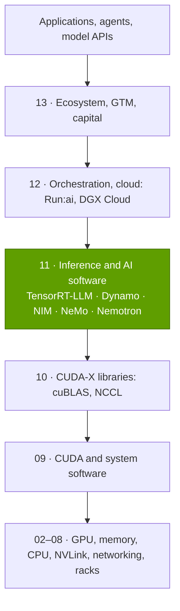
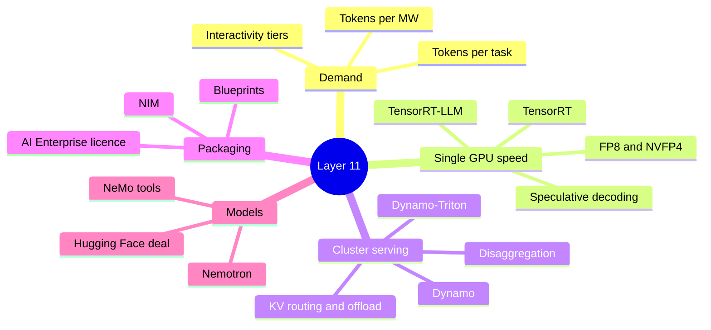

# Layer 11 — Inference and AI software

Layer 11 of 12 · The software that turns GPUs into served tokens: TensorRT-LLM, Dynamo, NIM, NeMo, Nemotron and AI Enterprise · ~6 min read · Last verified: 2026-11-05

## ⚡ The Executive Take

- **Inference is the growth engine, but NVIDIA stopped sizing it.** Management last put [inference](../../glossary.md#inference) at more than 40% of Data Center revenue for the year to Q2 FY2025, at least ~$33B [[S11011]](../../sources/bibliography.md#s11011)[[S441]](../../sources/bibliography.md#s441). Since then it speaks only qualitatively: "inference is revenues" [[S11012]](../../sources/bibliography.md#s11012)[[S409]](../../sources/bibliography.md#s409).
- **Reasoning and agents multiply tokens per task.** In this repo's illustration a reasoning answer generates ~21× a chat reply's tokens and a coding agent ~1,100× the total (Est.) [[S32025]](../../sources/bibliography.md#s32025). Google's monthly tokens rose ~134× in 18 months [[S32018]](../../sources/bibliography.md#s32018)[[S32020]](../../sources/bibliography.md#s32020).
- **Systems are judged on a curve, not a peak.** At 50 tokens/s per user, GB300 NVL72 serves ~6,261 tokens/s per GPU on DeepSeek-R1, ~20× H200; per megawatt the gap is ~13× [[S621]](../../sources/bibliography.md#s621)[[S622]](../../sources/bibliography.md#s622).
- **Software keeps lifting the same hardware.** MLPerf DeepSeek-R1 throughput on an unchanged GB300 NVL72 rose 2.9× in a year, cutting estimated cost per million tokens ~65% [[S601]](../../sources/bibliography.md#s601)[[S603]](../../sources/bibliography.md#s603)[[S622]](../../sources/bibliography.md#s622).
- 🟢 **Dynamo 1.0 makes a cluster serve like one machine.** It shipped at GTC 2026 as Apache-2.0 open source [[S90066]](../../sources/bibliography.md#s90066)[[S520]](../../sources/bibliography.md#s520). Splitting [prefill](../../glossary.md#prefill) from [decode](../../glossary.md#decode) lifted B200 throughput ~2.5× per GPU on long prompts [[S621]](../../sources/bibliography.md#s621).
- **Direct software revenue is small; pull-through is the point.** [NVIDIA AI Enterprise](../../glossary.md#nvidia-ai-enterprise) lists at $4,500 per GPU-year [[S11013]](../../sources/bibliography.md#s11013), and software was guided to ~$2B a year exiting FY2025 [[S11011]](../../sources/bibliography.md#s11011), under 1% of Data Center revenue.
- **Biggest weakness: little here locks customers in.** Dynamo also runs [vLLM](../../glossary.md#vllm) and [SGLang](../../glossary.md#sglang), which support AMD and others [[S11001]](../../sources/bibliography.md#s11001)[[S580]](../../sources/bibliography.md#s580)[[S582]](../../sources/bibliography.md#s582). Google's TPU served one large model ~18% cheaper per token than B200 [[S625]](../../sources/bibliography.md#s625). 🟡 The ~$12.9B [Hugging Face](../../glossary.md#hugging-face) purchase faces neutrality scrutiny [[S11026]](../../sources/bibliography.md#s11026)[[S11028]](../../sources/bibliography.md#s11028).

## Where this layer sits in the stack

This layer sits above CUDA and its libraries ([Layer 09](../09-cuda-and-system-software/index.md), [Layer 10](../10-libraries-cuda-x/index.md)) and below cluster orchestration ([Layer 12](../12-orchestration-and-cloud-services/index.md)).

> [!TIP]
> **Worked example — one agent request through this layer.** A coding agent sends a 60,000-token context and asks for 1,500 new tokens. Dynamo's router picks a worker that already caches most of that context, so only the new turn is prefilled [[S11001]](../../sources/bibliography.md#s11001). A prefill pool computes it and NIXL ships the [KV cache](../../glossary.md#kv-cache) to a decode pool [[S11002]](../../sources/bibliography.md#s11002)[[S11003]](../../sources/bibliography.md#s11003). At 50 tokens/s per user the answer streams in 30 s. At 100 tokens/s it takes 15 s but uses ~11× more GPU time per token on GB300 NVL72 (6,261 vs ~562 tokens/s per GPU, Est.) [[S621]](../../sources/bibliography.md#s621)[[S622]](../../sources/bibliography.md#s622). **Business reading:** this layer turns one GPU price into many token prices.

🔧 Under the hood: what "inference software" covers here

**Compilers and runtimes**: TensorRT and TensorRT-LLM make one GPU or NVLink domain fast [[S11008]](../../sources/bibliography.md#s11008)[[S589]](../../sources/bibliography.md#s589). **Serving**: Dynamo and Dynamo-Triton route requests, split phases, move caches and autoscale [[S11001]](../../sources/bibliography.md#s11001)[[S11010]](../../sources/bibliography.md#s11010). **Packaging**: NIM containers and the AI Enterprise licence [[S11013]](../../sources/bibliography.md#s11013). **Models and tools**: Nemotron and NeMo [[S11019]](../../sources/bibliography.md#s11019)[[S11029]](../../sources/bibliography.md#s11029). Kubernetes scheduling and cloud services sit in [Layer 12](../12-orchestration-and-cloud-services/index.md).

## Layer map

## The eight questions at a glance

| # | Question | Short answer | Where answered |
|---|---|---|---|
| Q1 | Job, and what breaks if weak? | Turn GPU-hours into the most tokens at each latency tier; weak software leaves a 2–3× cost gap on the same silicon [[S601]](../../sources/bibliography.md#s601)[[S603]](../../sources/bibliography.md#s603). | [The inference shift](the-inference-shift.md) |
| Q2 | Metrics that matter? | Tokens/s per GPU at a stated tokens/s per user; tokens/s per MW; $ per million tokens; time to first token. | [The inference shift](the-inference-shift.md) |
| Q3 | Generational progress? | H200 ~308 → GB300 NVL72 ~6,261 tokens/s per GPU at 50 per user [[S621]](../../sources/bibliography.md#s621); software alone 2.9× in a year [[S603]](../../sources/bibliography.md#s603). | [Software gains](software-gains-on-same-hardware.md) |
| Q4 | Source of advantage? | Software co-designed with rack hardware (NVL72, NVFP4), and speed tuning each new model. | [History and how built](history-and-how-built.md) |
| Q5 | Strongest challenger? | Hardware-neutral open engines (vLLM, SGLang) plus Google's TPU on cost per token [[S625]](../../sources/bibliography.md#s625). | [Competition](competition.md) |
| Q6 | Replication cost? | Engines are copyable; the per-model tuning treadmill tied to rack-scale hardware is not. | [History and how built](history-and-how-built.md) |
| Q7 | Roadmap? | 🟢 Dynamo on Vera Rubin; 🟡 Groq LPX decode racks (35× tokens per watt claimed) [[S113]](../../sources/bibliography.md#s113)[[S90003]](../../sources/bibliography.md#s90003); 🟡 Nemotron 4 via a coalition [[S11022]](../../sources/bibliography.md#s11022). | [Roadmap](roadmap.md) |
| Q8 | Value pools? | Direct software ~$2B a year [[S11011]](../../sources/bibliography.md#s11011); the real pool is hardware pull-through. Deals: Groq licence, 🟡 Hugging Face [[S90019]](../../sources/bibliography.md#s90019)[[S11026]](../../sources/bibliography.md#s11026). | [Value chain and corp dev](value-chain-and-corp-dev.md) |

## Pages in this layer

| Page | What you will learn |
|---|---|
| [The inference shift](the-inference-shift.md) | Tokens per task, the latency curve, tokens per MW, revenue share |
| [TensorRT-LLM and Dynamo](tensorrt-llm-and-dynamo.md) | Single-GPU tricks, disaggregated serving, KV-cache routing |
| [Software gains on the same hardware](software-gains-on-same-hardware.md) | Lift on installed GPUs, its value, benchmark caveats |
| [NIM, NeMo, Nemotron and AI Enterprise](nim-nemo-nemotron-and-ai-enterprise.md) | Packaged models, licensing, open models, channel conflict |
| [Competition](competition.md) | Open engines, TPU, Trainium, inference ASICs |
| [History and how NVIDIA built it](history-and-how-built.md) | Key decisions; replication cost |
| [Roadmap](roadmap.md) | NVIDIA and competitor timelines |
| [Value chain and corp dev angles](value-chain-and-corp-dev.md) | Value pools; private companies |

## 🎯 Corp Dev Lens

1. **Inference software is a hardware-margin tool.** Licences list at $4,500 per GPU-year [[S11013]](../../sources/bibliography.md#s11013), yet software is under 1% of Data Center revenue. The real product is the extra tokens per GPU that justify the next rack.
2. **Openness cuts both ways.** Dynamo, TensorRT-LLM and Nemotron are open [[S11001]](../../sources/bibliography.md#s11001)[[S589]](../../sources/bibliography.md#s589)[[S11019]](../../sources/bibliography.md#s11019). Which pieces would a challenger adopt, fork or ignore?
3. **The metric is tokens per MW at a latency tier.** Any accelerator pitch, including Qualcomm's AI200/AI250 [[S173]](../../sources/bibliography.md#s173), is judged on that curve. What independent evidence exists at the tiers that pay most?
4. **Model distribution is becoming strategic.** A ~$12.9B Hugging Face bid [[S11026]](../../sources/bibliography.md#s11026) plus Nemotron make NVIDIA a model publisher. How will neutrality pledges fare under DOJ and EU review [[S11027]](../../sources/bibliography.md#s11027)[[S11028]](../../sources/bibliography.md#s11028)?

## 📚 Sources

<!-- Auto-generated from the [S…] citations on this page by `make build`. Edit sources/registry/*.csv, not this list. -->

- [**S113**](../../sources/bibliography.md#s113) Tom's Hardware, *How Nvidia's $20 billion Groq 3 LPU deal reshapes the Nvidia Vera Rubin Platform*, 2026-03. [Link](https://www.tomshardware.com/tech-industry/semiconductors/nvidias-20-billion-groq-deal-produces-its-first-chip)
- [**S173**](../../sources/bibliography.md#s173) Qualcomm, *Qualcomm Unveils AI200 and AI250 - Redefining Rack-Scale Data Center Inference*, 2025-10-27. [Link](https://www.qualcomm.com/news/releases/2025/10/qualcomm-unveils-ai200-and-ai250-redefining-rack-scale-data-cent)
- [**S409**](../../sources/bibliography.md#s409) NVIDIA Corporation, *NVIDIA Corp. (NVDA) Q1 Fiscal 2027 earnings call transcript (20 May 2026)*, 2026-05-20. [Link](https://s201.q4cdn.com/141608511/files/doc_financials/2027/q1/NVDA-Q1-2027-Earnings-Call-20-May-2026-5_00-PM-ET.pdf)
- [**S441**](../../sources/bibliography.md#s441) NVIDIA Corporation, *NVIDIA Announces Financial Results for Second Quarter Fiscal 2025 (press release with CFO commentary)*, 2024-08-28. [Link](https://nvidianews.nvidia.com/news/nvidia-announces-financial-results-for-second-quarter-fiscal-2025)
- [**S520**](../../sources/bibliography.md#s520) NVIDIA via ResearchPool, *NVIDIA Enters Production With Dynamo, the Broadly Adopted Inference Operating System for AI Factories (press release mirror)*, 2026-03-16. [Link](https://app.researchpool.com/company/nvda-us67066g1040-nvidia-corp-e9VqYYGjs8/press/nvidia-corporation-nvda-nvidia-enters-production-with-dynamo-the-broadly-adopted-inference-ope-DxMC1Gq48d)
- [**S580**](../../sources/bibliography.md#s580) vLLM project (GitHub), *vLLM README and installation docs — supported hardware*, 2026-11. [Link](https://github.com/vllm-project/vllm/blob/main/docs/getting_started/installation/README.md)
- [**S582**](../../sources/bibliography.md#s582) SGLang project (GitHub: sgl-project/sglang), *SGLang README — supported hardware*, 2026-11. [Link](https://github.com/sgl-project/sglang/blob/main/README.md)
- [**S589**](../../sources/bibliography.md#s589) NVIDIA (GitHub: NVIDIA/TensorRT-LLM), *TensorRT-LLM README*, 2026-11. [Link](https://github.com/NVIDIA/TensorRT-LLM/blob/main/README.md)
- [**S601**](../../sources/bibliography.md#s601) MLCommons, *MLPerf Inference v5.1 results (summary_results.json and per-submitter logs)*, 2025-09-09. [Link](https://github.com/mlcommons/inference_results_v5.1)
- [**S603**](../../sources/bibliography.md#s603) MLCommons, *MLPerf Inference v6.1 results (summary.csv and per-submitter logs)*, 2026-09. [Link](https://github.com/mlcommons/inference_results_v6.1)
- [**S621**](../../sources/bibliography.md#s621) SemiAnalysis (InferenceX-app repository), *InferenceX public API snapshot (benchmarks.json and benchmarks-history.json fixtures)*, 2026-10-17. [Link](https://github.com/SemiAnalysisAI/InferenceX-app/tree/main/packages/app/cypress/fixtures/api)
- [**S622**](../../sources/bibliography.md#s622) SemiAnalysis (InferenceX-app repository), *InferenceX hardware registry: TCO per GPU-hour by SKU (SemiAnalysis July 2026 pricing surveys and AI Cloud TCO Model)*, 2026-07. [Link](https://github.com/SemiAnalysisAI/InferenceX-app/blob/main/packages/constants/src/gpu-keys.ts)
- [**S625**](../../sources/bibliography.md#s625) SemiAnalysis, *TPU Inference Externalization Full Steam Ahead*, 2026-09-07. [Link](https://github.com/SemiAnalysisAI/InferenceX-app/blob/main/packages/app/content/blog/tpu-inferencex-full-steam.mdx)
- [**S11001**](../../sources/bibliography.md#s11001) NVIDIA (GitHub), *NVIDIA Dynamo README (ai-dynamo/dynamo)*, 2026-11. [Link](https://github.com/ai-dynamo/dynamo/blob/main/README.md)
- [**S11002**](../../sources/bibliography.md#s11002) NVIDIA (GitHub ai-dynamo/dynamo docs), *Dynamo design docs: Disaggregated Serving*, 2026. [Link](https://github.com/ai-dynamo/dynamo/blob/main/docs/fern/pages/developer-guide/knowledge-base/concepts/system-architecture/disaggregated-serving.md)
- [**S11003**](../../sources/bibliography.md#s11003) NVIDIA (GitHub ai-dynamo/nixl), *NVIDIA Inference Xfer Library (NIXL) README*, 2026-11. [Link](https://github.com/ai-dynamo/nixl/blob/main/README.md)
- [**S11008**](../../sources/bibliography.md#s11008) NVIDIA (GitHub NVIDIA/TensorRT), *TensorRT Open Source Software README (TensorRT 11.x announcement)*, 2026-11. [Link](https://github.com/NVIDIA/TensorRT/blob/main/README.md)
- [**S11010**](../../sources/bibliography.md#s11010) NVIDIA Developer, *NVIDIA Dynamo-Triton (product page)*, 2025-03-18. [Link](https://developer.nvidia.com/dynamo-triton)
- [**S11011**](../../sources/bibliography.md#s11011) MarketBeat, *NVIDIA Q2 Fiscal 2025 earnings call transcript (28 August 2024)*, 2024-08-28. [Link](https://www.marketbeat.com/earnings/transcripts/110080/)
- [**S11012**](../../sources/bibliography.md#s11012) The Motley Fool, *NVIDIA (NVDA) Q4 fiscal 2026 earnings call transcript (25 February 2026)*, 2026-02-25. [Link](https://www.fool.com/earnings/call-transcripts/2026/02/25/nvidia-nvda-q4-2026-earnings-call-transcript)
- [**S11013**](../../sources/bibliography.md#s11013) NVIDIA (docs.api.nvidia.com), *NVIDIA NIM FAQ*, 2025. [Link](https://docs.api.nvidia.com/nim/docs/faq)
- [**S11019**](../../sources/bibliography.md#s11019) NVIDIA (GitHub), *NVIDIA Nemotron Developer Repository README (NVIDIA-NeMo/Nemotron)*, 2026-11. [Link](https://github.com/NVIDIA-NeMo/Nemotron/blob/main/README.md)
- [**S11022**](../../sources/bibliography.md#s11022) Tom's Hardware, *Nvidia's Nemotron coalition brings eight AI labs together to build open frontier models*, 2026-03. [Link](https://www.tomshardware.com/tech-industry/artificial-intelligence/nvidias-nemoclaw-coalition-brings-eight-ai-labs-together-to-build-open-frontier-models)
- [**S11026**](../../sources/bibliography.md#s11026) Implicator.ai, *Nvidia confirms $12.9 billion Hugging Face deal, says its chips won't be required*, 2026-09. [Link](https://www.implicator.ai/nvidia-confirms-12-9-billion-hugging-face-deal-says-its-chips-wont-be-required/)
- [**S11027**](../../sources/bibliography.md#s11027) MLex, *Nvidia may seek EU review of Hugging Face deal amid filing uncertainty*, 2026-09-23. [Link](https://www.mlex.com/mlex/articles/2528556/nvidia-may-seek-eu-review-of-hugging-face-deal-amid-european-filing-uncertainty)
- [**S11028**](../../sources/bibliography.md#s11028) Stocktwits, *NVDA stock edges down on DOJ interest in $12.9 billion Hugging Face acquisition*, 2026-10-28. [Link](https://stocktwits.com/news-articles/markets/equity/nvda-stock-edges-down-on-doj-interest-in-12-9-billion-hugging-face-acquisition/cZU9MDeR9Go)
- [**S11029**](../../sources/bibliography.md#s11029) NVIDIA (GitHub NVIDIA-NeMo/Guardrails), *NVIDIA NeMo Guardrails library README*, 2026-11. [Link](https://github.com/NVIDIA-NeMo/Guardrails/blob/develop/README.md)
- [**S32018**](../../sources/bibliography.md#s32018) Google (The Keyword) (Sundar Pichai), *Google I/O 2025 keynote remarks (Sundar Pichai)*, 2025-05-20. [Link](https://blog.google/technology/ai/io-2025-keynote/)
- [**S32020**](../../sources/bibliography.md#s32020) Alphabet / Google (The Keyword) (Sundar Pichai), *Alphabet CEO remarks on token volume (October 2025)*, 2025-10. [Link](https://blog.google/inside-google/message-ceo/alphabet-earnings-q3-2025/)
- [**S32025**](../../sources/bibliography.md#s32025) nvidia_deep_dive_claude repository, *Repo analysis: inference token-budget scenarios and roofline serving model (Primer P2)*, 2026-11-05. [Link](https://github.com/FrankHuang94/nvidia_deep_dive_claude/blob/main/primers/P2-how-ai-inference-works.md)
- [**S90003**](../../sources/bibliography.md#s90003) eWeek, *Everything Nvidia Just Announced at GTC 2026: 7 Chips, 5 Racks, 1 Giant Bet on Agentic AI*, 2026-03-17. [Link](https://www.eweek.com/news/nvidia-gtc-2026-ai-inference-vera-rubin-neuron/)
- [**S90019**](../../sources/bibliography.md#s90019) TechSpot, *Nvidia's $20 billion Groq deal looks a lot like an acquisition*, 2025-12. [Link](https://www.techspot.com/news/110723-nvidia-20-billion-groq-deal-looks-lot-like.html)
- [**S90066**](../../sources/bibliography.md#s90066) HPCwire (NVIDIA press release), *NVIDIA enters production with Dynamo, the broadly adopted inference operating system for AI factories*, 2026-03-17. [Link](https://www.hpcwire.com/aiwire/tag/dynamo-1-0/)
