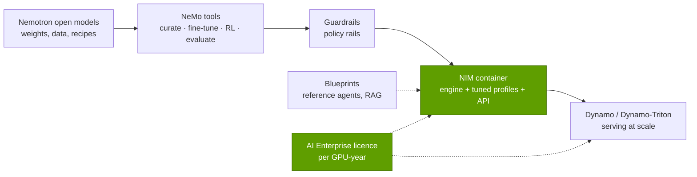
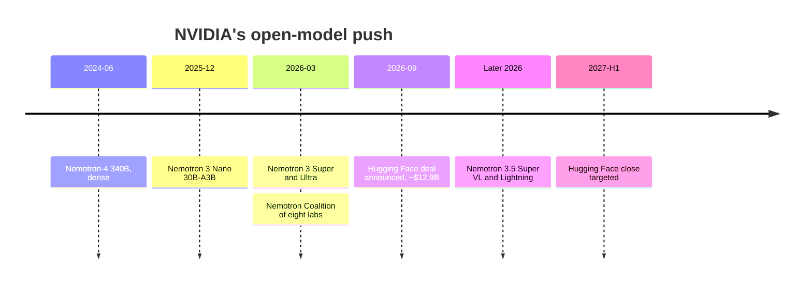

# NIM, NeMo, Nemotron and AI Enterprise

Layer 11 · Inference and AI software · ~9 min read · Last verified: 2026-11-05

## ⚡ The Executive Take

- **NIM turns a model into an appliance.** A [NIM](../../glossary.md#nim) microservice is a container with model weights, a tuned engine and an OpenAI-compatible API. It launched at GTC 2024 (18 March) and became generally available on 2 June 2024 [[S11014]](../../sources/bibliography.md#s11014)[[S11015]](../../sources/bibliography.md#s11015).
- **Development is free; production needs a licence.** Production NIM use requires [NVIDIA AI Enterprise](../../glossary.md#nvidia-ai-enterprise), from $4,500 per GPU-year or ~$1 per [GPU-hour](../../glossary.md#gpu-hour) in the cloud [[S11013]](../../sources/bibliography.md#s11013), ~30% on top of a B200's yearly owner cost [[S622]](../../sources/bibliography.md#s622). 🟡 At GTC Berlin (22 October 2026) Huang floated ~$2,000 per GPU-year for agent software, with no price list [[S11016]](../../sources/bibliography.md#s11016)[[S11017]](../../sources/bibliography.md#s11017).
- **Direct revenue is small.** Software, SaaS and support reached a ~$1B run rate in Q4 FY2024 [[S9516]](../../sources/bibliography.md#s9516) and was guided to ~$2B exiting FY2025 [[S11011]](../../sources/bibliography.md#s11011), under 1% of the latest year's $277.7B Data Center revenue [[S405]](../../sources/bibliography.md#s405).
- **NVIDIA is now a frontier open-model maker.** [Nemotron](../../glossary.md#nemotron) 3 Nano shipped in December 2025 [[S11021]](../../sources/bibliography.md#s11021); Nemotron 3 Ultra (550B total, 55B active) was announced at GTC 2026 with open weights [[S11019]](../../sources/bibliography.md#s11019). Nemotron 3 models use ~10% of their weights per token, vs 100% for 2024's Nemotron-4 340B [[S11019]](../../sources/bibliography.md#s11019)[[S34020]](../../sources/bibliography.md#s34020).
- **It is pulling partners in.** 🟢 An eight-lab Nemotron Coalition, including Mistral AI and Perplexity, is building Nemotron 4 on DGX Cloud [[S11022]](../../sources/bibliography.md#s11022). 🟡 NVIDIA agreed to buy Hugging Face for ~$12.9B, closing expected in H1 2027 subject to review [[S11025]](../../sources/bibliography.md#s11025)[[S11026]](../../sources/bibliography.md#s11026)[[S11027]](../../sources/bibliography.md#s11027).
- **Weakness: churn and channel conflict.** The NeMo Agent Toolkit and the RAG Blueprint were deprecated in October 2026 [[S11030]](../../sources/bibliography.md#s11030)[[S11031]](../../sources/bibliography.md#s11031). Building models and owning the main model hub moves NVIDIA closer to its largest customers' business.

![Log-scale paired horizontal bars of total and active parameters for NVIDIA's open Nemotron models: Nemotron-4 340B (June 2024, dense) 340B total and 340B active; Nemotron 3 Nano 30B-A3B (2025-12-15) 31.6B total, 3.6B active (11%); Nemotron 3 Super 120B-A12B (2026-03) 120.6B total, 12.7B active (11%); Nemotron 3 Ultra 550B-A55B (2026-03-16) 550B total, 55B active (10%); Nemotron 3.5 Lightning 30B-A3B (2026) 30B total, 3B active (10%); Nemotron 3.5 Super VL 120B-A12B (2026) 120B total, 12B active (10%). The Nemotron 3 generation uses hybrid Mamba-Transformer mixture-of-experts designs that activate about a tenth of the weights per token, cutting the memory bandwidth and compute each generated token needs.](../../assets/charts/11-nemotron-total-vs-active-parameters.svg)

## NIM and AI Enterprise: the model as an appliance

**Analogy.** Running an open model yourself is flat-pack furniture: the parts are free, the evening is not. A NIM is the assembled piece, delivered with a warranty.

**Mechanism.** Each NIM bundles a model, an engine ([TensorRT-LLM](../../glossary.md#tensorrt-llm), [vLLM](../../glossary.md#vllm) or [SGLang](../../glossary.md#sglang)), optimized profiles per GPU type and a standard API; developers use it free, enterprises deploy it under AI Enterprise [[S11015]](../../sources/bibliography.md#s11015)[[S11013]](../../sources/bibliography.md#s11013). The licence is per GPU, not per model [[S11013]](../../sources/bibliography.md#s11013), and covers support for TensorRT and [Triton](../../glossary.md#triton) too [[S11008]](../../sources/bibliography.md#s11008)[[S11009]](../../sources/bibliography.md#s11009).

> [!TIP]
> **Worked example — what the licence means for one rack.** A GB300 [NVL72](../../glossary.md#nvl72) has 72 GPUs: $324k a year at $4,500 list [[S11013]](../../sources/bibliography.md#s11013). The rack costs ~$4.0M (Est., Morgan Stanley) [[S332]](../../sources/bibliography.md#s332) and ~$1.46M a year to own and run ($2.31 × 8,760 h × 72, Est.) [[S622]](../../sources/bibliography.md#s622). List software adds ~8% of capex a year, or ~22% of annual owner cost. Secondary sources put the five-year term at $18,000 per GPU, ~$3,600 a year [[S11017]](../../sources/bibliography.md#s11017)[[S11018]](../../sources/bibliography.md#s11018). **Business reading:** large buyers negotiate or self-host open engines, so the licence lands mainly on enterprises wanting support (🔴 repo analysis).

**Scale check.** A ~$2B run rate [[S11011]](../../sources/bibliography.md#s11011) at $4,500 per GPU-year implies ~440,000 licensed GPUs (🔴 illustrative), a small slice of yearly shipments.

## NeMo, Guardrails and Blueprints: the customization toolchain

[NeMo](../../glossary.md#nemo) is NVIDIA's open toolkit family for building and adapting models: Curator for data, Megatron-Bridge and NeMo-RL for training, Evaluator for benchmarks [[S11019]](../../sources/bibliography.md#s11019). [NeMo Guardrails](../../glossary.md#nemo-guardrails) adds programmable rules around a model's inputs and outputs (release 0.24.1) [[S11029]](../../sources/bibliography.md#s11029). [AI Blueprints](../../glossary.md#ai-blueprint) are reference applications such as the AI-Q research agent [[S11032]](../../sources/bibliography.md#s11032).

> [!TIP]
> **Worked example — why a sparse Nemotron is cheap to serve.** Nemotron 3 Super has 120.6B parameters but activates 12.7B per token [[S11020]](../../sources/bibliography.md#s11020). In [NVFP4](../../glossary.md#nvfp4) (~0.56 bytes per parameter with scales) the weights take ~68 GB and fit one 180 GB B200, as NVIDIA's cookbook lists [[S11019]](../../sources/bibliography.md#s11019)[[S32017]](../../sources/bibliography.md#s32017). Each token reads only ~7 GB of active weights, so a single stream's bandwidth ceiling is ~8,000 ÷ 7 ≈ 1,100 tokens/s; a dense 120B model would manage ~120 (🔴 Est., ignoring cache traffic and routing) [[S11000]](../../sources/bibliography.md#s11000). **Business reading:** NVIDIA's model choices showcase NVFP4 and sparse inference on its own GPUs.

> [!WARNING]
> **Myth vs. reality:** "NVIDIA's software stack is a stable platform." Parts churn fast. The NeMo Agent Toolkit was deprecated in October 2026, end of life by year-end, replaced by NeMo Relay and NeMo Helix [[S11030]](../../sources/bibliography.md#s11030). The RAG Blueprint is "retained for reference only" [[S11031]](../../sources/bibliography.md#s11031). Standardizing on these tools means migration work.

🔧 Under the hood: what makes Nemotron 3 different

Nemotron 3 models are hybrids: mostly [Mamba](../../glossary.md#mamba) state-space layers, whose memory does not grow with context, plus a few attention layers and a sparse [mixture-of-experts](../../glossary.md#mixture-of-experts) design NVIDIA calls LatentMoE [[S11019]](../../sources/bibliography.md#s11019)[[S11020]](../../sources/bibliography.md#s11020). Super has 512 experts per layer and activates 22; it was pretrained on 25 trillion tokens using NVFP4 on B200 and supports 1M tokens of context [[S11020]](../../sources/bibliography.md#s11020). Nano used the same 25-trillion-token curriculum [[S11034]](../../sources/bibliography.md#s11034). NVIDIA publishes much of the data, recipes and RL environments with the weights [[S11019]](../../sources/bibliography.md#s11019), which most closed labs do not.

## Nemotron: why a chip company builds models

Dates: [[S34020]](../../sources/bibliography.md#s34020)[[S11021]](../../sources/bibliography.md#s11021)[[S11035]](../../sources/bibliography.md#s11035)[[S11019]](../../sources/bibliography.md#s11019)[[S11022]](../../sources/bibliography.md#s11022)[[S11026]](../../sources/bibliography.md#s11026); the Nemotron 3.5 month and the 2027 close are 🟡.

Four motives stand out (🔴 repo analysis on the cited facts):

1. **Seed demand.** Open models that run best in NVFP4 on NVIDIA GPUs pull enterprises and sovereign buyers onto its hardware [[S11019]](../../sources/bibliography.md#s11019)[[S11020]](../../sources/bibliography.md#s11020).
2. **Set reference performance.** NVIDIA's engines are tuned on its own models first.
3. **Sovereign AI.** Governments want models they can inspect and host; sovereign AI revenue exceeded ~$30B in FY2026 per management (🟡) [[S90071]](../../sources/bibliography.md#s90071).
4. **Hedge against labs going custom.** Anthropic plans up to 1M TPUs, OpenAI has a 6 GW AMD deal, and a Broadcom-designed OpenAI inference chip has been analysed [[S90025]](../../sources/bibliography.md#s90025)[[S90020]](../../sources/bibliography.md#s90020)[[S628]](../../sources/bibliography.md#s628).

> [!TIP]
> **Worked example — Nemotron 3 Ultra as a hardware sales tool.** Ultra has 550B parameters, 55B active [[S11019]](../../sources/bibliography.md#s11019). In NVFP4 the weights take ~308 GB, more than one 288 GB Rubin GPU [[S102]](../../sources/bibliography.md#s102). With a long-context cache it spans several GPUs, so a large [NVLink](../../glossary.md#nvlink) domain serves it best; each token reads only ~31 GB of active weights (🔴 Est.) [[S11000]](../../sources/bibliography.md#s11000). **Business reading:** the flagship open model is sized for the flagship rack.

### The channel-conflict question

NVIDIA's largest customers are model labs and the clouds that host them; one direct customer was 16% of Q2 FY2027 revenue [[S90069]](../../sources/bibliography.md#s90069).

| Move | Helps NVIDIA | Risk with labs and clouds |
|---|---|---|
| Nemotron open models | Inference demand; sovereign deals | Competes with customers' own open-weight releases |
| Nemotron Coalition | Shares model cost with eight labs [[S11022]](../../sources/bibliography.md#s11022) | Partners may resent dependence on DGX Cloud |
| Hugging Face acquisition 🟡 | Controls model distribution and developer habits [[S11025]](../../sources/bibliography.md#s11025) | Neutrality doubts; reported DOJ interest, possible EU review [[S11028]](../../sources/bibliography.md#s11028)[[S11027]](../../sources/bibliography.md#s11027) |
| AI Enterprise fees | Recurring revenue | Hyperscalers sell competing managed services |

NVIDIA's answer so far is openness: Huang said NVIDIA compute will not be required to build on or deploy through Hugging Face, with multi-accelerator support committed [[S11026]](../../sources/bibliography.md#s11026).

> [!NOTE]
> **🐂 Bull view.** Models, tools and the hub make NVIDIA the default starting point for open-model developers. Each Nemotron release is tuned for NVFP4 and NVL72 first [[S11019]](../../sources/bibliography.md#s11019)[[S11020]](../../sources/bibliography.md#s11020), and Hugging Face adds reach and data on what developers run [[S11025]](../../sources/bibliography.md#s11025).

> [!WARNING]
> **🐻 Bear view.** The licence monetizes a thin slice, the tools churn and the models are free. Owning Hugging Face invites antitrust remedies and pushes rivals toward neutral hubs [[S11027]](../../sources/bibliography.md#s11027)[[S11028]](../../sources/bibliography.md#s11028). If frontier labs keep moving to TPUs and custom ASICs, open models cannot replace their spend.

## 🎯 Corp Dev Lens

1. **Packaging is a wedge into enterprises.** A per-GPU licence covering models, engines and support [[S11013]](../../sources/bibliography.md#s11013) is hard to match without a software catalog. Which ISVs, integrators or hubs could give a challenger the same appliance offer?
2. **Open models are a hardware strategy.** Nemotron's sparsity and NVFP4 checkpoints [[S11019]](../../sources/bibliography.md#s11019)[[S11020]](../../sources/bibliography.md#s11020) showcase NVIDIA silicon. Should a rival publish tuned versions of popular open models, Nemotron included, for its own hardware?
3. **The Hugging Face deal is the one to watch.** ~$12.9B against ~$150M of reported annualized revenue [[S11025]](../../sources/bibliography.md#s11025). What remedies might regulators require, and what is hub neutrality worth to non-NVIDIA accelerators?
4. **Tool churn creates openings.** Deprecated toolkits and blueprints [[S11030]](../../sources/bibliography.md#s11030)[[S11031]](../../sources/bibliography.md#s11031) leave enterprises seeking stable, vendor-neutral agent tooling. Who could supply it?

## 📚 Sources

<!-- Auto-generated from the [S…] citations on this page by `make build`. Edit sources/registry/*.csv, not this list. -->

- [**S102**](../../sources/bibliography.md#s102) NVIDIA, *NVIDIA DGX Vera Rubin NVL72*, 2026. [Link](https://www.nvidia.com/en-us/data-center/dgx-vera-rubin-nvl72/)
- [**S332**](../../sources/bibliography.md#s332) Tiger Brokers (iTiger), *Morgan Stanley's BOM analysis of NVIDIA's Rubin: GPU share declines; PCB, MLCC and ABF substrate values soar*, 2026-05-20. [Link](https://www.itiger.com/news/1188068712)
- [**S405**](../../sources/bibliography.md#s405) NVIDIA Corporation via SEC EDGAR, *NVIDIA Announces Financial Results for Second Quarter Fiscal 2027 (Form 8-K exhibit 99.1)*, 2026-08-26. [Link](https://www.sec.gov/Archives/edgar/data/0001045810/000104581026000073/q2fy27pr.htm)
- [**S622**](../../sources/bibliography.md#s622) SemiAnalysis (InferenceX-app repository), *InferenceX hardware registry: TCO per GPU-hour by SKU (SemiAnalysis July 2026 pricing surveys and AI Cloud TCO Model)*, 2026-07. [Link](https://github.com/SemiAnalysisAI/InferenceX-app/blob/main/packages/constants/src/gpu-keys.ts)
- [**S628**](../../sources/bibliography.md#s628) SemiAnalysis, *OpenAI Jalapeño: Better Than Nvidia Blackwell*, 2026-08-25. [Link](https://github.com/SemiAnalysisAI/InferenceX-app/blob/main/packages/app/content/blog/openai-jalapeno-better-than-nvidia.mdx)
- [**S9516**](../../sources/bibliography.md#s9516) MarketBeat, *NVIDIA Q4 FY2024 earnings call transcript*, 2024-02-21. [Link](https://www.marketbeat.com/earnings/reports/2024-2-21-nvidia-co-stock)
- [**S11000**](../../sources/bibliography.md#s11000) nvidia_deep_dive_claude repository, *Repo analysis: layer 11 inference models (disaggregation comparison, cost per million tokens across software releases, implied inference revenue, tokens per MW and per-request economics)*, 2026-11-05. [Link](https://github.com/FrankHuang94/nvidia_deep_dive_claude/blob/main/layers/11-inference-and-ai-software/index.md)
- [**S11008**](../../sources/bibliography.md#s11008) NVIDIA (GitHub NVIDIA/TensorRT), *TensorRT Open Source Software README (TensorRT 11.x announcement)*, 2026-11. [Link](https://github.com/NVIDIA/TensorRT/blob/main/README.md)
- [**S11009**](../../sources/bibliography.md#s11009) NVIDIA (GitHub triton-inference-server/server), *Triton Inference Server README*, 2026-11. [Link](https://github.com/triton-inference-server/server/blob/main/README.md)
- [**S11011**](../../sources/bibliography.md#s11011) MarketBeat, *NVIDIA Q2 Fiscal 2025 earnings call transcript (28 August 2024)*, 2024-08-28. [Link](https://www.marketbeat.com/earnings/transcripts/110080/)
- [**S11013**](../../sources/bibliography.md#s11013) NVIDIA (docs.api.nvidia.com), *NVIDIA NIM FAQ*, 2025. [Link](https://docs.api.nvidia.com/nim/docs/faq)
- [**S11014**](../../sources/bibliography.md#s11014) NVIDIA (press release via Nasdaq), *NVIDIA launches generative AI microservices for developers to create and deploy generative AI copilots across NVIDIA CUDA GPU installed base*, 2024-03-18. [Link](https://www.nasdaq.com/press-release/nvidia-launches-generative-ai-microservices-for-developers-to-create-and-deploy)
- [**S11015**](../../sources/bibliography.md#s11015) HPCwire (NVIDIA press release), *NVIDIA NIM now available to transform world's millions of developers into generative AI developers*, 2024-06-02. [Link](https://www.hpcwire.com/aiwire/2024/06/02/nvidia-nim-now-available-to-transform-worlds-millions-of-developers-into-generative-ai-developers/)
- [**S11016**](../../sources/bibliography.md#s11016) TweakTown, *Jensen Huang puts a $2000 per GPU yearly price on NVIDIA's AI agent software*, 2026-10. [Link](https://www.tweaktown.com/news/114285/jensen-huang-puts-a-dollars2000-per-gpu-yearly-price-on-nvidias-ai-agent-software/index.html)
- [**S11017**](../../sources/bibliography.md#s11017) TechSpot, *Nvidia's AI chips already make billions, now Jensen wants $2,000 a year per GPU for software*, 2026-10. [Link](https://www.techspot.com/news/114333-nvidia-ai-chips-already-make-billions-now-jensen.html)
- [**S11018**](../../sources/bibliography.md#s11018) beri.net, *Pick vLLM or SGLang to skip NVIDIA AI Enterprise fees (per-GPU licence pricing)*, 2026. [Link](https://www.beri.net/article/nvidia-ai-enterprise-alternatives-2026-vllm-sglang-red-hat-ai-per-gpu-licence)
- [**S11019**](../../sources/bibliography.md#s11019) NVIDIA (GitHub), *NVIDIA Nemotron Developer Repository README (NVIDIA-NeMo/Nemotron)*, 2026-11. [Link](https://github.com/NVIDIA-NeMo/Nemotron/blob/main/README.md)
- [**S11020**](../../sources/bibliography.md#s11020) NVIDIA (GitHub NVIDIA-NeMo/Nemotron docs), *Nemotron 3 Super training guide*, 2026. [Link](https://github.com/NVIDIA-NeMo/Nemotron/blob/main/docs/nemotron/super3/README.md)
- [**S11021**](../../sources/bibliography.md#s11021) SiliconANGLE, *Nvidia launches Nemotron 3 open models to power multi-agent systems*, 2025-12-15. [Link](https://siliconangle.com/?p=725119)
- [**S11022**](../../sources/bibliography.md#s11022) Tom's Hardware, *Nvidia's Nemotron coalition brings eight AI labs together to build open frontier models*, 2026-03. [Link](https://www.tomshardware.com/tech-industry/artificial-intelligence/nvidias-nemoclaw-coalition-brings-eight-ai-labs-together-to-build-open-frontier-models)
- [**S11025**](../../sources/bibliography.md#s11025) Fortune, *Nvidia's Hugging Face deal (report of a ~$12.9 billion acquisition)*, 2026-08-27. [Link](https://www.fortune.com/2026/08/27/nvidia-hugging-face-billion-dollar-deal-open-source-ai/)
- [**S11026**](../../sources/bibliography.md#s11026) Implicator.ai, *Nvidia confirms $12.9 billion Hugging Face deal, says its chips won't be required*, 2026-09. [Link](https://www.implicator.ai/nvidia-confirms-12-9-billion-hugging-face-deal-says-its-chips-wont-be-required/)
- [**S11027**](../../sources/bibliography.md#s11027) MLex, *Nvidia may seek EU review of Hugging Face deal amid filing uncertainty*, 2026-09-23. [Link](https://www.mlex.com/mlex/articles/2528556/nvidia-may-seek-eu-review-of-hugging-face-deal-amid-european-filing-uncertainty)
- [**S11028**](../../sources/bibliography.md#s11028) Stocktwits, *NVDA stock edges down on DOJ interest in $12.9 billion Hugging Face acquisition*, 2026-10-28. [Link](https://stocktwits.com/news-articles/markets/equity/nvda-stock-edges-down-on-doj-interest-in-12-9-billion-hugging-face-acquisition/cZU9MDeR9Go)
- [**S11029**](../../sources/bibliography.md#s11029) NVIDIA (GitHub NVIDIA-NeMo/Guardrails), *NVIDIA NeMo Guardrails library README*, 2026-11. [Link](https://github.com/NVIDIA-NeMo/Guardrails/blob/develop/README.md)
- [**S11030**](../../sources/bibliography.md#s11030) NVIDIA (GitHub NVIDIA/NeMo-Agent-Toolkit), *NVIDIA NeMo Agent Toolkit README*, 2026-11. [Link](https://github.com/NVIDIA/NeMo-Agent-Toolkit/blob/develop/README.md)
- [**S11031**](../../sources/bibliography.md#s11031) NVIDIA (GitHub NVIDIA-AI-Blueprints/rag), *NVIDIA RAG Blueprint README*, 2026-11. [Link](https://github.com/NVIDIA-AI-Blueprints/rag/blob/main/README.md)
- [**S11032**](../../sources/bibliography.md#s11032) NVIDIA (GitHub NVIDIA-AI-Blueprints/aiq), *NVIDIA AI-Q Blueprint README*, 2026-11. [Link](https://github.com/NVIDIA-AI-Blueprints/aiq/blob/main/README.md)
- [**S11034**](../../sources/bibliography.md#s11034) NVIDIA (GitHub NVIDIA-NeMo/Nemotron docs), *Nemotron 3 Nano training guide*, 2026. [Link](https://github.com/NVIDIA-NeMo/Nemotron/blob/main/docs/nemotron/nano3/README.md)
- [**S11035**](../../sources/bibliography.md#s11035) Techleap Finder (news feed), *Nvidia unveils Nemotron Super 3 AI model ahead of GTC conference*, 2026-03-11. [Link](https://finder.techleap.nl/news/feed/nvidia-unveils-nemotron-super-3-ai-model-ahead-of-gtc-conference)
- [**S32017**](../../sources/bibliography.md#s32017) NVIDIA Technical Blog, *Introducing NVFP4 for Efficient and Accurate Low-Precision Inference*, 2025-06. [Link](https://developer.nvidia.com/blog/introducing-nvfp4-for-efficient-and-accurate-low-precision-inference/)
- [**S34020**](../../sources/bibliography.md#s34020) arXiv:2406.11704 (NVIDIA), *Nemotron-4 340B Technical Report*, 2024-06-17. [Link](https://arxiv.org/abs/2406.11704)
- [**S90020**](../../sources/bibliography.md#s90020) Shacknews, *AMD Helios AI rack system on track for initial shipments in Q3 2026*, 2026. [Link](https://www.shacknews.com/article/150249/amd-helios-ai-system-shipping-q3-2026)
- [**S90025**](../../sources/bibliography.md#s90025) SiliconANGLE, *Google and Meta reportedly strike new multibillion-dollar AI chip deal*, 2026-02-26. [Link](https://siliconangle.com/2026/02/26/google-meta-reportedly-strike-new-multibillion-dollar-ai-chip-deal/)
- [**S90069**](../../sources/bibliography.md#s90069) NVIDIA Corporation via SEC EDGAR, *NVIDIA Form 10-Q for the quarter ended July 26, 2026 (Q2 FY2027)*, 2026-08. [Link](https://www.sec.gov/Archives/edgar/data/0001045810/000104581026000075/nvda-20260726.htm)
- [**S90071**](../../sources/bibliography.md#s90071) Crypto Briefing, *Nvidia CFO emphasizes neutral partnership with AI customers as company diversifies beyond hyperscalers*, 2026. [Link](https://cryptobriefing.com/nvidia-cfo-neutral-ai-partnership/)
