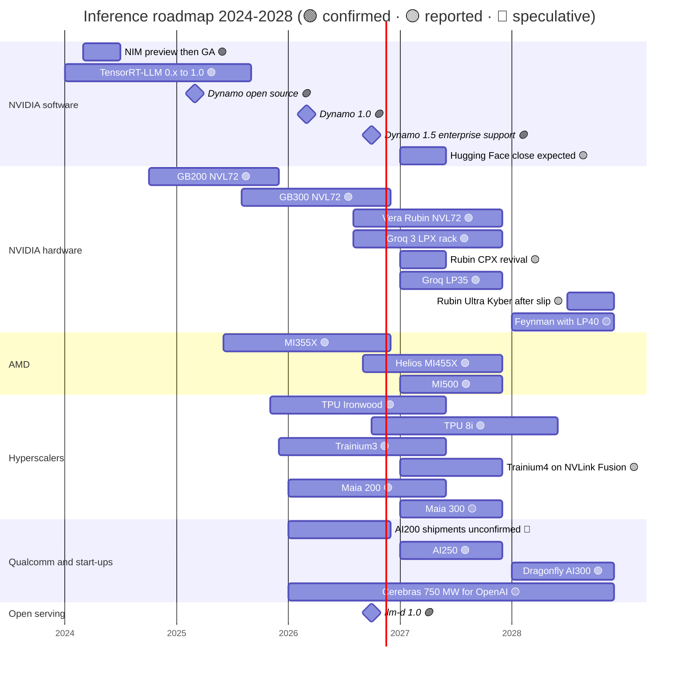

# Inference and AI software: Roadmap

Layer 11 · Inference and AI software · ~9 min read · Last verified: 2026-11-05

## ⚡ The Executive Take

- **Software moves on a monthly beat:** Dynamo went from open-source launch (March 2025) to 1.0 (March 2026) to 1.5.1 with enterprise support (October 2026); TensorRT-LLM reached 1.0 in September 2025 [[S32015]](../../sources/bibliography.md#s32015)[[S521]](../../sources/bibliography.md#s521)[[S522]](../../sources/bibliography.md#s522).
- **NVIDIA's inference hardware now has two tiers:** Vera Rubin NVL72 (production shipments from Q3 2026) for throughput, and the Groq 3 LPX rack (256 SRAM LPUs, full production August 2026) for fast decode 🟢 [[S90009]](../../sources/bibliography.md#s90009)[[S114]](../../sources/bibliography.md#s114)[[S506]](../../sources/bibliography.md#s506).
- **More decode silicon is coming:** LP35 (2027) and LP40 with Feynman (2028), and a reported Rubin CPX revival with HBM4 for prefill 🟡 [[S108]](../../sources/bibliography.md#s108)[[S90004]](../../sources/bibliography.md#s90004)[[S117]](../../sources/bibliography.md#s117).
- **Rivals ship on annual cadences too:** MI455X Helios (2026) and MI500 (2027); TPU 8i (late 2026); Maia 300 and Trainium4 (2027); Qualcomm AI250 (2027) and AI300 (2028) [[S538]](../../sources/bibliography.md#s538)[[S550]](../../sources/bibliography.md#s550)[[S90046]](../../sources/bibliography.md#s90046)[[S156]](../../sources/bibliography.md#s156)[[S173]](../../sources/bibliography.md#s173)[[S90060]](../../sources/bibliography.md#s90060).
- **AMD now leads on memory bandwidth per chip:** MI455X 23.3 TB/s vs Rubin 19.2 TB/s after NVIDIA's spec revision (~21% more); cloud ASICs sit ~2.6× below Rubin [[S144]](../../sources/bibliography.md#s144)[[S90093]](../../sources/bibliography.md#s90093)[[S90006]](../../sources/bibliography.md#s90006).
- **[Q7 · Roadmap & what changes the picture]** Watch three things: open serving reaching parity on non-NVIDIA racks (llm-d 1.0, Helios in volume Q2 2027), a public ASIC cost-per-token lead above ~2×, and token prices falling faster than cost per token.

Sources per row in the table below; bars not in it: NIM preview (March 2024) and general availability (June 2024) [[S11014]](../../sources/bibliography.md#s11014)[[S11015]](../../sources/bibliography.md#s11015); Cerebras up to 750 MW for OpenAI [[S11523]](../../sources/bibliography.md#s11523).

## The roadmap, item by item

| Item | Window | Status | Confidence | Source |
|---|---|---|---|---|
| Dynamo 1.0 → 1.5.1 (enterprise support) | Mar → Oct 2026 | shipping | 🟢 | [[S90066]](../../sources/bibliography.md#s90066)[[S521]](../../sources/bibliography.md#s521) |
| Vera Rubin NVL72 | Q3 2026 ship, Q4 ramp | shipping | 🟢 | [[S90009]](../../sources/bibliography.md#s90009) |
| Groq 3 LPX (256 LP30 LPUs, 128 GB SRAM) | H2 2026 | in production | 🟢 | [[S114]](../../sources/bibliography.md#s114)[[S506]](../../sources/bibliography.md#s506) |
| Rubin CPX (prefill), redesigned with HBM4 | 2027 | delayed / revived | 🟡 | [[S115]](../../sources/bibliography.md#s115)[[S117]](../../sources/bibliography.md#s117) |
| Groq LP35 (adds NVFP4) | 2027 | roadmap | 🟢 | [[S108]](../../sources/bibliography.md#s108) |
| Rubin Ultra, Kyber rack | H2 2027, reported slip to 2028 | roadmap | 🟡 | [[S90003]](../../sources/bibliography.md#s90003)[[S502]](../../sources/bibliography.md#s502) |
| Feynman + LP40 LPU | 2028 | roadmap | 🟡 | [[S90004]](../../sources/bibliography.md#s90004)[[S109]](../../sources/bibliography.md#s109) |
| Hugging Face acquisition close | H1 2027 | pending review | 🟡 | [[S11026]](../../sources/bibliography.md#s11026)[[S11027]](../../sources/bibliography.md#s11027) |
| AMD Helios MI455X → MI500 | 2026 → 2027 | shipping / roadmap | 🟢 | [[S538]](../../sources/bibliography.md#s538)[[S544]](../../sources/bibliography.md#s544) |
| Google TPU 8i | late 2026 | announced | 🟢 | [[S550]](../../sources/bibliography.md#s550)[[S551]](../../sources/bibliography.md#s551) |
| Microsoft Maia 300 | 2027 | announced | 🟡 | [[S90046]](../../sources/bibliography.md#s90046)[[S560]](../../sources/bibliography.md#s560) |
| AWS Trainium4 (NVLink Fusion) | 2027 (est.) | roadmap | 🟡 | [[S156]](../../sources/bibliography.md#s156)[[S90034]](../../sources/bibliography.md#s90034) |
| Qualcomm AI200 → AI250 → AI300 | 2026 → 2027 → 2028 | announced; AI200 shipments unconfirmed | 🟢 / 🔴 | [[S173]](../../sources/bibliography.md#s173)[[S90060]](../../sources/bibliography.md#s90060)[[S90028]](../../sources/bibliography.md#s90028) |
| llm-d 1.0 (NVIDIA, AMD, Intel, TPU) | Oct 2026 | shipping | 🟢 | [[S11503]](../../sources/bibliography.md#s11503) |

![Log-scale line chart of memory bandwidth per accelerator by vendor. NVIDIA rises from A100 (2.0 TB/s, 2021) and H100 (3.35) to B200/B300 (8.0) and Rubin (19.2 TB/s after the 2026 spec revision), with Rubin Ultra estimated at 32 TB/s in 2027. AMD tracks or leads at each step: MI300X 5.3, MI355X 8.0, MI455X 23.3. Google Ironwood (7.37) and Microsoft Maia 200 (7.0) sit ~2.6x below Rubin; AWS Trainium3 is 4.9 with Trainium4 estimated near 19.6 in 2027; Huawei's Ascend roadmap reaches 14.4 TB/s in 2028; Qualcomm's LPDDR-based AI 100 Ultra is 0.55 TB/s.](../../assets/charts/11-decode-bandwidth-by-vendor.svg)

> [!TIP]
> **Worked example — the decode ceiling, generation by generation.** One user's stream of a 70B model at FP8 (~70 GB) can go no faster than memory bandwidth divided by 70 GB: ~48 tokens/s on H100 (3.35 TB/s), ~114 on B200 (8 TB/s), ~274 on Rubin (19.2 TB/s), ~333 on MI455X (23.3 TB/s) [[S33002]](../../sources/bibliography.md#s33002)[[S33003]](../../sources/bibliography.md#s33003)[[S90006]](../../sources/bibliography.md#s90006)[[S144]](../../sources/bibliography.md#s144)[[S90093]](../../sources/bibliography.md#s90093). Had Rubin kept its launch spec of 22 TB/s, the ceiling would be ~314 [[S90006]](../../sources/bibliography.md#s90006), still below MI455X. AMD leads on this one metric and the spec cut widened the gap; NVLink domains, software and the LPX tier are what keep NVIDIA ahead on [interactivity](../../glossary.md#interactivity).

🔧 Under the hood: why NVIDIA swapped Rubin CPX for Groq LPUs, then may want both

[Prefill](../../glossary.md#prefill) reads the prompt in one compute-heavy pass; [decode](../../glossary.md#decode) emits tokens one by one and is bandwidth-bound. [Rubin CPX](../../glossary.md#rubin-cpx) (GDDR7, 30 PFLOPS NVFP4 as announced) targeted cheap prefill; it disappeared from the GTC 2026 roadmap as Groq 3 LPX took the decode slot [[S115]](../../sources/bibliography.md#s115)[[S116]](../../sources/bibliography.md#s116). NVIDIA claims LPX beside Vera Rubin delivers up to 35× throughput per MW vs Blackwell NVL72 for trillion-parameter models (vendor claim) [[S114]](../../sources/bibliography.md#s114)[[S308]](../../sources/bibliography.md#s308). A September 2026 analyst report says CPX is back with HBM4 for 2027 🟡 [[S117]](../../sources/bibliography.md#s117). If both ship, a Rubin-era factory could run three pools (CPX prefill, GPU batch decode, LPU fast decode) under Dynamo's [disaggregated serving](../../glossary.md#disaggregated-serving).

## What would change the picture

**[Q7 · Roadmap & what changes the picture]**

- **Open serving at parity on every rack.** llm-d 1.0 already runs on NVIDIA, AMD, Intel and TPU [[S11503]](../../sources/bibliography.md#s11503); if Helios reaches volume in Q2 2027 and open engines match Dynamo-class disaggregation there, NVIDIA's software lead shrinks to months 🟡 [[S624]](../../sources/bibliography.md#s624).
- **An ASIC with a public cost lead above ~2×.** Today's best public gap is ~18% (Ironwood vs B200) [[S625]](../../sources/bibliography.md#s625); candidates are TPU 8i, Maia 300 (hundreds of thousands of units sought) and Etched's Sohu (~$1B pre-orders reported) 🟡 [[S550]](../../sources/bibliography.md#s550)[[S559]](../../sources/bibliography.md#s559)[[S2507]](../../sources/bibliography.md#s2507).
- **Prices falling faster than costs.** Fixed-quality prices fall 9–900× a year [[S11525]](../../sources/bibliography.md#s11525); hardware cost per token fell ~11× from H200 to GB300 on one workload [[S621]](../../sources/bibliography.md#s621)[[S622]](../../sources/bibliography.md#s622). Faster price falls squeeze suppliers; the 2026 frontier price rise (GPT-5.5 at 2× GPT-5.4) points the other way 🟡 [[S11535]](../../sources/bibliography.md#s11535).
- **NVIDIA monetising software directly.** Huang floated ~$2,000 per GPU per year for agent software (October 2026), below AI Enterprise's $4,500 list; no price list exists yet 🟡 [[S11016]](../../sources/bibliography.md#s11016)[[S9515]](../../sources/bibliography.md#s9515).
- **Regulators and Hugging Face.** A blocked or conditioned deal would keep the main model hub neutral 🔴 [[S11027]](../../sources/bibliography.md#s11027)[[S11028]](../../sources/bibliography.md#s11028).

## 🎯 Corp Dev Lens

1. With MI455X now ahead of Rubin on bandwidth, where do other challengers differentiate: capacity (768 GB LPDDR), SRAM speed, or price?
2. If NVIDIA's own roadmap adds SRAM decode (LP30 → LP35 → LP40), what is left for independent SRAM start-ups besides being acquired or licensed?
3. Which 2027 milestone (Helios volume, TPU 8i, Maia 300, Trainium4) would most change a hyperscaler's mix?
4. What would a $2,000-per-GPU software fee do to open-source adoption and inference cloud margins?

## 📚 Sources

<!-- Auto-generated from the [S…] citations on this page by `make build`. Edit sources/registry/*.csv, not this list. -->

- [**S108**](../../sources/bibliography.md#s108) HPCwire / AIwire, *Huang Shares Nvidia Roadmap Showing More Chips, NVL1152, Scale-Up CPO*, 2026-03-18. [Link](https://www.hpcwire.com/aiwire/2026/03/18/huang-shares-nvidia-roadmap-showing-more-chips-nvl1152-scale-up-cpo/)
- [**S109**](../../sources/bibliography.md#s109) NVIDIA Blog, *NVIDIA GTC 2026: Live Updates on What's Next in AI*, 2026-03-16. [Link](https://blogs.nvidia.com/blog/gtc-2026-news/)
- [**S114**](../../sources/bibliography.md#s114) StorageReview, *NVIDIA Groq 3 LPX: Everything we know*, 2026-03. [Link](https://www.storagereview.com/news/nvidia-groq-3-lpx-everything-we-know)
- [**S115**](../../sources/bibliography.md#s115) Tom's Hardware, *Nvidia removes Rubin CPX accelerators from its roadmap - Groq 3 LPUs take center stage*, 2026-03. [Link](https://www.tomshardware.com/pc-components/gpus/nvidia-removes-rubin-cpx-accelerators-from-its-roadmap-groq-3-lpus-take-center-stage-as-cpx-is-removed)
- [**S116**](../../sources/bibliography.md#s116) Wccftech, *NVIDIA's Rubin CPX Is Off the Roadmap, Replaced by Groq LPUs for Inference, But May Return With Feynman in 2028*, 2026-03. [Link](https://wccftech.com/nvidia-rubin-cpx-is-off-the-roadmap-but-may-return-with-feynman-in-2028/)
- [**S117**](../../sources/bibliography.md#s117) TechNews (Taiwan), *Nvidia Rubin CPX re-enters roadmap with HBM4 for AI prefill*, 2026-09-02. [Link](https://technews.tw/2026/09/02/nvidia-rubin-cpx-reenters-roadmap-hbm4-ai-prefill/)
- [**S144**](../../sources/bibliography.md#s144) AMD Newsroom, *AMD Unveils Vision for an Open AI Ecosystem, Detailing New Silicon, Software and Systems at Advancing AI 2025*, 2025-06-12. [Link](https://www.amd.com/en/newsroom/press-releases/2025-6-12-amd-unveils-vision-for-an-open-ai-ecosystem-detai.html)
- [**S156**](../../sources/bibliography.md#s156) About Amazon, *AWS re:Invent 2025: top announcements (Trainium3 GA, Trainium4 preview, Graviton5)*, 2025-12-02. [Link](https://www.aboutamazon.com/news/aws/aws-re-invent-2025-ai-news-updates)
- [**S173**](../../sources/bibliography.md#s173) Qualcomm, *Qualcomm Unveils AI200 and AI250 - Redefining Rack-Scale Data Center Inference*, 2025-10-27. [Link](https://www.qualcomm.com/news/releases/2025/10/qualcomm-unveils-ai200-and-ai250-redefining-rack-scale-data-cent)
- [**S308**](../../sources/bibliography.md#s308) The Decoder, *GTC 2026: with Groq 3 LPX Nvidia adds dedicated inference hardware to its platform for the first time*, 2026-03. [Link](https://the-decoder.com/gtc-2026-with-groq-3-lpx-nvidia-adds-dedicated-inference-hardware-to-its-platform-for-the-first-time/)
- [**S502**](../../sources/bibliography.md#s502) Tom's Hardware, *Nvidia updates data center roadmap with Rosa CPU and stacked Feynman GPUs; optical NVLink; Groq LPUs with NVFP4 and NVLink also on deck*, 2026-03-17. [Link](https://www.tomshardware.com/pc-components/gpus/nvidia-updates-data-center-roadmap-with-rosa-cpu-and-stacked-feynman-gpus-optical-nvlink-groq-lpus-with-nvfp4-and-nvlink-also-on-deck)
- [**S506**](../../sources/bibliography.md#s506) SamMobile, *Samsung Foundry begins mass production of NVIDIA Groq 3 LPX chip*, 2026-08-25. [Link](https://www.sammobile.com/news/samsung-foundry-mass-production-nvidia-groq-3-lpx-chip/)
- [**S521**](../../sources/bibliography.md#s521) NVIDIA Docs, *NVIDIA Dynamo release notes*, 2026-10. [Link](https://docs.nvidia.com/dynamo/zh-CN/latest/reference/releases)
- [**S522**](../../sources/bibliography.md#s522) Python Package Index, *PyPI JSON API release histories (vllm, sglang, tensorrt-llm, ai-dynamo, torch-npu, jax-rocm7-plugin, tensorflow-rocm, intel-extension-for-tensorflow, onnxruntime-cann, onnxruntime-migraphx, torch-xla, torch-tpu)*, 2026-11-05. [Link](https://pypi.org/)
- [**S538**](../../sources/bibliography.md#s538) AMD Investor Relations, *AAI 2026: AMD Delivers Full-Stack Compute for the Agentic AI Era*, 2026-07-23. [Link](https://ir.amd.com/news-events/press-releases/detail/1294/aai-2026-amd-delivers-full-stack-compute-for-the-agentic-ai-era)
- [**S544**](../../sources/bibliography.md#s544) DatacenterDynamics, *AMD unveils full MI400 product lineup, claims MI500 chips will deliver 1000x increase in AI performance*, 2026-01. [Link](https://www.datacenterdynamics.com/en/news/amd-unveils-full-mi400-product-lineup-claims-mi500-chips-will-deliver-1000x-increase-in-ai-performance/)
- [**S550**](../../sources/bibliography.md#s550) SiliconANGLE, *Google Cloud unveils eighth-generation TPUs (TPU 8t and TPU 8i)*, 2026-04-22. [Link](https://siliconangle.com/?p=740999)
- [**S551**](../../sources/bibliography.md#s551) Techzine, *Google presents TPU 8t and TPU 8i chips; splits training and inference*, 2026-04-22. [Link](https://www.techzine.eu/blogs/infrastructure/140680/google-presents-tpu-8t-and-tpu-8i-chips-splits-training-and-inference/)
- [**S559**](../../sources/bibliography.md#s559) Techzine, *Microsoft aims to produce hundreds of thousands of Maia 300 AI chips*, 2026-08. [Link](https://www.techzine.eu/news/infrastructure/143518/microsoft-aims-to-produce-hundreds-of-thousands-of-maia-300-ai-chips/)
- [**S560**](../../sources/bibliography.md#s560) DatacenterDynamics, *Microsoft unveils Azure Maia 300, says chip will be its primary inference system*, 2026. [Link](https://datacenterdynamics.com/en/news/microsoft-unveils-azure-maia-300-says-chip-will-be-its-primary-inference-system)
- [**S621**](../../sources/bibliography.md#s621) SemiAnalysis (InferenceX-app repository), *InferenceX public API snapshot (benchmarks.json and benchmarks-history.json fixtures)*, 2026-10-17. [Link](https://github.com/SemiAnalysisAI/InferenceX-app/tree/main/packages/app/cypress/fixtures/api)
- [**S622**](../../sources/bibliography.md#s622) SemiAnalysis (InferenceX-app repository), *InferenceX hardware registry: TCO per GPU-hour by SKU (SemiAnalysis July 2026 pricing surveys and AI Cloud TCO Model)*, 2026-07. [Link](https://github.com/SemiAnalysisAI/InferenceX-app/blob/main/packages/constants/src/gpu-keys.ts)
- [**S624**](../../sources/bibliography.md#s624) SemiAnalysis, *InferenceX v2: NVIDIA Blackwell Vs AMD vs Hopper - Formerly InferenceMAX*, 2026-02-16. [Link](https://github.com/SemiAnalysisAI/InferenceX-app/blob/main/packages/app/content/blog/inferencex-v2-nvidia-blackwell-vs-amd-vs-hopper.mdx)
- [**S625**](../../sources/bibliography.md#s625) SemiAnalysis, *TPU Inference Externalization Full Steam Ahead*, 2026-09-07. [Link](https://github.com/SemiAnalysisAI/InferenceX-app/blob/main/packages/app/content/blog/tpu-inferencex-full-steam.mdx)
- [**S2507**](../../sources/bibliography.md#s2507) AI Weekly, *Etched closes $300M Series C at $10.3B led by Sequoia, books ~$1B in pre-orders for Sohu*, 2026-07. [Link](https://aiweekly.co/alerts/etched-closes-300m-series-c-at-103b-led-by-sequoia-books-1b-in-pre-orders-for)
- [**S9515**](../../sources/bibliography.md#s9515) The Register (Tobias Mann), *Nvidia's software empire (NVIDIA AI Enterprise licensing)*, 2024-08-06. [Link](https://www.theregister.com/2024/08/06/nvidia_software_empire/)
- [**S11014**](../../sources/bibliography.md#s11014) NVIDIA (press release via Nasdaq), *NVIDIA launches generative AI microservices for developers to create and deploy generative AI copilots across NVIDIA CUDA GPU installed base*, 2024-03-18. [Link](https://www.nasdaq.com/press-release/nvidia-launches-generative-ai-microservices-for-developers-to-create-and-deploy)
- [**S11015**](../../sources/bibliography.md#s11015) HPCwire (NVIDIA press release), *NVIDIA NIM now available to transform world's millions of developers into generative AI developers*, 2024-06-02. [Link](https://www.hpcwire.com/aiwire/2024/06/02/nvidia-nim-now-available-to-transform-worlds-millions-of-developers-into-generative-ai-developers/)
- [**S11016**](../../sources/bibliography.md#s11016) TweakTown, *Jensen Huang puts a $2000 per GPU yearly price on NVIDIA's AI agent software*, 2026-10. [Link](https://www.tweaktown.com/news/114285/jensen-huang-puts-a-dollars2000-per-gpu-yearly-price-on-nvidias-ai-agent-software/index.html)
- [**S11026**](../../sources/bibliography.md#s11026) Implicator.ai, *Nvidia confirms $12.9 billion Hugging Face deal, says its chips won't be required*, 2026-09. [Link](https://www.implicator.ai/nvidia-confirms-12-9-billion-hugging-face-deal-says-its-chips-wont-be-required/)
- [**S11027**](../../sources/bibliography.md#s11027) MLex, *Nvidia may seek EU review of Hugging Face deal amid filing uncertainty*, 2026-09-23. [Link](https://www.mlex.com/mlex/articles/2528556/nvidia-may-seek-eu-review-of-hugging-face-deal-amid-european-filing-uncertainty)
- [**S11028**](../../sources/bibliography.md#s11028) Stocktwits, *NVDA stock edges down on DOJ interest in $12.9 billion Hugging Face acquisition*, 2026-10-28. [Link](https://stocktwits.com/news-articles/markets/equity/nvda-stock-edges-down-on-doj-interest-in-12-9-billion-hugging-face-acquisition/cZU9MDeR9Go)
- [**S11503**](../../sources/bibliography.md#s11503) llm-d project (GitHub: llm-d/llm-d), *llm-d README (distributed inference on Kubernetes)*, 2026-11. [Link](https://github.com/llm-d/llm-d/blob/main/README.md)
- [**S11523**](../../sources/bibliography.md#s11523) DatacenterDynamics, *OpenAI signs $10 billion deal with Cerebras with 750MW of big chip compute*, 2026-01-14. [Link](https://www.datacenterdynamics.com/en/news/openai-signs-10-billion-deal-with-cerebras-with-750mw-of-big-chip-compute/)
- [**S11525**](../../sources/bibliography.md#s11525) Epoch AI, *LLM inference prices have fallen rapidly but unequally across tasks*, 2025-03. [Link](https://epoch.ai/data-insights/llm-inference-price-trends)
- [**S11535**](../../sources/bibliography.md#s11535) Doolpa, *OpenAI launches GPT-5.5 with state-of-the-art agentic coding and doubles API prices (April 2026)*, 2026-04. [Link](https://doolpa.com/news/openai-gpt-5-5-launch-agentic-coding-pricing-april-2026)
- [**S32015**](../../sources/bibliography.md#s32015) NVIDIA Newsroom, *NVIDIA Dynamo open-source inference framework announcement (GTC 2025)*, 2025-03-18. [Link](https://nvidianews.nvidia.com/news/nvidia-dynamo-open-source-library-accelerates-and-scales-ai-reasoning-models)
- [**S33002**](../../sources/bibliography.md#s33002) NVIDIA, *NVIDIA H100 Tensor Core GPU (product page and datasheet)*, 2022-03-22. [Link](https://www.nvidia.com/en-us/data-center/h100/)
- [**S33003**](../../sources/bibliography.md#s33003) Lenovo Press, *ThinkSystem NVIDIA B200 180GB 1000W GPU product guide*, 2025. [Link](https://lenovopress.lenovo.com/lp2226-thinksystem-nvidia-b200-180gb-1000w-gpu)
- [**S90003**](../../sources/bibliography.md#s90003) eWeek, *Everything Nvidia Just Announced at GTC 2026: 7 Chips, 5 Racks, 1 Giant Bet on Agentic AI*, 2026-03-17. [Link](https://www.eweek.com/news/nvidia-gtc-2026-ai-inference-vera-rubin-neuron/)
- [**S90004**](../../sources/bibliography.md#s90004) TrendForce, *Key GTC takeaways: how Samsung, Micron, Intel and more power NVIDIA's Vera Rubin and Feynman*, 2026-03-17. [Link](https://www.trendforce.com/news/2026/03/17/news-key-gtc-takeaways-how-samsung-micron-intel-more-power-nvidias-vera-rubin-and-feynman/)
- [**S90006**](../../sources/bibliography.md#s90006) TweakTown, *Nvidia cuts Vera Rubin's memory bandwidth by up to 26% and AMD's Helios now leads in memory bandwidth*, 2026-10. [Link](https://www.tweaktown.com/news/114304/nvidia-cuts-vera-rubins-memory-bandwidth-by-up-to-26-percent-and-amds-helios-now-leads-in-memory-bandwidth/index.html)
- [**S90009**](../../sources/bibliography.md#s90009) GamesBeat, *Nvidia Vera Rubin ramps into full production for fall launch*, 2026. [Link](https://gamesbeat.com/nvidia-vera-rubin-ramps-into-full-production-for-fall-launch-again/)
- [**S90028**](../../sources/bibliography.md#s90028) TechRepublic, *Qualcomm unveils AI chips to rival Nvidia, AMD*, 2025-10-27. [Link](https://techrepublic.com/article/news-qualcomm-unveils-ai-chips-to-rival-nvidia-amd)
- [**S90034**](../../sources/bibliography.md#s90034) NAND Research, *AWS releases Trainium3, teases Trainium4*, 2025-12. [Link](https://nand-research.com/research-note-aws-releases-trainium3-teases-trainium4/4/)
- [**S90046**](../../sources/bibliography.md#s90046) IT Brief UK, *Microsoft unveils Maia 300 for 2027 AI deployments*, 2026-10. [Link](https://itbrief.co.uk/story/microsoft-unveils-maia-300-for-2027-ai-deployments)
- [**S90060**](../../sources/bibliography.md#s90060) Qualcomm, *Qualcomm Dragonfly AI300 (product page)*, 2026-06. [Link](https://www.qualcomm.com/data-center/products/qualcomm-dragonfly-ai300)
- [**S90066**](../../sources/bibliography.md#s90066) HPCwire (NVIDIA press release), *NVIDIA enters production with Dynamo, the broadly adopted inference operating system for AI factories*, 2026-03-17. [Link](https://www.hpcwire.com/aiwire/tag/dynamo-1-0/)
- [**S90093**](../../sources/bibliography.md#s90093) Tom's Hardware, *AMD takes the wraps off its Instinct MI455X AI accelerator: CDNA 5 and Helios rack-scale architecture*, 2026. [Link](https://www.tomshardware.com/pc-components/gpus/amd-takes-the-wraps-off-its-instinct-mi455x-ai-accelerator-cdna-5-and-helios-rack-scale-architecture-combine-to-take-the-fight-to-nvidia-in-the-data-center)
