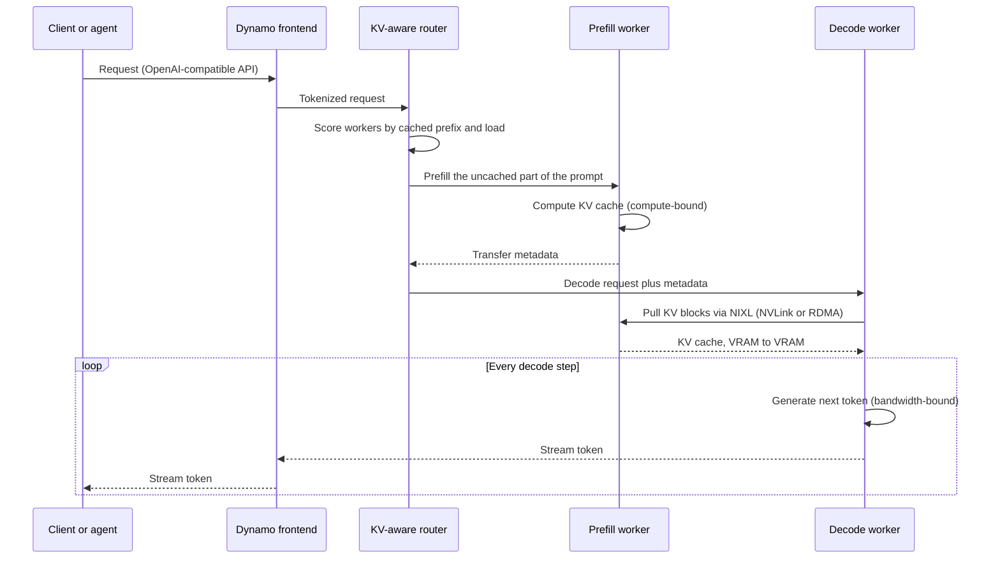

# TensorRT-LLM and Dynamo

Layer 11 · Inference and AI software · ~9 min read · Last verified: 2026-11-05

## ⚡ The Executive Take

- **Three tiers of serving software.** [TensorRT](../../glossary.md#tensorrt) compiles a model for one GPU and reached version 11 in 2026 [[S11008]](../../sources/bibliography.md#s11008). [TensorRT-LLM](../../glossary.md#tensorrt-llm) runs large language models on a GPU or [NVLink](../../glossary.md#nvlink) domain [[S589]](../../sources/bibliography.md#s589). [Dynamo](../../glossary.md#dynamo) coordinates whole clusters, above TensorRT-LLM, [vLLM](../../glossary.md#vllm) and [SGLang](../../glossary.md#sglang) [[S11001]](../../sources/bibliography.md#s11001).
- **TensorRT-LLM is open source and PyTorch-native**, developed on GitHub since March 2025 [[S589]](../../sources/bibliography.md#s589). Its levers: fused kernels, [continuous batching](../../glossary.md#continuous-batching), a paged reusable [KV cache](../../glossary.md#kv-cache), [FP8](../../glossary.md#fp8)/[NVFP4](../../glossary.md#nvfp4) and [speculative decoding](../../glossary.md#speculative-decoding) [[S11004]](../../sources/bibliography.md#s11004)[[S11005]](../../sources/bibliography.md#s11005)[[S11006]](../../sources/bibliography.md#s11006)[[S11007]](../../sources/bibliography.md#s11007).
- 🟢 **Dynamo 1.0 shipped at GTC 2026 (16 March) under Apache 2.0.** Adopters include CoreWeave, Nebius, Together AI, Cursor, Perplexity, PayPal and ByteDance [[S90066]](../../sources/bibliography.md#s90066)[[S520]](../../sources/bibliography.md#s520). Release 1.5.1 (6 October) was the first with enterprise support [[S521]](../../sources/bibliography.md#s521).
- **Disaggregation pays most on long prompts.** On B200 with 8k-token prompts a [disaggregated](../../glossary.md#disaggregated-serving) Dynamo setup served ~12,147 tokens/s per GPU vs ~4,815 for the best aggregated one, ~2.5× [[S621]](../../sources/bibliography.md#s621). With 1k-token prompts aggregated setups led at low interactivity [[S621]](../../sources/bibliography.md#s621).
- **The KV cache is managed like inventory.** [KV-aware routing](../../glossary.md#kv-aware-routing) halved time to first token at Baseten [[S11001]](../../sources/bibliography.md#s11001). The [KV block manager](../../glossary.md#kvbm) spills caches to CPU, SSD and remote storage [[S11001]](../../sources/bibliography.md#s11001). Restoring a 128K-token context from BlueField-4 flash takes ~0.2 s vs ~4.7 s to recompute (Est.) [[S7000]](../../sources/bibliography.md#s7000)[[S3012]](../../sources/bibliography.md#s3012).
- **Weakness: Dynamo is open and engine-agnostic.** It improves NVIDIA clusters without making workloads NVIDIA-only. AMD's MoRI-SGLang disaggregated stack also set frontier points on MI355X [[S621]](../../sources/bibliography.md#s621).

![Two-panel log-scale scatter of B200 frontier points by serving mode. Left, 8k-token input and 1k output: the disaggregated Dynamo plus TensorRT-LLM setup (prefill and decode on separate GPUs, 44 GPUs in total) delivers about 12,147 tokens/s per GPU at 32 tokens/s per user, versus about 4,815 for the best aggregated 8-GPU TensorRT-LLM setup at 37, about 2.5 times. Right, 1k input and 1k output: aggregated setups hold the frontier at low interactivity and disaggregation appears only above about 100 tokens/s per user, so the gain depends on prompt length.](../../assets/charts/11-disaggregation-vs-aggregated-b200.svg)

## TensorRT and TensorRT-LLM: making one GPU fast

**Analogy.** A research model is a recipe written for a home kitchen. TensorRT rewrites it for a restaurant line: merged steps, bulk prep, each station on the right appliance.

**Mechanism.** [Kernel fusion](../../glossary.md#kernel-fusion) merges small GPU programs so intermediate results stay on-chip instead of round-tripping to [HBM](../../glossary.md#hbm). TensorRT-LLM adds custom kernels for attention, GEMMs and mixture-of-experts layers plus runtime scheduling [[S589]](../../sources/bibliography.md#s589).

| Lever | What it does | Published gain |
|---|---|---|
| Fused and custom kernels | Fewer HBM round trips; tuned per GPU and model | Largest for new architectures [[S645]](../../sources/bibliography.md#s645) |
| In-flight (continuous) batching | Requests join and leave the batch every step | 2–4× throughput at equal latency in research systems [[S32011]](../../sources/bibliography.md#s32011)[[S32012]](../../sources/bibliography.md#s32012) |
| Paged, reusable KV cache | Fixed blocks; shared prefixes reused; cold blocks evicted to host memory | Avoids recomputing shared prompts [[S11005]](../../sources/bibliography.md#s11005) |
| FP8 and NVFP4 | Fewer bytes per weight and cached token | ~2.7× NVFP4 vs BF16 decode on B200 (Est.) [[S32025]](../../sources/bibliography.md#s32025)[[S32017]](../../sources/bibliography.md#s32017) |
| Speculative decoding (draft, EAGLE-3, MTP) | A cheap draft proposes tokens; the model checks several per pass | 3× on Llama 3.3 70B (NVIDIA) [[S589]](../../sources/bibliography.md#s589); 🟡 ~21× lower cost at 150 tokens/s per user with MTP on GB300 [[S624]](../../sources/bibliography.md#s624) |

> [!TIP]
> **Worked example — why continuous batching matters.** Put 64 requests in a static batch with outputs spread evenly from 100 to 2,000 tokens. The batch runs ~2,000 steps, but the average request needs ~1,050, so slots idle ~48% of the time. Continuous batching refills a slot the moment a request ends, roughly 1.9× the throughput on the same GPU (🔴 illustrative arithmetic) [[S11004]](../../sources/bibliography.md#s11004). **Business reading:** schedulers, not chips, decide much of a GPU's revenue.

Speculative decoding only helps at small batches; TensorRT-LLM's documentation says speed-ups are "only observable at low batch sizes" [[S11006]](../../sources/bibliography.md#s11006).

🔧 Under the hood: how the KV cache is paged and reused

TensorRT-LLM stores the KV cache as a pool of fixed-size blocks [[S11005]](../../sources/bibliography.md#s11005). Filled blocks enter a radix tree, so a request sharing a prompt prefix reuses them. When memory runs short, the lowest-priority, least-recently used blocks move to host memory and stay reusable [[S11005]](../../sources/bibliography.md#s11005). Paged storage was popularized by vLLM's PagedAttention [[S32011]](../../sources/bibliography.md#s32011). FP8 and NVFP4 KV-cache options cut the bytes each cached token costs [[S11007]](../../sources/bibliography.md#s11007).

## Dynamo: making a cluster act like one inference machine

**Analogy.** If TensorRT-LLM is a fast kitchen, Dynamo is the restaurant manager who seats guests, routes prep work and opens stations as the rush builds.

**Mechanism.** Dynamo, written in Rust with Python extensions, turns engines into one multi-node system [[S11001]](../../sources/bibliography.md#s11001). Its **router** picks workers by load and cached prefix. **Disaggregated serving** runs [prefill](../../glossary.md#prefill) and [decode](../../glossary.md#decode) in separate pools. The **KV block manager** offloads caches. The SLA-driven **Planner** sizes pools against latency targets. **Grove** gang-schedules on Kubernetes with [NVL72](../../glossary.md#nvl72) topology awareness. **ModelExpress** streams weights for 7× faster cold starts [[S11001]](../../sources/bibliography.md#s11001). Transfers use [NIXL](../../glossary.md#nixl), which abstracts GPU and CPU memory and file, block and object storage [[S11003]](../../sources/bibliography.md#s11003).

The flow follows Dynamo's design documentation; the KV transfer is non-blocking, so both workers keep serving others meanwhile [[S11002]](../../sources/bibliography.md#s11002).

> [!TIP]
> **Worked example — why disaggregation raises tokens/s per GPU at a latency target.** InferenceX tested DeepSeek-R1 on B200 with 8,000 input and 1,000 output tokens. The best aggregated setup (8 GPUs, TensorRT-LLM) gave ~4,815 tokens/s per GPU at ~37 tokens/s per user. A disaggregated Dynamo setup (44 GPUs across prefill and decode pools) gave ~12,147 at ~32 [[S621]](../../sources/bibliography.md#s621). Estimated cost fell from ~$0.10 to ~$0.04 per million tokens [[S622]](../../sources/bibliography.md#s622).
>
> **Why.** Each request brings eight prompt tokens per generated one. Aggregated, those prefills are chunked into the same steps as decode, so every user's next token waits behind someone's prompt [[S11002]](../../sources/bibliography.md#s11002); holding ~35 tokens/s per user forces small batches. Split, prefill GPUs run large compute-bound batches while decode GPUs hold many users at steady inter-token latency. With 1k-token prompts the interference is smaller and aggregated setups held the low-interactivity frontier [[S621]](../../sources/bibliography.md#s621). **Business reading:** ~2.5× more tokens from the same B200s on long-prompt traffic (agents, RAG); possibly nothing on short prompts.

Dynamo's documentation warns the best split "should not be encoded as a universal token threshold" [[S11002]](../../sources/bibliography.md#s11002). The Planner and the offline AISimulate tool search configurations per model and traffic mix [[S11001]](../../sources/bibliography.md#s11001).

🔧 Under the hood: what 1.0 added, and Dynamo-Triton

Version 1.0 added zero-config deployment (beta): one YAML file states model, hardware and SLA; AISimulate estimates candidates and the Planner sets the topology [[S11001]](../../sources/bibliography.md#s11001). TensorRT-LLM can also disaggregate alone via `trtllm-serve` [[S11033]](../../sources/bibliography.md#s11033). Since 18 March 2025 [Triton](../../glossary.md#triton) Inference Server is part of the Dynamo platform as Dynamo-Triton [[S11010]](../../sources/bibliography.md#s11010); release 2.74.0 still serves non-LLM models, CPUs and AWS Inferentia [[S11009]](../../sources/bibliography.md#s11009).

## The KV-cache economy: routing and offload tiers

Agents and long chats make the KV cache a reusable asset: recomputing costs GPU time, keeping costs memory. Dynamo's router and block manager decide where each cache lives [[S11001]](../../sources/bibliography.md#s11001); BlueField-4 context-memory storage adds pod-level flash [[S3012]](../../sources/bibliography.md#s3012)[[S3013]](../../sources/bibliography.md#s3013).

![Log-scale horizontal bar chart of the time to restore a 21.5 GB KV cache (Llama 3.1 70B, 128K tokens, FP8): G1 HBM4 at 19.2 TB/s about 1.1 ms; G2 Vera LPDDR5X over NVLink-C2C at ~450 GB/s about 47.7 ms; G3.5 BlueField-4 context-memory storage over an 800 Gb/s link about 215 ms; G3 one local PCIe Gen5 x4 SSD about 1.4 s; recomputing the prefill on a Rubin GPU at 50% of dense FP8 peak about 4.7 s (estimate); and a per-GPU share of Meta's 7 TB/s Llama 3 storage cluster about 50 s. The G3.5 tier is ~22x faster than recomputing.](../../assets/charts/07-kv-cache-reload-by-tier.svg)

> [!TIP]
> **Worked example — the value of a cache hit for an agent.** A 128K-token Llama 3.1 70B context is ~21.5 GB at FP8. Restoring it from flash takes ~0.2 s; recomputing takes ~4.7 s of Rubin time (Est.) [[S7000]](../../sources/bibliography.md#s7000). Over a 30-turn session that saves ~135 GPU-seconds and ~4.5 s of waiting per turn (🔴 illustrative). **Business reading:** cache placement becomes a revenue lever, pulling storage and [NIC](../../glossary.md#nic) vendors into the inference stack ([Layer 07](../07-dpu-supernic-storage-security/index.md)).

**[Q4 · Source of advantage]** (developed in [History and how built](history-and-how-built.md)). The engines are open, so the edge is integration and speed: kernels for each new model, recipes tuned to NVLink domains, and transfer software built around NVIDIA networking [[S11001]](../../sources/bibliography.md#s11001)[[S11003]](../../sources/bibliography.md#s11003).

## 🎯 Corp Dev Lens

1. **Orchestration is the new control point.** Dynamo decides where every request and cache goes [[S11001]](../../sources/bibliography.md#s11001). If it becomes the default open "inference OS", does NVIDIA gain influence over mixed fleets?
2. **Disaggregation favors fabrics.** KV transfers move gigabytes per request between pools [[S11002]](../../sources/bibliography.md#s11002), raising the value of NVLink, RDMA NICs and context-memory storage [[S3012]](../../sources/bibliography.md#s3012). Which suppliers are under-valued by this shift?
3. **Workload-dependence is an opening.** The ~2.5× gain on long prompts vanished on short ones [[S621]](../../sources/bibliography.md#s621). A specialized accelerator can target one phase, as NVIDIA does with Groq LPX for decode [[S113]](../../sources/bibliography.md#s113).
4. **Release cadence is a moat and a cost.** Could a smaller vendor match TensorRT-LLM and Dynamo's cadence [[S521]](../../sources/bibliography.md#s521)[[S589]](../../sources/bibliography.md#s589), or must it build on vLLM and SGLang?

## 📚 Sources

<!-- Auto-generated from the [S…] citations on this page by `make build`. Edit sources/registry/*.csv, not this list. -->

- [**S113**](../../sources/bibliography.md#s113) Tom's Hardware, *How Nvidia's $20 billion Groq 3 LPU deal reshapes the Nvidia Vera Rubin Platform*, 2026-03. [Link](https://www.tomshardware.com/tech-industry/semiconductors/nvidias-20-billion-groq-deal-produces-its-first-chip)
- [**S520**](../../sources/bibliography.md#s520) NVIDIA via ResearchPool, *NVIDIA Enters Production With Dynamo, the Broadly Adopted Inference Operating System for AI Factories (press release mirror)*, 2026-03-16. [Link](https://app.researchpool.com/company/nvda-us67066g1040-nvidia-corp-e9VqYYGjs8/press/nvidia-corporation-nvda-nvidia-enters-production-with-dynamo-the-broadly-adopted-inference-ope-DxMC1Gq48d)
- [**S521**](../../sources/bibliography.md#s521) NVIDIA Docs, *NVIDIA Dynamo release notes*, 2026-10. [Link](https://docs.nvidia.com/dynamo/zh-CN/latest/reference/releases)
- [**S589**](../../sources/bibliography.md#s589) NVIDIA (GitHub: NVIDIA/TensorRT-LLM), *TensorRT-LLM README*, 2026-11. [Link](https://github.com/NVIDIA/TensorRT-LLM/blob/main/README.md)
- [**S621**](../../sources/bibliography.md#s621) SemiAnalysis (InferenceX-app repository), *InferenceX public API snapshot (benchmarks.json and benchmarks-history.json fixtures)*, 2026-10-17. [Link](https://github.com/SemiAnalysisAI/InferenceX-app/tree/main/packages/app/cypress/fixtures/api)
- [**S622**](../../sources/bibliography.md#s622) SemiAnalysis (InferenceX-app repository), *InferenceX hardware registry: TCO per GPU-hour by SKU (SemiAnalysis July 2026 pricing surveys and AI Cloud TCO Model)*, 2026-07. [Link](https://github.com/SemiAnalysisAI/InferenceX-app/blob/main/packages/constants/src/gpu-keys.ts)
- [**S624**](../../sources/bibliography.md#s624) SemiAnalysis, *InferenceX v2: NVIDIA Blackwell Vs AMD vs Hopper - Formerly InferenceMAX*, 2026-02-16. [Link](https://github.com/SemiAnalysisAI/InferenceX-app/blob/main/packages/app/content/blog/inferencex-v2-nvidia-blackwell-vs-amd-vs-hopper.mdx)
- [**S645**](../../sources/bibliography.md#s645) NVIDIA TensorRT-LLM team, *Pushing Latency Boundaries: Optimizing DeepSeek-R1 Performance on NVIDIA B200 GPUs (TensorRT-LLM tech blog 1)*, 2025-05-16. [Link](https://github.com/NVIDIA/TensorRT-LLM/blob/main/docs/source/blogs/tech_blog/blog01_Pushing_Latency_Boundaries_Optimizing_DeepSeek-R1_Performance_on_NVIDIA_B200_GPUs.md)
- [**S3012**](../../sources/bibliography.md#s3012) NVIDIA Newsroom, *NVIDIA BlueField-4 Powers New Class of AI-Native Storage Infrastructure for the Next Frontier of AI*, 2026-01-05. [Link](https://nvidianews.nvidia.com/news/nvidia-bluefield-4-powers-new-class-of-ai-native-storage-infrastructure-for-the-next-frontier-of-ai)
- [**S3013**](../../sources/bibliography.md#s3013) Blocks and Files, *Nvidia standardizes GPU cluster KV cache offload to NVMe SSDs*, 2026-01-06. [Link](https://blocksandfiles.com/2026/01/06/nvidia-standardizes-gpu-cluster-kv-cache-offload-to-nvme-ssds/)
- [**S7000**](../../sources/bibliography.md#s7000) nvidia_deep_dive_claude repository, *Repo analysis: layer 07 models (DPU offload value per compute tray, checkpoint write time, KV-cache reload time by tier)*, 2026-11-05. [Link](https://github.com/FrankHuang94/nvidia_deep_dive_claude/blob/main/layers/07-dpu-supernic-storage-security/index.md)
- [**S11001**](../../sources/bibliography.md#s11001) NVIDIA (GitHub), *NVIDIA Dynamo README (ai-dynamo/dynamo)*, 2026-11. [Link](https://github.com/ai-dynamo/dynamo/blob/main/README.md)
- [**S11002**](../../sources/bibliography.md#s11002) NVIDIA (GitHub ai-dynamo/dynamo docs), *Dynamo design docs: Disaggregated Serving*, 2026. [Link](https://github.com/ai-dynamo/dynamo/blob/main/docs/fern/pages/developer-guide/knowledge-base/concepts/system-architecture/disaggregated-serving.md)
- [**S11003**](../../sources/bibliography.md#s11003) NVIDIA (GitHub ai-dynamo/nixl), *NVIDIA Inference Xfer Library (NIXL) README*, 2026-11. [Link](https://github.com/ai-dynamo/nixl/blob/main/README.md)
- [**S11004**](../../sources/bibliography.md#s11004) NVIDIA (GitHub NVIDIA/TensorRT-LLM docs), *TensorRT-LLM docs: Paged Attention, IFB and Request Scheduling*, 2026. [Link](https://github.com/NVIDIA/TensorRT-LLM/blob/main/docs/source/features/paged-attention-ifb-scheduler.md)
- [**S11005**](../../sources/bibliography.md#s11005) NVIDIA (GitHub NVIDIA/TensorRT-LLM docs), *TensorRT-LLM docs: KV Cache System*, 2026. [Link](https://github.com/NVIDIA/TensorRT-LLM/blob/main/docs/source/features/kvcache.md)
- [**S11006**](../../sources/bibliography.md#s11006) NVIDIA (GitHub NVIDIA/TensorRT-LLM docs), *TensorRT-LLM docs: Speculative Decoding*, 2026. [Link](https://github.com/NVIDIA/TensorRT-LLM/blob/main/docs/source/features/speculative-decoding.md)
- [**S11007**](../../sources/bibliography.md#s11007) NVIDIA (GitHub NVIDIA/TensorRT-LLM docs), *TensorRT-LLM docs: Quantization*, 2026. [Link](https://github.com/NVIDIA/TensorRT-LLM/blob/main/docs/source/features/quantization.md)
- [**S11008**](../../sources/bibliography.md#s11008) NVIDIA (GitHub NVIDIA/TensorRT), *TensorRT Open Source Software README (TensorRT 11.x announcement)*, 2026-11. [Link](https://github.com/NVIDIA/TensorRT/blob/main/README.md)
- [**S11009**](../../sources/bibliography.md#s11009) NVIDIA (GitHub triton-inference-server/server), *Triton Inference Server README*, 2026-11. [Link](https://github.com/triton-inference-server/server/blob/main/README.md)
- [**S11010**](../../sources/bibliography.md#s11010) NVIDIA Developer, *NVIDIA Dynamo-Triton (product page)*, 2025-03-18. [Link](https://developer.nvidia.com/dynamo-triton)
- [**S11033**](../../sources/bibliography.md#s11033) NVIDIA (GitHub NVIDIA/TensorRT-LLM docs), *TensorRT-LLM docs: Disaggregated Serving*, 2026. [Link](https://github.com/NVIDIA/TensorRT-LLM/blob/main/docs/source/features/disagg-serving.md)
- [**S32011**](../../sources/bibliography.md#s32011) SOSP 2023 (arXiv 2309.06180) (Kwon et al.), *Efficient Memory Management for Large Language Model Serving with PagedAttention (vLLM)*, 2023-09. [Link](https://arxiv.org/abs/2309.06180)
- [**S32012**](../../sources/bibliography.md#s32012) USENIX OSDI 2022 (Yu et al.), *Orca: A Distributed Serving System for Transformer-Based Generative Models*, 2022-07. [Link](https://www.usenix.org/conference/osdi22/presentation/yu)
- [**S32017**](../../sources/bibliography.md#s32017) NVIDIA Technical Blog, *Introducing NVFP4 for Efficient and Accurate Low-Precision Inference*, 2025-06. [Link](https://developer.nvidia.com/blog/introducing-nvfp4-for-efficient-and-accurate-low-precision-inference/)
- [**S32025**](../../sources/bibliography.md#s32025) nvidia_deep_dive_claude repository, *Repo analysis: inference token-budget scenarios and roofline serving model (Primer P2)*, 2026-11-05. [Link](https://github.com/FrankHuang94/nvidia_deep_dive_claude/blob/main/primers/P2-how-ai-inference-works.md)
- [**S90066**](../../sources/bibliography.md#s90066) HPCwire (NVIDIA press release), *NVIDIA enters production with Dynamo, the broadly adopted inference operating system for AI factories*, 2026-03-17. [Link](https://www.hpcwire.com/aiwire/tag/dynamo-1-0/)
