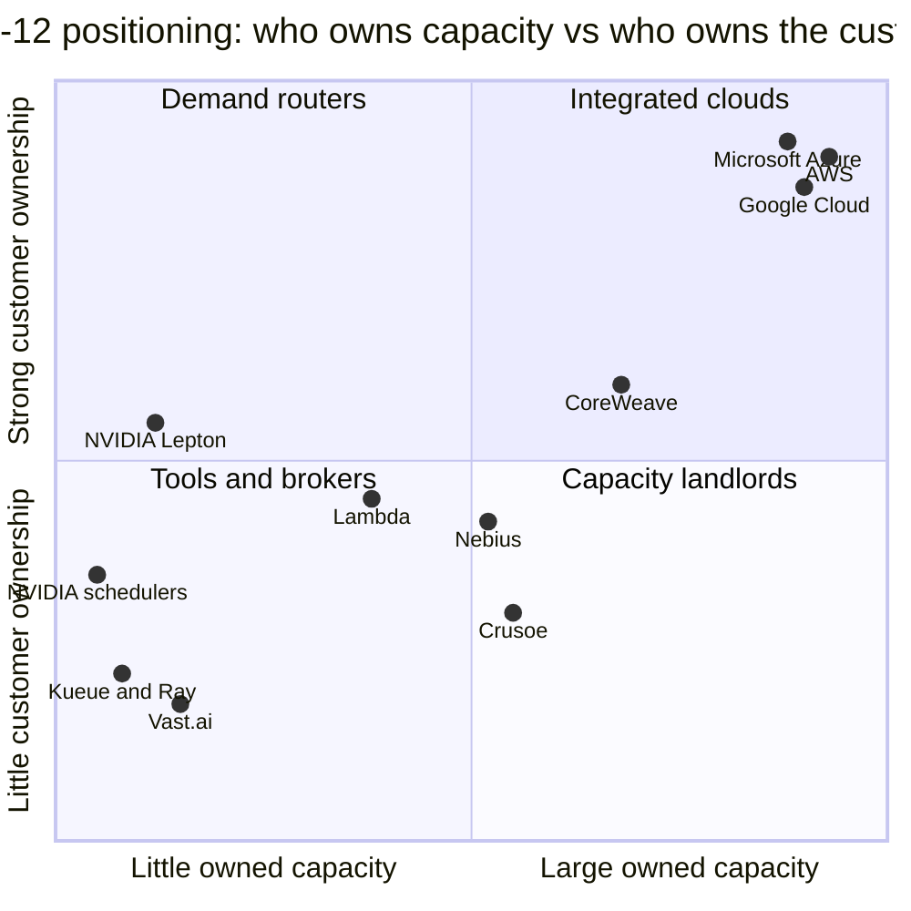

# Orchestration and cloud services: Competition

Layer 12 · Orchestration and cloud services · ~13 min read · Last verified: 2026-11-05

## ⚡ The Executive Take

- **NVIDIA competes here without owning a cloud.** It refocused [DGX Cloud](../../glossary.md#dgx-cloud) inward in 2025; [DGX Cloud Lepton](../../glossary.md#dgx-cloud-lepton) routes developers to partner GPUs 🟡 [[S90068]](../../sources/bibliography.md#s90068)[[S12009]](../../sources/bibliography.md#s12009).
- **It gives the software away and keeps the GPU margin:** [KAI Scheduler](../../glossary.md#kai-scheduler) (2025) and the whole [Run:ai](../../glossary.md#run-ai) platform (October 2026) are open source, and [Slurm](../../glossary.md#slurm) stays vendor-neutral under NVIDIA [[S12509]](../../sources/bibliography.md#s12509)[[S12510]](../../sources/bibliography.md#s12510)[[S12000]](../../sources/bibliography.md#s12000).
- **[Q5 · Strongest challenger]** The [hyperscalers](../../glossary.md#hyperscaler)' vertically integrated clouds own the customer, the capacity and a second accelerator: Anthropic has up to 1M Google TPUs and ~500k Trainium2 in Project Rainier [[S90026]](../../sources/bibliography.md#s90026)[[S90034]](../../sources/bibliography.md#s90034).
- **Even rivals buy NVIDIA capacity:** Microsoft's Maia 200 is small, and it has signed >$60B of rentals with NVIDIA-only [neoclouds](../../glossary.md#neocloud) 🟡 [[S90044]](../../sources/bibliography.md#s90044)[[S12526]](../../sources/bibliography.md#s12526).
- **CoreWeave is the strongest independent stack:** a $104.2B [revenue backlog](../../glossary.md#revenue-backlog) and Weights & Biases (~$1.7B). But its fleet is NVIDIA-only and NVIDIA backstops it [[S12500]](../../sources/bibliography.md#s12500)[[S12507]](../../sources/bibliography.md#s12507)[[S90067]](../../sources/bibliography.md#s90067).
- **Bear case:** if hyperscalers steer workloads to their own chips, NVIDIA's levers (allocation, equity, marketplace) cannot win the customer back.

## How the layer-12 contest is scored

Layer 12 turns racks into capacity a customer can rent and keep busy. Think of an airline: the GPU is the aircraft, the scheduler is crew rostering, and the cloud sells the ticket and owns the passenger. NVIDIA builds the aircraft, gives away the rostering software and runs a booking site (Lepton). It does not own the airline. Five things decide who wins: who **owns the customer**, who **owns capacity**, who **controls the accelerator**, whose **scheduler** runs the jobs, and whether the stack is **neutral**.

| Rival vs NVIDIA | Customer ownership | Owned capacity | Accelerator control | Scheduling & platform | Neutrality |
|---|---|---|---|---|---|
| AWS (SageMaker HyperPod, Bedrock, Trainium) | 🟩 direct enterprise contracts | 🟩 own regions | 🟨 Trainium3 GA [[S90035]](../../sources/bibliography.md#s90035) | 🟨 HyperPod / EKS | 🟥 one cloud |
| Google Cloud (Vertex AI, GKE, TPU) | 🟩 Gemini pull | 🟩 own regions | 🟨 up to 1M TPUs to Anthropic [[S90026]](../../sources/bibliography.md#s90026) | 🟨 GKE, Kueue lineage | 🟥 mostly one cloud |
| Microsoft Azure (Foundry, AKS, Maia) | 🟩 enterprise + OpenAI | 🟩 own + >$60B rented [[S12526]](../../sources/bibliography.md#s12526) | 🟥 Maia 200 small [[S90044]](../../sources/bibliography.md#s90044) | 🟨 AKS / CycleCloud | 🟥 one cloud |
| CoreWeave (CKS, SUNK, W&B) | 🟩 $104B backlog [[S12500]](../../sources/bibliography.md#s12500) | 🟩 1.5 GW active [[S12501]](../../sources/bibliography.md#s12501) | 🟥 NVIDIA-only | 🟨 96% goodput claim [[S12530]](../../sources/bibliography.md#s12530) | 🟥 one cloud |
| Open-source (Kueue, Ray, SkyPilot) | 🟦 no owner | 🟦 software only | 🟦 vendor-agnostic | 🟨 gang + topology-aware [[S12533]](../../sources/bibliography.md#s12533) | 🟩 any cloud or chip |
| GPU marketplaces (Vast.ai, SF Compute) | 🟨 price-led buyers | 🟦 others' GPUs | 🟥 NVIDIA listings | 🟥 raw instances | 🟩 many providers |

Verdicts are this repo's judgement 🔴; the heatmap above holds all nine rivals with sources in `data/l12_competitor_verdicts.csv`.

> [!TIP]
> **Worked example — the rival that is also the biggest neocloud customer.** By November 2025 Microsoft had signed >$60B of multi-year neocloud rentals: Nscale ~$23B for ~200,000 GB300 GPUs, Nebius $17.4B (up to $19.4B) and IREN $9.7B 🟡 [[S12526]](../../sources/bibliography.md#s12526). Spread over several years, that still equals about a third of Microsoft's ~$175B calendar-2026 capex guide 🟡 [[S12518]](../../sources/bibliography.md#s12518). The capacity is NVIDIA-based. A hyperscaler can compete with NVIDIA in silicon (Maia) while being one of its largest indirect buyers.

🔧 Under the hood: what a GPU scheduler actually decides

A 1,024-GPU job must start on all GPUs at once ([gang scheduling](../../glossary.md#gang-scheduling)), on GPUs that share a fast switch (topology awareness). The scheduler also pre-empts low-priority work, enforces team quotas and slices GPUs for small jobs. Slurm does this for supercomputer batch jobs; [Kubernetes](../../glossary.md#kubernetes) add-ons such as Kueue and KAI Scheduler do it for containers [[S12533]](../../sources/bibliography.md#s12533)[[S12002]](../../sources/bibliography.md#s12002). The commercial products (Run:ai, [Mission Control](../../glossary.md#mission-control), SageMaker HyperPod) add dashboards, accounting and automatic recovery from failed nodes [[S12004]](../../sources/bibliography.md#s12004)[[S12006]](../../sources/bibliography.md#s12006).

## Challenger by challenger

### Hyperscalers' vertically integrated clouds: the strongest challenger

**[Q5 · Strongest challenger]** AWS, Google and Microsoft are NVIDIA's largest customers (hyperscale was ~$48.7B of $89.0B Q2 FY2027 Data Center revenue 🟡) and its most complete rivals [[S406]](../../sources/bibliography.md#s406)[[S405]](../../sources/bibliography.md#s405):

- **AWS:** Trainium3 GA (December 2025); Trainium4 will support [NVLink](../../glossary.md#nvlink) Fusion; ~500k Trainium2 in Project Rainier [[S90034]](../../sources/bibliography.md#s90034)[[S90035]](../../sources/bibliography.md#s90035).
- **Google:** up to 1M TPUs (>1 GW in 2026) for Anthropic, a TPU rental to Meta, and TPUs sold into customer data centers 🟡 [[S90026]](../../sources/bibliography.md#s90026)[[S90025]](../../sources/bibliography.md#s90025)[[S90027]](../../sources/bibliography.md#s90027).
- **Microsoft:** Maia 200 runs Copilot; Maia 300 and multi-gigawatt plans from 2027 🟡 [[S90044]](../../sources/bibliography.md#s90044)[[S90046]](../../sources/bibliography.md#s90046)[[S90045]](../../sources/bibliography.md#s90045).

**Their best argument:** the cloud owns the bill. Behind Bedrock, Vertex AI or Foundry the provider chooses the chip, and no NVIDIA lever reaches that choice.

**How much the gap has closed:** a lot for their own and anchor-lab workloads, little for the open market. They keep raising 2026 capex that is mostly NVIDIA-bound ([roadmap](roadmap.md)).

### CoreWeave and the neocloud software stacks

CoreWeave grew from ~360 MW active power at end-2024 to ~1.5 GW at mid-2026 [[S12011]](../../sources/bibliography.md#s12011)[[S12501]](../../sources/bibliography.md#s12501). Its stack is CoreWeave Kubernetes Service plus SUNK (Slurm on Kubernetes), which it says reaches up to 96% [goodput](../../glossary.md#goodput) (vendor claim) [[S12530]](../../sources/bibliography.md#s12530). It bought Weights & Biases (~$1.7B, closed 2025-05-05) to move into the developer workflow; its ~$9B all-stock bid for Core Scientific was voted down on 2025-10-30 [[S12506]](../../sources/bibliography.md#s12506)[[S12507]](../../sources/bibliography.md#s12507)[[S12508]](../../sources/bibliography.md#s12508).

**Best argument:** a neocloud runs large clusters as well as a hyperscaler, for less. **Limit:** its fleet, financing and even its scheduler (Slurm, now NVIDIA-owned) depend on NVIDIA [[S12000]](../../sources/bibliography.md#s12000)[[S90067]](../../sources/bibliography.md#s90067).

> [!TIP]
> **Worked example — why NVIDIA bought the scheduler its partners use.** Slurm runs more than half of the top 10 and top 100 TOP500 supercomputers, and CoreWeave's SUNK layers it under Kubernetes [[S12000]](../../sources/bibliography.md#s12000)[[S12530]](../../sources/bibliography.md#s12530). Buying SchedMD (terms undisclosed) likely cost far less than Run:ai's reported ~$700M [[S476]](../../sources/bibliography.md#s476), yet secured the default job queue of AI training. With Slurm pledged open and neutral, the lever is roadmap influence, not lock-in.

### Open-source schedulers

Kueue adds queues, fair sharing, gang and topology-aware scheduling to Kubernetes [[S12533]](../../sources/bibliography.md#s12533). Ray (Anyscale) scales Python AI code on any cluster [[S12535]](../../sources/bibliography.md#s12535). SkyPilot spans Kubernetes, Slurm and 20+ clouds and claims a 14% [NVL72](../../glossary.md#nvl72) training gain (vendor claim) [[S12534]](../../sources/bibliography.md#s12534). They lead on neutrality and are free. NVIDIA joined rather than fought: KAI Scheduler is a CNCF sandbox project, and Crusoe, Nebius and six others are adopting open Run:ai [[S12002]](../../sources/bibliography.md#s12002)[[S12512]](../../sources/bibliography.md#s12512).

### GPU marketplaces

Lepton launched with ten partner clouds and added Mistral, Nscale, Fluidstack and Together AI in June 2025 [[S12009]](../../sources/bibliography.md#s12009)[[S12008]](../../sources/bibliography.md#s12008). [GPU marketplaces](../../glossary.md#gpu-marketplace) such as Vast.ai and SF Compute, and brokers such as SkyPilot's GPU Compass, compete on price [[S12534]](../../sources/bibliography.md#s12534). Silicon Data, whose H100 index rose from $2.00 to $2.20 per [GPU-hour](../../glossary.md#gpu-hour) in four weeks, is partnering with CME Group on compute futures 🟡 [[S12517]](../../sources/bibliography.md#s12517).

### Positioning

Placement is this repo's judgement 🔴. NVIDIA is a "demand router": it steers workloads (allocation, Lepton, financing) without owning much capacity.

> [!NOTE]
> **🐂 Bull view.** NVIDIA need not win layer 12 outright. Non-hyperscale buyers (neoclouds, sovereign, enterprise) were ~$40.3B of Q2 FY2027 Data Center revenue, and regional neoclouds grew more than 3× y/y 🟡 [[S406]](../../sources/bibliography.md#s406)[[S90071]](../../sources/bibliography.md#s90071). Open-sourcing the orchestration stack makes every cloud easier to run on NVIDIA.

> [!WARNING]
> **🐻 Bear view.** Customer ownership is the scarce asset here, and NVIDIA has the least of it. TPUs are now sold beyond Google, Trainium4 will speak [NVLink Fusion](../../glossary.md#nvlink-fusion), and hyperscalers decide which chip sits behind an API [[S90027]](../../sources/bibliography.md#s90027)[[S90034]](../../sources/bibliography.md#s90034). If neocloud financing tightens, NVIDIA's remaining channel narrows to the very buyers building alternatives.

## 🎯 Corp Dev Lens

1. Orchestration software is now free (KAI, Run:ai, Slurm, Kueue). Where is the remaining monetizable layer: managed operations, multi-cloud brokerage, or financing?
2. Hyperscalers rent NVIDIA capacity from neoclouds while building ASICs. How durable is that rental demand once Maia 300 and Trainium4 ramp in 2027?
3. CoreWeave bought Weights & Biases to climb the stack. Which neocloud tools (MLOps, inference endpoints, schedulers) could be acquired before they are commoditized?
4. A non-NVIDIA accelerator needs a scheduler and a marketplace that treat it as first-class. Do Kueue, Ray and SkyPilot already provide that path, or must a new entrant fund it?

## 📚 Sources

<!-- Auto-generated from the [S…] citations on this page by `make build`. Edit sources/registry/*.csv, not this list. -->

- [**S405**](../../sources/bibliography.md#s405) NVIDIA Corporation via SEC EDGAR, *NVIDIA Announces Financial Results for Second Quarter Fiscal 2027 (Form 8-K exhibit 99.1)*, 2026-08-26. [Link](https://www.sec.gov/Archives/edgar/data/0001045810/000104581026000073/q2fy27pr.htm)
- [**S406**](../../sources/bibliography.md#s406) NVIDIA Corporation (Colette Kress), *CFO Commentary on Second Quarter Fiscal 2027 Results*, 2026-08-26. [Link](https://s201.q4cdn.com/141608511/files/doc_financials/2027/Q227/Q2FY27-CFO-Commentary.pdf)
- [**S476**](../../sources/bibliography.md#s476) NVIDIA Blog, *NVIDIA to Acquire GPU Orchestration Software Provider Run:ai*, 2024-04-24. [Link](https://blogs.nvidia.com/blog/runai/)
- [**S12000**](../../sources/bibliography.md#s12000) NVIDIA Blog, *NVIDIA Acquires Open-Source Workload Management Provider SchedMD*, 2025-12-15. [Link](https://blogs.nvidia.com/blog/nvidia-acquires-schedmd)
- [**S12002**](../../sources/bibliography.md#s12002) KAI Scheduler project (originally NVIDIA Run:ai), *KAI Scheduler (GitHub repository README)*, 2026-04. [Link](https://github.com/kai-scheduler/KAI-Scheduler)
- [**S12004**](../../sources/bibliography.md#s12004) NVIDIA, *NVIDIA Mission Control (product page)*, 2025. [Link](https://www.nvidia.com/en-us/data-center/mission-control/)
- [**S12006**](../../sources/bibliography.md#s12006) NVIDIA Technical Blog, *Automating AI Factory Operations with NVIDIA Mission Control*, 2026. [Link](https://developer.nvidia.com/blog/automating-ai-factory-operations-with-nvidia-mission-control)
- [**S12008**](../../sources/bibliography.md#s12008) NVIDIA Newsroom, *NVIDIA DGX Cloud Lepton Connects Europe's Developers to Global NVIDIA Compute Ecosystem*, 2025-06-11. [Link](https://nvidianews.nvidia.com/news/nvidia-dgx-cloud-lepton-connects-europes-developers-to-global-nvidia-compute-ecosystem)
- [**S12009**](../../sources/bibliography.md#s12009) DatacenterDynamics, *Nvidia launches Lepton AI platform connecting GPU cloud providers' resources*, 2025-05. [Link](https://www.datacenterdynamics.com/en/news/nvidia-launches-lepton-ai-platform-connecting-gpu-cloud-providers-resources/)
- [**S12011**](../../sources/bibliography.md#s12011) DatacenterDynamics, *CoreWeave files for IPO on Nasdaq stock market*, 2025-03. [Link](https://www.datacenterdynamics.com/en/news/coreweave-files-for-ipo-on-nasdaq-stock-market/)
- [**S12500**](../../sources/bibliography.md#s12500) CoreWeave (press release via Seeking Alpha), *CoreWeave Reports Strong Second Quarter 2026 Results*, 2026-08. [Link](https://seekingalpha.com/pr/20615715)
- [**S12501**](../../sources/bibliography.md#s12501) Runtime Wire, *CoreWeave reports $2.58 billion Q2 revenue with $35 billion in debt*, 2026-08. [Link](https://runtimewire.com/article/coreweave-q2-2026-revenue-debt-ai-cloud)
- [**S12506**](../../sources/bibliography.md#s12506) CoreWeave Investor Relations, *CoreWeave Completes Acquisition of Weights & Biases*, 2025-05-05. [Link](https://investors.coreweave.com/news/news-details/2025/CoreWeave-Completes-Acquisition-of-Weights--Biases/default.aspx)
- [**S12507**](../../sources/bibliography.md#s12507) Maginative, *CoreWeave acquires Weights & Biases in a $1.7 billion AI cloud play*, 2025-03. [Link](https://www.maginative.com/article/coreweave-acquires-weights-biases-in-a-1-7-billion-ai-cloud-play/)
- [**S12508**](../../sources/bibliography.md#s12508) SiliconANGLE, *Core Scientific shareholders dismiss $9B CoreWeave deal on valuation worries*, 2025-10-30. [Link](https://siliconangle.com/2025/10/30/core-scientific-shareholders-dismiss-9b-coreweave-deal-valuation-worries/)
- [**S12509**](../../sources/bibliography.md#s12509) NVIDIA Technical Blog, *NVIDIA open sources Run:ai Scheduler to foster community collaboration (KAI Scheduler)*, 2025-04. [Link](https://developer.nvidia.com/blog/nvidia-open-sources-runai-scheduler-to-foster-community-collaboration/)
- [**S12510**](../../sources/bibliography.md#s12510) NVIDIA Technical Blog, *NVIDIA Run:ai is now open source as part of NVIDIA DSX AI Factory platform*, 2026-10. [Link](https://developer.nvidia.com/blog/nvidia-runai-is-now-open-source-as-part-of-nvidia-dsx-ai-factory-platform/)
- [**S12512**](../../sources/bibliography.md#s12512) Techstrong.ai, *NVIDIA hands Run:ai to the open source community*, 2026-10. [Link](https://techstrong.ai/articles/nvidia-hands-runai-to-the-open-source-community/)
- [**S12517**](../../sources/bibliography.md#s12517) Silicon Data, *H100 price spike (Silicon Data H100 rental index)*, 2026-01. [Link](https://www.silicondata.com/blog/h100-price-spike)
- [**S12518**](../../sources/bibliography.md#s12518) Datacentres.com, *Hyperscaler capex trends: over $700 billion for 2026*, 2026-08. [Link](https://www.datacentres.com/guides/hyperscaler-capex-trends)
- [**S12526**](../../sources/bibliography.md#s12526) Introl, *Microsoft's $60B neocloud bet: buying time in the AI capacity crisis*, 2025-12. [Link](https://introl.com/blog/microsoft-60-billion-neocloud-spending-2025)
- [**S12530**](../../sources/bibliography.md#s12530) CoreWeave Blog, *New CoreWeave SUNK capabilities help teams build modern AI research clusters*, 2025. [Link](https://coreweave.com/blog/new-coreweave-sunk-capabilities-help-teams-build-modern-ai-research-clusters)
- [**S12533**](../../sources/bibliography.md#s12533) Kubernetes SIGs on GitHub, *Kueue (README)*, 2026. [Link](https://github.com/kubernetes-sigs/kueue)
- [**S12534**](../../sources/bibliography.md#s12534) SkyPilot project on GitHub, *SkyPilot (README)*, 2026-10. [Link](https://github.com/skypilot-org/skypilot)
- [**S12535**](../../sources/bibliography.md#s12535) Ray project on GitHub (Anyscale), *Ray (README)*, 2026. [Link](https://github.com/ray-project/ray)
- [**S90025**](../../sources/bibliography.md#s90025) SiliconANGLE, *Google and Meta reportedly strike new multibillion-dollar AI chip deal*, 2026-02-26. [Link](https://siliconangle.com/2026/02/26/google-meta-reportedly-strike-new-multibillion-dollar-ai-chip-deal/)
- [**S90026**](../../sources/bibliography.md#s90026) Maginative, *Anthropic secures 1M Google TPUs while keeping Amazon as primary training partner*, 2025-10. [Link](https://www.maginative.com/anthropic-secures-1m-google-tpus-while-keeping-amazon-as-primary-training-partner)
- [**S90027**](../../sources/bibliography.md#s90027) The Next Web, *Google is building a four-partner chip supply chain to challenge Nvidia in AI inference*, 2026. [Link](https://thenextweb.com/news/google-inference-chips-nvidia-challenge-supply-chain)
- [**S90034**](../../sources/bibliography.md#s90034) NAND Research, *AWS releases Trainium3, teases Trainium4*, 2025-12. [Link](https://nand-research.com/research-note-aws-releases-trainium3-teases-trainium4/4/)
- [**S90035**](../../sources/bibliography.md#s90035) Business Today ME, *Trainium3 UltraServers now available*, 2025-12. [Link](https://businesstoday.me/tech-news/trainium3-ultraservers-now-available-enabling-customers-to-train-and-deploy-ai-models-fasterat-lower-cost/)
- [**S90044**](../../sources/bibliography.md#s90044) eWeek, *Microsoft introduces Maia 200, its most powerful AI chip yet*, 2026-01-27. [Link](https://www.eweek.com/news/microsoft-maia-200-ai-chip/)
- [**S90045**](../../sources/bibliography.md#s90045) Pulse 2.0, *Microsoft to expand Azure Maia AI infrastructure to multi-gigawatt deployments starting in 2027*, 2026-10. [Link](https://pulse2.com/microsoft-to-expand-azure-maia-ai-infrastructure/)
- [**S90046**](../../sources/bibliography.md#s90046) IT Brief UK, *Microsoft unveils Maia 300 for 2027 AI deployments*, 2026-10. [Link](https://itbrief.co.uk/story/microsoft-unveils-maia-300-for-2027-ai-deployments)
- [**S90067**](../../sources/bibliography.md#s90067) DatacenterDynamics, *Nvidia to purchase unsold compute capacity from CoreWeave for $6.3bn*, 2025-09-16. [Link](https://www.datacenterdynamics.com/en/news/nvidia-to-purchase-unsold-compute-capacity-from-coreweave-for-63bn/)
- [**S90068**](../../sources/bibliography.md#s90068) Tom's Hardware, *Nvidia steps back from DGX Cloud — stops trying to compete with AWS and Azure*, 2025-09. [Link](https://www.tomshardware.com/tech-industry/nvidia-steps-back-from-dgx-cloud)
- [**S90071**](../../sources/bibliography.md#s90071) Crypto Briefing, *Nvidia CFO emphasizes neutral partnership with AI customers as company diversifies beyond hyperscalers*, 2026. [Link](https://cryptobriefing.com/nvidia-cfo-neutral-ai-partnership/)
