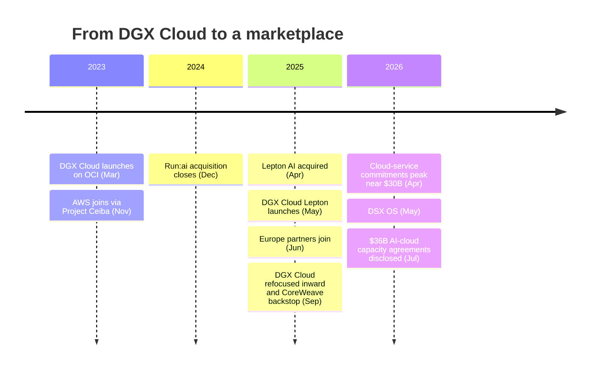
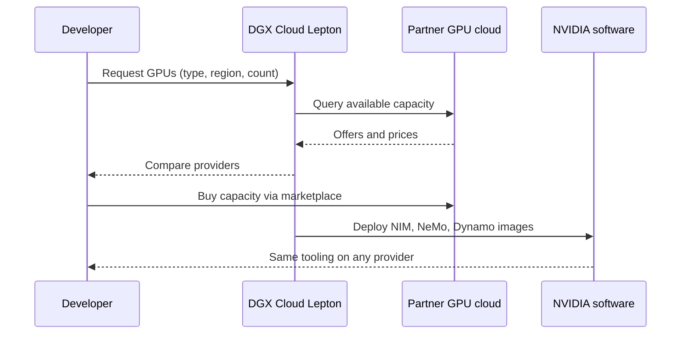

# DGX Cloud and DGX Cloud Lepton

Layer 12 · Orchestration and cloud services · ~8 min read · Last verified: 2026-11-05

## ⚡ The Executive Take

- **[DGX Cloud](../../glossary.md#dgx-cloud) (March 2023) was NVIDIA's cloud inside other people's clouds:** NVIDIA-run clusters hosted first on Oracle Cloud, then Azure and Google Cloud, from $36,999 a month per 8-GPU instance (~$6.34 per GPU-hour) [[S12007]](../../sources/bibliography.md#s12007); AWS joined in November 2023 [[S5525]](../../sources/bibliography.md#s5525).
- **The mechanism is a lease-back.** NVIDIA rents capacity from the clouds that bought its GPUs and resells it with its own software. Its [multi-year cloud service agreements](../../glossary.md#cloud-service-agreement) grew ~13×, from $2.23B (January 2023) to $29B (July 2026) [[S418]](../../sources/bibliography.md#s418)[[S407]](../../sources/bibliography.md#s407).
- 🟡 **The 2025 pivot:** most DGX Cloud capacity was reportedly redirected to NVIDIA's own research as it stepped back from competing with AWS and Azure [[S90068]](../../sources/bibliography.md#s90068); a reported ~$1.5B deal to rent back ~18,000 GPUs from Lambda points the same way [[S483]](../../sources/bibliography.md#s483).
- **[DGX Cloud Lepton](../../glossary.md#dgx-cloud-lepton) (May 2025) is a marketplace, not a cloud.** It routes developers to partner capacity (CoreWeave, Crusoe, Lambda, Nebius, Nscale and others) without owning hardware [[S598]](../../sources/bibliography.md#s598)[[S12009]](../../sources/bibliography.md#s12009), built on the Lepton AI acquisition (April 2025; reportedly several hundred million dollars) [[S478]](../../sources/bibliography.md#s478)[[S479]](../../sources/bibliography.md#s479).
- **NVIDIA is also a buyer of last resort:** up to $6.3B of CoreWeave's unsold capacity through 2032-04-13 [[S90067]](../../sources/bibliography.md#s90067), within $36B of AI-cloud capacity agreements disclosed in July 2026 [[S407]](../../sources/bibliography.md#s407)[[S430]](../../sources/bibliography.md#s430).
- **Why not a full public cloud:** hyperscale customers were ~$48.7B of NVIDIA's ~$89B Q2 FY2027 Data Center revenue [[S90011]](../../sources/bibliography.md#s90011)[[S90013]](../../sources/bibliography.md#s90013). Competing with them would invite channel conflict and accelerate their own chips.
- **Weakness:** NVIDIA now carries cloud-style commitments (~$65B combined) on a hardware balance sheet [[S407]](../../sources/bibliography.md#s407); if demand softens, they turn from support into cost.

## DGX Cloud 1.0: a shop inside the department store

A designer brand can run its own concession inside a department store: its staff, its prices, its customers, the store's floor space. DGX Cloud worked the same way. The [hyperscaler](../../glossary.md#hyperscaler) bought the GPUs and hosted them; NVIDIA leased the capacity back, added Base Command, AI Enterprise and its engineers, and sold access at its own price [[S12007]](../../sources/bibliography.md#s12007).

> [!TIP]
> **Worked example — what DGX Cloud charged.** $36,999 a month ÷ (8 GPUs × ~730 hours) = **~$6.34 per GPU-hour** [[S12007]](../../sources/bibliography.md#s12007), including NVIDIA's software and support. AWS's own H100 instance listed at $12.29 per GPU-hour at its July 2023 launch [[S391]](../../sources/bibliography.md#s391), and neocloud H100s ran ~$8 at the 2023 peak [[S393]](../../sources/bibliography.md#s393). **Conclusion:** DGX Cloud was priced as a premium, software-rich service, not a discount channel, and it competed with the hosts' own instances.

## The 2025 pivot: from cloud seller to cloud tenant

By September 2025, reporting said most DGX Cloud capacity was used for NVIDIA's own research and that it would stop trying to compete with AWS and Azure [[S90068]](../../sources/bibliography.md#s90068). The commitments did not shrink: they rose from $10.6B in April 2025 to $29B in July 2026 [[S414]](../../sources/bibliography.md#s414)[[S407]](../../sources/bibliography.md#s407). NVIDIA still rents capacity at scale, now mainly for its own research and software work [[S90068]](../../sources/bibliography.md#s90068).

> [!TIP]
> **Worked example — how many GPUs $29B rents.** At an assumed ~$2.50 per GPU-hour (between the ~$2.35 one-year H100 index of March 2026 [[S12516]](../../sources/bibliography.md#s12516) and Blackwell list prices [[S395]](../../sources/bibliography.md#s395)), $29B buys ~11.6B GPU-hours. Over the six-year horizon of the commitments [[S401]](../../sources/bibliography.md#s401) that is ~220,000 GPUs running full-time (🔴 repo Est.). **Conclusion:** NVIDIA is itself one of the larger GPU-cloud tenants.

## DGX Cloud Lepton: routing demand instead of owning supply

Lepton is closer to a ride-hailing app than a taxi company. Developers search for GPUs across partner clouds, buy capacity from a provider or bring their own cluster, and get NVIDIA's software stack on whichever provider they choose [[S12009]](../../sources/bibliography.md#s12009)[[S12529]](../../sources/bibliography.md#s12529). Launch partners were CoreWeave, Crusoe, Firmus, Foxconn, GMI Cloud, Lambda, Nebius, Nscale, SoftBank and Yotta [[S12009]](../../sources/bibliography.md#s12009); Mistral AI, Fluidstack, Scaleway, Together AI and others joined in June 2025, with AWS and Azure reported to follow 🟡 [[S12008]](../../sources/bibliography.md#s12008).

> [!TIP]
> **Worked example — why a neocloud joins.** A 2,000-GPU neocloud lifting utilization from 60% to 70% sells 2,000 × 8,760 × 10% ≈ **1.75M** more GPU-hours a year; at ~$2.35 [[S12516]](../../sources/bibliography.md#s12516) that is ~$41M of revenue on capacity it already owns (Est.). **Conclusion:** Lepton's value to partners is demand aggregation; NVIDIA's is keeping developers on its stack whoever owns the hardware.

🔧 Under the hood: three kinds of NVIDIA cloud commitment

| Instrument | What NVIDIA pays for | Size | Source |
|---|---|---|---|
| Multi-year cloud service agreements | Capacity it uses (DGX Cloud, research) | $29B (Jul 2026) | [[S407]](../../sources/bibliography.md#s407) |
| AI-cloud capacity agreements | Partner capacity left unsold | $36B (Jul 2026) | [[S407]](../../sources/bibliography.md#s407)[[S430]](../../sources/bibliography.md#s430) |
| CoreWeave backstop (one of the above) | Unsold CoreWeave capacity to 2032-04-13 | Up to $6.3B | [[S90067]](../../sources/bibliography.md#s90067) |

These are purchase commitments, not revenue. The [circular-financing](../../glossary.md#circular-financing) debate around them is developed in [value chain and corp dev](value-chain-and-corp-dev.md).

## Why NVIDIA avoids competing head-on with hyperscalers

1. **Concentration:** hyperscale was ~55% of Q2 FY2027 Data Center revenue ($48.7B of ~$89B) [[S90011]](../../sources/bibliography.md#s90011)[[S90013]](../../sources/bibliography.md#s90013). A rival cloud would put the largest customers' orders at risk.
2. **Their alternative is real:** every hyperscaler has its own accelerator (TPU, Trainium, Maia, MTIA); channel conflict would speed adoption.
3. **Different economics:** NVIDIA earns ~75% gross margin up front [[S3]](../../sources/bibliography.md#s3); a cloud earns over years and carries utilization and financing risk.

> [!TIP]
> **Worked example — selling vs renting one GB300 GPU.** NVIDIA's revenue arrives at shipment (the rack sells for ~$55K per GPU at the ODM level [[S332]](../../sources/bibliography.md#s332)). A cloud renting the same GPU at an assumed $3.00 per hour and 60% utilization collects ~$95K over six years (3.00 × 8,760 × 0.6 × 6), before power, facility, staff and interest (🔴 assumption). **Conclusion:** the cloud's extra revenue is paid for with six years of risk; NVIDIA prefers to supply every cloud rather than become one.

> [!NOTE]
> **🐂 Bull view:** Lepton plus backstops give NVIDIA influence over where demand lands, at little capex, while hyperscalers stay customers.

> [!WARNING]
> **🐻 Bear view:** commitments of ~$65B [[S407]](../../sources/bibliography.md#s407) make NVIDIA a de facto cloud risk-taker; in a downturn it would pay for idle GPUs it already booked as revenue.

## 🎯 Corp Dev Lens

1. **Marketplace vs owner:** Lepton shows NVIDIA prefers to own routing and software, not datacenters. Which GPU-cloud brokers or aggregators remain independent targets?
2. **Read commitments like a lessee's balance sheet:** $29B of service agreements plus $36B of capacity agreements [[S407]](../../sources/bibliography.md#s407) deserve the same scrutiny as lease liabilities.
3. **Partner leverage cuts both ways:** neoclouds gain demand from Lepton but deepen dependence on NVIDIA allocation and pricing.
4. **Qualcomm question (public information only):** would a Lepton-like marketplace that is hardware-neutral help non-NVIDIA inference racks reach developers, and who would run it?

## 📚 Sources

<!-- Auto-generated from the [S…] citations on this page by `make build`. Edit sources/registry/*.csv, not this list. -->

- [**S3**](../../sources/bibliography.md#s3) StorageNewsletter, *NVIDIA Q2 Fiscal 2027 results coverage: revenue $96.2B*, 2026-08-27. [Link](https://www.storagenewsletter.com/2026/08/27/nvidia-fiscal-2q27-financial-results/)
- [**S332**](../../sources/bibliography.md#s332) Tiger Brokers (iTiger), *Morgan Stanley's BOM analysis of NVIDIA's Rubin: GPU share declines; PCB, MLCC and ABF substrate values soar*, 2026-05-20. [Link](https://www.itiger.com/news/1188068712)
- [**S391**](../../sources/bibliography.md#s391) AWS, *Amazon EC2 P5 instances (NVIDIA H100) - product and on-demand pricing*, 2023-07-26. [Link](https://aws.amazon.com/ec2/instance-types/p5/)
- [**S393**](../../sources/bibliography.md#s393) Latent Space (Eugene Cheah), *$2 H100s: how the GPU bubble burst*, 2024-10. [Link](https://www.latent.space/p/gpu-bubble)
- [**S395**](../../sources/bibliography.md#s395) Lambda, *Lambda GPU cloud pricing*, 2025. [Link](https://lambda.ai/pricing)
- [**S401**](../../sources/bibliography.md#s401) NVIDIA Corporation via SEC EDGAR, *NVIDIA Corporation Form 10-K for fiscal year ended January 25, 2026*, 2026-02-25. [Link](https://www.sec.gov/Archives/edgar/data/1045810/000104581026000021/nvda-20260125.htm)
- [**S407**](../../sources/bibliography.md#s407) NVIDIA Corporation via SEC EDGAR, *NVIDIA Corporation Form 10-Q for quarter ended July 26, 2026*, 2026-08-28. [Link](https://www.sec.gov/Archives/edgar/data/1045810/000104581026000075/nvda-20260726.htm)
- [**S414**](../../sources/bibliography.md#s414) NVIDIA Corporation via SEC EDGAR, *NVIDIA Corporation Form 10-Q for quarter ended April 27, 2025*, 2025-05-28. [Link](https://www.sec.gov/Archives/edgar/data/1045810/000104581025000116/nvda-20250427.htm)
- [**S418**](../../sources/bibliography.md#s418) NVIDIA Corporation via SEC EDGAR, *NVIDIA Corporation Form 10-K for fiscal year ended January 29, 2023*, 2023-02-24. [Link](https://www.sec.gov/Archives/edgar/data/1045810/000104581023000017/nvda-20230129.htm)
- [**S430**](../../sources/bibliography.md#s430) FourWeekMBA, *Nvidia's 10-Q Lists $530B in Commitments and Guarantees*, 2026-08. [Link](https://fourweekmba.com/ai-nvidia-10-q-lists-530b-in-commitments-and-guarantees/)
- [**S478**](../../sources/bibliography.md#s478) NVIDIA, *NVIDIA Blog and Newsroom acquisition announcements (Cumulus, SwiftStack, DeepMap, Bright Computing, Excelero, Shoreline, Brev.dev, OctoAI, VinBrain, Gretel, Lepton AI, CentML, SchedMD)*, 2025-12. [Link](https://blogs.nvidia.com/)
- [**S479**](../../sources/bibliography.md#s479) Various (press), *Reporting on NVIDIA tuck-in acquisition prices (Run:ai, Deci, Shoreline, OctoAI, Gretel, Lepton, CentML) — The Information, Calcalist, Reuters, CNBC*, 2025-06. [Link](https://www.reuters.com/technology/)
- [**S483**](../../sources/bibliography.md#s483) Various (Bloomberg, The Information, Reuters), *Reporting on NVIDIA commitments to xAI (up to $2B in ~$20B raise), Poolside (up to $1B), Lambda (~$1.5B GPU lease-back) and Wayve ($500M LOI)*, 2025-10. [Link](https://www.bloomberg.com/technology)
- [**S598**](../../sources/bibliography.md#s598) NVIDIA Newsroom, *NVIDIA Announces DGX Cloud Lepton to Connect Developers to NVIDIA's Global Compute Ecosystem*, 2025-05-18. [Link](https://nvidianews.nvidia.com/news/nvidia-announces-dgx-cloud-lepton-to-connect-developers-to-nvidias-global-compute-ecosystem)
- [**S5525**](../../sources/bibliography.md#s5525) NVIDIA Blog, *Embracing transformation: AWS and NVIDIA forge ahead in generative AI and cloud innovation*, 2023-11-28. [Link](https://blogs.nvidia.com/blog/aws-nvidia)
- [**S12007**](../../sources/bibliography.md#s12007) NVIDIA Newsroom, *NVIDIA Launches DGX Cloud, Giving Every Enterprise Instant Access to AI Supercomputer From a Browser*, 2023-03-21. [Link](https://nvidianews.nvidia.com/news/nvidia-launches-dgx-cloud-giving-every-enterprise-instant-access-to-ai-supercomputer-from-a-browser)
- [**S12008**](../../sources/bibliography.md#s12008) NVIDIA Newsroom, *NVIDIA DGX Cloud Lepton Connects Europe's Developers to Global NVIDIA Compute Ecosystem*, 2025-06-11. [Link](https://nvidianews.nvidia.com/news/nvidia-dgx-cloud-lepton-connects-europes-developers-to-global-nvidia-compute-ecosystem)
- [**S12009**](../../sources/bibliography.md#s12009) DatacenterDynamics, *Nvidia launches Lepton AI platform connecting GPU cloud providers' resources*, 2025-05. [Link](https://www.datacenterdynamics.com/en/news/nvidia-launches-lepton-ai-platform-connecting-gpu-cloud-providers-resources/)
- [**S12516**](../../sources/bibliography.md#s12516) SemiAnalysis, *The Great GPU Shortage - Rental Capacity - Launching our H100 1 Year Rental Price Index*, 2026-03. [Link](https://newsletter.semianalysis.com/p/the-great-gpu-shortage-rental-capacity)
- [**S12529**](../../sources/bibliography.md#s12529) NVIDIA Technical Blog, *Introducing NVIDIA DGX Cloud Lepton: a unified AI platform built for developers*, 2025-05. [Link](https://developer.nvidia.com/blog/introducing-nvidia-dgx-cloud-lepton-a-unified-ai-platform-built-for-developers)
- [**S90011**](../../sources/bibliography.md#s90011) Nasdaq (Zacks), *NVIDIA Q2 earnings beat on Blackwell Ultra and Data Center strength*, 2026-08-27. [Link](https://www.nasdaq.com/articles/nvidia-q2-earnings-beat-blackwell-ultra-data-center-strength)
- [**S90013**](../../sources/bibliography.md#s90013) Quartr, *NVIDIA (NVDA) Q2 2027 earnings summary*, 2026-08-26. [Link](https://quartr.com/events/nvidia-corporation-nvda-q2-2027_33dRoFp6)
- [**S90067**](../../sources/bibliography.md#s90067) DatacenterDynamics, *Nvidia to purchase unsold compute capacity from CoreWeave for $6.3bn*, 2025-09-16. [Link](https://www.datacenterdynamics.com/en/news/nvidia-to-purchase-unsold-compute-capacity-from-coreweave-for-63bn/)
- [**S90068**](../../sources/bibliography.md#s90068) Tom's Hardware, *Nvidia steps back from DGX Cloud — stops trying to compete with AWS and Azure*, 2025-09. [Link](https://www.tomshardware.com/tech-industry/nvidia-steps-back-from-dgx-cloud)
