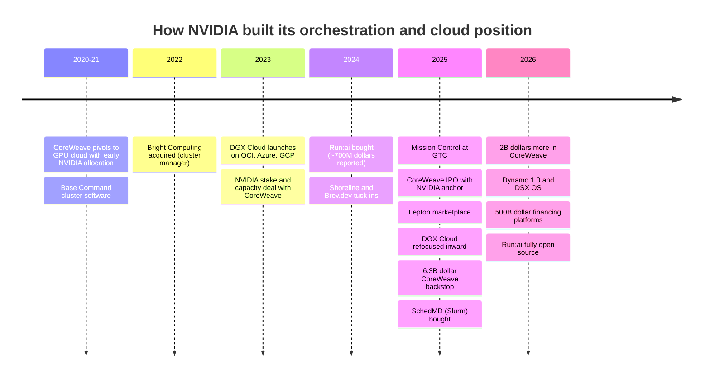
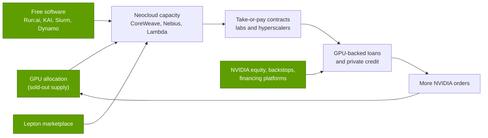

# Orchestration and cloud services: History and how NVIDIA built it

Layer 12 · Orchestration and cloud services · ~11 min read · Last verified: 2026-11-05

## ⚡ The Executive Take

- **NVIDIA tried to be a cloud, then chose to be the clouds' kingmaker.** [DGX Cloud](../../glossary.md#dgx-cloud) launched in March 2023 at $36,999 per 8-GPU instance-month inside Oracle, Microsoft and Google data centers. By 2025 it mostly served NVIDIA's own research 🟡 [[S12007]](../../sources/bibliography.md#s12007)[[S90068]](../../sources/bibliography.md#s90068).
- **The software came by acquisition:** Bright Computing (2022), [Run:ai](../../glossary.md#run-ai) (~$700M reported, 2024), Shoreline and Brev.dev (2024), Lepton (2025) and SchedMD, maker of [Slurm](../../glossary.md#slurm) (December 2025) [[S478]](../../sources/bibliography.md#s478)[[S476]](../../sources/bibliography.md#s476)[[S479]](../../sources/bibliography.md#s479)[[S12000]](../../sources/bibliography.md#s12000).
- **Then it gave the software away:** KAI Scheduler went open source in 2025 and the full Run:ai platform in October 2026, inside the [DSX OS](../../glossary.md#dsx-os) portfolio [[S12509]](../../sources/bibliography.md#s12509)[[S12510]](../../sources/bibliography.md#s12510)[[S12514]](../../sources/bibliography.md#s12514).
- **CoreWeave is the template:** a ~$100M stake (2023), a ~$250M IPO anchor order (March 2025), a $6.3B [capacity backstop](../../glossary.md#capacity-backstop) to April 2032 and $2B more equity (January 2026) [[S481]](../../sources/bibliography.md#s481)[[S473]](../../sources/bibliography.md#s473)[[S90067]](../../sources/bibliography.md#s90067)[[S472]](../../sources/bibliography.md#s472).
- **[Q4 · Source of advantage]** Allocation power, ecosystem and equity, not software alone. The software is free; scarce GPUs and cheap capital for their buyers are not.
- **[Q6 · Replication cost]** The software is cheap to copy (Est. $1–2B, 2–3 years). The position needs a sold-out product plus tens of billions of balance sheet 🔴.

## From selling boxes to shaping clouds

NVIDIA's first orchestration software ran customers' own DGX SuperPODs; Bright Computing's cluster manager became Base Command Manager, now inside [Mission Control](../../glossary.md#mission-control) [[S478]](../../sources/bibliography.md#s478)[[S12004]](../../sources/bibliography.md#s12004). The harder question was who would rent GPUs to buyers who could not own a SuperPOD. NVIDIA tried three answers: its own cloud, a marketplace, and financing other clouds.

| Date | Decision | Why it mattered | Source |
|---|---|---|---|
| 2022-01 | Buy Bright Computing | Cluster provisioning; later Base Command Manager | [[S478]](../../sources/bibliography.md#s478) |
| 2023-03 | DGX Cloud inside OCI, Azure, Google Cloud | Sells cloud time directly on rented hyperscaler capacity | [[S12007]](../../sources/bibliography.md#s12007) |
| 2023-04 | Stake and capacity deal with CoreWeave | Seeds an NVIDIA-only cloud outside the hyperscalers | [[S481]](../../sources/bibliography.md#s481)[[S90067]](../../sources/bibliography.md#s90067) |
| 2024-04 → 12 | Buy Run:ai (~$700M reported) | GPU pooling and fractional GPUs on Kubernetes | [[S476]](../../sources/bibliography.md#s476) |
| 2025-03 | Mission Control; anchor CoreWeave IPO (~$250M) | One ops stack for AI factories; public capital for its largest neocloud | [[S12005]](../../sources/bibliography.md#s12005)[[S473]](../../sources/bibliography.md#s473) |
| 2025-05 | DGX Cloud Lepton marketplace | Routes developers to partner GPUs instead of competing | [[S598]](../../sources/bibliography.md#s598)[[S12009]](../../sources/bibliography.md#s12009) |
| 2025-09 | DGX Cloud inward; $6.3B CoreWeave backstop | Exits head-on cloud competition; de-risks partner capacity | [[S90068]](../../sources/bibliography.md#s90068)[[S90067]](../../sources/bibliography.md#s90067) |
| 2025-12 | Buy SchedMD (Slurm) | Secures the default training job queue; pledged neutral | [[S12000]](../../sources/bibliography.md#s12000) |
| 2026-08 | Financing platforms with six asset managers | Targets >$500B of third-party capital for NVIDIA buyers | [[S12528]](../../sources/bibliography.md#s12528) |
| 2026-10 | Open-source the full Run:ai platform | Commoditizes orchestration; Crusoe and Nebius adopt it | [[S12510]](../../sources/bibliography.md#s12510)[[S12512]](../../sources/bibliography.md#s12512) |

> [!TIP]
> **Worked example — why NVIDIA stopped selling DGX Cloud head-on.** The launch price of $36,999 per 8-GPU instance-month is ~$6.33 per [GPU-hour](../../glossary.md#gpu-hour) [[S12007]](../../sources/bibliography.md#s12007). NVIDIA rented that capacity from Oracle, Microsoft and Google and resold it against them. [Hyperscalers](../../glossary.md#hyperscaler) bought ~$48.7B of NVIDIA's $89.0B Q2 FY2027 Data Center revenue 🟡 [[S406]](../../sources/bibliography.md#s406)[[S405]](../../sources/bibliography.md#s405). Competing with buyers of more than half your core revenue is a poor trade, so DGX Cloud became an internal resource and Lepton a traffic router 🟡 [[S90068]](../../sources/bibliography.md#s90068).

## The CoreWeave relationship (2020 → 2026)

CoreWeave pivoted from crypto mining to GPU cloud with early access to new NVIDIA generations. By end-2024 it had >250,000 GPUs, >360 MW active power and ~1.3 GW contracted, with Microsoft at 62% of 2024 revenue [[S12011]](../../sources/bibliography.md#s12011)[[S386]](../../sources/bibliography.md#s386). NVIDIA supported every funding step, and by June 2026 CoreWeave held a $104.2B revenue backlog [[S12500]](../../sources/bibliography.md#s12500). Capital commitments, not software, now make up most of NVIDIA's deal dollars:

> [!TIP]
> **Worked example — what a backstop costs the giver vs the receiver.** The $6.3B backstop obliges NVIDIA to buy CoreWeave capacity left unsold until 2032-04-13 [[S90067]](../../sources/bibliography.md#s90067). That is ≤$1B a year over ~6.5 years, and ~10% of one quarter's operating income ($63.7B in Q2 FY2027) [[S405]](../../sources/bibliography.md#s405). CoreWeave's lenders can treat that capacity as partly pre-sold and lend cheaper. Cheap for the giver, valuable for the receiver: that asymmetry is the moat.

## [Q4 · Source of advantage] Allocation, ecosystem and equity

**[Q4 · Source of advantage]** Three levers reinforce each other; the software on top is free.

1. **Allocation.** When demand exceeds supply, whoever gets GPUs first wins customers; NVIDIA's FY2028 outlook is supply-constrained and new H100 capacity was booked through September 2026 🟡 [[S90012]](../../sources/bibliography.md#s90012)[[S12516]](../../sources/bibliography.md#s12516).
2. **Ecosystem.** Lepton, [Dynamo](../../glossary.md#dynamo) and open Run:ai make a new [neocloud](../../glossary.md#neocloud) credible on day one; Dynamo 1.0 adopters include CoreWeave, Nebius and Together AI [[S12009]](../../sources/bibliography.md#s12009)[[S90066]](../../sources/bibliography.md#s90066)[[S12510]](../../sources/bibliography.md#s12510).
3. **Equity and credit.** NVIDIA's support lowers its buyers' cost of capital: its 10-Q lists $36B of AI-cloud capacity agreements and $29B of cloud service agreements [[S407]](../../sources/bibliography.md#s407).

> [!TIP]
> **Worked example — why early allocation beat any software feature in 2023.** An H100 rented for ~$8 per GPU-hour in 2023 and cost ~$25–30K [[S393]](../../sources/bibliography.md#s393)[[S356]](../../sources/bibliography.md#s356). Rented 24/7, the GPU alone paid back in ~4–5 months. A cloud that received H100s a quarter before its rival collected most of the purchase price in rent, which is why neoclouds organized themselves around NVIDIA's allocation queue.

## [Q6 · Replication cost] Time, dollars and talent

| Component | What NVIDIA spent or committed | Time to replicate (Est.) | Who could |
|---|---|---|---|
| Orchestration software | Run:ai ~$0.7B, Shoreline ~$0.1B, Lepton "several hundred million" (reported); Bright, Brev.dev, SchedMD undisclosed [[S479]](../../sources/bibliography.md#s479)[[S478]](../../sources/bibliography.md#s478) | 2–3 years, a few hundred engineers | Anyone; Kueue, Ray, SkyPilot are free [[S12533]](../../sources/bibliography.md#s12533)[[S12535]](../../sources/bibliography.md#s12535)[[S12534]](../../sources/bibliography.md#s12534) |
| Neocloud financing support | CoreWeave ~$2.35B equity + $6.3B backstop; Lambda lease-back ~$1.5B; $36B AI-cloud agreements [[S472]](../../sources/bibliography.md#s472)[[S90067]](../../sources/bibliography.md#s90067)[[S483]](../../sources/bibliography.md#s483)[[S407]](../../sources/bibliography.md#s407) | 3–5 years | Cash-rich firms; Google already backstops Fluidstack [[S12525]](../../sources/bibliography.md#s12525) |
| Allocation power | Needs a supply-constrained product at ~75% gross margin [[S405]](../../sources/bibliography.md#s405) | While demand outruns supply | Nobody by spending alone |
| Developer pull | CUDA and libraries, 15+ years ([layer 09](../09-cuda-and-system-software/index.md)) | A decade | Hyperscalers, partly |

**[Q6 · Replication cost]** Est. (this repo, 🔴): **software $1–2B, 2–3 years, ~300–1,000 engineers**. The **position** needs $40B+ of balance-sheet support and a sold-out product: 5+ years, and only for a firm that has both. Hyperscalers need not replicate it, because they own customers and capacity; a merchant-silicon challenger would.

> [!TIP]
> **Worked example — the bill for a challenger.** NVIDIA's support for one CoreWeave-sized partner is ~$8.7B ($2.35B equity + $6.3B backstop), ~18% of its $48.6B Q1 FY2027 free cash flow [[S472]](../../sources/bibliography.md#s472)[[S90067]](../../sources/bibliography.md#s90067)[[S403]](../../sources/bibliography.md#s403). A challenger without that cash pays in another currency: AMD gave OpenAI warrants for up to 160M AMD shares, vesting with deployments and share-price hurdles 🟡 [[S13506]](../../sources/bibliography.md#s13506).

## Counterfactuals — what if NVIDIA hadn't…

- 🔴 **…retreated from DGX Cloud and become a full public cloud?** A 1 GW AI factory costs ~$50–60B all-in, ~$35B of it NVIDIA content [[S398]](../../sources/bibliography.md#s398). NVIDIA would have financed that capex itself, diluted its ~75% gross margin and competed with buyers of ~55% of its Data Center output [[S405]](../../sources/bibliography.md#s405)[[S406]](../../sources/bibliography.md#s406). Likely result: faster hyperscaler [ASIC](../../glossary.md#asic) adoption.
- 🔴 **…not backed neoclouds?** The non-hyperscale ACIE segment (~$40.3B in Q2 FY2027) would be smaller and hyperscaler bargaining power larger [[S406]](../../sources/bibliography.md#s406). CoreWeave's debt would cost more and it would grow more slowly.
- 🔴 **…let a hyperscaler buy SchedMD or Run:ai?** The default training job queue would favour that owner's chips [[S12000]](../../sources/bibliography.md#s12000)[[S476]](../../sources/bibliography.md#s476).

🔧 Under the hood: why open-sourcing Run:ai does not hurt NVIDIA

Run:ai pools GPUs: fractional GPUs, quotas and pre-emption that raise utilization (NVIDIA claims up to 5×, a vendor figure) [[S12004]](../../sources/bibliography.md#s12004). Higher utilization makes NVIDIA GPUs cheaper per useful hour, which sells more GPUs. Charging for the software would slow adoption and invite open alternatives. Releasing it under Apache 2.0, with paid support via Mission Control and AI Enterprise, keeps NVIDIA's code the reference implementation [[S12510]](../../sources/bibliography.md#s12510)[[S12511]](../../sources/bibliography.md#s12511). Economists call this "commoditizing the complement".

## 🎯 Corp Dev Lens

1. NVIDIA spent perhaps $1–2B on layer-12 software and then open-sourced most of it. What does that imply for the standalone value of GPU-orchestration start-ups?
2. The backstop asymmetry works only for a cash-rich supplier with sold-out product. Could a challenger borrow it through partners (hyperscalers, private credit)?
3. Does the order in which neoclouds received each GPU generation predict their later growth and valuation?
4. If supply catches up with demand in 2027–2028, which lever (allocation, ecosystem, equity) weakens first?

## 📚 Sources

<!-- Auto-generated from the [S…] citations on this page by `make build`. Edit sources/registry/*.csv, not this list. -->

- [**S356**](../../sources/bibliography.md#s356) Tom's Hardware, *Nvidia makes nearly 1,000% profit on H100 GPUs: report*, 2023-08. [Link](https://www.tomshardware.com/news/nvidia-makes-1000-profit-on-h100-gpus-report)
- [**S386**](../../sources/bibliography.md#s386) CoreWeave via SEC EDGAR, *CoreWeave Form S-1 registration statement (2025) - technology equipment useful life*, 2025-03-03. [Link](https://www.sec.gov/cgi-bin/browse-edgar?action=getcompany&company=coreweave&type=S-1&dateb=&owner=include&count=40)
- [**S393**](../../sources/bibliography.md#s393) Latent Space (Eugene Cheah), *$2 H100s: how the GPU bubble burst*, 2024-10. [Link](https://www.latent.space/p/gpu-bubble)
- [**S398**](../../sources/bibliography.md#s398) NVIDIA Investor Relations, *NVIDIA Q2 FY2026 earnings call (2025-08-27): AI factory economics commentary*, 2025-08-27. [Link](https://investor.nvidia.com/events-and-presentations/events-and-presentations/default.aspx)
- [**S403**](../../sources/bibliography.md#s403) NVIDIA Corporation via SEC EDGAR, *NVIDIA Announces Financial Results for First Quarter Fiscal 2027 (Form 8-K exhibit 99.1)*, 2026-05-20. [Link](https://www.sec.gov/Archives/edgar/data/0001045810/000104581026000051/q1fy27pr.htm)
- [**S405**](../../sources/bibliography.md#s405) NVIDIA Corporation via SEC EDGAR, *NVIDIA Announces Financial Results for Second Quarter Fiscal 2027 (Form 8-K exhibit 99.1)*, 2026-08-26. [Link](https://www.sec.gov/Archives/edgar/data/0001045810/000104581026000073/q2fy27pr.htm)
- [**S406**](../../sources/bibliography.md#s406) NVIDIA Corporation (Colette Kress), *CFO Commentary on Second Quarter Fiscal 2027 Results*, 2026-08-26. [Link](https://s201.q4cdn.com/141608511/files/doc_financials/2027/Q227/Q2FY27-CFO-Commentary.pdf)
- [**S407**](../../sources/bibliography.md#s407) NVIDIA Corporation via SEC EDGAR, *NVIDIA Corporation Form 10-Q for quarter ended July 26, 2026*, 2026-08-28. [Link](https://www.sec.gov/Archives/edgar/data/1045810/000104581026000075/nvda-20260726.htm)
- [**S472**](../../sources/bibliography.md#s472) CoreWeave Newsroom, *CoreWeave and NVIDIA expand partnership; NVIDIA invests $2B in CoreWeave Class A stock*, 2026-01-26. [Link](https://www.coreweave.com/news)
- [**S473**](../../sources/bibliography.md#s473) U.S. Securities and Exchange Commission (EDGAR), *CoreWeave Inc. Form 8-K / S-1 filings (EDGAR index): NVIDIA capacity agreement and IPO participation*, 2025-09-15. [Link](https://www.sec.gov/cgi-bin/browse-edgar?action=getcompany&CIK=0001769628&type=8-K&dateb=&owner=include&count=40)
- [**S476**](../../sources/bibliography.md#s476) NVIDIA Blog, *NVIDIA to Acquire GPU Orchestration Software Provider Run:ai*, 2024-04-24. [Link](https://blogs.nvidia.com/blog/runai/)
- [**S478**](../../sources/bibliography.md#s478) NVIDIA, *NVIDIA Blog and Newsroom acquisition announcements (Cumulus, SwiftStack, DeepMap, Bright Computing, Excelero, Shoreline, Brev.dev, OctoAI, VinBrain, Gretel, Lepton AI, CentML, SchedMD)*, 2025-12. [Link](https://blogs.nvidia.com/)
- [**S479**](../../sources/bibliography.md#s479) Various (press), *Reporting on NVIDIA tuck-in acquisition prices (Run:ai, Deci, Shoreline, OctoAI, Gretel, Lepton, CentML) — The Information, Calcalist, Reuters, CNBC*, 2025-06. [Link](https://www.reuters.com/technology/)
- [**S481**](../../sources/bibliography.md#s481) Various (company announcements; Reuters, Bloomberg, TechCrunch), *Reporting on NVIDIA participation in AI-lab and neocloud funding rounds 2023–2025 (Inflection, Cohere, Hugging Face, Databricks, Mistral, xAI, Perplexity, Crusoe, Lambda, Nebius, Nscale, Together AI, Poolside, Reflection AI, Thinking Machines, Cursor)*, 2025-11. [Link](https://techcrunch.com/)
- [**S483**](../../sources/bibliography.md#s483) Various (Bloomberg, The Information, Reuters), *Reporting on NVIDIA commitments to xAI (up to $2B in ~$20B raise), Poolside (up to $1B), Lambda (~$1.5B GPU lease-back) and Wayve ($500M LOI)*, 2025-10. [Link](https://www.bloomberg.com/technology)
- [**S598**](../../sources/bibliography.md#s598) NVIDIA Newsroom, *NVIDIA Announces DGX Cloud Lepton to Connect Developers to NVIDIA's Global Compute Ecosystem*, 2025-05-18. [Link](https://nvidianews.nvidia.com/news/nvidia-announces-dgx-cloud-lepton-to-connect-developers-to-nvidias-global-compute-ecosystem)
- [**S12000**](../../sources/bibliography.md#s12000) NVIDIA Blog, *NVIDIA Acquires Open-Source Workload Management Provider SchedMD*, 2025-12-15. [Link](https://blogs.nvidia.com/blog/nvidia-acquires-schedmd)
- [**S12004**](../../sources/bibliography.md#s12004) NVIDIA, *NVIDIA Mission Control (product page)*, 2025. [Link](https://www.nvidia.com/en-us/data-center/mission-control/)
- [**S12005**](../../sources/bibliography.md#s12005) NVIDIA Blog, *New NVIDIA Software for Blackwell Infrastructure Runs AI Factories at Light Speed*, 2025-03-18. [Link](https://blogs.nvidia.com/?p=78497)
- [**S12007**](../../sources/bibliography.md#s12007) NVIDIA Newsroom, *NVIDIA Launches DGX Cloud, Giving Every Enterprise Instant Access to AI Supercomputer From a Browser*, 2023-03-21. [Link](https://nvidianews.nvidia.com/news/nvidia-launches-dgx-cloud-giving-every-enterprise-instant-access-to-ai-supercomputer-from-a-browser)
- [**S12009**](../../sources/bibliography.md#s12009) DatacenterDynamics, *Nvidia launches Lepton AI platform connecting GPU cloud providers' resources*, 2025-05. [Link](https://www.datacenterdynamics.com/en/news/nvidia-launches-lepton-ai-platform-connecting-gpu-cloud-providers-resources/)
- [**S12011**](../../sources/bibliography.md#s12011) DatacenterDynamics, *CoreWeave files for IPO on Nasdaq stock market*, 2025-03. [Link](https://www.datacenterdynamics.com/en/news/coreweave-files-for-ipo-on-nasdaq-stock-market/)
- [**S12500**](../../sources/bibliography.md#s12500) CoreWeave (press release via Seeking Alpha), *CoreWeave Reports Strong Second Quarter 2026 Results*, 2026-08. [Link](https://seekingalpha.com/pr/20615715)
- [**S12509**](../../sources/bibliography.md#s12509) NVIDIA Technical Blog, *NVIDIA open sources Run:ai Scheduler to foster community collaboration (KAI Scheduler)*, 2025-04. [Link](https://developer.nvidia.com/blog/nvidia-open-sources-runai-scheduler-to-foster-community-collaboration/)
- [**S12510**](../../sources/bibliography.md#s12510) NVIDIA Technical Blog, *NVIDIA Run:ai is now open source as part of NVIDIA DSX AI Factory platform*, 2026-10. [Link](https://developer.nvidia.com/blog/nvidia-runai-is-now-open-source-as-part-of-nvidia-dsx-ai-factory-platform/)
- [**S12511**](../../sources/bibliography.md#s12511) TechRepublic, *Nvidia Run:ai is now open source: what's free and paid*, 2026-10-15. [Link](https://www.techrepublic.com/article/news-nvidia-runai-open-source-free-paid/)
- [**S12512**](../../sources/bibliography.md#s12512) Techstrong.ai, *NVIDIA hands Run:ai to the open source community*, 2026-10. [Link](https://techstrong.ai/articles/nvidia-hands-runai-to-the-open-source-community/)
- [**S12514**](../../sources/bibliography.md#s12514) NVIDIA, *NVIDIA DSX OS (product page)*, 2026. [Link](https://www.nvidia.com/en-us/data-center/products/dsx/os/)
- [**S12516**](../../sources/bibliography.md#s12516) SemiAnalysis, *The Great GPU Shortage - Rental Capacity - Launching our H100 1 Year Rental Price Index*, 2026-03. [Link](https://newsletter.semianalysis.com/p/the-great-gpu-shortage-rental-capacity)
- [**S12525**](../../sources/bibliography.md#s12525) The Energy Mag, *Fluidstack seeks $700M at $7B valuation; TeraWulf and Cipher leases backstopped by Google*, 2025-12-07. [Link](https://theenergymag.com/news/2025-12-07/fluidstack-ai-terawulf-cipher)
- [**S12528**](../../sources/bibliography.md#s12528) NVIDIA Newsroom, *NVIDIA Partners With Apollo, BlackRock, Blackstone, Brookfield, Goldman Sachs and KKR to Establish AI Compute Infrastructure Financing Platforms to Mobilize Over $500 Billion of Third-Party Capital*, 2026-08-10. [Link](https://nvidianews.nvidia.com/news/nvidia-partners-with-apollo-blackrock-blackstone-brookfield-goldman-sachs-and-kkr-to-establish-ai-compute-infrastructure-financing-platforms-to-mobilize-over-500-billion-of-third-party-capital)
- [**S12533**](../../sources/bibliography.md#s12533) Kubernetes SIGs on GitHub, *Kueue (README)*, 2026. [Link](https://github.com/kubernetes-sigs/kueue)
- [**S12534**](../../sources/bibliography.md#s12534) SkyPilot project on GitHub, *SkyPilot (README)*, 2026-10. [Link](https://github.com/skypilot-org/skypilot)
- [**S12535**](../../sources/bibliography.md#s12535) Ray project on GitHub (Anyscale), *Ray (README)*, 2026. [Link](https://github.com/ray-project/ray)
- [**S13506**](../../sources/bibliography.md#s13506) Tom's Hardware, *OpenAI signs 6 GW AMD GPU deal*, 2025-10-06. [Link](https://www.tomshardware.com/pc-components/gpus/openai-signs-6gw-amd-gpu-deal)
- [**S90012**](../../sources/bibliography.md#s90012) Tomasz Tunguz (Tomasz Tunguz), *Nvidia Q2 FY27 earnings*, 2026-08. [Link](https://www.tomtunguz.com/nvidia-q2-fy27-earnings/index.md)
- [**S90066**](../../sources/bibliography.md#s90066) HPCwire (NVIDIA press release), *NVIDIA enters production with Dynamo, the broadly adopted inference operating system for AI factories*, 2026-03-17. [Link](https://www.hpcwire.com/aiwire/tag/dynamo-1-0/)
- [**S90067**](../../sources/bibliography.md#s90067) DatacenterDynamics, *Nvidia to purchase unsold compute capacity from CoreWeave for $6.3bn*, 2025-09-16. [Link](https://www.datacenterdynamics.com/en/news/nvidia-to-purchase-unsold-compute-capacity-from-coreweave-for-63bn/)
- [**S90068**](../../sources/bibliography.md#s90068) Tom's Hardware, *Nvidia steps back from DGX Cloud — stops trying to compete with AWS and Azure*, 2025-09. [Link](https://www.tomshardware.com/tech-industry/nvidia-steps-back-from-dgx-cloud)
