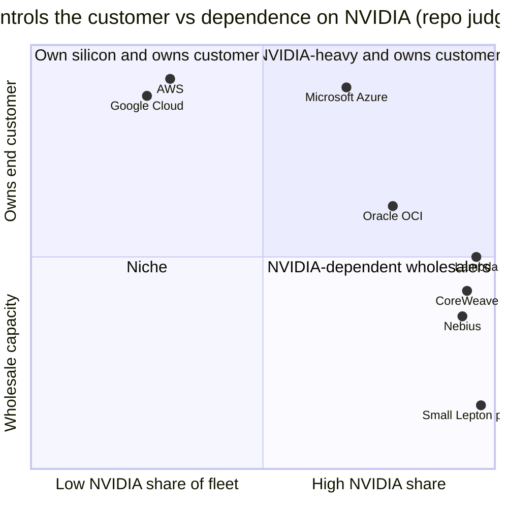

# Hyperscalers vs neoclouds: who rents out NVIDIA's GPUs

Layer 12 · Orchestration and cloud services · ~8 min read · Last verified: 2026-11-05

## ⚡ The Executive Take

- **[Hyperscalers](../../glossary.md#hyperscaler) are NVIDIA's largest customers and most capable rivals.** Hyperscale was ~$48.7B of Q2 FY2027 Data Center revenue [[S90011]](../../sources/bibliography.md#s90011); Microsoft, Amazon and Google bought ~850K of ~1.73M tracked Hopper GPUs in 2024 (Omdia Est.) [[S12014]](../../sources/bibliography.md#s12014). Each also builds its own accelerator: TPU, Trainium, Maia, MTIA [[S90026]](../../sources/bibliography.md#s90026)[[S90035]](../../sources/bibliography.md#s90035)[[S90044]](../../sources/bibliography.md#s90044)[[S160]](../../sources/bibliography.md#s160).
- **[Neoclouds](../../glossary.md#neocloud) are NVIDIA-first.** CoreWeave had ~1.5 GW live and 4.2 GW [contracted](../../glossary.md#contracted-power) by August 2026 [[S12010]](../../sources/bibliography.md#s12010); Nebius targets ~5 GW contracted by end-2026 [[S12010]](../../sources/bibliography.md#s12010). Synergy puts neocloud revenue above $25B in 2025, heading to ~$180B by 2030 (secondary citation) [[S12022]](../../sources/bibliography.md#s12022).
- **Oracle is a quasi-neocloud:** its Zettascale10 cluster targets up to 800,000 NVIDIA GPUs [[S6008]](../../sources/bibliography.md#s6008), yet it also ordered 50,000 AMD MI450s [[S90022]](../../sources/bibliography.md#s90022).
- **NVIDIA steers demand with capital:** a $2B CoreWeave stake (January 2026) [[S472]](../../sources/bibliography.md#s472), stakes in Nebius, Crusoe, Lambda, Together AI and Nscale [[S481]](../../sources/bibliography.md#s481), the $6.3B CoreWeave backstop [[S90067]](../../sources/bibliography.md#s90067) and Lepton routing [[S598]](../../sources/bibliography.md#s598).
- **The mix is shifting, unevenly:** [sovereign AI](../../glossary.md#sovereign-ai) exceeded ~$30B in FY2026; [ACIE](../../glossary.md#acie) (~$37B) roughly matched hyperscale in Q1 FY2027; regional neoclouds grew 35% q/q in Q2 FY2027 [[S90071]](../../sources/bibliography.md#s90071). Yet hyperscale's share rose from ~51% to ~55% of Data Center revenue in Q2 [[S403]](../../sources/bibliography.md#s403)[[S90011]](../../sources/bibliography.md#s90011).
- **Weakness:** neoclouds' biggest tenants are hyperscalers and labs (Microsoft >$60B of neocloud contracts [[S12526]](../../sources/bibliography.md#s12526); Meta $14.2B with CoreWeave [[S12527]](../../sources/bibliography.md#s12527)), so much "diversified" demand is hyperscale overflow.

## Partner and competitor: the hyperscaler relationship

A hyperscaler is like a supermarket chain that stocks a famous brand and also sells its own label. It needs the brand to fill the shelves today, and its own label to protect margin tomorrow. Google rents TPU capacity to Anthropic (up to 1M TPUs) [[S90026]](../../sources/bibliography.md#s90026) and Meta [[S90025]](../../sources/bibliography.md#s90025); AWS built Project Rainier on ~500,000 Trainium2 chips [[S90034]](../../sources/bibliography.md#s90034); Microsoft runs Copilot on Maia 200 [[S90044]](../../sources/bibliography.md#s90044).

| Dimension | Hyperscalers | Neoclouds | Sovereign / enterprise | NVIDIA (DGX Cloud, Lepton) |
|---|---|---|---|---|
| Share of fleet on NVIDIA | 🟨 Majority, falling with own chips | 🟩 Near 100% | 🟩 Mostly NVIDIA | 🟩 100% |
| Owns the end customer | 🟩 Yes | 🟨 Often a hyperscaler or lab | 🟩 Yes | 🟥 Rarely |
| Own accelerator | 🟦 TPU, Trainium, Maia, MTIA | 🟥 None | 🟥 None | 🟦 Sells the GPU |
| Cost of capital | 🟩 Investment grade | 🟥 High; debt-funded | 🟨 State-backed | 🟩 Cash-rich |
| NVIDIA equity tie | 🟥 None | 🟩 Often | 🟨 Some | n/a |

> [!TIP]
> **Worked example — the Q1 → Q2 FY2027 mix.** Q1: hyperscale ~$38B of $75.2B Data Center (~51%), ACIE ~$37B [[S403]](../../sources/bibliography.md#s403). Q2: hyperscale ~$48.7B of ~$89.0B (~55%), ACIE ~$40.3B [[S90011]](../../sources/bibliography.md#s90011)[[S90013]](../../sources/bibliography.md#s90013)[[S406]](../../sources/bibliography.md#s406). Hyperscale grew ~28% q/q, ACIE ~9%. **Conclusion:** diversification is real (sovereign, neoclouds), but one quarter of hyperscale catch-up reversed the share shift.

## Neoclouds: GPU-only clouds with borrowed balance sheets

Neoclouds buy NVIDIA systems, often with debt, and rent them on multi-year contracts: CoreWeave (Microsoft, OpenAI, Meta), Lambda, Nebius, Crusoe, Together AI, Nscale and Fluidstack. Their edge is speed: a new NVIDIA generation reaches their racks quickly because they run nothing else.

> [!TIP]
> **Worked example — how many GPUs is 1.5 GW?** At end-2024 CoreWeave ran >250,000 GPUs on >360 MW, ~1.4 kW per GPU all-in [[S12011]](../../sources/bibliography.md#s12011). A GB300 draws ~1.83 kW of rack IT power (132 kW ÷ 72) [[S337]](../../sources/bibliography.md#s337), ~2.1 kW with cooling overhead. So 1.5 GW is roughly **0.7–1.0M GPUs** depending on the mix (🔴 repo Est.). **Conclusion:** one neocloud now runs a fleet comparable to one to two years of Microsoft's 2024 Hopper buying [[S12014]](../../sources/bibliography.md#s12014).

🔧 Under the hood: how NVIDIA allocates when supply is short

NVIDIA does not publish allocation rules. Observable levers: equity (CoreWeave's $2B at $87.20 per share [[S472]](../../sources/bibliography.md#s472)), capacity guarantees (the backstop [[S90067]](../../sources/bibliography.md#s90067)), demand routing (Lepton [[S598]](../../sources/bibliography.md#s598)) and early reference designs. Supply stays tight, with the CFO calling FY2028 "supply-constrained" [[S90012]](../../sources/bibliography.md#s90012), so allocation is a strategic tool, not just order-taking. The equity, backstops and [circular-financing](../../glossary.md#circular-financing) questions are developed in [value chain and corp dev](value-chain-and-corp-dev.md).

## What a rented GPU-hour buys, generation by generation

**[Q3 · Generational progress]** (cloud side). List prices per GPU-hour fell fast after the 2023 shortage: H100 from ~$8 on neoclouds and $12.29 on AWS to ~$2–3 by 2025 [[S393]](../../sources/bibliography.md#s393)[[S391]](../../sources/bibliography.md#s391)[[S395]](../../sources/bibliography.md#s395). Per unit of compute, each Blackwell generation is cheaper again.

> [!TIP]
> **Worked example — B200 vs H100 at the same provider.** CoreWeave listed H100 at $6.16 and B200 at $8.60 per GPU-hour [[S394]](../../sources/bibliography.md#s394): 40% more money for 2.27× the dense FP8 compute (4.5 vs 1.98 PFLOPS) [[S33003]](../../sources/bibliography.md#s33003)[[S33002]](../../sources/bibliography.md#s33002), so a FP8 PFLOPS-hour costs 1.6× less. Using FP4, which H100 lacks, it costs 3.3× less. **Conclusion:** most of the generational gain reaches renters only if their software uses the new number formats. Old GPUs did not simply depreciate: H100 one-year contracts rebounded ~38% from $1.70 (October 2025) to $2.35 (March 2026) as inference demand outran supply [[S12516]](../../sources/bibliography.md#s12516).

> [!NOTE]
> **🐂 Bull view:** more buyer types (sovereigns, neoclouds, enterprises) dilute the bargaining power of the four hyperscalers and keep NVIDIA's pricing intact.

> [!WARNING]
> **🐻 Bear view:** neoclouds are leveraged, NVIDIA-financed and dependent on hyperscaler overflow. If hyperscalers shift to own silicon, neocloud demand weakens first, and NVIDIA's stakes and backstops sit right in that path.

## 🎯 Corp Dev Lens

1. **Customer quality matters as much as count.** Track how much neocloud backlog traces back to Microsoft, OpenAI and Meta [[S12526]](../../sources/bibliography.md#s12526)[[S12527]](../../sources/bibliography.md#s12527).
2. **Oracle's dual sourcing (NVIDIA plus AMD MI450) [[S6008]](../../sources/bibliography.md#s6008)[[S90022]](../../sources/bibliography.md#s90022) is a template** other quasi-neoclouds may follow once AMD racks ship.
3. **Neocloud equity is a call on utilization and financing spreads**, not on technology; private names (Crusoe, Lambda, Nscale) carry that risk at high marks.
4. **Qualcomm question (public information only):** HUMAIN's planned 200 MW of AI200/AI250 [[S90030]](../../sources/bibliography.md#s90030) is a sovereign-style anchor; which neocloud or sovereign buyers value a second inference source enough to dual-source?

## 📚 Sources

<!-- Auto-generated from the [S…] citations on this page by `make build`. Edit sources/registry/*.csv, not this list. -->

- [**S160**](../../sources/bibliography.md#s160) Meta AI Blog, *Our next-generation Meta Training and Inference Accelerator*, 2024-04-10. [Link](https://ai.meta.com/blog/next-generation-meta-training-inference-accelerator-AI-MTIA/)
- [**S337**](../../sources/bibliography.md#s337) Spheron, *NVIDIA GB300 (rental and specifications)*, 2026. [Link](https://spheron.network/gpu-rental/gb300/)
- [**S391**](../../sources/bibliography.md#s391) AWS, *Amazon EC2 P5 instances (NVIDIA H100) - product and on-demand pricing*, 2023-07-26. [Link](https://aws.amazon.com/ec2/instance-types/p5/)
- [**S393**](../../sources/bibliography.md#s393) Latent Space (Eugene Cheah), *$2 H100s: how the GPU bubble burst*, 2024-10. [Link](https://www.latent.space/p/gpu-bubble)
- [**S394**](../../sources/bibliography.md#s394) CoreWeave, *CoreWeave GPU cloud pricing*, 2025. [Link](https://www.coreweave.com/pricing)
- [**S395**](../../sources/bibliography.md#s395) Lambda, *Lambda GPU cloud pricing*, 2025. [Link](https://lambda.ai/pricing)
- [**S403**](../../sources/bibliography.md#s403) NVIDIA Corporation via SEC EDGAR, *NVIDIA Announces Financial Results for First Quarter Fiscal 2027 (Form 8-K exhibit 99.1)*, 2026-05-20. [Link](https://www.sec.gov/Archives/edgar/data/0001045810/000104581026000051/q1fy27pr.htm)
- [**S406**](../../sources/bibliography.md#s406) NVIDIA Corporation (Colette Kress), *CFO Commentary on Second Quarter Fiscal 2027 Results*, 2026-08-26. [Link](https://s201.q4cdn.com/141608511/files/doc_financials/2027/Q227/Q2FY27-CFO-Commentary.pdf)
- [**S472**](../../sources/bibliography.md#s472) CoreWeave Newsroom, *CoreWeave and NVIDIA expand partnership; NVIDIA invests $2B in CoreWeave Class A stock*, 2026-01-26. [Link](https://www.coreweave.com/news)
- [**S481**](../../sources/bibliography.md#s481) Various (company announcements; Reuters, Bloomberg, TechCrunch), *Reporting on NVIDIA participation in AI-lab and neocloud funding rounds 2023–2025 (Inflection, Cohere, Hugging Face, Databricks, Mistral, xAI, Perplexity, Crusoe, Lambda, Nebius, Nscale, Together AI, Poolside, Reflection AI, Thinking Machines, Cursor)*, 2025-11. [Link](https://techcrunch.com/)
- [**S598**](../../sources/bibliography.md#s598) NVIDIA Newsroom, *NVIDIA Announces DGX Cloud Lepton to Connect Developers to NVIDIA's Global Compute Ecosystem*, 2025-05-18. [Link](https://nvidianews.nvidia.com/news/nvidia-announces-dgx-cloud-lepton-to-connect-developers-to-nvidias-global-compute-ecosystem)
- [**S6008**](../../sources/bibliography.md#s6008) Oracle, *Oracle Unveils Next-Generation Oracle Cloud Infrastructure Zettascale10 Cluster for AI*, 2025-10-14. [Link](https://www.oracle.com/news/announcement/ai-world-oracle-unveils-next-generation-oci-zettascale10-cluster-for-ai-2025-10-14/)
- [**S12010**](../../sources/bibliography.md#s12010) DatacenterDynamics, *Neocloud results Q2 2026: CoreWeave, Nebius, Cerebras*, 2026-08. [Link](https://www.datacenterdynamics.com/en/news/neocloud-results-q2-2026-coreweave-nebius-cerebras/)
- [**S12011**](../../sources/bibliography.md#s12011) DatacenterDynamics, *CoreWeave files for IPO on Nasdaq stock market*, 2025-03. [Link](https://www.datacenterdynamics.com/en/news/coreweave-files-for-ipo-on-nasdaq-stock-market/)
- [**S12014**](../../sources/bibliography.md#s12014) DatacenterDynamics, *Microsoft bought twice as many Nvidia Hopper GPUs as other big tech companies - report*, 2024-12. [Link](https://www.datacenterdynamics.com/en/news/microsoft-bought-twice-as-many-nvidia-hopper-gpus-as-other-big-tech-companies-report)
- [**S12022**](../../sources/bibliography.md#s12022) Trending Topics, *Neoclouds challenge the hyperscalers in big bets on AI infrastructure*, 2026. [Link](https://www.trendingtopics.eu/neoclouds-challenge-the-hyperscalers-in-big-bets-on-ai-infrastructure/)
- [**S12516**](../../sources/bibliography.md#s12516) SemiAnalysis, *The Great GPU Shortage - Rental Capacity - Launching our H100 1 Year Rental Price Index*, 2026-03. [Link](https://newsletter.semianalysis.com/p/the-great-gpu-shortage-rental-capacity)
- [**S12526**](../../sources/bibliography.md#s12526) Introl, *Microsoft's $60B neocloud bet: buying time in the AI capacity crisis*, 2025-12. [Link](https://introl.com/blog/microsoft-60-billion-neocloud-spending-2025)
- [**S12527**](../../sources/bibliography.md#s12527) TechRepublic, *Meta inks $14.2B AI infrastructure deal with CoreWeave*, 2025-09-30. [Link](https://www.techrepublic.com/article/news-coreweave-meta-deal/)
- [**S33002**](../../sources/bibliography.md#s33002) NVIDIA, *NVIDIA H100 Tensor Core GPU (product page and datasheet)*, 2022-03-22. [Link](https://www.nvidia.com/en-us/data-center/h100/)
- [**S33003**](../../sources/bibliography.md#s33003) Lenovo Press, *ThinkSystem NVIDIA B200 180GB 1000W GPU product guide*, 2025. [Link](https://lenovopress.lenovo.com/lp2226-thinksystem-nvidia-b200-180gb-1000w-gpu)
- [**S90011**](../../sources/bibliography.md#s90011) Nasdaq (Zacks), *NVIDIA Q2 earnings beat on Blackwell Ultra and Data Center strength*, 2026-08-27. [Link](https://www.nasdaq.com/articles/nvidia-q2-earnings-beat-blackwell-ultra-data-center-strength)
- [**S90012**](../../sources/bibliography.md#s90012) Tomasz Tunguz (Tomasz Tunguz), *Nvidia Q2 FY27 earnings*, 2026-08. [Link](https://www.tomtunguz.com/nvidia-q2-fy27-earnings/index.md)
- [**S90013**](../../sources/bibliography.md#s90013) Quartr, *NVIDIA (NVDA) Q2 2027 earnings summary*, 2026-08-26. [Link](https://quartr.com/events/nvidia-corporation-nvda-q2-2027_33dRoFp6)
- [**S90022**](../../sources/bibliography.md#s90022) Tom's Hardware, *AMD and Oracle partner to deploy 50,000 MI450 Instinct GPUs*, 2025-10. [Link](https://www.tomshardware.com/tech-industry/artificial-intelligence/amd-and-oracle-partner-to-deploy-50-000-mi450-instinct-gpus-in-new-ai-superclusters-deployment-of-expansion-set-for-2026-powered-by-amds-helios-rack)
- [**S90025**](../../sources/bibliography.md#s90025) SiliconANGLE, *Google and Meta reportedly strike new multibillion-dollar AI chip deal*, 2026-02-26. [Link](https://siliconangle.com/2026/02/26/google-meta-reportedly-strike-new-multibillion-dollar-ai-chip-deal/)
- [**S90026**](../../sources/bibliography.md#s90026) Maginative, *Anthropic secures 1M Google TPUs while keeping Amazon as primary training partner*, 2025-10. [Link](https://www.maginative.com/anthropic-secures-1m-google-tpus-while-keeping-amazon-as-primary-training-partner)
- [**S90030**](../../sources/bibliography.md#s90030) Morningstar, *Qualcomm: Humain deal provides some AI upside*, 2025-10. [Link](https://www.morningstar.com/stocks/qualcomm-humain-deal-provides-some-ai-upside)
- [**S90034**](../../sources/bibliography.md#s90034) NAND Research, *AWS releases Trainium3, teases Trainium4*, 2025-12. [Link](https://nand-research.com/research-note-aws-releases-trainium3-teases-trainium4/4/)
- [**S90035**](../../sources/bibliography.md#s90035) Business Today ME, *Trainium3 UltraServers now available*, 2025-12. [Link](https://businesstoday.me/tech-news/trainium3-ultraservers-now-available-enabling-customers-to-train-and-deploy-ai-models-fasterat-lower-cost/)
- [**S90044**](../../sources/bibliography.md#s90044) eWeek, *Microsoft introduces Maia 200, its most powerful AI chip yet*, 2026-01-27. [Link](https://www.eweek.com/news/microsoft-maia-200-ai-chip/)
- [**S90067**](../../sources/bibliography.md#s90067) DatacenterDynamics, *Nvidia to purchase unsold compute capacity from CoreWeave for $6.3bn*, 2025-09-16. [Link](https://www.datacenterdynamics.com/en/news/nvidia-to-purchase-unsold-compute-capacity-from-coreweave-for-63bn/)
- [**S90071**](../../sources/bibliography.md#s90071) Crypto Briefing, *Nvidia CFO emphasizes neutral partnership with AI customers as company diversifies beyond hyperscalers*, 2026. [Link](https://cryptobriefing.com/nvidia-cfo-neutral-ai-partnership/)
