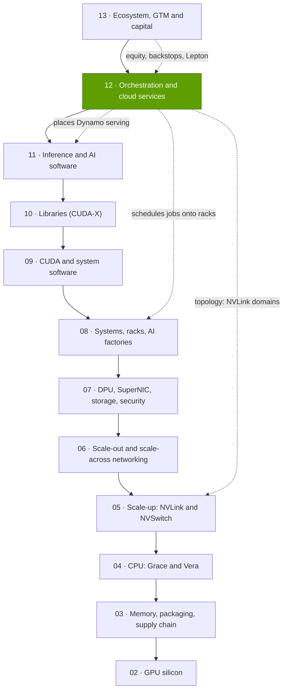
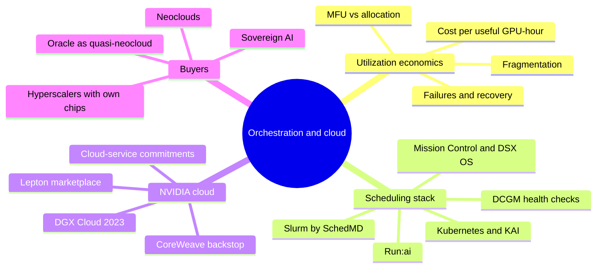

# Layer 12 — Orchestration and cloud services

Layer 12 of 12 · schedulers, AI-factory operations software and the GPU clouds that rent NVIDIA systems · ~6 min read · Last verified: 2026-11-05

## ⚡ The Executive Take

- **This layer turns racks into useful, paid [GPU-hours](../../glossary.md#gpu-hour).** Depreciation is ~81–88% of a GPU's yearly cost [[S389]](../../sources/bibliography.md#s389)[[S382]](../../sources/bibliography.md#s382), so a GB300 NVL72 GPU costs ~$1.50 per installed hour busy or idle (Est.) [[S332]](../../sources/bibliography.md#s332)[[S324]](../../sources/bibliography.md#s324): **$5.00 per useful hour at 30% utilization, $1.67 at 90%**.
- **The losses are large and measurable.** Alibaba lifted its 155,410-GPU fleet's [allocation](../../glossary.md#allocation-ratio) from 68% to 93% with a fragmentation-aware scheduler [[S12015]](../../sources/bibliography.md#s12015); Meta's Llama 3 run logged 419 unexpected interruptions in 54 days and ran at 38–41% [MFU](../../glossary.md#mfu) [[S34006]](../../sources/bibliography.md#s34006).
- **NVIDIA bought the control plane:** Bright Computing (2022), Run:ai (~$700M, 2024), SchedMD, the developer of [Slurm](../../glossary.md#slurm) (December 2025) [[S478]](../../sources/bibliography.md#s478)[[S476]](../../sources/bibliography.md#s476)[[S12000]](../../sources/bibliography.md#s12000), bundled as [Mission Control](../../glossary.md#mission-control) [[S12005]](../../sources/bibliography.md#s12005) and the modular [DSX OS](../../glossary.md#dsx-os) (2026) [[S12513]](../../sources/bibliography.md#s12513). It open-sourced [KAI Scheduler](../../glossary.md#kai-scheduler) and then Run:ai itself [[S12003]](../../sources/bibliography.md#s12003)[[S12510]](../../sources/bibliography.md#s12510).
- 🟡 **NVIDIA's own cloud turned inward:** [DGX Cloud](../../glossary.md#dgx-cloud) (2023) was refocused on internal research [[S90068]](../../sources/bibliography.md#s90068), and [DGX Cloud Lepton](../../glossary.md#dgx-cloud-lepton) routes developers to partner clouds instead [[S598]](../../sources/bibliography.md#s598). NVIDIA still holds $29B of cloud-service agreements plus $36B of AI-cloud capacity agreements (July 2026) [[S407]](../../sources/bibliography.md#s407).
- **Buyers are diversifying, unevenly:** hyperscale was ~55% of Q2 FY2027 Data Center revenue [[S90011]](../../sources/bibliography.md#s90011)[[S90013]](../../sources/bibliography.md#s90013); [ACIE](../../glossary.md#acie) roughly matched hyperscale in Q1, and regional [neoclouds](../../glossary.md#neocloud) grew 35% q/q in Q2 [[S90071]](../../sources/bibliography.md#s90071). CoreWeave alone runs ~1.5 GW [[S12010]](../../sources/bibliography.md#s12010).
- **Weakness and strongest challenger:** [hyperscalers](../../glossary.md#hyperscaler) own the customer, the cloud control plane and their own chips (TPU, Trainium, Maia) [[S90026]](../../sources/bibliography.md#s90026)[[S90035]](../../sources/bibliography.md#s90035)[[S90044]](../../sources/bibliography.md#s90044). Orchestration software is free or open source, so NVIDIA earns from it only indirectly, while its backstops tie it to neocloud utilization.

> [!TIP]
> **Worked example — why ten points of utilization is a board-level number.** A 100,000-GPU GB300 fleet costs ~$1.50 × 8,760 h × 100,000 ≈ **$1.3B a year** whether busy or idle (Est., from [the utilization problem](the-utilization-problem.md)). Raising utilization from 60% to 70% yields 87.6M more useful GPU-hours, worth ~$131M at cost and more at rental prices. **Conclusion:** scheduling and recovery software is cheap relative to the capacity it unlocks.

## Where this layer sits in the stack

## Layer map

## The eight questions at a glance

| # | Question | Short answer | Where answered |
|---|---|---|---|
| Q1 | Job, and what breaks if weak? | Turn installed GPUs into useful, paid hours; weak → idle, fragmented, failing clusters and ~3× cost per useful hour at 30% vs 90% | [The utilization problem](the-utilization-problem.md) |
| Q2 | Metrics that matter? | Allocation ratio, effective training time (goodput), MFU or tokens per GPU-hour, mean time to recovery, $ per useful GPU-hour | [The utilization problem](the-utilization-problem.md) |
| Q3 | Generational progress? | Control plane grew from cluster tools (2022) to an AI-factory OS (2026); a rented PFLOPS-hour got 1.4–1.6× cheaper H100 → Blackwell at FP8, 2.7–3.3× at FP4 | [Scheduling stack](run-ai-mission-control-base-command.md), [Hyperscalers vs neoclouds](hyperscalers-vs-neoclouds.md) |
| Q4 | Source of advantage? | Integration of scheduler, telemetry and hardware, plus capital and allocation power, not licence revenue | [History and how built](history-and-how-built.md) |
| Q5 | Strongest challenger? | Hyperscalers: they own customers, control planes and their own accelerators | [Competition](competition.md) |
| Q6 | Replication cost? | Schedulers are cheap (open source); NVIDIA's mix of allocation, capital and software reach is not | [History and how built](history-and-how-built.md) |
| Q7 | Roadmap? | DSX OS, open-source Run:ai, Slurm tuned for Vera Rubin, Lepton growth; watch neocloud financing and hyperscaler silicon | [Roadmap](roadmap.md) |
| Q8 | Value pools and M&A? | Rental margins sit with clouds; NVIDIA plays through stakes, backstops and a marketplace; tuck-ins: Run:ai, SchedMD, Lepton | [Value chain and corp dev](value-chain-and-corp-dev.md) |

## Pages in this layer

| Page | What you will learn |
|---|---|
| [The utilization problem](the-utilization-problem.md) | Cost per useful GPU-hour, five sources of waste, metrics, who bears idle risk |
| [Run:ai, Mission Control and Base Command](run-ai-mission-control-base-command.md) | Slurm, Kubernetes, KAI, fractional GPUs, gang and topology-aware scheduling, failure recovery |
| [DGX Cloud and Lepton](dgx-cloud-and-lepton.md) | DGX Cloud's lease-back model, the 2025 pivot, Lepton, backstops, why NVIDIA avoids head-on cloud competition |
| [Hyperscalers vs neoclouds](hyperscalers-vs-neoclouds.md) | Partner-and-rival hyperscalers, neocloud capacity, allocation, customer mix, rental prices by generation |
| [Competition](competition.md) | Head-to-head comparison and capability heatmap |
| [History and how NVIDIA built it](history-and-how-built.md) | Timeline, key deals, replication cost, counterfactuals |
| [Roadmap](roadmap.md) | Orchestration and cloud roadmap with confidence tags |
| [Value chain and corp dev angles](value-chain-and-corp-dev.md) | Who captures cloud dollars, circular financing, private companies, M&A |

🔧 Under the hood: how to read a GPU-cloud or scheduler claim

- **Which utilization?** Allocation ratio, SM activity and MFU differ by 2–3× on the same cluster; see [the utilization problem](the-utilization-problem.md).
- **Active vs contracted power:** contracted gigawatts are signed future capacity, not GPUs running today [[S12010]](../../sources/bibliography.md#s12010).
- **List vs contract prices:** on-demand list prices overstate what large tenants pay; one-year contract indices are better guides [[S12516]](../../sources/bibliography.md#s12516).
- **Vendor multipliers:** "up to 5× utilization" (Run:ai) [[S12004]](../../sources/bibliography.md#s12004) and "up to 10× faster recovery" (Mission Control) [[S12005]](../../sources/bibliography.md#s12005) are best-case vendor claims without published baselines.

## 🎯 Corp Dev Lens

1. **Software as a utilization lever, not a revenue line:** NVIDIA paid ~$700M for Run:ai [[S479]](../../sources/bibliography.md#s479) and then open-sourced it [[S12510]](../../sources/bibliography.md#s12510); the value is in GPU-hours unlocked and default status.
2. **NVIDIA is now a cloud counterparty:** ~$65B of cloud commitments (July 2026) [[S407]](../../sources/bibliography.md#s407) make neocloud utilization an NVIDIA risk; diligence neocloud partners accordingly.
3. **Hyperscaler dependence is the structural question:** the largest buyers are building their own chips and control planes; NVIDIA's answer is spreading demand to sovereigns and neoclouds [[S90071]](../../sources/bibliography.md#s90071).
4. **Qualcomm question (public information only):** for inference racks such as AI200/AI250 [[S90028]](../../sources/bibliography.md#s90028), is the path to scale through hyperscalers, neoclouds or sovereign buyers, and which schedulers must support them first?

## 📚 Sources

<!-- Auto-generated from the [S…] citations on this page by `make build`. Edit sources/registry/*.csv, not this list. -->

- [**S324**](../../sources/bibliography.md#s324) fal.ai, *NVIDIA GB200 price in 2026: what a GPU, a tray and an NVL72 rack cost*, 2026. [Link](https://fal.ai/learn/serverless/nvidia-gb200-price)
- [**S332**](../../sources/bibliography.md#s332) Tiger Brokers (iTiger), *Morgan Stanley's BOM analysis of NVIDIA's Rubin: GPU share declines; PCB, MLCC and ABF substrate values soar*, 2026-05-20. [Link](https://www.itiger.com/news/1188068712)
- [**S382**](../../sources/bibliography.md#s382) Microsoft via SEC EDGAR, *Microsoft Corporation Form 10-K filings (FY2021, FY2023) - property and equipment useful lives*, 2023-07-27. [Link](https://www.sec.gov/cgi-bin/browse-edgar?action=getcompany&CIK=0000789019&type=10-K&dateb=&owner=include&count=40)
- [**S389**](../../sources/bibliography.md#s389) U.S. Energy Information Administration, *EIA Electric Power Monthly, Table 5.6.A: average price of electricity to ultimate customers by end-use sector*, 2025. [Link](https://www.eia.gov/electricity/monthly/epm_table_grapher.php?t=epmt_5_6_a)
- [**S407**](../../sources/bibliography.md#s407) NVIDIA Corporation via SEC EDGAR, *NVIDIA Corporation Form 10-Q for quarter ended July 26, 2026*, 2026-08-28. [Link](https://www.sec.gov/Archives/edgar/data/1045810/000104581026000075/nvda-20260726.htm)
- [**S476**](../../sources/bibliography.md#s476) NVIDIA Blog, *NVIDIA to Acquire GPU Orchestration Software Provider Run:ai*, 2024-04-24. [Link](https://blogs.nvidia.com/blog/runai/)
- [**S478**](../../sources/bibliography.md#s478) NVIDIA, *NVIDIA Blog and Newsroom acquisition announcements (Cumulus, SwiftStack, DeepMap, Bright Computing, Excelero, Shoreline, Brev.dev, OctoAI, VinBrain, Gretel, Lepton AI, CentML, SchedMD)*, 2025-12. [Link](https://blogs.nvidia.com/)
- [**S479**](../../sources/bibliography.md#s479) Various (press), *Reporting on NVIDIA tuck-in acquisition prices (Run:ai, Deci, Shoreline, OctoAI, Gretel, Lepton, CentML) — The Information, Calcalist, Reuters, CNBC*, 2025-06. [Link](https://www.reuters.com/technology/)
- [**S598**](../../sources/bibliography.md#s598) NVIDIA Newsroom, *NVIDIA Announces DGX Cloud Lepton to Connect Developers to NVIDIA's Global Compute Ecosystem*, 2025-05-18. [Link](https://nvidianews.nvidia.com/news/nvidia-announces-dgx-cloud-lepton-to-connect-developers-to-nvidias-global-compute-ecosystem)
- [**S12000**](../../sources/bibliography.md#s12000) NVIDIA Blog, *NVIDIA Acquires Open-Source Workload Management Provider SchedMD*, 2025-12-15. [Link](https://blogs.nvidia.com/blog/nvidia-acquires-schedmd)
- [**S12003**](../../sources/bibliography.md#s12003) The New Stack, *NVIDIA open sources KAI Scheduler to help AI teams optimize GPU utilization*, 2025-04. [Link](https://thenewstack.io/nvidia-open-sources-kai-scheduler-to-help-ai-teams-optimize-gpu-utilization/)
- [**S12004**](../../sources/bibliography.md#s12004) NVIDIA, *NVIDIA Mission Control (product page)*, 2025. [Link](https://www.nvidia.com/en-us/data-center/mission-control/)
- [**S12005**](../../sources/bibliography.md#s12005) NVIDIA Blog, *New NVIDIA Software for Blackwell Infrastructure Runs AI Factories at Light Speed*, 2025-03-18. [Link](https://blogs.nvidia.com/?p=78497)
- [**S12010**](../../sources/bibliography.md#s12010) DatacenterDynamics, *Neocloud results Q2 2026: CoreWeave, Nebius, Cerebras*, 2026-08. [Link](https://www.datacenterdynamics.com/en/news/neocloud-results-q2-2026-coreweave-nebius-cerebras/)
- [**S12015**](../../sources/bibliography.md#s12015) USENIX OSDI '26 (Li et al. (Alibaba / HKUST)), *Heterogeneity at Hyperscale: Characterization and Scheduling of Large Production AI Clusters at Alibaba*, 2026-07. [Link](https://www.usenix.org/conference/osdi26/presentation/li-suyi)
- [**S12510**](../../sources/bibliography.md#s12510) NVIDIA Technical Blog, *NVIDIA Run:ai is now open source as part of NVIDIA DSX AI Factory platform*, 2026-10. [Link](https://developer.nvidia.com/blog/nvidia-runai-is-now-open-source-as-part-of-nvidia-dsx-ai-factory-platform/)
- [**S12513**](../../sources/bibliography.md#s12513) NVIDIA Newsroom, *NVIDIA DSX Gives Infrastructure Builders the Playbook for AI Factories*, 2026-05-31. [Link](https://nvidianews.nvidia.com/news/dsx-infrastructure-ai-factory)
- [**S12516**](../../sources/bibliography.md#s12516) SemiAnalysis, *The Great GPU Shortage - Rental Capacity - Launching our H100 1 Year Rental Price Index*, 2026-03. [Link](https://newsletter.semianalysis.com/p/the-great-gpu-shortage-rental-capacity)
- [**S34006**](../../sources/bibliography.md#s34006) arXiv:2407.21783 (Llama Team (AI @ Meta)), *The Llama 3 Herd of Models*, 2024-07-31. [Link](https://arxiv.org/abs/2407.21783)
- [**S90011**](../../sources/bibliography.md#s90011) Nasdaq (Zacks), *NVIDIA Q2 earnings beat on Blackwell Ultra and Data Center strength*, 2026-08-27. [Link](https://www.nasdaq.com/articles/nvidia-q2-earnings-beat-blackwell-ultra-data-center-strength)
- [**S90013**](../../sources/bibliography.md#s90013) Quartr, *NVIDIA (NVDA) Q2 2027 earnings summary*, 2026-08-26. [Link](https://quartr.com/events/nvidia-corporation-nvda-q2-2027_33dRoFp6)
- [**S90026**](../../sources/bibliography.md#s90026) Maginative, *Anthropic secures 1M Google TPUs while keeping Amazon as primary training partner*, 2025-10. [Link](https://www.maginative.com/anthropic-secures-1m-google-tpus-while-keeping-amazon-as-primary-training-partner)
- [**S90028**](../../sources/bibliography.md#s90028) TechRepublic, *Qualcomm unveils AI chips to rival Nvidia, AMD*, 2025-10-27. [Link](https://techrepublic.com/article/news-qualcomm-unveils-ai-chips-to-rival-nvidia-amd)
- [**S90035**](../../sources/bibliography.md#s90035) Business Today ME, *Trainium3 UltraServers now available*, 2025-12. [Link](https://businesstoday.me/tech-news/trainium3-ultraservers-now-available-enabling-customers-to-train-and-deploy-ai-models-fasterat-lower-cost/)
- [**S90044**](../../sources/bibliography.md#s90044) eWeek, *Microsoft introduces Maia 200, its most powerful AI chip yet*, 2026-01-27. [Link](https://www.eweek.com/news/microsoft-maia-200-ai-chip/)
- [**S90068**](../../sources/bibliography.md#s90068) Tom's Hardware, *Nvidia steps back from DGX Cloud — stops trying to compete with AWS and Azure*, 2025-09. [Link](https://www.tomshardware.com/tech-industry/nvidia-steps-back-from-dgx-cloud)
- [**S90071**](../../sources/bibliography.md#s90071) Crypto Briefing, *Nvidia CFO emphasizes neutral partnership with AI customers as company diversifies beyond hyperscalers*, 2026. [Link](https://cryptobriefing.com/nvidia-cfo-neutral-ai-partnership/)
