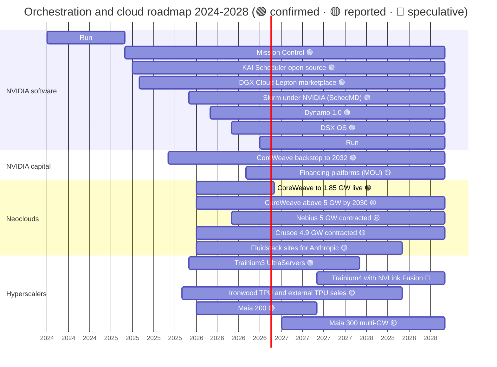

# Orchestration and cloud services: Roadmap

Layer 12 · Orchestration and cloud services · ~11 min read · Last verified: 2026-11-05

## ⚡ The Executive Take

- **NVIDIA's software roadmap is now open by default:** Mission Control (2025), [DSX OS](../../glossary.md#dsx-os) (GTC Taipei, 2026), Dynamo 1.0 (March 2026) and an Apache-licensed Run:ai (October 2026) [[S12005]](../../sources/bibliography.md#s12005)[[S12513]](../../sources/bibliography.md#s12513)[[S90066]](../../sources/bibliography.md#s90066)[[S12510]](../../sources/bibliography.md#s12510).
- **The demand roadmap is set by hyperscaler capex.** Alphabet, Amazon and Meta raised 2026 guides from ~$505B to ~$558B (midpoints); Microsoft adds ~$170–175B 🟡 [[S460]](../../sources/bibliography.md#s460)[[S461]](../../sources/bibliography.md#s461)[[S462]](../../sources/bibliography.md#s462)[[S12518]](../../sources/bibliography.md#s12518)[[S12519]](../../sources/bibliography.md#s12519).
- **Neoclouds are building ahead of revenue:** CoreWeave targets >1.85 GW live by end-2026 against ~4.2 GW contracted. Nebius expects ~5 GW contracted by end-2026, with 0.8–1 GW connected [[S12500]](../../sources/bibliography.md#s12500)[[S12010]](../../sources/bibliography.md#s12010)[[S12503]](../../sources/bibliography.md#s12503).
- **Backlog is the bridge:** CoreWeave's [revenue backlog](../../glossary.md#revenue-backlog) rose 3.5× in a year to $104.2B, about 8× its 2026 revenue guide [[S12500]](../../sources/bibliography.md#s12500).
- **Capital is the next product:** NVIDIA's August 2026 financing platforms with Apollo, BlackRock, Blackstone, Brookfield, Goldman Sachs and KKR aim to mobilize >$500B of third-party capital, but they are MOUs subject to final agreements 🟡 [[S12528]](../../sources/bibliography.md#s12528).
- **[Q7 · Roadmap & what changes the picture]** Three things would change the picture: a hyperscaler capex pause, a renewed GPU-rental price collapse, or credit stress at leveraged neoclouds. Interest is already ~26% of CoreWeave's guided Q3 2026 revenue [[S12502]](../../sources/bibliography.md#s12502).

## The 2024–2028 roadmap

Bars show availability or build windows; open-ended items run to the chart edge. Trainium4 timing is not disclosed 🔴. Sources per row in the table below.

| Item | Window | Status | Confidence | Source |
|---|---|---|---|---|
| NVIDIA Mission Control (ops for AI factories) | 2025 → | shipping; v2.5 adds Run:ai-managed Kubernetes recovery | 🟢 | [[S12005]](../../sources/bibliography.md#s12005)[[S12006]](../../sources/bibliography.md#s12006) |
| DGX Cloud Lepton | 2025 → | marketplace; early-access language removed Jan 2026 | 🟢 / 🟡 | [[S598]](../../sources/bibliography.md#s598)[[S12529]](../../sources/bibliography.md#s12529) |
| DSX OS (KAI, Run:ai, NVCF, Grove, Dynamo…) | 2026 → | announced at GTC Taipei | 🟢 | [[S12513]](../../sources/bibliography.md#s12513)[[S12514]](../../sources/bibliography.md#s12514) |
| Run:ai full platform open source | 2026-10 → | released; 8 partners integrating | 🟢 | [[S12510]](../../sources/bibliography.md#s12510)[[S12512]](../../sources/bibliography.md#s12512) |
| AI compute financing platforms (>$500B target) | 2026-08 → | MOUs, subject to final agreements | 🟡 | [[S12528]](../../sources/bibliography.md#s12528) |
| CoreWeave >1.85 GW active; >5 GW by 2030 | 2026 / 2030 | guidance / plan | 🟢 / 🟡 | [[S12500]](../../sources/bibliography.md#s12500)[[S472]](../../sources/bibliography.md#s472) |
| Nebius ~5 GW contracted, 0.8–1 GW connected by end-2026 | 2026 → 2029 | guidance | 🟡 | [[S12503]](../../sources/bibliography.md#s12503) |
| Crusoe ~4.9 GW contracted, ~0.2 GW energized | 2026 → | secondary data | 🟡 | [[S12013]](../../sources/bibliography.md#s12013) |
| Anthropic $50B US data centers with Fluidstack | 2026 → | announced | 🟢 | [[S12524]](../../sources/bibliography.md#s12524) |
| Trainium4 (NVLink Fusion support) | not dated | announced | 🟢 product / 🔴 timing | [[S90034]](../../sources/bibliography.md#s90034) |
| Maia 300; multi-GW Maia from 2027 | 2027 → | announced / reported | 🟡 | [[S90046]](../../sources/bibliography.md#s90046)[[S90045]](../../sources/bibliography.md#s90045) |

> [!TIP]
> **Worked example — how much of hyperscaler capex can reach NVIDIA.** NVIDIA's CEO put a 1 GW AI factory at ~$50–60B all-in, with ~$35B of NVIDIA content (58–70%) [[S398]](../../sources/bibliography.md#s398). Apply that ratio to the big four's ~$728B of 2026 guidance (repo sum of latest midpoints 🟡) [[S12518]](../../sources/bibliography.md#s12518)[[S12519]](../../sources/bibliography.md#s12519). The upper bound is ~$420–510B of NVIDIA-addressable spend. That compares with ~$432B a year at NVIDIA's $108B Q3 FY2027 guide [[S3]](../../sources/bibliography.md#s3). It is only an upper bound: hyperscaler capex also buys land, buildings, CPUs and their own TPUs, Trainium and Maia 🔴.

## Capacity and backlog progression

These February guides (~$505B for the big three) have since risen; Alphabet moved to $195–205B in July and expects 2027 capex to rise again 🟡 [[S12518]](../../sources/bibliography.md#s12518).

> [!TIP]
> **Worked example — turning backlog into power and capex.** CoreWeave's 2026 revenue guide is $12.4–13.2B, with ~0.85 GW live at the start of the year and >1.85 GW at the end [[S12500]](../../sources/bibliography.md#s12500)[[S12012]](../../sources/bibliography.md#s12012). On the ~1.35 GW average, that is roughly $9–10B of revenue per live GW-year (repo arithmetic 🔴). Serving a $104B backlog at that rate needs ~11 GW-years of live capacity: about 2.2 GW running for five years, more than the 1.85 GW targeted for end-2026. At ~$50–60B per GW all-in, each extra GW costs more than CoreWeave's entire $35–39B 2026 capex budget [[S398]](../../sources/bibliography.md#s398)[[S12500]](../../sources/bibliography.md#s12500). The backlog converts to revenue only as fast as financing allows.

🔧 Under the hood: reading neocloud capacity disclosures

**Active** (or connected) power is energized and billing. **Contracted** power is signed with a landlord or utility for future delivery. Backlog is signed customer revenue not yet recognized. The three move at different speeds: CoreWeave had ~3.1 GW contracted and >850 MW active at end-2025, then ~3.7 GW contracted and ~1.5 GW active by June 2026 [[S12012]](../../sources/bibliography.md#s12012)[[S12501]](../../sources/bibliography.md#s12501). A widening contracted-to-active gap is the build-out still to be financed. Watch the ratio of backlog to contracted GW: a falling ratio means capacity is being built ahead of customers. See [contracted vs active power](../../glossary.md#contracted-power).

## [Q7 · Roadmap & what changes the picture]

**[Q7 · Roadmap & what changes the picture]** NVIDIA's own layer-12 roadmap (open software, a marketplace, financing vehicles) is low-risk; the risk sits with its buyers. Signals to watch:

- **Capex pause.** Microsoft already trimmed its calendar-2026 figure from ~$175B to ~$170B because third-party capacity arrived late 🟡 [[S12518]](../../sources/bibliography.md#s12518)[[S12519]](../../sources/bibliography.md#s12519). A guide cut by two of the big four for 2027 would hit neocloud rentals first, because hyperscalers use them as overflow [[S12526]](../../sources/bibliography.md#s12526).
- **GPU-rental price collapse.** H100 rentals fell from ~$8 (2023) to below $2 on marketplaces (late 2024), then rebounded 38% to $2.35 by March 2026 [[S393]](../../sources/bibliography.md#s393)[[S12516]](../../sources/bibliography.md#s12516). A fall back below the $1.70 low as Rubin ramps would cut the collateral value behind [GPU-backed loans](../../glossary.md#gpu-backed-loan) (see [value chain](value-chain-and-corp-dev.md)).
- **Neocloud credit stress.** CoreWeave's net interest was $640M in Q2 2026 on $35.1B of debt, and it guided $860–940M for Q3 [[S12501]](../../sources/bibliography.md#s12501)[[S12502]](../../sources/bibliography.md#s12502). CoreWeave reports Q3 on 2026-11-16, after this page's as-of date [[S12500]](../../sources/bibliography.md#s12500).
- **Hyperscaler silicon ramps.** Maia 300 (2027), Trainium4 and external TPU sales shift demand without touching NVIDIA's layer-12 levers [[S90046]](../../sources/bibliography.md#s90046)[[S90034]](../../sources/bibliography.md#s90034)[[S90027]](../../sources/bibliography.md#s90027).
- **Financing platforms close or stall.** If the >$500B MOUs become signed funds, neocloud cost of capital falls; if not, the [circular-financing](../../glossary.md#circular-financing) critique sharpens [[S12528]](../../sources/bibliography.md#s12528).

> [!TIP]
> **Worked example — interest coverage as an early-warning gauge.** CoreWeave guided Q3 2026 revenue of $3.45–3.6B and interest expense of $860–940M [[S12502]](../../sources/bibliography.md#s12502). Interest would absorb ~24–27% of revenue, up from ~25% in Q2 ($640M on $2.58B) [[S12501]](../../sources/bibliography.md#s12501)[[S12500]](../../sources/bibliography.md#s12500). If a 20% rental-price decline hit uncontracted capacity while debt kept growing, that share could pass 30% 🔴. That is the region where lenders reprice and backstops start to matter.

## 🎯 Corp Dev Lens

1. Which indicator should a strategy team track monthly: hyperscaler capex guides, the H100/B200 rental indices or neocloud interest coverage?
2. NVIDIA's financing platforms are MOUs. Who carries the first loss if GPU collateral values fall: NVIDIA, the asset managers or the neoclouds?
3. Contracted power at Nebius (~5 GW) and Crusoe (~4.9 GW) far exceeds their live capacity. Which accelerator vendors could win a share of the uncommitted capacity?
4. If 2027 brings Maia 300, Trainium4 and external TPUs at scale, which neoclouds would offer non-NVIDIA capacity first, and on what terms?

## 📚 Sources

<!-- Auto-generated from the [S…] citations on this page by `make build`. Edit sources/registry/*.csv, not this list. -->

- [**S3**](../../sources/bibliography.md#s3) StorageNewsletter, *NVIDIA Q2 Fiscal 2027 results coverage: revenue $96.2B*, 2026-08-27. [Link](https://www.storagenewsletter.com/2026/08/27/nvidia-fiscal-2q27-financial-results/)
- [**S393**](../../sources/bibliography.md#s393) Latent Space (Eugene Cheah), *$2 H100s: how the GPU bubble burst*, 2024-10. [Link](https://www.latent.space/p/gpu-bubble)
- [**S398**](../../sources/bibliography.md#s398) NVIDIA Investor Relations, *NVIDIA Q2 FY2026 earnings call (2025-08-27): AI factory economics commentary*, 2025-08-27. [Link](https://investor.nvidia.com/events-and-presentations/events-and-presentations/default.aspx)
- [**S460**](../../sources/bibliography.md#s460) Alphabet Investor Relations, *Alphabet Q4 and fiscal year 2025 results and 2026 capex outlook*, 2026-02. [Link](https://abc.xyz/investor/)
- [**S461**](../../sources/bibliography.md#s461) Amazon Investor Relations, *Amazon.com Q4 2025 results and 2026 capex commentary*, 2026-02. [Link](https://ir.aboutamazon.com/)
- [**S462**](../../sources/bibliography.md#s462) Meta Investor Relations, *Meta Q4 and full year 2025 results and 2026 capex outlook*, 2026-01. [Link](https://investor.atmeta.com/)
- [**S472**](../../sources/bibliography.md#s472) CoreWeave Newsroom, *CoreWeave and NVIDIA expand partnership; NVIDIA invests $2B in CoreWeave Class A stock*, 2026-01-26. [Link](https://www.coreweave.com/news)
- [**S598**](../../sources/bibliography.md#s598) NVIDIA Newsroom, *NVIDIA Announces DGX Cloud Lepton to Connect Developers to NVIDIA's Global Compute Ecosystem*, 2025-05-18. [Link](https://nvidianews.nvidia.com/news/nvidia-announces-dgx-cloud-lepton-to-connect-developers-to-nvidias-global-compute-ecosystem)
- [**S12005**](../../sources/bibliography.md#s12005) NVIDIA Blog, *New NVIDIA Software for Blackwell Infrastructure Runs AI Factories at Light Speed*, 2025-03-18. [Link](https://blogs.nvidia.com/?p=78497)
- [**S12006**](../../sources/bibliography.md#s12006) NVIDIA Technical Blog, *Automating AI Factory Operations with NVIDIA Mission Control*, 2026. [Link](https://developer.nvidia.com/blog/automating-ai-factory-operations-with-nvidia-mission-control)
- [**S12010**](../../sources/bibliography.md#s12010) DatacenterDynamics, *Neocloud results Q2 2026: CoreWeave, Nebius, Cerebras*, 2026-08. [Link](https://www.datacenterdynamics.com/en/news/neocloud-results-q2-2026-coreweave-nebius-cerebras/)
- [**S12012**](../../sources/bibliography.md#s12012) CoreWeave via Business Wire, *CoreWeave Reports Strong Fourth Quarter and Fiscal Year 2025 Results*, 2026-02-26. [Link](https://www.businesswire.com/news/home/20260226281661/en/CoreWeave-Reports-Strong-Fourth-Quarter-and-Fiscal-Year-2025-Results)
- [**S12013**](../../sources/bibliography.md#s12013) MarkTechPost, *Best GPU neoclouds 2026: CoreWeave, Nebius, Lambda, Crusoe and Groq ranked by published pricing and contracted power*, 2026-08-23. [Link](https://www.marktechpost.com/2026/08/23/best-gpu-neoclouds-2026/)
- [**S12500**](../../sources/bibliography.md#s12500) CoreWeave (press release via Seeking Alpha), *CoreWeave Reports Strong Second Quarter 2026 Results*, 2026-08. [Link](https://seekingalpha.com/pr/20615715)
- [**S12501**](../../sources/bibliography.md#s12501) Runtime Wire, *CoreWeave reports $2.58 billion Q2 revenue with $35 billion in debt*, 2026-08. [Link](https://runtimewire.com/article/coreweave-q2-2026-revenue-debt-ai-cloud)
- [**S12502**](../../sources/bibliography.md#s12502) MarketBeat, *CoreWeave Q2 earnings call highlights*, 2026-08-11. [Link](https://www.marketbeat.com/instant-alerts/coreweave-q2-earnings-call-highlights-2026-08-11/)
- [**S12503**](../../sources/bibliography.md#s12503) Quartr, *Nebius Group (NBIS) Q2 2026 earnings summary*, 2026-08. [Link](https://quartr.com/events/nebius-group-n-v-nbis-q2-2026_ozKEzQzr)
- [**S12510**](../../sources/bibliography.md#s12510) NVIDIA Technical Blog, *NVIDIA Run:ai is now open source as part of NVIDIA DSX AI Factory platform*, 2026-10. [Link](https://developer.nvidia.com/blog/nvidia-runai-is-now-open-source-as-part-of-nvidia-dsx-ai-factory-platform/)
- [**S12512**](../../sources/bibliography.md#s12512) Techstrong.ai, *NVIDIA hands Run:ai to the open source community*, 2026-10. [Link](https://techstrong.ai/articles/nvidia-hands-runai-to-the-open-source-community/)
- [**S12513**](../../sources/bibliography.md#s12513) NVIDIA Newsroom, *NVIDIA DSX Gives Infrastructure Builders the Playbook for AI Factories*, 2026-05-31. [Link](https://nvidianews.nvidia.com/news/dsx-infrastructure-ai-factory)
- [**S12514**](../../sources/bibliography.md#s12514) NVIDIA, *NVIDIA DSX OS (product page)*, 2026. [Link](https://www.nvidia.com/en-us/data-center/products/dsx/os/)
- [**S12516**](../../sources/bibliography.md#s12516) SemiAnalysis, *The Great GPU Shortage - Rental Capacity - Launching our H100 1 Year Rental Price Index*, 2026-03. [Link](https://newsletter.semianalysis.com/p/the-great-gpu-shortage-rental-capacity)
- [**S12518**](../../sources/bibliography.md#s12518) Datacentres.com, *Hyperscaler capex trends: over $700 billion for 2026*, 2026-08. [Link](https://www.datacentres.com/guides/hyperscaler-capex-trends)
- [**S12519**](../../sources/bibliography.md#s12519) Hargreaves Lansdown, *AI hyperscalers are expected to finish the year spending a whopping $828 billion on capex*, 2026-10. [Link](https://www.hl.co.uk/news/ai-hyperscalers-are-expected-to-finish-the-year-spending-a-whopping-828-billion-on-capex)
- [**S12524**](../../sources/bibliography.md#s12524) DatacenterDynamics, *Anthropic plans $50bn US data center spend, starting with Fluidstack sites in Texas and New York*, 2025-11-12. [Link](https://datacenterdynamics.com/en/news/anthropic-plans-50bn-us-data-center-spend-starting-with-fluidstack-sites-in-texas-and-new-york)
- [**S12526**](../../sources/bibliography.md#s12526) Introl, *Microsoft's $60B neocloud bet: buying time in the AI capacity crisis*, 2025-12. [Link](https://introl.com/blog/microsoft-60-billion-neocloud-spending-2025)
- [**S12528**](../../sources/bibliography.md#s12528) NVIDIA Newsroom, *NVIDIA Partners With Apollo, BlackRock, Blackstone, Brookfield, Goldman Sachs and KKR to Establish AI Compute Infrastructure Financing Platforms to Mobilize Over $500 Billion of Third-Party Capital*, 2026-08-10. [Link](https://nvidianews.nvidia.com/news/nvidia-partners-with-apollo-blackrock-blackstone-brookfield-goldman-sachs-and-kkr-to-establish-ai-compute-infrastructure-financing-platforms-to-mobilize-over-500-billion-of-third-party-capital)
- [**S12529**](../../sources/bibliography.md#s12529) NVIDIA Technical Blog, *Introducing NVIDIA DGX Cloud Lepton: a unified AI platform built for developers*, 2025-05. [Link](https://developer.nvidia.com/blog/introducing-nvidia-dgx-cloud-lepton-a-unified-ai-platform-built-for-developers)
- [**S90027**](../../sources/bibliography.md#s90027) The Next Web, *Google is building a four-partner chip supply chain to challenge Nvidia in AI inference*, 2026. [Link](https://thenextweb.com/news/google-inference-chips-nvidia-challenge-supply-chain)
- [**S90034**](../../sources/bibliography.md#s90034) NAND Research, *AWS releases Trainium3, teases Trainium4*, 2025-12. [Link](https://nand-research.com/research-note-aws-releases-trainium3-teases-trainium4/4/)
- [**S90045**](../../sources/bibliography.md#s90045) Pulse 2.0, *Microsoft to expand Azure Maia AI infrastructure to multi-gigawatt deployments starting in 2027*, 2026-10. [Link](https://pulse2.com/microsoft-to-expand-azure-maia-ai-infrastructure/)
- [**S90046**](../../sources/bibliography.md#s90046) IT Brief UK, *Microsoft unveils Maia 300 for 2027 AI deployments*, 2026-10. [Link](https://itbrief.co.uk/story/microsoft-unveils-maia-300-for-2027-ai-deployments)
- [**S90066**](../../sources/bibliography.md#s90066) HPCwire (NVIDIA press release), *NVIDIA enters production with Dynamo, the broadly adopted inference operating system for AI factories*, 2026-03-17. [Link](https://www.hpcwire.com/aiwire/tag/dynamo-1-0/)
