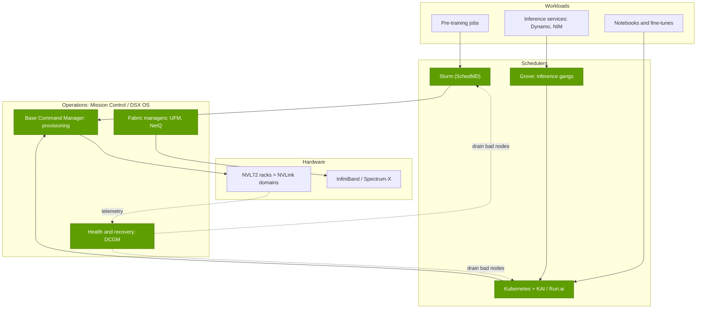
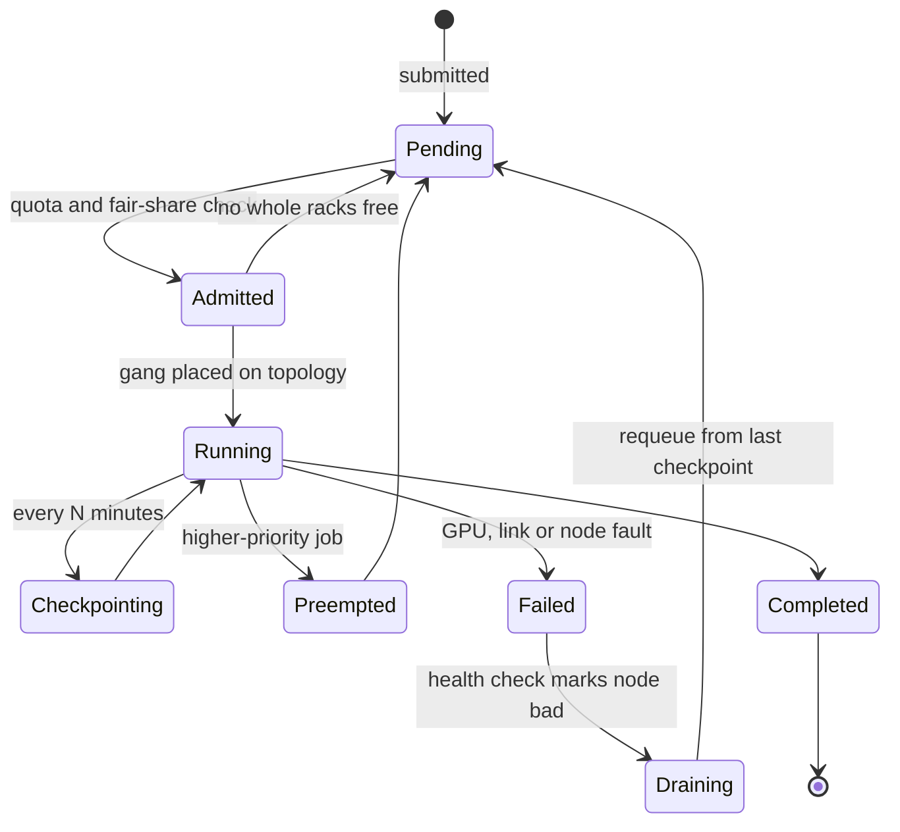

# Run:ai, Mission Control and Base Command: the scheduling stack

Layer 12 · Orchestration and cloud services · ~10 min read · Last verified: 2026-11-05

## ⚡ The Executive Take

- **NVIDIA has bought most of the AI control plane:** Bright Computing (2022, now [Base Command Manager](../../glossary.md#base-command-manager)) [[S478]](../../sources/bibliography.md#s478), [Run:ai](../../glossary.md#run-ai) (~$700M reported, closed 2024-12-30) [[S476]](../../sources/bibliography.md#s476)[[S479]](../../sources/bibliography.md#s479) and SchedMD, the developer of [Slurm](../../glossary.md#slurm) (2025-12-15, terms undisclosed) [[S12000]](../../sources/bibliography.md#s12000). They are packaged as [Mission Control](../../glossary.md#mission-control) (GTC 2025) [[S12005]](../../sources/bibliography.md#s12005) and, since May 2026, the modular [DSX OS](../../glossary.md#dsx-os) [[S12513]](../../sources/bibliography.md#s12513)[[S12514]](../../sources/bibliography.md#s12514).
- **Two schedulers run the world's GPUs.** Slurm runs on more than half of the top-10 and top-100 TOP500 systems [[S12000]](../../sources/bibliography.md#s12000); [Kubernetes](../../glossary.md#kubernetes) runs inference and mixed fleets. NVIDIA now steers both.
- **Then it gave the scheduler away:** Run:ai's [KAI Scheduler](../../glossary.md#kai-scheduler) went Apache 2.0 at KubeCon Europe 2025 [[S12003]](../../sources/bibliography.md#s12003) and is now a CNCF sandbox project [[S12002]](../../sources/bibliography.md#s12002); the full Run:ai platform followed in October 2026 [[S12510]](../../sources/bibliography.md#s12510)[[S12511]](../../sources/bibliography.md#s12511).
- **Three tricks raise utilization:** [fractional GPUs](../../glossary.md#fractional-gpu) ([MIG](../../glossary.md#mig) splits a GPU up to seven ways) [[S12019]](../../sources/bibliography.md#s12019), [gang scheduling](../../glossary.md#gang-scheduling) and [topology-aware placement](../../glossary.md#topology-aware-scheduling) [[S12002]](../../sources/bibliography.md#s12002). In a repo model, scattered 8-GPU jobs at 30% allocation leave <1 of 18 NVL72 racks whole; packing leaves 12.
- **Failure handling is the new frontier.** At Llama 3's failure rate a 100,000-GPU job breaks every ~30 minutes, and 15-minute recoveries would waste ~33% of its time (Est.) [[S34006]](../../sources/bibliography.md#s34006). NVIDIA claims Mission Control recovers jobs up to 10× faster (vendor claim) [[S12005]](../../sources/bibliography.md#s12005).
- **Weakness:** this software earns little directly. Kubernetes, Kueue, Ray and SkyPilot are free [[S12533]](../../sources/bibliography.md#s12533)[[S12535]](../../sources/bibliography.md#s12535)[[S12534]](../../sources/bibliography.md#s12534), neoclouds build their own (CoreWeave's SUNK) [[S12530]](../../sources/bibliography.md#s12530), and owning Slurm invites neutrality questions from AMD- and Intel-based HPC sites.

## The stack, layer by layer

Think of an airport. Racks are the runways and gates, the scheduler is air-traffic control, cluster management is ground operations, and health monitoring is the maintenance crew that grounds a faulty aircraft before it takes off.

| Component | Job | Origin | Licence |
|---|---|---|---|
| Slurm | Batch queue for HPC and pre-training; gang allocation of whole nodes | SchedMD, acquired Dec 2025 [[S12000]](../../sources/bibliography.md#s12000) | Open source, kept vendor-neutral |
| KAI Scheduler / Run:ai | Kubernetes GPU scheduler: queues, fair share, GPU sharing, topology [[S12002]](../../sources/bibliography.md#s12002) | Run:ai, acquired 2024 [[S476]](../../sources/bibliography.md#s476) | Apache 2.0 (KAI 2025; Run:ai Oct 2026) [[S12510]](../../sources/bibliography.md#s12510) |
| [Grove](../../glossary.md#grove) | One Kubernetes resource for a whole [Dynamo](../../glossary.md#dynamo) inference system [[S12021]](../../sources/bibliography.md#s12021) | NVIDIA Dynamo project | Apache 2.0 |
| Base Command Manager | Provisioning, OS images, cluster monitoring | Bright Computing, 2022 [[S478]](../../sources/bibliography.md#s478) | Commercial |
| [DCGM](../../glossary.md#dcgm) | GPU health checks, diagnostics, telemetry [[S12020]](../../sources/bibliography.md#s12020) | NVIDIA | Open source |
| Mission Control | Bundles the above with UFM/NetQ and autonomous recovery [[S12004]](../../sources/bibliography.md#s12004) | GTC 2025 [[S12005]](../../sources/bibliography.md#s12005) | Commercial |

> [!TIP]
> **Worked example — the same cluster, two schedulers.** A 576-GPU pre-training job needs 8 full NVL72 racks at once, for weeks: a Slurm-style batch job. An inference service needs 8 GPUs per replica, scaling from 4 to 40 replicas with traffic: a Kubernetes-style service. Running both on one 18-rack cluster means either two schedulers fighting over racks or one that does both. That is why CoreWeave runs Slurm inside Kubernetes (SUNK) [[S12530]](../../sources/bibliography.md#s12530) and why NVIDIA bought both sides.

## Three tricks that raise utilization

**Fractional GPUs (car-pooling).** A notebook or small model rarely needs a whole GPU. [MIG](../../glossary.md#mig) carves a GPU into up to seven isolated instances [[S12019]](../../sources/bibliography.md#s12019); MPS shares memory and compute with enforced limits; [time-slicing](../../glossary.md#gpu-time-slicing) is cheapest but shares one fault domain, so one crash takes all tenants down [[S12018]](../../sources/bibliography.md#s12018).

> [!TIP]
> **Worked example — 70 notebooks.** Seventy data scientists each holding a whole GB300 GPU tie up 70 GPUs. On one-seventh MIG slices they fit on 10. The 60 freed GPUs are worth ~$788K a year at the ~$1.50 per installed hour estimated in [the utilization problem](the-utilization-problem.md) (60 × 8,760 h × $1.50). **Conclusion:** fractioning pays for itself on idle-heavy interactive work, not on large training.

**Gang scheduling (seating a party together).** A restaurant seats a party of twelve only when the whole table is free. A distributed job is the same: half its GPUs are useless without the other half. KAI and Grove start all pods of a group or none [[S12002]](../../sources/bibliography.md#s12002)[[S12021]](../../sources/bibliography.md#s12021).

> [!TIP]
> **Worked example — the deadlock gang scheduling prevents.** Two 512-GPU jobs arrive at a cluster with 768 free GPUs. A naive scheduler gives each 384 GPUs; both wait forever for 128 more, and 768 GPUs sit idle. A gang scheduler starts one job with 512 GPUs and queues the other. **Conclusion:** 512 GPUs work instead of zero.

**Topology-aware placement and bin-packing (keeping whole floors free).** A tensor-parallel group exchanges data every layer, so it must sit inside one NVLink domain, which on NVL72 means one rack (see [layer 05](../05-scale-up-nvlink-nvswitch/index.md)). If small jobs are sprinkled across racks, no rack stays whole.

🔧 Under the hood: fairness, preemption and reservations

KAI uses hierarchical queues with quotas and over-quota weights, [DRF](../../glossary.md#dominant-resource-fairness) fair sharing [[S12002]](../../sources/bibliography.md#s12002), time-based fair share (credit for past usage), [preemption](../../glossary.md#preemption) with a minimum guaranteed runtime, workload consolidation to defragment, and Kubernetes Dynamic Resource Allocation that covers GB200/GB300 and AMD GPUs [[S12002]](../../sources/bibliography.md#s12002). Its v0.10.0 release (Oct 2025) added topology-aware scheduling and hierarchical pod groups [[S12002]](../../sources/bibliography.md#s12002). Alibaba's ATC '23 work showed fragmentation-aware placement beating classic best-fit policies on its trace [[S12016]](../../sources/bibliography.md#s12016).

## Failure is the normal state

At scale, something is always broken. Meta logged 419 unexpected interruptions in 54 days on a 16,384-GPU job, roughly one every three hours, mostly hardware [[S34006]](../../sources/bibliography.md#s34006)[[S31003]](../../sources/bibliography.md#s31003). Each failure costs detection, isolating the bad node, restarting and redoing work since the last [checkpoint](../../glossary.md#checkpoint).

DCGM supplies health checks and diagnostics [[S12020]](../../sources/bibliography.md#s12020). Mission Control adds autonomous job recovery (captures the job's context, finds the suspect GPU or node, restarts) and autonomous hardware recovery (catches degradation before it kills a job); version 2.5 extended this to Kubernetes workloads under Run:ai [[S12006]](../../sources/bibliography.md#s12006).

> [!TIP]
> **Worked example — why recovery time matters more each generation.** Llama 3's rate is 419 ÷ (54 days × 24 h × 16,384 GPUs) ≈ 2.0 failures per 100,000 GPU-hours [[S34006]](../../sources/bibliography.md#s34006). A 100,000-GPU job therefore fails ~2 times an hour. With 15-minute recovery it loses 0.49 ÷ 1.49 ≈ **33%** of its time; at 3 minutes, **~9%**. **Conclusion:** at 100k-GPU scale, cutting recovery from 15 to 3 minutes yields ~36% more useful work from the same GPUs (0.91 ÷ 0.67, Est.).

## How the control plane grew, and why NVIDIA gives it away

**[Q3 · Generational progress]** (software side; the cloud-price side is charted in [hyperscalers vs neoclouds](hyperscalers-vs-neoclouds.md)):

| Year | NVIDIA control-plane step | What it added |
|---|---|---|
| 2022 | Bright Computing → Base Command Manager [[S478]](../../sources/bibliography.md#s478) | Cluster provisioning and monitoring |
| 2023 | DGX Cloud [[S12007]](../../sources/bibliography.md#s12007) | Hosted clusters with NVIDIA's software |
| 2024 | Run:ai closed [[S476]](../../sources/bibliography.md#s476) | Kubernetes GPU pools, fractioning, fair share |
| 2025 | Mission Control [[S12005]](../../sources/bibliography.md#s12005); KAI open source [[S12003]](../../sources/bibliography.md#s12003); Grove [[S12021]](../../sources/bibliography.md#s12021) | Autonomous recovery; topology-aware gangs for inference |
| Dec 2025 | SchedMD [[S12000]](../../sources/bibliography.md#s12000) | Ownership of Slurm, the HPC default |
| 2026 | DSX OS [[S12513]](../../sources/bibliography.md#s12513); Run:ai open source [[S12510]](../../sources/bibliography.md#s12510) | Open, modular AI-factory OS spanning provisioning to inference |

Schedulers are a complement to GPUs: the cheaper and better they are, the more GPU-hours customers can use. Open-sourcing KAI and Run:ai, and pledging to keep Slurm vendor-neutral [[S12000]](../../sources/bibliography.md#s12000), keeps rivals' free tools from becoming the default while NVIDIA monetises support, Mission Control and AI Enterprise [[S12510]](../../sources/bibliography.md#s12510).

> [!TIP]
> **Worked example — what a free scheduler is worth to NVIDIA.** If better placement and recovery add just 5 points of utilization across 1M installed GB300-class GPUs, customers gain 1M × 8,760 h × 5% ≈ 438M useful GPU-hours a year, ~$657M of capacity at ~$1.50 per hour (Est., from [the utilization problem](the-utilization-problem.md)). Run:ai cost ~$700M once [[S479]](../../sources/bibliography.md#s479). **Conclusion:** the software pays back through cheaper useful compute and stickier customers, not licences.

> [!WARNING]
> **🐻 Bear view:** neutrality is a promise, not a guarantee. If Slurm or KAI features land first or best on NVIDIA hardware (SchedMD's Rubin and Vera optimisation is already reported [[S12001]](../../sources/bibliography.md#s12001)), AMD and Intel sites may fork or move to Kueue or Ray. And hyperscalers, the largest buyers, run their own control planes.

## 🎯 Corp Dev Lens

1. **Control point, not profit pool.** Run:ai's ~$700M [[S479]](../../sources/bibliography.md#s479) is small next to NVIDIA's ~$216B FY2026 revenue [[S1]](../../sources/bibliography.md#s1); the value is telemetry and default status in every AI factory.
2. **Open-source orchestration startups face a squeeze** between NVIDIA's free stack and hyperscalers' own; value shifts to multi-cloud brokers (SkyPilot-like) and vertical operators.
3. **Slurm neutrality is a watch item** for any non-NVIDIA accelerator vendor's HPC go-to-market.
4. **Qualcomm question (public information only):** would first-class support in KAI, Kueue and Slurm for inference racks such as AI200/AI250 [[S90028]](../../sources/bibliography.md#s90028) matter more to cloud buyers than additional kernel work?

## 📚 Sources

<!-- Auto-generated from the [S…] citations on this page by `make build`. Edit sources/registry/*.csv, not this list. -->

- [**S1**](../../sources/bibliography.md#s1) NVIDIA Corporation via SEC EDGAR, *NVIDIA Announces Financial Results for Fourth Quarter and Fiscal 2026 (Form 8-K exhibit 99.1)*, 2026-02-25. [Link](https://www.sec.gov/Archives/edgar/data/1045810/000104581026000019/q4fy26pr.htm)
- [**S476**](../../sources/bibliography.md#s476) NVIDIA Blog, *NVIDIA to Acquire GPU Orchestration Software Provider Run:ai*, 2024-04-24. [Link](https://blogs.nvidia.com/blog/runai/)
- [**S478**](../../sources/bibliography.md#s478) NVIDIA, *NVIDIA Blog and Newsroom acquisition announcements (Cumulus, SwiftStack, DeepMap, Bright Computing, Excelero, Shoreline, Brev.dev, OctoAI, VinBrain, Gretel, Lepton AI, CentML, SchedMD)*, 2025-12. [Link](https://blogs.nvidia.com/)
- [**S479**](../../sources/bibliography.md#s479) Various (press), *Reporting on NVIDIA tuck-in acquisition prices (Run:ai, Deci, Shoreline, OctoAI, Gretel, Lepton, CentML) — The Information, Calcalist, Reuters, CNBC*, 2025-06. [Link](https://www.reuters.com/technology/)
- [**S12000**](../../sources/bibliography.md#s12000) NVIDIA Blog, *NVIDIA Acquires Open-Source Workload Management Provider SchedMD*, 2025-12-15. [Link](https://blogs.nvidia.com/blog/nvidia-acquires-schedmd)
- [**S12001**](../../sources/bibliography.md#s12001) SiliconANGLE, *Nvidia acquires SchedMD, developer of the Slurm workload manager*, 2025-12-15. [Link](https://siliconangle.com/?p=725204)
- [**S12002**](../../sources/bibliography.md#s12002) KAI Scheduler project (originally NVIDIA Run:ai), *KAI Scheduler (GitHub repository README)*, 2026-04. [Link](https://github.com/kai-scheduler/KAI-Scheduler)
- [**S12003**](../../sources/bibliography.md#s12003) The New Stack, *NVIDIA open sources KAI Scheduler to help AI teams optimize GPU utilization*, 2025-04. [Link](https://thenewstack.io/nvidia-open-sources-kai-scheduler-to-help-ai-teams-optimize-gpu-utilization/)
- [**S12004**](../../sources/bibliography.md#s12004) NVIDIA, *NVIDIA Mission Control (product page)*, 2025. [Link](https://www.nvidia.com/en-us/data-center/mission-control/)
- [**S12005**](../../sources/bibliography.md#s12005) NVIDIA Blog, *New NVIDIA Software for Blackwell Infrastructure Runs AI Factories at Light Speed*, 2025-03-18. [Link](https://blogs.nvidia.com/?p=78497)
- [**S12006**](../../sources/bibliography.md#s12006) NVIDIA Technical Blog, *Automating AI Factory Operations with NVIDIA Mission Control*, 2026. [Link](https://developer.nvidia.com/blog/automating-ai-factory-operations-with-nvidia-mission-control)
- [**S12007**](../../sources/bibliography.md#s12007) NVIDIA Newsroom, *NVIDIA Launches DGX Cloud, Giving Every Enterprise Instant Access to AI Supercomputer From a Browser*, 2023-03-21. [Link](https://nvidianews.nvidia.com/news/nvidia-launches-dgx-cloud-giving-every-enterprise-instant-access-to-ai-supercomputer-from-a-browser)
- [**S12016**](../../sources/bibliography.md#s12016) Alibaba (GitHub), *Alibaba Cluster Trace Program (clusterdata) README incl. cluster-trace-gpu-v2026*, 2026. [Link](https://github.com/alibaba/clusterdata)
- [**S12018**](../../sources/bibliography.md#s12018) NVIDIA (GitHub), *NVIDIA Kubernetes device plugin (GitHub README): MIG strategies and shared access via time-slicing and MPS*, 2026. [Link](https://github.com/NVIDIA/k8s-device-plugin)
- [**S12019**](../../sources/bibliography.md#s12019) NVIDIA (GitHub), *NVIDIA MIG Partition Editor (mig-parted) README*, 2026. [Link](https://github.com/NVIDIA/mig-parted)
- [**S12020**](../../sources/bibliography.md#s12020) NVIDIA (GitHub), *NVIDIA Data Center GPU Manager (DCGM) README*, 2026. [Link](https://github.com/NVIDIA/DCGM)
- [**S12021**](../../sources/bibliography.md#s12021) NVIDIA Dynamo project (GitHub), *Grove: one API for any inference architecture (GitHub README)*, 2026. [Link](https://github.com/ai-dynamo/grove)
- [**S12510**](../../sources/bibliography.md#s12510) NVIDIA Technical Blog, *NVIDIA Run:ai is now open source as part of NVIDIA DSX AI Factory platform*, 2026-10. [Link](https://developer.nvidia.com/blog/nvidia-runai-is-now-open-source-as-part-of-nvidia-dsx-ai-factory-platform/)
- [**S12511**](../../sources/bibliography.md#s12511) TechRepublic, *Nvidia Run:ai is now open source: what's free and paid*, 2026-10-15. [Link](https://www.techrepublic.com/article/news-nvidia-runai-open-source-free-paid/)
- [**S12513**](../../sources/bibliography.md#s12513) NVIDIA Newsroom, *NVIDIA DSX Gives Infrastructure Builders the Playbook for AI Factories*, 2026-05-31. [Link](https://nvidianews.nvidia.com/news/dsx-infrastructure-ai-factory)
- [**S12514**](../../sources/bibliography.md#s12514) NVIDIA, *NVIDIA DSX OS (product page)*, 2026. [Link](https://www.nvidia.com/en-us/data-center/products/dsx/os/)
- [**S12530**](../../sources/bibliography.md#s12530) CoreWeave Blog, *New CoreWeave SUNK capabilities help teams build modern AI research clusters*, 2025. [Link](https://coreweave.com/blog/new-coreweave-sunk-capabilities-help-teams-build-modern-ai-research-clusters)
- [**S12533**](../../sources/bibliography.md#s12533) Kubernetes SIGs on GitHub, *Kueue (README)*, 2026. [Link](https://github.com/kubernetes-sigs/kueue)
- [**S12534**](../../sources/bibliography.md#s12534) SkyPilot project on GitHub, *SkyPilot (README)*, 2026-10. [Link](https://github.com/skypilot-org/skypilot)
- [**S12535**](../../sources/bibliography.md#s12535) Ray project on GitHub (Anyscale), *Ray (README)*, 2026. [Link](https://github.com/ray-project/ray)
- [**S31003**](../../sources/bibliography.md#s31003) Tom's Hardware, *Faulty Nvidia H100 GPUs and HBM3 memory caused half of the failures during Llama 3 training — one failure every three hours for Meta's 16,384 GPU training cluster*, 2024-07. [Link](https://www.tomshardware.com/tech-industry/artificial-intelligence/faulty-nvidia-h100-gpus-and-hbm3-memory-caused-half-of-the-failures-during-llama-3-training-one-failure-every-three-hours-for-metas-16384-gpu-training-cluster)
- [**S34006**](../../sources/bibliography.md#s34006) arXiv:2407.21783 (Llama Team (AI @ Meta)), *The Llama 3 Herd of Models*, 2024-07-31. [Link](https://arxiv.org/abs/2407.21783)
- [**S90028**](../../sources/bibliography.md#s90028) TechRepublic, *Qualcomm unveils AI chips to rival Nvidia, AMD*, 2025-10-27. [Link](https://techrepublic.com/article/news-qualcomm-unveils-ai-chips-to-rival-nvidia-amd)
