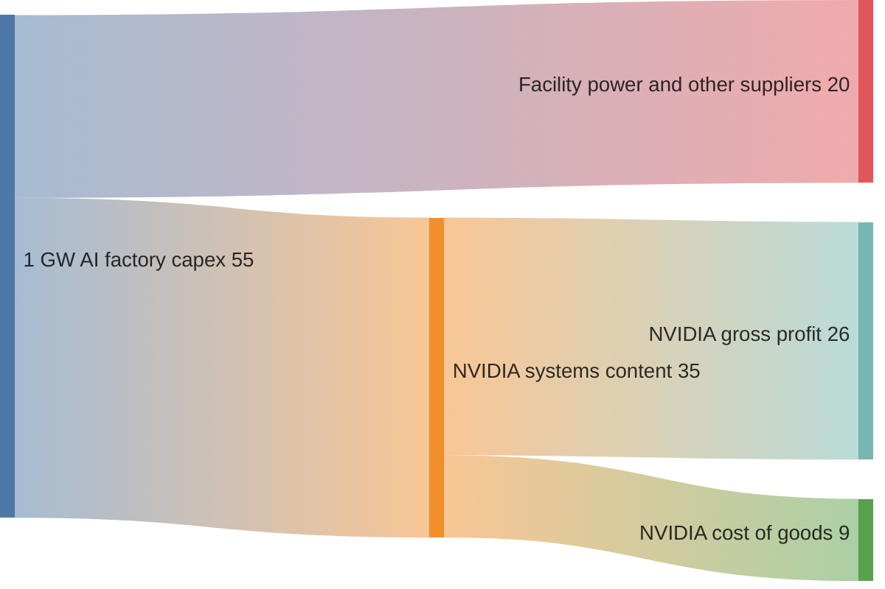
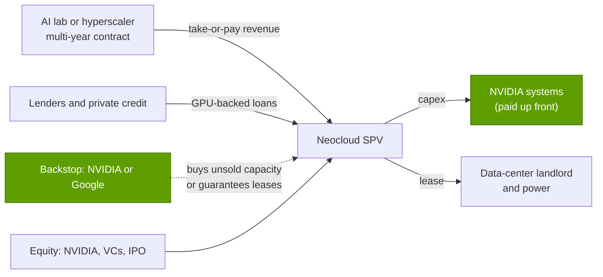

# Orchestration and cloud services: Value chain and corp dev angles

Layer 12 · Orchestration and cloud services · ~15 min read · Last verified: 2026-11-05

## ⚡ The Executive Take

- **Most of the GPU-cloud dollar flows back to NVIDIA.** In a ~$50–60B gigawatt AI factory, ~$35B is NVIDIA content; at ~75% gross margin, about $26B of that is NVIDIA gross profit (Est.) [[S398]](../../sources/bibliography.md#s398)[[S405]](../../sources/bibliography.md#s405).
- **Neoclouds carry the risk.** CoreWeave plans ~2.9× and Nebius ~7× as much 2026 capex as 2026 revenue. CoreWeave carries $35.1B of debt and paid $640M of interest in Q2 2026 [[S12500]](../../sources/bibliography.md#s12500)[[S12503]](../../sources/bibliography.md#s12503)[[S12501]](../../sources/bibliography.md#s12501).
- **Rental prices are the swing factor.** H100 rentals fell ~80% from 2023 to a $1.70/hr low in October 2025, then rose 38% to $2.35 by March 2026 [[S393]](../../sources/bibliography.md#s393)[[S12516]](../../sources/bibliography.md#s12516).
- **NVIDIA's ties to its customers total ~$189B:** ~$99B of equity stakes, ~$25B of further equity commitments, $36B of AI-cloud capacity agreements and $29B of cloud service agreements. FY2026 revenue was $216B [[S90072]](../../sources/bibliography.md#s90072)[[S90069]](../../sources/bibliography.md#s90069)[[S407]](../../sources/bibliography.md#s407)[[S1]](../../sources/bibliography.md#s1).
- **The [circular-financing](../../glossary.md#circular-financing) debate is real on both sides.** H1 FY2027 equity purchases ($42.4B) were ~24% of H1 revenue. Yet the ~$45B pledged to five customers is ~7% of the NVIDIA content in their ~19 GW plans 🔴 [[S90072]](../../sources/bibliography.md#s90072)[[S403]](../../sources/bibliography.md#s403)[[S405]](../../sources/bibliography.md#s405)[[S398]](../../sources/bibliography.md#s398).
- **[Q8 · Value pools & M&A angles]** The open pools are financing, pre-IPO neocloud equity and utilization tooling; orchestration software alone is commoditized.

![Horizontal stacked bar chart of NVIDIA's balance-sheet ties to the AI build-out at July 2026: equity securities held $99B (marketable $42.8B, non-marketable $51.2B, locked-up $5B), further equity commitments $25B, AI-cloud capacity agreements $36B (buying capacity partners cannot resell, including the $6.3B CoreWeave backstop) and multi-year cloud service agreements $29B, about $189B in all versus FY2026 revenue of $216B. The $500B financing platforms with six asset managers are third-party capital and not included.](../../assets/charts/12-nvidia-customer-support-exposure.svg)

## Who captures the GPU-cloud dollar

A [neocloud](../../glossary.md#neocloud) is a leveraged landlord for GPUs: it borrows to buy NVIDIA systems, leases power and buildings, and rents GPU-hours. NVIDIA is paid up front; the neocloud earns it back over years of rent (CoreWeave depreciates GPU servers over six years) [[S386]](../../sources/bibliography.md#s386).

US$ B per gigawatt, Est. 🔴: $55B midpoint and $35B NVIDIA content per NVIDIA's CEO [[S398]](../../sources/bibliography.md#s398); gross profit at the ~75% Q2 FY2027 GAAP gross margin [[S405]](../../sources/bibliography.md#s405). Cost of goods covers TSMC, HBM makers and ODMs ([layer 03](../03-memory-packaging-supply-chain/value-chain-and-corp-dev.md)).

> [!TIP]
> **Worked example — what the 2026 rebound did to an old GPU.** At the $2.35/hr one-year contract rate, an H100 rented 85% of the time earns ~$17.5K a year (2.35 × 8,760 × 0.85) [[S12516]](../../sources/bibliography.md#s12516). Against a ~$25–30K purchase price that is a ~1.5-year GPU-only payback, versus ~4–5 months at 2023's ~$8/hr [[S356]](../../sources/bibliography.md#s356)[[S393]](../../sources/bibliography.md#s393). Three-year-old Hopper fleets were worth more in 2026 than in 2025, propping up the collateral behind neocloud debt.

## Neocloud financing: contracts, GPU-backed loans and backstops

It works like project finance. A lab or hyperscaler signs a multi-year [take-or-pay](../../glossary.md#take-or-pay) contract ([offtake agreement](../../glossary.md#offtake-agreement)); the neocloud puts the contract and GPUs in a special-purpose vehicle and borrows against both ([GPU-backed loan](../../glossary.md#gpu-backed-loan)). Third parties cut the rate further: NVIDIA by buying unsold capacity ([capacity backstop](../../glossary.md#capacity-backstop)), Google by guaranteeing Fluidstack's leases with TeraWulf (~$3.2B) and Cipher (~$1.4B) for equity 🟡 [[S90067]](../../sources/bibliography.md#s90067)[[S12525]](../../sources/bibliography.md#s12525).

> [!TIP]
> **Worked example — CoreWeave's quarter in one line.** In Q2 2026 CoreWeave booked $2.58B of revenue, $640M of net interest and a $626M net loss, with $46.7B of net property and equipment funded largely by $35.1B of debt [[S12500]](../../sources/bibliography.md#s12500)[[S12501]](../../sources/bibliography.md#s12501). Interest took ~25 cents of every revenue dollar. Lenders underwrite the $104.2B backlog; the backstop and six-year depreciation make the arithmetic close [[S12500]](../../sources/bibliography.md#s12500)[[S90067]](../../sources/bibliography.md#s90067)[[S386]](../../sources/bibliography.md#s386).

🔧 Under the hood: why the GPU depreciation life matters so much

A $70K GPU costs ~$11.7K a year over six years but ~$17.5K over four: a 50% gap that separates profit from loss at ~$2–3/hr. CoreWeave uses six years, in line with Microsoft and Alphabet server lives [[S386]](../../sources/bibliography.md#s386)[[S382]](../../sources/bibliography.md#s382)[[S383]](../../sources/bibliography.md#s383). Critics say annual GPU generations shorten economic life; the 2026 Hopper rental rebound argues otherwise while compute is scarce [[S12516]](../../sources/bibliography.md#s12516).

## The circular-financing debate

NVIDIA invests in, guarantees capacity for and rents back from companies that buy its GPUs. Is that ecosystem-building or demand manufacturing? Both sides at full strength:

> [!WARNING]
> **🐻 Bear view (steelmanned).**
> 1. **Scale.** Equity purchases jumped from $1.2B (H1 FY2026) to $42.4B (H1 FY2027), ~24% of H1 FY2027 revenue of $177.8B [[S90072]](../../sources/bibliography.md#s90072)[[S403]](../../sources/bibliography.md#s403)[[S405]](../../sources/bibliography.md#s405).
> 2. **Earnings quality.** Q1 FY2027 net income of $58.3B included ~$15.9B of other income, largely unrealized [mark-to-market](../../glossary.md#mark-to-market) gains that reverse in a downturn [[S403]](../../sources/bibliography.md#s403).
> 3. **Capacity buy-backs.** NVIDIA has agreed to buy $36B of AI-cloud capacity partners cannot resell, plus $29B of cloud service commitments [[S407]](../../sources/bibliography.md#s407). Part of its customers' utilization is NVIDIA itself.
> 4. **Concentration.** Three direct customers were 16%, 15% and 13% of H1 FY2027 revenue, and big buyers such as OpenAI, Anthropic and CoreWeave are also investees [[S90069]](../../sources/bibliography.md#s90069)[[S90015]](../../sources/bibliography.md#s90015)[[S90075]](../../sources/bibliography.md#s90075)[[S472]](../../sources/bibliography.md#s472).
> 5. **History rhymes.** In 1999–2001 telecom equipment makers financed carriers whose demand vanished; [vendor financing](../../glossary.md#vendor-financing) turned a slowdown into a collapse 🟡 [[S90074]](../../sources/bibliography.md#s90074). Goldman Sachs now speaks of credit backed by NVIDIA compute: collateral whose rent fell ~80% in two years before rebounding [[S12528]](../../sources/bibliography.md#s12528)[[S12516]](../../sources/bibliography.md#s12516).

> [!NOTE]
> **🐂 Bull view (steelmanned).**
> 1. **Small relative to what it unlocks.** The ~$45B pledged to five customers supports plans for ~19 GW. At ~$35B of NVIDIA content per GW, that is ~$665B of potential content, so the stakes are a ~7% "rebate" 🔴 [[S398]](../../sources/bibliography.md#s398).
> 2. **Strategic.** Non-hyperscale buyers (ACIE) were ~$40.3B of Q2 FY2027 Data Center revenue; supporting them reduces dependence on ASIC-building hyperscalers [[S406]](../../sources/bibliography.md#s406).
> 3. **Demand shows in prices.** H100 rents rose 38% in five months, capacity was booked through September 2026, and NVIDIA's outlook is supply-constrained [[S12516]](../../sources/bibliography.md#s12516)[[S90012]](../../sources/bibliography.md#s90012).
> 4. **Risk is moving to third parties.** The financing platforms aim to mobilize >$500B from six asset managers, not NVIDIA's balance sheet 🟡 [[S12528]](../../sources/bibliography.md#s12528).
> 5. **Everyone does it.** Google backstops Fluidstack's leases; AMD gave OpenAI warrants for up to 160M shares [[S12525]](../../sources/bibliography.md#s12525)[[S13506]](../../sources/bibliography.md#s13506).

> [!TIP]
> **Worked example — sizing the "rebate".** OpenAI's ~$30B is the largest single stake [[S90015]](../../sources/bibliography.md#s90015). If OpenAI's NVIDIA-based programme reaches 10 GW, NVIDIA content would be ~$350B at $35B/GW, so the stake equals ~8.6% of that potential revenue [[S398]](../../sources/bibliography.md#s398). At only 3 GW, the same stake is ~29% 🔴. The debate is about deployment risk, not accounting: the ratio looks harmless only if the gigawatts arrive.

**Verdict 🔴:** both sides are right about different time frames. While compute is scarce, NVIDIA's support speeds the build-out cheaply; in a downturn it makes NVIDIA a creditor of its weakest customers. Early-warning signals are on the [roadmap page](roadmap.md); see also the [bear case](../../cross-cutting/18-vulnerabilities-and-bear-case.md) and [layer 13](../13-ecosystem-gtm-and-capital/index.md).

## Private companies worth knowing

Public information only; several valuations are press-reported.

| Company | What they do | Stage / last public funding | Why it matters |
|---|---|---|---|
| Crusoe | Gigawatt AI campuses (Abilene) plus a GPU cloud | Series F $3.9B at $30.9B post-money (Sep 2026) 🟡; ~4.9 GW contracted 🟡 | Largest private AI-factory builder; adopting open Run:ai [[S12522]](../../sources/bibliography.md#s12522)[[S12013]](../../sources/bibliography.md#s12013)[[S12512]](../../sources/bibliography.md#s12512) |
| Lambda | GPU cloud for developers; Microsoft contract | Seeking ~$4B pre-IPO at ~$14.5B pre-money target (Oct 2026) 🟡 | NVIDIA both investor and tenant (~$1.5B lease-back) [[S12521]](../../sources/bibliography.md#s12521)[[S483]](../../sources/bibliography.md#s483) |
| Nscale | UK/European neocloud | Series C at $14.6B (Mar 2026); $3.36B pre-IPO convertibles (Sep 2026) | Sovereign-AI and hyperscaler-overflow play [[S12520]](../../sources/bibliography.md#s12520)[[S12526]](../../sources/bibliography.md#s12526) |
| Fluidstack | Runs Anthropic's $50B US build-out | >$750M at $7B (Apr 2026); talks at ~$18B reported 🟡 | Google-backstopped: a non-NVIDIA financing template [[S12523]](../../sources/bibliography.md#s12523)[[S12524]](../../sources/bibliography.md#s12524)[[S12525]](../../sources/bibliography.md#s12525) |
| Together AI | Open-model inference cloud | $305M Series B at $3.3B (2025) | Dynamo adopter and Lepton partner [[S12522]](../../sources/bibliography.md#s12522)[[S90066]](../../sources/bibliography.md#s90066)[[S12008]](../../sources/bibliography.md#s12008) |
| VAST Data | Storage/data platform for GPU clouds | ~$1B Series F at $30B (Apr 2026); IPO considered | Storage layer every neocloud needs ([layer 07](../07-dpu-supernic-storage-security/value-chain-and-corp-dev.md)) [[S7513]](../../sources/bibliography.md#s7513)[[S7512]](../../sources/bibliography.md#s7512) |
| SF Compute, Vast.ai | GPU marketplaces | Private; no recent public valuation found | Price discovery; arbitrage of idle capacity [[S393]](../../sources/bibliography.md#s393) |

## M&A history in the layer

| Year | Acquirer → target | Value | What it bought | Source |
|---|---|---|---|---|
| 2022 | NVIDIA → Bright Computing | undisclosed | Cluster manager (now Base Command Manager) | [[S478]](../../sources/bibliography.md#s478) |
| 2024 | NVIDIA → Run:ai | ~$700M (reported) | Kubernetes GPU pooling; open-sourced 2025–26 | [[S476]](../../sources/bibliography.md#s476)[[S12510]](../../sources/bibliography.md#s12510) |
| 2024 | NVIDIA → Shoreline.io; Brev.dev | ~$100M (reported); undisclosed | Fleet automation; developer on-ramp | [[S478]](../../sources/bibliography.md#s478)[[S479]](../../sources/bibliography.md#s479) |
| 2025 | NVIDIA → Lepton AI | "several hundred million" (reported) | Basis of the DGX Cloud Lepton marketplace | [[S479]](../../sources/bibliography.md#s479)[[S598]](../../sources/bibliography.md#s598) |
| 2025 | CoreWeave → Weights & Biases | ~$1.7B (reported) | Experiment tracking and MLOps users | [[S12507]](../../sources/bibliography.md#s12507)[[S12506]](../../sources/bibliography.md#s12506) |
| 2025 | CoreWeave → Core Scientific | ~$9B all-stock, **voted down** | Owned data-center sites | [[S12508]](../../sources/bibliography.md#s12508) |
| 2025 | NVIDIA → SchedMD (Slurm) | undisclosed | The default HPC/AI batch scheduler | [[S12000]](../../sources/bibliography.md#s12000) |

> [!TIP]
> **Worked example — why software multiples are capped here.** NVIDIA paid ~$0.7B for Run:ai and then released it free [[S476]](../../sources/bibliography.md#s476)[[S12510]](../../sources/bibliography.md#s12510). CoreWeave's ~$1.7B for Weights & Biases is ~1.6% of its $104.2B backlog [[S12507]](../../sources/bibliography.md#s12507)[[S12500]](../../sources/bibliography.md#s12500). Here software is worth what it adds to GPU-hours sold, not its licence revenue.

## [Q8 · Value pools & M&A angles]

**[Q8 · Value pools & M&A angles]** Four pools stand out:

1. **Financing the build-out.** Neocloud capex runs 3–7× revenue, so whoever prices GPU-backed credit and backstops earns a spread. NVIDIA, Google and private credit are already there [[S12500]](../../sources/bibliography.md#s12500)[[S12503]](../../sources/bibliography.md#s12503)[[S12528]](../../sources/bibliography.md#s12528)[[S12525]](../../sources/bibliography.md#s12525).
2. **Pre-IPO neocloud equity.** Crusoe, Lambda and Nscale are heading for public markets with combined last-round values of ~$60B 🟡 [[S12522]](../../sources/bibliography.md#s12522)[[S12521]](../../sources/bibliography.md#s12521)[[S12520]](../../sources/bibliography.md#s12520).
3. **Utilization tooling.** Schedulers are free, but recovery, multi-cloud brokerage and inference endpoints still turn idle GPU-hours into revenue ([competition](competition.md)).
4. **Hardware-neutral capacity.** Neoclouds that run non-NVIDIA accelerators would need neutral software (Kueue, Ray, SkyPilot, or portability stacks such as the Modular platform Qualcomm bought for ~$3.9B, closed 2026-07-29 [[S9511]](../../sources/bibliography.md#s9511)) [[S12533]](../../sources/bibliography.md#s12533)[[S12535]](../../sources/bibliography.md#s12535)[[S12534]](../../sources/bibliography.md#s12534)[[S90057]](../../sources/bibliography.md#s90057).

## 🎯 Corp Dev Lens

1. Could an accelerator vendor win neocloud capacity by offering backstops or residual-value guarantees on its GPUs, and what would that do to its balance sheet?
2. Which neoclouds with contracted-but-unbuilt power would trial a second accelerator, and would a hardware-portable stack (such as Modular, which Qualcomm now owns) be a precondition?
3. With Run:ai, KAI and Slurm free, which orchestration or MLOps assets still command a premium, and to whom (clouds, chip vendors, private equity)?
4. How should the ~$189B of NVIDIA ties be stress-tested: rental-price scenarios, customer default or mark-to-market reversal?

## 📚 Sources

<!-- Auto-generated from the [S…] citations on this page by `make build`. Edit sources/registry/*.csv, not this list. -->

- [**S1**](../../sources/bibliography.md#s1) NVIDIA Corporation via SEC EDGAR, *NVIDIA Announces Financial Results for Fourth Quarter and Fiscal 2026 (Form 8-K exhibit 99.1)*, 2026-02-25. [Link](https://www.sec.gov/Archives/edgar/data/1045810/000104581026000019/q4fy26pr.htm)
- [**S356**](../../sources/bibliography.md#s356) Tom's Hardware, *Nvidia makes nearly 1,000% profit on H100 GPUs: report*, 2023-08. [Link](https://www.tomshardware.com/news/nvidia-makes-1000-profit-on-h100-gpus-report)
- [**S382**](../../sources/bibliography.md#s382) Microsoft via SEC EDGAR, *Microsoft Corporation Form 10-K filings (FY2021, FY2023) - property and equipment useful lives*, 2023-07-27. [Link](https://www.sec.gov/cgi-bin/browse-edgar?action=getcompany&CIK=0000789019&type=10-K&dateb=&owner=include&count=40)
- [**S383**](../../sources/bibliography.md#s383) Alphabet via SEC EDGAR, *Alphabet Inc. Form 10-K filings (FY2020, FY2022) - useful lives of servers and network equipment*, 2023-02-03. [Link](https://www.sec.gov/cgi-bin/browse-edgar?action=getcompany&CIK=0001652044&type=10-K&dateb=&owner=include&count=40)
- [**S386**](../../sources/bibliography.md#s386) CoreWeave via SEC EDGAR, *CoreWeave Form S-1 registration statement (2025) - technology equipment useful life*, 2025-03-03. [Link](https://www.sec.gov/cgi-bin/browse-edgar?action=getcompany&company=coreweave&type=S-1&dateb=&owner=include&count=40)
- [**S393**](../../sources/bibliography.md#s393) Latent Space (Eugene Cheah), *$2 H100s: how the GPU bubble burst*, 2024-10. [Link](https://www.latent.space/p/gpu-bubble)
- [**S398**](../../sources/bibliography.md#s398) NVIDIA Investor Relations, *NVIDIA Q2 FY2026 earnings call (2025-08-27): AI factory economics commentary*, 2025-08-27. [Link](https://investor.nvidia.com/events-and-presentations/events-and-presentations/default.aspx)
- [**S403**](../../sources/bibliography.md#s403) NVIDIA Corporation via SEC EDGAR, *NVIDIA Announces Financial Results for First Quarter Fiscal 2027 (Form 8-K exhibit 99.1)*, 2026-05-20. [Link](https://www.sec.gov/Archives/edgar/data/0001045810/000104581026000051/q1fy27pr.htm)
- [**S405**](../../sources/bibliography.md#s405) NVIDIA Corporation via SEC EDGAR, *NVIDIA Announces Financial Results for Second Quarter Fiscal 2027 (Form 8-K exhibit 99.1)*, 2026-08-26. [Link](https://www.sec.gov/Archives/edgar/data/0001045810/000104581026000073/q2fy27pr.htm)
- [**S406**](../../sources/bibliography.md#s406) NVIDIA Corporation (Colette Kress), *CFO Commentary on Second Quarter Fiscal 2027 Results*, 2026-08-26. [Link](https://s201.q4cdn.com/141608511/files/doc_financials/2027/Q227/Q2FY27-CFO-Commentary.pdf)
- [**S407**](../../sources/bibliography.md#s407) NVIDIA Corporation via SEC EDGAR, *NVIDIA Corporation Form 10-Q for quarter ended July 26, 2026*, 2026-08-28. [Link](https://www.sec.gov/Archives/edgar/data/1045810/000104581026000075/nvda-20260726.htm)
- [**S472**](../../sources/bibliography.md#s472) CoreWeave Newsroom, *CoreWeave and NVIDIA expand partnership; NVIDIA invests $2B in CoreWeave Class A stock*, 2026-01-26. [Link](https://www.coreweave.com/news)
- [**S476**](../../sources/bibliography.md#s476) NVIDIA Blog, *NVIDIA to Acquire GPU Orchestration Software Provider Run:ai*, 2024-04-24. [Link](https://blogs.nvidia.com/blog/runai/)
- [**S478**](../../sources/bibliography.md#s478) NVIDIA, *NVIDIA Blog and Newsroom acquisition announcements (Cumulus, SwiftStack, DeepMap, Bright Computing, Excelero, Shoreline, Brev.dev, OctoAI, VinBrain, Gretel, Lepton AI, CentML, SchedMD)*, 2025-12. [Link](https://blogs.nvidia.com/)
- [**S479**](../../sources/bibliography.md#s479) Various (press), *Reporting on NVIDIA tuck-in acquisition prices (Run:ai, Deci, Shoreline, OctoAI, Gretel, Lepton, CentML) — The Information, Calcalist, Reuters, CNBC*, 2025-06. [Link](https://www.reuters.com/technology/)
- [**S483**](../../sources/bibliography.md#s483) Various (Bloomberg, The Information, Reuters), *Reporting on NVIDIA commitments to xAI (up to $2B in ~$20B raise), Poolside (up to $1B), Lambda (~$1.5B GPU lease-back) and Wayve ($500M LOI)*, 2025-10. [Link](https://www.bloomberg.com/technology)
- [**S598**](../../sources/bibliography.md#s598) NVIDIA Newsroom, *NVIDIA Announces DGX Cloud Lepton to Connect Developers to NVIDIA's Global Compute Ecosystem*, 2025-05-18. [Link](https://nvidianews.nvidia.com/news/nvidia-announces-dgx-cloud-lepton-to-connect-developers-to-nvidias-global-compute-ecosystem)
- [**S7512**](../../sources/bibliography.md#s7512) Bloomberg Law, *Nvidia-backed Vast Data triples value to $30 billion, mulls IPO*, 2026-04. [Link](https://news.bloomberglaw.com/private-equity/nvidia-backed-vast-data-triples-value-to-30-billion-mulls-ipo)
- [**S7513**](../../sources/bibliography.md#s7513) Built In, *VAST Data raises $1B Series F at $30B valuation*, 2026-04-23. [Link](https://builtin.com/articles/vast-data-raises-1b-series-f-30b-valuation-20260423)
- [**S9511**](../../sources/bibliography.md#s9511) Nasdaq (Qualcomm press release), *Qualcomm Completes Acquisition of Modular*, 2026-07-29. [Link](https://www.nasdaq.com/press-release/qualcomm-completes-acquisition-modular-2026-07-29)
- [**S12000**](../../sources/bibliography.md#s12000) NVIDIA Blog, *NVIDIA Acquires Open-Source Workload Management Provider SchedMD*, 2025-12-15. [Link](https://blogs.nvidia.com/blog/nvidia-acquires-schedmd)
- [**S12008**](../../sources/bibliography.md#s12008) NVIDIA Newsroom, *NVIDIA DGX Cloud Lepton Connects Europe's Developers to Global NVIDIA Compute Ecosystem*, 2025-06-11. [Link](https://nvidianews.nvidia.com/news/nvidia-dgx-cloud-lepton-connects-europes-developers-to-global-nvidia-compute-ecosystem)
- [**S12013**](../../sources/bibliography.md#s12013) MarkTechPost, *Best GPU neoclouds 2026: CoreWeave, Nebius, Lambda, Crusoe and Groq ranked by published pricing and contracted power*, 2026-08-23. [Link](https://www.marktechpost.com/2026/08/23/best-gpu-neoclouds-2026/)
- [**S12500**](../../sources/bibliography.md#s12500) CoreWeave (press release via Seeking Alpha), *CoreWeave Reports Strong Second Quarter 2026 Results*, 2026-08. [Link](https://seekingalpha.com/pr/20615715)
- [**S12501**](../../sources/bibliography.md#s12501) Runtime Wire, *CoreWeave reports $2.58 billion Q2 revenue with $35 billion in debt*, 2026-08. [Link](https://runtimewire.com/article/coreweave-q2-2026-revenue-debt-ai-cloud)
- [**S12503**](../../sources/bibliography.md#s12503) Quartr, *Nebius Group (NBIS) Q2 2026 earnings summary*, 2026-08. [Link](https://quartr.com/events/nebius-group-n-v-nbis-q2-2026_ozKEzQzr)
- [**S12506**](../../sources/bibliography.md#s12506) CoreWeave Investor Relations, *CoreWeave Completes Acquisition of Weights & Biases*, 2025-05-05. [Link](https://investors.coreweave.com/news/news-details/2025/CoreWeave-Completes-Acquisition-of-Weights--Biases/default.aspx)
- [**S12507**](../../sources/bibliography.md#s12507) Maginative, *CoreWeave acquires Weights & Biases in a $1.7 billion AI cloud play*, 2025-03. [Link](https://www.maginative.com/article/coreweave-acquires-weights-biases-in-a-1-7-billion-ai-cloud-play/)
- [**S12508**](../../sources/bibliography.md#s12508) SiliconANGLE, *Core Scientific shareholders dismiss $9B CoreWeave deal on valuation worries*, 2025-10-30. [Link](https://siliconangle.com/2025/10/30/core-scientific-shareholders-dismiss-9b-coreweave-deal-valuation-worries/)
- [**S12510**](../../sources/bibliography.md#s12510) NVIDIA Technical Blog, *NVIDIA Run:ai is now open source as part of NVIDIA DSX AI Factory platform*, 2026-10. [Link](https://developer.nvidia.com/blog/nvidia-runai-is-now-open-source-as-part-of-nvidia-dsx-ai-factory-platform/)
- [**S12512**](../../sources/bibliography.md#s12512) Techstrong.ai, *NVIDIA hands Run:ai to the open source community*, 2026-10. [Link](https://techstrong.ai/articles/nvidia-hands-runai-to-the-open-source-community/)
- [**S12516**](../../sources/bibliography.md#s12516) SemiAnalysis, *The Great GPU Shortage - Rental Capacity - Launching our H100 1 Year Rental Price Index*, 2026-03. [Link](https://newsletter.semianalysis.com/p/the-great-gpu-shortage-rental-capacity)
- [**S12520**](../../sources/bibliography.md#s12520) Fierce Network, *Neocloud Nscale raises $3.36B ahead of IPO*, 2026-09. [Link](https://www.fierce-network.com/cloud/neocloud-nscale-raises-336b-ahead-ipo)
- [**S12521**](../../sources/bibliography.md#s12521) TechCrunch, *AI computing startup Lambda to raise $4B ahead of planned IPO*, 2026-10-06. [Link](https://techcrunch.com/2026/10/06/ai-computing-startup-lambda-to-raise-4b-ahead-of-planned-ipo)
- [**S12522**](../../sources/bibliography.md#s12522) ValueAdd VC, *Neocloud valuations 2026 (tracker)*, 2026-10-31. [Link](https://valueaddvc.com/blog/neocloud-valuations-2026)
- [**S12523**](../../sources/bibliography.md#s12523) Dealroom, *Fluidstack raises $750M at $7B as Google and Anthropic anchor its AI data centres*, 2026-04-06. [Link](https://dealroom.co/news/127233-fluidstack-raises-750m-at-7b-as-google-and-anthropic-anchor-its-ai-data/)
- [**S12524**](../../sources/bibliography.md#s12524) DatacenterDynamics, *Anthropic plans $50bn US data center spend, starting with Fluidstack sites in Texas and New York*, 2025-11-12. [Link](https://datacenterdynamics.com/en/news/anthropic-plans-50bn-us-data-center-spend-starting-with-fluidstack-sites-in-texas-and-new-york)
- [**S12525**](../../sources/bibliography.md#s12525) The Energy Mag, *Fluidstack seeks $700M at $7B valuation; TeraWulf and Cipher leases backstopped by Google*, 2025-12-07. [Link](https://theenergymag.com/news/2025-12-07/fluidstack-ai-terawulf-cipher)
- [**S12526**](../../sources/bibliography.md#s12526) Introl, *Microsoft's $60B neocloud bet: buying time in the AI capacity crisis*, 2025-12. [Link](https://introl.com/blog/microsoft-60-billion-neocloud-spending-2025)
- [**S12528**](../../sources/bibliography.md#s12528) NVIDIA Newsroom, *NVIDIA Partners With Apollo, BlackRock, Blackstone, Brookfield, Goldman Sachs and KKR to Establish AI Compute Infrastructure Financing Platforms to Mobilize Over $500 Billion of Third-Party Capital*, 2026-08-10. [Link](https://nvidianews.nvidia.com/news/nvidia-partners-with-apollo-blackrock-blackstone-brookfield-goldman-sachs-and-kkr-to-establish-ai-compute-infrastructure-financing-platforms-to-mobilize-over-500-billion-of-third-party-capital)
- [**S12533**](../../sources/bibliography.md#s12533) Kubernetes SIGs on GitHub, *Kueue (README)*, 2026. [Link](https://github.com/kubernetes-sigs/kueue)
- [**S12534**](../../sources/bibliography.md#s12534) SkyPilot project on GitHub, *SkyPilot (README)*, 2026-10. [Link](https://github.com/skypilot-org/skypilot)
- [**S12535**](../../sources/bibliography.md#s12535) Ray project on GitHub (Anyscale), *Ray (README)*, 2026. [Link](https://github.com/ray-project/ray)
- [**S13506**](../../sources/bibliography.md#s13506) Tom's Hardware, *OpenAI signs 6 GW AMD GPU deal*, 2025-10-06. [Link](https://www.tomshardware.com/pc-components/gpus/openai-signs-6gw-amd-gpu-deal)
- [**S90012**](../../sources/bibliography.md#s90012) Tomasz Tunguz (Tomasz Tunguz), *Nvidia Q2 FY27 earnings*, 2026-08. [Link](https://www.tomtunguz.com/nvidia-q2-fy27-earnings/index.md)
- [**S90015**](../../sources/bibliography.md#s90015) DatacenterDynamics, *Nvidia plans $30bn investment in upcoming OpenAI funding round*, 2026-02. [Link](https://www.datacenterdynamics.com/en/news/nvidia-plans-30bn-investment-in-upcoming-openai-funding-round/)
- [**S90057**](../../sources/bibliography.md#s90057) StorageReview, *Qualcomm unveils Dragonfly data center roadmap: C1000 CPU, AI300 accelerator and Modular acquisition*, 2026-06-24. [Link](https://www.storagereview.com/es/news/qualcomm-unveils-dragonfly-data-center-roadmap-c1000-cpu-ai300-accelerator-and-modular-acquisition)
- [**S90066**](../../sources/bibliography.md#s90066) HPCwire (NVIDIA press release), *NVIDIA enters production with Dynamo, the broadly adopted inference operating system for AI factories*, 2026-03-17. [Link](https://www.hpcwire.com/aiwire/tag/dynamo-1-0/)
- [**S90067**](../../sources/bibliography.md#s90067) DatacenterDynamics, *Nvidia to purchase unsold compute capacity from CoreWeave for $6.3bn*, 2025-09-16. [Link](https://www.datacenterdynamics.com/en/news/nvidia-to-purchase-unsold-compute-capacity-from-coreweave-for-63bn/)
- [**S90069**](../../sources/bibliography.md#s90069) NVIDIA Corporation via SEC EDGAR, *NVIDIA Form 10-Q for the quarter ended July 26, 2026 (Q2 FY2027)*, 2026-08. [Link](https://www.sec.gov/Archives/edgar/data/0001045810/000104581026000075/nvda-20260726.htm)
- [**S90072**](../../sources/bibliography.md#s90072) Unite.AI, *Nvidia's AI sector equity stakes grow, SEC filing shows*, 2026-08. [Link](https://unite.ai/nvidias-ai-sector-equity-stakes-grow-sec-filing-shows)
- [**S90074**](../../sources/bibliography.md#s90074) Kavout, *Nvidia's AI dominance meets circular financing: a systemic risk underpriced?*, 2026. [Link](https://www.kavout.com/market-lens/nvidia-s-ai-dominance-meets-circular-financing-a-systemic-risk-underpriced)
- [**S90075**](../../sources/bibliography.md#s90075) Windows Central, *NVIDIA joins Microsoft's push on Claude — piling billions into Anthropic's future*, 2025-11-18. [Link](https://www.windowscentral.com/microsoft/nvidia-joins-microsofts-push-on-claude-piling-billions-into-anthropics-future)
