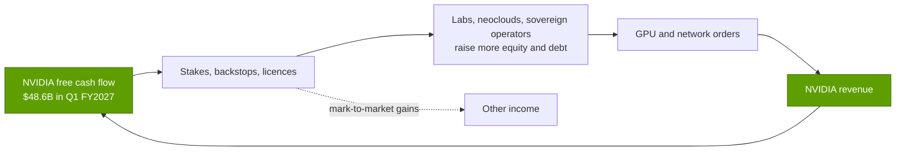
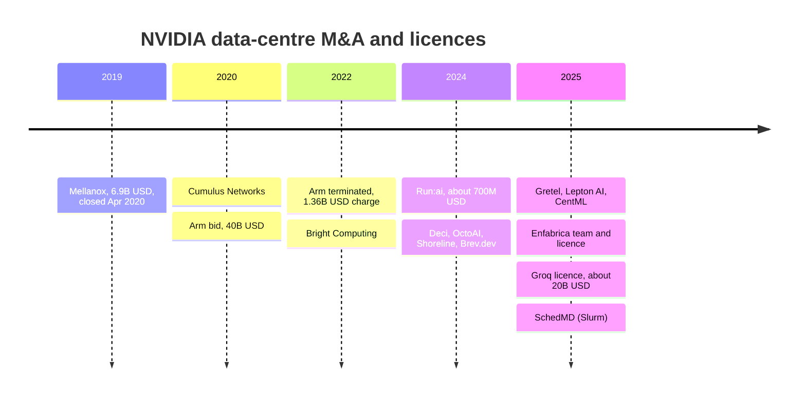

# Capital deployment

Layer 13 · Ecosystem, go-to-market and capital · ~9 min read · Last verified: 2026-11-05

## ⚡ The Executive Take

- **Deal dollars jumped five-fold.** All logged NVIDIA deals before 2025 total ~$10B. 2025 alone reached ~$51B, led by the ~$20B Groq licence, up to $10B for Anthropic, the $6.3B CoreWeave backstop and $5B for Intel [[S474]](../../sources/bibliography.md#s474)[[S90075]](../../sources/bibliography.md#s90075)[[S90067]](../../sources/bibliography.md#s90067)[[S468]](../../sources/bibliography.md#s468).
- **The equity book grew 15× in 18 months.** Private stakes rose from $3.4B (Jan 2025) to $51.2B (Jul 2026) [[S13043]](../../sources/bibliography.md#s13043)[[S90072]](../../sources/bibliography.md#s90072). With listed stakes, NVIDIA holds ~$99B [[S90073]](../../sources/bibliography.md#s90073). Equity purchases were $42.4B in H1 FY2027 vs $1.2B a year earlier [[S90072]](../../sources/bibliography.md#s90072).
- **OpenAI is the largest single bet.** A September 2025 letter of intent for up to $100B, paid per gigawatt deployed [[S467]](../../sources/bibliography.md#s467), was shelved in February 2026 for a ~$30B direct equity stake with no deployment milestones 🟡 [[S90015]](../../sources/bibliography.md#s90015)[[S90016]](../../sources/bibliography.md#s90016)[[S90017]](../../sources/bibliography.md#s90017).
- **M&A shifted to licences and acquihires.** Mellanox ($6.9B) built the networking business [[S464]](../../sources/bibliography.md#s464). Enfabrica (>$900M) and Groq (~$20B reported) were team-plus-licence deals that left the companies standing 🟡 [[S475]](../../sources/bibliography.md#s475)[[S90018]](../../sources/bibliography.md#s90018)[[S90019]](../../sources/bibliography.md#s90019). The $40B Arm bid failed in 2022 and cost a $1.36B charge [[S465]](../../sources/bibliography.md#s465)[[S466]](../../sources/bibliography.md#s466).
- **[Customer concentration](../../glossary.md#customer-concentration) is high.** Three direct customers took 16%, 15% and 13% of H1 FY2027 revenue, and one took 16% of Q2 FY2027 [[S90069]](../../sources/bibliography.md#s90069).
- **Bear case:** NVIDIA funds buyers who then buy its GPUs. H1 FY2027 net equity gains of $23.7B ran through earnings [[S90072]](../../sources/bibliography.md#s90072), ~$25B of further equity commitments remain [[S90069]](../../sources/bibliography.md#s90069), and NVIDIA is organising >$500B of third-party financing for customers [[S12528]](../../sources/bibliography.md#s12528).

**[Q3 · Generational progress]** The chart's 2026 bar omits ~$6B of March 2026 supply-chain stakes: $2B each in Lumentum and Coherent [[S6511]](../../sources/bibliography.md#s6511)[[S13529]](../../sources/bibliography.md#s13529) and a reported $2B in Marvell [[S90037]](../../sources/bibliography.md#s90037). It also omits xAI's January 2026 round, whose NVIDIA amount was undisclosed [[S13039]](../../sources/bibliography.md#s13039). Press tallies put NVIDIA's 2026 investments above $40B 🟡 [[S13528]](../../sources/bibliography.md#s13528).

## The capital loop, mechanically

NVIDIA earns more cash than R&D and buybacks absorb, and uses part of it to secure demand through four instruments. Equity stakes give a lab or cloud cheaper capital to buy GPUs. [Capacity backstops](../../glossary.md#capacity-backstop) promise to buy unsold capacity, as with CoreWeave's $6.3B through 2032 [[S90067]](../../sources/bibliography.md#s90067). Licences and acquihires bring in teams and technology. Supplier stakes buy capacity rights, as with the optics makers [[S6511]](../../sources/bibliography.md#s6511). A [letter of intent](../../glossary.md#letter-of-intent) often comes first.

> [!TIP]
> **Worked example — what the OpenAI stake buys.** OpenAI's plan with NVIDIA was ≥10 GW [[S467]](../../sources/bibliography.md#s467). At ~232 MW per 100,000 GB300 GPUs and ~$5.7B of NVIDIA content per 100,000 (Est., see [Sovereign AI](sovereign-ai.md)), 10 GW is **~4.3M GPUs and ~$246B of potential NVIDIA revenue**. The ~$30B stake [[S90015]](../../sources/bibliography.md#s90015) is **~12%** of that, before any return on the equity itself. OpenAI also signed 6 GW with AMD for a share warrant [[S13506]](../../sources/bibliography.md#s13506), so the stake buys share of wallet, not exclusivity. 🔴 Repo arithmetic.

## Strategic investments: who and why

| Counterparty | Date | NVIDIA amount | Strategic logic | Status |
|---|---|---|---|---|
| OpenAI | 2025-09 LOI → 2026-02 | Up to $100B LOI → ~$30B equity [[S467]](../../sources/bibliography.md#s467)[[S90015]](../../sources/bibliography.md#s90015) | Largest GPU buyer; first GW on Vera Rubin | LOI superseded; equity reported finalised 🟡 [[S13526]](../../sources/bibliography.md#s13526) |
| Anthropic | 2025-11-18 | Up to $10B [[S90075]](../../sources/bibliography.md#s90075) | Wins a TPU- and Trainium-heavy lab; up to 1 GW on NVIDIA | Announced 🟢 |
| xAI | 2025-10; 2026-01 | Up to $2B 🟡 [[S483]](../../sources/bibliography.md#s483); Series E strategic investor [[S13039]](../../sources/bibliography.md#s13039) | Colossus build-outs | Closed; 2026 amount undisclosed |
| Mistral AI | 2024-06; 2025-09 | Undisclosed [[S481]](../../sources/bibliography.md#s481) | European sovereign anchor; Mistral Compute | Closed |
| CoreWeave | 2023 → 2026-01 | ~$2.35B equity + $6.3B backstop [[S472]](../../sources/bibliography.md#s472)[[S90067]](../../sources/bibliography.md#s90067) | Neocloud demand and early allocation | Active |
| Intel | 2025-09-18 | $5B at $23.28/share [[S468]](../../sources/bibliography.md#s468) | x86 CPUs with NVLink; US foundry partner | Closed Dec 2025 |
| Nokia | 2025-10-28 | $1B at $6.01/share [[S470]](../../sources/bibliography.md#s470) | [AI-RAN](../../glossary.md#ai-ran) in base stations | Closed |
| Synopsys | 2025-12-01 | $2B at $414.79/share [[S471]](../../sources/bibliography.md#s471) | GPU-accelerated EDA | Closed |
| Marvell | 2026-03 | ~$2B 🟡 [[S90037]](../../sources/bibliography.md#s90037) | NVLink Fusion custom XPUs | Reported |
| Lumentum, Coherent | 2026-03-02 | $2B each [[S6511]](../../sources/bibliography.md#s6511) | Lasers and capacity for co-packaged optics | Announced |

> [!TIP]
> **Worked example — the Intel stake as a profit line.** $5B at $23.28 bought **~215M Intel shares** [[S468]](../../sources/bibliography.md#s468). Listed stakes are [marked to market](../../glossary.md#mark-to-market) every quarter, so price moves flow straight into "other income". In Q1 FY2027 NVIDIA's net income of $58.3B included ~$15.9B of other income, largely unrealised gains on stakes such as Intel [[S403]](../../sources/bibliography.md#s403): **~27% of net income** came from the investment book, not from selling chips.

🔧 Under the hood: how the stakes hit the accounts

- **Listed stakes** (Intel, Nokia, Synopsys, CoreWeave) are carried at fair value; gains and losses run through other income each quarter. Some are under lock-up (~$5.0B in July 2026) [[S90072]](../../sources/bibliography.md#s90072).
- **Private stakes** ([non-marketable equity](../../glossary.md#non-marketable-equity), e.g. OpenAI) are carried at cost and re-measured when an observable transaction occurs. In FY2026 net additions were $17.4B and unrealised gains $2.4B [[S13043]](../../sources/bibliography.md#s13043).
- **Backstops** such as CoreWeave's are purchase commitments, not equity: they show up as future obligations, not on the investment line [[S473]](../../sources/bibliography.md#s473).

> [!WARNING]
> **Myth vs. reality:** "NVIDIA invested $100B in OpenAI." The $100B was an LOI to invest progressively as each gigawatt came online [[S467]](../../sources/bibliography.md#s467). It was replaced by a ~$30B equity stake in OpenAI's ~$110B round, with no deployment milestones 🟡 [[S90016]](../../sources/bibliography.md#s90016)[[S90017]](../../sources/bibliography.md#s90017)[[S13526]](../../sources/bibliography.md#s13526).

## M&A, acquihires and licences

NVIDIA's acquisitions buy layers, not market share: Mellanox became the networking business; Cumulus, Bright and SchedMD filled the cluster software stack [[S478]](../../sources/bibliography.md#s478)[[S13041]](../../sources/bibliography.md#s13041). Run:ai, Deci, OctoAI, CentML and Gretel strengthened inference and data tooling, at reported prices of ~$250–700M each 🟡 [[S479]](../../sources/bibliography.md#s479). Since 2025 the largest moves have been [acquihire](../../glossary.md#acquihire) licences, which hire the team and license the technology but leave the company independent, avoiding merger review [[S90018]](../../sources/bibliography.md#s90018). The SchedMD deal kept Slurm open source and vendor-neutral [[S13041]](../../sources/bibliography.md#s13041).

> [!TIP]
> **Worked example — Groq vs Mellanox vs Arm.** Groq's last round valued it at ~$6.9B (Sep 2025). NVIDIA reportedly paid ~$20B for a non-exclusive licence plus the founders [[S90019]](../../sources/bibliography.md#s90019): **~2.9× the last private mark**, without owning the company. Mellanox cost $6.9B [[S464]](../../sources/bibliography.md#s464), and the networking business it seeded passed $31B of revenue in FY2026 [[S5514]](../../sources/bibliography.md#s5514): **~4.5× the purchase price in one year's revenue**. Arm, at $40B, produced only a $1.36B write-off [[S466]](../../sources/bibliography.md#s466). Regulators shape which structure NVIDIA uses.

## Customer concentration

Direct customers are mostly OEMs and ODMs; NVIDIA estimates that some indirect customers behind them also exceed 10% of revenue [[S90069]](../../sources/bibliography.md#s90069). In Q1 FY2027 one AI research lab contributed meaningfully through cloud providers [[S90070]](../../sources/bibliography.md#s90070).

> [!TIP]
> **Worked example — concentration in dollars.** In Q2 FY2027 one direct customer was 16% of $96.2B revenue [[S90069]](../../sources/bibliography.md#s90069)[[S405]](../../sources/bibliography.md#s405), **~$15.4B in a quarter**. Over H1 FY2027 three direct customers were 16%, 15% and 13%, together **44%** of $177.8B [[S90069]](../../sources/bibliography.md#s90069)[[S403]](../../sources/bibliography.md#s403)[[S405]](../../sources/bibliography.md#s405), or **~$78B** through three assemblers. If one hyperscaler behind them shifted a fifth of its accelerator budget to in-house chips, NVIDIA would feel it within a quarter.

> [!NOTE]
> **🐂 Bull view:** the ~$30B OpenAI stake is less than one quarter's free cash flow ($48.6B in Q1 FY2027) [[S403]](../../sources/bibliography.md#s403). Stakes buy information and design-ins and have produced large gains, while customers still pay cash for GPUs.

> [!WARNING]
> **🐻 Bear view:** vendor financing inflates demand and earnings at the same time. Gains on stakes ($23.7B in H1 FY2027) [[S90072]](../../sources/bibliography.md#s90072), backstops and >$500B of organised third-party financing [[S12528]](../../sources/bibliography.md#s12528) tie NVIDIA's results to its customers' ability to raise capital. Critics compare it to telecom vendor financing before 2001 [[S90074]](../../sources/bibliography.md#s90074).

## 🎯 Corp Dev Lens

1. **Capital is now a competitive weapon.** NVIDIA's ~$56.6B of cash and debt securities [[S13500]](../../sources/bibliography.md#s13500) plus ~$99B of stakes [[S90073]](../../sources/bibliography.md#s90073) dwarf peers (see [Value chain and corp dev](value-chain-and-corp-dev.md)). What deal structures, such as warrants, revenue-linked credits or co-investment with infrastructure funds, let a smaller balance sheet compete?
2. **Licence-plus-team is the new M&A template.** Enfabrica and Groq show regulators can be sidestepped without buying the company [[S90018]](../../sources/bibliography.md#s90018). Which private inference and interconnect teams are exposed to the same structure?
3. **Supplier stakes lock capacity.** The optics stakes came with purchase commitments and capacity rights [[S6511]](../../sources/bibliography.md#s6511). Where in a challenger's supply chain (lasers, HBM, CoWoS, power) could similar stakes secure scarce capacity?
4. **Concentration is two-sided.** Three direct customers took 44% of H1 FY2027 revenue [[S90069]](../../sources/bibliography.md#s90069). Which of the indirect customers behind them are most open to a second supplier?

## 📚 Sources

<!-- Auto-generated from the [S…] citations on this page by `make build`. Edit sources/registry/*.csv, not this list. -->

- [**S403**](../../sources/bibliography.md#s403) NVIDIA Corporation via SEC EDGAR, *NVIDIA Announces Financial Results for First Quarter Fiscal 2027 (Form 8-K exhibit 99.1)*, 2026-05-20. [Link](https://www.sec.gov/Archives/edgar/data/0001045810/000104581026000051/q1fy27pr.htm)
- [**S405**](../../sources/bibliography.md#s405) NVIDIA Corporation via SEC EDGAR, *NVIDIA Announces Financial Results for Second Quarter Fiscal 2027 (Form 8-K exhibit 99.1)*, 2026-08-26. [Link](https://www.sec.gov/Archives/edgar/data/0001045810/000104581026000073/q2fy27pr.htm)
- [**S464**](../../sources/bibliography.md#s464) NVIDIA Newsroom, *NVIDIA to Acquire Mellanox for $6.9 Billion*, 2019-03-11. [Link](https://nvidianews.nvidia.com/news/nvidia-to-acquire-mellanox-for-6-9-billion)
- [**S465**](../../sources/bibliography.md#s465) NVIDIA Newsroom, *NVIDIA to Acquire Arm for $40 Billion, Creating World's Premier Computing Company for the Age of AI*, 2020-09-13. [Link](https://nvidianews.nvidia.com/news/nvidia-to-acquire-arm-for-40-billion-creating-worlds-premier-computing-company-for-the-age-of-ai)
- [**S466**](../../sources/bibliography.md#s466) NVIDIA Newsroom, *NVIDIA and SoftBank Group Announce Termination of NVIDIA's Acquisition of Arm Limited*, 2022-02-08. [Link](https://nvidianews.nvidia.com/news/nvidia-and-softbank-group-announce-termination-of-nvidias-acquisition-of-arm-limited)
- [**S467**](../../sources/bibliography.md#s467) NVIDIA Newsroom, *OpenAI and NVIDIA Announce Strategic Partnership to Deploy 10 Gigawatts of NVIDIA Systems*, 2025-09-22. [Link](https://nvidianews.nvidia.com/news/openai-and-nvidia-announce-strategic-partnership-to-deploy-10gw-of-nvidia-systems)
- [**S468**](../../sources/bibliography.md#s468) NVIDIA Newsroom, *NVIDIA and Intel to Develop AI Infrastructure and Personal Computing Products*, 2025-09-18. [Link](https://nvidianews.nvidia.com/news/nvidia-and-intel-to-develop-ai-infrastructure-and-personal-computing-products)
- [**S470**](../../sources/bibliography.md#s470) NVIDIA Newsroom, *NVIDIA and Nokia partnership on AI-RAN; NVIDIA $1B equity investment in Nokia*, 2025-10-28. [Link](https://nvidianews.nvidia.com/)
- [**S471**](../../sources/bibliography.md#s471) NVIDIA Newsroom, *NVIDIA and Synopsys strategic partnership; NVIDIA $2B investment in Synopsys common stock*, 2025-12-01. [Link](https://nvidianews.nvidia.com/)
- [**S472**](../../sources/bibliography.md#s472) CoreWeave Newsroom, *CoreWeave and NVIDIA expand partnership; NVIDIA invests $2B in CoreWeave Class A stock*, 2026-01-26. [Link](https://www.coreweave.com/news)
- [**S473**](../../sources/bibliography.md#s473) U.S. Securities and Exchange Commission (EDGAR), *CoreWeave Inc. Form 8-K / S-1 filings (EDGAR index): NVIDIA capacity agreement and IPO participation*, 2025-09-15. [Link](https://www.sec.gov/cgi-bin/browse-edgar?action=getcompany&CIK=0001769628&type=8-K&dateb=&owner=include&count=40)
- [**S474**](../../sources/bibliography.md#s474) Groq Newsroom, *Groq and NVIDIA enter non-exclusive inference technology licensing agreement*, 2025-12-24. [Link](https://groq.com/newsroom)
- [**S475**](../../sources/bibliography.md#s475) CNBC, *Nvidia spends over $900 million on Enfabrica CEO, AI startup technology*, 2025-09-18. [Link](https://www.cnbc.com/technology/)
- [**S478**](../../sources/bibliography.md#s478) NVIDIA, *NVIDIA Blog and Newsroom acquisition announcements (Cumulus, SwiftStack, DeepMap, Bright Computing, Excelero, Shoreline, Brev.dev, OctoAI, VinBrain, Gretel, Lepton AI, CentML, SchedMD)*, 2025-12. [Link](https://blogs.nvidia.com/)
- [**S479**](../../sources/bibliography.md#s479) Various (press), *Reporting on NVIDIA tuck-in acquisition prices (Run:ai, Deci, Shoreline, OctoAI, Gretel, Lepton, CentML) — The Information, Calcalist, Reuters, CNBC*, 2025-06. [Link](https://www.reuters.com/technology/)
- [**S481**](../../sources/bibliography.md#s481) Various (company announcements; Reuters, Bloomberg, TechCrunch), *Reporting on NVIDIA participation in AI-lab and neocloud funding rounds 2023–2025 (Inflection, Cohere, Hugging Face, Databricks, Mistral, xAI, Perplexity, Crusoe, Lambda, Nebius, Nscale, Together AI, Poolside, Reflection AI, Thinking Machines, Cursor)*, 2025-11. [Link](https://techcrunch.com/)
- [**S483**](../../sources/bibliography.md#s483) Various (Bloomberg, The Information, Reuters), *Reporting on NVIDIA commitments to xAI (up to $2B in ~$20B raise), Poolside (up to $1B), Lambda (~$1.5B GPU lease-back) and Wayve ($500M LOI)*, 2025-10. [Link](https://www.bloomberg.com/technology)
- [**S5514**](../../sources/bibliography.md#s5514) SDxCentral, *Nvidia's networking arm hits $31B as new cornerstone of AI dominance*, 2026-02. [Link](https://www.sdxcentral.com/news/nvidias-networking-arm-hits-31b-as-new-cornerstone-of-ai-dominance/)
- [**S6511**](../../sources/bibliography.md#s6511) SiliconANGLE, *Nvidia invests $4B in co-packaged optics suppliers Lumentum and Coherent*, 2026-03-02. [Link](https://siliconangle.com/2026/03/02/nvidia-invests-4b-co-packaged-optics-suppliers-lumentum-coherent/)
- [**S12528**](../../sources/bibliography.md#s12528) NVIDIA Newsroom, *NVIDIA Partners With Apollo, BlackRock, Blackstone, Brookfield, Goldman Sachs and KKR to Establish AI Compute Infrastructure Financing Platforms to Mobilize Over $500 Billion of Third-Party Capital*, 2026-08-10. [Link](https://nvidianews.nvidia.com/news/nvidia-partners-with-apollo-blackrock-blackstone-brookfield-goldman-sachs-and-kkr-to-establish-ai-compute-infrastructure-financing-platforms-to-mobilize-over-500-billion-of-third-party-capital)
- [**S13039**](../../sources/bibliography.md#s13039) xAI, *xAI raises $20B Series E (announcement)*, 2026-01-06. [Link](https://x.ai/blog/series-e)
- [**S13041**](../../sources/bibliography.md#s13041) NVIDIA Blog, *NVIDIA Acquires Open-Source Workload Management Provider SchedMD*, 2025-12-15. [Link](https://blogs.nvidia.com/blog/nvidia-acquires-schedmd)
- [**S13043**](../../sources/bibliography.md#s13043) NVIDIA Corporation via SEC EDGAR, *NVIDIA FY2026 Form 10-K, note: non-marketable equity securities (XBRL R17)*, 2026-02-25. [Link](https://www.sec.gov/Archives/edgar/data/1045810/000104581026000021/R17.htm)
- [**S13500**](../../sources/bibliography.md#s13500) Securities.io, *Nvidia board adds $150 billion to share repurchase program*, 2026-08. [Link](https://www.securities.io/nvidia-board-adds-150-billion-to-share-repurchase-program/)
- [**S13506**](../../sources/bibliography.md#s13506) Tom's Hardware, *OpenAI signs 6 GW AMD GPU deal*, 2025-10-06. [Link](https://www.tomshardware.com/pc-components/gpus/openai-signs-6gw-amd-gpu-deal)
- [**S13526**](../../sources/bibliography.md#s13526) Storyboard18, *Nvidia CEO Jensen Huang hints no further investments in OpenAI, Anthropic*, 2026. [Link](https://www.storyboard18.com/brand-makers/nvidia-ceo-jensen-huang-hints-no-further-investments-in-openai-anthropic-heres-why-91280.htm)
- [**S13528**](../../sources/bibliography.md#s13528) Digital Today (Korea), *Nvidia emerges as major investor in AI ecosystem, puts in $40 billion this year*, 2026. [Link](https://www.digitaltoday.co.kr/en/view/54034/nvidia-emerges-as-major-investor-in-ai-ecosystem-puts-in-40-billion-this-year)
- [**S13529**](../../sources/bibliography.md#s13529) Bloomberg Government, *Nvidia to invest $4 billion in data center optics companies*, 2026-03-02. [Link](https://news.bgov.com/artificial-intelligence/nvidia-to-invest-4-billion-in-data-center-optics-companies-1)
- [**S90015**](../../sources/bibliography.md#s90015) DatacenterDynamics, *Nvidia plans $30bn investment in upcoming OpenAI funding round*, 2026-02. [Link](https://www.datacenterdynamics.com/en/news/nvidia-plans-30bn-investment-in-upcoming-openai-funding-round/)
- [**S90016**](../../sources/bibliography.md#s90016) Storyboard18 (Financial Times), *Nvidia set for $30bn OpenAI deal as $100bn partnership shelved, report says (FT)*, 2026-02-20. [Link](https://www.storyboard18.com/digital/nvidia-set-for-30bn-openai-deal-as-100bn-partnership-shelved-report-says-90188.htm)
- [**S90017**](../../sources/bibliography.md#s90017) ITdaily, *Nvidia won't invest $100 billion in OpenAI after all*, 2026-02. [Link](https://itdaily.com/news/innovation/nvidia-openai-30-billion/)
- [**S90018**](../../sources/bibliography.md#s90018) Constellation Research, *Nvidia's Groq deal: acquisition, acquihire or creative licensing deal?*, 2025-12. [Link](https://www.constellationr.com/insights/news/nvidias-groq-deal-acquisition-acquihire-or-creative-licensing-deal)
- [**S90019**](../../sources/bibliography.md#s90019) TechSpot, *Nvidia's $20 billion Groq deal looks a lot like an acquisition*, 2025-12. [Link](https://www.techspot.com/news/110723-nvidia-20-billion-groq-deal-looks-lot-like.html)
- [**S90037**](../../sources/bibliography.md#s90037) Converge Digest, *NVIDIA invests $2B in Marvell to extend NVLink Fusion AI ecosystem*, 2026-03. [Link](https://convergedigest.com/nvidia-invests-2b-in-marvell-to-extend-nvlink-fusion-ai-ecosystem/)
- [**S90067**](../../sources/bibliography.md#s90067) DatacenterDynamics, *Nvidia to purchase unsold compute capacity from CoreWeave for $6.3bn*, 2025-09-16. [Link](https://www.datacenterdynamics.com/en/news/nvidia-to-purchase-unsold-compute-capacity-from-coreweave-for-63bn/)
- [**S90069**](../../sources/bibliography.md#s90069) NVIDIA Corporation via SEC EDGAR, *NVIDIA Form 10-Q for the quarter ended July 26, 2026 (Q2 FY2027)*, 2026-08. [Link](https://www.sec.gov/Archives/edgar/data/0001045810/000104581026000075/nvda-20260726.htm)
- [**S90070**](../../sources/bibliography.md#s90070) NVIDIA Corporation via SEC EDGAR, *NVIDIA Form 10-Q for the quarter ended April 26, 2026 (Q1 FY2027)*, 2026-05. [Link](https://www.sec.gov/Archives/edgar/data/0001045810/000104581026000052/nvda-20260426.htm)
- [**S90072**](../../sources/bibliography.md#s90072) Unite.AI, *Nvidia's AI sector equity stakes grow, SEC filing shows*, 2026-08. [Link](https://unite.ai/nvidias-ai-sector-equity-stakes-grow-sec-filing-shows)
- [**S90073**](../../sources/bibliography.md#s90073) FourWeekMBA, *NVIDIA's $99 billion investment portfolio and the circular financing loop at the center of AI*, 2026-08. [Link](https://fourweekmba.com/ai-nvidia-99-billion-investment-portfolio-circular-financing-ai/)
- [**S90074**](../../sources/bibliography.md#s90074) Kavout, *Nvidia's AI dominance meets circular financing: a systemic risk underpriced?*, 2026. [Link](https://www.kavout.com/market-lens/nvidia-s-ai-dominance-meets-circular-financing-a-systemic-risk-underpriced)
- [**S90075**](../../sources/bibliography.md#s90075) Windows Central, *NVIDIA joins Microsoft's push on Claude — piling billions into Anthropic's future*, 2025-11-18. [Link](https://www.windowscentral.com/microsoft/nvidia-joins-microsofts-push-on-claude-piling-billions-into-anthropics-future)
