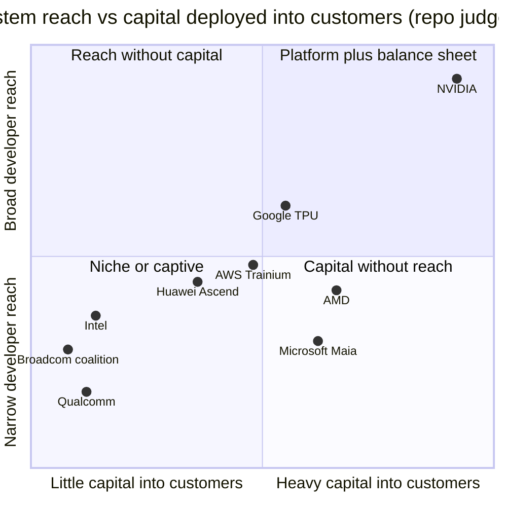
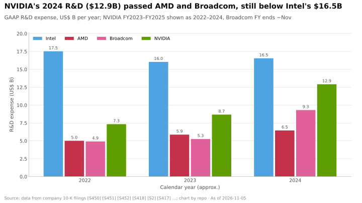

# Ecosystem, go-to-market and capital: Competition

Layer 13 · Ecosystem, go-to-market and capital · ~11 min read · Last verified: 2026-11-05

## ⚡ The Executive Take

- **The contest is over who funds, trains and sells to buyers, not over chips.** NVIDIA brings ~6M [CUDA](../../glossary.md#cuda) developers, >$30B of [sovereign AI](../../glossary.md#sovereign-ai) revenue in FY2026 and $48.6B of [free cash flow](../../glossary.md#free-cash-flow) in a single quarter [[S528]](../../sources/bibliography.md#s528)[[S90071]](../../sources/bibliography.md#s90071)[[S403]](../../sources/bibliography.md#s403).
- **Capital firepower is lopsided.** NVIDIA held ~$57B of cash and debt securities in July 2026, more than AMD ($15.8B), Broadcom ($24.0B) and Qualcomm ($7.7B) combined [[S13500]](../../sources/bibliography.md#s13500)[[S13501]](../../sources/bibliography.md#s13501)[[S2516]](../../sources/bibliography.md#s2516)[[S13503]](../../sources/bibliography.md#s13503).
- **AMD pays with equity instead of cash.** OpenAI holds a [warrant](../../glossary.md#warrant) for up to 160M AMD shares that vests as it deploys 1 GW to 6 GW of AMD GPUs [[S13506]](../../sources/bibliography.md#s13506); 🟡 AMD also plans up to $5B in Anthropic with 2 GW of Helios [[S9538]](../../sources/bibliography.md#s9538).
- **Broadcom wins without paying.** OpenAI's 10 GW custom-accelerator programme carries no disclosed vendor capital [[S174]](../../sources/bibliography.md#s174), and Broadcom's AI revenue reached $16.7B in its August 2026 quarter, ~19% of NVIDIA's Data Center revenue [[S2516]](../../sources/bibliography.md#s2516)[[S405]](../../sources/bibliography.md#s405).
- **[Q5 · Strongest challenger]** The [hyperscaler](../../glossary.md#hyperscaler) and Broadcom-led custom-[ASIC](../../glossary.md#asic) coalitions: NVIDIA holds 10 of OpenAI's 26 announced gigawatts and ~39% across four big buyers.
- **NVIDIA's weakness: money buys allocation, not exclusivity.** OpenAI and Anthropic took NVIDIA equity and still signed with AMD, Broadcom and Google [[S13506]](../../sources/bibliography.md#s13506)[[S174]](../../sources/bibliography.md#s174)[[S655]](../../sources/bibliography.md#s655).

![Stacked horizontal bar chart of announced compute programmes in gigawatts. OpenAI 26 GW: NVIDIA 10 (September 2025 letter of intent, since restructured), Broadcom custom accelerators 10 and AMD 6. Anthropic 4 GW: AMD Helios up to 2 (with an up-to-$5B AMD investment), NVIDIA up to 1 and Google TPUs over 1 GW in 2026 (a further multi-GW TPU expansion from 2027 is unquantified). HUMAIN: NVIDIA up to 0.5 GW, AMD 0.5 GW and Qualcomm 0.2 GW. xAI: about 1 GW on NVIDIA (company claim, contested). NVIDIA's share across these programmes is about 39%.](../../assets/charts/13-gw-pipeline-by-supplier.svg)

## How the ecosystem contest is scored

Think of a platform as a city: developers are residents, start-up programmes schools, sovereign deals treaties and capital the roads. Better buildings (chips) do not help if nobody lives there. We score developer reach, start-up programme, sovereign deals, capital firepower and channel breadth ([OEMs](../../glossary.md#oem), clouds, [global systems integrators](../../glossary.md#gsi)).

| Rival | Developer reach | Start-up programme | Sovereign deals | Capital firepower | Channel breadth |
|---|---|---|---|---|---|
| Google (TPU) | 🟦 [JAX](../../glossary.md#jax)/[XLA](../../glossary.md#xla) in its cloud | 🟩 up to $350k credits | 🟥 few national deals | 🟦 equity in Anthropic | 🟥 mostly Google Cloud |
| AWS (Trainium) | 🟦 Neuron SDK | 🟩 Activate credits | 🟦 sells regions, not chips | 🟦 Anthropic, Rainier | 🟥 AWS only |
| Microsoft (Maia) | 🟦 Maia internal only | 🟩 ~$150k Founders Hub | 🟦 sovereign cloud | 🟦 $5B Anthropic, >$60B neocloud deals | 🟥 Azure only |
| Broadcom coalition | 🟦 customer's own stack | 🟥 none | 🟥 none | 🟥 no vendor capital | 🟦 4–5 giant buyers |
| AMD | 🟥 [ROCm](../../glossary.md#rocm) far smaller | 🟥 no Inception-scale programme found | 🟥 HUMAIN 500 MW | 🟦 warrants and stakes | 🟨 same OEMs |
| Intel | 🟥 oneAPI niche | 🟥 none found | 🟥 none | 🟥 raised ~$23B itself | 🟨 x86 OEM breadth |
| Huawei | 🟦 [CANN](../../glossary.md#cann) open-sourced | 🟦 30k dev boards a year | 🟦 China-first | 🟦 state-aligned | 🟦 China only |
| Qualcomm | 🟦 Modular stack (closed Jul 2026) | 🟥 none at this scale | 🟥 HUMAIN 200 MW | 🟥 $7.7B cash, net debt | 🟦 Meta, HUMAIN |

Verdict = rival vs NVIDIA (🟩 rival leads · 🟨 parity · 🟥 rival behind · 🟦 different approach). Repo judgement 🔴 from [[S13519]](../../sources/bibliography.md#s13519)[[S13520]](../../sources/bibliography.md#s13520)[[S90034]](../../sources/bibliography.md#s90034)[[S90075]](../../sources/bibliography.md#s90075)[[S12526]](../../sources/bibliography.md#s12526)[[S174]](../../sources/bibliography.md#s174)[[S9518]](../../sources/bibliography.md#s9518)[[S13517]](../../sources/bibliography.md#s13517)[[S13532]](../../sources/bibliography.md#s13532)[[S13521]](../../sources/bibliography.md#s13521)[[S13523]](../../sources/bibliography.md#s13523)[[S9511]](../../sources/bibliography.md#s9511)[[S90030]](../../sources/bibliography.md#s90030)[[S13503]](../../sources/bibliography.md#s13503).

> [!TIP]
> **Worked example — what a $350,000 start-up credit buys.** At $2.99 (Lambda list) to $6.88 (AWS p5 list) per H100-hour [[S395]](../../sources/bibliography.md#s395)[[S392]](../../sources/bibliography.md#s392), Google's top AI tier of $350,000 [[S13519]](../../sources/bibliography.md#s13519) buys ~51,000–117,000 GPU-hours: 6–13 H100s for a year. Enough to fine-tune a product, not to pre-train a frontier model. Credits win the *first* workload; NVIDIA routes start-ups to partner clouds through [DGX Cloud Lepton](../../glossary.md#dgx-cloud-lepton) instead [[S12529]](../../sources/bibliography.md#s12529).

🔧 Under the hood: why cash and warrants are not equivalent

A cash stake (NVIDIA's ~$30B into OpenAI [[S90015]](../../sources/bibliography.md#s90015)[[S13526]](../../sources/bibliography.md#s13526)) is paid from today's free cash flow and becomes an illiquid private asset. A warrant (AMD's 160M shares at $0.01) costs no cash; it gains value only if the issuer's stock rises, and existing shareholders pay through [dilution](../../glossary.md#dilution). A customer warrant is typically booked as a reduction of revenue as tranches become probable (🔴 repo reading of standard practice), while NVIDIA's stakes sit on the balance sheet with gains and losses in other income [[S90072]](../../sources/bibliography.md#s90072).

## Challenger by challenger

### Hyperscalers and the Broadcom-led custom-ASIC coalition: the strongest challenger

**What they have.** Google supplies Anthropic with up to 1M TPUs (>1 GW in 2026) plus a multi-gigawatt block from 2027, rents Ironwood to Meta and places TPUs in customer data centres [[S90026]](../../sources/bibliography.md#s90026)[[S655]](../../sources/bibliography.md#s655)[[S90025]](../../sources/bibliography.md#s90025)[[S90027]](../../sources/bibliography.md#s90027). AWS built Project Rainier on ~500k Trainium2 chips; Microsoft plans multi-gigawatt Maia deployments from 2027 [[S90034]](../../sources/bibliography.md#s90034)[[S90045]](../../sources/bibliography.md#s90045). Broadcom also co-develops OpenAI's 10 GW programme (H2 2026 to 2029) [[S174]](../../sources/bibliography.md#s174).

**Best argument.** It owns the demand: a hyperscaler is cloud, chip designer and investor at once, so it can fund a lab (Microsoft up to $5B in Anthropic [[S90075]](../../sources/bibliography.md#s90075)), rent it capacity and steer it to [captive silicon](../../glossary.md#captive-silicon), without paying for allocation.

**How much the gap has closed.** Broadcom's AI revenue rose from ~11–14% of NVIDIA's Data Center revenue (2024 to early 2026) to ~19% in its August 2026 quarter, with $21.7B guided next [[S2516]](../../sources/bibliography.md#s2516).

> [!TIP]
> **Worked example — the price of neutrality at OpenAI.** OpenAI announced 26 GW: NVIDIA 10, Broadcom 10, AMD 6 [[S467]](../../sources/bibliography.md#s467)[[S174]](../../sources/bibliography.md#s174)[[S13506]](../../sources/bibliography.md#s13506). NVIDIA's 2025 letter of intent offered ~$10B per GW, later replaced by ~$30B of equity without milestones [[S90016]](../../sources/bibliography.md#s90016)[[S90017]](../../sources/bibliography.md#s90017). Broadcom offered nothing and won as much. Capital keeps NVIDIA in the room; a buyer big enough to design its own chip does so anyway.

### AMD: the capital-for-capacity counter-model

**What AMD has.** The OpenAI deal pairs 6 GW of Instinct deployments (first 1 GW of MI450 in H2 2026) with a warrant for up to 160M shares at $0.01 that vests against deployment, share-price and technical milestones; one report ties the last tranche to a $600 share price [[S13506]](../../sources/bibliography.md#s13506)[[S13507]](../../sources/bibliography.md#s13507). AMD bought ZT Systems ($4.9B) for its rack-design team and sold the factories to Sanmina [[S8527]](../../sources/bibliography.md#s8527)[[S5527]](../../sources/bibliography.md#s5527). It added Silo AI (~$665M), Brium, Untether AI's team and MK1, and drew 2,000+ developers to Advancing AI 2026 🟡 [[S9506]](../../sources/bibliography.md#s9506)[[S9507]](../../sources/bibliography.md#s9507)[[S9509]](../../sources/bibliography.md#s9509)[[S9519]](../../sources/bibliography.md#s9519).

**Best argument.** A [capital-for-capacity](../../glossary.md#capital-for-capacity) deal paid in stock lets a $15.8B balance sheet [[S13501]](../../sources/bibliography.md#s13501) compete with NVIDIA's cash and ties the customer to AMD's success. **Gap:** AMD now has 6 GW at OpenAI (NVIDIA 10) and 🟡 2 GW at Anthropic (NVIDIA 1) [[S13506]](../../sources/bibliography.md#s13506)[[S9538]](../../sources/bibliography.md#s9538), but remains far behind on developers ([layer 09](../09-cuda-and-system-software/competition.md)).

![Horizontal bar chart of vendor capital per gigawatt of compute a customer commits to: AMD's warrant for 160 million shares is worth about $16B per GW to OpenAI if AMD reaches the reported $600 share-price hurdle, or ~$5.3B per GW at an illustrative $200; NVIDIA's pledges were about $10B per GW for Anthropic (up to $10B, 1 GW) and for OpenAI's superseded letter of intent ($100B, 10 GW); AMD's up-to-$5B Anthropic stake ~$2.5B per GW (2 GW); NVIDIA's xAI stake ~$2B per GW, Poolside ~$0.5B and CoreWeave ~$0.47B; Broadcom's 10 GW OpenAI programme carries no disclosed vendor capital. NVIDIA's 2026 $30B OpenAI equity has no GW tie.](../../assets/charts/13-capital-per-gigawatt.svg)

> [!TIP]
> **Worked example — the AMD warrant's cost.** 160M shares × $600 = $96B if every tranche vests at the reported hurdle, i.e. $16B per GW over 6 GW (repo calculation) [[S13507]](../../sources/bibliography.md#s13507). At an illustrative $200 it is $32B. AMD pays in dilution (up to roughly a tenth of the company, Est.), not cash, and only if deployments happen.

### Intel, Huawei and Qualcomm

**Intel** has the widest [x86](../../glossary.md#x86) OEM channel but needed ~$23B of outside capital, including NVIDIA's $5B for ~4%; its foundry hinges on two prospective 14A customers deciding from H2 2026 🟡 [[S13532]](../../sources/bibliography.md#s13532)[[S4009]](../../sources/bibliography.md#s4009)[[S13531]](../../sources/bibliography.md#s13531). **Huawei** open-sourced CANN by end-2025, funds 30,000 development boards and 1,500 [PFLOPS](../../glossary.md#flops) of developer compute a year, and says external developers are 61% of the CANN community 🟡; no absolute count is published [[S13521]](../../sources/bibliography.md#s13521)[[S13523]](../../sources/bibliography.md#s13523)[[S9524]](../../sources/bibliography.md#s9524). **Qualcomm (public information only)** has AI200 (2026) and AI250 (2027) racks, a 200 MW HUMAIN plan, the C1000 CPU with Meta as first customer (H2 2028) and AI300 (2028); it closed the all-stock Modular purchase (~$3.9B reported) on 2026-07-29 and Alphawave in December 2025 [[S90028]](../../sources/bibliography.md#s90028)[[S90030]](../../sources/bibliography.md#s90030)[[S90058]](../../sources/bibliography.md#s90058)[[S90060]](../../sources/bibliography.md#s90060)[[S9511]](../../sources/bibliography.md#s9511)[[S90057]](../../sources/bibliography.md#s90057)[[S4513]](../../sources/bibliography.md#s4513).

> [!NOTE]
> **🐂 Bull view.** Only NVIDIA is developer platform, sovereign partner and financier at once; one quarter of its free cash flow exceeds the peers' combined cash, and its financing platforms target >$500B of third-party capital for its customers [[S403]](../../sources/bibliography.md#s403)[[S12528]](../../sources/bibliography.md#s12528).

> [!WARNING]
> **🐻 Bear view.** The biggest buyers take NVIDIA's money and multi-source anyway: custom silicon holds 10 GW at OpenAI, AMD a growing share of Anthropic, and Broadcom's AI revenue equals ~19% of NVIDIA's Data Center revenue [[S174]](../../sources/bibliography.md#s174)[[S9538]](../../sources/bibliography.md#s9538)[[S2516]](../../sources/bibliography.md#s2516). Each stake also invites [circular-financing](../../glossary.md#circular-financing) and antitrust questions ([roadmap](roadmap.md)).

**[Q5 · Strongest challenger]** The hyperscaler-plus-Broadcom coalition. It controls demand, the start-up on-ramp and its own silicon, so it need not buy allocation. The gap narrowed from ~11% to ~19% of NVIDIA's Data Center revenue in about two years [[S2516]](../../sources/bibliography.md#s2516). AMD's warrant model is the most creative counter to NVIDIA's cash and has 8 GW of frontier-lab programmes on paper 🟡 [[S13506]](../../sources/bibliography.md#s13506)[[S9538]](../../sources/bibliography.md#s9538).

## 🎯 Corp Dev Lens

1. OpenAI chose Broadcom at $0 per GW and NVIDIA at ~$10B per GW. How much of a buyer's decision is capital, and how much is design control?
2. AMD paid with equity, NVIDIA with cash. Which structure suits a capital-constrained entrant, and which milestones protect its shareholders?
3. Hyperscaler credits win the first workload. Could a [neocloud](../../glossary.md#neocloud) or sovereign-cloud partner stand in for a start-up programme a chip vendor cannot fund alone, and could a portable stack (CANN, Modular) make that programme hardware-neutral?

## 📚 Sources

<!-- Auto-generated from the [S…] citations on this page by `make build`. Edit sources/registry/*.csv, not this list. -->

- [**S174**](../../sources/bibliography.md#s174) OpenAI, *OpenAI and Broadcom announce strategic collaboration to deploy 10 gigawatts of OpenAI-designed AI accelerators*, 2025-10-13. [Link](https://openai.com/index/openai-and-broadcom-announce-strategic-collaboration/)
- [**S392**](../../sources/bibliography.md#s392) AWS, *AWS announces up to 45% price reduction for Amazon EC2 NVIDIA GPU-accelerated instances (P4, P5)*, 2025-06. [Link](https://aws.amazon.com/about-aws/whats-new/2025/06/pricing-usage-model-ec2-instances-nvidia-gpus/)
- [**S395**](../../sources/bibliography.md#s395) Lambda, *Lambda GPU cloud pricing*, 2025. [Link](https://lambda.ai/pricing)
- [**S403**](../../sources/bibliography.md#s403) NVIDIA Corporation via SEC EDGAR, *NVIDIA Announces Financial Results for First Quarter Fiscal 2027 (Form 8-K exhibit 99.1)*, 2026-05-20. [Link](https://www.sec.gov/Archives/edgar/data/0001045810/000104581026000051/q1fy27pr.htm)
- [**S405**](../../sources/bibliography.md#s405) NVIDIA Corporation via SEC EDGAR, *NVIDIA Announces Financial Results for Second Quarter Fiscal 2027 (Form 8-K exhibit 99.1)*, 2026-08-26. [Link](https://www.sec.gov/Archives/edgar/data/0001045810/000104581026000073/q2fy27pr.htm)
- [**S467**](../../sources/bibliography.md#s467) NVIDIA Newsroom, *OpenAI and NVIDIA Announce Strategic Partnership to Deploy 10 Gigawatts of NVIDIA Systems*, 2025-09-22. [Link](https://nvidianews.nvidia.com/news/openai-and-nvidia-announce-strategic-partnership-to-deploy-10gw-of-nvidia-systems)
- [**S528**](../../sources/bibliography.md#s528) NVIDIA Developer Forums, *20 Years of CUDA: Honoring the Architects of the Accelerated Age*, 2026-03. [Link](https://forums.developer.nvidia.com/t/20-years-of-cuda-honoring-the-architects-of-the-accelerated-age/364654)
- [**S655**](../../sources/bibliography.md#s655) Anthropic, *Anthropic expands partnership with Google and Broadcom for multiple gigawatts of next-generation compute*, 2026-04-06. [Link](https://www.anthropic.com/news/google-broadcom-partnership-compute)
- [**S2516**](../../sources/bibliography.md#s2516) Broadcom Inc. via SEC EDGAR, *Broadcom Inc. Announces Third Quarter Fiscal Year 2026 Financial Results (Form 8-K exhibit 99.1)*, 2026-09. [Link](https://www.sec.gov/Archives/edgar/data/0001730168/000173016826000076/avgo-08022026x8kxex99.htm)
- [**S4009**](../../sources/bibliography.md#s4009) SDxCentral, *Intel gets hands on Nvidia's $5B investment*, 2025-12. [Link](https://www.sdxcentral.com/news/intel-gets-hands-on-nvidias-5b-investment/)
- [**S4513**](../../sources/bibliography.md#s4513) I-Connect007, *Qualcomm completes acquisition of Alphawave Semi*, 2025-12-18. [Link](https://iconnect007.com/article/148161/qualcomm-completes-acquisition-of-alphawave-semi/148158/ein)
- [**S5527**](../../sources/bibliography.md#s5527) Evertiq, *AMD completes sale of ZT Systems manufacturing unit to Sanmina*, 2025-10-27. [Link](https://evertiq.com/design/2025-10-27-amd-completes-sale-of-zt-systems-manufacturing-unit-to-sanmina)
- [**S8527**](../../sources/bibliography.md#s8527) AMD Investor Relations, *AMD completes acquisition of ZT Systems*, 2025-03-31. [Link](https://ir.amd.com/news-events/press-releases/detail/1240/amd-completes-acquisition-of-zt-systems)
- [**S9506**](../../sources/bibliography.md#s9506) Converge Digest, *AMD completes $665 million acquisition of Silo AI*, 2024-08. [Link](https://convergedigest.com/amd-completes-665-million-acquisition-of-silo-ai/?amp=1)
- [**S9507**](../../sources/bibliography.md#s9507) DatacenterDynamics, *AMD extends acquisition run: brings software optimization firm Brium and staff from recently shuttered Untether AI into the fold*, 2025-06. [Link](https://www.datacenterdynamics.com/en/news/amd-extends-acquisition-run-brings-software-optimization-firm-brium-and-staff-from-recently-shuttered-untether-ai-into-the-fold/)
- [**S9509**](../../sources/bibliography.md#s9509) PrivSource (deal record), *AMD Acquires MK1*, 2025-11. [Link](https://www.privsource.com/acquisitions/deal/y3S4jb)
- [**S9511**](../../sources/bibliography.md#s9511) Nasdaq (Qualcomm press release), *Qualcomm Completes Acquisition of Modular*, 2026-07-29. [Link](https://www.nasdaq.com/press-release/qualcomm-completes-acquisition-modular-2026-07-29)
- [**S9518**](../../sources/bibliography.md#s9518) StorageNewsletter, *AMD AAI 2026: AMD ROCm.ai accelerates AI development across AMD platforms*, 2026-07-27. [Link](https://storagenewsletter.com/2026/07/27/amd-aai-2026-amd-rocm-ai-accelerates-ai-development-across-amd-platforms)
- [**S9519**](../../sources/bibliography.md#s9519) Blockchain.news, *AMD's Advancing AI 2026 draws 2,000+ developers; launches ROCm.ai*, 2026-07. [Link](https://blockchain.news/news/amd-advancing-ai-2026-rocm-ai-launch)
- [**S9524**](../../sources/bibliography.md#s9524) TrendForce, *Huawei open-sources CANN toolkit for Ascend AI GPUs; taking aim at Nvidia's CUDA*, 2025-08-07. [Link](https://www.trendforce.com/news/2025/08/07/news-huawei-open-sources-cann-toolkit-for-ascend-ai-gpus-taking-aim-at-nvidias-cuda/)
- [**S9538**](../../sources/bibliography.md#s9538) The Next Web, *AMD is investing $5 billion in Anthropic and deploying 2 gigawatts of Helios GPUs to run Claude*, 2026. [Link](https://thenextweb.com/news/amd-anthropic-5-billion-investment-2gw-helios-mi450)
- [**S12526**](../../sources/bibliography.md#s12526) Introl, *Microsoft's $60B neocloud bet: buying time in the AI capacity crisis*, 2025-12. [Link](https://introl.com/blog/microsoft-60-billion-neocloud-spending-2025)
- [**S12528**](../../sources/bibliography.md#s12528) NVIDIA Newsroom, *NVIDIA Partners With Apollo, BlackRock, Blackstone, Brookfield, Goldman Sachs and KKR to Establish AI Compute Infrastructure Financing Platforms to Mobilize Over $500 Billion of Third-Party Capital*, 2026-08-10. [Link](https://nvidianews.nvidia.com/news/nvidia-partners-with-apollo-blackrock-blackstone-brookfield-goldman-sachs-and-kkr-to-establish-ai-compute-infrastructure-financing-platforms-to-mobilize-over-500-billion-of-third-party-capital)
- [**S12529**](../../sources/bibliography.md#s12529) NVIDIA Technical Blog, *Introducing NVIDIA DGX Cloud Lepton: a unified AI platform built for developers*, 2025-05. [Link](https://developer.nvidia.com/blog/introducing-nvidia-dgx-cloud-lepton-a-unified-ai-platform-built-for-developers)
- [**S13500**](../../sources/bibliography.md#s13500) Securities.io, *Nvidia board adds $150 billion to share repurchase program*, 2026-08. [Link](https://www.securities.io/nvidia-board-adds-150-billion-to-share-repurchase-program/)
- [**S13501**](../../sources/bibliography.md#s13501) Advanced Micro Devices via SEC EDGAR, *AMD Q3 2026 earnings slides (Form 8-K exhibit)*, 2026-11. [Link](https://www.sec.gov/Archives/edgar/data/0000002488/000000248826000188/amdq32026earningsslidesf.htm)
- [**S13503**](../../sources/bibliography.md#s13503) Qualcomm via SEC EDGAR, *Qualcomm Form 10-K for fiscal year ended September 27, 2026*, 2026-11. [Link](https://www.sec.gov/Archives/edgar/data/0000804328/000080432826000128/qcom-20260927.htm)
- [**S13506**](../../sources/bibliography.md#s13506) Tom's Hardware, *OpenAI signs 6 GW AMD GPU deal*, 2025-10-06. [Link](https://www.tomshardware.com/pc-components/gpus/openai-signs-6gw-amd-gpu-deal)
- [**S13507**](../../sources/bibliography.md#s13507) The Motley Fool, *AMD pays a high price for blockbuster OpenAI deal*, 2025-10-07. [Link](https://www.fool.com/investing/2025/10/07/amd-pays-a-high-price-for-blockbuster-openai-deal)
- [**S13517**](../../sources/bibliography.md#s13517) Futuriom, *NVIDIA and AMD score AI hub deals in Saudi Arabia*, 2025-05. [Link](https://www.futuriom.com/articles/news/nvidia-amd-score-deals-for-the-saudi-ai-hub/2025/05)
- [**S13519**](../../sources/bibliography.md#s13519) Google Cloud, *Google for Startups Cloud Program*, 2026. [Link](https://cloud.google.com/startup)
- [**S13520**](../../sources/bibliography.md#s13520) Fin.ai, *Startup programs compared 2026: AWS, Google, Microsoft*, 2026. [Link](https://fin.ai/learn/startup-credit-programs)
- [**S13521**](../../sources/bibliography.md#s13521) Huawei, *Huawei announces open-sourcing of CANN and Ascend ecosystem investments (HUAWEI CONNECT 2025)*, 2025-09. [Link](https://www.huawei.com/br/news/2025/9/hc-shengten-opensource)
- [**S13523**](../../sources/bibliography.md#s13523) Emerce (Industry Wire), *Huawei industry release on the Ascend/CANN open-source community (Dutch)*, 2026-09-23. [Link](https://www.emerce.nl/?p=7100764)
- [**S13526**](../../sources/bibliography.md#s13526) Storyboard18, *Nvidia CEO Jensen Huang hints no further investments in OpenAI, Anthropic*, 2026. [Link](https://www.storyboard18.com/brand-makers/nvidia-ceo-jensen-huang-hints-no-further-investments-in-openai-anthropic-heres-why-91280.htm)
- [**S13531**](../../sources/bibliography.md#s13531) Tom's Hardware, *Intel says it has two prospective customers for 14A and expects commitments in the second half of 2026*, 2026. [Link](https://www.tomshardware.com/tech-industry/semiconductors/intel-says-it-has-two-prospective-customers-for-14a-expects-to-hear-about-commitments-in-second-half-of-2026)
- [**S13532**](../../sources/bibliography.md#s13532) Borecraft, *Intel's post-18A roadmap hangs on landing 14A foundry customers*, 2026-06-17. [Link](https://borecraft.com/2026/06/17/intels-post-18a-roadmap-hangs-on-landing-14a-foundry-customers/)
- [**S90015**](../../sources/bibliography.md#s90015) DatacenterDynamics, *Nvidia plans $30bn investment in upcoming OpenAI funding round*, 2026-02. [Link](https://www.datacenterdynamics.com/en/news/nvidia-plans-30bn-investment-in-upcoming-openai-funding-round/)
- [**S90016**](../../sources/bibliography.md#s90016) Storyboard18 (Financial Times), *Nvidia set for $30bn OpenAI deal as $100bn partnership shelved, report says (FT)*, 2026-02-20. [Link](https://www.storyboard18.com/digital/nvidia-set-for-30bn-openai-deal-as-100bn-partnership-shelved-report-says-90188.htm)
- [**S90017**](../../sources/bibliography.md#s90017) ITdaily, *Nvidia won't invest $100 billion in OpenAI after all*, 2026-02. [Link](https://itdaily.com/news/innovation/nvidia-openai-30-billion/)
- [**S90025**](../../sources/bibliography.md#s90025) SiliconANGLE, *Google and Meta reportedly strike new multibillion-dollar AI chip deal*, 2026-02-26. [Link](https://siliconangle.com/2026/02/26/google-meta-reportedly-strike-new-multibillion-dollar-ai-chip-deal/)
- [**S90026**](../../sources/bibliography.md#s90026) Maginative, *Anthropic secures 1M Google TPUs while keeping Amazon as primary training partner*, 2025-10. [Link](https://www.maginative.com/anthropic-secures-1m-google-tpus-while-keeping-amazon-as-primary-training-partner)
- [**S90027**](../../sources/bibliography.md#s90027) The Next Web, *Google is building a four-partner chip supply chain to challenge Nvidia in AI inference*, 2026. [Link](https://thenextweb.com/news/google-inference-chips-nvidia-challenge-supply-chain)
- [**S90028**](../../sources/bibliography.md#s90028) TechRepublic, *Qualcomm unveils AI chips to rival Nvidia, AMD*, 2025-10-27. [Link](https://techrepublic.com/article/news-qualcomm-unveils-ai-chips-to-rival-nvidia-amd)
- [**S90030**](../../sources/bibliography.md#s90030) Morningstar, *Qualcomm: Humain deal provides some AI upside*, 2025-10. [Link](https://www.morningstar.com/stocks/qualcomm-humain-deal-provides-some-ai-upside)
- [**S90034**](../../sources/bibliography.md#s90034) NAND Research, *AWS releases Trainium3, teases Trainium4*, 2025-12. [Link](https://nand-research.com/research-note-aws-releases-trainium3-teases-trainium4/4/)
- [**S90045**](../../sources/bibliography.md#s90045) Pulse 2.0, *Microsoft to expand Azure Maia AI infrastructure to multi-gigawatt deployments starting in 2027*, 2026-10. [Link](https://pulse2.com/microsoft-to-expand-azure-maia-ai-infrastructure/)
- [**S90057**](../../sources/bibliography.md#s90057) StorageReview, *Qualcomm unveils Dragonfly data center roadmap: C1000 CPU, AI300 accelerator and Modular acquisition*, 2026-06-24. [Link](https://www.storagereview.com/es/news/qualcomm-unveils-dragonfly-data-center-roadmap-c1000-cpu-ai300-accelerator-and-modular-acquisition)
- [**S90058**](../../sources/bibliography.md#s90058) Constellation Research, *Qualcomm outlines new CPU, AI accelerator roadmap, inks deal with Meta*, 2026-06-24. [Link](https://www.constellationr.com/insights/news/qualcomm-outlines-new-cpu-ai-accelerator-roadmap-inks-deal-meta)
- [**S90060**](../../sources/bibliography.md#s90060) Qualcomm, *Qualcomm Dragonfly AI300 (product page)*, 2026-06. [Link](https://www.qualcomm.com/data-center/products/qualcomm-dragonfly-ai300)
- [**S90071**](../../sources/bibliography.md#s90071) Crypto Briefing, *Nvidia CFO emphasizes neutral partnership with AI customers as company diversifies beyond hyperscalers*, 2026. [Link](https://cryptobriefing.com/nvidia-cfo-neutral-ai-partnership/)
- [**S90072**](../../sources/bibliography.md#s90072) Unite.AI, *Nvidia's AI sector equity stakes grow, SEC filing shows*, 2026-08. [Link](https://unite.ai/nvidias-ai-sector-equity-stakes-grow-sec-filing-shows)
- [**S90075**](../../sources/bibliography.md#s90075) Windows Central, *NVIDIA joins Microsoft's push on Claude — piling billions into Anthropic's future*, 2025-11-18. [Link](https://www.windowscentral.com/microsoft/nvidia-joins-microsofts-push-on-claude-piling-billions-into-anthropics-future)
