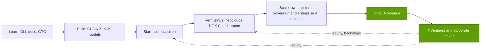

# Developer ecosystem and Inception

Layer 13 · Ecosystem, go-to-market and capital · ~8 min read · Last verified: 2026-11-05

## ⚡ The Executive Take

- **CUDA developers tripled, then the headline stopped moving.** NVIDIA counted 2M registered developers in 2020 and ~6M at GTC 2025, and cited the same ~6M at GTC 2026 [[S529]](../../sources/bibliography.md#s529)[[S536]](../../sources/bibliography.md#s536)[[S528]](../../sources/bibliography.md#s528).
- **[GTC](../../glossary.md#gtc) became an industry trade show.** Attendance went from ~1,500 at the first GTC (2009) [[S13024]](../../sources/bibliography.md#s13024) to ~25,000 in person plus ~300,000 online in 2025 [[S13020]](../../sources/bibliography.md#s13020), and >30,000 expected from >190 countries in 2026 [[S13533]](../../sources/bibliography.md#s13533), with 500+ sessions [[S13023]](../../sources/bibliography.md#s13023).
- **Training is a feeder, not a business.** The [Deep Learning Institute](../../glossary.md#deep-learning-institute) set out to train 100,000 developers in 2017 [[S13031]](../../sources/bibliography.md#s13031) and had trained >200,000 by ~2020, with >550 certified instructors [[S13032]](../../sources/bibliography.md#s13032).
- **Inception is free and broad:** 2,000 start-ups in 2017 [[S13027]](../../sources/bibliography.md#s13027), 8,500 in 2021 that had raised >$60B [[S13026]](../../sources/bibliography.md#s13026), ~10,000 by 2022 [[S531]](../../sources/bibliography.md#s531); secondary sources cite >22,000 in 2025 [[S13536]](../../sources/bibliography.md#s13536).
- **NVentures is the equity arm, and it sped up:** ~30 deals in 2025 against 1 in 2022; NVIDIA as a whole joined ~67 venture rounds in 2025 vs 54 in 2024 (PitchBook via press) 🟡 [[S13029]](../../sources/bibliography.md#s13029).
- **Bear case:** frameworks such as PyTorch, Triton and Mojo abstract CUDA away. Qualcomm closed its ~$3.9B all-stock Modular acquisition in July 2026 to own such a stack [[S9511]](../../sources/bibliography.md#s9511)[[S90057]](../../sources/bibliography.md#s90057).

## How the developer flywheel works

Think of CUDA as an operating system that happens to sell hardware. Developers pay NVIDIA nothing; they learn free tools and write code that assumes NVIDIA GPUs, and their employers buy or rent the GPUs. [Developer relations](../../glossary.md#developer-relations) is the machinery that keeps that habit forming: free SDKs and [CUDA-X](../../glossary.md#cuda-x) libraries, the NVIDIA Developer Program, DLI courses and GTC. Every model, kernel and tutorial written for CUDA raises the next buyer's switching cost (see [Layer 09](../09-cuda-and-system-software/index.md) and the [flywheel chapter](../../01-the-nvidia-flywheel.md)).

> [!TIP]
> **Worked example — what NVIDIA spends and earns per developer.** FY2026 R&D was $18.5B [[S401]](../../sources/bibliography.md#s401). Spread over ~6M registered developers [[S528]](../../sources/bibliography.md#s528), that is **~$3,100 of R&D per developer per year**. Data Center revenue was $193.7B [[S1]](../../sources/bibliography.md#s1), or **~$32,000 per developer**. Developers are a cost centre that buyers fund: a 10:1 ratio of revenue to R&D per head only works while those developers keep choosing CUDA.

**[Q3 · Generational progress]** The top of the funnel kept widening, but the developer count did not keep pace. From mid-2024 to early 2026 GTC in-person attendance rose from >16,000 to >30,000 expected (+~90%) [[S13021]](../../sources/bibliography.md#s13021)[[S13533]](../../sources/bibliography.md#s13533), while registered developers rose from 5.0M to ~6.0M (+20%) [[S534]](../../sources/bibliography.md#s534)[[S528]](../../sources/bibliography.md#s528). GTC's audience is shifting from programmers to buyers, partners and investors.

🔧 Under the hood: why the "6 million" stalls

- The figure counts sign-ups to NVIDIA's Developer Program, rounded for keynotes. Most PyTorch users never register, so the count measures a committed core, not usage.
- NVIDIA tracked 438,000 CUDA downloads a month in 2020 against ~39,000 new sign-ups [[S529]](../../sources/bibliography.md#s529), about one registration per eleven downloads.
- A flat count can mean saturation of the specialist pool, or a shift to higher-level tools that hide CUDA. Both readings appear in the [CUDA chapter](../09-cuda-and-system-software/index.md).

## GTC as a platform

GTC began as a GPU-computing conference and now works as NVIDIA's annual roadmap event, partner launch window and sales floor. The spring keynote sets the cadence the supply chain plans around. GTC 2026 introduced Vera Rubin NVL72, the Groq 3 LPX rack and the Kyber roadmap [[S90003]](../../sources/bibliography.md#s90003), released Dynamo 1.0 with named adopters such as CoreWeave, Perplexity and PayPal [[S90066]](../../sources/bibliography.md#s90066), and raised NVIDIA's demand claim from $500B to $1 trillion through 2027 [[S90001]](../../sources/bibliography.md#s90001). Partners time launches to the keynote; regional events extend the format, and GTC DC runs Nov 30 – Dec 3, 2026, after this repo's as-of date [[S90047]](../../sources/bibliography.md#s90047).

> [!TIP]
> **Worked example — one keynote, one demand number.** At GTC 2026 Huang sized Blackwell plus Vera Rubin demand at $1 trillion through 2027, double the $500B through 2026 cited a month earlier [[S90001]](../../sources/bibliography.md#s90001)[[S90002]](../../sources/bibliography.md#s90002). NVIDIA's FY2026 revenue was $215.9B [[S1]](../../sources/bibliography.md#s1). Even at the lower $500B, the keynote framed **~2.3 years of FY2026 revenue** as visible demand. That is why investors, suppliers and rivals all attend. Outlets differ on whether it meant orders or opportunity 🟡.

## Inception vs NVentures: two different instruments

[NVIDIA Inception](../../glossary.md#nvidia-inception) is a free membership program for start-ups. [NVentures](../../glossary.md#nventures) is NVIDIA's [corporate venture capital](../../glossary.md#corporate-venture-capital) arm, which buys equity. Larger strategic stakes, such as OpenAI or Intel, sit on NVIDIA's own balance sheet (see [Capital deployment](capital-deployment.md)).

| | NVIDIA Inception | NVentures | Corporate strategic stakes |
|---|---|---|---|
| What it gives | Technical help, DLI training, partner and investor introductions; free to join [[S13536]](../../sources/bibliography.md#s13536) | Minority equity in venture rounds | Large equity, backstops, licences |
| Scale | ~10,000 members (2022) [[S531]](../../sources/bibliography.md#s531); >22,000 cited for 2025 🟡 [[S13536]](../../sources/bibliography.md#s13536) | ~30 deals in 2025 vs 1 in 2022 🟡 [[S13029]](../../sources/bibliography.md#s13029) | ~$99B of stakes held (Jul 2026) [[S90073]](../../sources/bibliography.md#s90073) |
| What NVIDIA gets | Early design-ins and a feed of future GPU renters | Information rights and ecosystem influence | Anchored demand from labs, clouds and suppliers |

> [!TIP]
> **Worked example — what Inception is worth in GPU-hours.** In 2021 Inception's 8,500 members had raised >$60B [[S13026]](../../sources/bibliography.md#s13026), ~$7M each on average. If a typical start-up spends a quarter of its funding on compute 🔴, that is ~$1.8M. At Lambda's ~$2.99 per H100-hour list price [[S395]](../../sources/bibliography.md#s395), it buys **~590,000 GPU-hours, ~67 GPU-years**, almost all on NVIDIA. NVIDIA spends little on the program; members' investors pay for the hardware.

## How the ecosystem converts into demand

The funnel ends with renting before owning. DGX Cloud Lepton routes developers to partner GPU clouds instead of NVIDIA competing with them [[S90068]](../../sources/bibliography.md#s90068). NVIDIA holds stakes in many of those clouds: CoreWeave, Lambda, Nebius, Crusoe, Together AI and Nscale [[S481]](../../sources/bibliography.md#s481).

> [!TIP]
> **Worked example — CoreWeave as a converted ecosystem member.** NVIDIA's exposure to CoreWeave totals ~$8.65B: ~$0.1B pre-IPO 🟡, a $0.25B IPO anchor 🟡, $2B of equity in January 2026 and a $6.3B capacity backstop [[S481]](../../sources/bibliography.md#s481)[[S473]](../../sources/bibliography.md#s473)[[S472]](../../sources/bibliography.md#s472)[[S90067]](../../sources/bibliography.md#s90067). CoreWeave targets >5 GW by 2030 [[S472]](../../sources/bibliography.md#s472). At ~232 MW per 100,000 GB300 GPUs (see [Sovereign AI](sovereign-ai.md)), 5 GW is **~2.2M GPUs, roughly $120B of racks** at ~$55,000 per GPU [[S332]](../../sources/bibliography.md#s332). 🔴 Repo arithmetic.

## 🎯 Corp Dev Lens

1. **Who owns the developer when CUDA is hidden?** If PyTorch, Triton or Mojo become the interface, the owner of the compiler layer captures the habit. Qualcomm's Modular deal [[S9511]](../../sources/bibliography.md#s9511) is one public bet on this. How quickly can a portable stack reach "default" status in start-up programs?
2. **Start-up programs are cheap options.** Cloud credits are common across vendors (see [Competition](competition.md)). NVIDIA's edge is that members' hardware choice is already made. What would a rival need to offer before a start-up designs for a second architecture?
3. **GTC is a coordination device.** Suppliers, OEMs and clouds align launch calendars to it. Is there a neutral forum (OCP, MLCommons, UALink events) where a challenger coalition can coordinate as visibly?

## 📚 Sources

<!-- Auto-generated from the [S…] citations on this page by `make build`. Edit sources/registry/*.csv, not this list. -->

- [**S1**](../../sources/bibliography.md#s1) NVIDIA Corporation via SEC EDGAR, *NVIDIA Announces Financial Results for Fourth Quarter and Fiscal 2026 (Form 8-K exhibit 99.1)*, 2026-02-25. [Link](https://www.sec.gov/Archives/edgar/data/1045810/000104581026000019/q4fy26pr.htm)
- [**S332**](../../sources/bibliography.md#s332) Tiger Brokers (iTiger), *Morgan Stanley's BOM analysis of NVIDIA's Rubin: GPU share declines; PCB, MLCC and ABF substrate values soar*, 2026-05-20. [Link](https://www.itiger.com/news/1188068712)
- [**S395**](../../sources/bibliography.md#s395) Lambda, *Lambda GPU cloud pricing*, 2025. [Link](https://lambda.ai/pricing)
- [**S401**](../../sources/bibliography.md#s401) NVIDIA Corporation via SEC EDGAR, *NVIDIA Corporation Form 10-K for fiscal year ended January 25, 2026*, 2026-02-25. [Link](https://www.sec.gov/Archives/edgar/data/1045810/000104581026000021/nvda-20260125.htm)
- [**S472**](../../sources/bibliography.md#s472) CoreWeave Newsroom, *CoreWeave and NVIDIA expand partnership; NVIDIA invests $2B in CoreWeave Class A stock*, 2026-01-26. [Link](https://www.coreweave.com/news)
- [**S473**](../../sources/bibliography.md#s473) U.S. Securities and Exchange Commission (EDGAR), *CoreWeave Inc. Form 8-K / S-1 filings (EDGAR index): NVIDIA capacity agreement and IPO participation*, 2025-09-15. [Link](https://www.sec.gov/cgi-bin/browse-edgar?action=getcompany&CIK=0001769628&type=8-K&dateb=&owner=include&count=40)
- [**S481**](../../sources/bibliography.md#s481) Various (company announcements; Reuters, Bloomberg, TechCrunch), *Reporting on NVIDIA participation in AI-lab and neocloud funding rounds 2023–2025 (Inflection, Cohere, Hugging Face, Databricks, Mistral, xAI, Perplexity, Crusoe, Lambda, Nebius, Nscale, Together AI, Poolside, Reflection AI, Thinking Machines, Cursor)*, 2025-11. [Link](https://techcrunch.com/)
- [**S528**](../../sources/bibliography.md#s528) NVIDIA Developer Forums, *20 Years of CUDA: Honoring the Architects of the Accelerated Age*, 2026-03. [Link](https://forums.developer.nvidia.com/t/20-years-of-cuda-honoring-the-architects-of-the-accelerated-age/364654)
- [**S529**](../../sources/bibliography.md#s529) NVIDIA Blog (Will Ramey), *2 Million Registered Developers, Countless Breakthroughs*, 2020. [Link](https://blogs.nvidia.com/blog/2-million-registered-developers-breakthroughs/)
- [**S531**](../../sources/bibliography.md#s531) TechRadar, *Nvidia GTC 2022 keynote: all the latest news, releases and more (live blog)*, 2022-03-22. [Link](https://www.techradar.com/news/live/nvidia-gtc-2022-keynote-all-the-latest-news-and-annoucnements)
- [**S534**](../../sources/bibliography.md#s534) Yahoo Finance, *An era of robotics, 'AI factories' powered by Nvidia's chips and software is 'in our near future', CEO Jensen Huang says*, 2024-06-02. [Link](https://sg.finance.yahoo.com/news/era-robotics-ai-factories-powered-093000078.html)
- [**S536**](../../sources/bibliography.md#s536) TechRadar, *Nvidia GTC 2025 — all the news and updates from Jensen Huang's keynote (live blog)*, 2025-03-18. [Link](https://www.techradar.com/pro/live/nvidia-gtc-2025-all-the-news-and-updates-from-jensen-huang-keynote-as-it-happens)
- [**S9511**](../../sources/bibliography.md#s9511) Nasdaq (Qualcomm press release), *Qualcomm Completes Acquisition of Modular*, 2026-07-29. [Link](https://www.nasdaq.com/press-release/qualcomm-completes-acquisition-modular-2026-07-29)
- [**S13020**](../../sources/bibliography.md#s13020) Quiver Quantitative (NVIDIA press release), *NVIDIA Announces GTC 2025: Premier AI Conference Set for March 17-21 in San Jose*, 2025-01. [Link](https://www.quiverquant.com/news/NVIDIA+Announces+GTC+2025%3A+Premier+AI+Conference+Set+for+March+17-21+in+San+Jose)
- [**S13021**](../../sources/bibliography.md#s13021) GamesBeat, *NVIDIA GTC 2024 preview: AI marches forward (Greg Estes interview)*, 2024-03. [Link](https://gamesbeat.com/nvidia-gtc-2024-preview-ai-marches-forward-greg-estes)
- [**S13023**](../../sources/bibliography.md#s13023) NVIDIA, *GTC 2026 Schedule at a Glance*, 2026. [Link](https://www.nvidia.com/gtc/conference-schedule/)
- [**S13024**](../../sources/bibliography.md#s13024) Wikipedia, *Nvidia GTC*, 2026. [Link](https://en.wikipedia.org/wiki/Nvidia_GTC)
- [**S13026**](../../sources/bibliography.md#s13026) AI Business, *Nvidia's Inception program now boasts 8,500 AI startup members*, 2021-08. [Link](https://aibusiness.com/verticals/nvidia-s-inception-program-now-boasts-8-500-ai-startup-members)
- [**S13027**](../../sources/bibliography.md#s13027) MarketScreener (NVIDIA press release), *NVIDIA Inception Program for AI Startups Adds 2,000th Member*, 2017. [Link](https://in.marketscreener.com/quote/stock/NVIDIA-CORPORATION-10282/news/NVIDIA-Inception-Program-for-AI-Startups-Adds-2-000th-Member-25305924/)
- [**S13029**](../../sources/bibliography.md#s13029) TechCrunch, *Nvidia's AI empire: a look at its top startup investments*, 2026-01-02. [Link](https://techcrunch.com/2026/01/02/nvidias-ai-empire-a-look-at-its-top-startup-investments/)
- [**S13031**](../../sources/bibliography.md#s13031) NVIDIA Newsroom, *NVIDIA to Train 100,000 Developers on Deep Learning in 2017*, 2017-05. [Link](https://nvidianews.nvidia.com/news/nvidia-to-train-100-000-developers-on-deep-learning-in-2017)
- [**S13032**](../../sources/bibliography.md#s13032) NVIDIA Blog, *NVIDIA Deep Learning Institute Instructor-Led Training Now Available Remotely*, 2020-05-06. [Link](https://blogs.nvidia.com/blog/2020/05/06/dli-instructor-led-training-available-remotely)
- [**S13533**](../../sources/bibliography.md#s13533) ResearchPool (NVIDIA press release), *NVIDIA CEO Jensen Huang and global technology leaders to showcase age of AI at GTC 2026 (press release summary)*, 2026-02. [Link](https://app.researchpool.com/company/nvda-us67066g1040-nvidia-corp-e9VqYYGjs8/press/nvidia-corporation-nvda-nvidia-ceo-jensen-huang-and-global-technology-leaders-to-showcase-age-s9kKOjK0qb)
- [**S13536**](../../sources/bibliography.md#s13536) Techsoma, *Nvidia's free startup program just unlocked AI success for 22,000 companies*, 2025. [Link](https://techsoma.africa/nvidias-free-startup-program-just-unlocked-ai-success-for-22000-companies-heres-how-to-join/)
- [**S90001**](../../sources/bibliography.md#s90001) The Star (Reuters), *Nvidia bets on AI inference as chip revenue opportunity hits $1 trillion (Reuters)*, 2026-03-17. [Link](https://www.thestar.com.my/tech/tech-news/2026/03/17/nvidia-bets-on-ai-inference-as-chip-revenue-opportunity-hits-1-trillion)
- [**S90002**](../../sources/bibliography.md#s90002) MarketScreener, *Nvidia forecasts $1 trillion in orders for its AI systems by 2027*, 2026-03-16. [Link](https://www.marketscreener.com/news/nvidia-forecasts-1-trillion-in-orders-for-its-ai-systems-by-2027-ce7e5edad08eff27)
- [**S90003**](../../sources/bibliography.md#s90003) eWeek, *Everything Nvidia Just Announced at GTC 2026: 7 Chips, 5 Racks, 1 Giant Bet on Agentic AI*, 2026-03-17. [Link](https://www.eweek.com/news/nvidia-gtc-2026-ai-inference-vera-rubin-neuron/)
- [**S90047**](../../sources/bibliography.md#s90047) NVIDIA, *NVIDIA GTC DC 2026 (November 30 – December 3, 2026)*, 2026. [Link](https://www.nvidia.com/en-us/gtc-dc/topics/ai-policy/)
- [**S90057**](../../sources/bibliography.md#s90057) StorageReview, *Qualcomm unveils Dragonfly data center roadmap: C1000 CPU, AI300 accelerator and Modular acquisition*, 2026-06-24. [Link](https://www.storagereview.com/es/news/qualcomm-unveils-dragonfly-data-center-roadmap-c1000-cpu-ai300-accelerator-and-modular-acquisition)
- [**S90066**](../../sources/bibliography.md#s90066) HPCwire (NVIDIA press release), *NVIDIA enters production with Dynamo, the broadly adopted inference operating system for AI factories*, 2026-03-17. [Link](https://www.hpcwire.com/aiwire/tag/dynamo-1-0/)
- [**S90067**](../../sources/bibliography.md#s90067) DatacenterDynamics, *Nvidia to purchase unsold compute capacity from CoreWeave for $6.3bn*, 2025-09-16. [Link](https://www.datacenterdynamics.com/en/news/nvidia-to-purchase-unsold-compute-capacity-from-coreweave-for-63bn/)
- [**S90068**](../../sources/bibliography.md#s90068) Tom's Hardware, *Nvidia steps back from DGX Cloud — stops trying to compete with AWS and Azure*, 2025-09. [Link](https://www.tomshardware.com/tech-industry/nvidia-steps-back-from-dgx-cloud)
- [**S90073**](../../sources/bibliography.md#s90073) FourWeekMBA, *NVIDIA's $99 billion investment portfolio and the circular financing loop at the center of AI*, 2026-08. [Link](https://fourweekmba.com/ai-nvidia-99-billion-investment-portfolio-circular-financing-ai/)
