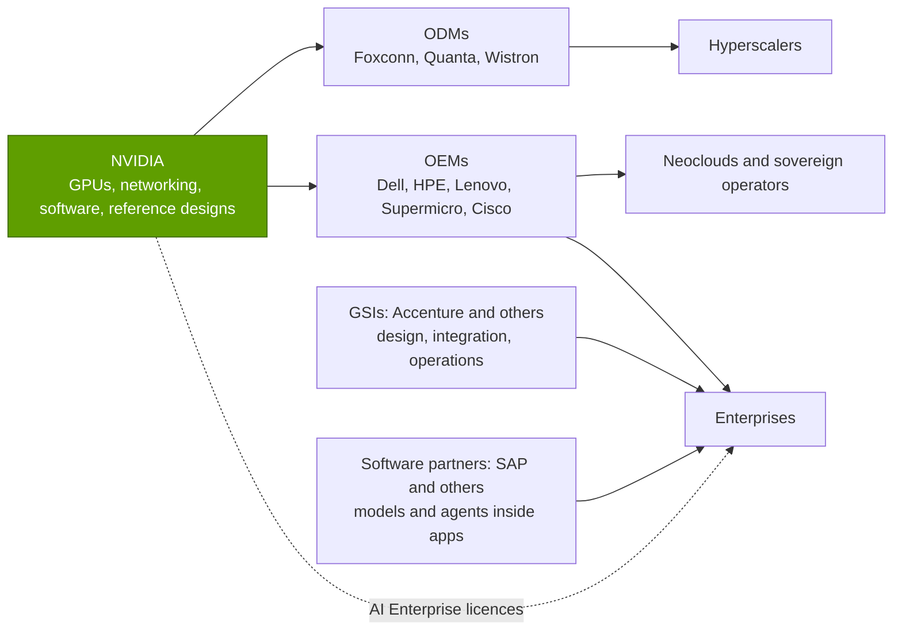

# Enterprise go-to-market: OEMs, GSIs and software partners

Layer 13 · Ecosystem, go-to-market and capital · ~7 min read · Last verified: 2026-11-05

## ⚡ The Executive Take

- **NVIDIA sells through a few large hands.** Its direct customers are mostly [OEMs](../../glossary.md#oem) and [ODMs](../../glossary.md#odm) that build systems for others. Three of them took 44% of H1 FY2027 revenue, and one took 16% of Q2 FY2027 [[S90069]](../../sources/bibliography.md#s90069).
- **Non-hyperscale demand is nearly half of Data Center.** AI clouds, industrial and enterprise buyers were ~$37B (49%) in Q1 FY2027 and ~$40.3B (45%) in Q2 FY2027 [[S403]](../../sources/bibliography.md#s403)[[S406]](../../sources/bibliography.md#s406).
- **The enterprise offer is a packaged "AI factory".** [RTX PRO servers](../../glossary.md#rtx-pro-server) ship from Cisco, Dell, HPE, Lenovo and Supermicro [[S13034]](../../sources/bibliography.md#s13034). A validated design bundles them with Spectrum-X networking, BlueField DPUs, certified storage and [NVIDIA AI Enterprise](../../glossary.md#nvidia-ai-enterprise) software [[S13033]](../../sources/bibliography.md#s13033)[[S13034]](../../sources/bibliography.md#s13034).
- **Integrators supply the people.** Accenture formed an NVIDIA business group with ~30,000 professionals to be trained on NVIDIA's stack [[S13042]](../../sources/bibliography.md#s13042).
- **Software is small but priced per GPU.** AI Enterprise lists at $4,500 per GPU per year or $1 per GPU-hour in the cloud [[S13036]](../../sources/bibliography.md#s13036). Software and services passed a ~$1B annualised run rate in Q4 FY2024 [[S13037]](../../sources/bibliography.md#s13037).
- **Leverage:** NVIDIA ran FY2026's ~$216B of revenue on ~$4.6B of SG&A, about 2% of sales (Est.) [[S401]](../../sources/bibliography.md#s401)[[S1]](../../sources/bibliography.md#s1). [Channel partners](../../glossary.md#channel-partner) carry most of the selling cost.

## The channel: who actually buys from NVIDIA

NVIDIA rarely ships a finished server to the end user. ODMs such as Foxconn, Quanta and Wistron assemble racks for hyperscalers; branded OEMs (Dell, HPE, Lenovo, Supermicro, Cisco) sell to enterprises, governments and neoclouds with their own service and financing; [global systems integrators](../../glossary.md#gsi) run the projects; software vendors embed NVIDIA models in their products. In the 10-Q these show up as a handful of large [direct customers](../../glossary.md#indirect-customer), while NVIDIA estimates the clouds and labs behind them separately [[S90069]](../../sources/bibliography.md#s90069).

> [!TIP]
> **Worked example — how much one partner carries.** One direct customer was 16% of Q2 FY2027 revenue [[S90069]](../../sources/bibliography.md#s90069). On $96.2B [[S405]](../../sources/bibliography.md#s405), that is **~$15.4B in a single quarter** flowing through one assembler. Across H1 FY2027, three direct customers were 16%, 15% and 13% [[S90069]](../../sources/bibliography.md#s90069). NVIDIA spent ~$4.6B on all SG&A in FY2026 (Est.) [[S401]](../../sources/bibliography.md#s401). The channel is how a company with an operating margin around 60% [[S1]](../../sources/bibliography.md#s1) avoids building a large direct sales force.

**[Q2 · Metrics that matter]** For the enterprise channel, track the ACIE share of Data Center revenue (45% in Q2 FY2027) [[S406]](../../sources/bibliography.md#s406), the number of OEMs and integrators with certified NVIDIA designs, and software attach (licensed GPUs ÷ installed GPUs).

## The "AI factory for every enterprise" pitch

Most enterprises cannot host a 132 kW liquid-cooled GB300 NVL72 rack [[S337]](../../sources/bibliography.md#s337). NVIDIA's answer (Computex, May 2025) was RTX PRO servers: x86 servers with RTX PRO 6000 Blackwell Server Edition GPUs that fit ordinary halls [[S13033]](../../sources/bibliography.md#s13033). In August 2025 Cisco, Dell, HPE, Lenovo and Supermicro added 2U, two-GPU versions [[S13035]](../../sources/bibliography.md#s13035). The *Enterprise AI Factory* validated design specifies the full bill: servers, Spectrum-X Ethernet, BlueField DPUs, certified storage and AI Enterprise software. Cadence, Foxconn and Lilly were named as early adopters [[S13034]](../../sources/bibliography.md#s13034). Deutsche Telekom's Munich industrial AI cloud mixes DGX B200 and RTX PRO servers, with SAP supplying the software stack [[S13013]](../../sources/bibliography.md#s13013)[[S13014]](../../sources/bibliography.md#s13014).

> [!TIP]
> **Worked example — software attach is still thin.** At the $4,500 per GPU per year list price [[S13036]](../../sources/bibliography.md#s13036), the ~$1B software and services run rate of early 2024 [[S13037]](../../sources/bibliography.md#s13037) equals **~220,000 GPU-licences** if it were all AI Enterprise at list. That is a small fraction of the millions of data-centre GPUs shipped since 2023. Huang's later figure of ~$2,000 per GPU per year to run NVIDIA's agent software is not a price list 🟡 [[S13038]](../../sources/bibliography.md#s13038). At that rate, every million licensed GPUs would add **~$2B a year** of recurring revenue 🔴.

🔧 Under the hood: what is in the Enterprise AI Factory validated design

- **Compute:** RTX PRO servers in several configurations from the five OEMs plus Advantech, ASUS and others [[S13034]](../../sources/bibliography.md#s13034).
- **Network and DPU:** Spectrum-X Ethernet and BlueField DPUs (see [Layer 06](../06-scale-out-scale-across-networking/index.md) and [Layer 07](../07-dpu-supernic-storage-security/index.md)).
- **Storage:** NVIDIA-certified storage partners.
- **Software:** AI Enterprise, which includes NVIDIA's [NIM](../../glossary.md#nim) inference microservices and frameworks, licensed per GPU [[S13036]](../../sources/bibliography.md#s13036).
- **Why it matters:** a [reference architecture](../../glossary.md#reference-architecture) lets an OEM quote a complete, supported system without NVIDIA's own engineers on site.

## GSIs and software partners: borrowed sales forces

| Channel role | Examples (public) | What the partner gets | What NVIDIA gets |
|---|---|---|---|
| OEM | Dell, HPE, Lenovo, Supermicro, Cisco [[S13034]](../../sources/bibliography.md#s13034) | Hardware margin, services, financing | Enterprise reach and support capacity |
| ODM | Foxconn, Quanta, Wistron | Volume; ODM margin ~2.7% of a GB300 rack (Est.) [[S332]](../../sources/bibliography.md#s332) | Fast rack-scale manufacturing |
| GSI | Accenture (~30,000 trained staff) [[S13042]](../../sources/bibliography.md#s13042) | Consulting and managed-service revenue | Project design, change management, pull-through |
| Software partner | SAP in Deutsche Telekom's cloud [[S13014]](../../sources/bibliography.md#s13014) | AI features inside existing apps | Inference demand inside enterprise workflows |
| Telco / neocloud | Deutsche Telekom, Nscale, Yotta [[S13014]](../../sources/bibliography.md#s13014)[[S13010]](../../sources/bibliography.md#s13010)[[S13017]](../../sources/bibliography.md#s13017) | Sovereign or regional cloud revenue | Capacity close to regulated customers |

Deloitte, Infosys and TCS also market NVIDIA practices, and ServiceNow and Salesforce have announced NVIDIA-based agent features; their scale was not re-verified here.

> [!TIP]
> **Worked example — what an integrator practice is worth.** Accenture reported ~$3B of generative-AI bookings in its fiscal year when it announced the NVIDIA business group [[S13042]](../../sources/bibliography.md#s13042). Spread over the ~30,000 professionals the group targeted, that is **~$100,000 of bookings per trained person**. NVIDIA pays none of those salaries but gains the projects that specify its hardware 🔴.

> [!WARNING]
> **🐻 Bear view:** a partner-led channel is a partner-owned customer. OEMs also sell AMD Helios racks [[S90020]](../../sources/bibliography.md#s90020) and integrators follow client demand, so if enterprise inference moves to cheaper, portable hardware, the channel can switch quickly.

## 🎯 Corp Dev Lens

1. **The OEM is the swing vote in enterprise.** Dell, HPE, Lenovo, Supermicro and Cisco decide which accelerators appear in a standard quote. What would it take, in validated designs and support, for a challenger's inference card to sit in the same catalogue?
2. **Integrator capacity is scarce.** Accenture alone committed ~30,000 people to NVIDIA's stack [[S13042]](../../sources/bibliography.md#s13042). Is there value in co-funding a dedicated practice at a mid-sized integrator rather than competing for attention at the largest?
3. **Per-GPU software pricing creates a template.** AI Enterprise at $4,500 per GPU per year [[S13036]](../../sources/bibliography.md#s13036) shows enterprises will pay for supported software. Could a portable stack such as Qualcomm's Modular [[S9511]](../../sources/bibliography.md#s9511) be priced the same way across hardware?

## 📚 Sources

<!-- Auto-generated from the [S…] citations on this page by `make build`. Edit sources/registry/*.csv, not this list. -->

- [**S1**](../../sources/bibliography.md#s1) NVIDIA Corporation via SEC EDGAR, *NVIDIA Announces Financial Results for Fourth Quarter and Fiscal 2026 (Form 8-K exhibit 99.1)*, 2026-02-25. [Link](https://www.sec.gov/Archives/edgar/data/1045810/000104581026000019/q4fy26pr.htm)
- [**S332**](../../sources/bibliography.md#s332) Tiger Brokers (iTiger), *Morgan Stanley's BOM analysis of NVIDIA's Rubin: GPU share declines; PCB, MLCC and ABF substrate values soar*, 2026-05-20. [Link](https://www.itiger.com/news/1188068712)
- [**S337**](../../sources/bibliography.md#s337) Spheron, *NVIDIA GB300 (rental and specifications)*, 2026. [Link](https://spheron.network/gpu-rental/gb300/)
- [**S401**](../../sources/bibliography.md#s401) NVIDIA Corporation via SEC EDGAR, *NVIDIA Corporation Form 10-K for fiscal year ended January 25, 2026*, 2026-02-25. [Link](https://www.sec.gov/Archives/edgar/data/1045810/000104581026000021/nvda-20260125.htm)
- [**S403**](../../sources/bibliography.md#s403) NVIDIA Corporation via SEC EDGAR, *NVIDIA Announces Financial Results for First Quarter Fiscal 2027 (Form 8-K exhibit 99.1)*, 2026-05-20. [Link](https://www.sec.gov/Archives/edgar/data/0001045810/000104581026000051/q1fy27pr.htm)
- [**S405**](../../sources/bibliography.md#s405) NVIDIA Corporation via SEC EDGAR, *NVIDIA Announces Financial Results for Second Quarter Fiscal 2027 (Form 8-K exhibit 99.1)*, 2026-08-26. [Link](https://www.sec.gov/Archives/edgar/data/0001045810/000104581026000073/q2fy27pr.htm)
- [**S406**](../../sources/bibliography.md#s406) NVIDIA Corporation (Colette Kress), *CFO Commentary on Second Quarter Fiscal 2027 Results*, 2026-08-26. [Link](https://s201.q4cdn.com/141608511/files/doc_financials/2027/Q227/Q2FY27-CFO-Commentary.pdf)
- [**S9511**](../../sources/bibliography.md#s9511) Nasdaq (Qualcomm press release), *Qualcomm Completes Acquisition of Modular*, 2026-07-29. [Link](https://www.nasdaq.com/press-release/qualcomm-completes-acquisition-modular-2026-07-29)
- [**S13010**](../../sources/bibliography.md#s13010) ITPro, *UK to host largest European GPU cluster under GBP 11 billion Nvidia investment plans*, 2025-09. [Link](https://www.itpro.com/infrastructure/uk-to-host-largest-european-gpu-cluster-under-gbp11-billion-nvidia-investment-plans)
- [**S13013**](../../sources/bibliography.md#s13013) DatacenterDynamics, *Deutsche Telekom launches NVIDIA-powered AI factory in Munich's Tucherpark*, 2026. [Link](https://www.datacenterdynamics.com/en/news/deutsche-telekom-launches-nvidia-powered-ai-factory-in-munichs-tucherpark/)
- [**S13014**](../../sources/bibliography.md#s13014) heise online, *Telekom data center with 10,000 Nvidia GPUs being built in Munich*, 2025-11-04. [Link](https://heise.de/-11056781)
- [**S13017**](../../sources/bibliography.md#s13017) Computer Weekly, *Nvidia backs India's sovereign AI push with gigawatt-scale infrastructure*, 2026-02. [Link](https://www.computerweekly.com/news/366639266/Nvidia-backs-Indias-sovereign-AI-push-with-gigawatt-scale-infrastructure)
- [**S13033**](../../sources/bibliography.md#s13033) NVIDIA Newsroom, *NVIDIA RTX PRO Servers Speed Trillion-Dollar Enterprise IT Industry Transition to AI Factories*, 2025-05-19. [Link](https://nvidianews.nvidia.com/news/nvidia-rtx-pro-blackwell-servers-speed-trillion-dollar-enterprise-it-industry-transition-to-ai-factories)
- [**S13034**](../../sources/bibliography.md#s13034) NVIDIA Investor Relations, *Industry Leaders Transform Enterprise Data Centers for the AI Era With NVIDIA RTX PRO Servers*, 2025-08-11. [Link](https://investor.nvidia.com/news/press-release-details/2025/Industry-Leaders-Transform-Enterprise-Data-Centers-for-the-AI-Era-With-NVIDIA-RTX-PRO-Servers/default.aspx)
- [**S13035**](../../sources/bibliography.md#s13035) Tom's Hardware, *Nvidia unveils 2U RTX Pro 6000 servers at SIGGRAPH*, 2025-08. [Link](https://www.tomshardware.com/pc-components/gpus/nvidia-unveils-2u-rtx-pro-6000-servers-at-siggraph-double-shot-of-blackwell-power-comes-to-smaller-rackmount-form-factors)
- [**S13036**](../../sources/bibliography.md#s13036) The Register, *Nvidia's software empire (NVIDIA AI Enterprise pricing)*, 2024-08-06. [Link](https://www.theregister.com/2024/08/06/nvidia_software_empire/)
- [**S13037**](../../sources/bibliography.md#s13037) The Motley Fool, *Here's Nvidia's newest $1 billion business*, 2024-02-28. [Link](https://www.fool.com/investing/2024/02/28/heres-nvidias-newest-1-billion-business-and-ceo-je)
- [**S13038**](../../sources/bibliography.md#s13038) TechSpot, *Nvidia's AI chips already make billions; now Jensen Huang wants $2000 per GPU in annual software fees*, 2026. [Link](https://www.techspot.com/news/114333-nvidia-ai-chips-already-make-billions-now-jensen.html)
- [**S13042**](../../sources/bibliography.md#s13042) HPCwire / AIwire, *Accenture and NVIDIA strengthen partnership to accelerate deployment and scaling of AI-driven solutions*, 2024-10-09. [Link](https://www.hpcwire.com/aiwire/2024/10/09/accenture-and-nvidia-strengthen-partnership-to-accelerate-deployment-and-scaling-of-ai-driven-solutions/)
- [**S90020**](../../sources/bibliography.md#s90020) Shacknews, *AMD Helios AI rack system on track for initial shipments in Q3 2026*, 2026. [Link](https://www.shacknews.com/article/150249/amd-helios-ai-system-shipping-q3-2026)
- [**S90069**](../../sources/bibliography.md#s90069) NVIDIA Corporation via SEC EDGAR, *NVIDIA Form 10-Q for the quarter ended July 26, 2026 (Q2 FY2027)*, 2026-08. [Link](https://www.sec.gov/Archives/edgar/data/0001045810/000104581026000075/nvda-20260726.htm)
