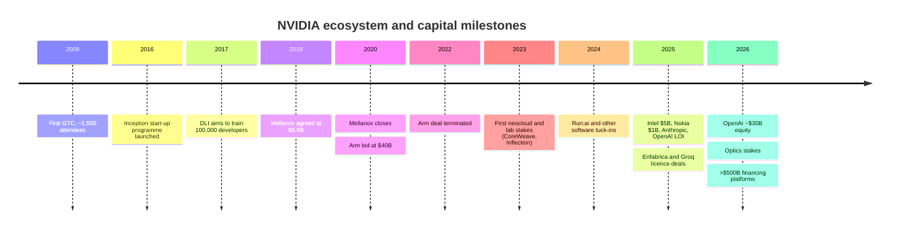
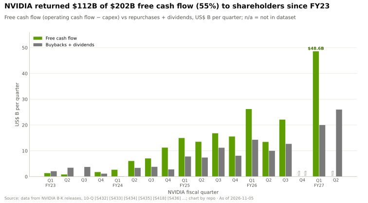

# Ecosystem, go-to-market and capital: History and how NVIDIA built it

Layer 13 · Ecosystem, go-to-market and capital · ~12 min read · Last verified: 2026-11-05

## ⚡ The Executive Take

- **Four eras.** A developer platform (GTC from 2009, Inception from 2016, a 2017 target of 100,000 developers trained), platform M&A (Mellanox, the failed Arm bid), software tuck-ins, and from 2023 a wave of stakes, licences and financing deals [[S13024]](../../sources/bibliography.md#s13024)[[S13027]](../../sources/bibliography.md#s13027)[[S13031]](../../sources/bibliography.md#s13031)[[S464]](../../sources/bibliography.md#s464)[[S465]](../../sources/bibliography.md#s465).
- **The deal mix flipped.** Since 2023 only 18% of NVIDIA's 66 logged deals were acquisitions; 47 were stakes in customers, suppliers and partners (chart below).
- **In August 2026 NVIDIA moved to other people's money:** MOUs with six asset managers to mobilise >$500B of third-party capital for its customers [[S12528]](../../sources/bibliography.md#s12528).
- **[Q4 · Source of advantage]** Cash flow plus ecosystem centrality: $48.6B of free cash flow in Q1 FY2027 [[S403]](../../sources/bibliography.md#s403), ~6M CUDA developers and > $30B of FY2026 sovereign AI revenue (see [competition](competition.md)) let NVIDIA act as developer platform, financier and sovereign partner at once, a combination no rival matches today (🔴 repo judgement).
- **[Q6 · Replication cost]** The capital is replicable by hyperscalers within a few years; the developer and partner ecosystem is a 7–10-year, tens-of-billions project (🔴 repo estimate).

![Stacked bar chart of NVIDIA deals by year and structure, 2019 to 2026. In 2019-2022 acquisitions (Mellanox, Cumulus, Bright, the failed Arm bid) were 100% of 7 deals. In 2023-2026 there were 70 deals and acquisitions fell to 19%: 33 stakes in customers such as OpenAI, Anthropic, xAI, CoreWeave and Mistral, 15 stakes in suppliers and partners such as Intel, Nokia, Synopsys, Marvell, Lumentum and Coherent, 2 licence-plus-acquihire deals (Enfabrica, Groq) and 7 capacity or financing commitments including the CoreWeave backstop and the 2026 financing platforms.](../../assets/charts/13-deal-structure-mix.svg)

## Timeline: from developer conference to capital allocator

| Date | Decision | Why it mattered | Source |
|---|---|---|---|
| 2009 | First GTC (~1,500 attendees) | A developer conference that became the launch stage; 30,000+ expected in 2026 | [[S13024]](../../sources/bibliography.md#s13024)[[S13533]](../../sources/bibliography.md#s13533) |
| 2016 | Inception programme | Free tooling and investor access, no cash; 2,000 members within ~18 months | [[S13027]](../../sources/bibliography.md#s13027) |
| 2019-03 | Mellanox, $6.9B cash | Became the networking business (>$31B revenue in FY2026) | [[S464]](../../sources/bibliography.md#s464)[[S402]](../../sources/bibliography.md#s402) |
| 2020-09 → 2022-02 | Arm, $40B bid, abandoned | Regulators blocked it; NVIDIA expensed a $1.36B prepayment and kept a 20-year licence | [[S465]](../../sources/bibliography.md#s465)[[S466]](../../sources/bibliography.md#s466)[[S418]](../../sources/bibliography.md#s418) |
| 2023 | First neocloud and lab stakes | Seeded GPU buyers outside the hyperscalers | [[S481]](../../sources/bibliography.md#s481) |
| 2024-04 → 2024-12 | Run:ai, ~$700M | Closed only after an EU review: tuck-ins now draw scrutiny | [[S476]](../../sources/bibliography.md#s476) |
| 2025-09 | CoreWeave capacity [backstop](../../glossary.md#capacity-backstop) to 2032 | Up to $6.3B of unsold capacity becomes NVIDIA's risk | [[S90067]](../../sources/bibliography.md#s90067) |
| 2025-09 → 12 | Intel $5B (~4%) | A partner stake that also secures a US supplier | [[S468]](../../sources/bibliography.md#s468)[[S4009]](../../sources/bibliography.md#s4009) |
| 2025-09 → 12 | Enfabrica, Groq [licence plus acquihire](../../glossary.md#licence-plus-acquihire) | Teams and IP without a merger filing | [[S475]](../../sources/bibliography.md#s475)[[S474]](../../sources/bibliography.md#s474) |
| 2025-09 → 2026-02 | OpenAI: up-to-$100B LOI → ~$30B equity | From milestone-linked to plain equity | [[S467]](../../sources/bibliography.md#s467)[[S90015]](../../sources/bibliography.md#s90015)[[S13526]](../../sources/bibliography.md#s13526) |
| 2026-03 | Lumentum and Coherent $2B each | Equity plus purchase commitments for laser capacity | [[S13529]](../../sources/bibliography.md#s13529) |
| 2026-08 | Financing platforms (>$500B target) | Moves balance-sheet risk to third parties | [[S12528]](../../sources/bibliography.md#s12528) |

🔧 Under the hood: why the stakes started in 2023

Before 2023 NVIDIA's cash went to buybacks and two platform bids; buybacks paused in FY2020–FY2022 during the Mellanox and Arm period [[S2]](../../sources/bibliography.md#s2). After ChatGPT, allocation itself became the scarce good, and a small stake in a GPU-only cloud such as CoreWeave (~$100M in 2023 [[S481]](../../sources/bibliography.md#s481)) created a fast-growing buyer with no chip of its own. PitchBook counts ~67 NVIDIA venture rounds in 2025, up from 54 in 2024 [[S13029]](../../sources/bibliography.md#s13029).

> [!TIP]
> **Worked example — Mellanox paid for itself in weeks of sales.** NVIDIA paid $6.9B in 2019 [[S464]](../../sources/bibliography.md#s464); networking revenue was ~$31.4B in FY2026 and an estimated $17.5B in Q2 FY2027 alone [[S402]](../../sources/bibliography.md#s402)[[S408]](../../sources/bibliography.md#s408). At the Q2 run-rate the purchase price equals about five weeks of networking sales.

## [Q4 · Source of advantage] Cash flow plus ecosystem centrality

**The mechanism** is a loop: developers build on CUDA, so buyers ask for NVIDIA; buyers pay ~75% [gross margins](../../glossary.md#gross-margin) [[S405]](../../sources/bibliography.md#s405); the cash funds stakes, backstops and sovereign partnerships that create more CUDA buyers. Rivals can copy a step, not the loop at this scale.

> [!TIP]
> **Worked example — what a $30B stake costs each company.** NVIDIA's ~$30B OpenAI stake equals 62% of one quarter's free cash flow ($48.6B in Q1 FY2027) [[S90015]](../../sources/bibliography.md#s90015)[[S403]](../../sources/bibliography.md#s403). For AMD the same cheque would be ~1.9× its entire $15.8B cash pile; for Qualcomm ~3.9× its $7.7B [[S13501]](../../sources/bibliography.md#s13501)[[S13503]](../../sources/bibliography.md#s13503). That is why AMD paid OpenAI in warrants, and why "matching NVIDIA's capital" is not a realistic strategy for the peers ([competition](competition.md)).

## [Q6 · Replication cost] Time, dollars and talent

| Component | What NVIDIA has | Time to replicate | Dollars (🔴 repo estimate) | Talent |
|---|---|---|---|---|
| Developer base | ~6M CUDA developers, 20 years of CUDA [[S528]](../../sources/bibliography.md#s528) | 7–10 years | ~$1–2B a year | thousands of engineers |
| Start-up programme | Inception, ~22,000 members (secondary estimate) [[S13536]](../../sources/bibliography.md#s13536) | 3–5 years | modest; needs a cloud partner | VC-facing team |
| Events and training | GTC 30,000+ attendees; DLI >200,000 trained by 2020 [[S13533]](../../sources/bibliography.md#s13533)[[S13032]](../../sources/bibliography.md#s13032) | 3–5 years | <$1B | content and instructors |
| Capital portfolio | ~$99B of equity holdings (Jul 2026) [[S90073]](../../sources/bibliography.md#s90073) | 1–2 years if cash exists | $50–100B balance sheet | small deal team |
| Sovereign relationships | >$30B sovereign revenue FY2026 [[S90071]](../../sources/bibliography.md#s90071) | 3–5 years | partner-financed | policy and local partners |

**Answer.** A hyperscaler could match the capital within one to two years (Alphabet, Amazon and Meta plan ~$505B of 2026 capex [[S460]](../../sources/bibliography.md#s460)[[S461]](../../sources/bibliography.md#s461)[[S462]](../../sources/bibliography.md#s462)) but cannot be neutral, because its cloud competes with the labs it funds. AMD substitutes equity for cash. Qualcomm, with $7.7B of cash and net debt [[S13503]](../../sources/bibliography.md#s13503), would need partners to supply the capital and a portable layer such as Modular to shorten the developer gap [[S9511]](../../sources/bibliography.md#s9511). Overall 🔴 estimate: **7–10 years, $50–100B of deployable capital plus ~$10–20B of cumulative ecosystem spend, and thousands of developer-facing engineers**, with the developer base, not the money, as the binding constraint.

> [!TIP]
> **Worked example — the developer gap in years.** CUDA took ~20 years to reach ~6M developers [[S528]](../../sources/bibliography.md#s528), an average of ~300,000 a year. A rival adding developers at that same average pace from a small base would need ~7 years to reach 2M (🔴 repo arithmetic); money can speed events and credits, not habits.

## Counterfactuals: what if NVIDIA hadn't…

- 🔴 **…lost Arm?** NVIDIA would own the instruction set it licenses to rival CPU designers, which is why regulators objected [[S466]](../../sources/bibliography.md#s466). It has since captured much of the benefit without ownership: its Grace and Vera CPUs run Arm [[S100]](../../sources/bibliography.md#s100), and [NVLink Fusion](../../glossary.md#nvlink-fusion) now plugs Arm Neoverse designs into NVIDIA racks [[S90036]](../../sources/bibliography.md#s90036). Owning Arm would have added neutrality problems on top of today's capital-neutrality questions.
- 🔴 **…invested in neoclouds?** Without stakes in CoreWeave and others, the hyperscalers would control nearly all rentable GPU capacity and could steer customers to TPU, Trainium and Maia. Regional [neoclouds](../../glossary.md#neocloud) grew >3× y/y in Q2 FY2027 [[S90071]](../../sources/bibliography.md#s90071); that buyer base is NVIDIA's hedge against captive silicon (see [layer 12](../12-orchestration-and-cloud-services/value-chain-and-corp-dev.md)).
- 🔴 **…bought Groq outright?** A $20B acquisition of an inference-chip rival would have faced a full [merger review](../../glossary.md#merger-review); Run:ai, at ~$700M, took eight months including an EU review [[S476]](../../sources/bibliography.md#s476). The licence structure closed in days but drew senators' questions instead [[S13511]](../../sources/bibliography.md#s13511).

> [!TIP]
> **Worked example — what the failed Arm bid cost.** The $40B price was mostly stock ($21.5B) plus $12B of cash [[S465]](../../sources/bibliography.md#s465); when it collapsed NVIDIA wrote off a $1.36B prepayment [[S418]](../../sources/bibliography.md#s418), under 1% of FY2026 revenue of $215.9B [[S1]](../../sources/bibliography.md#s1). The real cost was time: 17 months in review.

## 🎯 Corp Dev Lens

1. NVIDIA's capital advantage is cash flow, not cash. For a peer, which assets (sovereign partners, clouds, warrants) can substitute for a $48.6B quarter?
2. The developer base is the binding constraint in the replication estimate. Does acquiring a portable software layer (as Qualcomm did with Modular) cut the 7–10 years, or only the porting cost?
3. NVIDIA used platform M&A twice in a decade and succeeded once. What regulatory read-across does the Arm termination give any chip company considering a large horizontal deal?
4. Neocloud stakes created non-captive buyers. Which customer segments today lack a non-captive financier, and who could play that role?

## 📚 Sources

<!-- Auto-generated from the [S…] citations on this page by `make build`. Edit sources/registry/*.csv, not this list. -->

- [**S1**](../../sources/bibliography.md#s1) NVIDIA Corporation via SEC EDGAR, *NVIDIA Announces Financial Results for Fourth Quarter and Fiscal 2026 (Form 8-K exhibit 99.1)*, 2026-02-25. [Link](https://www.sec.gov/Archives/edgar/data/1045810/000104581026000019/q4fy26pr.htm)
- [**S2**](../../sources/bibliography.md#s2) U.S. Securities and Exchange Commission (EDGAR), *NVIDIA Corporation Form 10-K annual reports FY2020–FY2025 (filing index)*, 2025-02-26. [Link](https://www.sec.gov/cgi-bin/browse-edgar?action=getcompany&CIK=0001045810&type=10-K&dateb=&owner=include&count=40)
- [**S100**](../../sources/bibliography.md#s100) NVIDIA Technical Blog, *Inside the NVIDIA Vera Rubin Platform: Six New Chips, One AI Supercomputer*, 2026-01-05. [Link](https://developer.nvidia.com/blog/inside-the-nvidia-rubin-platform-six-new-chips-one-ai-supercomputer/)
- [**S402**](../../sources/bibliography.md#s402) NVIDIA Corporation via SEC EDGAR (Colette Kress), *CFO Commentary on Fourth Quarter and Fiscal 2026 Results (Form 8-K exhibit 99.2)*, 2026-02-25. [Link](https://www.sec.gov/Archives/edgar/data/1045810/000104581026000019/q4fy26cfocommentary.htm)
- [**S403**](../../sources/bibliography.md#s403) NVIDIA Corporation via SEC EDGAR, *NVIDIA Announces Financial Results for First Quarter Fiscal 2027 (Form 8-K exhibit 99.1)*, 2026-05-20. [Link](https://www.sec.gov/Archives/edgar/data/0001045810/000104581026000051/q1fy27pr.htm)
- [**S405**](../../sources/bibliography.md#s405) NVIDIA Corporation via SEC EDGAR, *NVIDIA Announces Financial Results for Second Quarter Fiscal 2027 (Form 8-K exhibit 99.1)*, 2026-08-26. [Link](https://www.sec.gov/Archives/edgar/data/0001045810/000104581026000073/q2fy27pr.htm)
- [**S408**](../../sources/bibliography.md#s408) NVIDIA Corporation, *NVIDIA Corp. (NVDA) Q2 Fiscal 2027 earnings call transcript (26 August 2026)*, 2026-08-26. [Link](https://s201.q4cdn.com/141608511/files/content_files/TRANSCRIPT_-NVIDIA-Corp-NVDA-US-Q2-2027-Earnings-Call-26-August-2026-5_00-PM-ET.pdf)
- [**S418**](../../sources/bibliography.md#s418) NVIDIA Corporation via SEC EDGAR, *NVIDIA Corporation Form 10-K for fiscal year ended January 29, 2023*, 2023-02-24. [Link](https://www.sec.gov/Archives/edgar/data/1045810/000104581023000017/nvda-20230129.htm)
- [**S460**](../../sources/bibliography.md#s460) Alphabet Investor Relations, *Alphabet Q4 and fiscal year 2025 results and 2026 capex outlook*, 2026-02. [Link](https://abc.xyz/investor/)
- [**S461**](../../sources/bibliography.md#s461) Amazon Investor Relations, *Amazon.com Q4 2025 results and 2026 capex commentary*, 2026-02. [Link](https://ir.aboutamazon.com/)
- [**S462**](../../sources/bibliography.md#s462) Meta Investor Relations, *Meta Q4 and full year 2025 results and 2026 capex outlook*, 2026-01. [Link](https://investor.atmeta.com/)
- [**S464**](../../sources/bibliography.md#s464) NVIDIA Newsroom, *NVIDIA to Acquire Mellanox for $6.9 Billion*, 2019-03-11. [Link](https://nvidianews.nvidia.com/news/nvidia-to-acquire-mellanox-for-6-9-billion)
- [**S465**](../../sources/bibliography.md#s465) NVIDIA Newsroom, *NVIDIA to Acquire Arm for $40 Billion, Creating World's Premier Computing Company for the Age of AI*, 2020-09-13. [Link](https://nvidianews.nvidia.com/news/nvidia-to-acquire-arm-for-40-billion-creating-worlds-premier-computing-company-for-the-age-of-ai)
- [**S466**](../../sources/bibliography.md#s466) NVIDIA Newsroom, *NVIDIA and SoftBank Group Announce Termination of NVIDIA's Acquisition of Arm Limited*, 2022-02-08. [Link](https://nvidianews.nvidia.com/news/nvidia-and-softbank-group-announce-termination-of-nvidias-acquisition-of-arm-limited)
- [**S467**](../../sources/bibliography.md#s467) NVIDIA Newsroom, *OpenAI and NVIDIA Announce Strategic Partnership to Deploy 10 Gigawatts of NVIDIA Systems*, 2025-09-22. [Link](https://nvidianews.nvidia.com/news/openai-and-nvidia-announce-strategic-partnership-to-deploy-10gw-of-nvidia-systems)
- [**S468**](../../sources/bibliography.md#s468) NVIDIA Newsroom, *NVIDIA and Intel to Develop AI Infrastructure and Personal Computing Products*, 2025-09-18. [Link](https://nvidianews.nvidia.com/news/nvidia-and-intel-to-develop-ai-infrastructure-and-personal-computing-products)
- [**S474**](../../sources/bibliography.md#s474) Groq Newsroom, *Groq and NVIDIA enter non-exclusive inference technology licensing agreement*, 2025-12-24. [Link](https://groq.com/newsroom)
- [**S475**](../../sources/bibliography.md#s475) CNBC, *Nvidia spends over $900 million on Enfabrica CEO, AI startup technology*, 2025-09-18. [Link](https://www.cnbc.com/technology/)
- [**S476**](../../sources/bibliography.md#s476) NVIDIA Blog, *NVIDIA to Acquire GPU Orchestration Software Provider Run:ai*, 2024-04-24. [Link](https://blogs.nvidia.com/blog/runai/)
- [**S481**](../../sources/bibliography.md#s481) Various (company announcements; Reuters, Bloomberg, TechCrunch), *Reporting on NVIDIA participation in AI-lab and neocloud funding rounds 2023–2025 (Inflection, Cohere, Hugging Face, Databricks, Mistral, xAI, Perplexity, Crusoe, Lambda, Nebius, Nscale, Together AI, Poolside, Reflection AI, Thinking Machines, Cursor)*, 2025-11. [Link](https://techcrunch.com/)
- [**S528**](../../sources/bibliography.md#s528) NVIDIA Developer Forums, *20 Years of CUDA: Honoring the Architects of the Accelerated Age*, 2026-03. [Link](https://forums.developer.nvidia.com/t/20-years-of-cuda-honoring-the-architects-of-the-accelerated-age/364654)
- [**S4009**](../../sources/bibliography.md#s4009) SDxCentral, *Intel gets hands on Nvidia's $5B investment*, 2025-12. [Link](https://www.sdxcentral.com/news/intel-gets-hands-on-nvidias-5b-investment/)
- [**S9511**](../../sources/bibliography.md#s9511) Nasdaq (Qualcomm press release), *Qualcomm Completes Acquisition of Modular*, 2026-07-29. [Link](https://www.nasdaq.com/press-release/qualcomm-completes-acquisition-modular-2026-07-29)
- [**S12528**](../../sources/bibliography.md#s12528) NVIDIA Newsroom, *NVIDIA Partners With Apollo, BlackRock, Blackstone, Brookfield, Goldman Sachs and KKR to Establish AI Compute Infrastructure Financing Platforms to Mobilize Over $500 Billion of Third-Party Capital*, 2026-08-10. [Link](https://nvidianews.nvidia.com/news/nvidia-partners-with-apollo-blackrock-blackstone-brookfield-goldman-sachs-and-kkr-to-establish-ai-compute-infrastructure-financing-platforms-to-mobilize-over-500-billion-of-third-party-capital)
- [**S13024**](../../sources/bibliography.md#s13024) Wikipedia, *Nvidia GTC*, 2026. [Link](https://en.wikipedia.org/wiki/Nvidia_GTC)
- [**S13027**](../../sources/bibliography.md#s13027) MarketScreener (NVIDIA press release), *NVIDIA Inception Program for AI Startups Adds 2,000th Member*, 2017. [Link](https://in.marketscreener.com/quote/stock/NVIDIA-CORPORATION-10282/news/NVIDIA-Inception-Program-for-AI-Startups-Adds-2-000th-Member-25305924/)
- [**S13029**](../../sources/bibliography.md#s13029) TechCrunch, *Nvidia's AI empire: a look at its top startup investments*, 2026-01-02. [Link](https://techcrunch.com/2026/01/02/nvidias-ai-empire-a-look-at-its-top-startup-investments/)
- [**S13031**](../../sources/bibliography.md#s13031) NVIDIA Newsroom, *NVIDIA to Train 100,000 Developers on Deep Learning in 2017*, 2017-05. [Link](https://nvidianews.nvidia.com/news/nvidia-to-train-100-000-developers-on-deep-learning-in-2017)
- [**S13032**](../../sources/bibliography.md#s13032) NVIDIA Blog, *NVIDIA Deep Learning Institute Instructor-Led Training Now Available Remotely*, 2020-05-06. [Link](https://blogs.nvidia.com/blog/2020/05/06/dli-instructor-led-training-available-remotely)
- [**S13501**](../../sources/bibliography.md#s13501) Advanced Micro Devices via SEC EDGAR, *AMD Q3 2026 earnings slides (Form 8-K exhibit)*, 2026-11. [Link](https://www.sec.gov/Archives/edgar/data/0000002488/000000248826000188/amdq32026earningsslidesf.htm)
- [**S13503**](../../sources/bibliography.md#s13503) Qualcomm via SEC EDGAR, *Qualcomm Form 10-K for fiscal year ended September 27, 2026*, 2026-11. [Link](https://www.sec.gov/Archives/edgar/data/0000804328/000080432826000128/qcom-20260927.htm)
- [**S13511**](../../sources/bibliography.md#s13511) Kavout, *Is Nvidia's Groq deal a masterstroke or an antitrust minefield?*, 2026. [Link](https://www.kavout.com/market-lens/is-nvidia-s-groq-deal-a-masterstroke-or-an-antitrust-minefield)
- [**S13526**](../../sources/bibliography.md#s13526) Storyboard18, *Nvidia CEO Jensen Huang hints no further investments in OpenAI, Anthropic*, 2026. [Link](https://www.storyboard18.com/brand-makers/nvidia-ceo-jensen-huang-hints-no-further-investments-in-openai-anthropic-heres-why-91280.htm)
- [**S13529**](../../sources/bibliography.md#s13529) Bloomberg Government, *Nvidia to invest $4 billion in data center optics companies*, 2026-03-02. [Link](https://news.bgov.com/artificial-intelligence/nvidia-to-invest-4-billion-in-data-center-optics-companies-1)
- [**S13533**](../../sources/bibliography.md#s13533) ResearchPool (NVIDIA press release), *NVIDIA CEO Jensen Huang and global technology leaders to showcase age of AI at GTC 2026 (press release summary)*, 2026-02. [Link](https://app.researchpool.com/company/nvda-us67066g1040-nvidia-corp-e9VqYYGjs8/press/nvidia-corporation-nvda-nvidia-ceo-jensen-huang-and-global-technology-leaders-to-showcase-age-s9kKOjK0qb)
- [**S13536**](../../sources/bibliography.md#s13536) Techsoma, *Nvidia's free startup program just unlocked AI success for 22,000 companies*, 2025. [Link](https://techsoma.africa/nvidias-free-startup-program-just-unlocked-ai-success-for-22000-companies-heres-how-to-join/)
- [**S90015**](../../sources/bibliography.md#s90015) DatacenterDynamics, *Nvidia plans $30bn investment in upcoming OpenAI funding round*, 2026-02. [Link](https://www.datacenterdynamics.com/en/news/nvidia-plans-30bn-investment-in-upcoming-openai-funding-round/)
- [**S90036**](../../sources/bibliography.md#s90036) Converge Digest, *Arm extends Neoverse with NVIDIA NVLink Fusion*, 2025-11. [Link](https://convergedigest.com/arm-extends-neoverse-with-nvidia-nvlink-fusion/)
- [**S90067**](../../sources/bibliography.md#s90067) DatacenterDynamics, *Nvidia to purchase unsold compute capacity from CoreWeave for $6.3bn*, 2025-09-16. [Link](https://www.datacenterdynamics.com/en/news/nvidia-to-purchase-unsold-compute-capacity-from-coreweave-for-63bn/)
- [**S90071**](../../sources/bibliography.md#s90071) Crypto Briefing, *Nvidia CFO emphasizes neutral partnership with AI customers as company diversifies beyond hyperscalers*, 2026. [Link](https://cryptobriefing.com/nvidia-cfo-neutral-ai-partnership/)
- [**S90073**](../../sources/bibliography.md#s90073) FourWeekMBA, *NVIDIA's $99 billion investment portfolio and the circular financing loop at the center of AI*, 2026-08. [Link](https://fourweekmba.com/ai-nvidia-99-billion-investment-portfolio-circular-financing-ai/)
