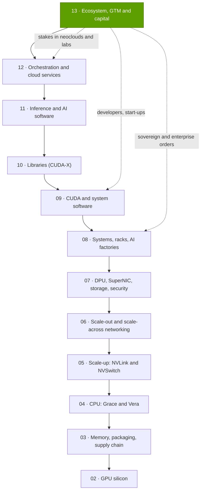
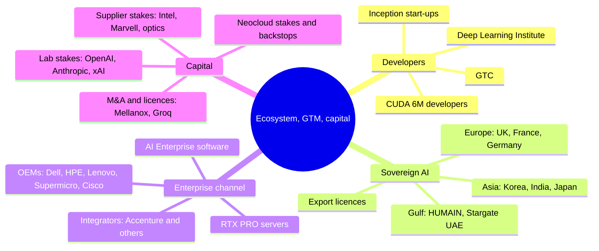

# Layer 13 — Ecosystem, go-to-market and capital

Layer 13 · top of the 12-layer stack · developers, start-ups, sovereign and enterprise channels, capital deployment · ~8 min read · Last verified: 2026-11-05

## ⚡ The Executive Take

- **This layer turns NVIDIA's technology into orders:** developers on [CUDA](../../glossary.md#cuda) (~6M, flat since GTC 2025 [[S536]](../../sources/bibliography.md#s536)[[S528]](../../sources/bibliography.md#s528)), start-ups, governments, enterprises and the capital that funds buyers.
- **The developer funnel keeps widening at the top:** GTC grew from ~1,500 attendees in 2009 to >30,000 expected in 2026 from >190 countries [[S13024]](../../sources/bibliography.md#s13024)[[S13533]](../../sources/bibliography.md#s13533); [NVIDIA Inception](../../glossary.md#nvidia-inception) reached ~10,000 start-ups by 2022 [[S531]](../../sources/bibliography.md#s531) and, per secondary sources, >22,000 by 2025 [[S13536]](../../sources/bibliography.md#s13536).
- **[Sovereign AI](../../glossary.md#sovereign-ai) is now a demand pillar:** > ~$30B of FY2026 revenue (+80%) [[S90071]](../../sources/bibliography.md#s90071), ~14% of $215.9B [[S1]](../../sources/bibliography.md#s1). Announced country deals name ~1.03M NVIDIA GPUs, led by HUMAIN (up to 600,000) and South Korea (260,000) [[S13003]](../../sources/bibliography.md#s13003)[[S13000]](../../sources/bibliography.md#s13000).
- **Half of Data Center demand arrives without a hyperscaler:** AI clouds, industrial and enterprise buyers were ~$40.3B, 45% of Q2 FY2027 Data Center revenue [[S406]](../../sources/bibliography.md#s406), reached through OEMs, integrators and [neoclouds](../../glossary.md#neocloud), not a large direct salesforce.
- **NVIDIA has become a capital allocator:** private stakes rose from $3.4B (Jan 2025) to $51.2B (Jul 2026) and all stakes to ~$99B [[S13043]](../../sources/bibliography.md#s13043)[[S90072]](../../sources/bibliography.md#s90072)[[S90073]](../../sources/bibliography.md#s90073), led by ~$30B in OpenAI [[S90015]](../../sources/bibliography.md#s90015) and up to $10B in Anthropic [[S90075]](../../sources/bibliography.md#s90075).
- **Weakness and bear case:** the loop is circular and concentrated. One direct customer was 16% of Q2 FY2027 revenue [[S90069]](../../sources/bibliography.md#s90069); H1 FY2027 net equity gains of $23.7B flatter earnings [[S90072]](../../sources/bibliography.md#s90072); sovereign GPU plans far exceed firm orders [[S13514]](../../sources/bibliography.md#s13514)[[S13516]](../../sources/bibliography.md#s13516).
- **Strongest challenger here:** rivals compete with capital and ecosystems too. AMD gave OpenAI a warrant for up to 160M shares tied to 6 GW [[S13506]](../../sources/bibliography.md#s13506); Google is supplying Anthropic with up to 1M TPUs [[S90026]](../../sources/bibliography.md#s90026); HUMAIN also signed AMD (500 MW) and Qualcomm (200 MW) [[S13517]](../../sources/bibliography.md#s13517)[[S90030]](../../sources/bibliography.md#s90030).

## What this layer does, and what breaks if it is weak

**[Q1 · Job & failure mode]** Layers 02–12 make an AI factory work; layer 13 decides who buys one, how fast and with whose money, through developer relations, sovereign deals, the enterprise channel and capital. If it weakens, supply is stranded when buyers cannot finance purchases, revenue concentrates in hyperscalers that build their own chips, and developers drift to portable stacks that lower switching costs in every layer below.

> [!TIP]
> **Worked example — how big is "sovereign" in hardware terms?** A 100,000-GPU GB300 factory costs ~$8.5B up front, of which NVIDIA invoices ~$5.3–6.1B (Est., see [Sovereign AI](sovereign-ai.md)). NVIDIA's > ~$30B of FY2026 sovereign revenue [[S90071]](../../sources/bibliography.md#s90071) is therefore **~5 such factories a year, ~525,000 GPUs**. The ~1.03M GPUs announced in country deals [[S13003]](../../sources/bibliography.md#s13003)[[S13000]](../../sources/bibliography.md#s13000)[[S13009]](../../sources/bibliography.md#s13009) equal roughly two years of that run rate. 🔴 Repo arithmetic.

**[Q2 · Metrics that matter]**

| Metric | Latest value | Why it matters |
|---|---|---|
| Non-hyperscale share of Data Center revenue | ~45% (Q2 FY2027) [[S406]](../../sources/bibliography.md#s406) | Diversification away from buyers who design their own chips |
| Sovereign revenue | > ~$30B, +80% (FY2026) [[S90071]](../../sources/bibliography.md#s90071) | A demand source that is political as well as economic |
| Largest direct customer | 16% of Q2 FY2027 revenue [[S90069]](../../sources/bibliography.md#s90069) | Concentration and bargaining-power risk |
| Equity stakes held | ~$99B (Jul 2026) [[S90073]](../../sources/bibliography.md#s90073) | Size of the circular-financing exposure |
| Registered CUDA developers | ~6M, flat since 2025 [[S528]](../../sources/bibliography.md#s528) | Leading indicator of software lock-in |

## Where this layer sits in the stack

## Layer map

## The eight questions at a glance

| # | Question | Short answer | Where answered |
|---|---|---|---|
| Q1 | What job does this layer do, and what breaks if it is weak? | Converts technology into financed demand; weakness strands supply and concentrates revenue | This page; [Developer ecosystem](developer-ecosystem-and-inception.md) |
| Q2 | What are the metrics that matter? | Non-hyperscale share, sovereign revenue, top-customer share, equity book, developers | This page; [Capital deployment](capital-deployment.md) |
| Q3 | How has NVIDIA's offering improved? | GTC ~20×, Inception 5× to 2022, deal dollars from ~$10B (all pre-2025) to ~$51B in 2025 | [Developer ecosystem](developer-ecosystem-and-inception.md); [Capital deployment](capital-deployment.md) |
| Q4 | Source of advantage? | Installed-base ecosystem plus a balance sheet rivals cannot match | [History and how built](history-and-how-built.md) |
| Q5 | Strongest challenger? | Hyperscaler ecosystems (Google TPU) and AMD's equity-for-gigawatts offer | [Competition](competition.md) |
| Q6 | Replication cost? | Decades of developer relations plus ~$100B of deployable capital | [History and how built](history-and-how-built.md) |
| Q7 | Roadmap and what changes the picture? | Sovereign phases 2026–27, third-party financing platforms, GTC DC (Dec 2026) | [Roadmap](roadmap.md) |
| Q8 | Value pools and M&A angles? | Channel, financing and neocloud stakes; private ecosystem companies | [Value chain and corp dev](value-chain-and-corp-dev.md) |

## Pages in this layer

| Page | What you will learn |
|---|---|
| [Developer ecosystem and Inception](developer-ecosystem-and-inception.md) | CUDA developers, GTC, DLI, Inception vs NVentures, funnel to demand |
| [Sovereign AI](sovereign-ai.md) | Country deals, a 100k-GPU factory's cost, export controls |
| [Enterprise go-to-market: OEMs and GSIs](enterprise-gtm-oems-gsis.md) | The channel, RTX PRO servers, AI Enterprise software |
| [Capital deployment](capital-deployment.md) | Stakes, backstops, M&A, the equity book, concentration |
| [Competition](competition.md) | Rival ecosystems and capital offers |
| [History and how NVIDIA built it](history-and-how-built.md) | Timeline, key decisions, replication cost, counterfactuals |
| [Roadmap](roadmap.md) | What comes next and what would change the picture |
| [Value chain and corp dev angles](value-chain-and-corp-dev.md) | Who captures the dollars, private companies, M&A |

🔧 Under the hood: how to read NVIDIA's customer disclosures

- **Direct vs indirect customers.** The 10-Q names *direct* customers above 10% of revenue (mostly OEMs and ODMs) and *estimates* the clouds and labs behind them [[S90069]](../../sources/bibliography.md#s90069).
- **Hyperscale vs ACIE.** From Q1 FY2027 Data Center revenue is split into hyperscale and AI clouds, industrial and enterprise [[S403]](../../sources/bibliography.md#s403); the split is rounded in management commentary [[S406]](../../sources/bibliography.md#s406).
- **Sovereign is not a segment.** The > ~$30B figure is management commentary [[S90071]](../../sources/bibliography.md#s90071) and overlaps both buckets.

## 🎯 Corp Dev Lens

1. **The moat is moving up the stack.** Where rivals near hardware parity, channel, developers and balance sheet carry the defence. Which can a challenger rent (cloud credits, integrator practices) and which must it build?
2. **Financing is now part of the product.** NVIDIA's ~$99B of stakes [[S90073]](../../sources/bibliography.md#s90073) and the August 2026 platforms to mobilise >$500B of third-party capital [[S12528]](../../sources/bibliography.md#s12528) change how deals are won. What vendor-financing posture suits a smaller balance sheet?
3. **Sovereign buyers multi-source.** HUMAIN signed NVIDIA, AMD and Qualcomm [[S13003]](../../sources/bibliography.md#s13003)[[S13517]](../../sources/bibliography.md#s13517)[[S90030]](../../sources/bibliography.md#s90030). Where do sovereign tenders reward a second source rather than the incumbent stack?
4. **Concentration cuts both ways.** A 16% direct customer [[S90069]](../../sources/bibliography.md#s90069) gives that customer leverage too. Which mid-market channels (OEMs, integrators, regional clouds) are under-served?

## 📚 Sources

<!-- Auto-generated from the [S…] citations on this page by `make build`. Edit sources/registry/*.csv, not this list. -->

- [**S1**](../../sources/bibliography.md#s1) NVIDIA Corporation via SEC EDGAR, *NVIDIA Announces Financial Results for Fourth Quarter and Fiscal 2026 (Form 8-K exhibit 99.1)*, 2026-02-25. [Link](https://www.sec.gov/Archives/edgar/data/1045810/000104581026000019/q4fy26pr.htm)
- [**S403**](../../sources/bibliography.md#s403) NVIDIA Corporation via SEC EDGAR, *NVIDIA Announces Financial Results for First Quarter Fiscal 2027 (Form 8-K exhibit 99.1)*, 2026-05-20. [Link](https://www.sec.gov/Archives/edgar/data/0001045810/000104581026000051/q1fy27pr.htm)
- [**S406**](../../sources/bibliography.md#s406) NVIDIA Corporation (Colette Kress), *CFO Commentary on Second Quarter Fiscal 2027 Results*, 2026-08-26. [Link](https://s201.q4cdn.com/141608511/files/doc_financials/2027/Q227/Q2FY27-CFO-Commentary.pdf)
- [**S528**](../../sources/bibliography.md#s528) NVIDIA Developer Forums, *20 Years of CUDA: Honoring the Architects of the Accelerated Age*, 2026-03. [Link](https://forums.developer.nvidia.com/t/20-years-of-cuda-honoring-the-architects-of-the-accelerated-age/364654)
- [**S531**](../../sources/bibliography.md#s531) TechRadar, *Nvidia GTC 2022 keynote: all the latest news, releases and more (live blog)*, 2022-03-22. [Link](https://www.techradar.com/news/live/nvidia-gtc-2022-keynote-all-the-latest-news-and-annoucnements)
- [**S536**](../../sources/bibliography.md#s536) TechRadar, *Nvidia GTC 2025 — all the news and updates from Jensen Huang's keynote (live blog)*, 2025-03-18. [Link](https://www.techradar.com/pro/live/nvidia-gtc-2025-all-the-news-and-updates-from-jensen-huang-keynote-as-it-happens)
- [**S12528**](../../sources/bibliography.md#s12528) NVIDIA Newsroom, *NVIDIA Partners With Apollo, BlackRock, Blackstone, Brookfield, Goldman Sachs and KKR to Establish AI Compute Infrastructure Financing Platforms to Mobilize Over $500 Billion of Third-Party Capital*, 2026-08-10. [Link](https://nvidianews.nvidia.com/news/nvidia-partners-with-apollo-blackrock-blackstone-brookfield-goldman-sachs-and-kkr-to-establish-ai-compute-infrastructure-financing-platforms-to-mobilize-over-500-billion-of-third-party-capital)
- [**S13000**](../../sources/bibliography.md#s13000) The Korea Times, *Nvidia to supply 260,000 chips to Korea for AI factories with Samsung, SK, Hyundai*, 2025-10-31. [Link](https://www.koreatimes.co.kr/amp/business/tech-science/20251031/nvidia-to-supply-260000-chips-to-korea-for-ai-factories-with-samsung-sk-hyundai)
- [**S13003**](../../sources/bibliography.md#s13003) Middle East AI News, *HUMAIN to deploy 600,000 NVIDIA GPUs across KSA, USA*, 2025-11-19. [Link](https://www.middleeastainews.com/p/humain-to-deploy-600000-nvidia-gpus)
- [**S13009**](../../sources/bibliography.md#s13009) NVIDIA Newsroom, *NVIDIA and United Kingdom Build Nation's AI Infrastructure and Ecosystem to Fuel Innovation, Economic Growth and Jobs*, 2025-09-16. [Link](https://nvidianews.nvidia.com/news/nvidia-and-united-kingdom-build-nations-ai-infrastructure-and-ecosystem-to-fuel-innovation-economic-growth-and-jobs)
- [**S13024**](../../sources/bibliography.md#s13024) Wikipedia, *Nvidia GTC*, 2026. [Link](https://en.wikipedia.org/wiki/Nvidia_GTC)
- [**S13043**](../../sources/bibliography.md#s13043) NVIDIA Corporation via SEC EDGAR, *NVIDIA FY2026 Form 10-K, note: non-marketable equity securities (XBRL R17)*, 2026-02-25. [Link](https://www.sec.gov/Archives/edgar/data/1045810/000104581026000021/R17.htm)
- [**S13506**](../../sources/bibliography.md#s13506) Tom's Hardware, *OpenAI signs 6 GW AMD GPU deal*, 2025-10-06. [Link](https://www.tomshardware.com/pc-components/gpus/openai-signs-6gw-amd-gpu-deal)
- [**S13514**](../../sources/bibliography.md#s13514) The Daily Star, *Saudi AI firm Humain inks Nvidia deal (Reuters)*, 2025-05-13. [Link](https://www.thedailystar.net/business/global-economy/news/saudi-ai-firm-humain-inks-nvidia-deal-4039841)
- [**S13516**](../../sources/bibliography.md#s13516) The National, *Saudi Arabia's Humain expands Nvidia deal with 84 MW AI computing plan*, 2026-10-22. [Link](https://www.thenationalnews.com/future/technology/2026/10/22/saudi-arabias-humain-expands-nvidia-deal-with-84mw-ai-computing-plan/)
- [**S13517**](../../sources/bibliography.md#s13517) Futuriom, *NVIDIA and AMD score AI hub deals in Saudi Arabia*, 2025-05. [Link](https://www.futuriom.com/articles/news/nvidia-amd-score-deals-for-the-saudi-ai-hub/2025/05)
- [**S13533**](../../sources/bibliography.md#s13533) ResearchPool (NVIDIA press release), *NVIDIA CEO Jensen Huang and global technology leaders to showcase age of AI at GTC 2026 (press release summary)*, 2026-02. [Link](https://app.researchpool.com/company/nvda-us67066g1040-nvidia-corp-e9VqYYGjs8/press/nvidia-corporation-nvda-nvidia-ceo-jensen-huang-and-global-technology-leaders-to-showcase-age-s9kKOjK0qb)
- [**S13536**](../../sources/bibliography.md#s13536) Techsoma, *Nvidia's free startup program just unlocked AI success for 22,000 companies*, 2025. [Link](https://techsoma.africa/nvidias-free-startup-program-just-unlocked-ai-success-for-22000-companies-heres-how-to-join/)
- [**S90015**](../../sources/bibliography.md#s90015) DatacenterDynamics, *Nvidia plans $30bn investment in upcoming OpenAI funding round*, 2026-02. [Link](https://www.datacenterdynamics.com/en/news/nvidia-plans-30bn-investment-in-upcoming-openai-funding-round/)
- [**S90026**](../../sources/bibliography.md#s90026) Maginative, *Anthropic secures 1M Google TPUs while keeping Amazon as primary training partner*, 2025-10. [Link](https://www.maginative.com/anthropic-secures-1m-google-tpus-while-keeping-amazon-as-primary-training-partner)
- [**S90030**](../../sources/bibliography.md#s90030) Morningstar, *Qualcomm: Humain deal provides some AI upside*, 2025-10. [Link](https://www.morningstar.com/stocks/qualcomm-humain-deal-provides-some-ai-upside)
- [**S90069**](../../sources/bibliography.md#s90069) NVIDIA Corporation via SEC EDGAR, *NVIDIA Form 10-Q for the quarter ended July 26, 2026 (Q2 FY2027)*, 2026-08. [Link](https://www.sec.gov/Archives/edgar/data/0001045810/000104581026000075/nvda-20260726.htm)
- [**S90071**](../../sources/bibliography.md#s90071) Crypto Briefing, *Nvidia CFO emphasizes neutral partnership with AI customers as company diversifies beyond hyperscalers*, 2026. [Link](https://cryptobriefing.com/nvidia-cfo-neutral-ai-partnership/)
- [**S90072**](../../sources/bibliography.md#s90072) Unite.AI, *Nvidia's AI sector equity stakes grow, SEC filing shows*, 2026-08. [Link](https://unite.ai/nvidias-ai-sector-equity-stakes-grow-sec-filing-shows)
- [**S90073**](../../sources/bibliography.md#s90073) FourWeekMBA, *NVIDIA's $99 billion investment portfolio and the circular financing loop at the center of AI*, 2026-08. [Link](https://fourweekmba.com/ai-nvidia-99-billion-investment-portfolio-circular-financing-ai/)
- [**S90075**](../../sources/bibliography.md#s90075) Windows Central, *NVIDIA joins Microsoft's push on Claude — piling billions into Anthropic's future*, 2025-11-18. [Link](https://www.windowscentral.com/microsoft/nvidia-joins-microsofts-push-on-claude-piling-billions-into-anthropics-future)
