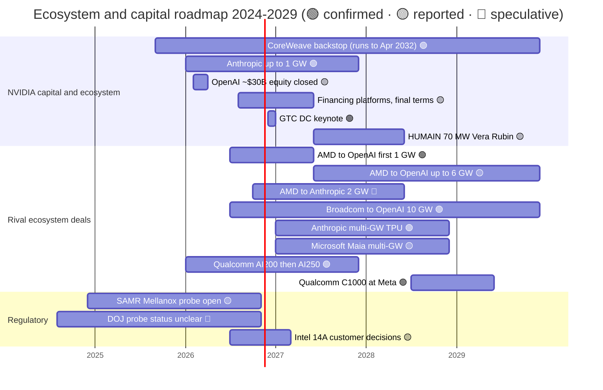
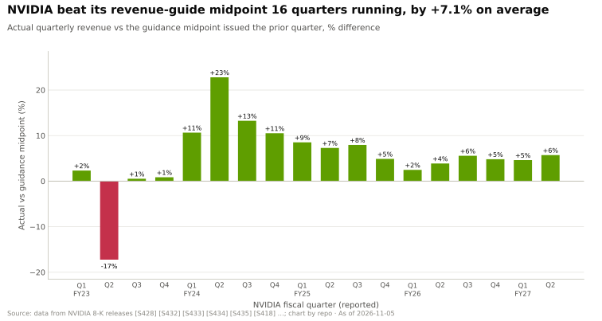

# Ecosystem, go-to-market and capital: Roadmap

Layer 13 · Ecosystem, go-to-market and capital · ~11 min read · Last verified: 2026-11-05

## ⚡ The Executive Take

- **Next marker:** the GTC DC keynote on 2026-12-01, just after this page's as-of date [[S90047]](../../sources/bibliography.md#s90047).
- **2026–2029 is a calendar of contract tranches.** AMD's first 1 GW for OpenAI starts in H2 2026, Broadcom's 10 GW runs H2 2026 to 2029, Anthropic's next multi-GW TPU block starts in 2027, and Microsoft's Maia goes multi-gigawatt from 2027 [[S13506]](../../sources/bibliography.md#s13506)[[S174]](../../sources/bibliography.md#s174)[[S655]](../../sources/bibliography.md#s655)[[S90045]](../../sources/bibliography.md#s90045).
- **NVIDIA's own commitments run longer still.** The CoreWeave [capacity backstop](../../glossary.md#capacity-backstop) lasts to 2032-04-13, and the financing platforms announced in August 2026 are memoranda of understanding awaiting final agreements 🟡 [[S90067]](../../sources/bibliography.md#s90067)[[S12528]](../../sources/bibliography.md#s12528).
- **Regulators have open files.** China's SAMR issued a preliminary finding in September 2025 that NVIDIA breached its Mellanox approval conditions; the US DOJ opened a probe in 2024; neither has a public 2026 resolution 🔴 [[S9505]](../../sources/bibliography.md#s9505)[[S9503]](../../sources/bibliography.md#s9503)[[S9504]](../../sources/bibliography.md#s9504).
- **The portfolio now moves earnings.** NVIDIA booked $23.7B of net equity gains in H1 FY2027, largely [mark-to-market](../../glossary.md#mark-to-market); they can reverse [[S90072]](../../sources/bibliography.md#s90072).
- **[Q7 · Roadmap & what changes the picture]** Three things would change it: antitrust action against investments-for-allocation, a turn in the [hyperscaler](../../glossary.md#hyperscaler) capex cycle, and write-downs on private stakes.

Sources per row in the table below; the OpenAI equity bar: ~$30B direct investment replacing the LOI [[S90015]](../../sources/bibliography.md#s90015)[[S13526]](../../sources/bibliography.md#s13526).

| Item | Window | Status | Confidence | Source |
|---|---|---|---|---|
| GTC DC keynote | 2026-12-01 | scheduled | 🟢 | [[S90047]](../../sources/bibliography.md#s90047) |
| NVIDIA–Anthropic up to 1 GW, up to $10B | 2026 onward | announced | 🟢 | [[S469]](../../sources/bibliography.md#s469) |
| Financing platforms with six asset managers (>$500B target) | from Aug 2026 | MOUs | 🟡 | [[S12528]](../../sources/bibliography.md#s12528) |
| HUMAIN 84 MW (~27k GPUs) then 70 MW of Vera Rubin | now; from mid-2027 | announced | 🟡 | [[S13516]](../../sources/bibliography.md#s13516) |
| CoreWeave backstop, up to $6.3B | to 2032-04-13 | active | 🟢 | [[S90067]](../../sources/bibliography.md#s90067) |
| AMD–OpenAI first 1 GW of MI450, warrant tranche 1 | H2 2026 | in deployment | 🟢 | [[S13506]](../../sources/bibliography.md#s13506)[[S90020]](../../sources/bibliography.md#s90020) |
| AMD–Anthropic up to $5B, 2 GW Helios | 2026 onward | announced | 🟡 | [[S9538]](../../sources/bibliography.md#s9538) |
| Broadcom–OpenAI 10 GW custom accelerators | H2 2026 – 2029 | announced | 🟢 | [[S174]](../../sources/bibliography.md#s174) |
| Anthropic multi-GW TPU expansion | from 2027 | announced | 🟢 | [[S655]](../../sources/bibliography.md#s655) |
| Qualcomm–Modular | closed 2026-07-29 | closed | 🟢 | [[S9511]](../../sources/bibliography.md#s9511) |
| Qualcomm C1000 at Meta | H2 2028 | announced | 🟢 | [[S90058]](../../sources/bibliography.md#s90058) |
| SAMR Mellanox probe | since Dec 2024 | preliminary finding | 🟡 | [[S9505]](../../sources/bibliography.md#s9505) |

## How the roadmap reads in a capital layer

Here a roadmap is a schedule of **obligations and options**: tranches that vest per gigawatt, backstops that trigger on unsold capacity, stakes repriced by funding rounds. For each, ask who carries the risk if demand slows.

> [!TIP]
> **Worked example — what a 30% markdown of private stakes would do.** NVIDIA held $51.2B of non-marketable equity in July 2026 [[S90072]](../../sources/bibliography.md#s90072). A 30% markdown, the kind of reset a down round or a stalled lab could cause, is ~$15.4B of losses through other income, about 26% of Q2 FY2027 net income of $59.7B [[S405]](../../sources/bibliography.md#s405). Painful, not existential; the larger risk is that the same shock hits those customers' GPU orders.

🔧 Under the hood: where these items show up in the filings

Private stakes appear as non-marketable equity securities, measured at cost and adjusted for observable price changes; listed stakes (Intel, Nokia, Synopsys, CoreWeave) are marked to market every quarter [[S90072]](../../sources/bibliography.md#s90072)[[S90073]](../../sources/bibliography.md#s90073). The backstop and multi-year cloud agreements sit in the commitments note, not on the balance sheet: $29B of cloud service commitments and $36B of AI-cloud capacity agreements in July 2026 [[S407]](../../sources/bibliography.md#s407). A customer warrant like AMD's is typically recorded as a reduction of revenue as tranches become probable to vest (consideration payable to a customer), so its cost shows up in AMD's reported margins, not in cash (🔴 repo reading of standard US GAAP practice).

## [Q7 · Roadmap & what changes the picture]

**1. Antitrust action against investments-for-allocation.** Investigators' stated concerns include making it harder to switch suppliers and penalising buyers that do not use NVIDIA exclusively [[S9503]](../../sources/bibliography.md#s9503). A finding that stakes were tied to allocation would constrain the playbook. SAMR penalties could range from 1% to 10% of prior-year China sales [[S9505]](../../sources/bibliography.md#s9505); senators have also questioned the Groq licence as a way around merger review [[S13511]](../../sources/bibliography.md#s13511).

**2. A turn in the capex cycle.** NVIDIA guided Q3 FY2027 revenue to $108B ± 2%, excluding China Data Center compute [[S3]](../../sources/bibliography.md#s3).

> [!TIP]
> **Worked example — how much a hyperscaler pause would remove.** Hyperscale customers bought ~$48.7B of NVIDIA's $89.0B Q2 FY2027 Data Center revenue [[S90011]](../../sources/bibliography.md#s90011)[[S405]](../../sources/bibliography.md#s405). A 20% cut in their NVIDIA spend removes ~$9.7B a quarter, close to the entire ~$11.8B step-up NVIDIA guided from Q2 ($96.2B) to Q3 ($108B) [[S405]](../../sources/bibliography.md#s405)[[S3]](../../sources/bibliography.md#s3). [Neocloud](../../glossary.md#neocloud) and sovereign buyers cushion that, but NVIDIA has financed many of them.

**3. Mark-to-market losses.** H1 FY2027's $23.7B of net equity gains flattered other income; a reversal would hit earnings just as customers' funding tightens [[S90072]](../../sources/bibliography.md#s90072).

**4. Custom silicon delivering.** SemiAnalysis rates OpenAI's Broadcom-built inference chip as competitive with Blackwell on performance per [TCO](../../glossary.md#tco) 🟡 [[S628]](../../sources/bibliography.md#s628). If it ships on time, the coalition's case strengthens with every frontier lab.

**5. What would help NVIDIA.** Final agreements on the >$500B financing platforms would shift funding risk to third parties [[S12528]](../../sources/bibliography.md#s12528); 16 straight quarters of beating its own guidance (chart below) help with financiers.

| Signal to watch | Leading indicator | Direction for NVIDIA |
|---|---|---|
| Antitrust | DOJ/FTC complaint, SAMR penalty, EU referral of a licence deal | ⬇ negative |
| Capex cycle | Hyperscaler 2027 capex guides (Jan–Feb 2027) | ± |
| Private marks | Down rounds at labs or neoclouds; CoreWeave backstop draws | ⬇ negative |
| Custom silicon | OpenAI–Broadcom first-GW timing; Anthropic TPU block in 2027 | ⬇ negative |
| Financing platforms | Definitive agreements and first funds closed | ⬆ positive |

## 🎯 Corp Dev Lens

1. Which of NVIDIA's commitments (backstop, cloud agreements, equity commitments) would a buyer of capacity treat as a price floor, and does that floor help or hurt a new entrant's pricing?
2. If regulators restrict investments-for-allocation, would sovereign partnerships, where governments carry the capital, become the main route to market for every vendor?
3. AMD's warrant tranches vest on deployment milestones from H2 2026. What evidence of on-time delivery should a partner want before committing alongside AMD?
4. If private AI marks reset, which assets (optics suppliers, software teams, licensed IP) become cheaper to acquire, and who has the balance sheet to act?

## 📚 Sources

<!-- Auto-generated from the [S…] citations on this page by `make build`. Edit sources/registry/*.csv, not this list. -->

- [**S3**](../../sources/bibliography.md#s3) StorageNewsletter, *NVIDIA Q2 Fiscal 2027 results coverage: revenue $96.2B*, 2026-08-27. [Link](https://www.storagenewsletter.com/2026/08/27/nvidia-fiscal-2q27-financial-results/)
- [**S174**](../../sources/bibliography.md#s174) OpenAI, *OpenAI and Broadcom announce strategic collaboration to deploy 10 gigawatts of OpenAI-designed AI accelerators*, 2025-10-13. [Link](https://openai.com/index/openai-and-broadcom-announce-strategic-collaboration/)
- [**S405**](../../sources/bibliography.md#s405) NVIDIA Corporation via SEC EDGAR, *NVIDIA Announces Financial Results for Second Quarter Fiscal 2027 (Form 8-K exhibit 99.1)*, 2026-08-26. [Link](https://www.sec.gov/Archives/edgar/data/0001045810/000104581026000073/q2fy27pr.htm)
- [**S407**](../../sources/bibliography.md#s407) NVIDIA Corporation via SEC EDGAR, *NVIDIA Corporation Form 10-Q for quarter ended July 26, 2026*, 2026-08-28. [Link](https://www.sec.gov/Archives/edgar/data/1045810/000104581026000075/nvda-20260726.htm)
- [**S469**](../../sources/bibliography.md#s469) Microsoft Official Blog, *Microsoft, NVIDIA and Anthropic announce strategic partnerships*, 2025-11-18. [Link](https://blogs.microsoft.com/blog/2025/11/18/microsoft-nvidia-and-anthropic-announce-strategic-partnerships/)
- [**S628**](../../sources/bibliography.md#s628) SemiAnalysis, *OpenAI Jalapeño: Better Than Nvidia Blackwell*, 2026-08-25. [Link](https://github.com/SemiAnalysisAI/InferenceX-app/blob/main/packages/app/content/blog/openai-jalapeno-better-than-nvidia.mdx)
- [**S655**](../../sources/bibliography.md#s655) Anthropic, *Anthropic expands partnership with Google and Broadcom for multiple gigawatts of next-generation compute*, 2026-04-06. [Link](https://www.anthropic.com/news/google-broadcom-partnership-compute)
- [**S9503**](../../sources/bibliography.md#s9503) Business Standard (Bloomberg), *Nvidia gets subpoena from US Justice Dept as antitrust probe deepens*, 2024-09-04. [Link](https://www.business-standard.com/world-news/nvidia-gets-subpoena-from-us-justice-dept-as-antitrust-probe-deepens-124090400121_1.html)
- [**S9504**](../../sources/bibliography.md#s9504) Business Standard, *US launches antitrust investigation into Nvidia over sales practices*, 2024-08-02. [Link](https://www.business-standard.com/world-news/us-launches-antitrust-investigation-into-nvidia-over-sales-practices-124080201689_1.html)
- [**S9505**](../../sources/bibliography.md#s9505) JURIST, *China finds Nvidia violated antimonopoly law in preliminary probe*, 2025-09-15. [Link](https://www.jurist.org/news/2025/09/china-finds-nvidia-violated-antimonopoly-law-in-preliminary-probe/)
- [**S9511**](../../sources/bibliography.md#s9511) Nasdaq (Qualcomm press release), *Qualcomm Completes Acquisition of Modular*, 2026-07-29. [Link](https://www.nasdaq.com/press-release/qualcomm-completes-acquisition-modular-2026-07-29)
- [**S9538**](../../sources/bibliography.md#s9538) The Next Web, *AMD is investing $5 billion in Anthropic and deploying 2 gigawatts of Helios GPUs to run Claude*, 2026. [Link](https://thenextweb.com/news/amd-anthropic-5-billion-investment-2gw-helios-mi450)
- [**S12528**](../../sources/bibliography.md#s12528) NVIDIA Newsroom, *NVIDIA Partners With Apollo, BlackRock, Blackstone, Brookfield, Goldman Sachs and KKR to Establish AI Compute Infrastructure Financing Platforms to Mobilize Over $500 Billion of Third-Party Capital*, 2026-08-10. [Link](https://nvidianews.nvidia.com/news/nvidia-partners-with-apollo-blackrock-blackstone-brookfield-goldman-sachs-and-kkr-to-establish-ai-compute-infrastructure-financing-platforms-to-mobilize-over-500-billion-of-third-party-capital)
- [**S13506**](../../sources/bibliography.md#s13506) Tom's Hardware, *OpenAI signs 6 GW AMD GPU deal*, 2025-10-06. [Link](https://www.tomshardware.com/pc-components/gpus/openai-signs-6gw-amd-gpu-deal)
- [**S13511**](../../sources/bibliography.md#s13511) Kavout, *Is Nvidia's Groq deal a masterstroke or an antitrust minefield?*, 2026. [Link](https://www.kavout.com/market-lens/is-nvidia-s-groq-deal-a-masterstroke-or-an-antitrust-minefield)
- [**S13516**](../../sources/bibliography.md#s13516) The National, *Saudi Arabia's Humain expands Nvidia deal with 84 MW AI computing plan*, 2026-10-22. [Link](https://www.thenationalnews.com/future/technology/2026/10/22/saudi-arabias-humain-expands-nvidia-deal-with-84mw-ai-computing-plan/)
- [**S13526**](../../sources/bibliography.md#s13526) Storyboard18, *Nvidia CEO Jensen Huang hints no further investments in OpenAI, Anthropic*, 2026. [Link](https://www.storyboard18.com/brand-makers/nvidia-ceo-jensen-huang-hints-no-further-investments-in-openai-anthropic-heres-why-91280.htm)
- [**S90011**](../../sources/bibliography.md#s90011) Nasdaq (Zacks), *NVIDIA Q2 earnings beat on Blackwell Ultra and Data Center strength*, 2026-08-27. [Link](https://www.nasdaq.com/articles/nvidia-q2-earnings-beat-blackwell-ultra-data-center-strength)
- [**S90015**](../../sources/bibliography.md#s90015) DatacenterDynamics, *Nvidia plans $30bn investment in upcoming OpenAI funding round*, 2026-02. [Link](https://www.datacenterdynamics.com/en/news/nvidia-plans-30bn-investment-in-upcoming-openai-funding-round/)
- [**S90020**](../../sources/bibliography.md#s90020) Shacknews, *AMD Helios AI rack system on track for initial shipments in Q3 2026*, 2026. [Link](https://www.shacknews.com/article/150249/amd-helios-ai-system-shipping-q3-2026)
- [**S90045**](../../sources/bibliography.md#s90045) Pulse 2.0, *Microsoft to expand Azure Maia AI infrastructure to multi-gigawatt deployments starting in 2027*, 2026-10. [Link](https://pulse2.com/microsoft-to-expand-azure-maia-ai-infrastructure/)
- [**S90047**](../../sources/bibliography.md#s90047) NVIDIA, *NVIDIA GTC DC 2026 (November 30 – December 3, 2026)*, 2026. [Link](https://www.nvidia.com/en-us/gtc-dc/topics/ai-policy/)
- [**S90058**](../../sources/bibliography.md#s90058) Constellation Research, *Qualcomm outlines new CPU, AI accelerator roadmap, inks deal with Meta*, 2026-06-24. [Link](https://www.constellationr.com/insights/news/qualcomm-outlines-new-cpu-ai-accelerator-roadmap-inks-deal-meta)
- [**S90067**](../../sources/bibliography.md#s90067) DatacenterDynamics, *Nvidia to purchase unsold compute capacity from CoreWeave for $6.3bn*, 2025-09-16. [Link](https://www.datacenterdynamics.com/en/news/nvidia-to-purchase-unsold-compute-capacity-from-coreweave-for-63bn/)
- [**S90072**](../../sources/bibliography.md#s90072) Unite.AI, *Nvidia's AI sector equity stakes grow, SEC filing shows*, 2026-08. [Link](https://unite.ai/nvidias-ai-sector-equity-stakes-grow-sec-filing-shows)
- [**S90073**](../../sources/bibliography.md#s90073) FourWeekMBA, *NVIDIA's $99 billion investment portfolio and the circular financing loop at the center of AI*, 2026-08. [Link](https://fourweekmba.com/ai-nvidia-99-billion-investment-portfolio-circular-financing-ai/)
