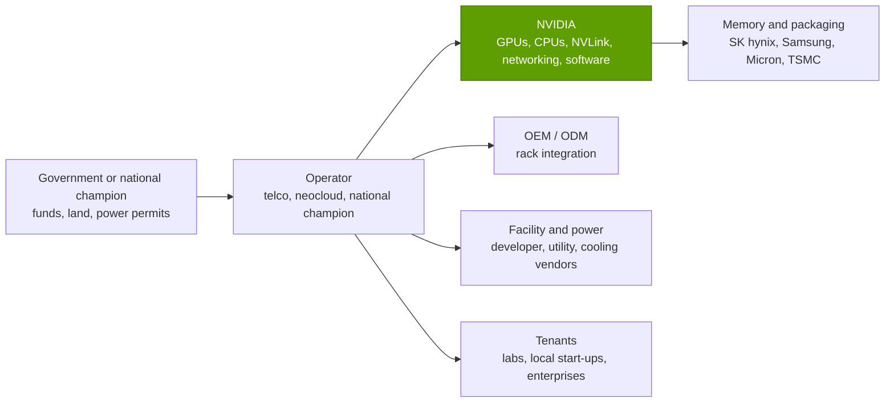

# Sovereign AI

Layer 13 · Ecosystem, go-to-market and capital · ~9 min read · Last verified: 2026-11-05

## ⚡ The Executive Take

- **[Sovereign AI](../../glossary.md#sovereign-ai) became a demand pillar.** Management put FY2026 sovereign revenue at > ~$30B, up ~80% 🟡 [[S90071]](../../sources/bibliography.md#s90071), about 14% of NVIDIA's $215.9B [[S1]](../../sources/bibliography.md#s1).
- **Announced country deals name ~1.03M NVIDIA GPUs.** HUMAIN (Saudi Arabia) plans up to 600,000 over three years across Saudi and US sites [[S13003]](../../sources/bibliography.md#s13003). South Korea has 260,000 [[S13000]](../../sources/bibliography.md#s13000), the UK up to 120,000 by end-2026 [[S13009]](../../sources/bibliography.md#s13009), India's Yotta 20,736 [[S13017]](../../sources/bibliography.md#s13017), France's Mistral 18,000 [[S13011]](../../sources/bibliography.md#s13011) and Germany's Deutsche Telekom 10,000 [[S13014]](../../sources/bibliography.md#s13014).
- **Plans run far ahead of firm orders.** HUMAIN's firm phases so far are 18,000 GB300 (May 2025) and ~27,000 GPUs / 84 MW (Oct 2026) [[S13514]](../../sources/bibliography.md#s13514)[[S13516]](../../sources/bibliography.md#s13516). US licences first capped HUMAIN and G42 at 35,000 Blackwell-equivalents each 🟡 [[S13515]](../../sources/bibliography.md#s13515).
- **A 100,000-GPU national [AI factory](../../glossary.md#ai-factory) costs ~$8.5B up front (Est.).** NVIDIA invoices ~$5.3–6.1B of that, so sovereign revenue equals about five such factories a year 🔴.
- **Export controls decide who can buy.** The US allowed H200 sales to approved Chinese buyers with 25% of revenue going to the US government [[S90032]](../../sources/bibliography.md#s90032). No H200 revenue had been recognised, and guidance excludes China Data Center compute [[S90081]](../../sources/bibliography.md#s90081)[[S3]](../../sources/bibliography.md#s3).
- **Bear case:** sovereigns hedge. HUMAIN also signed AMD for up to 500 MW [[S13517]](../../sources/bibliography.md#s13517) and Qualcomm for 200 MW [[S90030]](../../sources/bibliography.md#s90030). Korea's deal carried no value or timeline [[S13001]](../../sources/bibliography.md#s13001).

![Horizontal bar chart of NVIDIA GPUs named in sovereign AI announcements: Saudi Arabia's HUMAIN up to 600,000 over three years (across Saudi Arabia and the US, Nov 2025), South Korea 260,000 (Oct 2025: government 50,000, Samsung, SK and Hyundai 50,000 each, Naver 60,000), United Kingdom 120,000 by end-2026, India's Yotta 20,736 B300, France's Mistral Compute 18,000 Grace Blackwell and Germany's Deutsche Telekom 10,000. About 1.03M GPUs in total, 84% of them in the Saudi and Korean deals. Stargate UAE (1 GW) and Japan's subsidised clouds (>$740M) disclosed no GPU count.](../../assets/charts/13-sovereign-gpu-commitments.svg)

## Why countries buy AI factories

A sovereign AI factory resembles a national airline or power utility: governments want domestic capacity even when renting from a US cloud would be cheaper, for data residency, local-language models, industrial policy and bargaining power. The builders are usually national champions (HUMAIN, G42), telecom operators (Deutsche Telekom, SK) or local [neoclouds](../../glossary.md#neocloud) (Nscale, Yotta), often with a frontier lab as anchor tenant: xAI in Saudi Arabia [[S13004]](../../sources/bibliography.md#s13004) and OpenAI in Stargate UAE and Stargate UK [[S13007]](../../sources/bibliography.md#s13007)[[S13010]](../../sources/bibliography.md#s13010).

NVIDIA sells the whole package (GPUs, networking, reference designs, software, local Inception start-ups), which turns hardware sales into national programmes.

**[Q2 · Metrics that matter]** For sovereign demand, watch four numbers rather than headline GPU counts: firm orders, megawatts energised, export licences granted, and NVIDIA's disclosed sovereign revenue.

> [!TIP]
> **Worked example — how many GPUs is $30B?** At ~$5.7B of NVIDIA content per 100,000 GB300 GPUs (midpoint of the estimate below), > ~$30B of sovereign revenue [[S90071]](../../sources/bibliography.md#s90071) buys **~525,000 GPUs a year**. The ~1.03M GPUs announced are about two years of that. Stretched over three to five years, as HUMAIN's plans are [[S13003]](../../sources/bibliography.md#s13003)[[S13005]](../../sources/bibliography.md#s13005), the pipeline supports today's run rate but not much growth. 🔴 Repo arithmetic.

## The country deals, checked

| Country | Date | Builders and partners | NVIDIA GPUs / power | Status and caveats |
|---|---|---|---|---|
| Saudi Arabia | 2025-05 → 2026-10 | HUMAIN (PIF); xAI first tenant; AWS | Up to 600,000 over 3 years (KSA + US); 500 MW+ site [[S13003]](../../sources/bibliography.md#s13003)[[S13004]](../../sources/bibliography.md#s13004) | First GB300 shipment Dec 2025 [[S13006]](../../sources/bibliography.md#s13006); firm phases 18,000 and ~27,000 [[S13514]](../../sources/bibliography.md#s13514)[[S13516]](../../sources/bibliography.md#s13516) |
| United Arab Emirates | 2025-05-22 | G42, OpenAI, Oracle, Cisco, SoftBank (Stargate UAE) | 1 GW cluster on GB300; first 200 MW in 2026 [[S13007]](../../sources/bibliography.md#s13007)[[S13008]](../../sources/bibliography.md#s13008) | GPU count not disclosed; licence cap 35,000 Blackwell-equivalents at first 🟡 [[S13515]](../../sources/bibliography.md#s13515) |
| United Kingdom | 2025-09-16 | Nscale, CoreWeave, Microsoft, OpenAI (Stargate UK) | Up to 120,000 Blackwell Ultra by end-2026; up to £11B [[S13009]](../../sources/bibliography.md#s13009) | Nscale 60,000, of which 8,000 for Stargate UK [[S13010]](../../sources/bibliography.md#s13010) |
| France | 2025-06-11 | Mistral AI (Mistral Compute) | 18,000 Grace Blackwell; 40 MW site, scalable to 100 MW [[S13011]](../../sources/bibliography.md#s13011)[[S13012]](../../sources/bibliography.md#s13012) | Full deployment 2026 |
| Germany | 2025-11-04 | Deutsche Telekom / T-Systems, SAP, Siemens | 10,000 Blackwell (DGX B200, RTX PRO); ~€1B [[S13014]](../../sources/bibliography.md#s13014)[[S13015]](../../sources/bibliography.md#s13015) | Switched on in Munich in 2026 [[S13013]](../../sources/bibliography.md#s13013) |
| South Korea | 2025-10-31 | Government, Samsung, SK, Hyundai, Naver Cloud | 260,000 Blackwell-family [[S13000]](../../sources/bibliography.md#s13000) | No value or timeline [[S13001]](../../sources/bibliography.md#s13001); Naver targets gigawatt scale (Jun 2026) [[S13002]](../../sources/bibliography.md#s13002) |
| India | 2026-02 | Yotta for the IndiaAI Mission and NVIDIA DGX Cloud | 20,736 B300; ~$2B 🟡 [[S13017]](../../sources/bibliography.md#s13017)[[S13019]](../../sources/bibliography.md#s13019) | NVIDIA reportedly rents ~half; IndiaAI runs >38,000 GPUs overall [[S13018]](../../sources/bibliography.md#s13018) |
| Japan | 2024-05 | KDDI, SoftBank, Sakura Internet, GMO and others | > $740M of state support [[S13016]](../../sources/bibliography.md#s13016) | GPU count not disclosed; 2026 programme reports single-sourced 🔴 |

> [!TIP]
> **Worked example — South Korea's 260,000 GPUs in dollars and megawatts.** At 72 GPUs per GB300 NVL72 rack, 260,000 GPUs is ~3,611 racks. At ~$3.99M per rack (Est., Morgan Stanley) [[S332]](../../sources/bibliography.md#s332) that is **~$14.4B of racks**. At ~145 kW per rack including networking [[S340]](../../sources/bibliography.md#s340) and a PUE of 1.15 [[S387]](../../sources/bibliography.md#s387)[[S388]](../../sources/bibliography.md#s388), it needs **~600 MW**. Reuters reported the deal lifts Korea's NVIDIA GPU base from ~65,000 to >300,000 [[S13513]](../../sources/bibliography.md#s13513). 🔴 Repo arithmetic.

## Worked example: what a 100,000-GPU national AI factory costs

![Waterfall chart estimating the up-front cost of a 100,000-GPU national AI factory built from 1,389 GB300 NVL72 racks at about $3.99M each: NVIDIA GPUs about $3.5B, HBM and LPDDR memory about $0.5B, the rest of the rack (Grace CPUs, NVLink switch trays, boards, power, cooling, ODM margin) about $1.5B, scale-out networking and storage about $1.4B and the facility shell and power plant for ~232 MW about $1.5B, totalling about $8.5B. NVIDIA would invoice an estimated $5.3-6.1B; electricity adds ~$164M a year.](../../assets/charts/13-national-ai-factory-cost.svg)

> [!TIP]
> **Worked example — the bill for 1,389 racks.** 100,000 GPUs ÷ 72 = 1,389 GB300 NVL72 racks. Each costs ~$3.99M, of which the GPUs are ~$2.52M and memory ~$0.37M (Est., Morgan Stanley) [[S332]](../../sources/bibliography.md#s332)[[S331]](../../sources/bibliography.md#s331), so the racks total **~$5.5B**. Scale-out networking and storage are ~20.5% of an all-in cluster (Est., SemiAnalysis) [[S324]](../../sources/bibliography.md#s324), adding **~$1.4B**. At ~145 kW per rack [[S340]](../../sources/bibliography.md#s340) and PUE 1.15, the site draws **~232 MW**. At $6.6M per MW, from a Morgan Stanley model it later retracted and used here only as an illustration [[S357]](../../sources/bibliography.md#s357), the shell and power plant cost **~$1.5B**. The total is **~$8.5B**, plus ~$164M a year of power at $0.081/kWh [[S389]](../../sources/bibliography.md#s389). NVIDIA invoices ~$5.3–6.1B (63–71%) depending on how much of the CPUs, switches and network it supplies 🔴.

🔧 Under the hood: what the estimate leaves out

- **Platform choice.** On Vera Rubin NVL72 at ~$7.8M per rack (Est.) [[S330]](../../sources/bibliography.md#s330)[[S332]](../../sources/bibliography.md#s332) the same 100,000 GPUs cost ~$10.8B in racks alone, but each GPU does far more work.
- **Facility cost.** $/MW varies widely by site; the figure used is a placeholder.
- **Software and services.** NVIDIA AI Enterprise licences, integrators and model development sit on top (see [Enterprise go-to-market](enterprise-gtm-oems-gsis.md)).

## Export controls: the other half of sovereign AI

The logic that creates sovereign AI also creates [export controls](../../glossary.md#export-controls): the US decides which countries and buyers receive top-end GPUs, and how many.

- **China.** In April 2025 the US required licences for H20-class chips, and NVIDIA recorded a ~$4.5B charge [[S90081]](../../sources/bibliography.md#s90081)[[S90082]](../../sources/bibliography.md#s90082). In December 2025 H200 sales to approved Chinese buyers were allowed with 25% of revenue going to the US government [[S90032]](../../sources/bibliography.md#s90032). NVIDIA received purchase orders in March 2026 [[S90033]](../../sources/bibliography.md#s90033), but had recognised no H200 revenue and its guidance still excludes China Data Center compute [[S90081]](../../sources/bibliography.md#s90081)[[S3]](../../sources/bibliography.md#s3).
- **The Gulf.** Deals were signed with US approval, but licences were metered: first approvals capped HUMAIN and G42 at 35,000 Blackwell-equivalents each 🟡 [[S13515]](../../sources/bibliography.md#s13515).
- **The revenue mix.** Non-US-headquartered customers fell to 22% of Q1 FY2027 revenue from 42% a year earlier [[S90070]](../../sources/bibliography.md#s90070).

> [!TIP]
> **Worked example — what the 25% arrangement does to margin.** Take $10B of H200 sales to China at a ~75% gross margin (NVIDIA's Q2 FY2027 GAAP level [[S3]](../../sources/bibliography.md#s3)): gross profit is $7.5B. Remitting 25% of revenue ($2.5B) leaves $5.0B, a **~50% effective margin**, still profitable but a third less per chip than in other markets. How the remittance is booked has not been disclosed 🔴.

> [!WARNING]
> **Myth vs. reality:** "Sovereign AI is non-cyclical government spending." Many deals are financed by state-linked funds, telcos and neoclouds against tenant contracts, and depend on revocable US export licences. Korea's announcement disclosed no price or schedule [[S13001]](../../sources/bibliography.md#s13001).

## 🎯 Corp Dev Lens

1. **Second-source demand is real in sovereign tenders.** HUMAIN's AMD (500 MW) and Qualcomm (200 MW) agreements sit beside its NVIDIA plan [[S13517]](../../sources/bibliography.md#s13517)[[S90030]](../../sources/bibliography.md#s90030). Which sovereign programmes publish open procurement where an inference-focused rack can win on power or price?
2. **Operators are the control point.** Telcos and neoclouds (Deutsche Telekom, Nscale, Yotta, Naver) own the customer. Which might add a challenger for a sovereign inference tier?
3. **Export policy is a swing factor.** Licence caps and revenue-sharing terms change by administration. How should deal models price a licence narrowed after signing?
4. **Watch firm orders, not GPU counts.** The gap between 600,000 planned and ~45,000 firmly ordered at HUMAIN [[S13003]](../../sources/bibliography.md#s13003)[[S13514]](../../sources/bibliography.md#s13514)[[S13516]](../../sources/bibliography.md#s13516) is where competitors still have room.

## 📚 Sources

<!-- Auto-generated from the [S…] citations on this page by `make build`. Edit sources/registry/*.csv, not this list. -->

- [**S1**](../../sources/bibliography.md#s1) NVIDIA Corporation via SEC EDGAR, *NVIDIA Announces Financial Results for Fourth Quarter and Fiscal 2026 (Form 8-K exhibit 99.1)*, 2026-02-25. [Link](https://www.sec.gov/Archives/edgar/data/1045810/000104581026000019/q4fy26pr.htm)
- [**S3**](../../sources/bibliography.md#s3) StorageNewsletter, *NVIDIA Q2 Fiscal 2027 results coverage: revenue $96.2B*, 2026-08-27. [Link](https://www.storagenewsletter.com/2026/08/27/nvidia-fiscal-2q27-financial-results/)
- [**S324**](../../sources/bibliography.md#s324) fal.ai, *NVIDIA GB200 price in 2026: what a GPU, a tray and an NVL72 rack cost*, 2026. [Link](https://fal.ai/learn/serverless/nvidia-gb200-price)
- [**S330**](../../sources/bibliography.md#s330) PC Gamer, *A single Nvidia Vera Rubin rack is estimated to cost $7,803,148 with over $2 million of that figure spent on memory alone*, 2026-05. [Link](https://pcgamer.com/hardware/a-single-nvidia-vera-rubin-rack-is-estimated-to-cost-usd7-803-148-with-over-usd2-million-of-that-figure-spent-on-memory-alone)
- [**S331**](../../sources/bibliography.md#s331) Wccftech, *NVIDIA's Vera Rubin rack hit with 435% memory price surge, pushing HBM4 & LPDDR5X bill to $2M of $7.8M total*, 2026-05. [Link](https://wccftech.com/nvidia-vera-rubin-rack-hit-with-memory-price-surge-pushing-hbm4-lpddr5x-bill-to-2m-of-7-8m-total/)
- [**S332**](../../sources/bibliography.md#s332) Tiger Brokers (iTiger), *Morgan Stanley's BOM analysis of NVIDIA's Rubin: GPU share declines; PCB, MLCC and ABF substrate values soar*, 2026-05-20. [Link](https://www.itiger.com/news/1188068712)
- [**S340**](../../sources/bibliography.md#s340) SemiAnalysis (Dylan Patel et al.), *Huawei AI CloudMatrix 384 - China's answer to Nvidia GB200 NVL72*, 2025-04-16. [Link](https://newsletter.semianalysis.com/p/huawei-ai-cloudmatrix-384-chinas-answer-to-nvidia-gb200-nvl72)
- [**S357**](../../sources/bibliography.md#s357) Wccftech, *Morgan Stanley: NVIDIA GB200 NVL72 racks deliver a profit margin of 77.6% vs AMD MI355X while entailing nearly the same TCO (report later retracted)*, 2025-08. [Link](https://wccftech.com/morgan-stanley-nvidia-gb200-nvl72-racks-deliver-a-profit-margin-of-77-6-vs-64-for-amd-mi355x-while-entailing-nearly-the-same-tco/)
- [**S387**](../../sources/bibliography.md#s387) Uptime Institute, *Uptime Institute Global Data Center Survey 2024*, 2024-07. [Link](https://uptimeinstitute.com/resources/research-and-reports/uptime-institute-global-data-center-survey-results-2024)
- [**S388**](../../sources/bibliography.md#s388) Google, *Google data centers: efficiency (fleet-wide PUE)*, 2025. [Link](https://datacenters.google/efficiency/)
- [**S389**](../../sources/bibliography.md#s389) U.S. Energy Information Administration, *EIA Electric Power Monthly, Table 5.6.A: average price of electricity to ultimate customers by end-use sector*, 2025. [Link](https://www.eia.gov/electricity/monthly/epm_table_grapher.php?t=epmt_5_6_a)
- [**S13000**](../../sources/bibliography.md#s13000) The Korea Times, *Nvidia to supply 260,000 chips to Korea for AI factories with Samsung, SK, Hyundai*, 2025-10-31. [Link](https://www.koreatimes.co.kr/amp/business/tech-science/20251031/nvidia-to-supply-260000-chips-to-korea-for-ai-factories-with-samsung-sk-hyundai)
- [**S13001**](../../sources/bibliography.md#s13001) Data Center Knowledge, *South Korea to boost AI infrastructure with 260,000 Nvidia chips*, 2025-11. [Link](https://www.datacenterknowledge.com/infrastructure/south-korea-to-boost-ai-infrastructure-with-260-000-nvidia-chips)
- [**S13002**](../../sources/bibliography.md#s13002) The Korea Herald, *Naver and NVIDIA expand sovereign AI partnership toward gigawatt-scale AI factories*, 2026-06. [Link](https://www.koreaherald.com/article/10765602)
- [**S13003**](../../sources/bibliography.md#s13003) Middle East AI News, *HUMAIN to deploy 600,000 NVIDIA GPUs across KSA, USA*, 2025-11-19. [Link](https://www.middleeastainews.com/p/humain-to-deploy-600000-nvidia-gpus)
- [**S13004**](../../sources/bibliography.md#s13004) GIGAZINE, *xAI to co-develop 500MW+ data center in Saudi Arabia*, 2025-11-20. [Link](https://gigazine.net/gsc_news/en/20251120-xai-nvidia-saudi-arabia-data-center)
- [**S13005**](../../sources/bibliography.md#s13005) Middle East AI News, *Saudi to build 500MW AI factories with NVIDIA tech*, 2025-05. [Link](https://www.middleeastainews.com/p/saudi-nvidia-500mw-ai-factories)
- [**S13006**](../../sources/bibliography.md#s13006) AGBI, *Humain receives first shipment of fast Nvidia AI chips*, 2025-12. [Link](https://www.agbi.com/ai/2025/12/humain-receives-first-shipment-of-fast-nvidia-ai-chips/)
- [**S13007**](../../sources/bibliography.md#s13007) Intelligent CIO Middle East, *G42, OpenAI, Oracle, NVIDIA, SoftBank, Cisco launch Stargate UAE from UAE-US AI Campus in Abu Dhabi*, 2025-05-23. [Link](https://www.intelligentcio.com/me/2025/05/23/g42-openai-oracle-nvidia-softbank-cisco-launch-stargate-uae-from-uae-us-ai-campus-in-abu-dhabi/)
- [**S13008**](../../sources/bibliography.md#s13008) Gulf News, *New update on Stargate UAE: first phase of 200MW to complete by 2026*, 2025-10. [Link](https://gulfnews.com/business/markets/stargate-uae-first-phase-of-200mw-to-complete-by-2026-1.500310364)
- [**S13009**](../../sources/bibliography.md#s13009) NVIDIA Newsroom, *NVIDIA and United Kingdom Build Nation's AI Infrastructure and Ecosystem to Fuel Innovation, Economic Growth and Jobs*, 2025-09-16. [Link](https://nvidianews.nvidia.com/news/nvidia-and-united-kingdom-build-nations-ai-infrastructure-and-ecosystem-to-fuel-innovation-economic-growth-and-jobs)
- [**S13010**](../../sources/bibliography.md#s13010) ITPro, *UK to host largest European GPU cluster under GBP 11 billion Nvidia investment plans*, 2025-09. [Link](https://www.itpro.com/infrastructure/uk-to-host-largest-european-gpu-cluster-under-gbp11-billion-nvidia-investment-plans)
- [**S13011**](../../sources/bibliography.md#s13011) Sifted, *Mistral Compute launch*, 2025-06-11. [Link](https://sifted.eu/articles/mistral-compute-launch)
- [**S13012**](../../sources/bibliography.md#s13012) ActuIA, *Mistral AI and NVIDIA towards a sovereign AI infrastructure in Europe*, 2025-06. [Link](https://www.actuia.com/en/news/mistral-ai-and-nvidia-towards-a-sovereign-ai-infrastructure-in-europe)
- [**S13013**](../../sources/bibliography.md#s13013) DatacenterDynamics, *Deutsche Telekom launches NVIDIA-powered AI factory in Munich's Tucherpark*, 2026. [Link](https://www.datacenterdynamics.com/en/news/deutsche-telekom-launches-nvidia-powered-ai-factory-in-munichs-tucherpark/)
- [**S13014**](../../sources/bibliography.md#s13014) heise online, *Telekom data center with 10,000 Nvidia GPUs being built in Munich*, 2025-11-04. [Link](https://heise.de/-11056781)
- [**S13015**](../../sources/bibliography.md#s13015) eWEEK, *Nvidia and Deutsche Telekom unveil EUR 1B AI factory in Munich*, 2025-11. [Link](https://www.eweek.com/news/nvidia-deutsche-telekom-ai-factory/)
- [**S13016**](../../sources/bibliography.md#s13016) NVIDIA Blog, *NVIDIA to Help Elevate Japan's Sovereign AI Efforts Through Generative AI Infrastructure Build-Out*, 2024-05. [Link](https://blogs.nvidia.com/?p=71602)
- [**S13017**](../../sources/bibliography.md#s13017) Computer Weekly, *Nvidia backs India's sovereign AI push with gigawatt-scale infrastructure*, 2026-02. [Link](https://www.computerweekly.com/news/366639266/Nvidia-backs-Indias-sovereign-AI-push-with-gigawatt-scale-infrastructure)
- [**S13018**](../../sources/bibliography.md#s13018) Business Today, *Nvidia embeds itself at the heart of India's sovereign AI push*, 2026-02-18. [Link](https://www.businesstoday.in/technology/news/story/nvidia-embeds-itself-at-the-heart-of-indias-sovereign-ai-push-516628-2026-02-18)
- [**S13019**](../../sources/bibliography.md#s13019) YourStory, *Yotta to spend $2B on NVIDIA chips*, 2026-02. [Link](https://yourstory.com/ai-story/yotta-to-spend-2-billion-on-nvidia-chips)
- [**S13513**](../../sources/bibliography.md#s13513) AOL / Yahoo Finance, *Nvidia steps up South Korea AI push with 260 000-chip rollout (Reuters)*, 2025-10-31. [Link](https://www.aol.com/finance/nvidia-steps-south-korea-ai-060026309.html)
- [**S13514**](../../sources/bibliography.md#s13514) The Daily Star, *Saudi AI firm Humain inks Nvidia deal (Reuters)*, 2025-05-13. [Link](https://www.thedailystar.net/business/global-economy/news/saudi-ai-firm-humain-inks-nvidia-deal-4039841)
- [**S13515**](../../sources/bibliography.md#s13515) The Sun (Malaysia), *Saudi AI firm Humain signs major Nvidia chip deal after US approval*, 2025-11. [Link](https://thesun.my/news/world-news/saudi-ai-firm-humain-signs-major-nvidia-chip-deal-after-us-approval)
- [**S13516**](../../sources/bibliography.md#s13516) The National, *Saudi Arabia's Humain expands Nvidia deal with 84 MW AI computing plan*, 2026-10-22. [Link](https://www.thenationalnews.com/future/technology/2026/10/22/saudi-arabias-humain-expands-nvidia-deal-with-84mw-ai-computing-plan/)
- [**S13517**](../../sources/bibliography.md#s13517) Futuriom, *NVIDIA and AMD score AI hub deals in Saudi Arabia*, 2025-05. [Link](https://www.futuriom.com/articles/news/nvidia-amd-score-deals-for-the-saudi-ai-hub/2025/05)
- [**S90030**](../../sources/bibliography.md#s90030) Morningstar, *Qualcomm: Humain deal provides some AI upside*, 2025-10. [Link](https://www.morningstar.com/stocks/qualcomm-humain-deal-provides-some-ai-upside)
- [**S90032**](../../sources/bibliography.md#s90032) Bloomberg Government, *Nvidia gets US license for small amount of H200 exports to China*, 2026-02. [Link](https://news.bgov.com/international-trade/nvidia-gets-us-license-for-small-amount-of-h200-exports-to-china)
- [**S90033**](../../sources/bibliography.md#s90033) Tom's Hardware, *Nvidia has received POs from Chinese customers*, 2026-03-17. [Link](https://tomshardware.com/tech-industry/nvidia-has-received-pos-from-chinese-customers)
- [**S90070**](../../sources/bibliography.md#s90070) NVIDIA Corporation via SEC EDGAR, *NVIDIA Form 10-Q for the quarter ended April 26, 2026 (Q1 FY2027)*, 2026-05. [Link](https://www.sec.gov/Archives/edgar/data/0001045810/000104581026000052/nvda-20260426.htm)
- [**S90071**](../../sources/bibliography.md#s90071) Crypto Briefing, *Nvidia CFO emphasizes neutral partnership with AI customers as company diversifies beyond hyperscalers*, 2026. [Link](https://cryptobriefing.com/nvidia-cfo-neutral-ai-partnership/)
- [**S90081**](../../sources/bibliography.md#s90081) NVIDIA Corporation via SEC EDGAR, *NVIDIA Form 10-K for fiscal year 2026 (ended January 25, 2026)*, 2026-02. [Link](https://www.sec.gov/Archives/edgar/data/1045810/000104581026000021/nvda-20260125.htm)
- [**S90082**](../../sources/bibliography.md#s90082) Verdict, *Nvidia writedown on H20 chip*, 2025-04. [Link](https://www.verdict.co.uk/nvidia-writedown-h20-chip/)
