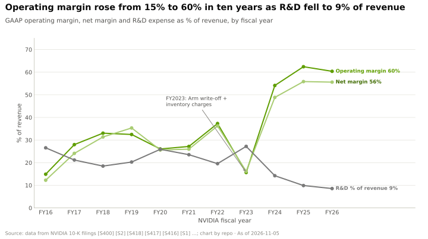
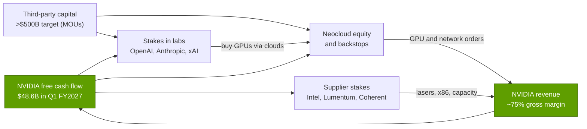
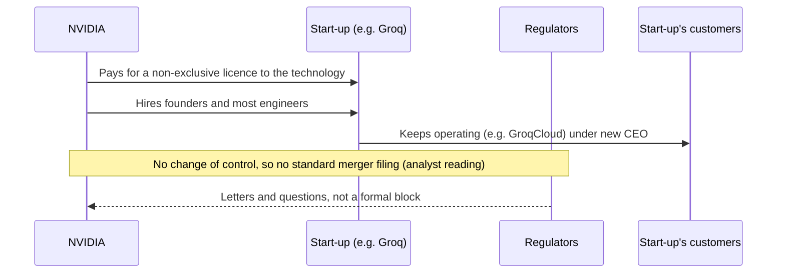

# Ecosystem, go-to-market and capital: Value chain and corp dev angles

Layer 13 · Ecosystem, go-to-market and capital · ~13 min read · Last verified: 2026-11-05

## ⚡ The Executive Take

- **NVIDIA keeps the fattest margin it controls.** Its gross margin was 75.0% in Q2 FY2027, against 66.4% at TSMC and an estimated ~2–3% for the [ODMs](../../glossary.md#odm) that assemble its racks; only memory makers now earn more (Micron 86.8%) [[S405]](../../sources/bibliography.md#s405)[[S3538]](../../sources/bibliography.md#s3538)[[S332]](../../sources/bibliography.md#s332)[[S3533]](../../sources/bibliography.md#s3533).
- **Its capital returns as demand.** NVIDIA's content per gigawatt is ~$35B (CEO, Aug 2025), so a $10B-per-GW stake pre-funds under a third of its sales [[S398]](../../sources/bibliography.md#s398)[[S469]](../../sources/bibliography.md#s469).
- **Three M&A structures.** Platform buys (Mellanox, $6.9B), software tuck-ins (Run:ai ~$700M) and [licence plus acquihire](../../glossary.md#licence-plus-acquihire) (Enfabrica >$900M, Groq ~$20B reported) [[S464]](../../sources/bibliography.md#s464)[[S476]](../../sources/bibliography.md#s476)[[S475]](../../sources/bibliography.md#s475)[[S90019]](../../sources/bibliography.md#s90019).
- **Equity now reserves supply as well as demand.** Stakes in Intel ($5B), Lumentum and Coherent ($2B each) and, reportedly, Marvell ($2B) come with capacity or product commitments [[S4009]](../../sources/bibliography.md#s4009)[[S13529]](../../sources/bibliography.md#s13529)[[S90037]](../../sources/bibliography.md#s90037).
- **[Q8 · Value pools & M&A angles]** The scarce assets are allocation, developers and teams, not factories. NVIDIA buys teams through licences, demand through stakes and supply through prepaid equity; the open angles for others lie in portable software, sovereign financing and supplier capacity.

## Who captures the dollars

| Participant | Economics | How NVIDIA's capital touches it |
|---|---|---|
| NVIDIA | 75.0% gross, ~60% operating margin (FY2026) [[S405]](../../sources/bibliography.md#s405)[[S1]](../../sources/bibliography.md#s1) | Source of the cash |
| Memory and foundry (SK hynix, Micron, TSMC) | 66–87% margins [[S3533]](../../sources/bibliography.md#s3533)[[S3538]](../../sources/bibliography.md#s3538) | Prepayments and $279B of supply commitments [[S407]](../../sources/bibliography.md#s407) |
| Optics and components (Lumentum, Coherent) | Capacity-constrained | $2B stakes plus purchase commitments [[S13529]](../../sources/bibliography.md#s13529) |
| Rack ODMs (Foxconn and others) | ~6% company gross; ~2–3% on a rack (Est.) [[S3522]](../../sources/bibliography.md#s3522)[[S332]](../../sources/bibliography.md#s332) | None needed |
| Neoclouds (CoreWeave, Lambda, Nscale) | Levered: CoreWeave carried ~$35B of debt in mid-2026 [[S12501]](../../sources/bibliography.md#s12501) | Equity, backstops, GPU lease-backs [[S472]](../../sources/bibliography.md#s472)[[S90067]](../../sources/bibliography.md#s90067)[[S483]](../../sources/bibliography.md#s483) |
| Frontier labs (OpenAI, Anthropic, xAI) | Funded by very large equity rounds | ~$30B, up to $10B, Series E stakes [[S13526]](../../sources/bibliography.md#s13526)[[S469]](../../sources/bibliography.md#s469)[[S13039]](../../sources/bibliography.md#s13039) |

> [!TIP]
> **Worked example — who earns what on a Vera Rubin NVL72 rack.** Morgan Stanley puts the rack at ~$7.8M, of which the 72 Rubin GPUs are ~$3.96M [[S332]](../../sources/bibliography.md#s332). NVIDIA's 75% gross margin on the GPU line alone is ~$3.0M of gross profit (illustrative; it also sells the rack's CPUs, switches and NICs). The ODM's ~1.9% rack margin is ~$0.15M (Est.) [[S332]](../../sources/bibliography.md#s332). NVIDIA earns roughly 20× the assembler on the same box.

## Where NVIDIA's capital goes, and who benefits

This loop is the [circular-financing](../../glossary.md#circular-financing) debate: a dollar of NVIDIA equity can return as GPU revenue. Beneficiaries: buyers that could not raise capital as cheaply, suppliers that need funds to expand, and the asset managers the August 2026 platforms bring in [[S12528]](../../sources/bibliography.md#s12528). The risk is [vendor financing](../../glossary.md#vendor-financing): if end demand falters, NVIDIA holds both the receivable and the stake.

> [!TIP]
> **Worked example — the payback on a gigawatt.** NVIDIA pledged up to $10B to Anthropic alongside up to 1 GW of NVIDIA systems [[S469]](../../sources/bibliography.md#s469). At ~$35B of NVIDIA content per GW [[S398]](../../sources/bibliography.md#s398) and ~75% gross margin [[S405]](../../sources/bibliography.md#s405), that gigawatt yields ~$26B of gross profit, about 2.6× the stake, if it is built. The stake is a customer-acquisition cost, cheap only if the gigawatts arrive.

## The M&A playbook

| Structure | Examples (price) | Time to close | Regulatory exposure | What NVIDIA got |
|---|---|---|---|---|
| Platform acquisition | Mellanox $6.9B; Arm $40B (failed) [[S464]](../../sources/bibliography.md#s464)[[S465]](../../sources/bibliography.md#s465) | 13 months; 17 months, then terminated [[S466]](../../sources/bibliography.md#s466) | Full multi-country review | A new layer (networking) |
| Software tuck-in | Run:ai ~$700M; Deci, OctoAI, CentML, Lepton; SchedMD [[S476]](../../sources/bibliography.md#s476)[[S479]](../../sources/bibliography.md#s479)[[S13041]](../../sources/bibliography.md#s13041) | Weeks to 8 months | EU review for Run:ai | Orchestration and inference teams |
| Licence plus acquihire | Enfabrica >$900M; Groq ~$20B 🟡 [[S475]](../../sources/bibliography.md#s475)[[S90019]](../../sources/bibliography.md#s90019) | Days | Political scrutiny, no filing found [[S13511]](../../sources/bibliography.md#s13511) | Founders, engineers, non-exclusive IP |
| Stake in customer | OpenAI ~$30B, Anthropic up to $10B, CoreWeave $2B [[S13526]](../../sources/bibliography.md#s13526)[[S469]](../../sources/bibliography.md#s469)[[S472]](../../sources/bibliography.md#s472) | At round close | Antitrust concern about allocation [[S9503]](../../sources/bibliography.md#s9503) | Demand and design input |
| Stake in supplier or partner | Intel $5B, Synopsys $2B, Nokia $1B, Lumentum and Coherent $2B each [[S4009]](../../sources/bibliography.md#s4009)[[S471]](../../sources/bibliography.md#s471)[[S470]](../../sources/bibliography.md#s470)[[S13529]](../../sources/bibliography.md#s13529) | Weeks to 3 months | Standard clearance (Intel cleared Dec 2025) | Capacity, co-design, new markets |

> [!TIP]
> **Worked example — what speed is worth.** Groq's licence closed within days; Run:ai took eight months including an EU review [[S474]](../../sources/bibliography.md#s474)[[S476]](../../sources/bibliography.md#s476). On a ~$20B deal, eight months at an assumed 10% cost of capital is ~$1.3B of time value (🔴 repo arithmetic), before counting the risk of a block.

🔧 Under the hood: why licence plus acquihire works, and its limits

US merger notification covers acquisitions of voting shares or assets above size thresholds; a non-exclusive licence plus employment offers transfers neither control nor exclusive assets, which is why analysts describe the Groq deal as an acquisition in substance even though it closed without a public review [[S90018]](../../sources/bibliography.md#s90018)[[S90019]](../../sources/bibliography.md#s90019). The limits: the licensor keeps the right to license others, key staff may not all move, and the agencies have signalled they will look at such structures, as senators urged after the Groq deal [[S13511]](../../sources/bibliography.md#s13511).

### Private companies worth knowing (public information only)

| Company | What it does | Last public funding (as logged) | NVIDIA link | Why it matters |
|---|---|---|---|---|
| Mistral AI | European open-weight models; Mistral Compute cloud | €1.7B Series C, Sep 2025, led by ASML [[S481]](../../sources/bibliography.md#s481)[[S13030]](../../sources/bibliography.md#s13030) | Investor; 18,000 Grace Blackwell [[S13011]](../../sources/bibliography.md#s13011) | Europe's sovereign-AI anchor |
| Thinking Machines Lab | Frontier lab (ex-OpenAI CTO) | $2B seed, 2025 [[S481]](../../sources/bibliography.md#s481) | Investor | New gigawatt-scale buyer |
| Reflection AI | US open-weight frontier models | ~$2B round led by NVIDIA, Oct 2025 [[S481]](../../sources/bibliography.md#s481) | Lead investor | Open-model demand on NVIDIA |
| Poolside | Coding models; 2 GW Project Horizon | Up to $1B from NVIDIA in ~$2B round [[S483]](../../sources/bibliography.md#s483) | Investor | Capital-for-capacity in miniature |
| Crusoe | Energy-first AI data-centre developer | $3.9B Series F at $30.9B (Sep 2026, tracker) [[S12522]](../../sources/bibliography.md#s12522) | Investor [[S481]](../../sources/bibliography.md#s481) | Builds GW sites for labs |
| Lambda | GPU cloud | ~$4B pre-IPO raise (Oct 2026) [[S12521]](../../sources/bibliography.md#s12521) | Investor; ~$1.5B GPU lease-back [[S483]](../../sources/bibliography.md#s483) | A neocloud NVIDIA both funds and rents from |
| Groq | GroqCloud inference service after the licence | NVIDIA licence ~$20B reported (Dec 2025) [[S474]](../../sources/bibliography.md#s474)[[S90019]](../../sources/bibliography.md#s90019) | Licensee and team hire | Test case for the licence structure |
| Ayar Labs | Optical I/O chiplets | $155M Series D (Dec 2024) [[S482]](../../sources/bibliography.md#s482) | Investor (AMD, Intel too) | Optics for scale-up fabrics |

Funding rows marked [[S481]](../../sources/bibliography.md#s481)–[[S483]](../../sources/bibliography.md#s483) were logged partly from memory (see the verification queue); treat as indicative. Neoclouds are covered in depth in [layer 12](../12-orchestration-and-cloud-services/value-chain-and-corp-dev.md).

**[Q8 · Value pools & M&A angles]** Everything here protects NVIDIA's ~75% margin, with one tool per scarce asset: platform M&A for missing layers, tuck-ins and licences for teams, customer stakes for allocation, supplier stakes for capacity. The open angles are those NVIDIA cannot occupy without conflict: portable software (Qualcomm–Modular [[S9511]](../../sources/bibliography.md#s9511)), multi-vendor sovereign programmes (HUMAIN buys from NVIDIA, AMD and Qualcomm [[S13005]](../../sources/bibliography.md#s13005)[[S13517]](../../sources/bibliography.md#s13517)[[S90030]](../../sources/bibliography.md#s90030)) and financing structures that do not depend on one vendor's balance sheet.

## 🎯 Corp Dev Lens

1. **Licence plus acquihire:** which inference, interconnect or compiler teams could be secured this way, and how should a buyer price the risk that agencies start treating the structure as a merger?
2. **Strategic stakes in customers:** NVIDIA's stakes pay back ~2.6× in gross profit per gigawatt only if the capacity is built. What return would a smaller vendor need, and should it be in equity, warrants or prepaid capacity?
3. **Sovereign partnerships:** when a sovereign fund supplies the capital, does the chip vendor still need a balance sheet, or only a credible roadmap and local partners?
4. **Supplier capacity:** NVIDIA now buys optics capacity with equity. Which components (lasers, HBM, substrates) are scarce enough that a stake beats a long-term agreement?

## 📚 Sources

<!-- Auto-generated from the [S…] citations on this page by `make build`. Edit sources/registry/*.csv, not this list. -->

- [**S1**](../../sources/bibliography.md#s1) NVIDIA Corporation via SEC EDGAR, *NVIDIA Announces Financial Results for Fourth Quarter and Fiscal 2026 (Form 8-K exhibit 99.1)*, 2026-02-25. [Link](https://www.sec.gov/Archives/edgar/data/1045810/000104581026000019/q4fy26pr.htm)
- [**S332**](../../sources/bibliography.md#s332) Tiger Brokers (iTiger), *Morgan Stanley's BOM analysis of NVIDIA's Rubin: GPU share declines; PCB, MLCC and ABF substrate values soar*, 2026-05-20. [Link](https://www.itiger.com/news/1188068712)
- [**S398**](../../sources/bibliography.md#s398) NVIDIA Investor Relations, *NVIDIA Q2 FY2026 earnings call (2025-08-27): AI factory economics commentary*, 2025-08-27. [Link](https://investor.nvidia.com/events-and-presentations/events-and-presentations/default.aspx)
- [**S405**](../../sources/bibliography.md#s405) NVIDIA Corporation via SEC EDGAR, *NVIDIA Announces Financial Results for Second Quarter Fiscal 2027 (Form 8-K exhibit 99.1)*, 2026-08-26. [Link](https://www.sec.gov/Archives/edgar/data/0001045810/000104581026000073/q2fy27pr.htm)
- [**S407**](../../sources/bibliography.md#s407) NVIDIA Corporation via SEC EDGAR, *NVIDIA Corporation Form 10-Q for quarter ended July 26, 2026*, 2026-08-28. [Link](https://www.sec.gov/Archives/edgar/data/1045810/000104581026000075/nvda-20260726.htm)
- [**S464**](../../sources/bibliography.md#s464) NVIDIA Newsroom, *NVIDIA to Acquire Mellanox for $6.9 Billion*, 2019-03-11. [Link](https://nvidianews.nvidia.com/news/nvidia-to-acquire-mellanox-for-6-9-billion)
- [**S465**](../../sources/bibliography.md#s465) NVIDIA Newsroom, *NVIDIA to Acquire Arm for $40 Billion, Creating World's Premier Computing Company for the Age of AI*, 2020-09-13. [Link](https://nvidianews.nvidia.com/news/nvidia-to-acquire-arm-for-40-billion-creating-worlds-premier-computing-company-for-the-age-of-ai)
- [**S466**](../../sources/bibliography.md#s466) NVIDIA Newsroom, *NVIDIA and SoftBank Group Announce Termination of NVIDIA's Acquisition of Arm Limited*, 2022-02-08. [Link](https://nvidianews.nvidia.com/news/nvidia-and-softbank-group-announce-termination-of-nvidias-acquisition-of-arm-limited)
- [**S469**](../../sources/bibliography.md#s469) Microsoft Official Blog, *Microsoft, NVIDIA and Anthropic announce strategic partnerships*, 2025-11-18. [Link](https://blogs.microsoft.com/blog/2025/11/18/microsoft-nvidia-and-anthropic-announce-strategic-partnerships/)
- [**S470**](../../sources/bibliography.md#s470) NVIDIA Newsroom, *NVIDIA and Nokia partnership on AI-RAN; NVIDIA $1B equity investment in Nokia*, 2025-10-28. [Link](https://nvidianews.nvidia.com/)
- [**S471**](../../sources/bibliography.md#s471) NVIDIA Newsroom, *NVIDIA and Synopsys strategic partnership; NVIDIA $2B investment in Synopsys common stock*, 2025-12-01. [Link](https://nvidianews.nvidia.com/)
- [**S472**](../../sources/bibliography.md#s472) CoreWeave Newsroom, *CoreWeave and NVIDIA expand partnership; NVIDIA invests $2B in CoreWeave Class A stock*, 2026-01-26. [Link](https://www.coreweave.com/news)
- [**S474**](../../sources/bibliography.md#s474) Groq Newsroom, *Groq and NVIDIA enter non-exclusive inference technology licensing agreement*, 2025-12-24. [Link](https://groq.com/newsroom)
- [**S475**](../../sources/bibliography.md#s475) CNBC, *Nvidia spends over $900 million on Enfabrica CEO, AI startup technology*, 2025-09-18. [Link](https://www.cnbc.com/technology/)
- [**S476**](../../sources/bibliography.md#s476) NVIDIA Blog, *NVIDIA to Acquire GPU Orchestration Software Provider Run:ai*, 2024-04-24. [Link](https://blogs.nvidia.com/blog/runai/)
- [**S479**](../../sources/bibliography.md#s479) Various (press), *Reporting on NVIDIA tuck-in acquisition prices (Run:ai, Deci, Shoreline, OctoAI, Gretel, Lepton, CentML) — The Information, Calcalist, Reuters, CNBC*, 2025-06. [Link](https://www.reuters.com/technology/)
- [**S481**](../../sources/bibliography.md#s481) Various (company announcements; Reuters, Bloomberg, TechCrunch), *Reporting on NVIDIA participation in AI-lab and neocloud funding rounds 2023–2025 (Inflection, Cohere, Hugging Face, Databricks, Mistral, xAI, Perplexity, Crusoe, Lambda, Nebius, Nscale, Together AI, Poolside, Reflection AI, Thinking Machines, Cursor)*, 2025-11. [Link](https://techcrunch.com/)
- [**S482**](../../sources/bibliography.md#s482) Various (company announcements; Reuters, Bloomberg), *Reporting on NVIDIA participation in robotics, autonomy, photonics, storage and energy rounds (Figure AI, Wayve, Scale AI, Ayar Labs, Enfabrica, VAST Data, Sakana AI, TerraPower, Commonwealth Fusion Systems, Applied Digital, Recursion)*, 2025-09. [Link](https://www.reuters.com/technology/)
- [**S483**](../../sources/bibliography.md#s483) Various (Bloomberg, The Information, Reuters), *Reporting on NVIDIA commitments to xAI (up to $2B in ~$20B raise), Poolside (up to $1B), Lambda (~$1.5B GPU lease-back) and Wayve ($500M LOI)*, 2025-10. [Link](https://www.bloomberg.com/technology)
- [**S3522**](../../sources/bibliography.md#s3522) AI CERTS News, *Foxconn results and AI server margin pressure*, 2026. [Link](https://www.aicerts.ai/news/?p=29781)
- [**S3533**](../../sources/bibliography.md#s3533) Micron Technology via SEC EDGAR, *Micron Technology fiscal Q4 2026 results (Form 8-K exhibit 99.1)*, 2026-09. [Link](https://www.sec.gov/Archives/edgar/data/0000723125/000072312526000018/a2026q4ex991-pressrelease.htm)
- [**S3538**](../../sources/bibliography.md#s3538) TSMC, *TSMC reports third quarter 2026 results*, 2026-10. [Link](https://pr.tsmc.com/english/news/3346)
- [**S4009**](../../sources/bibliography.md#s4009) SDxCentral, *Intel gets hands on Nvidia's $5B investment*, 2025-12. [Link](https://www.sdxcentral.com/news/intel-gets-hands-on-nvidias-5b-investment/)
- [**S9503**](../../sources/bibliography.md#s9503) Business Standard (Bloomberg), *Nvidia gets subpoena from US Justice Dept as antitrust probe deepens*, 2024-09-04. [Link](https://www.business-standard.com/world-news/nvidia-gets-subpoena-from-us-justice-dept-as-antitrust-probe-deepens-124090400121_1.html)
- [**S9511**](../../sources/bibliography.md#s9511) Nasdaq (Qualcomm press release), *Qualcomm Completes Acquisition of Modular*, 2026-07-29. [Link](https://www.nasdaq.com/press-release/qualcomm-completes-acquisition-modular-2026-07-29)
- [**S12501**](../../sources/bibliography.md#s12501) Runtime Wire, *CoreWeave reports $2.58 billion Q2 revenue with $35 billion in debt*, 2026-08. [Link](https://runtimewire.com/article/coreweave-q2-2026-revenue-debt-ai-cloud)
- [**S12521**](../../sources/bibliography.md#s12521) TechCrunch, *AI computing startup Lambda to raise $4B ahead of planned IPO*, 2026-10-06. [Link](https://techcrunch.com/2026/10/06/ai-computing-startup-lambda-to-raise-4b-ahead-of-planned-ipo)
- [**S12522**](../../sources/bibliography.md#s12522) ValueAdd VC, *Neocloud valuations 2026 (tracker)*, 2026-10-31. [Link](https://valueaddvc.com/blog/neocloud-valuations-2026)
- [**S12528**](../../sources/bibliography.md#s12528) NVIDIA Newsroom, *NVIDIA Partners With Apollo, BlackRock, Blackstone, Brookfield, Goldman Sachs and KKR to Establish AI Compute Infrastructure Financing Platforms to Mobilize Over $500 Billion of Third-Party Capital*, 2026-08-10. [Link](https://nvidianews.nvidia.com/news/nvidia-partners-with-apollo-blackrock-blackstone-brookfield-goldman-sachs-and-kkr-to-establish-ai-compute-infrastructure-financing-platforms-to-mobilize-over-500-billion-of-third-party-capital)
- [**S13005**](../../sources/bibliography.md#s13005) Middle East AI News, *Saudi to build 500MW AI factories with NVIDIA tech*, 2025-05. [Link](https://www.middleeastainews.com/p/saudi-nvidia-500mw-ai-factories)
- [**S13011**](../../sources/bibliography.md#s13011) Sifted, *Mistral Compute launch*, 2025-06-11. [Link](https://sifted.eu/articles/mistral-compute-launch)
- [**S13030**](../../sources/bibliography.md#s13030) Rallies.ai, *Nvidia participates in 14 European funding rounds in 2025, including EUR 1.7B Mistral Series C*, 2026-01. [Link](https://rallies.ai/news/nvidia-doubles-european-startup-investments-to-14-rounds-backs-17b-mistral)
- [**S13039**](../../sources/bibliography.md#s13039) xAI, *xAI raises $20B Series E (announcement)*, 2026-01-06. [Link](https://x.ai/blog/series-e)
- [**S13041**](../../sources/bibliography.md#s13041) NVIDIA Blog, *NVIDIA Acquires Open-Source Workload Management Provider SchedMD*, 2025-12-15. [Link](https://blogs.nvidia.com/blog/nvidia-acquires-schedmd)
- [**S13511**](../../sources/bibliography.md#s13511) Kavout, *Is Nvidia's Groq deal a masterstroke or an antitrust minefield?*, 2026. [Link](https://www.kavout.com/market-lens/is-nvidia-s-groq-deal-a-masterstroke-or-an-antitrust-minefield)
- [**S13517**](../../sources/bibliography.md#s13517) Futuriom, *NVIDIA and AMD score AI hub deals in Saudi Arabia*, 2025-05. [Link](https://www.futuriom.com/articles/news/nvidia-amd-score-deals-for-the-saudi-ai-hub/2025/05)
- [**S13526**](../../sources/bibliography.md#s13526) Storyboard18, *Nvidia CEO Jensen Huang hints no further investments in OpenAI, Anthropic*, 2026. [Link](https://www.storyboard18.com/brand-makers/nvidia-ceo-jensen-huang-hints-no-further-investments-in-openai-anthropic-heres-why-91280.htm)
- [**S13529**](../../sources/bibliography.md#s13529) Bloomberg Government, *Nvidia to invest $4 billion in data center optics companies*, 2026-03-02. [Link](https://news.bgov.com/artificial-intelligence/nvidia-to-invest-4-billion-in-data-center-optics-companies-1)
- [**S90018**](../../sources/bibliography.md#s90018) Constellation Research, *Nvidia's Groq deal: acquisition, acquihire or creative licensing deal?*, 2025-12. [Link](https://www.constellationr.com/insights/news/nvidias-groq-deal-acquisition-acquihire-or-creative-licensing-deal)
- [**S90019**](../../sources/bibliography.md#s90019) TechSpot, *Nvidia's $20 billion Groq deal looks a lot like an acquisition*, 2025-12. [Link](https://www.techspot.com/news/110723-nvidia-20-billion-groq-deal-looks-lot-like.html)
- [**S90030**](../../sources/bibliography.md#s90030) Morningstar, *Qualcomm: Humain deal provides some AI upside*, 2025-10. [Link](https://www.morningstar.com/stocks/qualcomm-humain-deal-provides-some-ai-upside)
- [**S90037**](../../sources/bibliography.md#s90037) Converge Digest, *NVIDIA invests $2B in Marvell to extend NVLink Fusion AI ecosystem*, 2026-03. [Link](https://convergedigest.com/nvidia-invests-2b-in-marvell-to-extend-nvlink-fusion-ai-ecosystem/)
- [**S90067**](../../sources/bibliography.md#s90067) DatacenterDynamics, *Nvidia to purchase unsold compute capacity from CoreWeave for $6.3bn*, 2025-09-16. [Link](https://www.datacenterdynamics.com/en/news/nvidia-to-purchase-unsold-compute-capacity-from-coreweave-for-63bn/)
