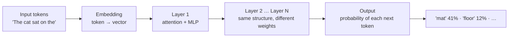
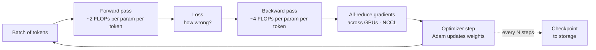
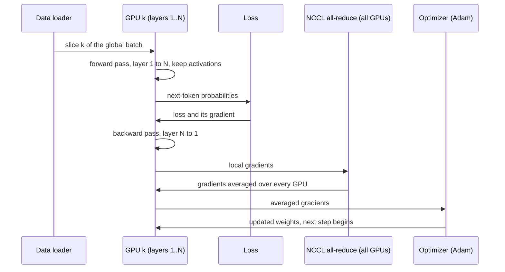
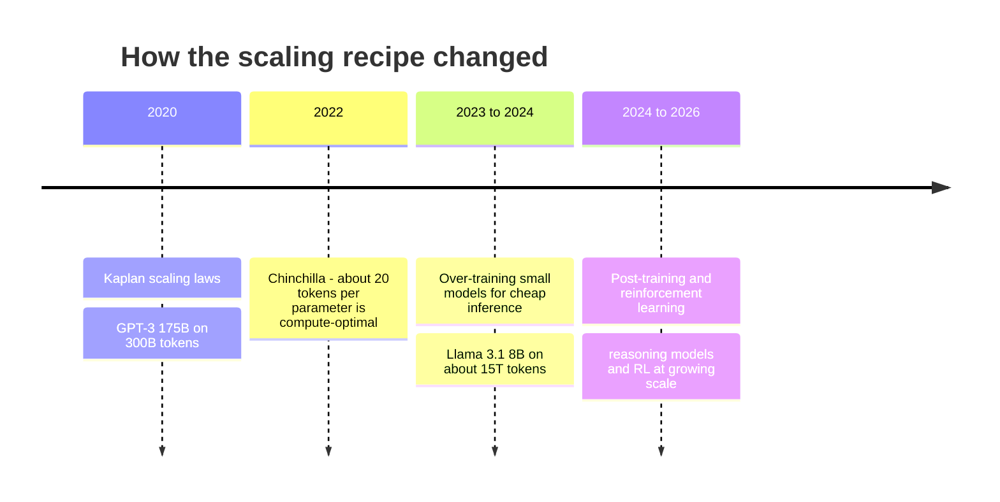
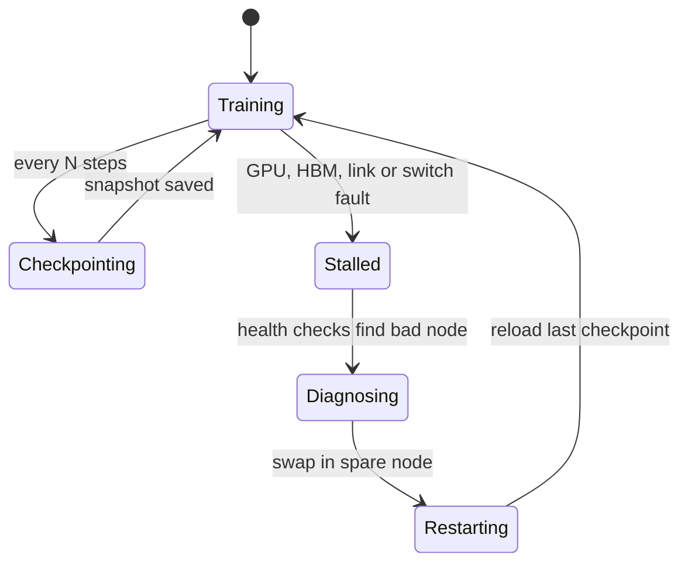
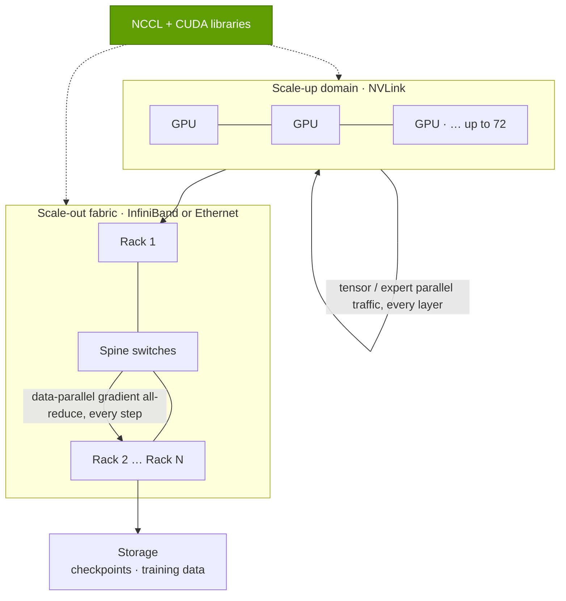

# P1 · How AI training works

Primer P1 · Foundations for non-engineers · ~22 min read · Last verified: 2026-11-05

> [!NOTE]
> **Start here if you know spreadsheets and finance, not chips.** This primer explains what "training a model" physically
> means, why it eats tens of thousands of GPUs for months, and which numbers to ask about. Inference (using a trained
> model) is [P2](P2-how-ai-inference-works.md); how the work is split across GPUs is [P4](P4-parallelism-explained.md).

## ⚡ The Executive Take

- **Training is one enormous, repetitive calculation.** A model guesses the next [token](../glossary.md#token), measures its error, and nudges every [parameter](../glossary.md#parameter) to be slightly less wrong, over trillions of tokens. Total work ≈ **6 × parameters × training tokens**: Meta's Llama 3.1 405B (405B parameters, 15.6T tokens) needed **3.8 × 10²⁵ FLOPs** [[S34006]](../sources/bibliography.md#s34006).
- **That maps directly to GPU-hours and dollars.** Llama 3.1 405B consumed **30.84M H100 GPU-hours** [[S31002]](../sources/bibliography.md#s31002); at the ~$2/GPU-hour rental rate DeepSeek used for its own costing [[S34007]](../sources/bibliography.md#s34007), that is **~$62M** of compute for the final run alone (Est., repo arithmetic).
- **GPUs run training at well under their peak.** Meta measured **38–43% model FLOPs utilization (MFU)** at up to 16,384 H100s [[S34006]](../sources/bibliography.md#s34006); dividing the reported FLOPs by the reported GPU-hours implies ~35% overall, because restarts, evaluation and data stalls also burn hours.
- **Memory, not just math, sets the floor.** Mixed-precision training with the Adam optimizer needs **~16 bytes per parameter** before activations [[S34004]](../sources/bibliography.md#s34004), 8× BF16 inference: a 405B model carries ~6.5 TB of training state, more than 81 H100s' worth of memory.
- **Frontier compute has grown ~4–5× per year** [[S31007]](../sources/bibliography.md#s31007): from 3.1 × 10²³ FLOPs for GPT-3 in 2020 [[S31015]](../sources/bibliography.md#s31015) to ~5 × 10²⁶ for Grok 4 in 2025 (Est., Epoch AI) [[S31008]](../sources/bibliography.md#s31008), about 1,600× in five years.
- **The recipe changed twice.** Chinchilla (2022) showed models were under-trained (~20 tokens per parameter is compute-optimal) [[S31005]](../sources/bibliography.md#s31005); since then labs deliberately [**over-train**](../glossary.md#over-training) smaller models (Llama 3.1 8B saw ~1,875 tokens per parameter) [[S31002]](../sources/bibliography.md#s31002) and shift effort into [**post-training**](../glossary.md#post-training) and [**reinforcement learning**](../glossary.md#reinforcement-learning): Epoch AI estimates GPT-5 used *less* total compute than GPT-4.5 [[S31010]](../sources/bibliography.md#s31010).
- **At scale, hardware fails constantly.** Llama 3's 54-day pre-training snapshot logged **466 job interruptions, 419 unplanned**, roughly one every three hours, with GPUs and HBM the leading causes [[S34006]](../sources/bibliography.md#s34006)[[S31003]](../sources/bibliography.md#s31003). Reliability, checkpointing and fast restart are part of the product.
- **Why this matters for NVIDIA:** training is a tightly synchronized, communication-heavy job, so the winning system is not the fastest chip but the fastest *cluster*: GPUs + NVLink scale-up + InfiniBand/Ethernet scale-out + NCCL + resilient software. That bundle is NVIDIA's moat, and it is also exactly what the bear case says efficiency gains could commoditize.

## 1. What is being trained: networks, transformers, tokens and parameters

**Analogy.** Think of a model as a gigantic spreadsheet of numbers. Text goes in at the top, flows through hundreds of
sheets of multiplications, and a probability for every possible next word comes out at the bottom. Training means
adjusting the numbers in the spreadsheet until those probabilities are good. The numbers are the model's
**parameters** (also called weights); nothing else is "learned".

- A [neural network](../glossary.md#neural-network) is a stack of layers; each layer multiplies its input by a matrix of
  parameters and applies a simple non-linear function. Matrix multiplication is the single operation that GPUs, and their
  [tensor cores](../glossary.md#tensor-core), are built to do fast.
- A [transformer](../glossary.md#transformer) is the network design behind essentially every frontier language model of recent years. Each
  layer has two parts: **[attention](../glossary.md#attention)**, where every token looks back at earlier tokens to pick up
  context, and a **feed-forward block** (an MLP), where most parameters live. Llama 3.1 70B stacks 80 such layers
  [[S32006]](../sources/bibliography.md#s32006).
- **Tokens** are the unit of text: word pieces a few characters long. Models read tokens, are trained on tokens and are
  priced per token.

> [!TIP]
> **Worked example — how big is "405 billion parameters"?** Each parameter stored in [BF16](../glossary.md#bf16) takes 2 bytes,
> so Llama 3.1 405B's weights alone are 405B × 2 B = **810 GB**. An H100 has 80 GB of HBM [[S33002]](../sources/bibliography.md#s33002), so just *holding*
> the model needs at least 11 H100s, before any training state. On a 288 GB Blackwell Ultra or Rubin GPU
> [[S32004]](../sources/bibliography.md#s32004)[[S33005]](../sources/bibliography.md#s33005) it still needs three. Model size, not just speed, forces multi-GPU systems.

🔧 Under the hood: where the parameters sit

In a dense transformer almost all parameters are in the attention projection matrices and the feed-forward (MLP)
matrices of each layer; embeddings are a small share at frontier scale. A
[mixture-of-experts (MoE)](../glossary.md#mixture-of-experts) model replaces the single MLP with many "expert" MLPs and routes
each token to a few of them, so total parameters and *active* parameters differ: DeepSeek-V3 has 671B parameters but
activates 37B per token [[S34007]](../sources/bibliography.md#s34007). Training compute scales with active parameters, memory with total parameters.

## 2. The training loop: forward pass, loss, backward pass, optimizer step

Training repeats one loop millions of times. Each step processes a **batch** of token sequences (millions of tokens
for frontier runs):

1. **[Forward pass](../glossary.md#forward-pass):** run the batch through every layer and predict each next token.
2. **[Loss](../glossary.md#loss-function):** compare predictions with the actual next tokens; the loss is one number for "how
   wrong".
3. **[Backward pass](../glossary.md#backward-pass) (backpropagation):** walk the layers in reverse and compute a
   [gradient](../glossary.md#gradient) for every parameter: which direction, and how much, to nudge it to reduce the loss.
4. **Synchronize:** every GPU worked on a different slice of the batch, so gradients are averaged across GPUs with an
   [all-reduce](../glossary.md#all-reduce), usually via NVIDIA's [NCCL](../glossary.md#nccl) library [[S34013]](../sources/bibliography.md#s34013).
5. **[Optimizer](../glossary.md#optimizer) step:** the optimizer (almost always [Adam](../glossary.md#adam) or a variant) turns
   gradients into weight updates.

The sequence below shows the same step from the point of view of one GPU in a data-parallel cluster. The all-reduce in
the middle is why training is a *network* problem: no GPU can take its next step until every GPU has contributed.

> [!TIP]
> **Worked example — where "6 × N × D" comes from.** In the forward pass each parameter does one multiply and one add per
> token: **2 FLOPs**. The backward pass computes two gradients (with respect to the layer's input and its weights), about
> **4 FLOPs**. So training costs ~**6 FLOPs per parameter per token** [[S31006]](../sources/bibliography.md#s31006). For Llama 3.1 405B: 6 × 405 × 10⁹ ×
> 15.6 × 10¹² tokens = **3.79 × 10²⁵ FLOPs**, matching the 3.8 × 10²⁵ Meta reports [[S34006]](../sources/bibliography.md#s34006). The rule ignores attention
> math that grows with sequence length, which is why it is an approximation, but it is the standard first cut used by
> Epoch AI and labs alike [[S31011]](../sources/bibliography.md#s31011).

🔧 Under the hood: why the backward pass costs twice the forward pass

For a layer computing *y = W·x*, the backward pass needs ∂loss/∂x (to keep propagating to earlier layers) **and**
∂loss/∂W (to update this layer's weights). Each is a matrix multiplication of the same size as the forward one, hence
~2× the forward FLOPs. Training also stores the forward pass's intermediate results (**[activations](../glossary.md#activation)**)
so the backward pass can use them; that is a large, batch- and sequence-dependent memory cost. Engineers trade compute
for memory with *activation recomputation*: discard some activations and recompute them during the backward pass
[[S34008]](../sources/bibliography.md#s34008).

## 3. Memory: why training needs ~16 bytes per parameter

**Mechanism.** Inference only needs the weights. Training needs the weights *plus* everything the optimizer keeps about
each weight. In standard [mixed-precision](../glossary.md#mixed-precision) training, the arithmetic runs in BF16 (fast, 2 bytes)
but the optimizer keeps a full-precision FP32 "master" copy so that tiny updates are not rounded away, plus Adam's two
running averages per parameter.

| Component (per parameter) | Precision | Bytes | Why it exists |
|---|---|---|---|
| Working weights | BF16 | 2 | used in forward and backward math |
| Gradients | BF16 | 2 (4 if kept in FP32) | output of the backward pass |
| Master weights | FP32 | 4 | accumulates small updates without rounding loss |
| Adam momentum | FP32 | 4 | running mean of gradients |
| Adam variance | FP32 | 4 | running mean of squared gradients |
| **Total before activations** | | **16 (~18 with FP32 gradients)** | ZeRO paper accounting [[S34004]](../sources/bibliography.md#s34004) |

> [!TIP]
> **Worked example — the memory floor for a 405B model.** 405B parameters × 16 bytes = **6.5 TB** of training state.
> Spread over 80 GB H100s [[S33002]](../sources/bibliography.md#s33002) that is **≥ 81 GPUs** just to hold it; on 288 GB Blackwell Ultra or Rubin GPUs
> [[S32004]](../sources/bibliography.md#s32004)[[S33005]](../sources/bibliography.md#s33005) it is **≥ 23**. Then add activations, which can rival the state itself at long sequence lengths. No
> single GPU or server comes close, so the state is **sharded** across GPUs (ZeRO / FSDP) [[S34004]](../sources/bibliography.md#s34004), which converts a
> memory problem into a network problem: shards must be gathered and scattered every step. That trade is the subject of
> [P4](P4-parallelism-explained.md).

**Lower precision is the main lever.** [FP8](../glossary.md#fp8) halves the bytes per value versus BF16 and doubles tensor-core
throughput on Hopper and Blackwell (H100: 989 dense BF16 TFLOPS vs 1,979 dense FP8 [[S33002]](../sources/bibliography.md#s33002)). DeepSeek-V3 trained with
an FP8 mixed-precision framework [[S34007]](../sources/bibliography.md#s34007); NVIDIA now markets Rubin's training performance in its 4-bit NVFP4 format
(35 PFLOPS) [[S33004]](../sources/bibliography.md#s33004). The catch: every halving of precision needs new numerical tricks (scaling factors, higher-precision
accumulation) to avoid training instability.

## 4. The FLOPs math: from 6 × N × D to GPU-hours, MFU and dollars

The chain every training budget follows:

**FLOPs needed (6 × N × D) ÷ (peak FLOPS per GPU × [MFU](../glossary.md#mfu)) = GPU-seconds → GPU-hours × $/GPU-hour = cost.**

[Model FLOPs utilization](../glossary.md#mfu) is the share of the GPU's theoretical peak that turns into useful model math.
It is the single most important efficiency number in training: it bundles kernel quality, communication overlap,
pipeline bubbles and stragglers.

> [!TIP]
> **Worked example — reverse-engineering Llama 3.1 405B.**
> 1. **Compute:** 3.8 × 10²⁵ FLOPs [[S34006]](../sources/bibliography.md#s34006).
> 2. **Hours:** 30.84M H100 GPU-hours [[S31002]](../sources/bibliography.md#s31002). At 989 dense BF16 TFLOPS per H100 [[S33002]](../sources/bibliography.md#s33002) those hours could have
>    delivered 30.84M × 3,600 s × 989 × 10¹² = **1.10 × 10²⁶ FLOPs**.
> 3. **Implied utilization:** 3.8 × 10²⁵ ÷ 1.10 × 10²⁶ = **~35%**, versus the **38–43% MFU** Meta measured during
>    steady-state training [[S34006]](../sources/bibliography.md#s34006). The gap is time lost to failures, restarts, evaluation and the long-context
>    stage. Google reported 46.2% MFU for PaLM on TPU v4 [[S34021]](../sources/bibliography.md#s34021), so this is the industry range, not a weakness of one vendor.
> 4. **Wall clock:** 30.84M GPU-hours ÷ 16,384 GPUs ≈ 1,880 hours ≈ **78 days** if every GPU ran continuously.
> 5. **Dollars:** × $2/GPU-hour (DeepSeek's stated rental assumption [[S34007]](../sources/bibliography.md#s34007)) ≈ **$62M**; at $3 it is ~$93M.
>    For context, H100 rental has ranged from ~$12/GPU-hour on AWS's launch list price (2023) to under ~$2 on GPU
>    marketplaces by late 2024 [[S391]](../sources/bibliography.md#s391)[[S393]](../sources/bibliography.md#s393), so the same run could be priced anywhere from ~$60M to ~$380M.
>    **Energy:** 30.84M h × 0.7 kW GPU TDP ≈ 21.6 GWh for the GPUs alone, before CPUs, networking and cooling; Meta
>    reports 8,930 t CO₂e (location-based) for the 405B model [[S31002]](../sources/bibliography.md#s31002).

| Run | Compute | Hardware and time | Rental-equivalent compute cost | What the number hides |
|---|---|---|---|---|
| Llama 3.1 405B (Jul 2024) | 3.8 × 10²⁵ FLOPs [[S34006]](../sources/bibliography.md#s34006) | 30.84M H100-hours, up to 16,384 GPUs [[S31002]](../sources/bibliography.md#s31002)[[S34006]](../sources/bibliography.md#s34006) | ~$62M at $2/h (Est.) | ablations, smaller test models, data work |
| DeepSeek-V3 (Dec 2024) | ~3.3 × 10²⁴ (6 × 37B active × 14.8T, Est.) | 2.788M H800-hours on 2,048 GPUs [[S34007]](../sources/bibliography.md#s34007) | $5.576M as reported at $2/h [[S34007]](../sources/bibliography.md#s34007) | prior research and owned-cluster capex [[S31013]](../sources/bibliography.md#s31013) |
| Grok 4 (Jul 2025) | ~5 × 10²⁶ (Est.) [[S31008]](../sources/bibliography.md#s31008) | ~246M H100-equivalent hours (Est.) [[S31008]](../sources/bibliography.md#s31008) | ~$0.5B at $2/h (Est.) | Epoch flags large uncertainty [[S31008]](../sources/bibliography.md#s31008) |

> [!WARNING]
> **Myth vs. reality: "DeepSeek trained a frontier model for $6M."** The $5.576M is GPU-hours × an assumed rental price
> for the final run only [[S34007]](../sources/bibliography.md#s34007). It excludes the research, failed runs and the cluster itself [[S31013]](../sources/bibliography.md#s31013). The lesson
> for NVIDIA is real but narrower: algorithmic efficiency (MoE, FP8) cut the compute for a given capability by an order
> of magnitude, which lowers the bar for challengers and for buyers who do not need the very largest clusters. See
> [CS5](../case-studies/CS5-deepseek-moment-and-efficiency-shock.md).

The chart turns compute budgets into cluster sizes. A Grok 4-scale budget finished in 90 days at 40% MFU needs
~160,000 H100s, ~71,000 B200s or ~40,000 Rubin GPUs (BF16 peaks of 0.989, 2.25 and 4 PFLOPS [[S33002]](../sources/bibliography.md#s33002)[[S33003]](../sources/bibliography.md#s33003)[[S33005]](../sources/bibliography.md#s33005));
a 10²⁷ FLOPs run, roughly where the 4–5×/year trend points next (🔴 repo scenario) [[S31007]](../sources/bibliography.md#s31007), doubles that. This is the
arithmetic behind gigawatt campuses.

## 5. Scaling laws: Kaplan → Chinchilla → over-training → post-training

A [scaling law](../glossary.md#scaling-laws) is an empirical curve: model loss falls predictably, as a power law, when you add
parameters, data or compute. It is why labs keep buying GPUs: the curve says more compute buys a better model, and it
has kept saying so.

| Era | Key result | Practical rule | Example |
|---|---|---|---|
| Kaplan et al., Jan 2020 | Loss is a power law in parameters, data and compute; bigger models are more sample-efficient [[S31006]](../sources/bibliography.md#s31006) | Spend extra compute mostly on a bigger model | GPT-3: 175B parameters on only 300B tokens, ~1.7 tokens per parameter [[S31015]](../sources/bibliography.md#s31015) |
| Chinchilla, Mar 2022 | Scale parameters and tokens equally ([Chinchilla-optimal](../glossary.md#chinchilla-optimal)); 70B Chinchilla on 1.4T tokens beat 280B Gopher at the same compute [[S31005]](../sources/bibliography.md#s31005) | **~20 tokens per parameter** is compute-optimal | Most 2020–21 models were under-trained |
| Over-training, 2023– | Inference cost dominates a model's lifetime cost, so a smaller model trained far longer is cheaper to serve | Go well past 20 tokens per parameter | Llama 3.1 8B on ~15T tokens: ~1,875 per parameter [[S31002]](../sources/bibliography.md#s31002) |
| Post-training and RL, 2024– | Reinforcement learning on verifiable tasks (math, code) and reasoning traces adds capability per FLOP | Shift compute from pre-training to post-training | Epoch AI: GPT-5 ~5 × 10²⁵ FLOPs incl. RL vs GPT-4.5 > 10²⁶ (Est.) [[S31010]](../sources/bibliography.md#s31010) |

> [!TIP]
> **Worked example — why over-train?** Suppose two models reach the same quality: a 70B model at the Chinchilla ratio, or
> an 8B model trained on far more tokens. Training the 8B model on 15T tokens costs 6 × 8 × 10⁹ × 15 × 10¹² = 7.2 × 10²³
> FLOPs; a Chinchilla-optimal 70B costs 6 × 70 × 10⁹ × 1.4 × 10¹² = 5.9 × 10²³ FLOPs, about the same. But every generated
> token costs ~2 FLOPs per parameter at inference, so the 8B model is **~9× cheaper to serve forever** (70 ÷ 8). Whether
> the 8B model really matches the 70B is the empirical question; for many products it gets close enough, which is why
> "over-trained" small models dominate deployment.

**The shift to post-training and RL** matters for hardware demand. RL post-training generates huge numbers of candidate
answers (an *inference* workload) and scores them, then trains on the best: a training run now contains an inference
engine. Epoch AI's estimate that GPT-5 used less total training compute than GPT-4.5 [[S31010]](../sources/bibliography.md#s31010) does **not** mean compute
demand fell: the saved pre-training FLOPs moved into RL, experiments and, above all, serving reasoning models (see
[P2](P2-how-ai-inference-works.md)).

> [!NOTE]
> **🐂 Bull view.** Frontier training compute keeps compounding at 4–5× per year [[S31007]](../sources/bibliography.md#s31007); Epoch counted 24 models above
> 10²⁵ FLOPs by end-2024 [[S31014]](../sources/bibliography.md#s31014) and over 30 by mid-2025 [[S31009]](../sources/bibliography.md#s31009), with a median forecast of 165 by end-2028 [[S31014]](../sources/bibliography.md#s31014).
> Each new paradigm (over-training, RL, reasoning) added a new compute sink rather than replacing the old one.

> [!WARNING]
> **🐻 Bear view.** The largest disclosed pre-training runs stopped growing between GPT-4.5 and GPT-5 [[S31010]](../sources/bibliography.md#s31010), and
> DeepSeek-V3 showed near-frontier results from 2,048 GPUs [[S34007]](../sources/bibliography.md#s34007). If capability gains come mostly from algorithms and
> post-training, fewer buyers need 100,000-GPU synchronized clusters, the configuration where NVIDIA's full-stack
> advantage (NVLink, InfiniBand, NCCL) is largest. Training could become a smaller, more contestable share of spend.

## 6. Failures and checkpointing at scale

**Mechanism.** Synchronous training is a convoy: every step waits for the slowest GPU, and if one GPU, memory stack,
cable or switch fails, the whole job stops. The job then restarts from the last **[checkpoint](../glossary.md#checkpoint)**, a
snapshot of weights and optimizer state written to storage, and all work since that checkpoint is lost.

> [!TIP]
> **Worked example — failure rate versus cluster size.** Meta's 54-day snapshot on up to 16,384 H100s saw 419 unexpected
> interruptions [[S34006]](../sources/bibliography.md#s34006), about **7.8 per day, one every ~3 hours** [[S31003]](../sources/bibliography.md#s31003). 58.7% were GPU-related, including 30.1%
> GPU failures and 17.2% HBM3 memory failures [[S31003]](../sources/bibliography.md#s31003). If failures scale linearly with GPU count (🔴 repo
> extrapolation), a 100,000-GPU job would be interrupted ~47 times a day, **about every 30 minutes**. Each checkpoint of a
> 405B model is ~6.5 TB of weights plus optimizer state (Section 3), so storage bandwidth and restart speed decide how much
> of the cluster's time is productive. Meta still achieved **> 90% effective training time** [[S34006]](../sources/bibliography.md#s34006), through automation
> rather than luck.

🔧 Under the hood: how operators keep "goodput" high

Operators measure [**goodput**](../glossary.md#goodput), the fraction of GPU-hours that advance the model. Levers: (1) checkpoint more often when
failures are more frequent, which needs fast parallel storage; (2) asynchronous checkpointing that copies state to host
memory and writes it in the background; (3) hot-spare nodes and automated health checks that eject a bad GPU in minutes;
(4) telemetry that spots "slow but not dead" GPUs, which silently throttle a synchronous job. Several of these sit in
NVIDIA's system software and networking (Layers 07, 09 and 12), and several are areas where clouds and startups compete.

## 7. How training maps onto the stack

Every requirement above lands on a specific layer of the stack. The table is the bridge from this primer to the layer
deep dives.

The gap above is why the largest, most frequent traffic (tensor- and expert-parallel exchanges inside every layer) is kept
inside an NVLink domain, while once-per-step gradient sync can cross the slower scale-out fabric; [P4](P4-parallelism-explained.md) works through the numbers.

| Training requirement | Why | Stack layer | NVIDIA product examples | Alternatives |
|---|---|---|---|---|
| Dense matrix math at low precision | 6 × N × D FLOPs | [Layer 02](../layers/02-gpu-silicon/index.md) | H100, B200, B300, Rubin tensor cores | TPU, Trainium, MI355X |
| Memory capacity and bandwidth | 16 B/param state + activations | [Layer 03](../layers/03-memory-packaging-supply-chain/index.md) | HBM3E / HBM4 on CoWoS | same suppliers serve everyone |
| Very fast GPU-to-GPU links | tensor- and expert-parallel traffic every layer | [Layer 05](../layers/05-scale-up-nvlink-nvswitch/index.md) | NVLink 5/6, NVL72 racks | TPU ICI, UALink, Trainium NeuronLink |
| Cluster-wide gradient sync | data-parallel all-reduce every step | [Layer 06](../layers/06-scale-out-scale-across-networking/index.md) | InfiniBand, Spectrum-X Ethernet | Broadcom/Arista Ethernet, Google Jupiter |
| Checkpoint I/O and data loading | TB-scale snapshots, streaming tokens | [Layer 07](../layers/07-dpu-supernic-storage-security/index.md) | BlueField DPUs, SuperNICs | VAST, Weka, DDN storage |
| Collective libraries and kernels | all-reduce, all-gather, FP8 kernels | [Layer 09](../layers/09-cuda-and-system-software/index.md) and [Layer 10](../layers/10-libraries-cuda-x/index.md) | CUDA, NCCL, cuDNN, Megatron | XLA/JAX on TPU, ROCm/RCCL |
| Scheduling and resilience | failures every few hours | [Layer 12](../layers/12-orchestration-and-cloud-services/index.md) | DGX Cloud, Mission Control | hyperscaler schedulers, Slurm, Kubernetes |

> [!IMPORTANT]
> **The one thing to remember:** training throughput = chips × utilization, and utilization is decided by memory,
> interconnect, software and reliability as much as by the chip. That is why NVIDIA sells racks and networks, not GPUs,
> and why a challenger with a faster chip but a weaker cluster can still lose a training deal.

## How this connects to the layers

- **[Layer 02 · GPU silicon](../layers/02-gpu-silicon/index.md):** where the 6 × N × D FLOPs are executed; precision
  formats (BF16 → FP8 → NVFP4) are the biggest generational lever.
- **[Layer 03 · Memory, packaging and supply chain](../layers/03-memory-packaging-supply-chain/index.md):** the 16 bytes per
  parameter live in HBM; HBM and CoWoS supply cap how many training GPUs exist.
- **[Layer 05 · Scale-up (NVLink, NVSwitch)](../layers/05-scale-up-nvlink-nvswitch/index.md)** and
  **[Layer 06 · Scale-out networking](../layers/06-scale-out-scale-across-networking/index.md):** the all-reduce and
  sharding traffic that keeps MFU near 40% rather than collapsing; see also [P4 · Parallelism](P4-parallelism-explained.md).
- **[Layer 07 · DPU, SuperNIC, storage](../layers/07-dpu-supernic-storage-security/index.md):** checkpoint and data
  pipelines.
- **[Layer 08 · Systems, racks and AI factories](../layers/08-systems-racks-ai-factories/index.md):** how 100,000-GPU
  clusters and gigawatt campuses are built.
- **[Layer 09 · CUDA](../layers/09-cuda-and-system-software/index.md)** and
  **[Layer 10 · CUDA-X libraries](../layers/10-libraries-cuda-x/index.md):** NCCL, cuDNN, Megatron and the kernels behind MFU.
- **[Layer 12 · Orchestration and cloud](../layers/12-orchestration-and-cloud-services/index.md):** scheduling, health
  checks and restart automation.
- Economics across the model lifecycle: [Chapter 14 · Training vs. inference economics](../cross-cutting/14-training-vs-inference-economics.md);
  bottleneck intuition: [P3](P3-the-four-bottlenecks.md); chip cost: [P5](P5-chip-economics-101.md).

## Key numbers to remember

| Number | Value | Source |
|---|---|---|
| Training FLOPs rule of thumb | ≈ 6 × parameters × tokens | [[S31006]](../sources/bibliography.md#s31006) |
| Llama 3.1 405B compute | 3.8 × 10²⁵ FLOPs on 15.6T tokens | [[S34006]](../sources/bibliography.md#s34006) |
| Llama 3.1 405B GPU-hours | 30.84M H100-hours (39.3M for the 8B/70B/405B family) | [[S31002]](../sources/bibliography.md#s31002) |
| Measured MFU, Llama 3 405B | 38–43% (BF16, H100) | [[S34006]](../sources/bibliography.md#s34006) |
| Memory per parameter, mixed precision + Adam | ~16 bytes (≈18 with FP32 gradients), before activations | [[S34004]](../sources/bibliography.md#s34004) |
| Chinchilla compute-optimal ratio | ~20 tokens per parameter | [[S31005]](../sources/bibliography.md#s31005) |
| Frontier compute growth | ~4–5× per year | [[S31007]](../sources/bibliography.md#s31007) |
| Largest public estimate (late 2025) | Grok 4 ~5 × 10²⁶ FLOPs, ~246M H100-hours (Est.) | [[S31008]](../sources/bibliography.md#s31008) |
| DeepSeek-V3 final-run cost | 2.788M H800-hours, $5.576M at $2/h | [[S34007]](../sources/bibliography.md#s34007) |
| Failure rate at 16k GPUs | 419 unexpected interruptions in 54 days (~1 per 3 hours) | [[S34006]](../sources/bibliography.md#s34006)[[S31003]](../sources/bibliography.md#s31003) |

## 🎯 Corp Dev Lens

1. **Utilization is the hidden value pool.** A cluster at 40% MFU leaves more than half of its peak FLOPs unused. Software that adds
   5–10 points of MFU or goodput (compilers, communication overlap, failure prediction, checkpointing) is worth more per
   dollar than marginal chip speed. Which independent companies in this space could be partners or targets, and which
   will NVIDIA absorb into CUDA-X or Mission Control first?
2. **Who owns the training customer?** Only a handful of labs appear in Epoch AI's estimates above 10²⁶ FLOPs (xAI, OpenAI
   and Anthropic in this primer's data) [[S31011]](../sources/bibliography.md#s31011). That concentration
   gives them leverage to fund custom silicon (TPU, Trainium, MTIA) for training, the most NVIDIA-entrenched workload.
   How fast does that leverage translate into share loss, and where would a merchant challenger fit?
3. **The recipe shift is an opening.** Over-training and RL post-training move compute toward generation-heavy,
   inference-like work (see [P2](P2-how-ai-inference-works.md)), where memory bandwidth and cost per token matter
   more than synchronized 100k-GPU fabrics. Does that favor architectures optimized for inference efficiency, and on what
   timeline?
4. **Efficiency shocks cut both ways.** DeepSeek-style efficiency [[S34007]](../sources/bibliography.md#s34007) lowers the entry ticket for training but has
   historically expanded total demand. Track the count of 10²⁵-plus models (24 at end-2024, forecast 165 by 2028
   [[S31014]](../sources/bibliography.md#s31014)) as the demand signal rather than any single lab's cluster.
5. **Reliability is a product.** With failures every few hours at 16k GPUs [[S34006]](../sources/bibliography.md#s34006), cluster-level telemetry, spares and
   restart automation are differentiators. Is there an M&A angle in reliability/observability tooling that is
   vendor-neutral across NVIDIA, AMD and custom silicon?

## 📚 Sources

<!-- Auto-generated from the [S…] citations on this page by `make build`. Edit sources/registry/*.csv, not this list. -->

- [**S391**](../sources/bibliography.md#s391) AWS, *Amazon EC2 P5 instances (NVIDIA H100) - product and on-demand pricing*, 2023-07-26. [Link](https://aws.amazon.com/ec2/instance-types/p5/)
- [**S393**](../sources/bibliography.md#s393) Latent Space (Eugene Cheah), *$2 H100s: how the GPU bubble burst*, 2024-10. [Link](https://www.latent.space/p/gpu-bubble)
- [**S31002**](../sources/bibliography.md#s31002) Meta (GitHub meta-llama/llama-models), *Llama 3.1 model card (MODEL_CARD.md)*, 2024-07-23. [Link](https://github.com/meta-llama/llama-models/blob/main/models/llama3_1/MODEL_CARD.md)
- [**S31003**](../sources/bibliography.md#s31003) Tom's Hardware, *Faulty Nvidia H100 GPUs and HBM3 memory caused half of the failures during Llama 3 training — one failure every three hours for Meta's 16,384 GPU training cluster*, 2024-07. [Link](https://www.tomshardware.com/tech-industry/artificial-intelligence/faulty-nvidia-h100-gpus-and-hbm3-memory-caused-half-of-the-failures-during-llama-3-training-one-failure-every-three-hours-for-metas-16384-gpu-training-cluster)
- [**S31005**](../sources/bibliography.md#s31005) Google DeepMind (arXiv 2203.15556) (Hoffmann et al.), *Training Compute-Optimal Large Language Models (Chinchilla)*, 2022-03-29. [Link](https://arxiv.org/abs/2203.15556)
- [**S31006**](../sources/bibliography.md#s31006) OpenAI (arXiv 2001.08361) (Kaplan et al.), *Scaling Laws for Neural Language Models*, 2020-01-23. [Link](https://arxiv.org/abs/2001.08361)
- [**S31007**](../sources/bibliography.md#s31007) Epoch AI (Sevilla, Roldán), *Training compute of frontier AI models grows by 4-5x per year*, 2024-05-28. [Link](https://epoch.ai/blog/training-compute-of-frontier-ai-models-grows-by-4-5x-per-year)
- [**S31008**](../sources/bibliography.md#s31008) Epoch AI, *Grok 4 training resources (data insight)*, 2025. [Link](https://epoch.ai/data-insights/grok-4-training-resources)
- [**S31009**](../sources/bibliography.md#s31009) Epoch AI, *Models over 1e25 FLOP (data insight)*, 2025. [Link](https://epoch.ai/data-insights/models-over-1e25-flop)
- [**S31010**](../sources/bibliography.md#s31010) Epoch AI (Gradient Updates), *Why GPT-5 used less training compute than GPT-4.5 (but GPT-6 probably won't)*, 2025. [Link](https://epoch.ai/gradient-updates/why-gpt5-used-less-training-compute-than-gpt45-but-gpt6-probably-wont)
- [**S31011**](../sources/bibliography.md#s31011) Epoch AI, *Data on Notable AI Models (database)*, 2026. [Link](https://epoch.ai/data/notable-ai-models)
- [**S31013**](../sources/bibliography.md#s31013) Interconnects (Nathan Lambert), *DeepSeek V3 and the actual cost of training frontier AI models*, 2025-01. [Link](https://www.interconnects.ai/p/deepseek-v3-and-the-actual-cost-of)
- [**S31014**](../sources/bibliography.md#s31014) arXiv 2504.16138, *Trends in Frontier AI Model Count: A Forecast to 2028*, 2025-04. [Link](https://arxiv.org/abs/2504.16138)
- [**S31015**](../sources/bibliography.md#s31015) OpenAI (arXiv 2005.14165) (Brown et al.), *Language Models are Few-Shot Learners (GPT-3)*, 2020-05-28. [Link](https://arxiv.org/abs/2005.14165)
- [**S32004**](../sources/bibliography.md#s32004) NVIDIA, *NVIDIA GB300 NVL72 / Blackwell Ultra (product page)*, 2025-03. [Link](https://www.nvidia.com/en-us/data-center/gb300-nvl72/)
- [**S32006**](../sources/bibliography.md#s32006) Meta via Hugging Face, *Llama 3.1 70B configuration (config.json)*, 2024-07-23. [Link](https://huggingface.co/meta-llama/Llama-3.1-70B/blob/main/config.json)
- [**S33002**](../sources/bibliography.md#s33002) NVIDIA, *NVIDIA H100 Tensor Core GPU (product page and datasheet)*, 2022-03-22. [Link](https://www.nvidia.com/en-us/data-center/h100/)
- [**S33003**](../sources/bibliography.md#s33003) Lenovo Press, *ThinkSystem NVIDIA B200 180GB 1000W GPU product guide*, 2025. [Link](https://lenovopress.lenovo.com/lp2226-thinksystem-nvidia-b200-180gb-1000w-gpu)
- [**S33004**](../sources/bibliography.md#s33004) NVIDIA Newsroom, *NVIDIA Kicks Off the Next Generation of AI With Rubin — Six New Chips; One Incredible AI Supercomputer*, 2026-01-05. [Link](https://nvidianews.nvidia.com/news/rubin-platform-ai-supercomputer)
- [**S33005**](../sources/bibliography.md#s33005) NVIDIA, *NVIDIA Vera Rubin NVL72 (product page and specifications)*, 2026. [Link](https://www.nvidia.com/en-us/data-center/vera-rubin-nvl72/)
- [**S34004**](../sources/bibliography.md#s34004) arXiv:1910.02054 (SC20) (Samyam Rajbhandari, Jeff Rasley, Olatunji Ruwase, Yuxiong He (Microsoft)), *ZeRO: Memory Optimizations Toward Training Trillion Parameter Models*, 2019-10-04. [Link](https://arxiv.org/abs/1910.02054)
- [**S34006**](../sources/bibliography.md#s34006) arXiv:2407.21783 (Llama Team (AI @ Meta)), *The Llama 3 Herd of Models*, 2024-07-31. [Link](https://arxiv.org/abs/2407.21783)
- [**S34007**](../sources/bibliography.md#s34007) arXiv:2412.19437 (DeepSeek-AI), *DeepSeek-V3 Technical Report*, 2024-12-27. [Link](https://arxiv.org/abs/2412.19437)
- [**S34008**](../sources/bibliography.md#s34008) arXiv:2205.05198 (MLSys 2023) (Vijay Korthikanti, Jared Casper, Sangkug Lym et al. (NVIDIA)), *Reducing Activation Recomputation in Large Transformer Models*, 2022-05-10. [Link](https://arxiv.org/abs/2205.05198)
- [**S34013**](../sources/bibliography.md#s34013) NVIDIA Docs, *NCCL User Guide — Collective Operations*, 2025. [Link](https://docs.nvidia.com/deeplearning/nccl/user-guide/docs/usage/collectives.html)
- [**S34021**](../sources/bibliography.md#s34021) arXiv:2204.02311 (Aakanksha Chowdhery, Sharan Narang, Jacob Devlin et al. (Google)), *PaLM: Scaling Language Modeling with Pathways*, 2022-04-05. [Link](https://arxiv.org/abs/2204.02311)
