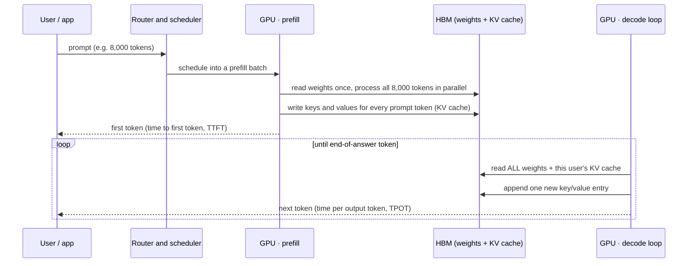
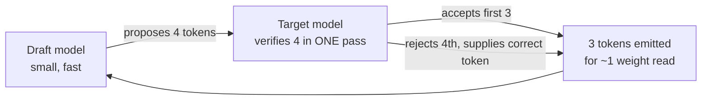
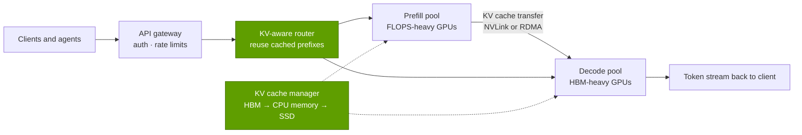

# P2 · How AI inference works

Primer P2 · Foundations for non-engineers · ~22 min read · Last verified: 2026-11-05

> [!NOTE]
> **Start here if you know spreadsheets and finance, not chips.** [Inference](../glossary.md#inference) is *using* a trained
> model: every chatbot answer, code completion and agent step. Training ([P1](P1-how-ai-training-works.md)) is
> a one-off capital project; inference is the recurring cost of goods sold of AI, and it is where token volumes, and the
> contest for NVIDIA's revenue, are growing fastest.

## ⚡ The Executive Take

- **Every request has two phases with opposite bottlenecks.** [Prefill](../glossary.md#prefill) reads the whole prompt at once and is *compute-bound*; [decode](../glossary.md#decode) generates one token at a time and is *memory-bandwidth-bound*, because every new token re-reads the model's weights from HBM [[S32027]](../sources/bibliography.md#s32027)[[S33013]](../sources/bibliography.md#s33013).
- **Decode speed per user ≈ memory bandwidth ÷ bytes read per token.** One stream of Llama 3.1 70B at FP8 (70 GB of weights) can never exceed ~48 tokens/s on an H100 (3.35 TB/s) [[S33002]](../sources/bibliography.md#s33002); on Rubin (19.2 TB/s per the current spec, cut from 22 TB/s at launch) [[S33005]](../sources/bibliography.md#s33005)[[S33007]](../sources/bibliography.md#s33007) the ceiling is ~274 tokens/s.
- **The [KV cache](../glossary.md#kv-cache) is inference's memory tax.** Each token in a conversation leaves keys and values in HBM: ~43 GB for one 128k-token Llama 3.1 70B conversation even with [grouped-query attention](../glossary.md#grouped-query-attention) [[S32006]](../sources/bibliography.md#s32006)[[S32010]](../sources/bibliography.md#s32010). Memory *capacity*, not FLOPs, decides how many users a GPU can hold.
- **[Batching](../glossary.md#batching) converts idle FLOPs into throughput, at the expense of speed per user.** Continuous batching and paged KV memory raised serving throughput 2–4× at equal latency [[S32011]](../sources/bibliography.md#s32011)[[S32012]](../sources/bibliography.md#s32012). The result is a [Pareto frontier](../glossary.md#pareto-frontier) of tokens/s per GPU versus tokens/s per user; in this repo's model a B200 node serves ~4× and Rubin ~10× an H100 node's tokens per GPU at 100 tokens/s per user (Est.).
- **The efficiency levers stack:** [quantization](../glossary.md#quantization) to FP8/[NVFP4](../glossary.md#nvfp4) [[S32017]](../sources/bibliography.md#s32017), [speculative decoding](../glossary.md#speculative-decoding) (2–3× in the original paper) [[S32013]](../sources/bibliography.md#s32013), [mixture-of-experts](../glossary.md#mixture-of-experts) (DeepSeek-V3 activates 37B of 671B parameters) [[S34007]](../sources/bibliography.md#s34007) and [disaggregated serving](../glossary.md#disaggregated-serving) of prefill and decode [[S32014]](../sources/bibliography.md#s32014)[[S32015]](../sources/bibliography.md#s32015).
- **Demand is compounding.** Google's monthly tokens rose from 9.7 trillion (Apr 2024) to over 1.3 quadrillion (Oct 2025) [[S32018]](../sources/bibliography.md#s32018)[[S32020]](../sources/bibliography.md#s32020); Microsoft processed 100T+ tokens in Jan–Mar 2025, 5× a year earlier [[S32021]](../sources/bibliography.md#s32021). [Reasoning models](../glossary.md#reasoning-model) and [agents](../glossary.md#agentic-ai) multiply tokens per task by one to three orders of magnitude (Est.) [[S32025]](../sources/bibliography.md#s32025).
- **Why it matters for NVIDIA:** inference is a cost-per-token contest, more divisible and more contestable than training. Specialized silicon (TPU, Trainium, Cerebras, SRAM-heavy designs) competes here first. NVIDIA's answer is rack-scale NVLink domains, FP4 and serving software (Dynamo), plus a reported ~$20B license-and-acquihire of Groq's LPU technology (Dec 2025) that now ships as a decode co-processor in the Vera Rubin platform [[S113]](../sources/bibliography.md#s113).

## 1. Prefill vs. decode: two jobs with opposite bottlenecks

**Analogy.** Prefill is reading the whole question; decode is writing the answer one word at a time, and before writing
each word you must flip through the entire textbook (the model's weights) again. Reading is fast because all words are
processed in parallel. Writing is slow because it is sequential and every step is a full pass through memory.

| | Prefill (context phase) | Decode (generation phase) |
|---|---|---|
| Tokens processed per step | the whole prompt, in parallel | one per user per step |
| Bottleneck | tensor-core FLOPS (compute-bound) | HBM bandwidth (memory-bound) |
| Latency metric it drives | time to first token (TTFT) | time per output token (TPOT) |
| Best hardware trait | raw FLOPS, even with cheaper memory | bandwidth and capacity per GPU |
| NVIDIA product hint | Rubin CPX (GDDR7, context phase): announced 2025, then pulled from the 2026 roadmap [[S33023]](../sources/bibliography.md#s33023)[[S115]](../sources/bibliography.md#s115) | HBM-rich GPUs in NVL72 racks; Groq-derived LPX (SRAM) racks [[S113]](../sources/bibliography.md#s113) |

> [!TIP]
> **Worked example — an 8,000-token prompt on Llama 3.1 70B.** Each token costs ~2 FLOPs per parameter in the forward
> pass, so prefill is 2 × 70 × 10⁹ × 8,000 = **1.1 × 10¹⁵ FLOPs**. An H100 does 1,979 dense FP8 TFLOPS [[S33002]](../sources/bibliography.md#s33002): ~0.57 s at
> peak, ~1.1 s at a realistic 50%, or ~0.15 s split across 8 GPUs. Decode is different: each output token needs only
> 2 × 70 × 10⁹ = 1.4 × 10¹¹ FLOPs (0.07 ms of H100 compute) but must read all 70 GB of FP8 weights, which takes **21 ms**
> at 3.35 TB/s. Decode is ~300× more memory-bound than compute-bound at batch size 1.

🔧 Under the hood: arithmetic intensity and the "ridge point"

[Arithmetic intensity](../glossary.md#arithmetic-intensity) is FLOPs performed per byte moved from memory. Decoding one stream
of an FP8 model does ~2 FLOPs per byte (one multiply-add per one-byte weight). An H100 can do 1,979 TFLOPS against
3.35 TB/s, a "ridge point" of ~590 FLOPs per byte [[S33002]](../sources/bibliography.md#s33002); B200 is ~560 [[S33003]](../sources/bibliography.md#s33003) and Rubin ~910 [[S33005]](../sources/bibliography.md#s33005). Below the
ridge a chip is waiting on memory. Batching lifts intensity because one weight read serves every sequence in the batch:
at batch 256 intensity is ~512 FLOPs per byte, close to the ridge, ignoring KV-cache reads. The chart below shows the same
picture in BF16, where both sides halve: ~1 FLOP per byte for batch-1 decode against an H100 ridge of ~295. The roofline picture is
developed in [P3 · The four bottlenecks](P3-the-four-bottlenecks.md) [[S33013]](../sources/bibliography.md#s33013).

## 2. The KV cache: memory that grows with every token

**Mechanism.** In attention, each new token compares itself with every earlier token. To avoid recomputing the earlier
tokens' "keys" and "values" each step, the server stores them: the KV cache. It grows linearly with context length and
with the number of concurrent users, and it lives in the same scarce HBM as the weights.

**Size formula (per token):** 2 (keys and values) × layers × KV heads × head dimension × bytes per value [[S32027]](../sources/bibliography.md#s32027).

> [!TIP]
> **Worked example — Llama 3.1 70B at its 128k context.** The model has 80 layers, 8 KV heads and a head dimension of
> 128 [[S32006]](../sources/bibliography.md#s32006). Per token: 2 × 80 × 8 × 128 × 2 bytes (BF16) = **327,680 bytes ≈ 0.33 MB**. At 131,072 tokens: 0.33 MB ×
> 131,072 = **42.9 GB for one conversation**, more than half of an 80 GB H100 [[S33002]](../sources/bibliography.md#s33002). Eight such users need 344 GB,
> more than a 288 GB Rubin GPU [[S33005]](../sources/bibliography.md#s33005). Without grouped-query attention (64 KV heads instead of 8) the same single
> conversation would need **344 GB** [[S32010]](../sources/bibliography.md#s32010). Storing the cache in FP8 halves every figure.

Model designers attack the KV cache directly. **Grouped-query attention** shares each key/value head across several
query heads (Llama 3.1: 8 KV heads for 64 query heads) [[S32010]](../sources/bibliography.md#s32010)[[S32006]](../sources/bibliography.md#s32006). DeepSeek's [**multi-head latent attention
(MLA)**](../glossary.md#multi-head-latent-attention) caches a compressed 576-value latent per layer per token [[S32009]](../sources/bibliography.md#s32009); DeepSeek-V2 reported a 93.3% smaller KV cache
and 5.76× higher maximum generation throughput from it [[S32026]](../sources/bibliography.md#s32026). On the serving side,
[PagedAttention](../glossary.md#paged-attention) stores the cache in fixed-size pages, like virtual memory, so it does not
waste HBM on fragmentation [[S32011]](../sources/bibliography.md#s32011).

🔧 Under the hood: prefix caching and KV offload

Many requests share a long common prefix (a system prompt, a code repository, an agent's growing transcript). Servers
keep those KV pages and reuse them, so a repeated prefix skips prefill entirely; that is why API providers price
"cached input" tokens far below fresh ones. When HBM runs out, inactive KV pages can be moved to CPU memory or SSD and
pulled back on demand. Both techniques make the network and memory hierarchy around the GPU (NVLink-C2C to Grace/Vera
CPUs, NICs, storage) part of inference performance, which is the hook for Layers 04, 07 and 11.

## 3. Batching and continuous batching

**Mechanism.** Because decode is memory-bound, a GPU serving one user leaves almost all its tensor cores idle. Serving
many users in the same step amortizes each weight read across all of them. Early servers used *static* batching: wait
for N requests, run them together, and let short answers sit idle until the longest one finishes. [**Continuous
batching**](../glossary.md#continuous-batching) (iteration-level scheduling, introduced by Orca [[S32012]](../sources/bibliography.md#s32012)) lets requests join and leave the batch at every
step. vLLM's PagedAttention added efficient KV memory management and reported **2–4× higher throughput** than
FasterTransformer and Orca at the same latency [[S32011]](../sources/bibliography.md#s32011).

> [!TIP]
> **Worked example — what batching buys on an 8× H100 node (repo model, Est.).** Llama 3.1 70B in FP8 split over 8 H100s
> (26.8 TB/s combined [[S33002]](../sources/bibliography.md#s33002)), 4k-token average context, FP8 KV cache, 75% achieved bandwidth and 3 ms of per-step
> overhead [[S32025]](../sources/bibliography.md#s32025):
>
> | Batch (concurrent users) | Step time | Tokens/s per user | Tokens/s per GPU |
> |---|---|---|---|
> | 1 | 6.5 ms | ~150 | ~19 |
> | 8 | 6.8 ms | ~148 | ~150 |
> | 64 | 8.6 ms | ~116 | ~930 |
> | 256 | 15.0 ms | ~67 | ~2,130 |
>
> Going from 1 to 64 users multiplies throughput ~49× while each user slows only ~25%. Past that, KV-cache reads grow
> with the batch and each user slows sharply. The operator's job is to pick the point on this curve that the product's
> latency promise allows.

## 4. Latency vs. throughput: the metrics and the Pareto frontier

| Metric | What it measures | Who cares | Typical driver |
|---|---|---|---|
| [TTFT](../glossary.md#ttft) (time to first token) | wait before the answer starts | chat UX, agents waiting on tools | prefill compute, queueing |
| [TPOT / ITL](../glossary.md#tpot) (time per output token / inter-token latency) | gap between streamed tokens | reading speed, agent loop speed | decode bandwidth, batch size |
| Tokens/s per user (interactivity) | 1 ÷ TPOT | premium tiers, reasoning models | bandwidth per user |
| Tokens/s per GPU (throughput) | total output across all users | the operator's revenue per GPU | batch size, memory capacity |
| [Goodput](../glossary.md#goodput) | throughput that still meets latency targets | SLA-bound services | everything above [[S32014]](../sources/bibliography.md#s32014) |

**The frontier.** Plot each batch size as a point: x = tokens/s per user, y = tokens/s per GPU. The curve slopes down:
bigger batches give more total tokens but slower individual users. Hardware and software generations are judged by how
far they push the *whole* curve up and to the right, not by one peak number. The chart at the top of this page is a
first-principles model of that frontier (an estimate; it ignores attention compute, MoE, speculative decoding, NVL72
scale-up and Dynamo).

> [!TIP]
> **Worked example — reading the frontier as a P&L.** In the model, at 100 tokens/s per user an H100 node yields ~1,270
> tokens/s per GPU, a B200 node ~4,950 and a Rubin node ~13,300 (Est.) [[S32025]](../sources/bibliography.md#s32025). At 50 tokens/s per user the B200 lead
> shrinks to ~2.8×. Revenue per GPU-hour = tokens/s per GPU × 3,600 × price per token: at an illustrative $1 per million
> output tokens, ~$4.60 per H100-hour vs ~$17.80 per B200-hour. The faster the product promises to be, the larger the
> newer generation's advantage, which is why NVIDIA markets interactivity-weighted comparisons.

> [!WARNING]
> **Myth vs. reality: "the cheapest chip per FLOP wins inference."** Decode rarely uses the FLOPs; it is bound by memory
> bandwidth, KV capacity and, for big models, the interconnect between GPUs. The right comparison is cost per token
> **at a stated latency target**. A chip that wins at relaxed latency (large batches) can lose badly at high
> interactivity, and vice versa.

## 5. Quantization and why decode tokens/s ≈ bandwidth ÷ bytes per token

**Mechanism.** If every generated token requires reading every weight once, then the fastest a single stream can go is
memory bandwidth divided by model bytes. Halving the bytes per weight (BF16 → FP8 → FP4) roughly doubles that ceiling and
halves the memory footprint. NVIDIA's NVFP4 stores 4-bit values with an FP8 scale per 16-value block plus a per-tensor
scale [[S32017]](../sources/bibliography.md#s32017), about 4.5 bits per weight once scales are included.

The bandwidth side of the ratio has grown far more slowly than compute, which is why decode, not FLOPS, sets the user
experience:

> [!TIP]
> **Worked example — H100 vs. B200 vs. Rubin for one Llama 3.1 70B stream.**
>
> | GPU | HBM bandwidth | BF16 weights (140 GB) | FP8 (70 GB) | FP4 (~39 GB) |
> |---|---|---|---|---|
> | H100 | 3.35 TB/s [[S33002]](../sources/bibliography.md#s33002) | ~24 tok/s (does not fit in 80 GB) | ~48 | ~85 |
> | B200 | 8 TB/s [[S33003]](../sources/bibliography.md#s33003) | ~57 | ~114 | ~203 |
> | Rubin | 19.2 TB/s [[S33005]](../sources/bibliography.md#s33005)[[S33007]](../sources/bibliography.md#s33007) | ~137 | ~274 | ~488 |
>
> These are ceilings for batch 1 (KV reads, overheads and multi-GPU splits ignored). Rubin's ~5.7× bandwidth over H100
> is the main reason it decodes faster, and NVIDIA's 2H 2026 revision of Rubin's listed bandwidth from 22 to 19.2 TB/s
> [[S33007]](../sources/bibliography.md#s33007)[[S33008]](../sources/bibliography.md#s33008) lowers this ceiling by ~13% (🟡 reported).

| Format | Bits per weight | Memory vs BF16 | Hardware support | Quality risk |
|---|---|---|---|---|
| BF16 | 16 | 1× | all current GPUs | baseline |
| FP8 | 8 | 0.5× | Hopper and later tensor cores [[S33002]](../sources/bibliography.md#s33002) | small with per-tensor scaling |
| NVFP4 | ~4.5 incl. scales | ~0.28× | Blackwell and Rubin tensor cores [[S32017]](../sources/bibliography.md#s32017) | needs block scaling; model-dependent |

## 6. Speculative decoding: guessing ahead

**Mechanism.** A small, cheap *draft* model proposes several next tokens; the large model then checks all of them in
**one** forward pass (which looks like a short prefill, so it is compute-friendly) and keeps the longest correct
prefix. The output distribution is mathematically identical to the large model's [[S32013]](../sources/bibliography.md#s32013). Because decode is
memory-bound, verifying four tokens costs about the same weight reads as generating one.

> [!TIP]
> **Worked example — why it helps.** If the target model accepts on average 3 of every 4 drafted tokens and also supplies
> one correct token on each pass, each expensive 70 GB weight read now yields ~4 tokens instead of 1. Draft-model and
> verification overheads eat part of that, which is why the original paper reported **2–3×** speed-ups rather than 4×
> [[S32013]](../sources/bibliography.md#s32013). Gains shrink at large batch sizes, where the GPU is already closer to compute-bound.

## 7. Mixture-of-experts at inference

An MoE model routes each token to a few expert sub-networks. DeepSeek-V3 has 671B parameters but activates 37B per
token [[S34007]](../sources/bibliography.md#s34007). For inference this splits the two bottlenecks:

- **Compute per token** behaves like a 37B model (cheap).
- **Memory** must hold all 671B parameters: ~671 GB at FP8, more than two 288 GB GPUs before any KV cache.
- **Traffic:** tokens are dispatched to experts on other GPUs and gathered back (*all-to-all* communication) at every
  MoE layer. DeepSeek's own decode deployment spread experts over 320 GPUs [[S34007]](../sources/bibliography.md#s34007).

> [!TIP]
> **Worked example — why MoE favors large NVLink domains.** At small batch, each token touches ~37B parameters (~37 GB at
> FP8), so a stream decodes almost as fast as a 37B dense model. At large batch, different tokens hit different experts
> and nearly all 671 GB are read every step, so aggregate bandwidth across many GPUs, and the all-to-all fabric between
> them, set throughput. A 72-GPU NVLink domain keeps that all-to-all on the fastest links; an 8-GPU server pushes it onto
> the slower scale-out network. This is the mechanism behind NVIDIA's claim of up to 30× more DeepSeek-R1 requests on
> GB200 NVL72 with Dynamo (🟡 vendor claim) [[S32015]](../sources/bibliography.md#s32015); see [Layer 05](../layers/05-scale-up-nvlink-nvswitch/index.md).

## 8. Disaggregated prefill and decode

Because prefill is compute-bound and decode is bandwidth-bound, running both on the same GPUs makes them interfere:
a long prefill stalls every user's decode step. **Disaggregated serving** runs them on separate GPU pools and ships
the KV cache between them; DistServe showed the goodput benefit of this split [[S32014]](../sources/bibliography.md#s32014), and NVIDIA's open-source Dynamo
framework (GTC 2025) productizes it with KV-aware routing [[S32015]](../sources/bibliography.md#s32015). NVIDIA then tried to specialize the *hardware*
per phase, and its plans have moved fast:

- **Prefill:** Rubin CPX, a GPU with 128 GB of GDDR7 instead of HBM for the compute-bound context phase, was announced in
  September 2025 for end-2026 [[S33023]](../sources/bibliography.md#s33023), then dropped from the GTC 2026 roadmap [[S115]](../sources/bibliography.md#s115); NVIDIA said it was pushed
  out to focus on decode [[S116]](../sources/bibliography.md#s116). A reported HBM4 redesign targets 1Q27 (🟡 analyst claim, not confirmed by NVIDIA) [[S117]](../sources/bibliography.md#s117).
- **Decode:** after its ~$20B Groq license and acquihire, NVIDIA added the Groq 3 LPU (LP30) to the Vera Rubin platform:
  ~500 MB of on-chip SRAM at ~150 TB/s per chip, 256 chips per LPX rack, shipping from Q3 2026 per NVIDIA (🟡 reported)
  [[S113]](../sources/bibliography.md#s113)[[S114]](../sources/bibliography.md#s114).

> [!TIP]
> **Worked example — sizing the KV hand-off.** An 8,000-token prompt on Llama 3.1 70B produces 8,000 × 0.33 MB ≈
> **2.6 GB** of BF16 KV cache (1.3 GB in FP8) [[S32006]](../sources/bibliography.md#s32006). Moving it from a prefill GPU to a decode GPU within ~10 ms
> needs ~130–260 GB/s: comfortable over NVLink, tight over a single 400 Gb/s (50 GB/s) network port. Disaggregation
> therefore pulls inference toward the same fast fabrics that training uses.

> [!TIP]
> **Worked example — why NVIDIA wanted an SRAM decode chip.** Decode speed is bandwidth ÷ bytes per token (Section 5).
> A Groq 3 LPU's on-chip SRAM delivers ~150 TB/s, ~8× a Rubin GPU's 19.2 TB/s of HBM4 [[S114]](../sources/bibliography.md#s114)[[S33005]](../sources/bibliography.md#s33005), but each
> chip holds only ~0.5 GB. Llama 3.1 70B in FP8 (70 GB) must therefore be spread across ~140 chips, more than half an
> LPX rack's 128 GB of SRAM [[S114]](../sources/bibliography.md#s114). The trade is extreme bandwidth per byte for tiny capacity per chip: superb for
> low-latency decode of a model that fits, poor for huge KV caches and long contexts, which still need HBM.

## 9. Reasoning, test-time compute, agents and token demand

**Reasoning models** think before answering: they generate hidden chain-of-thought tokens that the user never sees but
that are billed as output and cost decode time [[S32024]](../sources/bibliography.md#s32024). OpenAI advises reserving at least 25,000 tokens for reasoning
plus output when starting out [[S32024]](../sources/bibliography.md#s32024). Spending more inference compute per question to get a better answer is called
[test-time compute](../glossary.md#test-time-compute). **Agents** loop: plan, call a tool, read the result, re-read the growing
context, decide again, so one task can involve dozens of model calls.

> [!TIP]
> **Worked example — tokens per task (illustrative, Est.).** A chat reply: ~600 tokens read, ~400 generated. A reasoning
> answer to the same question: the same 600 read, but ~8,000 hidden reasoning tokens plus the 400-token answer, **~21×
> the generated tokens**. A 30-turn coding agent whose context grows from 10k to 60k tokens re-reads ~1.05M tokens and
> generates ~45k, **~1,100× the chat total** [[S32025]](../sources/bibliography.md#s32025). Prefix caching makes the re-reads cheaper, but the generated
> tokens are full-price decode. NVIDIA's CEO argued at GTC 2025 that reasoning and agentic AI need easily 100× the
> computation expected a year earlier (🟡 vendor claim) [[S33020]](../sources/bibliography.md#s33020).

| Disclosure | Figure | Date | Source |
|---|---|---|---|
| Google, all surfaces | 9.7T tokens/month → 480T (~50×) | Apr 2024 → Apr 2025 | [[S32018]](../sources/bibliography.md#s32018) |
| Google | ~980T tokens/month | mid-2025 | [[S32019]](../sources/bibliography.md#s32019) |
| Google | over 1.3 quadrillion tokens/month | Oct 2025 | [[S32020]](../sources/bibliography.md#s32020) |
| Microsoft | 100T+ tokens in Jan–Mar 2025 (5× YoY); 50T in March alone | Apr 2025 | [[S32021]](../sources/bibliography.md#s32021) |
| OpenAI API | ~6B tokens per minute (~259T per month) | Oct 2025 | [[S32022]](../sources/bibliography.md#s32022) |

> [!TIP]
> **Worked example — what 1.3 quadrillion tokens a month means in hardware.** 1.3 × 10¹⁵ tokens ÷ 2.59M seconds in a
> month ≈ **500M tokens/s** on average. At the ~5,000 tokens/s per GPU this primer's model gives a B200 node for a 70B
> dense model at 100 tokens/s per user, that is ~100,000 accelerators running flat out (🔴 illustrative: Google serves
> much of this on its own TPUs, model sizes vary, and peak load exceeds the average).

> [!NOTE]
> **🐂 Bull view.** Token demand grew ~134× in 18 months at Google alone [[S32018]](../sources/bibliography.md#s32018)[[S32020]](../sources/bibliography.md#s32020), reasoning and agents multiply
> tokens per task, and every point of interactivity customers pay for favors the newest, highest-bandwidth NVIDIA racks.
> Inference becomes the larger, recurring market, and NVIDIA's software (Dynamo, TensorRT-LLM) compounds the hardware lead.

> [!WARNING]
> **🐻 Bear view.** Inference splits into many small, independent jobs that do not need NVIDIA's synchronized fabrics,
> and cost per token is easy to benchmark, so buyers can multi-source. Hyperscalers already run large volumes on their
> own silicon (🟡 Google serves its own models largely on TPUs), and efficiency gains (MoE, MLA, FP4, distillation) cut the hardware needed
> per token, possibly faster than demand grows.

## How this connects to the layers

- **[Layer 02 · GPU silicon](../layers/02-gpu-silicon/index.md):** FP8/FP4 tensor cores, and the FLOPS-vs-bandwidth balance
  that sets prefill vs decode performance.
- **[Layer 03 · Memory and packaging](../layers/03-memory-packaging-supply-chain/index.md):** HBM bandwidth is the decode
  ceiling and HBM capacity is the KV-cache budget; HBM4 is the Rubin story.
- **[Layer 04 · CPU (Grace, Vera)](../layers/04-cpu-grace-vera/index.md):** coherent CPU memory as a KV-cache overflow tier.
- **[Layer 05 · Scale-up (NVLink)](../layers/05-scale-up-nvlink-nvswitch/index.md):** tensor- and expert-parallel serving
  of large and MoE models inside an NVL72 domain.
- **[Layer 06 · Scale-out networking](../layers/06-scale-out-scale-across-networking/index.md)** and
  **[Layer 07 · DPU, SuperNIC, storage](../layers/07-dpu-supernic-storage-security/index.md):** KV transfer for
  disaggregated serving, KV offload to storage.
- **[Layer 08 · Systems and AI factories](../layers/08-systems-racks-ai-factories/index.md):** rack-scale systems, LPX
  decode racks and the shifting prefill-hardware plans.
- **[Layer 11 · Inference and AI software](../layers/11-inference-and-ai-software/index.md):** TensorRT-LLM, Dynamo, NIM
  and the open-source alternatives (vLLM, SGLang).
- **[Layer 12 · Orchestration and cloud](../layers/12-orchestration-and-cloud-services/index.md):** autoscaling and routing
  across fleets.
- Economics: [Chapter 14 · Training vs. inference economics](../cross-cutting/14-training-vs-inference-economics.md);
  roofline intuition: [P3](P3-the-four-bottlenecks.md); multi-GPU splits: [P4](P4-parallelism-explained.md).

## Key numbers to remember

| Number | Value | Source |
|---|---|---|
| Decode ceiling, one stream | ≈ HBM bandwidth ÷ bytes read per token | [[S33013]](../sources/bibliography.md#s33013) |
| Llama 3.1 70B FP8, batch 1 | ≤ ~48 tok/s on H100 · ~114 on B200 · ~274 on Rubin | [[S33002]](../sources/bibliography.md#s33002)[[S33003]](../sources/bibliography.md#s33003)[[S33005]](../sources/bibliography.md#s33005) |
| KV cache per token, Llama 3.1 70B (BF16) | ~0.33 MB (2 × 80 layers × 8 KV heads × 128 × 2 B) | [[S32006]](../sources/bibliography.md#s32006) |
| KV cache at 128k tokens, same model | ~43 GB per conversation (344 GB without GQA) | [[S32006]](../sources/bibliography.md#s32006)[[S32010]](../sources/bibliography.md#s32010) |
| MLA KV-cache reduction (DeepSeek-V2) | −93.3%, 5.76× max generation throughput | [[S32026]](../sources/bibliography.md#s32026) |
| Continuous batching + PagedAttention | 2–4× throughput at equal latency | [[S32011]](../sources/bibliography.md#s32011) |
| Speculative decoding (original paper) | 2–3× faster, identical outputs | [[S32013]](../sources/bibliography.md#s32013) |
| DeepSeek-V3 active vs total parameters | 37B of 671B | [[S34007]](../sources/bibliography.md#s34007) |
| Google monthly tokens | 9.7T (Apr 2024) → 1.3 quadrillion (Oct 2025) | [[S32018]](../sources/bibliography.md#s32018)[[S32020]](../sources/bibliography.md#s32020) |
| Microsoft tokens, Jan–Mar 2025 | 100T+, 5× year over year | [[S32021]](../sources/bibliography.md#s32021) |

## 🎯 Corp Dev Lens

1. **Cost per token at a latency target is the metric that matters.** Every vendor claim should be pinned to a point on
   the throughput–interactivity frontier. Ask competitors (and NVIDIA) for the full curve, not a peak, before crediting a
   "10× cheaper" claim.
2. **Memory is the contested resource.** Decode is bandwidth-bound and KV-capacity-bound, so HBM supply (Layer 03) and
   memory-tiering (CPU memory, CXL, SSD offload) are where inference value pools. Which memory-hierarchy and KV-cache
   software companies could matter to an inference-focused datacenter roadmap?
3. **Disaggregation opens the door to heterogeneous fleets.** Once prefill and decode run on different pools, a
   non-NVIDIA accelerator can win one phase without winning both. NVIDIA clearly sees the same split: it announced a
   prefill GPU (Rubin CPX) [[S33023]](../sources/bibliography.md#s33023) and then spent a reported ~$20B to bring Groq's SRAM-based decode architecture
   in-house [[S113]](../sources/bibliography.md#s113). Is the decode pool, the context pool, or the router/scheduler software the most realistic entry
   point for a challenger, and how many decode-specialist startups remain independent?
4. **Efficiency techniques are commoditizing fast.** Continuous batching, paged KV, speculative decoding and FP8 are open
   and widely implemented [[S32011]](../sources/bibliography.md#s32011)[[S32013]](../sources/bibliography.md#s32013); differentiation migrates to rack-scale systems and fleet-level software. Who
   owns the open-source serving layer (vLLM, SGLang) and its talent is a strategic question for any accelerator vendor.
5. **Token growth is the demand signal to track.** Google's ~134× in 18 months [[S32018]](../sources/bibliography.md#s32018)[[S32020]](../sources/bibliography.md#s32020) and reasoning/agent
   multipliers [[S32025]](../sources/bibliography.md#s32025) argue for inference capacity growth; efficiency gains argue the other way. A quarterly tracker of
   disclosed token volumes against installed accelerator capacity would show which force is winning.

## 📚 Sources

<!-- Auto-generated from the [S…] citations on this page by `make build`. Edit sources/registry/*.csv, not this list. -->

- [**S113**](../sources/bibliography.md#s113) Tom's Hardware, *How Nvidia's $20 billion Groq 3 LPU deal reshapes the Nvidia Vera Rubin Platform*, 2026-03. [Link](https://www.tomshardware.com/tech-industry/semiconductors/nvidias-20-billion-groq-deal-produces-its-first-chip)
- [**S114**](../sources/bibliography.md#s114) StorageReview, *NVIDIA Groq 3 LPX: Everything we know*, 2026-03. [Link](https://www.storagereview.com/news/nvidia-groq-3-lpx-everything-we-know)
- [**S115**](../sources/bibliography.md#s115) Tom's Hardware, *Nvidia removes Rubin CPX accelerators from its roadmap - Groq 3 LPUs take center stage*, 2026-03. [Link](https://www.tomshardware.com/pc-components/gpus/nvidia-removes-rubin-cpx-accelerators-from-its-roadmap-groq-3-lpus-take-center-stage-as-cpx-is-removed)
- [**S116**](../sources/bibliography.md#s116) Wccftech, *NVIDIA's Rubin CPX Is Off the Roadmap, Replaced by Groq LPUs for Inference, But May Return With Feynman in 2028*, 2026-03. [Link](https://wccftech.com/nvidia-rubin-cpx-is-off-the-roadmap-but-may-return-with-feynman-in-2028/)
- [**S117**](../sources/bibliography.md#s117) TechNews (Taiwan), *Nvidia Rubin CPX re-enters roadmap with HBM4 for AI prefill*, 2026-09-02. [Link](https://technews.tw/2026/09/02/nvidia-rubin-cpx-reenters-roadmap-hbm4-ai-prefill/)
- [**S32006**](../sources/bibliography.md#s32006) Meta via Hugging Face, *Llama 3.1 70B configuration (config.json)*, 2024-07-23. [Link](https://huggingface.co/meta-llama/Llama-3.1-70B/blob/main/config.json)
- [**S32009**](../sources/bibliography.md#s32009) DeepSeek-AI via Hugging Face, *DeepSeek-V3 configuration (config.json)*, 2024-12-26. [Link](https://huggingface.co/deepseek-ai/DeepSeek-V3/blob/main/config.json)
- [**S32010**](../sources/bibliography.md#s32010) Google Research (arXiv 2305.13245) (Ainslie et al.), *GQA: Training Generalized Multi-Query Transformer Models from Multi-Head Checkpoints*, 2023-05. [Link](https://arxiv.org/abs/2305.13245)
- [**S32011**](../sources/bibliography.md#s32011) SOSP 2023 (arXiv 2309.06180) (Kwon et al.), *Efficient Memory Management for Large Language Model Serving with PagedAttention (vLLM)*, 2023-09. [Link](https://arxiv.org/abs/2309.06180)
- [**S32012**](../sources/bibliography.md#s32012) USENIX OSDI 2022 (Yu et al.), *Orca: A Distributed Serving System for Transformer-Based Generative Models*, 2022-07. [Link](https://www.usenix.org/conference/osdi22/presentation/yu)
- [**S32013**](../sources/bibliography.md#s32013) Google Research (arXiv 2211.17192) (Leviathan, Kalman, Matias), *Fast Inference from Transformers via Speculative Decoding*, 2022-11. [Link](https://arxiv.org/abs/2211.17192)
- [**S32014**](../sources/bibliography.md#s32014) USENIX OSDI 2024 (arXiv 2401.09670) (Zhong et al.), *DistServe: Disaggregating Prefill and Decoding for Goodput-optimized LLM Serving*, 2024-01. [Link](https://arxiv.org/abs/2401.09670)
- [**S32015**](../sources/bibliography.md#s32015) NVIDIA Newsroom, *NVIDIA Dynamo open-source inference framework announcement (GTC 2025)*, 2025-03-18. [Link](https://nvidianews.nvidia.com/news/nvidia-dynamo-open-source-library-accelerates-and-scales-ai-reasoning-models)
- [**S32017**](../sources/bibliography.md#s32017) NVIDIA Technical Blog, *Introducing NVFP4 for Efficient and Accurate Low-Precision Inference*, 2025-06. [Link](https://developer.nvidia.com/blog/introducing-nvfp4-for-efficient-and-accurate-low-precision-inference/)
- [**S32018**](../sources/bibliography.md#s32018) Google (The Keyword) (Sundar Pichai), *Google I/O 2025 keynote remarks (Sundar Pichai)*, 2025-05-20. [Link](https://blog.google/technology/ai/io-2025-keynote/)
- [**S32019**](../sources/bibliography.md#s32019) Alphabet / Google (The Keyword) (Sundar Pichai), *Alphabet Q2 2025 earnings call - CEO remarks*, 2025-07-23. [Link](https://blog.google/inside-google/message-ceo/alphabet-earnings-q2-2025/)
- [**S32020**](../sources/bibliography.md#s32020) Alphabet / Google (The Keyword) (Sundar Pichai), *Alphabet CEO remarks on token volume (October 2025)*, 2025-10. [Link](https://blog.google/inside-google/message-ceo/alphabet-earnings-q3-2025/)
- [**S32021**](../sources/bibliography.md#s32021) Microsoft Investor Relations (Satya Nadella), *Microsoft FY2025 Q3 earnings call (Satya Nadella remarks)*, 2025-04-30. [Link](https://www.microsoft.com/en-us/investor/events/fy-2025/earnings-fy-2025-q3)
- [**S32022**](../sources/bibliography.md#s32022) OpenAI (Sam Altman), *OpenAI DevDay 2025 keynote*, 2025-10-06. [Link](https://openai.com/devday/)
- [**S32024**](../sources/bibliography.md#s32024) OpenAI, *Reasoning models guide (OpenAI API documentation)*, 2025. [Link](https://platform.openai.com/docs/guides/reasoning)
- [**S32025**](../sources/bibliography.md#s32025) nvidia_deep_dive_claude repository, *Repo analysis: inference token-budget scenarios and roofline serving model (Primer P2)*, 2026-11-05. [Link](https://github.com/FrankHuang94/nvidia_deep_dive_claude/blob/main/primers/P2-how-ai-inference-works.md)
- [**S32026**](../sources/bibliography.md#s32026) DeepSeek-AI (arXiv 2405.04434) (DeepSeek-AI), *DeepSeek-V2: A Strong, Economical, and Efficient Mixture-of-Experts Language Model*, 2024-05. [Link](https://arxiv.org/abs/2405.04434)
- [**S32027**](../sources/bibliography.md#s32027) NVIDIA Technical Blog, *Mastering LLM Techniques: Inference Optimization*, 2023-11. [Link](https://developer.nvidia.com/blog/mastering-llm-techniques-inference-optimization/)
- [**S33002**](../sources/bibliography.md#s33002) NVIDIA, *NVIDIA H100 Tensor Core GPU (product page and datasheet)*, 2022-03-22. [Link](https://www.nvidia.com/en-us/data-center/h100/)
- [**S33003**](../sources/bibliography.md#s33003) Lenovo Press, *ThinkSystem NVIDIA B200 180GB 1000W GPU product guide*, 2025. [Link](https://lenovopress.lenovo.com/lp2226-thinksystem-nvidia-b200-180gb-1000w-gpu)
- [**S33005**](../sources/bibliography.md#s33005) NVIDIA, *NVIDIA Vera Rubin NVL72 (product page and specifications)*, 2026. [Link](https://www.nvidia.com/en-us/data-center/vera-rubin-nvl72/)
- [**S33007**](../sources/bibliography.md#s33007) Dataconomy, *Nvidia Quietly Cuts Vera Rubin HBM4 And NVLink Bandwidth Specs*, 2026-11-02. [Link](https://dataconomy.com/2026/11/02/nvidia-quietly-cuts-vera-rubin-hbm4-and-nvlink-bandwidth/)
- [**S33008**](../sources/bibliography.md#s33008) CloudNews.tech, *NVIDIA Vera Rubin: HBM4 and NVLink bandwidth cut in spec sheet*, 2026-11. [Link](https://cloudnews.tech/nvidia-lowers-vera-rubins-memory-and-nvlink-bandwidth-blames-production-ramp/)
- [**S33013**](../sources/bibliography.md#s33013) kipp.ly (Carol Chen (kipply)), *Transformer Inference Arithmetic*, 2022-03-30. [Link](https://kipp.ly/transformer-inference-arithmetic/)
- [**S33020**](../sources/bibliography.md#s33020) NVIDIA (Jensen Huang), *NVIDIA GTC 2025 keynote (Jensen Huang)*, 2025-03-18. [Link](https://www.nvidia.com/gtc/keynote/)
- [**S33023**](../sources/bibliography.md#s33023) NVIDIA Newsroom, *NVIDIA Unveils Rubin CPX: A New Class of GPU Designed for Massive-Context Inference*, 2025-09-09. [Link](https://nvidianews.nvidia.com/news/nvidia-unveils-rubin-cpx-a-new-class-of-gpu-designed-for-massive-context-inference)
- [**S34007**](../sources/bibliography.md#s34007) arXiv:2412.19437 (DeepSeek-AI), *DeepSeek-V3 Technical Report*, 2024-12-27. [Link](https://arxiv.org/abs/2412.19437)
