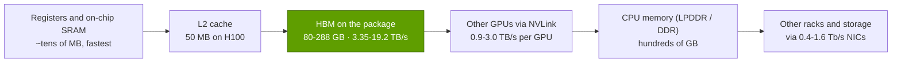
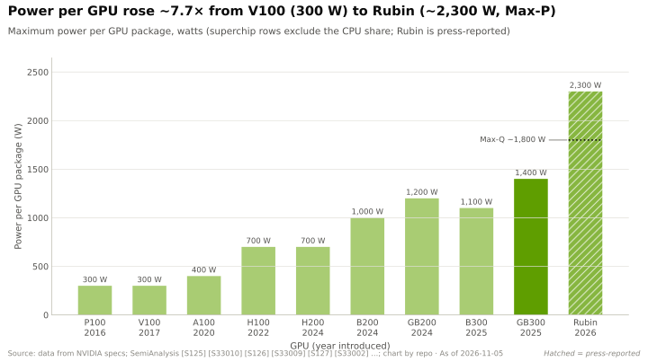
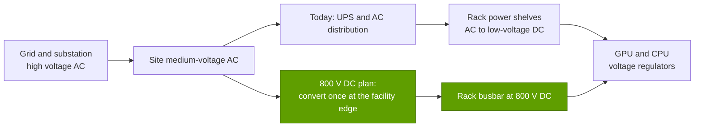
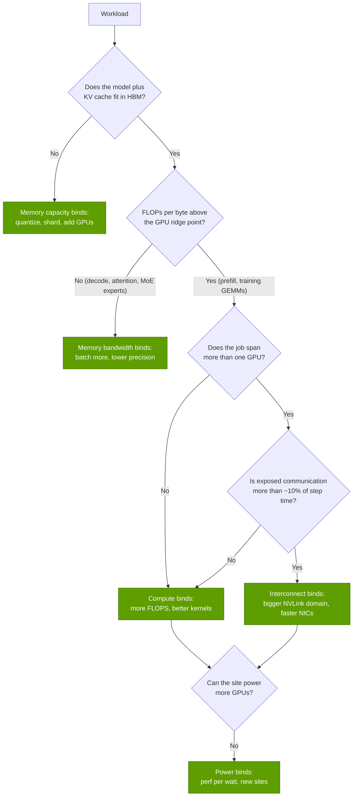

# P3 · The four bottlenecks

Primer P3 · Foundations for non-engineers · ~22 min read · Last verified: 2026-11-05

## ⚡ The Executive Take

- **An AI system runs at the speed of whichever of four resources runs out first:** compute ([FLOPS](../glossary.md#flops)), memory (bandwidth and capacity of [HBM](../glossary.md#hbm)), interconnect (the [scale-up](../glossary.md#scale-up) and [scale-out](../glossary.md#scale-out) fabrics) and power. Paying for more of a resource that is not binding buys almost nothing, which is why "peak PFLOPS" alone is a poor guide to value.
- **The [roofline model](../glossary.md#roofline-model) tells you which one binds.** Divide peak FLOPS by memory bandwidth to get the [ridge point](../glossary.md#ridge-point): about 295 FLOPs per byte for an H100 in dense BF16 (989 TFLOPS ÷ 3.35 TB/s) [[S33002]](../sources/bibliography.md#s33002), ~281 for a B200 (2,250 TFLOPS ÷ 8 TB/s) [[S33003]](../sources/bibliography.md#s33003) and ~208 for Rubin (4,000 TFLOPS ÷ 19.2 TB/s) [[S33005]](../sources/bibliography.md#s33005)[[S33007]](../sources/bibliography.md#s33007). Work that does fewer FLOPs per byte than that is [memory-bound](../glossary.md#memory-bound).
- **Chatbot-style generation is deeply memory-bound.** Generating one token at batch size 1 does ~1 FLOP per byte of weights read, so a B200 serving a 70B-parameter BF16 model uses ~8 of its 2,250 TFLOPS, about 0.4% (repo arithmetic on [[S33003]](../sources/bibliography.md#s33003)[[S33013]](../sources/bibliography.md#s33013)). Batching moves the work right on the roofline until the [KV cache](../glossary.md#kv-cache) runs out of memory capacity.
- **The [memory wall](../glossary.md#memory-wall) is real, though headline FLOPS overstate it.** From V100 to Rubin, peak dense FLOPS at the lowest supported precision rose ~280× while HBM bandwidth rose ~21× [[S33010]](../sources/bibliography.md#s33010)[[S33005]](../sources/bibliography.md#s33005)[[S33007]](../sources/bibliography.md#s33007); at a like-for-like 16-bit precision the gap is 32× vs 21×. Across the industry, peak FLOPS grew ~3.0× every two years vs ~1.6× for DRAM bandwidth and ~1.4× for interconnect [[S33011]](../sources/bibliography.md#s33011).
- **Communication caps scaling, per [Amdahl's law](../glossary.md#amdahls-law).** Even Meta's carefully tuned Llama 3 405B run reached 38–43% BF16 [model FLOPs utilization](../glossary.md#mfu) on up to 16,384 H100s [[S34006]](../sources/bibliography.md#s34006); most of the rest is lost to communication, pipeline bubbles and memory stalls (detail in [P4](P4-parallelism-explained.md)).
- **Power is now the site-level speed limit.** The IEA estimates datacenters used ~415 TWh in 2024 and projects ~945 TWh by 2030 [[S33015]](../sources/bibliography.md#s33015); LBNL puts US datacenters at 176 TWh (4.4% of US electricity) in 2023 and 325–580 TWh by 2028 [[S33016]](../sources/bibliography.md#s33016). Rack power rose from ~41 kW for four DGX H100 systems [[S33022]](../sources/bibliography.md#s33022) to ~120–132 kW for a GB200 NVL72 [[S33021]](../sources/bibliography.md#s33021), with ~600 kW Kyber racks reported for 2027 [[S35019]](../sources/bibliography.md#s35019).
- **NVIDIA's advantage is selling an answer to all four at once** (HBM-heavy GPUs, NVLink, InfiniBand/Spectrum-X, liquid-cooled racks and an 800 V DC power plan [[S33019]](../sources/bibliography.md#s33019)). The bear point: the binding resource for inference, HBM, is bought from the same three memory makers as everyone else, and NVIDIA's own Rubin HBM4 bandwidth listing was cut from 22 TB/s to 19.2 TB/s in late 2026 [[S33006]](../sources/bibliography.md#s33006)[[S33007]](../sources/bibliography.md#s33007).

## Start here: a kitchen with four ways to be slow

Picture a restaurant kitchen. The **chefs** are compute: how many dishes per minute they can cook if every ingredient is at hand. The **pantry door** is memory bandwidth: how fast ingredients reach the counter. The **pantry's size** is memory capacity: whether everything you need is in the building at all. The **runners between kitchens** are the interconnect: when one meal is cooked across eight kitchens, the plates have to move. And the **gas line** is power: no matter how many chefs you hire, the burners only deliver so much heat.

A kitchen with brilliant chefs and a narrow pantry door serves no more meals than the door allows. AI hardware works the same way. A GPU's headline number is its peak FLOPS (floating-point operations per second), but most AI workloads hit one of the other three limits first. The job of a system designer — and of anyone judging a competitor's claim — is to ask *which resource binds for this workload*.

| Bottleneck | What it measures | Unit | H100 → B200 → Rubin (per GPU) | When it binds | NVIDIA's answer | Strongest alternative approaches |
|---|---|---|---|---|---|---|
| **Compute** | Arithmetic per second | PFLOPS (dense) | 0.99 → 2.25 → 4.0 BF16 [[S33002]](../sources/bibliography.md#s33002)[[S33003]](../sources/bibliography.md#s33003)[[S33005]](../sources/bibliography.md#s33005) | Training, prefill | Tensor cores; FP8 → [NVFP4](../glossary.md#nvfp4) number formats [[S32017]](../sources/bibliography.md#s32017) | TPU and Trainium systolic arrays; wafer-scale (Cerebras) |
| **Memory** | Bytes per second from HBM; GB that fit | TB/s; GB | 3.35 → 8 → 19.2 TB/s; 80 → 180 → 288 GB [[S33002]](../sources/bibliography.md#s33002)[[S33003]](../sources/bibliography.md#s33003)[[S33005]](../sources/bibliography.md#s33005)[[S33007]](../sources/bibliography.md#s33007) | Decode, long context, MoE serving | More and newer HBM stacks; prefill/decode split with Rubin CPX [[S33023]](../sources/bibliography.md#s33023) | SRAM-heavy chips (Groq, Cerebras); LPDDR-based inference cards |
| **Interconnect** | GPU-to-GPU bytes per second | TB/s (scale-up); Gb/s (scale-out) | NVLink 0.9 → 1.8 → 3.0 TB/s [[S34014]](../sources/bibliography.md#s34014)[[S33007]](../sources/bibliography.md#s33007); NICs 400 → 800 → 1,600 Gb/s [[S34015]](../sources/bibliography.md#s34015)[[S33004]](../sources/bibliography.md#s33004) | Training at scale, MoE all-to-all | [NVLink](../glossary.md#nvlink)/[NVSwitch](../glossary.md#nvswitch) NVL72; [InfiniBand](../glossary.md#infiniband) and [Spectrum-X](../glossary.md#spectrum-x) | Google ICI with optical switches; UALink; Ethernet scale-up |
| **Power** | Watts per chip, rack, site | W; kW; MW | 700 → 1,000 W [[S33002]](../sources/bibliography.md#s33002)[[S33003]](../sources/bibliography.md#s33003); rack ~41 → ~120–132 kW [[S33022]](../sources/bibliography.md#s33022)[[S33021]](../sources/bibliography.md#s33021) | Site build-outs, grid hook-ups | [Liquid cooling](../glossary.md#liquid-cooling); [800 V DC](../glossary.md#hvdc-800v) racks [[S33019]](../sources/bibliography.md#s33019) | Efficiency-first ASICs; siting near cheap power |

> [!IMPORTANT]
> **The one thing to remember:** a workload's *arithmetic intensity* (FLOPs per byte moved) decides whether compute or memory binds; its *communication pattern* decides how far it can scale; and the *site's power* decides how many GPUs you get to buy in the first place.

## 1. Compute: how many FLOPs per second

**What it is.** A modern NVIDIA GPU does most of its AI math in [tensor cores](../glossary.md#tensor-core), units that multiply small matrices in one step. The big numbers on a datasheet are *peak* rates: what the chip would do if every tensor core were busy every cycle on perfectly shaped data. They depend on the number format. Halving the bits roughly doubles the rate: a B200 is rated at 2.25 PFLOPS dense in BF16, 4.5 in FP8 and 9 in FP4 [[S33003]](../sources/bibliography.md#s33003). NVIDIA's headline figures often assume 2:4 [sparsity](../glossary.md#sparsity), which doubles them again; this repo always quotes **dense** numbers unless stated.

**Why peak is not delivered.** A chip only hits peak on large, well-shaped [matrix multiplications (GEMMs)](../glossary.md#gemm) whose operands are already sitting in on-chip memory. Real training steps include element-wise operations, communication waits and pipeline idle time. The industry metric is model FLOPs utilization (MFU): useful model FLOPs ÷ peak FLOPs. NVIDIA's own Megatron-LM team reported 52% of peak on 3,072 A100s for a 1-trillion-parameter benchmark [[S34002]](../sources/bibliography.md#s34002); Meta reported 38–43% BF16 MFU for Llama 3 405B on H100s [[S34006]](../sources/bibliography.md#s34006).

> [!TIP]
> **Worked example — what Llama 3 405B's compute bill means in GPU-days.** Meta trained Llama 3 405B with ~3.8 × 10²⁵ FLOPs [[S34006]](../sources/bibliography.md#s34006). At the ~400 TFLOPS per GPU it actually achieved on 16,384 H100s (41% MFU) [[S34006]](../sources/bibliography.md#s34006), the cluster delivers 16,384 × 400 × 10¹² ≈ 6.6 × 10¹⁸ FLOPs per second, so pure compute takes 3.8 × 10²⁵ ÷ 6.6 × 10¹⁸ ≈ 5.8 million seconds ≈ **67 days**. Repeat the arithmetic with B200s at the same 41% MFU (≈ 920 TFLOPS of 2,250 [[S33003]](../sources/bibliography.md#s33003)) and it falls to ~29 days. **Business reading:** each generation's compute gain converts straight into either shorter time-to-model or a bigger model in the same calendar time — but only if the other three bottlenecks keep up, which is what the rest of this page is about.

🔧 Under the hood: why lower precision is "free" compute — and when it is not

A multiplier for 4-bit numbers needs far fewer transistors than one for 16-bit numbers, so the same silicon area delivers more operations per cycle; fewer bits also means fewer bytes to move, which helps the memory bottleneck. The catch is accuracy: 4-bit values have only 16 possible levels, so formats such as NVFP4 attach a shared FP8 scale factor to every block of 16 values plus a per-tensor scale [[S32017]](../sources/bibliography.md#s32017). Training in FP4 end-to-end is still an active research area, which is why Rubin quotes separate NVFP4 "training" (35 PFLOPS) and "inference" (50 PFLOPS) figures [[S33004]](../sources/bibliography.md#s33004). Note also how Rubin re-balances its silicon: dense FP8 is 17.5 PFLOPS but BF16 only 4 PFLOPS, a 4.4× ratio versus 2× on B200 [[S33005]](../sources/bibliography.md#s33005)[[S33003]](../sources/bibliography.md#s33003) — a bet that most future work runs at 8 bits or fewer.

## 2. Memory: bandwidth, capacity and the roofline

### The roofline, intuitively

Every calculation needs data. The question is how many calculations you do per byte you fetch from memory: the **[arithmetic intensity](../glossary.md#arithmetic-intensity)**, in FLOPs per byte. A chip can never go faster than the slower of two limits:

- the **compute roof**: peak FLOPS, a flat line; and
- the **bandwidth slope**: memory bandwidth × arithmetic intensity, a diagonal line (bring bytes faster, or do more work per byte, and you go faster).

Plot both on log-log axes and you get the roofline, introduced by Williams, Waterman and Patterson in 2009 [[S33001]](../sources/bibliography.md#s33001). The corner where the slope meets the roof is the **ridge point** = peak FLOPS ÷ memory bandwidth. Left of the ridge you are [memory-bound](../glossary.md#memory-bound): extra FLOPS sit idle. Right of it you are [compute-bound](../glossary.md#compute-bound): extra bandwidth sits idle.

> [!TIP]
> **Worked example — ridge points for three GPU generations.** Divide dense peak by HBM bandwidth (TFLOPS ÷ TB/s = FLOPs per byte):
>
> | GPU | Dense BF16 | Dense FP8 | Dense FP4 | HBM bandwidth | Ridge BF16 | Ridge FP8 | Ridge FP4 |
> |---|---|---|---|---|---|---|---|
> | H100 SXM | 989 TFLOPS | 1,979 TFLOPS | — | 3.35 TB/s | **295** | 591 | — |
> | B200 (HGX) | 2,250 TFLOPS | 4,500 TFLOPS | 9,000 TFLOPS | 8.0 TB/s | **281** | 563 | 1,125 |
> | Rubin | 4,000 TFLOPS | 17,500 TFLOPS | 35,000 TFLOPS (NVFP4 training) | 19.2 TB/s | **208** | 911 | 1,823 |
>
> Sources: [[S33002]](../sources/bibliography.md#s33002)[[S33003]](../sources/bibliography.md#s33003)[[S33005]](../sources/bibliography.md#s33005)[[S33004]](../sources/bibliography.md#s33004)[[S33007]](../sources/bibliography.md#s33007). **Reading:** the BF16 ridge has stayed near 200–300 FLOPs/byte for three generations because NVIDIA grew bandwidth roughly in step with 16-bit compute. But at FP8 and FP4 the ridge moves *right* — Rubin needs ~900 FLOPs per byte to keep its FP8 units busy — so the cheaper the number format, the more work becomes memory-bound.

### Why small-batch decode sits far left of the ridge

When a language model generates text ([decode](../glossary.md#decode)), it produces one [token](../glossary.md#token) per step, and each step must read *every* weight of the model from HBM. Each parameter is used for about two FLOPs (one multiply, one add) per token, and in BF16 each parameter is two bytes. So at batch size 1 the arithmetic intensity is ~2 FLOPs ÷ 2 bytes ≈ **1 FLOP per byte** — two hundred to three hundred times left of the ridge [[S33012]](../sources/bibliography.md#s33012)[[S33013]](../sources/bibliography.md#s33013).

[Batching](../glossary.md#batching) is the fix: if 64 users' requests are processed together, the weights are read once and used 64 times, so intensity rises to ~63 FLOPs/byte; at 256 it reaches ~241, close to the H100 and B200 ridge points (repo arithmetic on the GEMM formula in [[S33013]](../sources/bibliography.md#s33013)). By contrast, [prefill](../glossary.md#prefill) — reading a 2,048-token prompt — already supplies 2,048 rows to every matrix multiply (~1,365 FLOPs/byte) and training GEMMs with 16K tokens per GPU sit at ~3,300, comfortably compute-bound [[S33025]](../sources/bibliography.md#s33025).

Two operations do *not* improve with batching. **Attention during decode** reads each user's own KV cache, so its intensity is fixed by the model's layout — about 8 FLOPs/byte for a model in which 64 query heads share 8 key/value heads [[S33013]](../sources/bibliography.md#s33013)[[S32027]](../sources/bibliography.md#s32027). And in a **[mixture-of-experts](../glossary.md#mixture-of-experts)** model, each expert only sees the tokens routed to it: with 256 routed experts and 8 active per token, as in DeepSeek-V3 [[S34007]](../sources/bibliography.md#s34007), a 256-token batch leaves each expert ~8 tokens, so its matrix multiply is again ~8 FLOPs/byte. MoE saves FLOPs but makes serving *more* memory-bound.

> [!TIP]
> **Worked example — serving a 70B-parameter model at batch 1, then at batch 256.**
> **Batch 1.** In BF16 the weights are 70B × 2 bytes = 140 GB. Each generated token must stream all 140 GB from HBM, so the upper bound is bandwidth ÷ 140 GB: an H100 (80 GB) cannot hold the model, so two H100s split it and deliver ≤ 2 × 3.35 TB/s ÷ 140 GB ≈ **48 tokens/s**; one B200 (180 GB) gives ≤ 8 ÷ 0.14 ≈ **57 tokens/s**; one Rubin ≤ 19.2 ÷ 0.14 ≈ **137 tokens/s** [[S33002]](../sources/bibliography.md#s33002)[[S33003]](../sources/bibliography.md#s33003)[[S33005]](../sources/bibliography.md#s33005)[[S33007]](../sources/bibliography.md#s33007). Compute used: 57 tokens/s × 140 GFLOPs per token ≈ 8 TFLOPS of a B200's 2,250 — **0.36% of peak**.
> **Batch 256.** Now the same 140 GB read serves 256 users: ~14,600 tokens/s on a B200 in theory, using ~2.0 PFLOPS, ~91% of BF16 peak. But each user's KV cache costs 2 × 80 layers × 8 KV heads × 128 dims × 2 bytes ≈ **0.33 MB per token** [[S32027]](../sources/bibliography.md#s32027), so 256 users × 4,096-token contexts need ~344 GB of KV cache — while only 180 − 140 = 40 GB is free. 40 GB holds ~122,000 tokens, i.e. ~30 users at 4K context. **Capacity, not bandwidth or compute, binds.** Quantizing weights to FP8 (70 GB) frees ~110 GB, enough for ~80 users; Rubin's 288 GB [[S33005]](../sources/bibliography.md#s33005) roughly doubles that again. This is the economic logic behind every "more HBM per GPU" announcement.

### The memory wall

The [memory wall](../glossary.md#memory-wall) is the observation that processors have sped up much faster than memory can feed them. Gholami and co-authors measured peak server FLOPS growing ~3.0× every two years over two decades, versus ~1.6× for DRAM bandwidth and ~1.4× for interconnect bandwidth [[S33011]](../sources/bibliography.md#s33011). NVIDIA's own flagships show the same pattern:

Read the chart carefully, because it cuts both ways. Low-precision FLOPS rose ~280× from V100 to Rubin, but much of that came from shrinking the number format (FP16 → FP8 → FP4), which *also* halves the bytes per parameter each time — so the effective wall is narrower than the headline gap. At a like-for-like 16-bit precision, compute grew ~32× against ~21× for bandwidth [[S33010]](../sources/bibliography.md#s33010)[[S33005]](../sources/bibliography.md#s33005)[[S33007]](../sources/bibliography.md#s33007). Capacity grew slowest (~9×, 32 GB → 288 GB), which is why long-context and agentic workloads increasingly hit the capacity wall before the bandwidth wall.

*Each step down the memory hierarchy holds more data but delivers it roughly an order of magnitude more slowly; the art of AI software is keeping the working set as high up this ladder as possible (H100 L2 size [[S33024]](../sources/bibliography.md#s33024); HBM and NVLink figures [[S33002]](../sources/bibliography.md#s33002)[[S33005]](../sources/bibliography.md#s33005)[[S33007]](../sources/bibliography.md#s33007)[[S34014]](../sources/bibliography.md#s34014); NIC speeds [[S34015]](../sources/bibliography.md#s34015)).*

🔧 Under the hood: why HBM is fast, and why it is expensive

HBM stacks DRAM dies vertically and places the stacks millimetres from the GPU on a silicon interposer, connected by a very wide bus; a Rubin package carries eight HBM4 stacks [[S33006]](../sources/bibliography.md#s33006). Width, not clock speed, is what makes it fast — and stacking, through-silicon vias and advanced packaging are what make it expensive (see [P5](P5-chip-economics-101.md) and [Layer 03](../layers/03-memory-packaging-supply-chain/index.md)). Two practical consequences: HBM capacity per GPU grows in steps tied to stack count and stack height, and HBM pin speeds that look achievable at announcement can slip in production — the likely reason NVIDIA's listed Rubin bandwidth moved from 22 TB/s to 19.2 TB/s, which NVIDIA described as moving from preliminary targets to what the system sustains in volume production (🟡) [[S33007]](../sources/bibliography.md#s33007)[[S104]](../sources/bibliography.md#s104)[[S33008]](../sources/bibliography.md#s33008).

> [!WARNING]
> **Myth vs. reality:** "Rubin has 4× the FP8 FLOPS of Blackwell, so it serves chatbots 4× faster." Small-batch decode is bound by HBM bandwidth, which rose 8 → 19.2 TB/s (2.4×), not by FLOPS [[S33003]](../sources/bibliography.md#s33003)[[S33007]](../sources/bibliography.md#s33007). Large gains on inference benchmarks come from a mix of bandwidth, capacity, bigger NVLink domains, lower-precision weights and software (batching, speculative decoding, disaggregation) — not FLOPS alone.

## 3. Interconnect: scale-up, scale-out and Amdahl's law

**What it is.** Once a model or a job spans more than one GPU, data must move between GPUs. Inside a rack, NVIDIA connects GPUs with NVLink through NVSwitch chips — the **scale-up** domain, which behaves almost like one giant GPU. Between racks, each GPU gets its own network card on an InfiniBand or Ethernet **scale-out** fabric. The bandwidth drops sharply at each boundary: a B200 reads its own HBM at 8 TB/s [[S33003]](../sources/bibliography.md#s33003), reaches the other 71 GPUs in an NVL72 at 1.8 TB/s (900 GB/s each way) [[S34014]](../sources/bibliography.md#s34014), and reaches GPUs in other racks through its own 400–800 Gb/s network card, i.e. 50–100 GB/s each way [[S34015]](../sources/bibliography.md#s34015) (1.6 Tb/s per GPU with Rubin's ConnectX-9 [[S33004]](../sources/bibliography.md#s33004)). That is roughly a 10× step and then another ~8–18× step.

How much a workload suffers depends on *what* it must exchange and *how often* — gradients once per training step, activations every layer, tokens to experts every MoE layer. [P4 · Parallelism explained](P4-parallelism-explained.md) works through each pattern; here the point is the general law that limits all of them.

**[Amdahl's law](../glossary.md#amdahls-law)** (1967) says that if a fraction of a job cannot be sped up by adding processors, that fraction caps the total speed-up [[S33014]](../sources/bibliography.md#s33014): with 5% serial work, no number of processors gets you past 20×. In AI clusters, the "serial" part is usually *exposed communication* — time when GPUs wait for data that could not be overlapped with computation.

> [!TIP]
> **Worked example — why doubling the cluster does not halve the training time.** Suppose a training step takes 10 s of computation plus 1 s of communication that cannot be hidden. Spread the same job over more GPUs (same total batch): compute shrinks, communication does not.
>
> | GPUs (relative) | Compute per step | Exposed comms | Step time | Scaling efficiency | Speed-up vs ×1 |
> |---|---|---|---|---|---|
> | ×1 | 10.0 s | 1.0 s | 11.0 s | 91% | 1.0× |
> | ×2 | 5.0 s | 1.0 s | 6.0 s | 83% | 1.8× |
> | ×4 | 2.5 s | 1.0 s | 3.5 s | 71% | 3.1× |
> | ×8 | 1.25 s | 1.0 s | 2.25 s | 56% | 4.9× |
> | ×8 with a 2× faster fabric | 1.25 s | 0.5 s | 1.75 s | 71% | 6.3× |
>
> Illustrative numbers; the formula is Amdahl's [[S33014]](../sources/bibliography.md#s33014). **Business reading:** at ×8 the last doubling of GPUs bought only ~1.6× more speed, while doubling network speed at constant GPU count bought another ~1.3×. This is the quantitative case for spending on the network rather than only on more GPUs — and why NVIDIA bundles NVLink, NICs and switches with the GPU.

**Reliability is part of the interconnect bottleneck.** A synchronous training job runs at the speed of its slowest GPU and stops when any GPU or link fails. Meta logged 466 job interruptions in a 54-day Llama 3 snapshot, 419 of them unexpected and most hardware-related [[S34006]](../sources/bibliography.md#s34006) — roughly one every three hours on 16,384 GPUs [[S31003]](../sources/bibliography.md#s31003). The bigger the cluster, the more of its time goes to checkpoints and restarts, another reason achieved MFU sits near 40%.

🔧 Under the hood: bandwidth is not the only number — latency and in-network compute

For large messages (gradients, KV-cache transfers) bandwidth dominates; for the many small messages in tensor-parallel inference or MoE routing, per-message latency and congestion behaviour matter as much. Two NVIDIA techniques target this: **SHARP** performs the reduction arithmetic inside InfiniBand (and NVLink) switches so data crosses the network fewer times [[S34024]](../sources/bibliography.md#s34024); and adaptive routing with congestion control in Spectrum-X Ethernet tries to deliver InfiniBand-like tail latency on Ethernet (see [Layer 06](../layers/06-scale-out-scale-across-networking/index.md)). Competing designs make different trade-offs — Google's TPU pods use direct chip-to-chip links in a torus with optical circuit switches rather than a switched fabric (see [Layer 05](../layers/05-scale-up-nvlink-nvswitch/index.md)).

## 4. Power: watts per chip, kilowatts per rack, megawatts per site

**Chip.** Board power has climbed every generation: 300 W for V100 [[S33010]](../sources/bibliography.md#s33010), 400 W for A100 [[S33009]](../sources/bibliography.md#s33009), 700 W for H100 [[S33002]](../sources/bibliography.md#s33002) and 1,000 W for an HGX B200 [[S33003]](../sources/bibliography.md#s33003). Efficiency rose faster: dense 16-bit TFLOPS per watt went from ~0.42 (V100) to ~1.41 (H100) to ~2.25 (B200) — about 5.4× — while power per chip rose ~3.3× (repo arithmetic on the same sources). Rubin pushes further: reported power profiles of ~1.8 kW (Max-Q) and ~2.3 kW (Max-P) per GPU (🟡) [[S106]](../sources/bibliography.md#s106). Each GPU therefore does far more work per watt, but each rack draws far more watts.

**Rack.** Dense racks need liquid cooling because air cannot carry the heat away.

| Era | Example configuration | Power per rack | Cooling | Status |
|---|---|---|---|---|
| Hopper (2022–) | Four DGX H100 systems (8 GPUs each, ~10.2 kW max) | ~41 kW | Air | 🟢 per-system figure [[S33022]](../sources/bibliography.md#s33022); rack total is repo arithmetic |
| Blackwell (2024–) | GB200 NVL72 (72 GPUs, 36 Grace CPUs) | ~120–132 kW | Direct liquid | 🟡 [[S33021]](../sources/bibliography.md#s33021) |
| Rubin (2H 2026 ramp) | Vera Rubin NVL72 | ~190–230 kW | Direct liquid | 🟡 reported, from ~1.8–2.3 kW GPU power profiles [[S106]](../sources/bibliography.md#s106) |
| Rubin Ultra (2H 2027) | Kyber rack (NVL144 packages; called NVL576 at GTC 2025) | ~600 kW | Direct liquid, 800 V DC | 🟡 [[S35019]](../sources/bibliography.md#s35019) |
| 2027 onward | 800 V DC rack power architecture | up to ~1 MW per rack | Liquid | 🟢 design target [[S33019]](../sources/bibliography.md#s33019) |

*Fewer AC/DC conversion steps and higher distribution voltage mean less copper and less conversion loss per megawatt — NVIDIA's stated rationale for 800 V DC from 2027 [[S33019]](../sources/bibliography.md#s33019).*

**Site and grid.** Multiply racks up to a campus and power becomes the gating item for the whole industry.

The forecasts disagree on magnitude but agree on direction: the IEA's base case more than doubles global datacenter use to ~945 TWh by 2030 [[S33015]](../sources/bibliography.md#s33015); LBNL projects US use of 325–580 TWh by 2028, 6.7–12% of national electricity [[S33016]](../sources/bibliography.md#s33016); EPRI's 2024 scenarios span 4.6–9.1% by 2030 [[S33017]](../sources/bibliography.md#s33017). Grid operators see it in their load books — PJM, the largest US grid operator, forecast summer peak growth of roughly 32 GW between 2024 and 2030, driven mainly by datacenters [[S33018]](../sources/bibliography.md#s33018) — and the IEA estimates about a fifth of planned datacenter projects could be delayed by grid constraints [[S33015]](../sources/bibliography.md#s33015). Large training jobs also stress the grid in a new way: Meta reported datacenter power swinging by tens of megawatts as thousands of GPUs start and stop computing in lock-step [[S34006]](../sources/bibliography.md#s34006).

> [!TIP]
> **Worked example — what a 100,000-GPU Blackwell cluster means for the power bill.** 100,000 GPUs ÷ 72 per NVL72 rack ≈ 1,389 racks × ~132 kW [[S33021]](../sources/bibliography.md#s33021) ≈ **183 MW of IT load**. With an assumed power usage effectiveness ([PUE](../glossary.md#pue)) of 1.2 for cooling and losses, the site draws ~220 MW. At an assumed 80% average load, that is 220 MW × 0.8 × 8,760 h ≈ **1.5 TWh a year** — about 0.4% of all datacenter electricity worldwide in 2024 [[S33015]](../sources/bibliography.md#s33015) — and ~$110M a year at an assumed $70 per MWh. **Business reading:** the electricity bill is small next to the hardware (see [chapter 14](../cross-cutting/14-training-vs-inference-economics.md)), but *getting* 220 MW of grid capacity can take years. When power is the scarce input, the metric that matters is **tokens per second per megawatt**, which rewards perf/W over perf/$ and favours whoever ships the most efficient full system.

## Which bottleneck binds? A decision tree

*The ~10% threshold is a rule of thumb, not a law; the ridge point comes from the table in section 2.*

The heatmap is this repo's judgement (🔴 analysis), anchored in the arithmetic above and the published Llama 3 and DeepSeek-V3 configurations [[S34006]](../sources/bibliography.md#s34006)[[S34007]](../sources/bibliography.md#s34007). Its message for strategy: **the mix of workloads is shifting from the compute-bound top rows toward the memory- and interconnect-bound bottom rows** as inference, reasoning and MoE grow — see [P2](P2-how-ai-inference-works.md).

> [!NOTE]
> **🐂 Bull view:** Because the binding constraint moves around, the vendor that improves all four together wins. NVIDIA ships HBM capacity, NVLink domain size, NICs, switches, liquid-cooled racks and the software that schedules around them as one product, and it can re-balance silicon each year (Rubin's 4.4× FP8:BF16 ratio, Rubin CPX for compute-bound prefill [[S33005]](../sources/bibliography.md#s33005)[[S33023]](../sources/bibliography.md#s33023)). Competitors usually attack one bottleneck at a time.

> [!WARNING]
> **🐻 Bear view:** The bottleneck that matters most for the growing inference market — memory — is a commodity input NVIDIA buys from SK hynix, Samsung and Micron like everyone else, and its own Rubin bandwidth listing slipped 13% [[S33007]](../sources/bibliography.md#s33007). Memory-bound decode rewards bandwidth per dollar and per watt, not CUDA or peak FLOPS, which is precisely the opening for inference ASICs, SRAM-heavy designs and LPDDR-based cards. And when power, not chips, limits deployments, customers can optimise tokens per megawatt with whichever silicon is cheapest to run.

## How this connects to the layers

| Bottleneck | Where the repo goes deeper |
|---|---|
| Compute: tensor cores, number formats, dies | [Layer 02 · GPU silicon](../layers/02-gpu-silicon/index.md) · [P1 · Training](P1-how-ai-training-works.md) |
| Memory: HBM generations, CoWoS, supply | [Layer 03 · Memory, packaging and supply chain](../layers/03-memory-packaging-supply-chain/index.md) · [P2 · Inference](P2-how-ai-inference-works.md) · [P5 · Chip economics](P5-chip-economics-101.md) |
| Scale-up interconnect: NVLink, NVSwitch, NVL72 | [Layer 05 · Scale-up](../layers/05-scale-up-nvlink-nvswitch/index.md) · [P4 · Parallelism](P4-parallelism-explained.md) |
| Scale-out network: InfiniBand, Spectrum-X | [Layer 06 · Scale-out and scale-across](../layers/06-scale-out-scale-across-networking/index.md) |
| CPU memory tier: Grace, Vera, NVLink-C2C | [Layer 04 · CPU](../layers/04-cpu-grace-vera/index.md) |
| Power and cooling: racks, 800 V DC, AI factories | [Layer 08 · Systems, racks and AI factories](../layers/08-systems-racks-ai-factories/index.md) · [CS7 · Gigawatt AI factories](../case-studies/CS7-gigawatt-ai-factories-xai-stargate-etc.md) |
| Software that moves the bottleneck: batching, disaggregation | [Layer 11 · Inference and AI software](../layers/11-inference-and-ai-software/index.md) |
| Economics and risks | [14 · Training vs inference economics](../cross-cutting/14-training-vs-inference-economics.md) · [18 · Vulnerabilities and bear case](../cross-cutting/18-vulnerabilities-and-bear-case.md) |

## Key numbers to remember

| Number | Value | Why it matters |
|---|---|---|
| Ridge point, dense BF16 | ~295 (H100), ~281 (B200), ~208 (Rubin) FLOPs/byte [[S33002]](../sources/bibliography.md#s33002)[[S33003]](../sources/bibliography.md#s33003)[[S33005]](../sources/bibliography.md#s33005)[[S33007]](../sources/bibliography.md#s33007) | Workloads below it are memory-bound |
| Ridge point, Rubin FP8 | ~911 FLOPs/byte [[S33005]](../sources/bibliography.md#s33005)[[S33007]](../sources/bibliography.md#s33007) | Low precision pushes more work into the memory-bound zone |
| Decode intensity at batch 1 | ~1 FLOP/byte (BF16) [[S33013]](../sources/bibliography.md#s33013) | Uses <1% of peak FLOPS |
| KV cache, 70B-class model | ~0.33 MB per token [[S32027]](../sources/bibliography.md#s32027) | Capacity, not FLOPS, caps batch size |
| HBM per GPU | 80 GB / 3.35 TB/s (H100) → 288 GB / 19.2 TB/s (Rubin) [[S33002]](../sources/bibliography.md#s33002)[[S33005]](../sources/bibliography.md#s33005)[[S33007]](../sources/bibliography.md#s33007) | The inference bottleneck |
| NVLink per GPU | 0.9 → 1.8 → 3.0 TB/s (Hopper → Blackwell → Rubin) [[S34014]](../sources/bibliography.md#s34014)[[S33007]](../sources/bibliography.md#s33007) | Scale-up domain bandwidth |
| Scale-out NIC per GPU | 400 → 800 → 1,600 Gb/s (50 → 100 → 200 GB/s each way) [[S34015]](../sources/bibliography.md#s34015)[[S33004]](../sources/bibliography.md#s33004) | ~8–18× below NVLink |
| Achieved MFU, frontier training | 38–43% (Llama 3 405B) [[S34006]](../sources/bibliography.md#s34006) | Most peak FLOPS go unused |
| Rack power | ~41 kW (4× DGX H100) → ~120–132 kW (GB200 NVL72) → ~600 kW (Kyber) [[S33022]](../sources/bibliography.md#s33022)[[S33021]](../sources/bibliography.md#s33021)[[S35019]](../sources/bibliography.md#s35019) | Forces liquid cooling and 800 V DC |
| Datacenter electricity | ~415 TWh (2024) → ~945 TWh (2030, IEA base) [[S33015]](../sources/bibliography.md#s33015) | Power is the site-level limit |

## 🎯 Corp Dev Lens

1. **Follow the binding constraint to find the value pool.** As workloads shift toward memory-bound inference, value migrates toward HBM makers and advanced packaging: HBM rose from ~14% of an A100's build cost to ~45% of a B200's (Est., Silicon Analysts and Epoch AI) [[S35023]](../sources/bibliography.md#s35023)[[S35020]](../sources/bibliography.md#s35020) — see [P5](P5-chip-economics-101.md). Which partnerships or supply agreements give a challenger privileged access to memory bandwidth or capacity per dollar?

   

2. **Interconnect is where NVIDIA's integration is hardest to copy.** HBM and leading-edge wafers are available to anyone with money; a 72-GPU, 1.8 TB/s-per-GPU switched domain with mature software is not [[S34014]](../sources/bibliography.md#s34014). Is UALink or Ethernet-based scale-up credible enough by 2027 that a buyer could assemble an equivalent domain from merchant parts — and who would integrate it?
3. **Which bottleneck does a challenger's product actually attack?** An inference card that trades peak FLOPS for large, cheaper memory targets the capacity wall; one with large on-chip SRAM targets the bandwidth wall. Ask competitors (and ourselves) for tokens per second per watt at a stated batch size, context length and latency target — not peak TOPS.
4. **Power-constrained deployments change the scorecard.** When a site's megawatts are fixed, the buyer maximises tokens per MW [[S33015]](../sources/bibliography.md#s33015)[[S33016]](../sources/bibliography.md#s33016). That favours efficiency-first designs and opens room for edge/on-premise inference that avoids the grid queue — a question for [chapter 19](../cross-cutting/19-implications-for-qualcomm.md), framed as an option, not a recommendation.
5. **Power and cooling is a value pool NVIDIA does not own.** 800 V DC, liquid cooling and grid equipment are supplied by electrical and thermal vendors [[S33019]](../sources/bibliography.md#s33019); NVIDIA sets the reference design. Are there component or software (power-capping, grid-interactive scheduling) niches a non-GPU company could own?

## 📚 Sources

<!-- Auto-generated from the [S…] citations on this page by `make build`. Edit sources/registry/*.csv, not this list. -->

- [**S104**](../sources/bibliography.md#s104) Wccftech, *NVIDIA's Official Statement on Vera Rubin Spec Change*, 2026-10-29. [Link](https://wccftech.com/nvidia-official-statement-on-vera-rubin-spec-change/)
- [**S106**](../sources/bibliography.md#s106) SemiAnalysis, *Vera Rubin - Extreme Co-Design: An Evolution*, 2026. [Link](https://newsletter.semianalysis.com/p/vera-rubin-extreme-co-design-an-evolution)
- [**S31003**](../sources/bibliography.md#s31003) Tom's Hardware, *Faulty Nvidia H100 GPUs and HBM3 memory caused half of the failures during Llama 3 training — one failure every three hours for Meta's 16,384 GPU training cluster*, 2024-07. [Link](https://www.tomshardware.com/tech-industry/artificial-intelligence/faulty-nvidia-h100-gpus-and-hbm3-memory-caused-half-of-the-failures-during-llama-3-training-one-failure-every-three-hours-for-metas-16384-gpu-training-cluster)
- [**S32017**](../sources/bibliography.md#s32017) NVIDIA Technical Blog, *Introducing NVFP4 for Efficient and Accurate Low-Precision Inference*, 2025-06. [Link](https://developer.nvidia.com/blog/introducing-nvfp4-for-efficient-and-accurate-low-precision-inference/)
- [**S32027**](../sources/bibliography.md#s32027) NVIDIA Technical Blog, *Mastering LLM Techniques: Inference Optimization*, 2023-11. [Link](https://developer.nvidia.com/blog/mastering-llm-techniques-inference-optimization/)
- [**S33001**](../sources/bibliography.md#s33001) Communications of the ACM (Samuel Williams, Andrew Waterman, David Patterson), *Roofline: An Insightful Visual Performance Model for Multicore Architectures*, 2009-04. [Link](https://doi.org/10.1145/1498765.1498785)
- [**S33002**](../sources/bibliography.md#s33002) NVIDIA, *NVIDIA H100 Tensor Core GPU (product page and datasheet)*, 2022-03-22. [Link](https://www.nvidia.com/en-us/data-center/h100/)
- [**S33003**](../sources/bibliography.md#s33003) Lenovo Press, *ThinkSystem NVIDIA B200 180GB 1000W GPU product guide*, 2025. [Link](https://lenovopress.lenovo.com/lp2226-thinksystem-nvidia-b200-180gb-1000w-gpu)
- [**S33004**](../sources/bibliography.md#s33004) NVIDIA Newsroom, *NVIDIA Kicks Off the Next Generation of AI With Rubin — Six New Chips; One Incredible AI Supercomputer*, 2026-01-05. [Link](https://nvidianews.nvidia.com/news/rubin-platform-ai-supercomputer)
- [**S33005**](../sources/bibliography.md#s33005) NVIDIA, *NVIDIA Vera Rubin NVL72 (product page and specifications)*, 2026. [Link](https://www.nvidia.com/en-us/data-center/vera-rubin-nvl72/)
- [**S33006**](../sources/bibliography.md#s33006) Tom's Hardware, *Nvidia launches Vera Rubin NVL72 AI supercomputer at CES*, 2026-01-05. [Link](https://www.tomshardware.com/pc-components/gpus/nvidia-launches-vera-rubin-nvl72-ai-supercomputer-at-ces-promises-up-to-5x-greater-inference-performance-and-10x-lower-cost-per-token-than-blackwell-coming-2h-2026)
- [**S33007**](../sources/bibliography.md#s33007) Dataconomy, *Nvidia Quietly Cuts Vera Rubin HBM4 And NVLink Bandwidth Specs*, 2026-11-02. [Link](https://dataconomy.com/2026/11/02/nvidia-quietly-cuts-vera-rubin-hbm4-and-nvlink-bandwidth/)
- [**S33008**](../sources/bibliography.md#s33008) CloudNews.tech, *NVIDIA Vera Rubin: HBM4 and NVLink bandwidth cut in spec sheet*, 2026-11. [Link](https://cloudnews.tech/nvidia-lowers-vera-rubins-memory-and-nvlink-bandwidth-blames-production-ramp/)
- [**S33009**](../sources/bibliography.md#s33009) NVIDIA, *NVIDIA A100 Tensor Core GPU datasheet*, 2021. [Link](https://www.nvidia.com/content/dam/en-zz/Solutions/Data-Center/a100/pdf/nvidia-a100-datasheet-us-nvidia-1758950-r4-web.pdf)
- [**S33010**](../sources/bibliography.md#s33010) NVIDIA, *NVIDIA V100 Tensor Core GPU datasheet*, 2018. [Link](https://images.nvidia.com/content/technologies/volta/pdf/volta-v100-datasheet-update-us-1165301-r5.pdf)
- [**S33011**](../sources/bibliography.md#s33011) IEEE Micro (arXiv:2403.14123) (Amir Gholami, Zhewei Yao, Sehoon Kim, Coleman Hooper, Michael W. Mahoney, Kurt Keutzer), *AI and Memory Wall*, 2024-03-21. [Link](https://arxiv.org/abs/2403.14123)
- [**S33012**](../sources/bibliography.md#s33012) arXiv:2211.05102 (MLSys 2023) (Reiner Pope, Sholto Douglas, Aakanksha Chowdhery et al. (Google)), *Efficiently Scaling Transformer Inference*, 2022-11-09. [Link](https://arxiv.org/abs/2211.05102)
- [**S33013**](../sources/bibliography.md#s33013) kipp.ly (Carol Chen (kipply)), *Transformer Inference Arithmetic*, 2022-03-30. [Link](https://kipp.ly/transformer-inference-arithmetic/)
- [**S33014**](../sources/bibliography.md#s33014) AFIPS Spring Joint Computer Conference (Gene M. Amdahl), *Validity of the single processor approach to achieving large scale computing capabilities*, 1967-04. [Link](https://doi.org/10.1145/1465482.1465560)
- [**S33015**](../sources/bibliography.md#s33015) International Energy Agency, *Energy and AI*, 2025-04-10. [Link](https://www.iea.org/reports/energy-and-ai)
- [**S33016**](../sources/bibliography.md#s33016) Lawrence Berkeley National Laboratory (Arman Shehabi, Sarah J. Smith, Alex Hubbard et al.), *2024 United States Data Center Energy Usage Report*, 2024-12. [Link](https://eta-publications.lbl.gov/sites/default/files/2024-12/lbnl-2024-united-states-data-center-energy-usage-report.pdf)
- [**S33017**](../sources/bibliography.md#s33017) Electric Power Research Institute (EPRI), *Powering Intelligence: Analyzing Artificial Intelligence and Data Center Energy Consumption*, 2024-05-28. [Link](https://www.epri.com/research/products/3002028905)
- [**S33018**](../sources/bibliography.md#s33018) PJM Interconnection, *2025 Long-Term Load Forecast Report*, 2025-01. [Link](https://www.pjm.com/-/media/DotCom/library/reports-notices/load-forecast/2025-load-report.pdf)
- [**S33019**](../sources/bibliography.md#s33019) NVIDIA Technical Blog, *NVIDIA 800 V HVDC Architecture Will Power the Next Generation of AI Factories*, 2025-05-20. [Link](https://developer.nvidia.com/blog/nvidia-800-v-hvdc-architecture-will-power-the-next-generation-of-ai-factories/)
- [**S33021**](../sources/bibliography.md#s33021) SemiAnalysis (Dylan Patel, Wega Chu, Daniel Nishball et al.), *GB200 Hardware Architecture — Component Supply Chain and BOM*, 2024-07-17. [Link](https://semianalysis.com/2024/07/17/gb200-hardware-architecture-and-component/)
- [**S33022**](../sources/bibliography.md#s33022) NVIDIA Docs, *NVIDIA DGX H100 User Guide — Introduction (system specifications)*, 2023. [Link](https://docs.nvidia.com/dgx/dgxh100-user-guide/introduction-to-dgxh100.html)
- [**S33023**](../sources/bibliography.md#s33023) NVIDIA Newsroom, *NVIDIA Unveils Rubin CPX: A New Class of GPU Designed for Massive-Context Inference*, 2025-09-09. [Link](https://nvidianews.nvidia.com/news/nvidia-unveils-rubin-cpx-a-new-class-of-gpu-designed-for-massive-context-inference)
- [**S33024**](../sources/bibliography.md#s33024) NVIDIA, *NVIDIA H100 Tensor Core GPU Architecture (whitepaper)*, 2022. [Link](https://resources.nvidia.com/en-us-tensor-core)
- [**S33025**](../sources/bibliography.md#s33025) arXiv:2402.16363 (Zhihang Yuan, Yuzhang Shang, Yang Zhou et al.), *LLM Inference Unveiled: Survey and Roofline Model Insights*, 2024-02-26. [Link](https://arxiv.org/abs/2402.16363)
- [**S34002**](../sources/bibliography.md#s34002) arXiv:2104.04473 (SC21) (Deepak Narayanan, Mohammad Shoeybi, Jared Casper et al. (NVIDIA; Stanford; Microsoft)), *Efficient Large-Scale Language Model Training on GPU Clusters Using Megatron-LM*, 2021-04-09. [Link](https://arxiv.org/abs/2104.04473)
- [**S34006**](../sources/bibliography.md#s34006) arXiv:2407.21783 (Llama Team (AI @ Meta)), *The Llama 3 Herd of Models*, 2024-07-31. [Link](https://arxiv.org/abs/2407.21783)
- [**S34007**](../sources/bibliography.md#s34007) arXiv:2412.19437 (DeepSeek-AI), *DeepSeek-V3 Technical Report*, 2024-12-27. [Link](https://arxiv.org/abs/2412.19437)
- [**S34014**](../sources/bibliography.md#s34014) NVIDIA, *NVIDIA NVLink and NVLink Switch*, 2025. [Link](https://www.nvidia.com/en-us/data-center/nvlink/)
- [**S34015**](../sources/bibliography.md#s34015) NVIDIA, *NVIDIA InfiniBand adapters (ConnectX-7 NDR 400Gb/s; ConnectX-8 XDR 800Gb/s)*, 2025. [Link](https://www.nvidia.com/en-us/networking/infiniband-adapters/)
- [**S34024**](../sources/bibliography.md#s34024) NVIDIA Docs, *NVIDIA Scalable Hierarchical Aggregation and Reduction Protocol (SHARP) documentation*, 2024. [Link](https://docs.nvidia.com/networking/display/sharpv3)
- [**S35019**](../sources/bibliography.md#s35019) DatacenterDynamics, *Nvidia's Rubin Ultra NVL576 rack expected to be 600kW, coming second half of 2027*, 2025-03. [Link](https://datacenterdynamics.com/en/news/nvidias-rubin-ultra-nvl576-rack-expected-to-be-600kw-coming-second-half-of-2027)
- [**S35020**](../sources/bibliography.md#s35020) Epoch AI, *NVIDIA's B200 costs around $6,400 to produce, with memory accounting for half*, 2025-12. [Link](https://epoch.ai/data-insights/b200-cost-breakdown)
- [**S35023**](../sources/bibliography.md#s35023) Silicon Analysts, *AI Accelerator Manufacturing Cost (COGS) — Historical Time Series Data*, 2026. [Link](https://siliconanalysts.com/market-data/ai-chip-bom)
