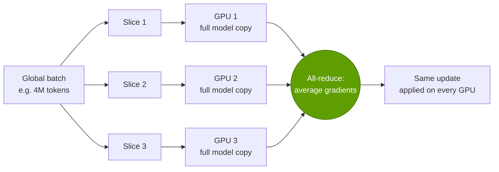
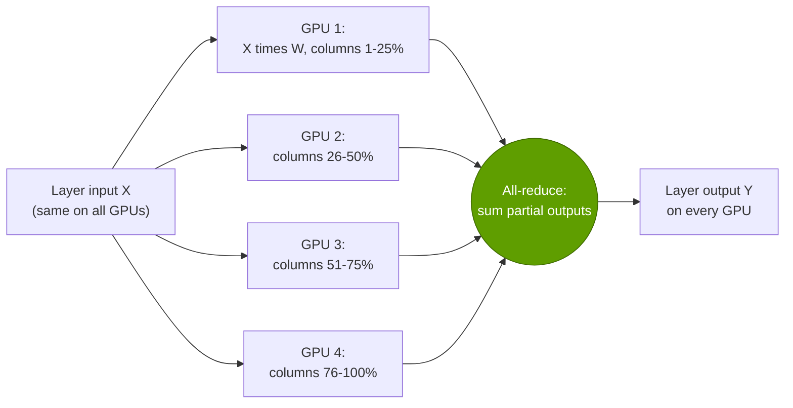
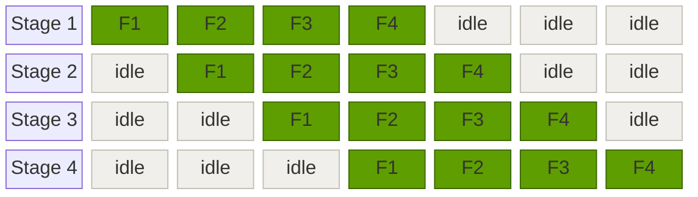
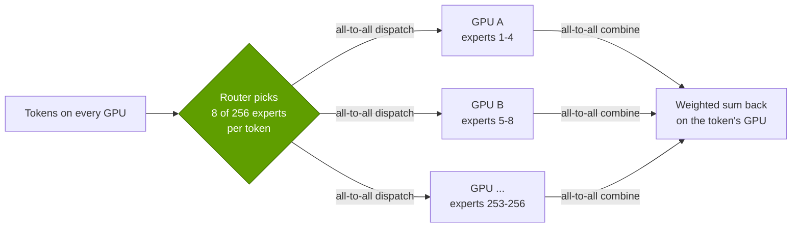
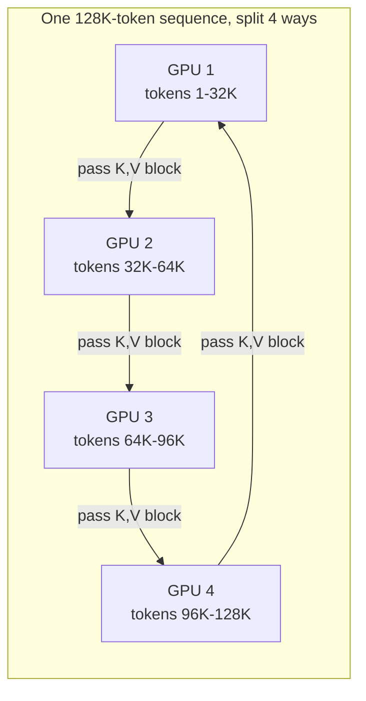
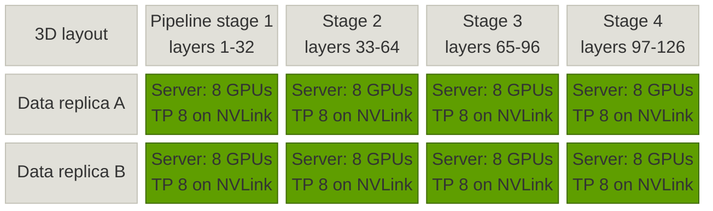
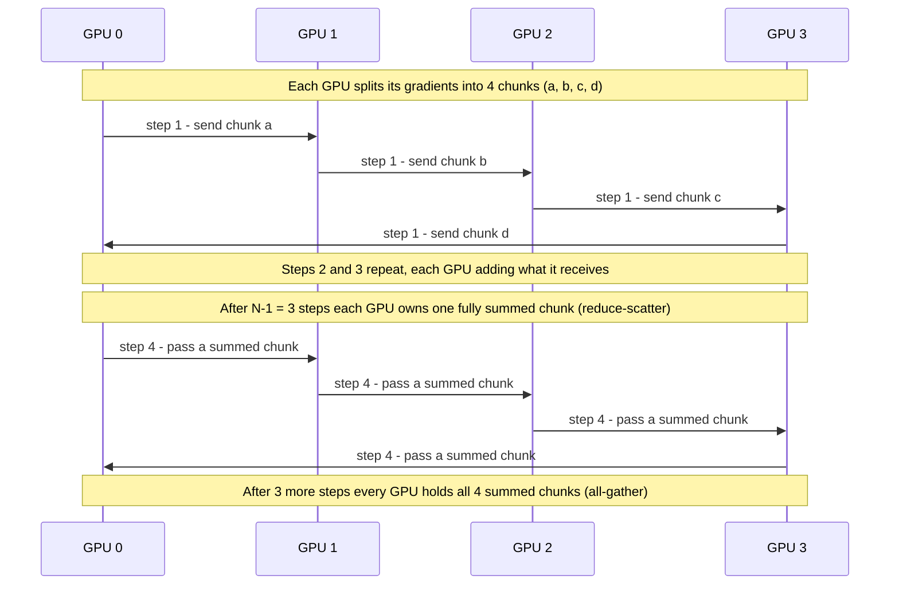
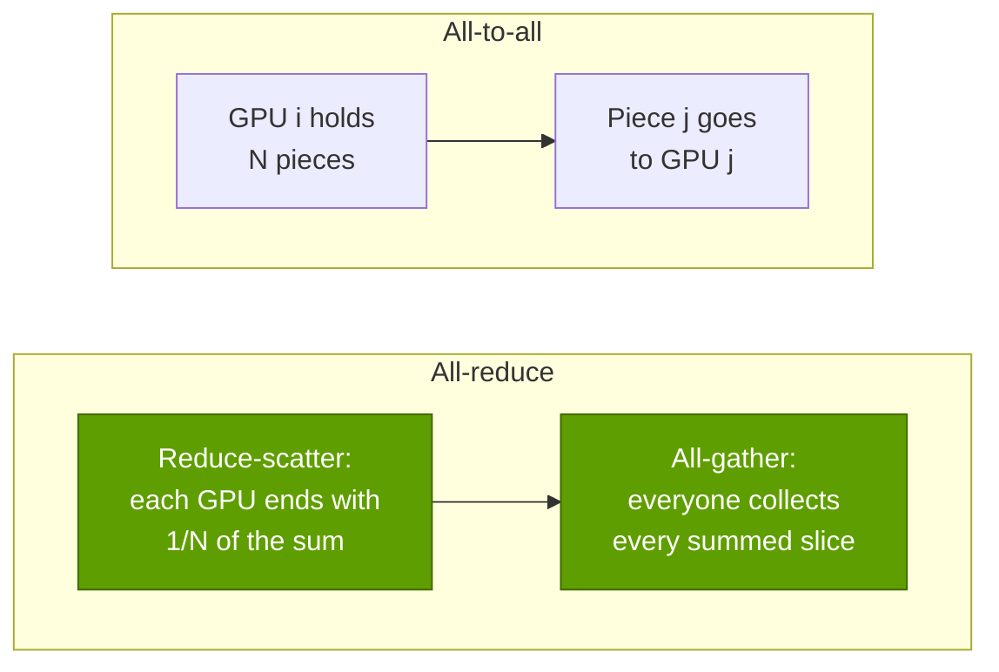

# P4 · Parallelism explained

Primer P4 · Foundations for non-engineers · ~22 min read · Last verified: 2026-11-05

## ⚡ The Executive Take

- **No frontier model trains on one GPU — for two separate reasons.** *Memory:* training with the standard Adam optimizer needs ~16 bytes per parameter [[S34004]](../sources/bibliography.md#s34004), so a 70B-parameter model needs ~1.1 TB, fourteen 80 GB H100s before storing a single activation. *Time:* Llama 3 405B took ~3.8 × 10²⁵ FLOPs [[S34006]](../sources/bibliography.md#s34006), which would occupy one H100 at the ~400 TFLOPS Meta achieved for roughly 3,000 years.
- **There are five ways to split the work** — [data](../glossary.md#data-parallelism), [tensor](../glossary.md#tensor-parallelism), [pipeline](../glossary.md#pipeline-parallelism), [expert](../glossary.md#expert-parallelism) and [context](../glossary.md#context-parallelism) parallelism — plus [sharding](../glossary.md#zero) of the optimizer state. Each saves memory or time and pays for it in communication, using a handful of [collective operations](../glossary.md#collective-operation): [all-reduce](../glossary.md#all-reduce), [all-gather](../glossary.md#all-gather), [reduce-scatter](../glossary.md#reduce-scatter) and [all-to-all](../glossary.md#all-to-all).
- **The art is putting the chattiest split on the fastest wire.** In a 70B example, tensor parallelism moves ~150 GB per GPU per step versus ~9 GB for data parallelism (repo estimate from [[S34001]](../sources/bibliography.md#s34001)[[S34011]](../sources/bibliography.md#s34011)), so it lives inside the [NVLink](../glossary.md#nvlink) domain (1.8 TB/s per Blackwell GPU [[S34014]](../sources/bibliography.md#s34014)) while data and pipeline parallelism cross 400 Gb/s–1.6 Tb/s network cards [[S34015]](../sources/bibliography.md#s34015)[[S33004]](../sources/bibliography.md#s33004).
- **Worked number:** a ring all-reduce of 140 GB of [BF16](../glossary.md#bf16) gradients (a 70B model) sends ~276 GB per GPU — ~5.5 s over a 400 Gb/s [InfiniBand](../glossary.md#infiniband) [NIC](../glossary.md#nic) versus ~0.31 s over NVLink 5 ([[S34011]](../sources/bibliography.md#s34011)[[S34015]](../sources/bibliography.md#s34015)[[S34014]](../sources/bibliography.md#s34014)).
- **Published frontier runs follow the same recipe.** Llama 3 405B used 8-way tensor × 16-way pipeline × 128-way data parallelism on 16,384 H100s at 41% [MFU](../glossary.md#mfu), adding 16-way context parallelism for its 128K-token stage [[S34006]](../sources/bibliography.md#s34006). Every GPU run in our sample keeps tensor parallelism at ≤ 8 — one NVLink server.
- **Mixture-of-experts changes the traffic pattern.** DeepSeek-V3 (671B total, 37B active parameters, 256 routed experts per layer) trained on 2,048 H800s with 16-way pipeline and 64-way expert parallelism and *no* tensor parallelism, and capped each token at 4 nodes to tame all-to-all traffic over InfiniBand [[S34007]](../sources/bibliography.md#s34007). All-to-all is why NVL72-class [scale-up](../glossary.md#scale-up) domains matter for MoE.
- **Bear/competitor angle:** the recipe is not NVIDIA-specific. Google trained PaLM 540B with 12-way model parallelism over TPU ICI links and no pipeline at all [[S34021]](../sources/bibliography.md#s34021); open software ([PyTorch](../glossary.md#pytorch) FSDP, DeepSpeed, JAX) implements every technique here [[S34005]](../sources/bibliography.md#s34005)[[S34004]](../sources/bibliography.md#s34004); and open scale-up standards target exactly the "fast domain" these splits need.

![Stacked horizontal bars showing how published training runs factor their GPU counts: Megatron 1T on 3,072 A100s (TP 8, PP 64, DP 6); MT-NLG 530B on 4,480 A100s (TP 8, PP 35, DP 16); BLOOM 176B on 384 A100s (TP 4, PP 12, DP 8); PaLM 540B on 6,144 TPU v4 chips (12-way model, 512-way data); Nemotron-4 340B on 6,144 H100s (TP 8, PP 12, DP 64); Llama 3 405B on 16,384 H100s (TP 8, PP 16, DP 128, and TP 8, CP 16, PP 16, DP 8 for long context); DeepSeek-V3 on 2,048 H800s (no TP, PP 16, DP 128 with 64-way expert parallelism).](../assets/charts/P4-parallelism-dimensions-frontier-runs.svg)

## Start here: why split the work at all

Think of training a model as auditing a giant company's books. One accountant (one GPU) would take millennia, and the ledgers would not even fit on their desk. You can hire thousands of accountants and divide the work in different ways: give each a different month of transactions (**data parallelism**); split each ledger page across several people who each total a few columns (**tensor parallelism**); set up an assembly line where one team handles revenue, the next costs, the next tax (**pipeline parallelism**); route each transaction only to the specialist who handles that kind (**expert parallelism**); or split one extremely long document into chapters read side by side (**context parallelism**). Every scheme needs the accountants to *talk* — compare totals, pass pages along — and the talking is what costs money.

> [!TIP]
> **Worked example — how many GPUs does a 70B model need just to *train* in memory?** Mixed-precision training with the Adam optimizer keeps, per parameter, a 2-byte BF16 weight, a 2-byte gradient and 12 bytes of FP32 optimizer state (master weight, momentum, variance) — ~16 bytes [[S34004]](../sources/bibliography.md#s34004). For 70B parameters that is 70 × 10⁹ × 16 ≈ **1.12 TB**. An H100 holds 80 GB [[S33002]](../sources/bibliography.md#s33002), so even with perfect splitting you need ≥ 14 GPUs before storing activations (the intermediate results kept for the backward pass), which for long sequences can exceed the weights. A B200's 180 GB [[S33003]](../sources/bibliography.md#s33003) cuts the floor to 7. **Reading:** the memory floor forces model splitting (tensor, pipeline, sharding); the *time* budget then forces data parallelism across thousands more GPUs.

| Strategy | What is split | What must be exchanged | Collective used | How often | Where it usually runs |
|---|---|---|---|---|---|
| **Data (DP)** | The batch of training examples | Gradients | All-reduce (FSDP: reduce-scatter + all-gather) | Once per step, overlappable | Scale-out network |
| **Tensor (TP)** | Each layer's weight matrices | Partial layer outputs | All-reduce (or reduce-scatter + all-gather) | 2× per layer forward, 2× backward [[S34001]](../sources/bibliography.md#s34001) | Inside the NVLink domain |
| **Pipeline (PP)** | The stack of layers, into stages | Activations at stage boundaries | Point-to-point send / receive | Every micro-batch, every boundary | Scale-out is fine |
| **Expert (EP)** | The experts of mixture-of-experts layers | Tokens to experts and back | All-to-all | 2× per MoE layer forward [[S34017]](../sources/bibliography.md#s34017) | NVLink domain ideally; network with routing limits [[S34007]](../sources/bibliography.md#s34007) |
| **Context (CP)** | The tokens of one long sequence | Attention keys and values | Ring send / receive, all-gather or all-to-all | Every attention layer | NVLink or network [[S34009]](../sources/bibliography.md#s34009)[[S34010]](../sources/bibliography.md#s34010) |

## 1. Data parallelism, and sharding with ZeRO / FSDP

**How it works.** Every GPU holds a full copy of the model and processes a different slice of the batch. After the backward pass each GPU has gradients computed from its own slice; they must be averaged so every copy applies the same update. That averaging is an **all-reduce**.

The best-known algorithm, the **[ring all-reduce](../glossary.md#ring-all-reduce)**, has each GPU send and receive 2 × (N − 1)/N times the data — about twice the gradient size, no matter how many GPUs are in the ring [[S34011]](../sources/bibliography.md#s34011)[[S34012]](../sources/bibliography.md#s34012). That independence from N is why data parallelism scales so well; its cost is that the volume is large and the full model must fit on each GPU.

> [!TIP]
> **Worked example — syncing a 70B model's gradients over different wires.** In BF16 the gradients are 70B × 2 bytes = 140 GB. A ring all-reduce across 64 GPUs sends 2 × 63/64 × 140 ≈ **276 GB per GPU** [[S34011]](../sources/bibliography.md#s34011). Divide by each link's per-direction bandwidth: a 400 Gb/s InfiniBand NIC moves 50 GB/s → **~5.5 s**; an 800 Gb/s NIC → ~2.8 s [[S34015]](../sources/bibliography.md#s34015); NVLink 4 on H100 (450 GB/s each way) → ~0.61 s; NVLink 5 on B200 (900 GB/s) → **~0.31 s** [[S34014]](../sources/bibliography.md#s34014); NVLink 6 on Rubin at the currently listed 3.0 TB/s → ~0.18 s [[S33007]](../sources/bibliography.md#s33007); even Rubin's 1.6 Tb/s ConnectX-9 NIC (200 GB/s each way) needs ~1.4 s [[S33004]](../sources/bibliography.md#s33004). These are ideal times; real collectives achieve somewhat less, and frameworks hide much of the cost by starting to all-reduce early layers' gradients while later layers are still computing. **Reading:** a ~18× gap per GPU between NVLink 5 and a 400G NIC is the core economic reason NVIDIA sells NVLink domains, not just GPUs.

**Sharding fixes the memory problem.** Microsoft's [ZeRO](../glossary.md#zero) observed that plain data parallelism stores 64 identical copies of everything. It shards the optimizer state (stage 1), then gradients (stage 2), then the weights themselves (stage 3) across the data-parallel GPUs, gathering pieces just in time [[S34004]](../sources/bibliography.md#s34004). PyTorch's [FSDP](../glossary.md#fsdp) is the same idea built into the framework [[S34005]](../sources/bibliography.md#s34005); Meta used it for Llama 3 [[S34006]](../sources/bibliography.md#s34006).

| 70B model, 64 data-parallel GPUs | What each GPU stores | Memory per GPU | Communication vs plain DP |
|---|---|---|---|
| Plain data parallelism | Everything (16 bytes/param) | ~1,120 GB | 1× |
| ZeRO-1: shard optimizer state | Weights + gradients + 1/64 of optimizer | ~293 GB | 1× |
| ZeRO-2: also shard gradients | Weights + 1/64 of gradients and optimizer | ~155 GB | 1× |
| ZeRO-3 / FSDP: also shard weights | 1/64 of everything | ~17.5 GB | ~1.5× |

*Repo arithmetic using ZeRO's 2 + 2 + 12 bytes-per-parameter accounting and its communication analysis [[S34004]](../sources/bibliography.md#s34004).*

🔧 Under the hood: why all-reduce = reduce-scatter + all-gather

A ring all-reduce runs in two halves. In the **reduce-scatter** half, each GPU splits its data into N chunks and passes one chunk to its neighbour each step, adding what it receives; after N − 1 steps each GPU owns one chunk that is fully summed. In the **all-gather** half, the summed chunks travel around the ring for another N − 1 steps until everyone has all of them. Each half moves (N − 1)/N of the data per GPU, hence 2(N − 1)/N in total; [NCCL](../glossary.md#nccl)'s benchmarks call the resulting per-link rate "bus bandwidth" [[S34012]](../sources/bibliography.md#s34012). FSDP simply stops after the reduce-scatter (each GPU only needs its own shard of the gradients) and runs the all-gather on the *weights* before each layer computes [[S34005]](../sources/bibliography.md#s34005). In-network reduction (NVIDIA SHARP) does the adding inside the switches so the data crosses the network fewer times [[S34024]](../sources/bibliography.md#s34024).

## 2. Tensor parallelism: splitting each layer

**How it works.** Instead of copying the model, split each layer's big weight matrices across GPUs — for example, give each of 8 GPUs one-eighth of the columns. Every GPU multiplies the same input by its slice; the partial results are then combined with an all-reduce. NVIDIA's Megatron-LM arranged the transformer's matrices so that each layer needs only two all-reduces in the forward pass and two in the backward pass [[S34001]](../sources/bibliography.md#s34001).

The attraction: every GPU stores only a slice of every layer, and the work of a single layer finishes faster — which also helps latency when serving. The catch: the all-reduce happens *inside* every layer, on the critical path, carrying full-size activations.

> [!TIP]
> **Worked example — why tensor parallelism stays inside the NVLink domain.** Take a 70B dense model (80 layers, hidden size 8,192) trained with 4,096-token sequences in BF16, split TP8 × PP4 × DP64 across 2,048 GPUs, with a 4M-token global batch. One sequence's activations at a layer boundary are 4,096 × 8,192 × 2 bytes ≈ 67 MB. Each GPU's stage has 20 layers × 4 all-reduces × 1.75 (ring factor for 8 GPUs) × 67 MB ≈ 9.4 GB of tensor-parallel traffic per sequence, and handles 16 sequences per step → **~150 GB per GPU per step** [[S34001]](../sources/bibliography.md#s34001)[[S34012]](../sources/bibliography.md#s34012). The data-parallel gradient sync for the same GPU's 2.2B-parameter shard is only ~8.6 GB, and pipeline sends ~2.1 GB. The step's compute is 6 × 70B × 4.2M tokens ÷ 2,048 GPUs ≈ 8.6 × 10¹⁴ FLOPs per GPU — ~0.86 s at an assumed 1 [PFLOPS](../glossary.md#flops) achieved per B200 (~44% of BF16 peak [[S33003]](../sources/bibliography.md#s33003)). Over NVLink 5 the 150 GB takes ~0.17 s (manageable, partly overlapped); over a 400G NIC it would take ~3.0 s, **3.5× longer than the compute itself**. **Reading:** tensor parallelism is only economic on scale-up links, so the size of the NVLink domain caps how far a model can be split this way.

Why not 72-way tensor parallelism now that an [NVL72](../glossary.md#nvl72) rack links 72 GPUs at full NVLink speed [[S34014]](../sources/bibliography.md#s34014)? Because slicing a matrix 72 ways leaves each GPU a thin sliver, and small matrix multiplies run far below peak (see the roofline in [P3](P3-the-four-bottlenecks.md)). Megatron's authors recommend keeping tensor parallelism within a server and using pipeline parallelism beyond it [[S34002]](../sources/bibliography.md#s34002). In practice, large NVLink domains are spent on expert parallelism and on serving, not on wider tensor splits.

🔧 Under the hood: sequence parallelism, the companion trick

Some layer operations (LayerNorm, dropout) are not split by tensor parallelism, so every GPU would redundantly compute and store them. NVIDIA's **[sequence parallelism](../glossary.md#sequence-parallelism)** splits those operations along the sequence dimension instead and replaces each all-reduce with a reduce-scatter plus an all-gather of equal total volume — so it saves activation memory at no extra communication cost [[S34008]](../sources/bibliography.md#s34008). Not to be confused with *context* parallelism (section 5), which splits attention itself across GPUs.

## 3. Pipeline parallelism and the bubble

**How it works.** Cut the model's layers into consecutive **stages** — layers 1–20 on GPU group A, 21–40 on B, and so on — and pass activations from stage to stage like an assembly line. Only point-to-point sends cross the boundaries, and they are small, so pipeline stages can sit in different racks on an ordinary [scale-out](../glossary.md#scale-out) network [[S34002]](../sources/bibliography.md#s34002).

The problem is the **[pipeline bubble](../glossary.md#pipeline-bubble)**: at the start of each step the later stages wait for work to arrive, and at the end the early stages wait for the backward pass to come back. GPipe's fix is to cut each batch into many [micro-batches](../glossary.md#micro-batch) so the line fills up quickly [[S34003]](../sources/bibliography.md#s34003).

*Forward pass of 4 micro-batches (F1–F4) through a 4-stage pipeline: each stage idles 3 of 7 time slots, the (p − 1)/(m + p − 1) = 3/7 ≈ 43% bubble. The backward pass adds a mirror-image bubble.*

The idle share of a step is (p − 1)/(m + p − 1) for p stages and m micro-batches; the "one-forward-one-backward" (1F1B) schedule keeps memory in check without changing this fraction, and Megatron's **interleaved** schedule, which gives each GPU v non-consecutive chunks of layers, divides the bubble by about v [[S34002]](../sources/bibliography.md#s34002)[[S34003]](../sources/bibliography.md#s34003).

> [!TIP]
> **Worked example — how many micro-batches does a 16-stage pipeline need?** With p = 16 stages, the idle share is 15 ÷ (m + 15). At m = 16 micro-batches the GPUs idle **48%** of the time; at m = 64, ~19%; at m = 128, ~10%. Interleaving with v = 4 chunks brings m = 16 down to ~19% [[S34002]](../sources/bibliography.md#s34002). But micro-batches are not free: the global batch is fixed by what the optimizer tolerates (Llama 3 used ~16M tokens per step [[S34006]](../sources/bibliography.md#s34006)), so more micro-batches per pipeline means fewer data-parallel replicas or smaller micro-batches — which hurt matrix-multiply efficiency. **Reading:** pipeline depth, micro-batch count and data-parallel width are traded against each other; a faster scale-up domain lets you use fewer pipeline stages and so a smaller bubble.

## 4. Expert parallelism for mixture-of-experts

**How it works.** A **[mixture-of-experts](../glossary.md#mixture-of-experts)** (MoE) model replaces each dense feed-forward block with many smaller "expert" blocks plus a **[router](../glossary.md#moe-router)** that sends each token to only a few of them. DeepSeek-V3 has 671B parameters in total but activates only 37B per token; each MoE layer has 1 shared and 256 routed experts, of which 8 are chosen per token [[S34007]](../sources/bibliography.md#s34007). Compute per token falls roughly in proportion to active parameters — that is the appeal. **Expert parallelism** places different experts on different GPUs, so every MoE layer must send each token to the GPUs holding its chosen experts and bring the results back: two **all-to-all** exchanges per layer [[S34017]](../sources/bibliography.md#s34017)[[S34023]](../sources/bibliography.md#s34023).

All-to-all is the hardest collective for a network: every GPU talks to every other GPU at once, the traffic is uneven (popular experts get more tokens), and it sits on the critical path of every MoE layer. A switched domain in which every GPU reaches every other at full speed — exactly what an NVLink/NVSwitch rack provides — is the natural home for it.

> [!TIP]
> **Worked example — all-to-all traffic for a DeepSeek-V3-class model.** With a hidden size of 7,168 [[S34007]](../sources/bibliography.md#s34007), sending one token to 8 experts in [FP8](../glossary.md#fp8) (1 byte per value) costs 8 × 7,168 ≈ **57 KB**, and returning the 8 results in BF16 costs ≈ **115 KB** — ~172 KB per token per MoE layer. With 58 MoE layers (all but the first 3 of 61) [[S34007]](../sources/bibliography.md#s34007), that is ~**10 MB per token** for one forward pass; a GPU processing a 4,096-token micro-batch must ship ~41 GB in and out. At 50 GB/s over InfiniBand that is ~0.8 s; over NVLink 5's 900 GB/s, ~0.05 s [[S34014]](../sources/bibliography.md#s34014)[[S34015]](../sources/bibliography.md#s34015). DeepSeek's answer on export-limited H800s, where it measured ~160 GB/s over NVLink versus ~50 GB/s over InfiniBand, was co-design: each token may visit experts on at most 4 nodes and crosses InfiniBand once per node before fanning out over NVLink inside it, so at most 4 rather than up to 8 copies cross the network; 20 of each GPU's 132 SMs were dedicated to communication; and a "DualPipe" schedule overlapped it with compute [[S34007]](../sources/bibliography.md#s34007). **Reading:** MoE swaps FLOPs for network traffic, so it shifts value from raw compute toward scale-up bandwidth and clever software.

Serving makes the point even more strongly. DeepSeek's [decode](../glossary.md#decode) deployment spreads each model replica over 320 GPUs in 40 nodes, one routed expert per GPU plus GPUs for redundant and shared experts [[S34007]](../sources/bibliography.md#s34007). Model serving at that scale is a cluster-design problem, which is why NVIDIA pitches rack-scale NVL72 systems and its [Dynamo](../glossary.md#dynamo) serving software for MoE inference (see [Layer 11](../layers/11-inference-and-ai-software/index.md)).

## 5. Context parallelism for long contexts

**How it works.** Attention compares every token with every earlier token, so its compute and activation memory grow with the square of the sequence length. At 128K tokens a single sequence no longer fits comfortably on one GPU. **[Context parallelism](../glossary.md#context-parallelism)** splits the *tokens* of one sequence across GPUs. Each GPU computes attention for its own chunk of queries but needs every earlier chunk's **keys and values**, so the GPUs exchange them — passing blocks around a ring while computing (Ring Attention [[S34009]](../sources/bibliography.md#s34009)), all-gathering them (Llama 3's approach [[S34006]](../sources/bibliography.md#s34006)), or re-partitioning from tokens to attention heads with an all-to-all (DeepSpeed-Ulysses [[S34010]](../sources/bibliography.md#s34010)).

> [!TIP]
> **Worked example — why Llama 3 needed 16-way context parallelism at 128K tokens.** Llama 3 405B has 126 layers and 8 key/value heads of 128 dimensions [[S32008]](../sources/bibliography.md#s32008). Its keys and values take 2 × 126 × 8 × 128 × 2 bytes ≈ **0.52 MB per token**, so one 131,072-token sequence carries ~68 GB of keys and values alone — before the much larger activations. Meta switched from TP8 × PP16 × DP128 to TP8 × **CP16** × PP16 × DP8 for that stage, keeping the GPU count at 16,384 and the batch at ~16M tokens, and still achieved 38% MFU versus 41% at 8K context [[S34006]](../sources/bibliography.md#s34006). **Reading:** long-context training trades data-parallel width for context-parallel width; the extra key/value traffic is affordable because each GPU now does 16× less attention work per sequence.

## Putting it together: 3D, 4D and 5D parallelism

Real runs combine the strategies as nested dimensions: GPU count = TP × CP × PP × DP, with expert parallelism usually reusing the data-parallel GPUs for the MoE layers. The rule is to put the dimension with the most traffic innermost, on the fastest links. Meta orders Llama 3's dimensions as [TP, CP, PP, DP], from most to least communication-hungry [[S34006]](../sources/bibliography.md#s34006).

*A toy 3D layout: tensor parallelism inside each 8-GPU server (NVLink), pipeline stages across servers in a row, data-parallel replicas across rows (both over the scale-out network). Llama 3 405B's real layout is 8 × 16 × 128 = 16,384 GPUs.*

The published configurations of Meta's largest run show how the dimensions are re-balanced as the job changes:

| Llama 3 405B stage | GPUs | TP | CP | PP | DP | Sequence length | Tokens per batch | Achieved TFLOPS per GPU | BF16 MFU |
|---|---|---|---|---|---|---|---|---|---|
| Early pre-training | 8,192 | 8 | 1 | 16 | 64 | 8,192 | ~16M | 430 | 43% |
| Main pre-training | 16,384 | 8 | 1 | 16 | 128 | 8,192 | ~16M | 400 | 41% |
| Long-context extension | 16,384 | 8 | 16 | 16 | 8 | 131,072 | ~16M | 380 | 38% |

*Source: Llama 3 paper, Table 4 [[S34006]](../sources/bibliography.md#s34006). Doubling the cluster from 8,192 to 16,384 GPUs cost ~2 points of MFU — Amdahl's law in action (see [P3](P3-the-four-bottlenecks.md)).*

> [!WARNING]
> **Myth vs. reality:** "With enough GPUs and a fast network, any model trains at near-peak speed." Every split adds communication or idle time: Llama 3 405B, on a 400 Gb/s-per-GPU RoCE fabric [[S34022]](../sources/bibliography.md#s34022) with NVLink inside each server, achieved 38–43% of peak [[S34006]](../sources/bibliography.md#s34006); NVIDIA's own 1T-parameter Megatron benchmark reached 52% on A100s [[S34002]](../sources/bibliography.md#s34002). The remaining half of the FLOPS is the price of parallelism — and the prize for whoever reduces it.

## The collective operations, visually

| Collective | Each GPU starts with | Each GPU ends with | Data sent per GPU (ring, N GPUs) | Used by |
|---|---|---|---|---|
| **All-reduce** | Its own full vector | The sum (or average) of everyone's vectors | 2(N − 1)/N × size | Data-parallel gradients; tensor-parallel outputs |
| **Reduce-scatter** | Its own full vector | One 1/N slice of the sum | (N − 1)/N × size | FSDP / ZeRO gradients; sequence parallelism |
| **All-gather** | One 1/N slice | Everyone's slices concatenated | (N − 1)/N × size | FSDP weights; context-parallel keys/values |
| **All-to-all** | N different pieces, one per destination | One piece from every source | (N − 1)/N × size | MoE dispatch/combine; Ulysses attention |
| **Broadcast** | One GPU has the data | Everyone has it | ≈ size | Initial weights, checkpoints |

*Definitions and per-GPU volumes from NCCL documentation and benchmarks [[S34013]](../sources/bibliography.md#s34013)[[S34012]](../sources/bibliography.md#s34012); ring algorithm [[S34011]](../sources/bibliography.md#s34011).*

*Ring all-reduce with 4 GPUs: 6 steps, each moving 1/4 of the data per GPU, so each GPU sends 6/4 = 2 × (4 − 1)/4 of the gradient size [[S34011]](../sources/bibliography.md#s34011).*

🔧 Under the hood: why NCCL is part of NVIDIA's moat

NCCL, NVIDIA's collective communication library, picks the algorithm (ring, tree, or switch-assisted), splits messages into channels across NVLink and NICs, and overlaps everything with compute — automatically, for whatever topology it detects [[S34013]](../sources/bibliography.md#s34013). Frameworks such as PyTorch call it for every collective above, so a training script written for an 8-GPU server runs on a 16,384-GPU cluster without change. AMD (RCCL), Google ([XLA](../glossary.md#xla) collectives on ICI) and others have equivalents; the difference is years of tuning against NVIDIA's own NVLink, [NVSwitch](../glossary.md#nvswitch), InfiniBand and [Spectrum-X](../glossary.md#spectrum-x) hardware, including in-switch reductions [[S34024]](../sources/bibliography.md#s34024). More in [Layer 10 · Libraries](../layers/10-libraries-cuda-x/index.md).

> [!NOTE]
> **🐂 Bull view:** As models shift to MoE, long context and reasoning, the most communication-hungry dimensions (expert and context parallelism) grow fastest, and they want the largest, fastest scale-up domain. NVIDIA's NVL72 today and larger NVLink domains on its roadmap, plus NCCL and Dynamo tuned to them, sit exactly where the traffic is heading [[S34014]](../sources/bibliography.md#s34014)[[S34007]](../sources/bibliography.md#s34007).

> [!WARNING]
> **🐻 Bear view:** Parallelism is algorithms, and algorithms travel. DeepSeek trained a frontier-class MoE without tensor parallelism on bandwidth-limited H800s by redesigning routing and scheduling [[S34007]](../sources/bibliography.md#s34007); Google trained PaLM with no pipeline parallelism on TPU torus links [[S34021]](../sources/bibliography.md#s34021); and every technique on this page exists in open-source frameworks [[S34004]](../sources/bibliography.md#s34004)[[S34005]](../sources/bibliography.md#s34005)[[S34010]](../sources/bibliography.md#s34010). And NVIDIA no longer has the biggest or fastest scale-up domain on paper: AMD's Helios rack links 72 MI455X GPUs at up to 3.6 TB/s each over UALink-over-Ethernet [[S226]](../sources/bibliography.md#s226), above NVLink 6's currently listed 3.0 TB/s [[S33007]](../sources/bibliography.md#s33007); AWS's Trn3 UltraServer joins 144 chips [[S242]](../sources/bibliography.md#s242); and Google's Ironwood pods reach 9,216 chips, albeit as multi-hop tori rather than one switched hop [[S232]](../sources/bibliography.md#s232). If open scale-up standards deliver comparable domain bandwidth, the software advantage in mapping work to hardware narrows.

## How this connects to the layers

| Topic on this page | Where the repo goes deeper |
|---|---|
| Tensor and expert parallelism need a fast scale-up domain | [Layer 05 · Scale-up (NVLink, NVSwitch)](../layers/05-scale-up-nvlink-nvswitch/index.md) |
| Data and pipeline parallelism ride the cluster network; collectives, SHARP, rail-optimized fabrics | [Layer 06 · Scale-out and scale-across networking](../layers/06-scale-out-scale-across-networking/index.md) |
| HBM capacity sets how much splitting is needed | [Layer 03 · Memory and packaging](../layers/03-memory-packaging-supply-chain/index.md) · [P3 · The four bottlenecks](P3-the-four-bottlenecks.md) |
| GPU compute that the splits must keep busy | [Layer 02 · GPU silicon](../layers/02-gpu-silicon/index.md) |
| NVL72 racks, cluster builds and their power | [Layer 08 · Systems, racks and AI factories](../layers/08-systems-racks-ai-factories/index.md) |
| NCCL, Megatron and the libraries that implement all of this | [Layer 10 · Libraries (CUDA-X)](../layers/10-libraries-cuda-x/index.md) · [Layer 09 · CUDA](../layers/09-cuda-and-system-software/index.md) |
| MoE serving, disaggregated inference, Dynamo | [Layer 11 · Inference and AI software](../layers/11-inference-and-ai-software/index.md) · [P2 · Inference](P2-how-ai-inference-works.md) |
| Why compute and FLOPs budgets are what they are | [P1 · How AI training works](P1-how-ai-training-works.md) |
| The efficiency shock from DeepSeek's co-design | [CS5 · The DeepSeek moment](../case-studies/CS5-deepseek-moment-and-efficiency-shock.md) |

## Key numbers to remember

| Number | Value | Why it matters |
|---|---|---|
| Training memory per parameter (mixed-precision Adam) | ~16 bytes → ~1.12 TB for 70B [[S34004]](../sources/bibliography.md#s34004) | Forces model splitting and sharding |
| Ring all-reduce traffic per GPU | 2(N − 1)/N × data ≈ 2× [[S34011]](../sources/bibliography.md#s34011)[[S34012]](../sources/bibliography.md#s34012) | Independent of GPU count |
| 70B BF16 gradient sync (64 GPUs) | ~5.5 s on 400G InfiniBand vs ~0.31 s on NVLink 5 [[S34015]](../sources/bibliography.md#s34015)[[S34014]](../sources/bibliography.md#s34014) | ~18× gap per GPU |
| Tensor-parallel all-reduces | 2 per layer forward + 2 backward [[S34001]](../sources/bibliography.md#s34001) | Why TP stays inside NVLink |
| Pipeline bubble | (p − 1)/(m + p − 1): 16 stages × 16 micro-batches → ~48% idle [[S34002]](../sources/bibliography.md#s34002)[[S34003]](../sources/bibliography.md#s34003) | Needs many micro-batches or interleaving |
| Llama 3 405B layout | TP8 × PP16 × DP128 = 16,384 H100s, 41% MFU; CP16 for 128K context [[S34006]](../sources/bibliography.md#s34006) | The reference 4D recipe |
| DeepSeek-V3 | 671B total / 37B active; 256 routed experts, 8 active; PP16 × EP64 on 2,048 H800s, no TP [[S34007]](../sources/bibliography.md#s34007) | MoE moves the bottleneck to all-to-all |
| MoE all-to-all, DeepSeek-V3 class | ~172 KB per token per MoE layer, ~10 MB per token per forward pass (repo estimate from [[S34007]](../sources/bibliography.md#s34007)) | Scale-up bandwidth becomes the constraint |
| Scale-up vs scale-out per GPU | NVLink 5 1.8 TB/s vs 400–800 Gb/s NICs; Rubin 3.0 TB/s vs 1.6 Tb/s [[S34014]](../sources/bibliography.md#s34014)[[S34015]](../sources/bibliography.md#s34015)[[S33004]](../sources/bibliography.md#s33004)[[S33007]](../sources/bibliography.md#s33007) | The ~8–18× step that shapes every layout |

## 🎯 Corp Dev Lens

1. **Parallelism strategy decides where network dollars go.** Tensor and expert parallelism buy scale-up bandwidth (NVLink switches, copper spines); data and pipeline parallelism buy scale-out (NICs, switches, optics). As MoE and long context grow, how much of a cluster's networking spend shifts toward the scale-up domain — the part NVIDIA controls most tightly — and how fast can [UALink](../glossary.md#ualink) or Ethernet scale-up claw it back?
2. **The mapping know-how is a software moat with an open-source shadow.** NCCL, Megatron-Core and Dynamo encode years of tuning [[S34013]](../sources/bibliography.md#s34013)[[S34002]](../sources/bibliography.md#s34002); PyTorch FSDP, DeepSpeed and JAX provide portable equivalents [[S34005]](../sources/bibliography.md#s34005)[[S34004]](../sources/bibliography.md#s34004). For a challenger, is "great collectives on our fabric, upstreamed into PyTorch" a buildable asset, an acquirable one, or a partnership with an existing framework team?
3. **Algorithm-systems co-design can substitute for hardware.** DeepSeek-V3 avoided tensor parallelism and capped cross-node traffic to fit export-limited GPUs [[S34007]](../sources/bibliography.md#s34007). Which future model changes (fewer experts per token, smaller hidden sizes, communication-avoiding attention) would reduce the premium on large scale-up domains — and who benefits?
4. **Inference is becoming a parallelism problem too.** Wide expert-parallel serving across hundreds of GPUs [[S34007]](../sources/bibliography.md#s34007) favours system vendors over chip vendors. Can an efficiency-focused inference product serve frontier MoE models within a smaller domain, or does it need to join a larger fabric (for example via [NVLink Fusion](../glossary.md#nvlink-fusion) or UALink)? A question for [chapter 19](../cross-cutting/19-implications-for-qualcomm.md), framed as options.
5. **Collective communication is a component-level value pool.** In-network reduction, all-to-all acceleration, congestion control and NIC offload [[S34024]](../sources/bibliography.md#s34024) sit between chips and software. Which suppliers and startups own pieces of this, and which are partnership versus acquisition candidates for a datacenter entrant?

## 📚 Sources

<!-- Auto-generated from the [S…] citations on this page by `make build`. Edit sources/registry/*.csv, not this list. -->

- [**S226**](../sources/bibliography.md#s226) AMD, *AMD Helios Rackscale Solution (product page)*, 2026. [Link](https://www.amd.com/en/products/rackscale-solutions/helios.html)
- [**S232**](../sources/bibliography.md#s232) Google Cloud, *TPU7x (Ironwood) - Cloud TPU documentation*, 2025-11. [Link](https://docs.cloud.google.com/tpu/docs/tpu7x)
- [**S242**](../sources/bibliography.md#s242) Amazon Web Services, *Amazon EC2 Trn3 instances (product page)*, 2025-12-02. [Link](https://aws.amazon.com/ec2/instance-types/trn3/)
- [**S32008**](../sources/bibliography.md#s32008) Meta via Hugging Face, *Llama 3.1 405B configuration (config.json)*, 2024-07-23. [Link](https://huggingface.co/meta-llama/Llama-3.1-405B/blob/main/config.json)
- [**S33002**](../sources/bibliography.md#s33002) NVIDIA, *NVIDIA H100 Tensor Core GPU (product page and datasheet)*, 2022-03-22. [Link](https://www.nvidia.com/en-us/data-center/h100/)
- [**S33003**](../sources/bibliography.md#s33003) Lenovo Press, *ThinkSystem NVIDIA B200 180GB 1000W GPU product guide*, 2025. [Link](https://lenovopress.lenovo.com/lp2226-thinksystem-nvidia-b200-180gb-1000w-gpu)
- [**S33004**](../sources/bibliography.md#s33004) NVIDIA Newsroom, *NVIDIA Kicks Off the Next Generation of AI With Rubin — Six New Chips; One Incredible AI Supercomputer*, 2026-01-05. [Link](https://nvidianews.nvidia.com/news/rubin-platform-ai-supercomputer)
- [**S33007**](../sources/bibliography.md#s33007) Dataconomy, *Nvidia Quietly Cuts Vera Rubin HBM4 And NVLink Bandwidth Specs*, 2026-11-02. [Link](https://dataconomy.com/2026/11/02/nvidia-quietly-cuts-vera-rubin-hbm4-and-nvlink-bandwidth/)
- [**S34001**](../sources/bibliography.md#s34001) arXiv:1909.08053 (Mohammad Shoeybi, Mostofa Patwary, Raul Puri et al. (NVIDIA)), *Megatron-LM: Training Multi-Billion Parameter Language Models Using Model Parallelism*, 2019-09-17. [Link](https://arxiv.org/abs/1909.08053)
- [**S34002**](../sources/bibliography.md#s34002) arXiv:2104.04473 (SC21) (Deepak Narayanan, Mohammad Shoeybi, Jared Casper et al. (NVIDIA; Stanford; Microsoft)), *Efficient Large-Scale Language Model Training on GPU Clusters Using Megatron-LM*, 2021-04-09. [Link](https://arxiv.org/abs/2104.04473)
- [**S34003**](../sources/bibliography.md#s34003) arXiv:1811.06965 (NeurIPS 2019) (Yanping Huang, Youlong Cheng, Ankur Bapna et al. (Google)), *GPipe: Efficient Training of Giant Neural Networks using Pipeline Parallelism*, 2018-11-16. [Link](https://arxiv.org/abs/1811.06965)
- [**S34004**](../sources/bibliography.md#s34004) arXiv:1910.02054 (SC20) (Samyam Rajbhandari, Jeff Rasley, Olatunji Ruwase, Yuxiong He (Microsoft)), *ZeRO: Memory Optimizations Toward Training Trillion Parameter Models*, 2019-10-04. [Link](https://arxiv.org/abs/1910.02054)
- [**S34005**](../sources/bibliography.md#s34005) arXiv:2304.11277 (VLDB 2023) (Yanli Zhao, Andrew Gu, Rohan Varma et al. (Meta)), *PyTorch FSDP: Experiences on Scaling Fully Sharded Data Parallel*, 2023-04-21. [Link](https://arxiv.org/abs/2304.11277)
- [**S34006**](../sources/bibliography.md#s34006) arXiv:2407.21783 (Llama Team (AI @ Meta)), *The Llama 3 Herd of Models*, 2024-07-31. [Link](https://arxiv.org/abs/2407.21783)
- [**S34007**](../sources/bibliography.md#s34007) arXiv:2412.19437 (DeepSeek-AI), *DeepSeek-V3 Technical Report*, 2024-12-27. [Link](https://arxiv.org/abs/2412.19437)
- [**S34008**](../sources/bibliography.md#s34008) arXiv:2205.05198 (MLSys 2023) (Vijay Korthikanti, Jared Casper, Sangkug Lym et al. (NVIDIA)), *Reducing Activation Recomputation in Large Transformer Models*, 2022-05-10. [Link](https://arxiv.org/abs/2205.05198)
- [**S34009**](../sources/bibliography.md#s34009) arXiv:2310.01889 (Hao Liu, Matei Zaharia, Pieter Abbeel), *Ring Attention with Blockwise Transformers for Near-Infinite Context*, 2023-10-03. [Link](https://arxiv.org/abs/2310.01889)
- [**S34010**](../sources/bibliography.md#s34010) arXiv:2309.14509 (Sam Ade Jacobs, Masahiro Tanaka, Chengming Zhang et al. (Microsoft)), *DeepSpeed Ulysses: System Optimizations for Enabling Training of Extreme Long Sequence Transformer Models*, 2023-09-25. [Link](https://arxiv.org/abs/2309.14509)
- [**S34011**](../sources/bibliography.md#s34011) Journal of Parallel and Distributed Computing (Pitch Patarasuk, Xin Yuan), *Bandwidth optimal all-reduce algorithms for clusters of workstations*, 2009-02. [Link](https://doi.org/10.1016/j.jpdc.2008.09.002)
- [**S34012**](../sources/bibliography.md#s34012) NVIDIA (GitHub), *NCCL Tests — Performance reported (algbw vs busbw)*, 2024. [Link](https://github.com/NVIDIA/nccl-tests/blob/master/doc/PERFORMANCE.md)
- [**S34013**](../sources/bibliography.md#s34013) NVIDIA Docs, *NCCL User Guide — Collective Operations*, 2025. [Link](https://docs.nvidia.com/deeplearning/nccl/user-guide/docs/usage/collectives.html)
- [**S34014**](../sources/bibliography.md#s34014) NVIDIA, *NVIDIA NVLink and NVLink Switch*, 2025. [Link](https://www.nvidia.com/en-us/data-center/nvlink/)
- [**S34015**](../sources/bibliography.md#s34015) NVIDIA, *NVIDIA InfiniBand adapters (ConnectX-7 NDR 400Gb/s; ConnectX-8 XDR 800Gb/s)*, 2025. [Link](https://www.nvidia.com/en-us/networking/infiniband-adapters/)
- [**S34017**](../sources/bibliography.md#s34017) arXiv:2006.16668 (Dmitry Lepikhin, HyoukJoong Lee, Yuanzhong Xu et al. (Google)), *GShard: Scaling Giant Models with Conditional Computation and Automatic Sharding*, 2020-06-30. [Link](https://arxiv.org/abs/2006.16668)
- [**S34021**](../sources/bibliography.md#s34021) arXiv:2204.02311 (Aakanksha Chowdhery, Sharan Narang, Jacob Devlin et al. (Google)), *PaLM: Scaling Language Modeling with Pathways*, 2022-04-05. [Link](https://arxiv.org/abs/2204.02311)
- [**S34022**](../sources/bibliography.md#s34022) ACM SIGCOMM 2024 (Adithya Gangidi, Rui Miao, Shengbao Zheng et al. (Meta)), *RDMA over Ethernet for Distributed AI Training at Meta Scale*, 2024-08. [Link](https://doi.org/10.1145/3651890.3672233)
- [**S34023**](../sources/bibliography.md#s34023) arXiv:2101.03961 (JMLR) (William Fedus, Barret Zoph, Noam Shazeer (Google)), *Switch Transformers: Scaling to Trillion Parameter Models with Simple and Efficient Sparsity*, 2021-01-11. [Link](https://arxiv.org/abs/2101.03961)
- [**S34024**](../sources/bibliography.md#s34024) NVIDIA Docs, *NVIDIA Scalable Hierarchical Aggregation and Reduction Protocol (SHARP) documentation*, 2024. [Link](https://docs.nvidia.com/networking/display/sharpv3)
