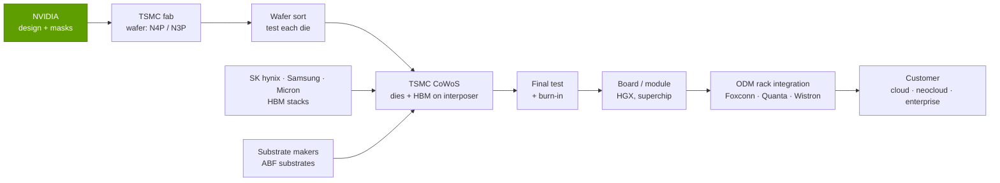
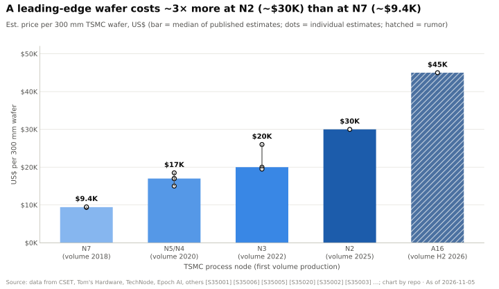
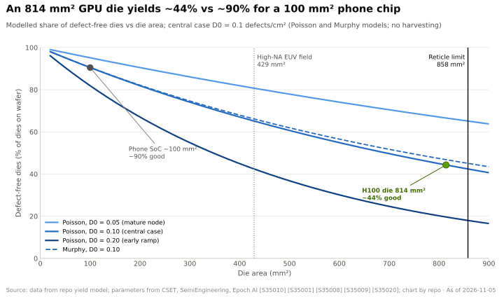
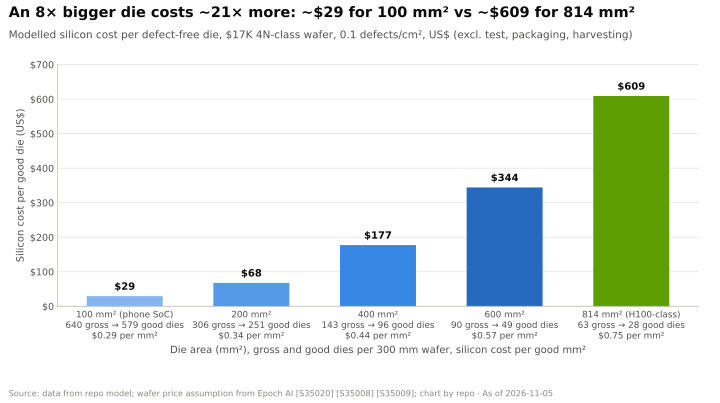
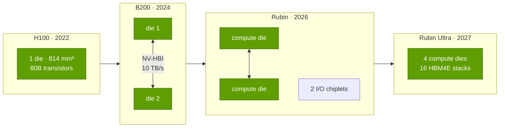
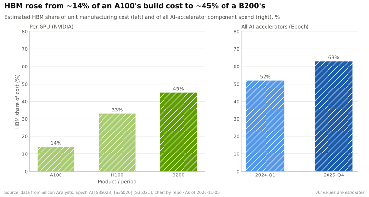
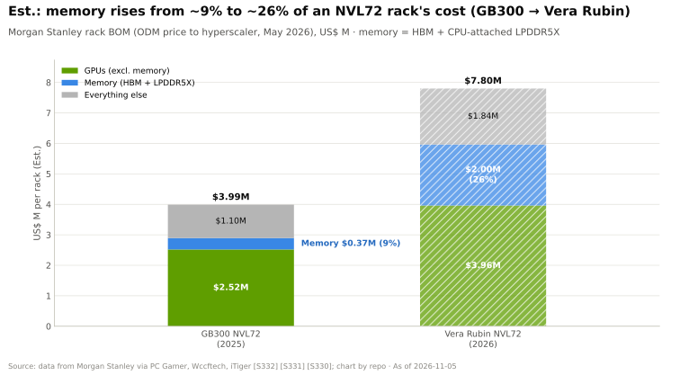
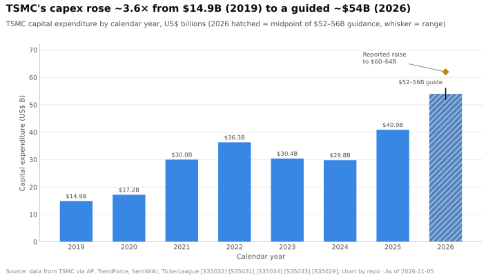

# P5 · Chip economics 101

Primer P5 · Wafers, yields, the reticle limit, chiplets, packaging, HBM and cost per FLOP · ~22 min read · Last verified: 2026-11-05

> [!NOTE]
> **Start here if you know spreadsheets and finance, not chips.** This primer turns a GPU into a
> cost model: what a wafer costs, how many sellable dies come off it, what packaging and memory
> add, and why the result supports NVIDIA's margins. Every figure is cited; estimates say "Est."
> and name the estimator, because nobody in the chain publishes these prices.

## ⚡ The Executive Take

- **A leading-edge wafer now costs about 3× what it did two nodes ago.** Published estimates put a
  300 mm TSMC wafer at ~$9.4K on N7 [[S35001]](../sources/bibliography.md#s35001)[[S35006]](../sources/bibliography.md#s35006), ~$17K on N5/N4 [[S35001]](../sources/bibliography.md#s35001)[[S35020]](../sources/bibliography.md#s35020) and
  ~$30K on N2 [[S35003]](../sources/bibliography.md#s35003); A16 is rumored at up to $45K [[S35004]](../sources/bibliography.md#s35004) (🔴 rumor). TSMC does not publish prices.
- **Big dies are disproportionately expensive.** In a standard yield model an 814 mm² H100-class
  die is defect-free only ~44% of the time at 0.1 defects/cm², versus ~90% for a 100 mm² phone
  chip, so 8× the area costs ~21× more per good die (repo model; inputs [[S35020]](../sources/bibliography.md#s35020)[[S35008]](../sources/bibliography.md#s35008)).
- **The [reticle limit](../glossary.md#reticle-limit) (~858 mm²) forced NVIDIA into multi-die GPUs.**
  The H100 die (814 mm²) already used ~95% of it [[S35013]](../sources/bibliography.md#s35013)[[S35010]](../sources/bibliography.md#s35010); B200 joins two reticle-limited
  dies (208B transistors) [[S35014]](../sources/bibliography.md#s35014); 🟢 Rubin Ultra (H2 2027) was announced with four [[S35018]](../sources/bibliography.md#s35018), though 🟡 reports say a two-die version replaced it [[S509]](../sources/bibliography.md#s509).
- **Memory and packaging, not the GPU die, dominate the build cost.** Epoch AI estimates a B200
  costs ~$6,400 to make (range $5.7–7.3K), with [HBM](../glossary.md#hbm) about 45% and the two logic
  dies only ~13% before packaging losses (Est., Epoch AI; Silicon Analysts) [[S35020]](../sources/bibliography.md#s35020)[[S35022]](../sources/bibliography.md#s35022).
- **Cost is a small fraction of price.** Against a $30–40K B200 price [[S35026]](../sources/bibliography.md#s35026) the build cost is
  ~16–21%, a chip-level gross margin near 80% (Est.) [[S35020]](../sources/bibliography.md#s35020); NVIDIA's reported company-wide gross
  margin is lower because it sells whole systems and books inventory charges (see §7).
- **Only TSMC can currently make these parts at volume.** It held 72.5% of top-10 foundry revenue
  in Q2 2026 (Samsung 5.9%) [[S35035]](../sources/bibliography.md#s35035) and guided $52–56B of 2026 capex [[S35029]](../sources/bibliography.md#s35029), ~3.6× its 2019
  level [[S35032]](../sources/bibliography.md#s35032) — a scale no rival matches.
- **Cost per FLOP keeps falling, but mostly through lower-precision math**, not cheaper silicon:
  system price per dense PFLOPS fell ~50× from a 2017 DGX-1 at FP16 (~$155K) to a Vera Rubin NVL72
  at NVFP4 (~$3.1K, Est.), while at BF16 it bottomed with GB200 NVL72 at ~$17K
  [[S312]](../sources/bibliography.md#s312)[[S326]](../sources/bibliography.md#s326)[[S330]](../sources/bibliography.md#s330)[[S33005]](../sources/bibliography.md#s33005).

## 1. From sand to a GPU: the manufacturing chain

Think of chipmaking as **printing a city map onto a dinner plate, 80–100 times over, layer upon
layer**. The plate is a [wafer](../glossary.md#wafer): a 300 mm disc of ultra-pure silicon [[S35001]](../sources/bibliography.md#s35001). A
[lithography](../glossary.md#lithography) scanner shines light through a [photomask](../glossary.md#photomask)
(a stencil of one layer of the circuit) and prints it onto the wafer; chemical steps then etch,
deposit and implant material, and the cycle repeats for each layer. The finished wafer is covered
in identical rectangles, each one a [die](../glossary.md#die). Dies are tested on the wafer, cut out, and
the good ones are mounted together with memory in an [advanced package](../glossary.md#advanced-packaging).
Only then does a GPU exist.

Four companies or groups touch every NVIDIA data-center GPU before a customer sees it:

The [foundry](../glossary.md#foundry) (TSMC) does the printing; memory makers supply HBM; substrate
makers supply the base layer the package sits on; and an [ODM](../glossary.md#odm) (original design
manufacturer) assembles boards, trays and racks. NVIDIA owns none of the factories. It owns the
design, the specification of every step and, increasingly, prepaid capacity at each of them (see
[Layer 03](../layers/03-memory-packaging-supply-chain/index.md)).

### Process nodes in one table

A [process node](../glossary.md#process-node) is a generation of manufacturing technology. The names
("N3", "2 nm") are marketing labels, not a physical dimension; what matters is that each node packs
more transistors into the same area, at a higher price per wafer.

| TSMC node | First volume | Transistor / tool change | NVIDIA data-center GPU on it | Est. wafer price |
|---|---|---|---|---|
| N7 | 2018 [[S35001]](../sources/bibliography.md#s35001) | FinFET; first DUV/EUV mix | A100 (826 mm² die) [[S35042]](../sources/bibliography.md#s35042) | ~$9.4K [[S35001]](../sources/bibliography.md#s35001)[[S35006]](../sources/bibliography.md#s35006) |
| N5 / N4 family | 2020 [[S35008]](../sources/bibliography.md#s35008) | FinFET, more EUV layers | H100 on custom 4N [[S35011]](../sources/bibliography.md#s35011); B200 on 4NP [[S35014]](../sources/bibliography.md#s35014) | ~$15–18.5K [[S35005]](../sources/bibliography.md#s35005)[[S35006]](../sources/bibliography.md#s35006) |
| N3 family | 2022 [[S35002]](../sources/bibliography.md#s35002) | Last FinFET node | 🟢 Rubin (N3-class) [[S35015]](../sources/bibliography.md#s35015) | ~$20–26K [[S35002]](../sources/bibliography.md#s35002)[[S35003]](../sources/bibliography.md#s35003) |
| N2 | 2025 [[S35009]](../sources/bibliography.md#s35009) | First [gate-all-around](../glossary.md#gate-all-around) nanosheet node | — | ~$30K [[S35003]](../sources/bibliography.md#s35003) |
| A16 | H2 2026 [[S35004]](../sources/bibliography.md#s35004) | Adds [backside power delivery](../glossary.md#backside-power-delivery) | 🟡 Feynman (2028) reported, not confirmed by NVIDIA [[S119]](../sources/bibliography.md#s119) | up to $45K (rumor) [[S35004]](../sources/bibliography.md#s35004) |

> [!TIP]
> **Worked example — what "a wafer" buys you.** A 300 mm wafer has an area of
> π × 150² ≈ 70,700 mm². An 814 mm² H100 die therefore fits ~63 times once you lose the partial
> dies at the round edge (formula in §3). At an Est. $17,000 per 4N-class wafer [[S35020]](../sources/bibliography.md#s35020), the
> silicon behind each *printed* die costs ~$270 before a single defect is counted. The rest of this
> primer is about why the real cost per sellable GPU is ~25× that.

🔧 Under the hood: what changes from node to node

- **EUV.** [Extreme-ultraviolet lithography](../glossary.md#euv-lithography) uses 13.5 nm light to print
  the finest layers in one exposure instead of three or four with older deep-UV light. More EUV
  layers per node means fewer steps but far more expensive tools, which shows up in the wafer price.
- **Gate-all-around (N2).** The transistor's gate wraps the channel on all four sides (nanosheets)
  instead of three (FinFET), cutting leakage. TSMC reported N2 defect density tracking *below* N3 at
  the same stage of development [[S35009]](../sources/bibliography.md#s35009).
- **Backside power (A16).** Moving the power wires under the transistors frees the top layers for
  signals; it matters most for power-hungry chips like AI accelerators.
- **High-NA EUV.** The next scanner generation prints finer features but exposes only half the
  field (26 × 16.5 mm = 429 mm²) [[S35010]](../sources/bibliography.md#s35010) — which pushes even harder toward multi-die designs (§4).

## 2. Wafer prices by node: why each generation costs more

Each node needs more process steps, more EUV exposures and a new multi-billion-dollar fab, and
TSMC prices to recover that investment. The result is a steep staircase:

Three things to know about these numbers. First, they are **estimates and reported quotes**, not
list prices: CSET built its N7/N5 figures from a capital-cost model [[S35001]](../sources/bibliography.md#s35001); the N3 and N2 figures
are press reports of TSMC quotes [[S35002]](../sources/bibliography.md#s35002)[[S35003]](../sources/bibliography.md#s35003); A16's $45K is a rumor [[S35004]](../sources/bibliography.md#s35004). Second, the
spread is wide — N3 estimates run from ~$19.5K [[S35006]](../sources/bibliography.md#s35006) to $25–27K [[S35003]](../sources/bibliography.md#s35003) — because prices
differ by customer, volume and contract year [[S35005]](../sources/bibliography.md#s35005). Third, prices **rise over a node's life**
when demand is tight: TSMC's blended average price per 300 mm wafer rose 22% in a single year, from
$5,384 in Q4 2022 to $6,611 in Q4 2023 (Est., Dan Nystedt) [[S35007]](../sources/bibliography.md#s35007), and N3P prices were reportedly
raised ~20% in 2025, a squeeze on smartphone chip designers such as Qualcomm and MediaTek [[S35037]](../sources/bibliography.md#s35037).

> [!TIP]
> **Worked example — the shrink must pay for the wafer.** Suppose a GPU die costs ~$609 of good
> silicon on a $17K 4N-class wafer (the §3 model). Move the same design to N2 at ~$30K per wafer
> [[S35003]](../sources/bibliography.md#s35003) and, if the die did not shrink, each good die would cost $609 × 30/17 ≈ $1,075. To merely
> break even, the die must shrink by ~43% (and yield as well). Density gains of that size are no
> longer automatic, so **cost per transistor now falls slowly or not at all** at the leading edge.
> That is why NVIDIA has stayed on 4N/4NP-class silicon for three product generations (H100, B200,
> B300) and moves to N3 only with Rubin [[S35011]](../sources/bibliography.md#s35011)[[S35014]](../sources/bibliography.md#s35014)[[S35015]](../sources/bibliography.md#s35015).

> [!WARNING]
> **Myth vs. reality: "Moore's Law makes chips cheaper every year."** Transistors still get smaller,
> but the price of the wafer they sit on rises almost as fast. Performance per dollar now improves
> mainly through architecture (lower-precision math, bigger packages, faster memory and links), not
> through cheaper silicon.

## 3. Dies per wafer and yield: why big dies are expensive

**Analogy.** Picture rain falling on a tiled floor. Raindrops (random manufacturing defects) land
at a roughly fixed density per square centimetre. Small tiles mostly stay dry; big tiles are very
likely to catch at least one drop. A single killer defect anywhere on a die can scrap it, so **yield
falls exponentially with die area**.

Two numbers drive it. [Dies per wafer](../glossary.md#dies-per-wafer) is pure geometry. [Defect
density](../glossary.md#defect-density) (D0, defects per cm²) is the fab's quality level; TSMC only shows
it as relative curves (N5 below N7 at the same stage [[S35008]](../sources/bibliography.md#s35008)[[S35036]](../sources/bibliography.md#s35036); N2 below N3 [[S35009]](../sources/bibliography.md#s35009)), so this
primer uses an illustrative 0.05–0.20 range with 0.10 as the central case.

> [!TIP]
> **Worked example — an ~800 mm² die on a 300 mm wafer.** Take the 814 mm² H100 die [[S35013]](../sources/bibliography.md#s35013).
> 1. *Gross dies per wafer* ≈ π·150²/814 − π·300/√(2·814) = 86.8 − 23.4 ≈ **63**.
> 2. *Yield* (Poisson model, D0 = 0.10/cm², area 8.14 cm²): e^(−0.814) ≈ **44%** → ~28 good dies.
> 3. *Cost per good die* at $17,000 per wafer [[S35020]](../sources/bibliography.md#s35020): $17,000 / 28 ≈ **$609**.
> 4. *Same wafer, 100 mm² phone chip:* 640 gross dies × 90% yield ≈ 579 good → **~$29 each**.
>
> The GPU die is 8× larger but costs ~21× more: **$0.75 per good mm² vs $0.29**. Epoch AI's
> B200 model assumes a 40–70% die yield (centre 60%) [[S35020]](../sources/bibliography.md#s35020), consistent with D0 ≈ 0.05–0.11 in
> this model — the same ballpark.

Two industry habits soften the curve. **[Die harvesting](../glossary.md#die-harvesting)**: a GPU is built
from many identical blocks, so a die with a defect in one block can still be sold with that block
switched off. The full GH100 die carries 18,432 FP32 cores in 144 streaming multiprocessors
[[S35042]](../sources/bibliography.md#s35042), while the H100 SXM5 ships with 132 of them enabled [[S33024]](../sources/bibliography.md#s33024) — a built-in yield buffer. **Redundancy**: spare memory rows and
columns are swapped in after test. Both lift effective yields above the simple model, which is why
large-die GPUs are viable at all.

🔧 Under the hood: the formulas and their limits

- **Gross dies per wafer:** DPW = π·(d/2)²/S − π·d/√(2S), with d = wafer diameter (mm) and S = die
  area (mm²). The second term approximates the partial dies lost at the edge. Real counts are a few
  percent lower because of scribe lines (the saw lanes between dies) and edge exclusion.
- **Poisson yield:** Y = e^(−A·D0). Assumes defects are independent and evenly spread; pessimistic
  for large dies.
- **Murphy yield:** Y = [(1 − e^(−A·D0)) / (A·D0)]². Assumes defects cluster, which gives large dies a
  slightly better yield (dashed line in the chart: ~47% vs ~44% at 814 mm²).
- **What the model leaves out:** parametric yield (dies that work but miss speed or power targets),
  die harvesting, and test cost. Treat the outputs as orders of magnitude, not foundry quotes. The
  model code lives in `scripts/charts/ch_primer_p5.py` and its inputs in `data/P5_wafer_economics.csv`.

## 4. The reticle limit and the move to multi-die GPUs

A scanner cannot print an arbitrarily large die: one exposure covers at most a 26 × 33 mm field,
the **[reticle limit](../glossary.md#reticle-limit)** of ~858 mm² [[S35010]](../sources/bibliography.md#s35010). NVIDIA's data-center GPUs hit
that wall three generations running — V100 at 815 mm² [[S126]](../sources/bibliography.md#s126), A100 at 826 mm² [[S127]](../sources/bibliography.md#s127) and H100 at
814 mm² [[S35013]](../sources/bibliography.md#s35013) — so every extra transistor since has had to come from a better node or from
**more dies per package**.

| GPU package | Compute dies | Transistors | HBM per package | Status |
|---|---|---|---|---|
| H100 (Hopper) | 1 × 814 mm², TSMC 4N | 80B [[S35011]](../sources/bibliography.md#s35011) | 80 GB HBM3 [[S33002]](../sources/bibliography.md#s33002) | 🟢 Shipping since 2022 |
| B200 (Blackwell) | 2 reticle-limited dies, TSMC 4NP, 10 TB/s die-to-die link | 208B [[S35014]](../sources/bibliography.md#s35014) | 192 GB physical (180 GB enabled in HGX) [[S35020]](../sources/bibliography.md#s35020)[[S33003]](../sources/bibliography.md#s33003) | 🟢 Shipping |
| Rubin | 2 reticle-sized compute dies + 2 I/O chiplets, N3-class | 336B [[S35015]](../sources/bibliography.md#s35015) | 288 GB HBM4, 8 stacks [[S33006]](../sources/bibliography.md#s33006) | 🟢 In production; partner systems H2 2026 [[S35016]](../sources/bibliography.md#s35016) |
| Rubin Ultra | 4 reticle-sized compute dies [[S107]](../sources/bibliography.md#s107) | n/a | 1 TB HBM4E, 16 stacks [[S35018]](../sources/bibliography.md#s35018); 🟡 one report says cut to 768 GB [[S111]](../sources/bibliography.md#s111) | 🟢 Roadmap H2 2027 [[S35018]](../sources/bibliography.md#s35018)[[S33020]](../sources/bibliography.md#s33020); 🟡 two-die version reported [[S509]](../sources/bibliography.md#s509) |

The engineering trick is the [die-to-die interconnect](../glossary.md#die-to-die-interconnect): if two dies
can exchange data fast enough (NVIDIA quotes 10 TB/s for Blackwell [[S35014]](../sources/bibliography.md#s35014)), software sees one GPU.
The economic trick is that each die is **tested before it is packaged** (a [known good
die](../glossary.md#known-good-die)), so a defect scraps one small die, not one giant one. This is the
logic of [chiplets](../glossary.md#chiplet), which AMD adopted earlier and more aggressively in its own
accelerators (see [AMD competition](../cross-cutting/15-competitive-landscape/index.md)).

> [!TIP]
> **Worked example — why two 800 mm² dies beat one 1,600 mm² die.** Using the §3 model at
> D0 = 0.10 and $17K per wafer: two tested 814 mm² dies cost 2 × $609 ≈ **$1,220** of silicon. A
> hypothetical single 1,628 mm² die (impossible anyway, since it is ~1.9× the reticle) would fit
> ~27 times per wafer at a ~20% yield → ~5 good dies → **~$3,100 each**. Splitting the die cuts
> silicon cost by ~60%; the price is a die-to-die link and a more complex, more expensive package.

> [!IMPORTANT]
> **The one thing to remember:** the reticle limit converts a *chip-design* problem into a
> *packaging* problem. Once GPUs became multi-die, the scarce resource moved from wafers to the
> advanced packaging that joins dies and memory — which is exactly where the 2023–2025 supply
> bottleneck appeared.

## 5. Advanced packaging: CoWoS and why it became the bottleneck

A modern AI GPU is not one chip but a small city: compute dies and 8–16 HBM stacks sit side by side
on an [interposer](../glossary.md#interposer), a thin slab of silicon (or silicon bridges in an organic
layer) carrying tens of thousands of microscopic wires between them. That wiring density is what
lets HBM deliver terabytes per second. TSMC's version is [CoWoS](../glossary.md#cowos)
(Chip-on-Wafer-on-Substrate), in three flavors:

| Variant | What carries the wiring | Typical use | Est. packaging cost per GPU |
|---|---|---|---|
| CoWoS-S | One monolithic silicon interposer | A100, H100, H200 | ~$750 (H100) [[S35040]](../sources/bibliography.md#s35040) |
| CoWoS-L | Small silicon bridges (local interconnect) embedded in a larger redistribution layer | B200, B300, Rubin | ~$1,100 (B200) [[S35040]](../sources/bibliography.md#s35040) |
| CoWoS-R | Organic redistribution-layer interposer, no silicon | Lower-cost, lower-density designs | n/a |

Why CoWoS-L? A monolithic silicon interposer is itself limited by lithography — CoWoS-S tops out
around 3.3× the reticle — so it cannot comfortably hold two reticle-sized dies plus eight HBM stacks;
bridges let the package grow (TSMC's roadmap runs to ~5.5× reticle in 2026 and ~9.5× in 2027) while
keeping fine wiring only where dies meet [[S380]](../sources/bibliography.md#s380). The cost is complexity: more parts must be bonded perfectly,
and **a package that fails final test takes its already-paid-for dies and HBM with it** [[S35020]](../sources/bibliography.md#s35020).

> [!TIP]
> **Worked example — what Epoch's "packaging yield loss" implies.** Epoch AI's B200 model carries
> ~$1,000 of packaging yield loss on top of ~$850 of logic, ~$2,880 of HBM and ~$1,100 of packaging
> (Est.) [[S35020]](../sources/bibliography.md#s35020)[[S35022]](../sources/bibliography.md#s35022)[[S35039]](../sources/bibliography.md#s35039). If the parts going into a package cost ~$4,830 and the yield loss
> per good unit is ~$1,000, then 4,830 × f / (1 − f) = 1,000 → f ≈ 17%, i.e. **roughly one package
> in six failing** (🔴 repo inference). Epoch notes Blackwell packaging yields were low early and
> have improved but likely still trail Hopper [[S35020]](../sources/bibliography.md#s35020). A few points of packaging yield are worth
> hundreds of dollars per GPU — and a lot of scarce HBM.

**Why packaging became the bottleneck.** CoWoS capacity was sized for a niche HPC market and had to
grow several-fold once every AI accelerator needed it: TSMC said capacity more than doubled in 2024
and would roughly double again in 2025 [[S378]](../sources/bibliography.md#s378). NVIDIA reportedly holds ~60% of 2026 CoWoS
allocation (~595K wafers), ahead of Broadcom (~150K) and AMD (~105K) (🟡 press estimates) [[S379]](../sources/bibliography.md#s379).
HBM supply had the same problem (details in [Layer 03](../layers/03-memory-packaging-supply-chain/index.md)).

TSMC now earmarks 10–20% of a $52–56B 2026 capex budget for advanced packaging, testing and masks
[[S35029]](../sources/bibliography.md#s35029) — on the order of $5–11B in one year.

🔧 Under the hood: known good die, substrates and the outsourced back end

- **Known good die (KGD).** Each compute die and each HBM stack is tested before assembly; the
  package cannot be reworked once bonded, so test coverage before bonding is an economic decision.
- **Substrates.** The interposer sits on an organic package substrate (ABF build-up film) that
  fans signals and power out to the board. Large AI packages use some of the biggest substrates in
  production, another occasional constraint.
- **OSATs.** Outsourced semiconductor assembly and test companies ([OSATs](../glossary.md#osat)) such as
  ASE/SPIL and Amkor handle parts of the back end; TSMC has kept the most advanced
  "chip-on-wafer" step largely in-house, which is part of its lock on AI accelerators.

## 6. HBM: the memory that now costs more than the GPU die

[HBM](../glossary.md#hbm) is DRAM stacked 8–16 dies high and wired straight down through the stack. A
B200 carries 192 GB of HBM3E physically [[S35020]](../sources/bibliography.md#s35020) (180 GB enabled in HGX systems [[S33003]](../sources/bibliography.md#s33003)); Rubin
carries 288 GB of HBM4 in eight stacks [[S33006]](../sources/bibliography.md#s33006), with per-GPU bandwidth first quoted at 22 TB/s
[[S33006]](../sources/bibliography.md#s33006) and now listed at 19.2 TB/s on NVIDIA's product page [[S33007]](../sources/bibliography.md#s33007) (🟡 reported spec change,
Nov 2026). Memory makers price HBM at several times commodity DRAM per gigabyte, and the amount per
GPU rises every generation — so HBM's share of the bill keeps climbing.

> [!TIP]
> **Worked example — HBM in dollars.** At Epoch's central HBM3E price of ~$15 per GB [[S35020]](../sources/bibliography.md#s35020), a
> B200's 192 GB costs ~$2,880, or ~45% of its ~$6,400 build cost. If Rubin's 288 GB of HBM4 cost the
> *same* $15/GB it would be ~$4,320; at a 30% premium for HBM4 it would be ~$5,600 (🔴 illustrative
> assumption). Either way, **memory alone would cost more than an entire B200's logic, packaging and
> test combined**, which is why HBM suppliers (SK hynix, Samsung, Micron) have become a major value
> pool and why Rubin's bandwidth spec depends on what the memory makers can deliver.

At rack level the same shift is visible: Morgan Stanley's teardown has memory rising from ~9% of a
GB300 NVL72's cost to ~26% of a Vera Rubin NVL72's (Est.) [[S332]](../sources/bibliography.md#s332).

## 7. Putting it together: bill of materials vs. selling price

A [bill of materials](../glossary.md#bill-of-materials) (BOM) for a GPU adds four layers: good logic dies,
HBM, packaging (including yield loss) and substrate/test. No vendor publishes it; two independent
analyst estimates bracket it.

| Item (Est.) | H100 (2023) | B200 (2025) | Source |
|---|---|---|---|
| Logic die(s) after yield | ~$1,200 incl. other (residual) | ~$850 (two dies) | [[S35023]](../sources/bibliography.md#s35023)[[S35022]](../sources/bibliography.md#s35022) |
| HBM | ~$1,350 (80 GB) | ~$2,880 (192 GB) | [[S35023]](../sources/bibliography.md#s35023)[[S35020]](../sources/bibliography.md#s35020) |
| Advanced packaging | ~$750 (CoWoS-S) | ~$1,100 (CoWoS-L) | [[S35040]](../sources/bibliography.md#s35040) |
| Packaging yield loss | included above | ~$1,000 | [[S35020]](../sources/bibliography.md#s35020)[[S35039]](../sources/bibliography.md#s35039) |
| Substrate, test, other | included above | ~$570 (residual) | [[S35020]](../sources/bibliography.md#s35020) |
| **Total build cost** | **~$3,320** (Raymond James) | **~$6,400** (Epoch AI; $5.7–7.3K) | [[S35024]](../sources/bibliography.md#s35024)[[S35020]](../sources/bibliography.md#s35020) |
| Epoch's own B200 split | — | logic incl. losses ~$1.7–2.2K; HBM ~$2.7–3.3K; CoWoS-L ~$1.1–1.5K; other ~$0.2–0.3K | [[S355]](../sources/bibliography.md#s355) |
| Reported selling price | ~$25–30K | ~$30–40K | [[S35024]](../sources/bibliography.md#s35024)[[S35026]](../sources/bibliography.md#s35026) |
| **Build cost as % of price** | **~11–13%** | **~16–21%** | repo calculation |

> [!TIP]
> **Worked example — from a 1,000% "markup" to a ~75% gross margin.** The famous 2023 headline
> that NVIDIA earns ~1,000% on an H100 is just $25–30K ÷ ~$3,320 [[S35025]](../sources/bibliography.md#s35025). In gross-margin terms
> that is (27,500 − 3,320) / 27,500 ≈ **88%** at the chip level; for the B200 it is
> (35,000 − 6,400) / 35,000 ≈ **82%** (Est.) [[S35020]](../sources/bibliography.md#s35020)[[S35026]](../sources/bibliography.md#s35026). NVIDIA's *reported* company gross
> margin is lower — 75.0% in FY2025, 71.1% in FY2026 after a $4.5B H20 export charge, ~75% in Q2 FY2027 [[S416]](../sources/bibliography.md#s416)[[S402]](../sources/bibliography.md#s402)[[S444]](../sources/bibliography.md#s444)[[S405]](../sources/bibliography.md#s405) — for four reasons: (1) much of revenue is whole boards, NVLink
> switch trays, Grace/Vera CPUs, networking and rack components carrying lower margins than a bare
> GPU; (2) inventory and purchase-commitment charges land in cost of revenue; (3) warranty, freight
> and depreciation of test equipment; (4) new products ramp at lower yields. R&D is *not* in gross
> margin at all: Jensen Huang put Blackwell's development cost at ~$10B [[S35028]](../sources/bibliography.md#s35028). Spread over, say,
> 5 million GPUs that is ~$2,000 per unit (🔴 illustrative unit count).

> [!NOTE]
> **🐂 Bull view.** The BOM shows NVIDIA's moat is not cheap silicon — it pays the same TSMC and
> HBM prices as everyone else — but the ability to charge 5–6× build cost because the GPU arrives
> with CUDA, NVLink and a system around it. Rivals using the same supply chain face the same
> ~$6K+ cost floor and must price below NVIDIA to win.

> [!WARNING]
> **🐻 Bear view.** A ~80% chip-level margin is an invitation. Custom ASIC buyers (Google, AWS, Meta)
> pay roughly the same TSMC/HBM/CoWoS costs plus a design-partner fee and skip NVIDIA's margin
> entirely; HBM makers can capture more of the pie as memory's cost share rises. See
> [the bear case](../cross-cutting/18-vulnerabilities-and-bear-case.md) and
> [training vs. inference economics](../cross-cutting/14-training-vs-inference-economics.md).

## 8. Cost per FLOP over time

What a buyer ultimately pays for is arithmetic: dollars per unit of compute. Three levers move
it — more transistors per package, a better architecture per transistor, and **smaller number
formats** (a tensor core does roughly twice the operations per cycle each time the format halves,
from BF16 to FP8 to FP4). Peak dense compute per NVIDIA flagship GPU has climbed steeply:

| GPU (year) | Dense peak, native AI format | Dense BF16/FP16 | Source |
|---|---|---|---|
| V100 (2017) | 125 TFLOPS FP16 | 125 TFLOPS | [[S33010]](../sources/bibliography.md#s33010) |
| A100 (2020) | 312 TFLOPS BF16 | 312 TFLOPS | [[S33009]](../sources/bibliography.md#s33009) |
| H100 (2022) | 1,979 TFLOPS FP8 | 989 TFLOPS | [[S33002]](../sources/bibliography.md#s33002) |
| B200 (2024) | 9,000 TFLOPS FP4 | 2,250 TFLOPS | [[S33003]](../sources/bibliography.md#s33003) |
| Rubin (2026) | 17,500 TFLOPS dense FP8; 50,000 NVFP4 inference | 4,000 TFLOPS | [[S33005]](../sources/bibliography.md#s33005)[[S33004]](../sources/bibliography.md#s33004) |

Prices are disclosed far less often than FLOPS, so the most consistent long series uses whole
systems: NVIDIA's DGX list prices for the early generations [[S312]](../sources/bibliography.md#s312)[[S316]](../sources/bibliography.md#s316), a 2026 listing for HGX
H200 [[S322]](../sources/bibliography.md#s322), and analyst rack estimates for Blackwell and Rubin (HSBC, Morgan Stanley) [[S326]](../sources/bibliography.md#s326)[[S332]](../sources/bibliography.md#s332)[[S330]](../sources/bibliography.md#s330).
Dividing price by dense peak PFLOPS gives the chart below. System prices include CPUs, networking,
memory and assembly, so the level is higher than a bare-GPU calculation, but the trend is the point.

> [!TIP]
> **Worked example — where a 7× cost-per-FLOP drop comes from (one GPU, two generations).** H100:
> $27,500 ÷ 0.989 dense BF16 PFLOPS ≈ **$27.8K per PFLOPS** [[S33002]](../sources/bibliography.md#s33002)[[S35024]](../sources/bibliography.md#s35024). B200: $35,000 ÷ 2.25
> ≈ **$15.6K** at the same precision, and $35,000 ÷ 9.0 ≈ **$3.9K** per dense FP4 PFLOPS
> [[S33003]](../sources/bibliography.md#s33003)[[S35026]](../sources/bibliography.md#s35026). So 27.8 / 15.6 ≈ **1.8×** came from a better, two-die GPU and 15.6 / 3.9 =
> **4×** from dropping BF16 to FP4. Build cost moved far less: ~$3,320 ÷ 1.98 ≈ $1.7K per dense FP8
> PFLOPS for H100 versus ~$6,400 ÷ 4.5 ≈ $1.4K for B200 (Est.) [[S35024]](../sources/bibliography.md#s35024)[[S35020]](../sources/bibliography.md#s35020) — about 15% cheaper —
> while price per FP8 PFLOPS fell ~44%. On these estimates NVIDIA passed more of the generational gain
> to buyers than its own suppliers passed to NVIDIA (🔴 repo inference from two analyst estimates).
> The system chart shows the next step: a Vera Rubin NVL72 is estimated at ~$7.8M, of which ~$2.0M
> is memory [[S330]](../sources/bibliography.md#s330), so its BF16 price per PFLOPS (~$27K) is *worse* than GB200's (~$17K) while its
> NVFP4 figure (~$3.1K) is the best yet [[S33005]](../sources/bibliography.md#s33005)[[S102]](../sources/bibliography.md#s102).

Two cautions keep this honest. First, **peak FLOPS are not delivered FLOPS**: real workloads are
often limited by memory bandwidth or networking (see [P3 — the four bottlenecks](P3-the-four-bottlenecks.md)),
and FP4 only helps where model quality survives 4-bit math. Second, **FLOPS are not tokens**: the
number that matters to a buyer is dollars per million tokens, which also depends on power,
utilization and software (see [14 — Training vs. inference economics](../cross-cutting/14-training-vs-inference-economics.md)).
Rubin raises dense FP8 to 17.5 PFLOPS per GPU [[S33005]](../sources/bibliography.md#s33005); its price is not public, and its HBM4
bandwidth spec was trimmed from 22 to 19.2 TB/s in late 2026 [[S33007]](../sources/bibliography.md#s33007) (🟡), a reminder that
roadmap numbers move.

## 9. Fab capex, and why only TSMC builds these parts

Leading-edge manufacturing is a scale game. TSMC spent $14.9B on capex in 2019 [[S35032]](../sources/bibliography.md#s35032), a record
$36.3B in 2022 [[S35033]](../sources/bibliography.md#s35033) and $40.9B in 2025, and guided $52–56B for 2026 [[S35029]](../sources/bibliography.md#s35029); a later report
says management first pointed to the top of that range and then raised it to $60–64B (🟡
single source) [[S35030]](../sources/bibliography.md#s35030).

Why does that spending translate into a near-monopoly on AI accelerators?

1. **Scale funds the next node.** In Q2 2026 TSMC took 72.5% of top-10 foundry revenue (~$40.2B in
   the quarter); Samsung Foundry had 5.9% and SMIC 5.4% [[S35035]](../sources/bibliography.md#s35035). Only the leader earns enough to
   fund each $50B+ year of capex.
2. **Yield learning compounds.** Every wafer run teaches the fab where defects come from; the
   leader's D0 curves fall faster (§3), which is worth more for 800 mm² dies than for phone chips.
3. **Packaging is bundled.** CoWoS sits next to the wafer fabs; a customer that wants N4P dies,
   HBM integration and CoWoS-L in one flow has, in practice, one supplier.
4. **Trust and co-optimization.** NVIDIA's custom 4N/4NP processes [[S35011]](../sources/bibliography.md#s35011)[[S35014]](../sources/bibliography.md#s35014) are tuned with
   TSMC over years — switching foundry means redesigning the chip.

> [!TIP]
> **Worked example — the size of the moat around the moat.** Samsung Foundry's 5.9% share of a
> ~$53.5B quarter [[S35035]](../sources/bibliography.md#s35035) is ~$3.2B of quarterly revenue, ~$12.6B a year. TSMC's 2026 capex
> midpoint of ~$54B [[S35029]](../sources/bibliography.md#s35029) is therefore **~4× Samsung Foundry's entire annual revenue**. A
> challenger cannot out-invest that without a state or a captive anchor customer.

> [!WARNING]
> **The concentration risk cuts both ways.** The same fact that protects NVIDIA from would-be GPU
> rivals — everyone must queue at TSMC — makes NVIDIA, AMD, Google and AWS equally exposed to one
> company and one island. See [vulnerabilities and bear case](../cross-cutting/18-vulnerabilities-and-bear-case.md).

## How this connects to the layers

| Concept in this primer | Where it matters most | Read next |
|---|---|---|
| Reticle limit, multi-die GPUs, process nodes | Die design and the annual cadence | [Layer 02 — GPU silicon](../layers/02-gpu-silicon/index.md) |
| CoWoS, HBM, yield, supply commitments | The physical bottleneck and who captures margin | [Layer 03 — Memory, packaging, supply chain](../layers/03-memory-packaging-supply-chain/index.md) · [value chain](../layers/03-memory-packaging-supply-chain/value-chain-and-corp-dev.md) |
| Die-to-die links → chip-to-chip links | Same physics, longer distances | [Layer 05 — Scale-up (NVLink)](../layers/05-scale-up-nvlink-nvswitch/index.md) |
| BOM vs price, system-level margin | Why NVIDIA sells racks, not chips | [Layer 08 — Systems and racks](../layers/08-systems-racks-ai-factories/index.md) |
| Cost per FLOP, $ per token | What buyers actually pay for | [14 — Training vs. inference economics](../cross-cutting/14-training-vs-inference-economics.md) |
| TSMC concentration, ASIC cost parity | The bear case | [18 — Vulnerabilities](../cross-cutting/18-vulnerabilities-and-bear-case.md) · [15 — Competition](../cross-cutting/15-competitive-landscape/index.md) |
| Margins funding R&D and supply | The reinforcing loops | [01 — The NVIDIA flywheel](../01-the-nvidia-flywheel.md) |

## Key numbers to remember

| Number | Value | Source |
|---|---|---|
| Reticle limit (one exposure) | ~858 mm² (26 × 33 mm); High-NA EUV 429 mm² | [[S35010]](../sources/bibliography.md#s35010) |
| H100 die | 814 mm², 80B transistors, TSMC 4N | [[S35013]](../sources/bibliography.md#s35013)[[S35011]](../sources/bibliography.md#s35011) |
| B200 package | 2 dies, 208B transistors, 10 TB/s die-to-die | [[S35014]](../sources/bibliography.md#s35014) |
| Wafer price, N7 → N2 | ~$9.4K → ~$30K (Est.) | [[S35001]](../sources/bibliography.md#s35001)[[S35003]](../sources/bibliography.md#s35003) |
| Modelled yield of an 814 mm² die at 0.1 defects/cm² | ~44% (vs ~90% at 100 mm²) | repo model |
| B200 build cost | ~$6,400 (Est., range $5.7–7.3K) | [[S35020]](../sources/bibliography.md#s35020) |
| HBM share of B200 build cost | ~45% (Est.) | [[S35020]](../sources/bibliography.md#s35020) |
| B200 price | ~$30–40K | [[S35026]](../sources/bibliography.md#s35026) |
| TSMC share of top-10 foundry revenue, Q2 2026 | 72.5% | [[S35035]](../sources/bibliography.md#s35035) |
| TSMC 2026 capex guidance | $52–56B | [[S35029]](../sources/bibliography.md#s35029) |

## 🎯 Corp Dev Lens

1. **Where does the margin pool move as HBM's share of cost rises from ~14% (A100) to ~45%
   (B200) [[S35023]](../sources/bibliography.md#s35023)[[S35020]](../sources/bibliography.md#s35020)?** Memory makers and packaging houses are capturing a growing slice of
   each accelerator's bill; which partnerships (HBM supply, packaging capacity) secure access rather
   than just price?
2. **Packaging is now strategic capacity.** If a few points of package yield are worth hundreds of
   dollars per GPU (§5), are there packaging, test or die-to-die interconnect IP assets — public
   companies or private specialists — whose value to a datacenter entrant exceeds their standalone
   value?
3. **The N3P price increase reportedly pressured Qualcomm and MediaTek [[S35037]](../sources/bibliography.md#s35037).** How does a
   datacenter accelerator program share, or compete for, leading-edge wafer and CoWoS allocation with
   the mobile business at the same foundry?
4. **Chiplets lower the entry ticket.** A design built from smaller known-good dies avoids the
   reticle and yield wall (§4). Does a chiplet-plus-standard-interconnect strategy let a challenger
   reach competitive silicon cost without NVIDIA's volume — and what does it give up in package
   complexity?
5. **The cost floor is shared; the price ceiling is not.** Any rival using TSMC, HBM and CoWoS starts
   from a similar ~$6K-plus build cost per flagship accelerator [[S35020]](../sources/bibliography.md#s35020). The question for an entrant
   is not "can we build it cheaper?" but "which customer will pay a price that clears that floor
   without CUDA?"

## 📚 Sources

<!-- Auto-generated from the [S…] citations on this page by `make build`. Edit sources/registry/*.csv, not this list. -->

- [**S102**](../sources/bibliography.md#s102) NVIDIA, *NVIDIA DGX Vera Rubin NVL72*, 2026. [Link](https://www.nvidia.com/en-us/data-center/dgx-vera-rubin-nvl72/)
- [**S107**](../sources/bibliography.md#s107) Tom's Hardware, *Nvidia's Vera Rubin platform in depth - Inside Nvidia's most complex AI and HPC platform to date*, 2026. [Link](https://www.tomshardware.com/pc-components/gpus/nvidias-vera-rubin-platform-in-depth-inside-nvidias-most-complex-ai-and-hpc-platform-to-date)
- [**S111**](../sources/bibliography.md#s111) Crypto Briefing, *Nvidia's Rubin Ultra targets 768GB of HBM4E as Kyber platform stays on schedule*, 2026. [Link](https://cryptobriefing.com/nvidia-rubin-ultra-hbm4e-kyber-2027/)
- [**S119**](../sources/bibliography.md#s119) XenoSpectrum, *NVIDIA's Feynman May Combine TSMC A16 and N3P, Reports Say*, 2026. [Link](https://xenospectrum.com/en/nvidia-feynman-tsmc-a16-report/)
- [**S126**](../sources/bibliography.md#s126) NVIDIA, *NVIDIA Tesla V100 GPU Architecture Whitepaper*, 2017-08. [Link](https://images.nvidia.com/content/volta-architecture/pdf/volta-architecture-whitepaper.pdf)
- [**S127**](../sources/bibliography.md#s127) NVIDIA Technical Blog, *NVIDIA Ampere Architecture In-Depth*, 2020-05-14. [Link](https://developer.nvidia.com/blog/nvidia-ampere-architecture-in-depth/)
- [**S312**](../sources/bibliography.md#s312) AnandTech, *NVIDIA ships first Volta-based DGX systems*, 2017-09-07. [Link](https://anandtech.com/show/11824)
- [**S316**](../sources/bibliography.md#s316) Tom's Hardware, *AMD unveils Nvidia DGX A100 specs in formal announcement*, 2020-05-14. [Link](https://www.tomshardware.com/news/amd-unveils-nvidia-dgx-a100-specs)
- [**S322**](../sources/bibliography.md#s322) GPUPerHour, *NVIDIA GPU prices (H100/H200 and DGX/HGX system listings)*, 2026-09. [Link](https://gpuperhour.com/blog/nvidia-gpu-prices)
- [**S326**](../sources/bibliography.md#s326) TweakTown, *NVIDIA's new GB200 Superchip costs up to $70,000: full B200 NVL72 AI server costs $3 million*, 2024-05. [Link](https://www.tweaktown.com/news/98292/nvidias-new-gb200-superchip-costs-up-to-70-000-full-b200-nvl72-ai-server-3-million/index.html)
- [**S330**](../sources/bibliography.md#s330) PC Gamer, *A single Nvidia Vera Rubin rack is estimated to cost $7,803,148 with over $2 million of that figure spent on memory alone*, 2026-05. [Link](https://pcgamer.com/hardware/a-single-nvidia-vera-rubin-rack-is-estimated-to-cost-usd7-803-148-with-over-usd2-million-of-that-figure-spent-on-memory-alone)
- [**S332**](../sources/bibliography.md#s332) Tiger Brokers (iTiger), *Morgan Stanley's BOM analysis of NVIDIA's Rubin: GPU share declines; PCB, MLCC and ABF substrate values soar*, 2026-05-20. [Link](https://www.itiger.com/news/1188068712)
- [**S355**](../sources/bibliography.md#s355) Epoch AI, *NVIDIA's B200 costs around $6,400 to produce, with memory accounting for half*, 2025-12. [Link](https://epoch.ai/data-insights/b200-cost-breakdown)
- [**S378**](../sources/bibliography.md#s378) TSMC Investor Relations, *TSMC quarterly earnings conference calls (CoWoS capacity commentary)*, 2025. [Link](https://investor.tsmc.com/english/quarterly-results)
- [**S379**](../sources/bibliography.md#s379) TrendForce News, *TSMC CoWoS capacity and customer allocation estimates (TrendForce / Morgan Stanley, as reported)*, 2025. [Link](https://www.trendforce.com/news/)
- [**S380**](../sources/bibliography.md#s380) TSMC, *TSMC 3DFabric: CoWoS-S, CoWoS-R and CoWoS-L technology overview and roadmap*, 2025. [Link](https://3dfabric.tsmc.com/english/dedicatedFoundry/technology/cowos.htm)
- [**S402**](../sources/bibliography.md#s402) NVIDIA Corporation via SEC EDGAR (Colette Kress), *CFO Commentary on Fourth Quarter and Fiscal 2026 Results (Form 8-K exhibit 99.2)*, 2026-02-25. [Link](https://www.sec.gov/Archives/edgar/data/1045810/000104581026000019/q4fy26cfocommentary.htm)
- [**S405**](../sources/bibliography.md#s405) NVIDIA Corporation via SEC EDGAR, *NVIDIA Announces Financial Results for Second Quarter Fiscal 2027 (Form 8-K exhibit 99.1)*, 2026-08-26. [Link](https://www.sec.gov/Archives/edgar/data/0001045810/000104581026000073/q2fy27pr.htm)
- [**S416**](../sources/bibliography.md#s416) NVIDIA Corporation via SEC EDGAR, *NVIDIA Corporation Form 10-K for fiscal year ended January 26, 2025*, 2025-02-26. [Link](https://www.sec.gov/Archives/edgar/data/1045810/000104581025000023/nvda-20250126.htm)
- [**S444**](../sources/bibliography.md#s444) NVIDIA Corporation, *NVIDIA Announces Financial Results for First Quarter Fiscal 2026 (press release with CFO commentary)*, 2025-05-28. [Link](https://nvidianews.nvidia.com/news/nvidia-announces-financial-results-for-first-quarter-fiscal-2026)
- [**S509**](../sources/bibliography.md#s509) TrendForce, *NVIDIA Rubin Ultra four-die single-package design not adopted amid advanced-packaging constraints*, 2026-04-01. [Link](https://www.trendforce.com/news/?p=55442)
- [**S33002**](../sources/bibliography.md#s33002) NVIDIA, *NVIDIA H100 Tensor Core GPU (product page and datasheet)*, 2022-03-22. [Link](https://www.nvidia.com/en-us/data-center/h100/)
- [**S33003**](../sources/bibliography.md#s33003) Lenovo Press, *ThinkSystem NVIDIA B200 180GB 1000W GPU product guide*, 2025. [Link](https://lenovopress.lenovo.com/lp2226-thinksystem-nvidia-b200-180gb-1000w-gpu)
- [**S33004**](../sources/bibliography.md#s33004) NVIDIA Newsroom, *NVIDIA Kicks Off the Next Generation of AI With Rubin — Six New Chips; One Incredible AI Supercomputer*, 2026-01-05. [Link](https://nvidianews.nvidia.com/news/rubin-platform-ai-supercomputer)
- [**S33005**](../sources/bibliography.md#s33005) NVIDIA, *NVIDIA Vera Rubin NVL72 (product page and specifications)*, 2026. [Link](https://www.nvidia.com/en-us/data-center/vera-rubin-nvl72/)
- [**S33006**](../sources/bibliography.md#s33006) Tom's Hardware, *Nvidia launches Vera Rubin NVL72 AI supercomputer at CES*, 2026-01-05. [Link](https://www.tomshardware.com/pc-components/gpus/nvidia-launches-vera-rubin-nvl72-ai-supercomputer-at-ces-promises-up-to-5x-greater-inference-performance-and-10x-lower-cost-per-token-than-blackwell-coming-2h-2026)
- [**S33007**](../sources/bibliography.md#s33007) Dataconomy, *Nvidia Quietly Cuts Vera Rubin HBM4 And NVLink Bandwidth Specs*, 2026-11-02. [Link](https://dataconomy.com/2026/11/02/nvidia-quietly-cuts-vera-rubin-hbm4-and-nvlink-bandwidth/)
- [**S33009**](../sources/bibliography.md#s33009) NVIDIA, *NVIDIA A100 Tensor Core GPU datasheet*, 2021. [Link](https://www.nvidia.com/content/dam/en-zz/Solutions/Data-Center/a100/pdf/nvidia-a100-datasheet-us-nvidia-1758950-r4-web.pdf)
- [**S33010**](../sources/bibliography.md#s33010) NVIDIA, *NVIDIA V100 Tensor Core GPU datasheet*, 2018. [Link](https://images.nvidia.com/content/technologies/volta/pdf/volta-v100-datasheet-update-us-1165301-r5.pdf)
- [**S33020**](../sources/bibliography.md#s33020) NVIDIA (Jensen Huang), *NVIDIA GTC 2025 keynote (Jensen Huang)*, 2025-03-18. [Link](https://www.nvidia.com/gtc/keynote/)
- [**S33024**](../sources/bibliography.md#s33024) NVIDIA, *NVIDIA H100 Tensor Core GPU Architecture (whitepaper)*, 2022. [Link](https://resources.nvidia.com/en-us-tensor-core)
- [**S35001**](../sources/bibliography.md#s35001) Center for Security and Emerging Technology (CSET) (Saif M. Khan; Alexander Mann), *AI Chips: What They Are and Why They Matter*, 2020-04. [Link](https://cset.georgetown.edu/wp-content/uploads/AI-Chips—What-They-Are-and-Why-They-Matter.pdf)
- [**S35002**](../sources/bibliography.md#s35002) Tom's Hardware (Anton Shilov), *TSMC Will Reportedly Charge $20,000 Per 3nm Wafer*, 2022-12. [Link](https://www.tomshardware.com/news/tsmc-will-charge-20000-per-3nm-wafer)
- [**S35003**](../sources/bibliography.md#s35003) TechNode, *TSMC sets 2nm wafer price at $30,000, far below earlier 50% increase speculation*, 2025-10-09. [Link](https://technode.com/2025/10/09/tsmc-sets-2nm-wafer-price-at-30000-far-below-earlier-50-increase-speculation/)
- [**S35004**](../sources/bibliography.md#s35004) Tom's Hardware (Anton Shilov), *TSMC could charge up to $45,000 for 1.6nm wafers — rumors allege a 50% increase in pricing over prior-gen wafers*, 2025. [Link](https://www.tomshardware.com/tech-industry/semiconductors/tsmc-could-charge-up-to-usd45-000-for-1-6nm-wafers-rumors-allege-a-50-percent-increase-in-pricing-over-prior-gen-wafers)
- [**S35005**](../sources/bibliography.md#s35005) Tom's Hardware (Anton Shilov), *TSMC's 2nm process will reportedly get another price hike — $30,000 per wafer for latest cutting-edge tech*, 2025. [Link](https://www.tomshardware.com/tech-industry/tsmcs-2nm-will-reportedly-receive-a-price-hike-once-again-usd30-000-per-wafer)
- [**S35006**](../sources/bibliography.md#s35006) Silicon Analysts, *Semiconductor Wafer Pricing by Process Node (2026)*, 2026. [Link](https://siliconanalysts.com/data/wafer-pricing)
- [**S35007**](../sources/bibliography.md#s35007) Tom's Hardware (Anton Shilov), *Newer chips are rapidly becoming far more expensive: TSMC's average wafer price jumped 22% in one year*, 2024-01. [Link](https://www.tomshardware.com/tech-industry/newer-chips-are-rapidly-becoming-far-more-expensive-tsmcs-average-wafer-price-jumped-22-in-one-year-and-nearly-all-semiconductor-industry-growth-now-comes-from-more-expensive-products)
- [**S35008**](../sources/bibliography.md#s35008) AnandTech (Ian Cutress), *'Better Yield on 5nm than 7nm': TSMC Update on Defect Rates for N5*, 2020-08-25. [Link](https://www.anandtech.com/show/16028)
- [**S35009**](../sources/bibliography.md#s35009) Tom's Hardware (Anton Shilov), *TSMC discloses N2 defect density — lower than N3 at the same stage of development*, 2025-04. [Link](https://www.tomshardware.com/tech-industry/tsmc-discloses-n2-defect-density-lower-than-n3-at-the-same-stage-of-development)
- [**S35010**](../sources/bibliography.md#s35010) Semiconductor Engineering, *Are Larger Reticle Sizes On The Horizon?*, 2024. [Link](https://semiengineering.com/are-larger-reticle-sizes-on-the-horizon)
- [**S35011**](../sources/bibliography.md#s35011) NVIDIA, *NVIDIA Hopper Architecture*, 2022-03. [Link](https://www.nvidia.com/en-in/data-center/technologies/hopper-architecture/)
- [**S35013**](../sources/bibliography.md#s35013) ComputerBase, *Nvidia Hopper: So schnell ist die neue Architektur für Supercomputer*, 2022-05. [Link](https://www.computerbase.de/2022-05/nvidia-hoppher-gh100-whitepaper/)
- [**S35014**](../sources/bibliography.md#s35014) NVIDIA, *NVIDIA Blackwell Architecture*, 2024-03. [Link](https://www.nvidia.com/en-us/data-center/technologies/blackwell-architecture/)
- [**S35015**](../sources/bibliography.md#s35015) Introl, *NVIDIA Rubin Enters Full Production: The 336 Billion Transistor GPU Reshaping AI Infrastructure*, 2026-01. [Link](https://introl.com/blog/nvidia-rubin-full-production-ces-2026-ai-infrastructure)
- [**S35016**](../sources/bibliography.md#s35016) Bloomberg, *Nvidia CEO Says Rubin Chips Are on Track, Demand Is Strong*, 2026-01-05. [Link](https://www.bloomberg.com/news/articles/2026-01-05/nvidia-ceo-says-new-rubin-chips-are-on-track-helping-speed-ai)
- [**S35018**](../sources/bibliography.md#s35018) Tom's Hardware, *Nvidia announces Rubin GPUs in 2026, Rubin Ultra in 2027, Feynman also added to roadmap*, 2025-03-18. [Link](https://www.tomshardware.com/pc-components/gpus/nvidia-announces-rubin-gpus-in-2026-rubin-ultra-in-2027-feynam-after)
- [**S35020**](../sources/bibliography.md#s35020) Epoch AI, *NVIDIA's B200 costs around $6,400 to produce, with memory accounting for half*, 2025-12. [Link](https://epoch.ai/data-insights/b200-cost-breakdown)
- [**S35022**](../sources/bibliography.md#s35022) Silicon Analysts, *NVIDIA B200 (Blackwell) cost breakdown*, 2026. [Link](https://siliconanalysts.com/analysis/nvidia-b200-blackwell-cost-breakdown)
- [**S35023**](../sources/bibliography.md#s35023) Silicon Analysts, *AI Accelerator Manufacturing Cost (COGS) — Historical Time Series Data*, 2026. [Link](https://siliconanalysts.com/market-data/ai-chip-bom)
- [**S35024**](../sources/bibliography.md#s35024) The Decoder, *Nvidia's H100 GPU sells like hot cakes with high profit margins*, 2023-08. [Link](https://the-decoder.com/nvidias-h100-gpu-sells-like-hot-cakes-with-high-profit-margins/)
- [**S35025**](../sources/bibliography.md#s35025) TechSpot, *Nvidia garners reported 1000% profit on each H100 GPU*, 2023-08. [Link](https://www.techspot.com/news/99839-nvidia-garners-reported-1000-profit-each-h100-gpu.html)
- [**S35026**](../sources/bibliography.md#s35026) Tom's Hardware, *Nvidia's Jensen Huang says Blackwell GPU to cost $30,000-$40,000, later clarifies that pricing will vary as they won't sell just the chip*, 2024-03-19. [Link](https://www.tomshardware.com/pc-components/gpus/nvidias-jensen-huang-says-blackwell-gpu-to-cost-dollar30000-dollar40000-later-clarifies-that-pricing-will-vary-as-they-wont-sell-just-the-chip)
- [**S35028**](../sources/bibliography.md#s35028) TweakTown, *NVIDIA spent $10 billion on developing its next-generation Blackwell GPU*, 2024-03. [Link](https://www.tweaktown.com/news/96987/nvidia-spent-10-billion-on-developing-its-next-generation-blackwell-gpu/index.html)
- [**S35029**](../sources/bibliography.md#s35029) Star Tribune (Associated Press), *Taiwan computer chip maker TSMC to expand investment as profit jumps 35%*, 2026-01-15. [Link](https://www.startribune.com/taiwan-computer-chip-maker-tsmcs-to-expand-investment-as-profit-jumps-35/601564518)
- [**S35030**](../sources/bibliography.md#s35030) Nasdaq (Zacks), *TSMC Commits Higher CapEx in 2026 While Raising Dividend Payouts*, 2026. [Link](https://www.nasdaq.com/articles/tsmc-commits-higher-capex-2026-while-raising-dividend-payouts)
- [**S35032**](../sources/bibliography.md#s35032) SemiWiki, *How to spend 100 billion dollars in three years*, 2021-04. [Link](https://semiwiki.com/semiconductor-manufacturers/tsmc/298361-how-to-spend-100-billion-dollars-in-three-years)
- [**S35033**](../sources/bibliography.md#s35033) TrendForce, *TSMC's capital expenditure expected to remain unchanged this year ahead of earnings call*, 2024-10-14. [Link](https://www.trendforce.com/news/2024/10/14/news-tsmcs-capital-expenditure-expected-to-remain-unchanged-this-year-ahead-of-earnings-call/)
- [**S35035**](../sources/bibliography.md#s35035) TrendForce, *TrendForce: global top-10 foundry revenue and ranking 2Q26*, 2026-09-09. [Link](https://www.trendforce.com/presscenter/news/20260909-13225.html)
- [**S35036**](../sources/bibliography.md#s35036) TSMC, *TSMC Showcases Leading Technologies at Online Technology Symposium and OIP Ecosystem Forum*, 2020-08-25. [Link](https://pr.tsmc.com/english/news/2729)
- [**S35037**](../sources/bibliography.md#s35037) TrendForce, *TSMC reportedly raising N3P prices 20% ahead of 2nm era; pressuring Qualcomm and MediaTek*, 2025-09-23. [Link](https://www.trendforce.com/news/2025/09/23/news-tsmc-reportedly-raising-n3p-prices-20-ahead-of-2nm-era-pressuring-qualcomm-and-mediatek/)
- [**S35039**](../sources/bibliography.md#s35039) FourWeekMBA, *The 14% Paradox: Why Nvidia's GPU Silicon Costs Less Than Its Packaging*, 2026. [Link](https://fourweekmba.com/the-14-paradox-why-nvidias-gpu-silicon-costs-less-than-its-packaging)
- [**S35040**](../sources/bibliography.md#s35040) Silicon Analysts, *CoWoS packaging cost: chiplet vs monolithic (2026)*, 2026. [Link](https://siliconanalysts.com/analysis/cowos-packaging-cost-chiplet-vs-monolithic-2026)
- [**S35042**](../sources/bibliography.md#s35042) HWCooling, *Nvidia Hopper GPU architecture revealed. 4nm die & 18432 shaders*, 2022-03. [Link](https://www.hwcooling.net/en/nvidia-hopper-gpu-architecture-revealed-4nm-die-18432-shaders/)
