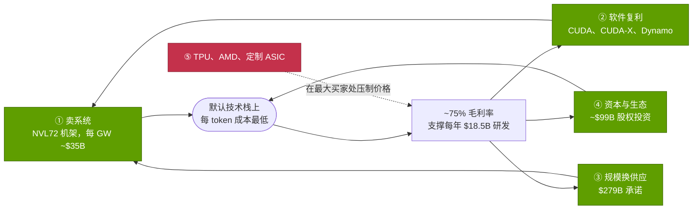
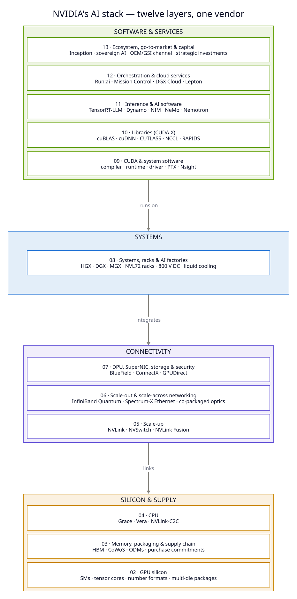
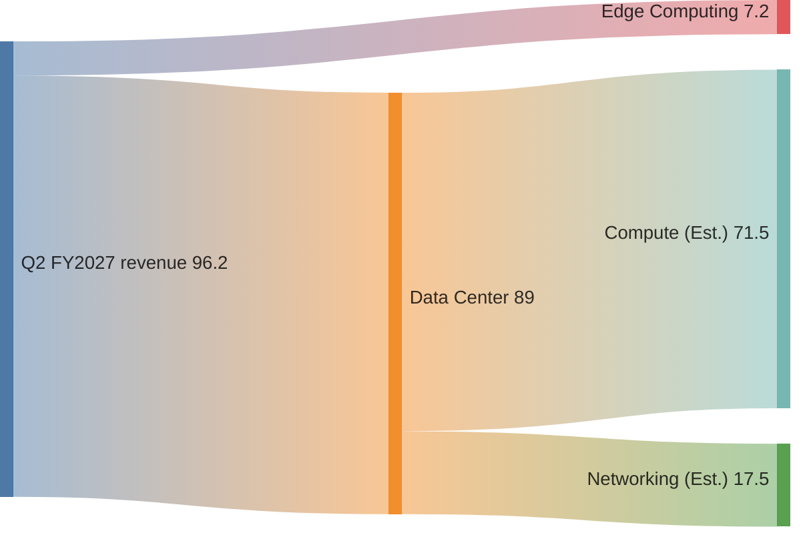
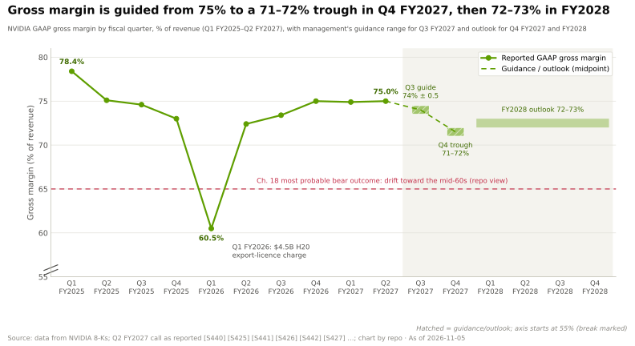
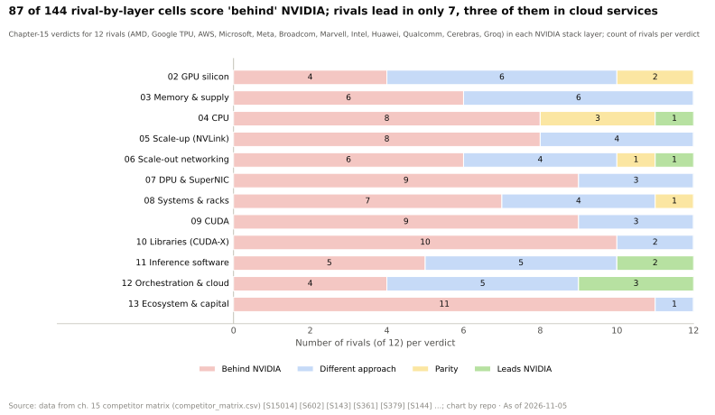
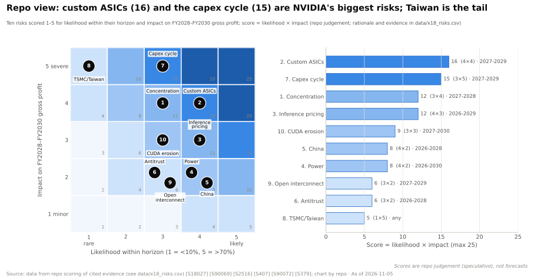
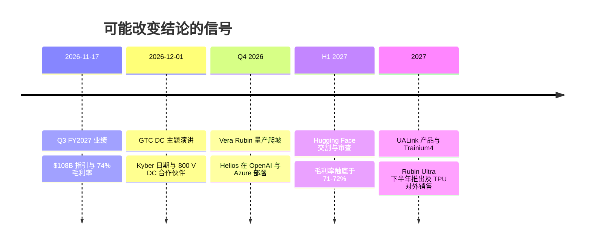

# 00 —— 执行摘要：英伟达如何以及为何变得不可或缺

> [!NOTE]
> 本页为英文原文的简体中文参考译文，仅供参考；如有出入，以[英文原文](../00-executive-summary.md "English original")为准。

综合篇 · 按不同阅读深度把整个资料库浓缩为一页 · 阅读约 ~22 分钟 · 最后核实：2026-11-05

## ⚡ 要点速览

- **一句话答案：英伟达（NVIDIA）把整座 AI 工厂作为一个系统来卖，并且每年更新一次，而竞争对手只卖其中的部件。**
  2025 年英伟达拿下了 AI 数据中心芯片收入的 ~87%（2023 年为 ~90%），而这一市场同期从 ~$53B 增长到 ~$224B
  （估计，本资料库测算）[[S416]](../sources/bibliography.md#s416)[[S1]](../sources/bibliography.md#s1)[[S660]](../sources/bibliography.md#s660)[[S661]](../sources/bibliography.md#s661)[[S663]](../sources/bibliography.md#s663)。数据中心业务占 FY2026
  $215.9B 收入的 90% [[S1]](../sources/bibliography.md#s1)[[S402]](../sources/bibliography.md#s402)。
- **约束因素不是需求，而是供应与毛利率。** Q2 FY2027 收入 $96.2B（同比 +106%），GAAP [毛利率](glossary.md#gross-margin)
  75.0%，Q3 指引为 $108B ± 2% [[S405]](../sources/bibliography.md#s405)[[S3]](../sources/bibliography.md#s3)。🟢 管理层将 FY2028 ~70% 的增长定性为
  [受供应约束](glossary.md#supply-constrained)，并指引毛利率因内存成本在 Q4 FY2027 触底于 71–72%，
  FY2028 回到 72–73% [[S90085]](../sources/bibliography.md#s90085)[[S90086]](../sources/bibliography.md#s90086)[[S18000]](../sources/bibliography.md#s18000)。
- **[护城河](glossary.md#moat)在于整体捆绑，而非芯片本身。** 🔴 按本资料库的分层结论，护城河最深的是
  软件库（4.5 分，满分 5），其次是供应、纵向扩展、机架与生态（各 4.0），最薄的是 CPU 和云服务
  （2.0）[[S1500]](../sources/bibliography.md#s1500)。12 层中有 6 层的差距在收窄，只有供应层在扩大——该层的承诺额已达
  $279B [[S407]](../sources/bibliography.md#s407)。
- **赚钱的地方与护城河所在之处并不重合。** GPU 是利润引擎：一颗 B200 的制造成本约 ~$6,400，
  售价却为 $30–40K（估计）[[S35020]](../sources/bibliography.md#s35020)[[S35026]](../sources/bibliography.md#s35026)。CUDA 与 [CUDA-X](glossary.md#cuda-x) 软件库是最深的护城河，却免费提供，
  其价值在于守护这份毛利率 [[S1509]](../sources/bibliography.md#s1509)[[S1510]](../sources/bibliography.md#s1510)。
- **挑战者真实存在，而且首先在最大买家处以价格取胜。** AMD 的 MI455X 在纸面上持平或超越 Rubin
  （[HBM](glossary.md#hbm) 432 vs 288 GB，23.3 vs 19.2 TB/s）[[S144]](../sources/bibliography.md#s144)[[S90093]](../sources/bibliography.md#s90093)[[S33005]](../sources/bibliography.md#s33005)；Anthropic 可使用多达 1M 颗谷歌（Google）
  [TPU](glossary.md#tpu) [[S653]](../sources/bibliography.md#s653)；博通（Broadcom）的 AI 收入相当于英伟达数据中心收入的比例从 ~12% 升至 ~19%
  [[S2516]](../sources/bibliography.md#s2516)[[S1500]](../sources/bibliography.md#s1500)。OpenAI、Anthropic 和 Meta 如今都采用多供应商组合 [[S24000]](../sources/bibliography.md#s24000)[[S174]](../sources/bibliography.md#s174)[[S24004]](../sources/bibliography.md#s24004)。
- **看空逻辑在于集中度、融资与替代，而非需求疲软。** 单一直接客户占 Q2 FY2027 收入的 16%
  [[S90069]](../sources/bibliography.md#s90069)；英伟达在 H1 FY2027 购入了 $42.4B 的股权，约占收入的 ~24% [[S90072]](../sources/bibliography.md#s90072)[[S18007]](../sources/bibliography.md#s18007)。
  🔴 本资料库认为最可能的看空结果是毛利率从 75% 滑向 65% 左右 [[S18027]](../sources/bibliography.md#s18027)。
- **接下来关注：** 2026-11-17 的 Q3 FY2027 业绩 [[S17005]](../sources/bibliography.md#s17005)、2026-12-01 的 GTC DC 主题演讲 [[S90047]](../sources/bibliography.md#s90047)、
  Vera Rubin 的量产爬坡 [[S90009]](../sources/bibliography.md#s90009)、AMD Helios 在 OpenAI 的部署 [[S90021]](../sources/bibliography.md#s90021)、TPU 对外销售 [[S90027]](../sources/bibliography.md#s90027)、$12.9B 收购
  [Hugging Face](glossary.md#hugging-face) 的交割 [[S11500]](../sources/bibliography.md#s11500) 以及中国出口许可 [[S90032]](../sources/bibliography.md#s90032)。

## 五点核心论点

本资料库的核心问题是：英伟达如何以及为何在 AI 训练与推理中变得不可或缺。答案分为五部分：前三点解释
机制，第四点解释强化作用，第五点说明边界。每一点都链接到给出证据的页面。

**1. 英伟达卖的是系统，而不是芯片。** 销售单位从 2016 年 $129K 的 DGX-1 服务器，扩大到 ~$4.0M 的
GB300 [NVL72](glossary.md#nvl72) 机架和 ~$7.8M 的 Vera Rubin NVL72（均为摩根士丹利估计）[[S310]](../sources/bibliography.md#s310)[[S332]](../sources/bibliography.md#s332)[[S330]](../sources/bibliography.md#s330)。在机架内部，
英伟达规定了 GPU、CPU、72 颗 GPU 的 [NVLink](glossary.md#nvlink) 域、网卡、铜缆背板、电源架与
液冷；ODM 以 ~2–3% 的毛利率完成组装 [[S5000]](../sources/bibliography.md#s5000)[[S332]](../sources/bibliography.md#s332)。英伟达 CEO 估计，在一座 1 GW
[AI 工厂](glossary.md#ai-factory) $50–60B 的总投资中，英伟达产品约占 ~$35B [[S398]](../sources/bibliography.md#s398)。系统之所以重要，是因为
现代模型受限于内存与通信，而非算术运算（[P3](primers/P3-the-four-bottlenecks.md)）。在每用户
50 tokens/s 下，GB300 NVL72 每颗 GPU 可提供 ~6,261 DeepSeek-R1 tokens/s，约为 H200 的 ~20×、AMD MI355X 的 ~8×
[[S621]](../sources/bibliography.md#s621)。按每兆瓦计，相对 H200 的差距约为 ~13× [[S621]](../sources/bibliography.md#s621)[[S622]](../sources/bibliography.md#s622)。

**2. 软件让每颗 GPU 每个季度都产出更多 token（词元）。** [CUDA](glossary.md#cuda) 原生支持本资料库追踪的全部 12 个主流
框架与引擎（36 分中得 36 分），AMD [ROCm](glossary.md#rocm) 为 26 分，高通（Qualcomm）Cloud AI 为 4 分
[[S587]](../sources/bibliography.md#s587)[[S580]](../sources/bibliography.md#s580)[[S586]](../sources/bibliography.md#s586)[[S596]](../sources/bibliography.md#s596)。新模型在发布首日（day 0）即可在其上运行。DeepSeek-V4-Pro 发布时，AMD MI355X 用了 8 天
才跑通 [FP4](glossary.md#fp4)，用了 27 天才达到每用户 50 tokens/s [[S633]](../sources/bibliography.md#s633)[[S631]](../sources/bibliography.md#s631)。软件还能提升已装机硬件的性能：在同一台
GB300 NVL72 上，MLPerf DeepSeek-R1 吞吐量一年内提升 2.9× [[S601]](../sources/bibliography.md#s601)[[S603]](../sources/bibliography.md#s603)，仅 [TensorRT-LLM](glossary.md#tensorrt-llm) 一项就在四个月内把
B200 从 ~2,000 提升到每 GPU 4,600 tokens/s [[S646]](../sources/bibliography.md#s646)。锁定效应真实存在，但并不均衡。🔴 本资料库对
自建部署的企业给出 4.5 分（满分 5），对有能力承担迁移成本的前沿实验室给出 2.75 分 [[S1509]](../sources/bibliography.md#s1509)。

**3. 规模换来供应、速度与迭代节奏。** 截至 Q2 FY2027，英伟达持有 $279B 的供应与产能承诺，
高于一个季度前的 $119B [[S407]](../sources/bibliography.md#s407)[[S404]](../sources/bibliography.md#s404)，并锁定了台积电（TSMC）2026 年 ~60% 的 [CoWoS](glossary.md#cowos) 晶圆（🟡
估计）[[S379]](../sources/bibliography.md#s379)。FY2026 研发支出 $18.5B，仅占收入的 ~9% [[S401]](../sources/bibliography.md#s401)。这支撑了
[年度迭代节奏](glossary.md#annual-cadence)：2025 年推出 Blackwell Ultra，Vera Rubin 自 2026 年 8 月起出货，🟢
Rubin Ultra 于 2027 下半年推出，🟢 Feynman 于 2028 年推出 [[S500]](../sources/bibliography.md#s500)[[S90009]](../sources/bibliography.md#s90009)[[S35018]](../sources/bibliography.md#s35018)[[S109]](../sources/bibliography.md#s109)。英伟达会在 GPU 出货前 26–40 个月
公布其时间表，使买家可以围绕其日程规划吉瓦级园区（🔴 本资料库分析）[[S17006]](../sources/bibliography.md#s17006)。

**4. 资本与生态使英伟达成为默认交易对手。** 英伟达的股权投资合计约 ~$99B（CNBC 根据 2026 年
7 月 10-Q 汇总）[[S90073]](../sources/bibliography.md#s90073)，其中包括对 OpenAI 的 ~$30B（🟡）以及对 Anthropic 最多 $10B 的投资
[[S90015]](../sources/bibliography.md#s90015)[[S90075]](../sources/bibliography.md#s90075)。主权 AI 在 FY2026 带来超过 ~$30B 的收入 [[S90071]](../sources/bibliography.md#s90071)。AI 云、工业与企业
买家（[ACIE](glossary.md#acie)）贡献了 ~$40.3B，占 Q2 FY2027 数据中心收入的 45%，主要通过合作伙伴与
[新兴云服务商（neocloud）](glossary.md#neocloud)实现 [[S406]](../sources/bibliography.md#s406)。同一循环也招致
[循环融资](glossary.md#circular-financing)的批评：H1 FY2027 的股权购买相当于收入的 ~24%，
与朗讯（Lucent）2000 年巅峰时的比例相当 [[S90072]](../sources/bibliography.md#s90072)[[S18007]](../sources/bibliography.md#s18007)。

**5. 今日不可或缺，边际上可被挑战。** 没有对手能匹敌其整个技术栈。在第 15 章的矩阵中，最接近的
谷歌 TPU 在 12 层中的 5 层持平或领先，而所有“对手 × 层级”单元格中有 60% 为“落后”
[[S15014]](../sources/bibliography.md#s15014)。然而，买家已不必复制整个技术栈就能约束英伟达的定价。按集邦咨询（TrendForce）的统计，
定制 [ASIC](glossary.md#asic) 服务器在 2026 年 AI 服务器出货量中占 ~27.8% [[S2517]](../sources/bibliography.md#s2517)；自有的
Ironwood TPU 每芯片小时成本约 ~$1.21，而 GB300 约为 ~$2.31（估计，SemiAnalysis）[[S622]](../sources/bibliography.md#s622)。🔴 本资料库结论：
竞争对手会在削弱英伟达出货量之前很久，就先在最大买家处压制其[定价权](glossary.md#pricing-power)
（[第 15 章](cross-cutting/15-competitive-landscape/index.md)）。

> [!TIP]
> **算例 —— 毛利率 75% 的供应商为何仍能提供最便宜的 token。** 第 14 章的模型测算，在每用户 50 tokens/s 下，
> GB300 NVL72 的 token 成本约为每百万 ~$0.16（估计，P10–P90 为 $0.13–0.23）[[S14000]](../sources/bibliography.md#s14000)[[S621]](../sources/bibliography.md#s621)。英伟达的
> 毛利仅占该成本的 ~24%；资本费用约占 ~70%，电费约占 ~6% [[S14000]](../sources/bibliography.md#s14000)。按每兆瓦计，不同平台的吞吐量
> 相差 ~30×，因此决定成本的是吞吐量而不是价格。🔴 在该工作点上，即便 MI355X、TPU v7 或 Trainium3 免费，
> 其 token 成本也高于付费购买的 GB300 [[S14000]](../sources/bibliography.md#s14000)。**结论：** 英伟达的毛利率之所以能维持，
> 是因为其系统降低了买家的每 token 成本。但这一领先是有条件的：在每用户 100 tokens/s 下，
> GB300（~$1.74/M）与 TPU v7（$1.46–1.72）持平（🔴 模型推算）[[S14000]](../sources/bibliography.md#s14000)。

🔧 技术细节：为何“不可或缺”不等于“垄断”

此处的“不可或缺”是指：对 2026 年的大多数买家而言，没有比英伟达机架更快或更便宜的方式，能把资本和
电力大规模转化为 token。这建立在竞争对手必须同时具备的三项能力之上：有竞争力的加速器、72-GPU 级别的
纵向扩展域及其配套网络，以及对每个新模型的首日软件支持。AMD 已具备第一项，正在交付第二项（Helios），
并以数周的滞后追赶第三项 [[S144]](../sources/bibliography.md#s144)
[[S90020]](../sources/bibliography.md#s90020)[[S631]](../sources/bibliography.md#s631)。谷歌三项俱全，但主要服务于自身工作负载和少数锚定客户 [[S653]](../sources/bibliography.md#s653)[[S552]](../sources/bibliography.md#s552)。

英伟达所缺乏的，是对其最大客户替代方案的控制力：贡献大部分数据中心收入的买家，同时也在设计
TPU、Trainium、Maia 和 MTIA [[S90069]](../sources/bibliography.md#s90069)[[S90026]](../sources/bibliography.md#s90026)[[S90035]](../sources/bibliography.md#s90035)[[S90044]](../sources/bibliography.md#s90044)。恰当的模型是：一家掌握定价权的在位者，在市场顶端
面临可信的替代品，在其下则很少——这也是第 18 章最可能的看空结果是毛利率承压、而非销量流失的
原因 [[S18027]](../sources/bibliography.md#s18027)。

## 一图看懂技术栈

本资料库把英伟达的 AI 业务拆分为十二层，从底部的 GPU 芯片到顶部的生态、市场进入与资本。可以把这块
“蛋糕”自下而上当作一个 token 的生成路径来读。芯片与内存负责运算（[第 02 层](layers/02-gpu-silicon/index.md)、[第 03 层](layers/03-memory-packaging-supply-chain/index.md)）。
CPU 为它们供给数据（[第 04 层](layers/04-cpu-grace-vera/index.md)）。[纵向扩展（scale-up）](glossary.md#scale-up)与
[横向扩展（scale-out）](glossary.md#scale-out)网络让数千颗 GPU 像一台机器一样工作
（[05](layers/05-scale-up-nvlink-nvswitch/index.md)、[06](layers/06-scale-out-scale-across-networking/index.md)、
[07](layers/07-dpu-supernic-storage-security/index.md)）。机架把部件变成一台供电、散热完备的计算机
（[08](layers/08-systems-racks-ai-factories/index.md)）。随后四个软件层把这台计算机转化为高速内核、
实际交付的速度、对外服务的 token 与付费 GPU 小时
（[09](layers/09-cuda-and-system-software/index.md)–[12](layers/12-orchestration-and-cloud-services/index.md)）。
资本与渠道再把这一切转化为获得融资的需求
（[13](layers/13-ecosystem-gtm-and-capital/index.md)）。

英伟达的特别之处不在于它涉足每一层，而在于它每年把所有层作为一个产品同步更新，因此竞争对手必须
追赶的是一个不断移动的整体，而不是某个部件。

> [!TIP]
> **算例 —— 一吉瓦电力穿过技术栈。** 在 1.15 的 [PUE](glossary.md#pue) 下，1 GW 可为 IT 设备留下 ~870 MW。一台 GB300 NVL72
> 需要 ~132 kW，另加 ~21% 分摊的网络与存储功耗，合计约 ~160 kW。这足以容纳 **~5,400 个机架和
> ~390,000 颗 GPU**（第 08 层，本资料库测算）[[S1508]](../sources/bibliography.md#s1508)[[S387]](../sources/bibliography.md#s387)[[S337]](../sources/bibliography.md#s337)。英伟达 CEO 为这样一座工厂给出的价格是
> **$50–60B，其中 ~$35B 为英伟达产品** [[S398]](../sources/bibliography.md#s398)。伯恩斯坦（Bernstein）的 ~$35B 与巴克莱（Barclays）的 $32.5–42B 处于同一量级
> [[S6025]](../sources/bibliography.md#s6025)[[S27012]](../sources/bibliography.md#s27012)。**结论：** 在吉瓦级规模下，英伟达的开票金额约占预算的 58–70%。没有任何
> 单层供应商的钱包份额能接近这一水平。

## 关键数字

| 指标 | 数值 | 为何重要 | 来源 |
|---|---|---|---|
| FY2026 收入 | $215.9B（+65%） | 约为 FY2016 $5.0B 的 ~43× | [[S1]](../sources/bibliography.md#s1)[[S400]](../sources/bibliography.md#s400) |
| FY2026 数据中心收入 | $193.7B，占收入的 90% | AI 业务就是公司本身 | [[S1]](../sources/bibliography.md#s1)[[S402]](../sources/bibliography.md#s402) |
| FY2026 网络收入 | ~$31.4B（估计），FY2024 为 $8.6B | Mellanox 业务，现占数据中心的 ~20% | [[S402]](../sources/bibliography.md#s402)[[S416]](../sources/bibliography.md#s416) |
| Q2 FY2027 收入 / 数据中心 | $96.2B（同比 +106%）/ $89.0B（同比 +117%） | 增长因 Blackwell Ultra 再度加速 | [[S405]](../sources/bibliography.md#s405) |
| Q2 FY2027 数据中心构成 | 超大规模云厂商 ~$48.7B（55%）；ACIE ~$40.3B（45%） | 近一半需求不经过超大规模云厂商 | [[S406]](../sources/bibliography.md#s406)[[S90011]](../sources/bibliography.md#s90011) |
| Q2 FY2027 网络 | ~$17.5B（估计，环比 +18%）；Spectrum-X 同比 2.6× | 以太网已成为英伟达的增长线 | [[S408]](../sources/bibliography.md#s408)[[S90012]](../sources/bibliography.md#s90012) |
| Q2 FY2027 GAAP 毛利率 | 75.0% | 销量巅峰期的定价权 | [[S405]](../sources/bibliography.md#s405) |
| Q3 FY2027 指引 | $108B ± 2%；毛利率 74% ± 50 bp；不含中国数据中心计算产品 | 业绩将于 2026-11-17 公布 | [[S3]](../sources/bibliography.md#s3)[[S90085]](../sources/bibliography.md#s90085)[[S17005]](../sources/bibliography.md#s17005) |
| FY2028 初步展望 | 🟢 收入增长 ~70%，受供应约束 | 市场一致预期原为 ~45% | [[S90086]](../sources/bibliography.md#s90086)[[S18000]](../sources/bibliography.md#s18000) |
| 毛利率路径 | 🟢 Q4 FY2027 触底于 71–72%；FY2028 为 72–73% | 内存成本高于计划；随后提价 | [[S90085]](../sources/bibliography.md#s90085)[[S18000]](../sources/bibliography.md#s18000) |
| 供应与产能承诺 | $279B（季度收入的 2.9×） | 以配额为武器，下行周期中则是固定成本 | [[S407]](../sources/bibliography.md#s407)[[S18027]](../sources/bibliography.md#s18027) |
| 最大直接客户 | 占 Q2 FY2027 收入的 16%；前三大客户占 H1 的 44% | 集中度会放大其他所有风险 | [[S90069]](../sources/bibliography.md#s90069) |
| 股权投资 | ~$99B；H1 FY2027 购入 $42.4B | 资本循环与循环融资之争 | [[S90073]](../sources/bibliography.md#s90073)[[S90072]](../sources/bibliography.md#s90072) |
| AI 数据中心芯片收入份额 | ~87%（2025）vs ~90%（2023）（估计） | 市场扩大至四倍，份额几乎未变 | [[S416]](../sources/bibliography.md#s416)[[S660]](../sources/bibliography.md#s660)[[S663]](../sources/bibliography.md#s663) |
| 市值 | ~$5.3–5.8T（2026 年 8–10 月）；🔴 约为 FY2028 指引盈利的 ~14× | 市场已按见顶来定价 | [[S18004]](../sources/bibliography.md#s18004)[[S18005]](../sources/bibliography.md#s18005)[[S18027]](../sources/bibliography.md#s18027) |

最新季度有两点值得注意。其一，数据中心收入如今可以从两个维度拆分：按客户分，超大规模云厂商与 ACIE
约为 55:45 [[S406]](../sources/bibliography.md#s406)；按产品分，计算与网络约为 80:20 [[S405]](../sources/bibliography.md#s405)[[S408]](../sources/bibliography.md#s408)。其二，指引本质上是供应指引：
管理层表示 FY2028 的增长受限于供应所能支撑的规模 [[S18000]](../sources/bibliography.md#s18000)。在 GTC 2026 上，公司估计 Blackwell 加 Vera Rubin 截至
2027 年的需求达 $1 trillion（🟡 各媒体对“订单”还是“收入机会”的表述不一）[[S90001]](../sources/bibliography.md#s90001)[[S90002]](../sources/bibliography.md#s90002)。

Q2 FY2027 按平台划分的收入，单位 US$ B（图中标签：revenue = 收入，Data Center = 数据中心，Edge Computing = 边缘计算，Compute = 计算，Networking = 网络，Est. = 估计）。计算/网络的拆分，是根据已披露的网络收入环比 +18%、
以 Q1 的 $14.8B 为基数估算的 [[S405]](../sources/bibliography.md#s405)[[S408]](../sources/bibliography.md#s408)[[S90014]](../sources/bibliography.md#s90014)。

> [!TIP]
> **算例 —— 指引在美元上意味着什么。** 以 Q3 $108B 的收入指引计，每 1 个百分点的毛利率相当于
> 每季度 ~$1.1B 的毛利，因此指引中从 75% 滑落到 71–72% 低点，在该收入水平下每季度减少毛利 ~$3–4B
> （本资料库测算）[[S3]](../sources/bibliography.md#s3)[[S90085]](../sources/bibliography.md#s90085)。第 18 章的 FY2028 路径为收入 ~$697B、毛利率 ~72.5%，对应
> 毛利 ~$505B（🔴 本资料库测算）[[S18027]](../sources/bibliography.md#s18027)[[S18000]](../sources/bibliography.md#s18000)。若毛利率转而滑向 65%——本资料库认为最可能的
> 看空情景——同等收入下毛利降至 ~$453B，减少 ~$52B。**结论：** 英伟达的盈利风险在于毛利率点数，
> 而不在于出货量，而如今左右这些点数的是内存价格。

🔧 技术细节：核对 Q2 FY2027 的收入构成数字

Q1 FY2027 网络收入创下 $14.8B 的纪录 [[S90014]](../sources/bibliography.md#s90014)；英伟达称 Q2 网络收入环比增长 18%，因此本资料库采用
~$17.5B（14.8 × 1.18），并标注为“估计” [[S408]](../sources/bibliography.md#s408)[[S90012]](../sources/bibliography.md#s90012)。计算收入为数据中心收入减去网络收入，约 ~$71.5B。
客户拆分（超大规模云厂商 ~$48.7B、ACIE ~$40.3B）来自 CFO 评论 [[S406]](../sources/bibliography.md#s406)。两种拆分加总均为 $89.0B，
但对同一收入的切分方式不同，因此不能放在同一张流向图中。毛利率均为 GAAP 口径；自 Q1 FY2027 以来，
GAAP 与非 GAAP 口径相差约 ~0.1 个百分点 [[S403]](../sources/bibliography.md#s403)。

## 逐层结论

每段浓缩了该层的索引页、八问表与竞争页面。分数为本资料库 1–5 分制的[护城河评分](glossary.md#moat-score)，
箭头为[差距趋势](glossary.md#gap-trend)，二者均为 🔴 本资料库判断，连同证据记录在
`data/x00_layer_verdicts.csv` 中 [[S1500]](../sources/bibliography.md#s1500)；[速查表](CHEATSHEET.md)把它们汇总在
一张表中。

**[第 02 层 · GPU 芯片](layers/02-gpu-silicon/index.md) —— 受挑战，3.0 ↘。** Rubin 可提供 35 [PFLOPS](glossary.md#flops) 的稠密
[NVFP4](glossary.md#nvfp4) 算力，约为 V100 16 位峰值的 ~280×，但在 16 位下仅为 ~32×，因此大部分提升来自更小的数值格式
[[S33005]](../sources/bibliography.md#s33005)[[S33010]](../sources/bibliography.md#s33010)[[S100]](../sources/bibliography.md#s100)。2026 年 9–10 月的规格修订把 Rubin 的 HBM4 带宽从 22 TB/s 下调至 19.2 TB/s，
NVLink 6 从每 GPU 3.6 TB/s 下调至 3.0 TB/s [[S90006]](../sources/bibliography.md#s90006)[[S90007]](../sources/bibliography.md#s90007)。纸面上，AMD MI455X 如今在内存上领先（432 GB、23.3
TB/s，带宽高出 ~21%）[[S144]](../sources/bibliography.md#s144)[[S90093]](../sources/bibliography.md#s90093)。🔴 芯片层面的领先以月计，而非以代计 [[S1502]](../sources/bibliography.md#s1502)。该层仍是利润引擎。

**[第 03 层 · 内存、封装与供应链](layers/03-memory-packaging-supply-chain/index.md) —— 深厚，4.0 ↗。**
对推理而言，内存比算力更早成为瓶颈；HBM 约占 B200 制造成本的 ~45%（估计）[[S35020]](../sources/bibliography.md#s35020)。英伟达与竞争对手
向同样的三家 HBM 厂商采购，因此其优势在于配额而非技术：$279B 的承诺与 2026 年 ~60% 的
CoWoS（🟡 估计）[[S407]](../sources/bibliography.md#s407)[[S379]](../sources/bibliography.md#s379)。这是唯一一个差距在扩大的层级。代价是一笔固定成本，这使英伟达在
$4.5B 的 H20 费用中充当了缓冲垫 [[S414]](../sources/bibliography.md#s414)。

**[第 04 层 · CPU](layers/04-cpu-grace-vera/index.md) —— 单薄，2.0 →。** Grace 与 Vera 的意义在于集成。
一致性 NVLink-C2C 链路为每颗 Vera Rubin GPU 提供到主机 ~900 GB/s 的带宽和 ~750 GB 的 CPU 内存 [[S128]](../sources/bibliography.md#s128)[[S4019]](../sources/bibliography.md#s4019)
[[S100]](../sources/bibliography.md#s100)[[S102]](../sources/bibliography.md#s102)。但 CPU 仅占一个 ~$7.8M 机架的 ~2%（估计）[[S331]](../sources/bibliography.md#s331)，而 AMD 256 核的 EPYC Venice 是 Helios
机架的核心 [[S4028]](../sources/bibliography.md#s4028)[[S538]](../sources/bibliography.md#s538)。[智能体（agentic）](glossary.md#agentic-ai) AI 可能使独立 CPU 成为新的插槽市场，CPU:GPU 比例正向
1:2–1:1 靠拢 [[S4012]](../sources/bibliography.md#s4012)[[S4013]](../sources/bibliography.md#s4013)。

**[第 05 层 · 纵向扩展（NVLink、NVSwitch）](layers/05-scale-up-nvlink-nvswitch/index.md) —— 深厚，4.0 ↘。** NVL72
是其标志性产品。在 2026 年下调后，Vera Rubin 的 NVLink 域带宽达 216 TB/s，通过铜缆背板传输，每个机架
省去 ~19 kW 功耗和 ~$0.7M 的光学器件（估计）[[S200]](../sources/bibliography.md#s200)[[S201]](../sources/bibliography.md#s201)[[S5000]](../sources/bibliography.md#s5000)[[S5016]](../sources/bibliography.md#s5016)。AMD Helios 宣称通过
[UALink](glossary.md#ualink)-over-Ethernet 达到 260 TB/s，谷歌 TPU pod 可达 9,216 颗芯片 [[S226]](../sources/bibliography.md#s226)[[S232]](../sources/bibliography.md#s232)。开放的 UALink 产品
将于 2027 年推出 [[S90051]](../sources/bibliography.md#s90051)。[NVLink Fusion](glossary.md#nvlink-fusion) 是英伟达的反制手段：向 13 家
合作伙伴开放该链路，包括高通、富士通、英特尔（Intel）和 AWS Trainium4，但每个系统中都保留英伟达芯片（🟡）
[[S131]](../sources/bibliography.md#s131)[[S518]](../sources/bibliography.md#s518)[[S5018]](../sources/bibliography.md#s5018)。

**[第 06 层 · 横向扩展网络](layers/06-scale-out-scale-across-networking/index.md) —— 受挑战，3.0 →。**
Mellanox（2019 年以 $6.9B 收购）已成长为年收入 ~$31.4B 的业务 [[S464]](../sources/bibliography.md#s464)[[S402]](../sources/bibliography.md#s402)。买家选择了以太网——2026 年 1Q
以太网约占 AI 后端交换机销售额的三分之二（🟡 Dell'Oro）——英伟达随之推出 [Spectrum-X](glossary.md#spectrum-x)，
同比增长 2.6× [[S90054]](../sources/bibliography.md#s90054)[[S408]](../sources/bibliography.md#s408)。博通比 Spectrum-6 早 ~12 个月交付 102.4 Tb/s 交换机，Celestica 在 2026 年 1Q
领跑 AI 后端交换市场 [[S274]](../sources/bibliography.md#s274)[[S6019]](../sources/bibliography.md#s6019)[[S90054]](../sources/bibliography.md#s90054)。英伟达的优势在于把[网卡（NIC）](glossary.md#nic)、交换机和 [NCCL](glossary.md#nccl) 调优打包销售。

**[第 07 层 · DPU、SuperNIC、存储与安全](layers/07-dpu-supernic-storage-security/index.md) —— 受挑战，
3.0 ↘。** 如今每颗 GPU 都配有自己的 [SuperNIC](glossary.md#supernic)：GB200 上为 400 Gb/s，GB300 上为 800，
Vera Rubin 上为 1.6 Tb/s [[S266]](../sources/bibliography.md#s266)[[S264]](../sources/bibliography.md#s264)[[S33004]](../sources/bibliography.md#s33004)。BlueField-4 把闪存变成推理用的 KV 缓存层级 [[S7511]](../sources/bibliography.md#s7511)。[超大规模云厂商](glossary.md#hyperscaler)
运行自家的卸载方案（AWS Nitro、Google Titanium），而 Helios 为每颗 GPU 配置 2.4 Tb/s 的 AMD Pensando 网卡
[[S292]](../sources/bibliography.md#s292)[[S228]](../sources/bibliography.md#s228)。存储软件的利润流向 VAST Data、DDN 和 WEKA 等合作伙伴 [[S1507]](../sources/bibliography.md#s1507)。

**[第 08 层 · 系统、机架与 AI 工厂](layers/08-systems-racks-ai-factories/index.md) —— 深厚，4.0 ↘。**
英伟达单系统功率从 3.2 kW（DGX-1）升至 ~132 kW（GB300 NVL72），Kyber 计划达到 ~600 kW，因此液冷
和 800 V 直流供电如今已成为产品的一部分 [[S310]](../sources/bibliography.md#s310)[[S337]](../sources/bibliography.md#s337)[[S305]](../sources/bibliography.md#s305)[[S90063]](../sources/bibliography.md#s90063)。产出指标是
[每兆瓦 token 数](glossary.md#tokens-per-megawatt)，GB300 NVL72 在该指标上领先 [[S621]](../sources/bibliography.md#s621)[[S622]](../sources/bibliography.md#s622)。AMD Helios（31 TB
[HBM4](glossary.md#hbm4)，约为 Vera Rubin 的 ~1.5×）约自 2026 年 Q3 末开始出货，在纸面上于 7 项机架指标中的 3 项领先
[[S90020]](../sources/bibliography.md#s90020)[[S90021]](../sources/bibliography.md#s90021)[[S1508]](../sources/bibliography.md#s1508)。

**[第 09 层 · CUDA 与系统软件](layers/09-cuda-and-system-software/index.md) —— 受挑战，3.5 ↘。** 护城河在于
长尾：~6M 开发者（自 2025 年以来持平），以及在每个主流框架中的原生支持 [[S528]](../sources/bibliography.md#s528)[[S587]](../sources/bibliography.md#s587)。侵蚀是
真实的。torch.compile、[Triton](glossary.md#triton)、[vLLM](glossary.md#vllm) 和 [SGLang](glossary.md#sglang) 可在多家厂商的硬件上运行，AMD 在新前沿模型上的滞后已缩短至 26
天，高通于 2026-07-29 完成了对 Modular（Mojo/MAX）约 ~$3.9B 的收购 [[S578]](../sources/bibliography.md#s578)[[S580]](../sources/bibliography.md#s580)[[S631]](../sources/bibliography.md#s631)[[S9511]](../sources/bibliography.md#s9511)。🔴
3.5 分是第 09 层各细分项平均分 ~3.6 的取整 [[S1509]](../sources/bibliography.md#s1509)。

**[第 10 层 · 软件库（CUDA-X）](layers/10-libraries-cuda-x/index.md) —— 最深，4.5 →。** 英伟达称其拥有“数百个
软件库” [[S10047]](../sources/bibliography.md#s10047)。在本资料库的 15 个领域测试中，没有对手在任何领域领先，AMD 在 3 个领域持平 [[S1510]](../sources/bibliography.md#s1510)。AI 核心部分
（GEMM、注意力、集合通信）是可复制的；AMD 的 RCCL 就是基于 NCCL 的源代码构建的 [[S10002]](../sources/bibliography.md#s10002)。数据、仿真与
科学计算库的长尾则难以复制。软件库是免费的，其价值体现在 GPU 定价中。

**[第 11 层 · 推理与 AI 软件](layers/11-inference-and-ai-software/index.md) —— 受挑战，3.0 →。** [Dynamo](glossary.md#dynamo)
1.0 在 GTC 2026 上以 Apache-2.0 协议开源发布 [[S90066]](../sources/bibliography.md#s90066)。将[预填充（prefill）](glossary.md#prefill)与[解码（decode）](glossary.md#decode)分离，使 B200 在长提示词下的
每 GPU 吞吐量提升 ~2.5× [[S621]](../sources/bibliography.md#s621)。这一层几乎没有能锁定客户的东西。开源引擎可在 AMD 和 TPU 上运行，谷歌
TPU 服务某一大型模型的每 token 成本比 B200 低 ~18% [[S580]](../sources/bibliography.md#s580)[[S625]](../sources/bibliography.md#s625)。直接软件收入每年约 ~$2B，
不到数据中心收入的 1% [[S11011]](../sources/bibliography.md#s11011)；关键在于带动硬件销售。

**[第 12 层 · 编排与云服务](layers/12-orchestration-and-cloud-services/index.md) —— 单薄，2.0 →。**
英伟达收购了控制平面（Run:ai ~$700M、SchedMD），并将其大部分开源 [[S479]](../sources/bibliography.md#s479)[[S12000]](../sources/bibliography.md#s12000)[[S12510]](../sources/bibliography.md#s12510)；DGX
Cloud 转向内部使用，Lepton 将开发者导流至合作伙伴云（🟡）[[S90068]](../sources/bibliography.md#s90068)[[S598]](../sources/bibliography.md#s598)。超大规模云厂商掌握
客户、控制平面以及自研芯片 [[S1512]](../sources/bibliography.md#s1512)。英伟达以交易对手身份参与，持有 ~$65B 的云服务
承诺以及对 CoreWeave $6.3B 的兜底承诺 [[S407]](../sources/bibliography.md#s407)[[S90067]](../sources/bibliography.md#s90067)。

**[第 13 层 · 生态、市场进入与资本](layers/13-ecosystem-gtm-and-capital/index.md) —— 深厚，4.0 ↘。**
[主权 AI](glossary.md#sovereign-ai) 在 FY2026 超过 ~$30B，已公布的国家级协议涉及 ~1.03M 颗英伟达 GPU
[[S90071]](../sources/bibliography.md#s90071)[[S13003]](../sources/bibliography.md#s13003)[[S13000]](../sources/bibliography.md#s13000)。对非上市公司的股权投资在 18 个月内从 $3.4B 增至 $51.2B [[S13043]](../sources/bibliography.md#s13043)[[S90072]](../sources/bibliography.md#s90072)。资产负债表上的
差距在扩大，但需求端的差距在收窄。博通的 AI 收入是“超大规模云厂商 + 博通”联盟最清晰的衡量指标，
它相当于英伟达数据中心收入的比例在约两年内从 ~11–14% 升至 ~19% [[S2516]](../sources/bibliography.md#s2516)[[S1513]](../sources/bibliography.md#s1513)。

> [!TIP]
> **算例 —— 解读一个结论：为什么纵向扩展得 4 分却趋势向下。** 一个 Vera Rubin 机架的 NVLink 网络
> 承载 72 × 3.0 TB/s = **216 TB/s**，而其 72 块 ConnectX-9 网卡的双向总带宽为 28.8 TB/s：留在机架内部的带宽
> 是离开机架带宽的 **7.5×** [[S200]](../sources/bibliography.md#s200)[[S33004]](../sources/bibliography.md#s33004)。要匹敌这一点，需要同时具备交换芯片、[SerDes](glossary.md#serdes)、
> 铜缆或光学背板以及集合通信库。这解释了 4 分。AMD Helios 宣称 260 TB/s，UALink 产品预计于 2027 年
> 推出，因此趋势向下 [[S226]](../sources/bibliography.md#s226)[[S90051]](../sources/bibliography.md#s90051)。**结论：** 高分加下行箭头是本资料库中最常见的结论。它描述的是
> 一种今天真实存在、但已能看到到期日的领先。

## 护城河最强与最弱之处

| 排名 | 层级 | 护城河评分 | 趋势 | 护城河靠什么守住 | 在哪里渗漏 |
|---|---|---:|:---:|---|---|
| 1 | [10 软件库](layers/10-libraries-cuda-x/index.md) | 4.5 | → | 覆盖每一代 GPU 的调优；15 个领域的广度 | AI 核心可复制（RCCL 源自 NCCL）[[S10002]](../sources/bibliography.md#s10002) |
| 2 | [03 内存与供应](layers/03-memory-packaging-supply-chain/index.md) | 4.0 | ↗ | $279B 承诺；2026 年 ~60% 的 CoWoS [[S407]](../sources/bibliography.md#s407)[[S379]](../sources/bibliography.md#s379) | HBM 厂商攫取利润 [[S35020]](../sources/bibliography.md#s35020) |
| 3 | [05 纵向扩展](layers/05-scale-up-nvlink-nvswitch/index.md) | 4.0 | ↘ | 已量产的 72-GPU 域；铜缆背板 [[S5000]](../sources/bibliography.md#s5000) | Helios 260 TB/s；UALink 2027 [[S226]](../sources/bibliography.md#s226)[[S90051]](../sources/bibliography.md#s90051) |
| 4 | [08 系统](layers/08-systems-racks-ai-factories/index.md) | 4.0 | ↘ | 年度机架设计、ODM 生态 [[S3014]](../sources/bibliography.md#s3014) | Helios 自 2026 年 Q3 末出货 [[S90020]](../sources/bibliography.md#s90020) |
| 5 | [13 生态与资本](layers/13-ecosystem-gtm-and-capital/index.md) | 4.0 | ↘ | ~$99B 股权投资；渠道覆盖 [[S90073]](../sources/bibliography.md#s90073) | 博通联盟达英伟达数据中心收入的 ~19% [[S2516]](../sources/bibliography.md#s2516) |
| 6 | [09 CUDA](layers/09-cuda-and-system-software/index.md) | 3.5 | ↘ | 长尾、首日支持 [[S633]](../sources/bibliography.md#s633) | 前沿实验室迁移；ROCm 滞后 26 天 [[S631]](../sources/bibliography.md#s631) |
| 7 | [02 GPU 芯片](layers/02-gpu-silicon/index.md) | 3.0 | ↘ | 迭代节奏、NVFP4、双裸片封装 [[S100]](../sources/bibliography.md#s100) | MI455X 纸面持平或超越 [[S144]](../sources/bibliography.md#s144)[[S90093]](../sources/bibliography.md#s90093) |
| 8 | [06 横向扩展](layers/06-scale-out-scale-across-networking/index.md) | 3.0 | → | 网卡–交换机–NCCL 捆绑 [[S464]](../sources/bibliography.md#s464) | 商用以太网、超以太网（Ultra Ethernet）[[S274]](../sources/bibliography.md#s274)[[S575]](../sources/bibliography.md#s575) |
| 9 | [07 DPU 与 SuperNIC](layers/07-dpu-supernic-storage-security/index.md) | 3.0 | ↘ | ConnectX 在 1.6 Tb/s 上领先 [[S33004]](../sources/bibliography.md#s33004) | 自研卸载方案；Pensando [[S292]](../sources/bibliography.md#s292)[[S228]](../sources/bibliography.md#s228) |
| 10 | [11 推理软件](layers/11-inference-and-ai-software/index.md) | 3.0 | → | 机架协同设计、逐模型调优 [[S621]](../sources/bibliography.md#s621) | 开源引擎；TPU 每 token 成本 [[S625]](../sources/bibliography.md#s625) |
| 11 | [04 CPU](layers/04-cpu-grace-vera/index.md) | 2.0 | → | 一致性 C2C 链路 [[S129]](../sources/bibliography.md#s129) | x86 与超大规模云厂商的 Arm 芯片 [[S4028]](../sources/bibliography.md#s4028) |
| 12 | [12 编排与云](layers/12-orchestration-and-cloud-services/index.md) | 2.0 | → | 配额与资本 [[S407]](../sources/bibliography.md#s407) | 超大规模云厂商掌握客户 [[S90026]](../sources/bibliography.md#s90026) |

有三个规律值得注意。最深的护城河不在芯片，而在软件库、供应配额和机架级系统，这些都复制得慢、
成本高。一半层级的差距在收窄，每次都是因为挑战者攻击了某个*部件*（AMD 的芯片与机架、UALink 的互连网络、
开源推理引擎）。而单薄的层级——CPU 和云——本就是英伟达从不需要赢下的；它通过 NVLink Fusion、对英特尔
$5B 的投资以及对新兴云服务商的兜底将其收编 [[S90031]](../sources/bibliography.md#s90031)[[S4009]](../sources/bibliography.md#s4009)[[S90067]](../sources/bibliography.md#s90067)。

第二张图加入了钱的维度。英伟达在 GPU、纵向扩展网络、横向网络和机架上确认毛利；软件库、CUDA 和供应配额
直接收益很少，但守护着这份利润。只复制盈利部分（芯片、机架）的挑战者会撞上防御层；只复制
防御部分（可移植的编译器）的挑战者，在同时交付硬件之前一无所获。

> [!TIP]
> **算例 —— 软件差距折算成硬件成本是多少。** DeepSeek-V4-Pro 发布后第 27 天，在 SemiAnalysis 的测试中，
> B200 每 GPU 的 token 产出约为 MI355X 的 ~5× [[S631]](../sources/bibliography.md#s631)。假设 MI355X 每小时的持有成本只有一半
> （🔴 示意性假设）。在其软件追上之前，其每 token 成本仍高出 5 ÷ 2 = **2.5×**
> [[S1509]](../sources/bibliography.md#s1509)。**结论：** 正是免费的软件层，让英伟达能为付费层收费。每出现一个新的模型
> 家族，就会重新打开一个窗口，让更便宜的芯片产出更贵的 token。

🔧 技术细节：护城河评分如何构建及其局限

每一层都围绕一个问题按 1 至 5 打分：买家或竞争对手要在这一层绕开英伟达，需要多长时间、多少投入？
输入包括该层的要点速览、八问表（尤其是 Q4 优势来源、Q5 最强挑战者和 Q6 复制成本）、其竞争结论矩阵
以及第 15 章的“对手 × 层级”矩阵 [[S1502]](../sources/bibliography.md#s1502)[[S1513]](../sources/bibliography.md#s1513)[[S15014]](../sources/bibliography.md#s15014)。3 分表示对手在某些维度上持平，而英伟达在集成上
领先。5 分表示没有对手接近、切换需要数年。没有任何层级得到 5 分。

差距趋势采用层级页面对过去 ~12 个月的描述。若某层情况好坏参半，趋势跟随竞争结论。例如在第 13 层，
资产负债表上的差距在扩大，但层级页面判断需求端差距在收窄，因此箭头向下 [[S1513]](../sources/bibliography.md#s1513)。价值获取评分（1–5）
衡量的是英伟达把该层支出中的多大比例直接确认为毛利，而不是该层有多重要。

这些是判断而非测量；任何评分都可能上下浮动半分。对手结论计数是机械统计，但对超大规模云厂商和
初创公司给予同等权重。请关注排序与箭头，而不是小数位。

## 看空情景概要

[第 18 章](cross-cutting/18-vulnerabilities-and-bear-case.md)逐项给出了针对英伟达最有力且客观的反方论证，
并按可能性与影响为每项风险打分。核心结论是：看空逻辑并不是“需求疲弱”，而是当前需求集中、
部分依靠自身融资且可被替代，并且这三点都会先体现在价格上，再体现在销量上 [[S18027]](../sources/bibliography.md#s18027)。

| 风险（第 18 章评分） | 一句话看空论点 | 英伟达最有力的反驳 |
|---|---|---|
| 超大规模云厂商 ASIC（16） | 博通季度 AI 收入相当于英伟达数据中心收入的 ~19%；Anthropic 可使用多达 1M 颗 TPU [[S2516]](../sources/bibliography.md#s2516)[[S653]](../sources/bibliography.md#s653) | 对手压制的是价格而非销量；NVLink Fusion 收编了 Trainium4 [[S518]](../sources/bibliography.md#s518) |
| 循环融资与资本开支周期（15） | 承诺额为季度收入的 2.9×，而 FY2023 下行前约为 ~1.4× [[S407]](../sources/bibliography.md#s407) | 单季 $50.3B 的经营现金流足以支撑 [[S403]](../sources/bibliography.md#s403) |
| 客户集中度（12） | 单一直接客户占 16%；前三大客户占 H1 FY2027 的 44% [[S90069]](../sources/bibliography.md#s90069) | ACIE 占数据中心收入的 45% 且仍在增长 [[S406]](../sources/bibliography.md#s406) |
| 推理商品化（12） | 开源引擎随处可运行；TPU 每 token 成本低 ~18% [[S580]](../sources/bibliography.md#s580)[[S625]](../sources/bibliography.md#s625) | 机架级推理服务在聊天速度下保持成本领先 [[S14000]](../sources/bibliography.md#s14000) |
| 软件抽象层（9） | Triton、JAX 与 Mojo 让代码可移植 [[S578]](../sources/bibliography.md#s578)[[S9511]](../sources/bibliography.md#s9511) | 首日支持与软件库长尾 [[S633]](../sources/bibliography.md#s633)[[S1510]](../sources/bibliography.md#s1510) |

其余五项风险得分较低。电力约束与中国/出口管制各 8 分，反垄断与开放互连标准各 6 分，台积电/台湾
集中度 5 分，属于低概率、极端影响的尾部风险 [[S18027]](../sources/bibliography.md#s18027)。结构性要点在于相关性。风险 1、2 和 7 都系于同样五六家
买家，它们既是英伟达最大的客户，也是最有能力的替代者 [[S90069]](../sources/bibliography.md#s90069)[[S90011]](../sources/bibliography.md#s90011)。

> [!NOTE]
> **🐂 看多观点。** 需求仍超过供应，管理层指引 FY2028 增长 ~70%，而市场对公司的估值约为 FY2028 指引
> 盈利的 14×，这一倍数意味着此后每年仅 ~2% 的增长（🔴 本资料库
> 测算）[[S18000]](../sources/bibliography.md#s18000)[[S18027]](../sources/bibliography.md#s18027)。每个挑战者只攻击一两个层级；没有一家能批量交付完整系统。

> [!WARNING]
> **🐻 看空观点。** 价格保护伞在顶端已经在收缩。第 14 章估计，GB300 降价 ~20% 即可与谷歌在每用户
> 100 tokens/s 下的内部 TPU 成本持平 [[S14000]](../sources/bibliography.md#s14000)。最大的买家已与 AMD、博通和谷歌签下数吉瓦级合同，
> 使这一威胁变得可信 [[S24000]](../sources/bibliography.md#s24000)[[S174]](../sources/bibliography.md#s174)[[S653]](../sources/bibliography.md#s653)。
> 需要关注的变量是毛利率，而非收入。

> [!TIP]
> **算例 —— ASIC 设定的价格上限。** 案例研究 CS3 估计，若要匹敌 TPU 的每 token 成本，英伟达在该业务上的
> 毛利率将降至 ~62%（🔴）[[S23010]](../sources/bibliography.md#s23010)。仅将其应用于超大规模云厂商（约占数据中心收入的 ~55%），
> 其他部分保持 75%：0.55 × 62% + 0.45 × 75% ≈ **68%** [[S90011]](../sources/bibliography.md#s90011)[[S18027]](../sources/bibliography.md#s18027)。以 FY2028 指引收入 ~$697B 计，
> 比指引的 ~72.5% 低 4.5 个百分点，相当于每年 ~$31B 的毛利（🔴 本资料库测算）。**结论：**
> 即使英伟达不丢失任何一笔超大规模订单，ASIC 威胁每年也价值数百亿美元。

## 关注事项：2026 年 11 月至 2027 年年中

| 事件或信号 | 时间 | 关注要点 | 什么会改变判断 |
|---|---|---|---|
| Q3 FY2027 业绩 | 2026-11-17 [[S17005]](../sources/bibliography.md#s17005) | 数据中心收入对比 $108B 指引；74% 毛利率；“受供应约束”的措辞 [[S3]](../sources/bibliography.md#s3)[[S90085]](../sources/bibliography.md#s90085) | 若供应相关措辞趋软，将提高[奥斯本效应](glossary.md#osborne-effect)风险 [[S17006]](../sources/bibliography.md#s17006) |
| GTC DC 主题演讲 | 2026-12-01 [[S90047]](../sources/bibliography.md#s90047) | Kyber 日期、Rubin CPX 进展、800 V DC 合作伙伴 [[S507]](../sources/bibliography.md#s507)[[S90063]](../sources/bibliography.md#s90063) | 若确认 Kyber 推迟至 2028 年，开放互连机架将多出一年窗口 [[S507]](../sources/bibliography.md#s507)[[S508]](../sources/bibliography.md#s508) |
| Vera Rubin 爬坡 | Q4 2026 量产，H1 2027 持续增长 [[S90009]](../sources/bibliography.md#s90009) | 按修订后 19.2 TB/s 规格的出货情况 [[S90006]](../sources/bibliography.md#s90006) | 若规格进一步下调，将考验路线图的可信度 |
| AMD Helios | 首批出货约在 2026 年 Q3 末；OpenAI 自 2026 年 Q4 起 [[S90020]](../sources/bibliography.md#s90020)[[S90021]](../sources/bibliography.md#s90021) | 在 OpenAI、甲骨文（Oracle）与 Azure 的规模部署（🟡）[[S90022]](../sources/bibliography.md#s90022)[[S90024]](../sources/bibliography.md#s90024) | 机架级量产将使 AMD 成为真正的第二供应商 |
| TPU 对外销售 | 2026–2027 | Anthropic 多达 1M 颗 TPU；Meta 洽谈采购；甲骨文自 2027 年起托管 [[S653]](../sources/bibliography.md#s653)[[S90025]](../sources/bibliography.md#s90025)[[S552]](../sources/bibliography.md#s552) | 类似商用芯片的 TPU 销售，将在谷歌之外压制英伟达定价 |
| Hugging Face 交割 | 目标 H1 2027 [[S11500]](../sources/bibliography.md#s11500) | 欧盟审查与美国司法部（DOJ）关注；中立性承诺 [[S11027]](../sources/bibliography.md#s11027)[[S11028]](../sources/bibliography.md#s11028) | 附加条件将考验英伟达作为中立模型平台的定位 |
| 中国 | 持续进行 | H200 许可证与已确认收入（尚无）；指引不含中国数据中心计算产品 [[S90081]](../sources/bibliography.md#s90081)[[S90032]](../sources/bibliography.md#s90032) | 波及海湾地区的第三国规则比中国本身更重要 [[S18027]](../sources/bibliography.md#s18027) |
| 博通 AI 收入 | 下季度指引 $21.7B [[S2516]](../sources/bibliography.md#s2516) | ASIC 相当于英伟达数据中心收入的比例 | 若持续升至 ~20% 以上，将证实 ASIC 风险 |

> [!TIP]
> **算例 —— 估算中国这一期权的价值。** 第 18 章借助案例研究 CS6，估计英伟达在中国数据中心市场的规模
> 约为每年 ~$17.5B（🔴）。以 75% 毛利率计，对应毛利约 ~$13.1B。对获许可的 H200 销售征收 25% 的收入分成，
> 将有效毛利率压至 50%，即约 ~$8.8B，因此**该分成每年的成本约为 ~$4.4B**，约占 FY2028 指引
> 毛利的 1% [[S18027]](../sources/bibliography.md#s18027)[[S90032]](../sources/bibliography.md#s90032)。**结论：** 中国已从支柱变成一项期权。值得关注的政策
> 风险是任何波及其他地区主权买家的规则。

## 这对企业发展读者意味着什么

综合分析给出了三种在合作、投资或收购问题上解读技术栈的方式。完整论述——逐层对照高通公开的
数据中心布局——见[第 19 章 —— 对高通的启示](cross-cutting/19-implications-for-qualcomm.md)。该章仅使用
公开信息，并以向管理层提出问题的形式呈现。

| 层级定位 | 层级 | 对挑战者或合作伙伴的含义 |
|---|---|---|
| 既赚钱又设防（利润与护城河兼具） | 05 纵向扩展、08 系统 | 最难正面进攻；可选路径是合作（NVLink Fusion、MGX）或开放替代方案（UALink、ESUN）[[S131]](../sources/bibliography.md#s131)[[S90052]](../sources/bibliography.md#s90052) |
| 赚钱，护城河较薄 | 02 GPU 芯片、06 横向扩展 | 挑战者已在规格与价格上竞争的领域：AMD、博通、定制 ASIC [[S144]](../sources/bibliography.md#s144)[[S274]](../sources/bibliography.md#s274) |
| 设防，赚钱少 | 03 供应、09 CUDA、10 软件库 | 可移植性资产与供应合作是杠杆点：Modular、HBM 基础裸片、CoWoS 配额 [[S9511]](../sources/bibliography.md#s9511)[[S3007]](../sources/bibliography.md#s3007)[[S379]](../sources/bibliography.md#s379) |
| 两者皆薄 | 04 CPU、12 云 | 开放的插槽：智能体 CPU、调度器与新兴云服务商渠道 [[S4013]](../sources/bibliography.md#s4013)[[S12510]](../sources/bibliography.md#s12510) |

公开案例显示每条路径都有人在走：AWS 在 Trainium4 上采用了 NVLink Fusion [[S90034]](../sources/bibliography.md#s90034)，AMD 通过收购
ZT Systems（$4.9B）获得了机架设计能力 [[S8527]](../sources/bibliography.md#s8527)。根据公开信息，高通同时在多条路径上布局：作为 NVLink Fusion
的 CPU 合作伙伴 [[S131]](../sources/bibliography.md#s131)、AI200 与 AI250 推理机架 [[S173]](../sources/bibliography.md#s173)、支持 UALink 与 [ESUN](glossary.md#esun) 的 Dragonfly AI300 [[S90060]](../sources/bibliography.md#s90060)、约 ~$3.9B
收购 Modular [[S9511]](../sources/bibliography.md#s9511)，以及与 AWS 的定制芯片协议 [[S90087]](../sources/bibliography.md#s90087)。第 19 章探讨哪些布局能够产生复利效应。

> [!TIP]
> **算例 —— 价格保护伞能多快收拢。** 假设某挑战者今天的机架定价比英伟达低 30%（🔴 示意性假设）。
> 如果英伟达将系统价格下调 ~20%——第 14 章估计这一降幅可与谷歌在每用户 100 tokens/s 下的
> 内部 TPU 成本持平——英伟达仍可保持 ~66% 的毛利率（🔴）[[S14000]](../sources/bibliography.md#s14000)。挑战者的
> 折扣将缩小至 1 − 0.70 ÷ 0.80 = **12.5%**。**结论：** 任何第二供应商加速器的商业论证，
> 都应以英伟达*降价后*的价格来检验，因为英伟达负担得起降价，而挑战者的
> [价格保护伞](glossary.md#price-umbrella)会随即收缩。

## 🎯 企业发展视角

1. **以系统而非芯片为基准进行评估。** 每一项挑战者的主张，都应基于实测吞吐量，换算为指定交互速度下的
   [每百万 token 成本](glossary.md#cost-per-million-tokens)
   [[S14000]](../sources/bibliography.md#s14000)[[S621]](../sources/bibliography.md#s621)。芯片层面的持平或领先（AMD 的 MI455X）并未转化为收入上的持平：2023 年初至 2026 年年中，
   英伟达相对 AMD 的数据中心收入领先倍数从 3.3× 扩大到 13× [[S450]](../sources/bibliography.md#s450)[[S543]](../sources/bibliography.md#s543)[[S405]](../sources/bibliography.md#s405)。
2. **跟踪毛利率，而不是份额。** 两年间 AI 芯片收入份额仅从 ~90% 变为 ~87%
   [[S416]](../sources/bibliography.md#s416)[[S660]](../sources/bibliography.md#s660)[[S663]](../sources/bibliography.md#s663)。更敏感的信号是毛利率从 75% 走向指引中 71–72% 低点的路径，以及
   超大规模云厂商的定价是否会将其推向本资料库 65% 左右的看空情景 [[S90085]](../sources/bibliography.md#s90085)[[S18027]](../sources/bibliography.md#s18027)。
3. **防御层是可移植性资产被定价的地方。** Groq 约 ~$20B 的授权交易（约为其最近一轮私募估值的 ~2.9×）、
   高通约 ~$3.9B 收购 Modular，以及英伟达 $12.9B 的 Hugging Face 交易，定价的都是能改变切换成本的
   软件或架构 [[S90019]](../sources/bibliography.md#s90019)[[S9511]](../sources/bibliography.md#s9511)[[S11500]](../sources/bibliography.md#s11500)。还有哪些独立的编译器、推理服务与
   内核资产，谁可能收购它们？
4. **供应是唯一在扩大的差距。** 在英伟达已承诺 $279B、锁定 2026 年 ~60% CoWoS 的情况下 [[S407]](../sources/bibliography.md#s407)[[S379]](../sources/bibliography.md#s379)，新进入者
   在 2027–2028 年能获得多少 HBM 与封装产能？供应合作是否比设计类收购更有价值？
5. **合作还是竞争，需要逐层决定。** NVLink Fusion 让竞争对手的 CPU 和加速器能纳入英伟达的机架发布
   日程，而 UALink 与 ESUN 保留了一条开放路径 [[S131]](../sources/bibliography.md#s131)[[S90051]](../sources/bibliography.md#s90051)[[S90052]](../sources/bibliography.md#s90052)。第 19 章基于公开信息，
   梳理每条路径对高通的适用之处。

## 📚 来源（Sources）

<!-- Auto-generated from the [S…] citations on this page by `make build`. Edit sources/registry/*.csv, not this list. -->

- [**S1**](../sources/bibliography.md#s1) NVIDIA Corporation via SEC EDGAR, *NVIDIA Announces Financial Results for Fourth Quarter and Fiscal 2026 (Form 8-K exhibit 99.1)*, 2026-02-25. [Link](https://www.sec.gov/Archives/edgar/data/1045810/000104581026000019/q4fy26pr.htm)
- [**S3**](../sources/bibliography.md#s3) StorageNewsletter, *NVIDIA Q2 Fiscal 2027 results coverage: revenue $96.2B*, 2026-08-27. [Link](https://www.storagenewsletter.com/2026/08/27/nvidia-fiscal-2q27-financial-results/)
- [**S100**](../sources/bibliography.md#s100) NVIDIA Technical Blog, *Inside the NVIDIA Vera Rubin Platform: Six New Chips, One AI Supercomputer*, 2026-01-05. [Link](https://developer.nvidia.com/blog/inside-the-nvidia-rubin-platform-six-new-chips-one-ai-supercomputer/)
- [**S102**](../sources/bibliography.md#s102) NVIDIA, *NVIDIA DGX Vera Rubin NVL72*, 2026. [Link](https://www.nvidia.com/en-us/data-center/dgx-vera-rubin-nvl72/)
- [**S109**](../sources/bibliography.md#s109) NVIDIA Blog, *NVIDIA GTC 2026: Live Updates on What's Next in AI*, 2026-03-16. [Link](https://blogs.nvidia.com/blog/gtc-2026-news/)
- [**S128**](../sources/bibliography.md#s128) NVIDIA, *NVIDIA GH200 Grace Hopper Superchip*, 2023-08. [Link](https://www.nvidia.com/en-us/data-center/grace-hopper-superchip/)
- [**S129**](../sources/bibliography.md#s129) NVIDIA, *NVIDIA Grace CPU*, 2023. [Link](https://www.nvidia.com/en-us/data-center/grace-cpu/)
- [**S131**](../sources/bibliography.md#s131) NVIDIA Newsroom, *NVIDIA NVLink Fusion: semi-custom AI infrastructure partner ecosystem (Computex 2025)*, 2025-05-19. [Link](https://nvidianews.nvidia.com/news/nvidia-nvlink-fusion-semi-custom-ai-infrastructure-partner-ecosystem)
- [**S144**](../sources/bibliography.md#s144) AMD Newsroom, *AMD Unveils Vision for an Open AI Ecosystem, Detailing New Silicon, Software and Systems at Advancing AI 2025*, 2025-06-12. [Link](https://www.amd.com/en/newsroom/press-releases/2025-6-12-amd-unveils-vision-for-an-open-ai-ecosystem-detai.html)
- [**S173**](../sources/bibliography.md#s173) Qualcomm, *Qualcomm Unveils AI200 and AI250 - Redefining Rack-Scale Data Center Inference*, 2025-10-27. [Link](https://www.qualcomm.com/news/releases/2025/10/qualcomm-unveils-ai200-and-ai250-redefining-rack-scale-data-cent)
- [**S174**](../sources/bibliography.md#s174) OpenAI, *OpenAI and Broadcom announce strategic collaboration to deploy 10 gigawatts of OpenAI-designed AI accelerators*, 2025-10-13. [Link](https://openai.com/index/openai-and-broadcom-announce-strategic-collaboration/)
- [**S200**](../sources/bibliography.md#s200) NVIDIA, *NVIDIA NVLink and NVLink Switch (product page with NVLink and NVLink Switch specification tables)*, 2026-09. [Link](https://www.nvidia.com/en-us/data-center/nvlink/)
- [**S201**](../sources/bibliography.md#s201) VideoCardz, *NVIDIA quietly cuts Vera Rubin specs, HBM4 bandwidth and NVLink 6 speeds now lower*, 2026-10. [Link](https://videocardz.com/newz/nvidia-quietly-cuts-vera-rubin-specs-hbm4-bandwidth-and-nvlink-6-speeds-now-lower)
- [**S226**](../sources/bibliography.md#s226) AMD, *AMD Helios Rackscale Solution (product page)*, 2026. [Link](https://www.amd.com/en/products/rackscale-solutions/helios.html)
- [**S228**](../sources/bibliography.md#s228) Spheron, *AMD Helios rack-scale AI on GPU cloud: deploy MI455X inference with UALink and Ultra Ethernet (2026 guide)*, 2026. [Link](https://www.spheron.network/blog/amd-helios-rack-scale-mi455x-gpu-cloud/)
- [**S232**](../sources/bibliography.md#s232) Google Cloud, *TPU7x (Ironwood) - Cloud TPU documentation*, 2025-11. [Link](https://docs.cloud.google.com/tpu/docs/tpu7x)
- [**S264**](../sources/bibliography.md#s264) NVIDIA Newsroom, *NVIDIA Announces New Switches Optimized for Trillion-Parameter GPU Computing and AI Infrastructure (Quantum-X800, Spectrum-X800, ConnectX-8)*, 2024-03-18. [Link](https://nvidianews.nvidia.com/news/networking-switches-gpu-computing-ai)
- [**S266**](../sources/bibliography.md#s266) NVIDIA Newsroom, *NVIDIA Quantum-2 Takes Supercomputing to New Heights, Into the Cloud*, 2021-11-09. [Link](https://nvidianews.nvidia.com/news/nvidia-quantum-2-takes-supercomputing-to-new-heights-into-the-cloud)
- [**S274**](../sources/bibliography.md#s274) Broadcom, *Broadcom ships Tomahawk 6: world's first 102.4 Tbps switch*, 2025-06-03. [Link](https://investors.broadcom.com/news-releases/news-release-details/broadcom-ships-tomahawk-6-worlds-first-1024-tbps-switch)
- [**S292**](../sources/bibliography.md#s292) Amazon Web Services, *Elastic Fabric Adapter (EFA) and AWS Nitro System documentation*, 2025. [Link](https://aws.amazon.com/hpc/efa/)
- [**S305**](../sources/bibliography.md#s305) DatacenterDynamics, *Nvidia's Rubin Ultra NVL576 rack expected to be 600kW, coming second half of 2027*, 2025-03-19. [Link](https://datacenterdynamics.com/en/news/nvidias-rubin-ultra-nvl576-rack-expected-to-be-600kw-coming-second-half-of-2027)
- [**S310**](../sources/bibliography.md#s310) AnandTech (Ryan Smith), *NVIDIA unveils the DGX-1 HPC server: 8 Teslas, 3U, Q2 2016*, 2016-04-05. [Link](https://www.anandtech.com/show/10229)
- [**S330**](../sources/bibliography.md#s330) PC Gamer, *A single Nvidia Vera Rubin rack is estimated to cost $7,803,148 with over $2 million of that figure spent on memory alone*, 2026-05. [Link](https://pcgamer.com/hardware/a-single-nvidia-vera-rubin-rack-is-estimated-to-cost-usd7-803-148-with-over-usd2-million-of-that-figure-spent-on-memory-alone)
- [**S331**](../sources/bibliography.md#s331) Wccftech, *NVIDIA's Vera Rubin rack hit with 435% memory price surge, pushing HBM4 & LPDDR5X bill to $2M of $7.8M total*, 2026-05. [Link](https://wccftech.com/nvidia-vera-rubin-rack-hit-with-memory-price-surge-pushing-hbm4-lpddr5x-bill-to-2m-of-7-8m-total/)
- [**S332**](../sources/bibliography.md#s332) Tiger Brokers (iTiger), *Morgan Stanley's BOM analysis of NVIDIA's Rubin: GPU share declines; PCB, MLCC and ABF substrate values soar*, 2026-05-20. [Link](https://www.itiger.com/news/1188068712)
- [**S337**](../sources/bibliography.md#s337) Spheron, *NVIDIA GB300 (rental and specifications)*, 2026. [Link](https://spheron.network/gpu-rental/gb300/)
- [**S379**](../sources/bibliography.md#s379) TrendForce News, *TSMC CoWoS capacity and customer allocation estimates (TrendForce / Morgan Stanley, as reported)*, 2025. [Link](https://www.trendforce.com/news/)
- [**S387**](../sources/bibliography.md#s387) Uptime Institute, *Uptime Institute Global Data Center Survey 2024*, 2024-07. [Link](https://uptimeinstitute.com/resources/research-and-reports/uptime-institute-global-data-center-survey-results-2024)
- [**S398**](../sources/bibliography.md#s398) NVIDIA Investor Relations, *NVIDIA Q2 FY2026 earnings call (2025-08-27): AI factory economics commentary*, 2025-08-27. [Link](https://investor.nvidia.com/events-and-presentations/events-and-presentations/default.aspx)
- [**S400**](../sources/bibliography.md#s400) U.S. Securities and Exchange Commission (EDGAR), *NVIDIA Corporation Form 10-K annual reports FY2001–FY2019 (EDGAR filing index)*, 2019-02-21. [Link](https://www.sec.gov/cgi-bin/browse-edgar?action=getcompany&CIK=0001045810&type=10-K&dateb=&owner=include&count=40)
- [**S401**](../sources/bibliography.md#s401) NVIDIA Corporation via SEC EDGAR, *NVIDIA Corporation Form 10-K for fiscal year ended January 25, 2026*, 2026-02-25. [Link](https://www.sec.gov/Archives/edgar/data/1045810/000104581026000021/nvda-20260125.htm)
- [**S402**](../sources/bibliography.md#s402) NVIDIA Corporation via SEC EDGAR (Colette Kress), *CFO Commentary on Fourth Quarter and Fiscal 2026 Results (Form 8-K exhibit 99.2)*, 2026-02-25. [Link](https://www.sec.gov/Archives/edgar/data/1045810/000104581026000019/q4fy26cfocommentary.htm)
- [**S403**](../sources/bibliography.md#s403) NVIDIA Corporation via SEC EDGAR, *NVIDIA Announces Financial Results for First Quarter Fiscal 2027 (Form 8-K exhibit 99.1)*, 2026-05-20. [Link](https://www.sec.gov/Archives/edgar/data/0001045810/000104581026000051/q1fy27pr.htm)
- [**S404**](../sources/bibliography.md#s404) NVIDIA Corporation via SEC EDGAR, *NVIDIA Corporation Form 10-Q for quarter ended April 26, 2026*, 2026-05-27. [Link](https://www.sec.gov/Archives/edgar/data/1045810/000104581026000052/nvda-20260426.htm)
- [**S405**](../sources/bibliography.md#s405) NVIDIA Corporation via SEC EDGAR, *NVIDIA Announces Financial Results for Second Quarter Fiscal 2027 (Form 8-K exhibit 99.1)*, 2026-08-26. [Link](https://www.sec.gov/Archives/edgar/data/0001045810/000104581026000073/q2fy27pr.htm)
- [**S406**](../sources/bibliography.md#s406) NVIDIA Corporation (Colette Kress), *CFO Commentary on Second Quarter Fiscal 2027 Results*, 2026-08-26. [Link](https://s201.q4cdn.com/141608511/files/doc_financials/2027/Q227/Q2FY27-CFO-Commentary.pdf)
- [**S407**](../sources/bibliography.md#s407) NVIDIA Corporation via SEC EDGAR, *NVIDIA Corporation Form 10-Q for quarter ended July 26, 2026*, 2026-08-28. [Link](https://www.sec.gov/Archives/edgar/data/1045810/000104581026000075/nvda-20260726.htm)
- [**S408**](../sources/bibliography.md#s408) NVIDIA Corporation, *NVIDIA Corp. (NVDA) Q2 Fiscal 2027 earnings call transcript (26 August 2026)*, 2026-08-26. [Link](https://s201.q4cdn.com/141608511/files/content_files/TRANSCRIPT_-NVIDIA-Corp-NVDA-US-Q2-2027-Earnings-Call-26-August-2026-5_00-PM-ET.pdf)
- [**S414**](../sources/bibliography.md#s414) NVIDIA Corporation via SEC EDGAR, *NVIDIA Corporation Form 10-Q for quarter ended April 27, 2025*, 2025-05-28. [Link](https://www.sec.gov/Archives/edgar/data/1045810/000104581025000116/nvda-20250427.htm)
- [**S416**](../sources/bibliography.md#s416) NVIDIA Corporation via SEC EDGAR, *NVIDIA Corporation Form 10-K for fiscal year ended January 26, 2025*, 2025-02-26. [Link](https://www.sec.gov/Archives/edgar/data/1045810/000104581025000023/nvda-20250126.htm)
- [**S450**](../sources/bibliography.md#s450) U.S. Securities and Exchange Commission (EDGAR), *Advanced Micro Devices Form 10-K / 10-Q filings (EDGAR index)*, 2025-02-05. [Link](https://www.sec.gov/cgi-bin/browse-edgar?action=getcompany&CIK=0000002488&type=10-&dateb=&owner=include&count=40)
- [**S464**](../sources/bibliography.md#s464) NVIDIA Newsroom, *NVIDIA to Acquire Mellanox for $6.9 Billion*, 2019-03-11. [Link](https://nvidianews.nvidia.com/news/nvidia-to-acquire-mellanox-for-6-9-billion)
- [**S479**](../sources/bibliography.md#s479) Various (press), *Reporting on NVIDIA tuck-in acquisition prices (Run:ai, Deci, Shoreline, OctoAI, Gretel, Lepton, CentML) — The Information, Calcalist, Reuters, CNBC*, 2025-06. [Link](https://www.reuters.com/technology/)
- [**S500**](../sources/bibliography.md#s500) NVIDIA Corporation, *NVIDIA Q2 Fiscal 2027 Quarterly Presentation (CFO commentary deck)*, 2026-08-26. [Link](https://s201.q4cdn.com/141608511/files/doc_financials/2027/Q227/NVDA-F2Q27-Quarterly-Presentation-final-1.pdf)
- [**S507**](../sources/bibliography.md#s507) Tom's Hardware, *Nvidia's Kyber rack for Rubin Ultra slips to 2028*, 2026-07-06. [Link](https://www.tomshardware.com/pc-components/gpus/nvidias-kyber-rack-for-rubin-ultra-slips-to-2028)
- [**S508**](../sources/bibliography.md#s508) Wccftech, *NVIDIA Quashes Rubin & Kyber Rack Delay Rumors, Says 'Chip Roadmap Is Intact'*, 2026-07. [Link](https://wccftech.com/nvidia-quashes-rubin-kyber-rack-delay-rumors-says-chip-roadmap-is-intact/)
- [**S518**](../sources/bibliography.md#s518) ServeTheHome, *NVIDIA NVLink Fusion tapped for future AWS Trainium4 deployments*, 2025-12-02. [Link](https://www.servethehome.com/nvidia-nvlink-fusion-tapped-for-future-aws-trainium4-deployments/)
- [**S528**](../sources/bibliography.md#s528) NVIDIA Developer Forums, *20 Years of CUDA: Honoring the Architects of the Accelerated Age*, 2026-03. [Link](https://forums.developer.nvidia.com/t/20-years-of-cuda-honoring-the-architects-of-the-accelerated-age/364654)
- [**S538**](../sources/bibliography.md#s538) AMD Investor Relations, *AAI 2026: AMD Delivers Full-Stack Compute for the Agentic AI Era*, 2026-07-23. [Link](https://ir.amd.com/news-events/press-releases/detail/1294/aai-2026-amd-delivers-full-stack-compute-for-the-agentic-ai-era)
- [**S543**](../sources/bibliography.md#s543) AMD via SEC EDGAR, *AMD Q2 2026 earnings slides (Form 8-K)*, 2026-08-04. [Link](https://www.sec.gov/Archives/edgar/data/0000002488/000000248826000121/amdq22026earningsslidesf.htm)
- [**S552**](../sources/bibliography.md#s552) Google Cloud Blog (Karan Batta), *Bringing Google TPUs to Oracle Cloud Infrastructure*, 2026-10-27. [Link](https://cloud.google.com/blog/products/infrastructure/bringing-google-tpus-to-oracle-cloud-infrastructure)
- [**S575**](../sources/bibliography.md#s575) Network World, *Ultra Ethernet 1.1 extends the specification to scale-up networks and adds programmable congestion control*, 2026-10. [Link](https://www.networkworld.com/article/4235340/ultra-ethernet-1-1-extends-the-specification-to-scale-up-networks-and-adds-programmable-congestion-control.html)
- [**S578**](../sources/bibliography.md#s578) OpenAI Triton (GitHub), *Triton (triton-lang/triton) README — supported hardware*, 2026-11. [Link](https://github.com/triton-lang/triton/blob/main/README.md)
- [**S580**](../sources/bibliography.md#s580) vLLM project (GitHub), *vLLM README and installation docs — supported hardware*, 2026-11. [Link](https://github.com/vllm-project/vllm/blob/main/docs/getting_started/installation/README.md)
- [**S586**](../sources/bibliography.md#s586) AMD (GitHub: ROCm/ROCm docs), *ROCm documentation sources: release history, AI-ecosystem compatibility matrix, consolidated changelog*, 2026-08-26. [Link](https://github.com/ROCm/ROCm/blob/develop/docs/release/versions.rst)
- [**S587**](../sources/bibliography.md#s587) PyTorch (GitHub: pytorch/pytorch), *PyTorch README — building with CUDA, ROCm and Intel GPU support*, 2026-11. [Link](https://github.com/pytorch/pytorch/blob/main/README.md)
- [**S596**](../sources/bibliography.md#s596) Qualcomm (GitHub: quic), *Qualcomm Cloud AI SDK and Efficient Transformers repositories*, 2026-11. [Link](https://github.com/quic/cloud-ai-sdk)
- [**S598**](../sources/bibliography.md#s598) NVIDIA Newsroom, *NVIDIA Announces DGX Cloud Lepton to Connect Developers to NVIDIA's Global Compute Ecosystem*, 2025-05-18. [Link](https://nvidianews.nvidia.com/news/nvidia-announces-dgx-cloud-lepton-to-connect-developers-to-nvidias-global-compute-ecosystem)
- [**S601**](../sources/bibliography.md#s601) MLCommons, *MLPerf Inference v5.1 results (summary_results.json and per-submitter logs)*, 2025-09-09. [Link](https://github.com/mlcommons/inference_results_v5.1)
- [**S603**](../sources/bibliography.md#s603) MLCommons, *MLPerf Inference v6.1 results (summary.csv and per-submitter logs)*, 2026-09. [Link](https://github.com/mlcommons/inference_results_v6.1)
- [**S621**](../sources/bibliography.md#s621) SemiAnalysis (InferenceX-app repository), *InferenceX public API snapshot (benchmarks.json and benchmarks-history.json fixtures)*, 2026-10-17. [Link](https://github.com/SemiAnalysisAI/InferenceX-app/tree/main/packages/app/cypress/fixtures/api)
- [**S622**](../sources/bibliography.md#s622) SemiAnalysis (InferenceX-app repository), *InferenceX hardware registry: TCO per GPU-hour by SKU (SemiAnalysis July 2026 pricing surveys and AI Cloud TCO Model)*, 2026-07. [Link](https://github.com/SemiAnalysisAI/InferenceX-app/blob/main/packages/constants/src/gpu-keys.ts)
- [**S625**](../sources/bibliography.md#s625) SemiAnalysis, *TPU Inference Externalization Full Steam Ahead*, 2026-09-07. [Link](https://github.com/SemiAnalysisAI/InferenceX-app/blob/main/packages/app/content/blog/tpu-inferencex-full-steam.mdx)
- [**S631**](../sources/bibliography.md#s631) SemiAnalysis, *MI355X DeepSeek-V4-Pro on SGLang: 110.5x Throughput per GPU in 26 Days*, 2026-05-26. [Link](https://github.com/SemiAnalysisAI/InferenceX-app/blob/main/packages/app/content/blog/mi355x-deepseek-v4-pro-sglang-110x-in-26-days.mdx)
- [**S633**](../sources/bibliography.md#s633) SemiAnalysis, *DeepSeekV4 1.6T Day 0 to Day 43 Performance Over Time — Huawei, GB300 NVL72, MI355X, B200*, 2026-06-09. [Link](https://github.com/SemiAnalysisAI/InferenceX-app/blob/main/packages/app/content/blog/deepseekv4-16t-day-0-to-day-43-performance.mdx)
- [**S646**](../sources/bibliography.md#s646) NVIDIA TensorRT-LLM team, *Optimizing DeepSeek R1 Throughput on NVIDIA Blackwell GPUs: A Deep Dive for Developers (TensorRT-LLM tech blog 3)*, 2025-05-30. [Link](https://github.com/NVIDIA/TensorRT-LLM/blob/main/docs/source/blogs/tech_blog/blog03_Optimizing_DeepSeek_R1_Throughput_on_NVIDIA_Blackwell_GPUs.md)
- [**S653**](../sources/bibliography.md#s653) Anthropic, *Expanding our use of Google Cloud TPUs and Services*, 2025-10-23. [Link](https://www.anthropic.com/news/expanding-our-use-of-google-cloud-tpus-and-services)
- [**S660**](../sources/bibliography.md#s660) Broadcom Inc., *Broadcom Inc. Announces Fourth Quarter and Fiscal Year 2024 Financial Results*, 2024-12-12. [Link](https://investors.broadcom.com/financial-information/quarterly-results)
- [**S661**](../sources/bibliography.md#s661) Broadcom Inc., *Broadcom Inc. Announces Fourth Quarter and Fiscal Year 2025 Financial Results*, 2025-12-11. [Link](https://investors.broadcom.com/financial-information/quarterly-results)
- [**S663**](../sources/bibliography.md#s663) AMD, *AMD Reports Fourth Quarter and Full Year 2024 Financial Results*, 2025-02-04. [Link](https://ir.amd.com/news-events/press-releases)
- [**S1500**](../sources/bibliography.md#s1500) nvidia_deep_dive_claude repository, *Repo analysis: synthesis verdicts by layer (moat score, gap trend, NVIDIA value capture) and thesis metrics*, 2026-11-05. [Link](https://github.com/FrankHuang94/nvidia_deep_dive_claude/blob/main/data/x00_layer_verdicts.csv)
- [**S1502**](../sources/bibliography.md#s1502) nvidia_deep_dive_claude repository, *Repo layer page: Layer 02, GPU silicon (index Executive Take, eight-question table, competition verdicts)*, 2026-11-05. [Link](https://github.com/FrankHuang94/nvidia_deep_dive_claude/blob/main/layers/02-gpu-silicon/index.md)
- [**S1507**](../sources/bibliography.md#s1507) nvidia_deep_dive_claude repository, *Repo layer page: Layer 07, DPU, SuperNIC, storage and security (index Executive Take, eight-question table, competition verdicts)*, 2026-11-05. [Link](https://github.com/FrankHuang94/nvidia_deep_dive_claude/blob/main/layers/07-dpu-supernic-storage-security/index.md)
- [**S1508**](../sources/bibliography.md#s1508) nvidia_deep_dive_claude repository, *Repo layer page: Layer 08, systems, racks and AI factories (index Executive Take, eight-question table, competition verdicts)*, 2026-11-05. [Link](https://github.com/FrankHuang94/nvidia_deep_dive_claude/blob/main/layers/08-systems-racks-ai-factories/index.md)
- [**S1509**](../sources/bibliography.md#s1509) nvidia_deep_dive_claude repository, *Repo layer page: Layer 09, CUDA and system software (index Executive Take, eight-question table, competition verdicts)*, 2026-11-05. [Link](https://github.com/FrankHuang94/nvidia_deep_dive_claude/blob/main/layers/09-cuda-and-system-software/index.md)
- [**S1510**](../sources/bibliography.md#s1510) nvidia_deep_dive_claude repository, *Repo layer page: Layer 10, libraries (CUDA-X) (index Executive Take, eight-question table, competition verdicts)*, 2026-11-05. [Link](https://github.com/FrankHuang94/nvidia_deep_dive_claude/blob/main/layers/10-libraries-cuda-x/index.md)
- [**S1512**](../sources/bibliography.md#s1512) nvidia_deep_dive_claude repository, *Repo layer page: Layer 12, orchestration and cloud services (index Executive Take, eight-question table, competition verdicts)*, 2026-11-05. [Link](https://github.com/FrankHuang94/nvidia_deep_dive_claude/blob/main/layers/12-orchestration-and-cloud-services/index.md)
- [**S1513**](../sources/bibliography.md#s1513) nvidia_deep_dive_claude repository, *Repo layer page: Layer 13, ecosystem, go-to-market and capital (index Executive Take, eight-question table, competition verdicts)*, 2026-11-05. [Link](https://github.com/FrankHuang94/nvidia_deep_dive_claude/blob/main/layers/13-ecosystem-gtm-and-capital/index.md)
- [**S2516**](../sources/bibliography.md#s2516) Broadcom Inc. via SEC EDGAR, *Broadcom Inc. Announces Third Quarter Fiscal Year 2026 Financial Results (Form 8-K exhibit 99.1)*, 2026-09. [Link](https://www.sec.gov/Archives/edgar/data/0001730168/000173016826000076/avgo-08022026x8kxex99.htm)
- [**S2517**](../sources/bibliography.md#s2517) TrendForce, *CSPs accelerate ASIC push in 2H26, challenging NVIDIA as MediaTek, GUC, Alchip benefit*, 2026-03-20. [Link](https://www.trendforce.com/news/2026/03/20/news-csps-accelerate-asic-push-in-2h26-challenging-nvidia-as-mediatek-guc-alchip-benefit/)
- [**S3007**](../sources/bibliography.md#s3007) Tom's Hardware, *Micron teams up with TSMC to deliver HBM4E, targeted for 2027*, 2025-09. [Link](https://www.tomshardware.com/micron-hands-tsmc-the-keys-to-hbm4e)
- [**S3014**](../sources/bibliography.md#s3014) Focus Taiwan (CNA), *Foxconn expects AI server rack shipments to double in 2026*, 2026-03-16. [Link](https://focustaiwan.tw/business/202603160022)
- [**S4009**](../sources/bibliography.md#s4009) SDxCentral, *Intel gets hands on Nvidia's $5B investment*, 2025-12. [Link](https://www.sdxcentral.com/news/intel-gets-hands-on-nvidias-5b-investment/)
- [**S4012**](../sources/bibliography.md#s4012) Tom's Hardware, *CPUs are cool again: Intel and AMD reporting spikes in CPU demand due to agentic AI*, 2026-05. [Link](https://www.tomshardware.com/pc-components/cpus/cpus-are-cool-again-intel-and-amd-reporting-spikes-in-cpu-demand-due-to-agentic-ai-shortages-lisa-su-says-business-exceeded-expectations-while-intel-is-looking-at-long-term-agreements-with-potential-customers)
- [**S4013**](../sources/bibliography.md#s4013) TrendForce, *How agentic AI is reshaping the CPU-to-GPU ratio*, 2026-09-29. [Link](https://www.trendforce.com/insights/agentic-ai-cpu-gpu)
- [**S4019**](../sources/bibliography.md#s4019) heise online, *Blackwell: Nvidia unveils its next generation of AI accelerators*, 2024-03-19. [Link](https://heise.de/en/news/Blackwell-Nvidia-unveils-its-next-generation-of-AI-accelerators-9782399.html)
- [**S4028**](../sources/bibliography.md#s4028) Digital Citizen, *AMD EPYC Venice launches with up to 256 Zen 6 cores and strong agentic AI performance claims*, 2026-07-22. [Link](https://www.digitalcitizen.life/amd-epyc-venice-launches-with-up-to-256-zen-6-cores-and-strong-agentic-ai-performance-claims/)
- [**S5000**](../sources/bibliography.md#s5000) SemiAnalysis, *Nvidia's Optical Boogeyman - NVL72, InfiniBand Scale Out, 800G & 1.6T Ramp*, 2024-03. [Link](https://newsletter.semianalysis.com/p/nvidias-optical-boogeyman-nvl72-infiniband)
- [**S5016**](../sources/bibliography.md#s5016) Fundamental Bottom (Substack), *Optical module industry (long AAOI note)*, 2025. [Link](https://fundamentalbottom.substack.com/p/longaaoi-optical-module-industry)
- [**S5018**](../sources/bibliography.md#s5018) Tom's Hardware, *Alchip responds to report that Nvidia is reportedly keeping prized NVLink tech closely guarded (updated)*, 2025. [Link](https://www.tomshardware.com/tech-industry/nvidia-keeping-prized-nvlink-tech-closely-guarded-companies-warn-restrictions-could-hamper-deployment-of-some-solutions)
- [**S6019**](../sources/bibliography.md#s6019) Focus Taiwan (CNA), *Nvidia starts shipping TSMC-backed CPO switches (GTC Taipei / Computex 2026)*, 2026-06-03. [Link](https://focustaiwan.tw/business/202606030020)
- [**S6025**](../sources/bibliography.md#s6025) Reuters (via Investing.com), *How much does a GW of data center capacity actually cost?*, 2025-10. [Link](https://ng.investing.com/news/stock-market-news/how-much-does-a-gw-of-data-center-capacity-actually-cost-2169144)
- [**S7511**](../sources/bibliography.md#s7511) NVIDIA Newsroom, *NVIDIA Launches BlueField-4 STX Storage Architecture With Broad Industry Adoption*, 2026-03-16. [Link](https://nvidianews.nvidia.com/news/nvidia-launches-bluefield-4-stx-storage-architecture-with-broad-industry-adoption)
- [**S8527**](../sources/bibliography.md#s8527) AMD Investor Relations, *AMD completes acquisition of ZT Systems*, 2025-03-31. [Link](https://ir.amd.com/news-events/press-releases/detail/1240/amd-completes-acquisition-of-zt-systems)
- [**S9511**](../sources/bibliography.md#s9511) Nasdaq (Qualcomm press release), *Qualcomm Completes Acquisition of Modular*, 2026-07-29. [Link](https://www.nasdaq.com/press-release/qualcomm-completes-acquisition-modular-2026-07-29)
- [**S10002**](../sources/bibliography.md#s10002) AMD (GitHub: ROCm/rccl), *RCCL README and LICENSE (develop branch)*, 2026-11. [Link](https://github.com/ROCm/rccl/blob/develop/README.md)
- [**S10047**](../sources/bibliography.md#s10047) NVIDIA Developer, *NVIDIA CUDA-X Libraries (developer page)*, 2026. [Link](https://developer.nvidia.com/cuda/cuda-x-libraries)
- [**S11011**](../sources/bibliography.md#s11011) MarketBeat, *NVIDIA Q2 Fiscal 2025 earnings call transcript (28 August 2024)*, 2024-08-28. [Link](https://www.marketbeat.com/earnings/transcripts/110080/)
- [**S11027**](../sources/bibliography.md#s11027) MLex, *Nvidia may seek EU review of Hugging Face deal amid filing uncertainty*, 2026-09-23. [Link](https://www.mlex.com/mlex/articles/2528556/nvidia-may-seek-eu-review-of-hugging-face-deal-amid-european-filing-uncertainty)
- [**S11028**](../sources/bibliography.md#s11028) Stocktwits, *NVDA stock edges down on DOJ interest in $12.9 billion Hugging Face acquisition*, 2026-10-28. [Link](https://stocktwits.com/news-articles/markets/equity/nvda-stock-edges-down-on-doj-interest-in-12-9-billion-hugging-face-acquisition/cZU9MDeR9Go)
- [**S11500**](../sources/bibliography.md#s11500) TechRadar Pro, *'The planets aligned': Nvidia confirms $12.9bn Hugging Face deal in potentially huge AI shake-up*, 2026-09-03. [Link](https://techradar.com/pro/the-planets-aligned-nvidia-confirms-usd12-9bn-hugging-face-deal-in-potentially-huge-ai-shake-up)
- [**S12000**](../sources/bibliography.md#s12000) NVIDIA Blog, *NVIDIA Acquires Open-Source Workload Management Provider SchedMD*, 2025-12-15. [Link](https://blogs.nvidia.com/blog/nvidia-acquires-schedmd)
- [**S12510**](../sources/bibliography.md#s12510) NVIDIA Technical Blog, *NVIDIA Run:ai is now open source as part of NVIDIA DSX AI Factory platform*, 2026-10. [Link](https://developer.nvidia.com/blog/nvidia-runai-is-now-open-source-as-part-of-nvidia-dsx-ai-factory-platform/)
- [**S13000**](../sources/bibliography.md#s13000) The Korea Times, *Nvidia to supply 260,000 chips to Korea for AI factories with Samsung, SK, Hyundai*, 2025-10-31. [Link](https://www.koreatimes.co.kr/amp/business/tech-science/20251031/nvidia-to-supply-260000-chips-to-korea-for-ai-factories-with-samsung-sk-hyundai)
- [**S13003**](../sources/bibliography.md#s13003) Middle East AI News, *HUMAIN to deploy 600,000 NVIDIA GPUs across KSA, USA*, 2025-11-19. [Link](https://www.middleeastainews.com/p/humain-to-deploy-600000-nvidia-gpus)
- [**S13043**](../sources/bibliography.md#s13043) NVIDIA Corporation via SEC EDGAR, *NVIDIA FY2026 Form 10-K, note: non-marketable equity securities (XBRL R17)*, 2026-02-25. [Link](https://www.sec.gov/Archives/edgar/data/1045810/000104581026000021/R17.htm)
- [**S14000**](../sources/bibliography.md#s14000) nvidia_deep_dive_claude repository, *Repo analysis: chapter 14 TCO model (scripts/tco/tco_model.py with data/x14_tco_scenarios.csv)*, 2026-11-05. [Link](https://github.com/FrankHuang94/nvidia_deep_dive_claude/blob/main/scripts/tco/README.md)
- [**S15014**](../sources/bibliography.md#s15014) nvidia_deep_dive_claude repository, *Repo analysis: Chapter 15A competitive-landscape calculations (gap-to-flagship ratios, implied AMD commitment value, hyperscaler wallet shares, breadth vs depth)*, 2026-11-05. [Link](https://github.com/FrankHuang94/nvidia_deep_dive_claude/blob/main/cross-cutting/15-competitive-landscape/index.md)
- [**S17005**](../sources/bibliography.md#s17005) NVIDIA Newsroom, *NVIDIA Sets Conference Call for Third-Quarter Financial Results*, 2026-10-28. [Link](https://nvidianews.nvidia.com/news/nvidia-sets-conference-call-for-third-quarter-financial-results-6928873)
- [**S17006**](../sources/bibliography.md#s17006) nvidia_deep_dive_claude repository, *Repo analysis: chapter 17 pre-announcement horizon and Osborne-effect test*, 2026-11-05. [Link](https://github.com/FrankHuang94/nvidia_deep_dive_claude/blob/main/cross-cutting/17-roadmap-2025-2028.md)
- [**S18000**](../sources/bibliography.md#s18000) Implicator.ai, *Nvidia guides ~70% fiscal 2028 growth as memory costs squeeze margins*, 2026-08-27. [Link](https://www.implicator.ai/nvidia-70-percent-growth-forecast-margin-outlook/)
- [**S18004**](../sources/bibliography.md#s18004) TS2 Tech, *Nvidia shares fall 4.6%, wiping out $253 billion as margin concerns eclipse $108 billion forecast*, 2026-08-28. [Link](https://ts2.tech/?p=21256496)
- [**S18005**](../sources/bibliography.md#s18005) Crowdfund Insider, *Nvidia ($NVDA) nears $6T market cap as company stock hits ATH*, 2026-10. [Link](https://www.crowdfundinsider.com/?p=316268)
- [**S18007**](../sources/bibliography.md#s18007) tomtunguz.com (Tomasz Tunguz), *Circular financing: does Nvidia's $110B bet echo the telecom bubble?*, 2025-11. [Link](https://tomtunguz.com/nvidia_nortel_vendor_financing_comparison/)
- [**S18027**](../sources/bibliography.md#s18027) nvidia_deep_dive_claude repository, *Repo analysis: chapter 18 risk scores, financing ratios and valuation scenarios*, 2026-11-05. [Link](https://github.com/FrankHuang94/nvidia_deep_dive_claude/blob/main/cross-cutting/18-vulnerabilities-and-bear-case.md)
- [**S23010**](../sources/bibliography.md#s23010) nvidia_deep_dive_claude repository, *Repo analysis: CS3 TPU economics (break-even fleet for an in-house ASIC, per-token gap vs B200, implied GPU price cut)*, 2026-11-05. [Link](https://github.com/FrankHuang94/nvidia_deep_dive_claude/blob/main/case-studies/CS3-google-tpu-the-credible-alternative.md)
- [**S24000**](../sources/bibliography.md#s24000) AMD (press release PDF), *AMD and OpenAI Announce Strategic Partnership to Deploy 6 Gigawatts of AMD GPUs*, 2025-10-06. [Link](https://d1io3yog0oux5.cloudfront.net/_be34f20d01abfe28aeec9c2c12afe601/amd/news/2025-10-06_AMD_and_OpenAI_Announce_Strategic_Partnership_to_1260.pdf)
- [**S24004**](../sources/bibliography.md#s24004) The Register, *AMD copy-pastes 6 GW chips-for-stock deal in new Meta agreement*, 2026-02-24. [Link](https://www.theregister.com/2026/02/24/amd_copypastes_openai_6gw_chipsforstock/)
- [**S27012**](../sources/bibliography.md#s27012) Benzinga, *Nvidia's 'Jensen math' of $50 billion revenue per GW gets a reality check: here's what Barclays analysts project*, 2025-09. [Link](https://benzinga.com/markets/equities/25/09/47935027/nvidias-jensen-math-of-50-billion-revenue-per-gw-gets-a-reality-check-heres-what-barclays-analysts-project-for-nvda)
- [**S33004**](../sources/bibliography.md#s33004) NVIDIA Newsroom, *NVIDIA Kicks Off the Next Generation of AI With Rubin — Six New Chips; One Incredible AI Supercomputer*, 2026-01-05. [Link](https://nvidianews.nvidia.com/news/rubin-platform-ai-supercomputer)
- [**S33005**](../sources/bibliography.md#s33005) NVIDIA, *NVIDIA Vera Rubin NVL72 (product page and specifications)*, 2026. [Link](https://www.nvidia.com/en-us/data-center/vera-rubin-nvl72/)
- [**S33010**](../sources/bibliography.md#s33010) NVIDIA, *NVIDIA V100 Tensor Core GPU datasheet*, 2018. [Link](https://images.nvidia.com/content/technologies/volta/pdf/volta-v100-datasheet-update-us-1165301-r5.pdf)
- [**S35018**](../sources/bibliography.md#s35018) Tom's Hardware, *Nvidia announces Rubin GPUs in 2026, Rubin Ultra in 2027, Feynman also added to roadmap*, 2025-03-18. [Link](https://www.tomshardware.com/pc-components/gpus/nvidia-announces-rubin-gpus-in-2026-rubin-ultra-in-2027-feynam-after)
- [**S35020**](../sources/bibliography.md#s35020) Epoch AI, *NVIDIA's B200 costs around $6,400 to produce, with memory accounting for half*, 2025-12. [Link](https://epoch.ai/data-insights/b200-cost-breakdown)
- [**S35026**](../sources/bibliography.md#s35026) Tom's Hardware, *Nvidia's Jensen Huang says Blackwell GPU to cost $30,000-$40,000, later clarifies that pricing will vary as they won't sell just the chip*, 2024-03-19. [Link](https://www.tomshardware.com/pc-components/gpus/nvidias-jensen-huang-says-blackwell-gpu-to-cost-dollar30000-dollar40000-later-clarifies-that-pricing-will-vary-as-they-wont-sell-just-the-chip)
- [**S90001**](../sources/bibliography.md#s90001) The Star (Reuters), *Nvidia bets on AI inference as chip revenue opportunity hits $1 trillion (Reuters)*, 2026-03-17. [Link](https://www.thestar.com.my/tech/tech-news/2026/03/17/nvidia-bets-on-ai-inference-as-chip-revenue-opportunity-hits-1-trillion)
- [**S90002**](../sources/bibliography.md#s90002) MarketScreener, *Nvidia forecasts $1 trillion in orders for its AI systems by 2027*, 2026-03-16. [Link](https://www.marketscreener.com/news/nvidia-forecasts-1-trillion-in-orders-for-its-ai-systems-by-2027-ce7e5edad08eff27)
- [**S90006**](../sources/bibliography.md#s90006) TweakTown, *Nvidia cuts Vera Rubin's memory bandwidth by up to 26% and AMD's Helios now leads in memory bandwidth*, 2026-10. [Link](https://www.tweaktown.com/news/114304/nvidia-cuts-vera-rubins-memory-bandwidth-by-up-to-26-percent-and-amds-helios-now-leads-in-memory-bandwidth/index.html)
- [**S90007**](../sources/bibliography.md#s90007) TechRadar Pro, *Nvidia forced to dial back key bandwidth targets on Vera Rubin*, 2026-10. [Link](https://techradar.com/pro/nvidia-forced-to-dial-back-key-bandwidth-targets-on-vera-rubin-hardware-tweaks-will-affect-target-specifications-for-memory-and-interconnect-fabric)
- [**S90009**](../sources/bibliography.md#s90009) GamesBeat, *Nvidia Vera Rubin ramps into full production for fall launch*, 2026. [Link](https://gamesbeat.com/nvidia-vera-rubin-ramps-into-full-production-for-fall-launch-again/)
- [**S90011**](../sources/bibliography.md#s90011) Nasdaq (Zacks), *NVIDIA Q2 earnings beat on Blackwell Ultra and Data Center strength*, 2026-08-27. [Link](https://www.nasdaq.com/articles/nvidia-q2-earnings-beat-blackwell-ultra-data-center-strength)
- [**S90012**](../sources/bibliography.md#s90012) Tomasz Tunguz (Tomasz Tunguz), *Nvidia Q2 FY27 earnings*, 2026-08. [Link](https://www.tomtunguz.com/nvidia-q2-fy27-earnings/index.md)
- [**S90014**](../sources/bibliography.md#s90014) Global Data Center Hub, *NVIDIA posts $81.6 billion quarter and splits into two reporting platforms*, 2026-05. [Link](https://www.globaldatacenterhub.com/p/nvidia-posts-816-billion-quarter)
- [**S90015**](../sources/bibliography.md#s90015) DatacenterDynamics, *Nvidia plans $30bn investment in upcoming OpenAI funding round*, 2026-02. [Link](https://www.datacenterdynamics.com/en/news/nvidia-plans-30bn-investment-in-upcoming-openai-funding-round/)
- [**S90019**](../sources/bibliography.md#s90019) TechSpot, *Nvidia's $20 billion Groq deal looks a lot like an acquisition*, 2025-12. [Link](https://www.techspot.com/news/110723-nvidia-20-billion-groq-deal-looks-lot-like.html)
- [**S90020**](../sources/bibliography.md#s90020) Shacknews, *AMD Helios AI rack system on track for initial shipments in Q3 2026*, 2026. [Link](https://www.shacknews.com/article/150249/amd-helios-ai-system-shipping-q3-2026)
- [**S90021**](../sources/bibliography.md#s90021) Igor's Lab, *AMD Helios in production: MI455X, EPYC Venice and OpenAI challenge Nvidia AI racks*, 2026. [Link](https://www.igorslab.de/en/amd-helios-in-production-mi455x-epyc-venice-openai-challenge-nvidia-ai-racks/)
- [**S90022**](../sources/bibliography.md#s90022) Tom's Hardware, *AMD and Oracle partner to deploy 50,000 MI450 Instinct GPUs*, 2025-10. [Link](https://www.tomshardware.com/tech-industry/artificial-intelligence/amd-and-oracle-partner-to-deploy-50-000-mi450-instinct-gpus-in-new-ai-superclusters-deployment-of-expansion-set-for-2026-powered-by-amds-helios-rack)
- [**S90024**](../sources/bibliography.md#s90024) Crypto Briefing, *AMD's Helios platform ships H2 2026 with Microsoft Azure as first major deployment*, 2026. [Link](https://cryptobriefing.com/amd-helios-platform-ships-h2-2026/)
- [**S90025**](../sources/bibliography.md#s90025) SiliconANGLE, *Google and Meta reportedly strike new multibillion-dollar AI chip deal*, 2026-02-26. [Link](https://siliconangle.com/2026/02/26/google-meta-reportedly-strike-new-multibillion-dollar-ai-chip-deal/)
- [**S90026**](../sources/bibliography.md#s90026) Maginative, *Anthropic secures 1M Google TPUs while keeping Amazon as primary training partner*, 2025-10. [Link](https://www.maginative.com/anthropic-secures-1m-google-tpus-while-keeping-amazon-as-primary-training-partner)
- [**S90027**](../sources/bibliography.md#s90027) The Next Web, *Google is building a four-partner chip supply chain to challenge Nvidia in AI inference*, 2026. [Link](https://thenextweb.com/news/google-inference-chips-nvidia-challenge-supply-chain)
- [**S90031**](../sources/bibliography.md#s90031) ServeTheHome, *NVIDIA announces NVLink Fusion bringing NVLink to third-party CPUs and accelerators*, 2025-05-19. [Link](https://www.servethehome.com/nvidia-announces-nvlink-fusion-bringing-nvlink-to-third-party-cpus-and-accelerators/nvlink-fusion-partners/)
- [**S90032**](../sources/bibliography.md#s90032) Bloomberg Government, *Nvidia gets US license for small amount of H200 exports to China*, 2026-02. [Link](https://news.bgov.com/international-trade/nvidia-gets-us-license-for-small-amount-of-h200-exports-to-china)
- [**S90034**](../sources/bibliography.md#s90034) NAND Research, *AWS releases Trainium3, teases Trainium4*, 2025-12. [Link](https://nand-research.com/research-note-aws-releases-trainium3-teases-trainium4/4/)
- [**S90035**](../sources/bibliography.md#s90035) Business Today ME, *Trainium3 UltraServers now available*, 2025-12. [Link](https://businesstoday.me/tech-news/trainium3-ultraservers-now-available-enabling-customers-to-train-and-deploy-ai-models-fasterat-lower-cost/)
- [**S90044**](../sources/bibliography.md#s90044) eWeek, *Microsoft introduces Maia 200, its most powerful AI chip yet*, 2026-01-27. [Link](https://www.eweek.com/news/microsoft-maia-200-ai-chip/)
- [**S90047**](../sources/bibliography.md#s90047) NVIDIA, *NVIDIA GTC DC 2026 (November 30 – December 3, 2026)*, 2026. [Link](https://www.nvidia.com/en-us/gtc-dc/topics/ai-policy/)
- [**S90051**](../sources/bibliography.md#s90051) SDxCentral, *UALink Consortium takes another swing at Nvidia's NVLink supremacy with specification 2.0*, 2026-04. [Link](https://www.sdxcentral.com/news/ualink-consortium-takes-another-swing-at-nvidias-nvlink-supremacy-with-specification-20/)
- [**S90052**](../sources/bibliography.md#s90052) Synopsys, *Ethernet standards for scale-up AI: an overview of ESUN, SUE, and UALink*, 2025-11. [Link](https://www.synopsys.com/articles/ethernet-standards-scale-up-ai.html)
- [**S90054**](../sources/bibliography.md#s90054) Dell'Oro Group, *Ethernet extends lead in AI scale-out networks despite strong InfiniBand rebound*, 2026. [Link](https://www.delloro.com/news/ethernet-extends-lead-in-ai-scale-out-networks-despite-strong-infiniband-rebound/)
- [**S90060**](../sources/bibliography.md#s90060) Qualcomm, *Qualcomm Dragonfly AI300 (product page)*, 2026-06. [Link](https://www.qualcomm.com/data-center/products/qualcomm-dragonfly-ai300)
- [**S90063**](../sources/bibliography.md#s90063) Converge Digest, *The megawatt shift: NVIDIA's 800 VDC strategy*, 2026. [Link](https://convergedigest.com/the-megawatt-shift-nvidias-800-vdc-strategy/)
- [**S90066**](../sources/bibliography.md#s90066) HPCwire (NVIDIA press release), *NVIDIA enters production with Dynamo, the broadly adopted inference operating system for AI factories*, 2026-03-17. [Link](https://www.hpcwire.com/aiwire/tag/dynamo-1-0/)
- [**S90067**](../sources/bibliography.md#s90067) DatacenterDynamics, *Nvidia to purchase unsold compute capacity from CoreWeave for $6.3bn*, 2025-09-16. [Link](https://www.datacenterdynamics.com/en/news/nvidia-to-purchase-unsold-compute-capacity-from-coreweave-for-63bn/)
- [**S90068**](../sources/bibliography.md#s90068) Tom's Hardware, *Nvidia steps back from DGX Cloud — stops trying to compete with AWS and Azure*, 2025-09. [Link](https://www.tomshardware.com/tech-industry/nvidia-steps-back-from-dgx-cloud)
- [**S90069**](../sources/bibliography.md#s90069) NVIDIA Corporation via SEC EDGAR, *NVIDIA Form 10-Q for the quarter ended July 26, 2026 (Q2 FY2027)*, 2026-08. [Link](https://www.sec.gov/Archives/edgar/data/0001045810/000104581026000075/nvda-20260726.htm)
- [**S90071**](../sources/bibliography.md#s90071) Crypto Briefing, *Nvidia CFO emphasizes neutral partnership with AI customers as company diversifies beyond hyperscalers*, 2026. [Link](https://cryptobriefing.com/nvidia-cfo-neutral-ai-partnership/)
- [**S90072**](../sources/bibliography.md#s90072) Unite.AI, *Nvidia's AI sector equity stakes grow, SEC filing shows*, 2026-08. [Link](https://unite.ai/nvidias-ai-sector-equity-stakes-grow-sec-filing-shows)
- [**S90073**](../sources/bibliography.md#s90073) FourWeekMBA, *NVIDIA's $99 billion investment portfolio and the circular financing loop at the center of AI*, 2026-08. [Link](https://fourweekmba.com/ai-nvidia-99-billion-investment-portfolio-circular-financing-ai/)
- [**S90075**](../sources/bibliography.md#s90075) Windows Central, *NVIDIA joins Microsoft's push on Claude — piling billions into Anthropic's future*, 2025-11-18. [Link](https://www.windowscentral.com/microsoft/nvidia-joins-microsofts-push-on-claude-piling-billions-into-anthropics-future)
- [**S90081**](../sources/bibliography.md#s90081) NVIDIA Corporation via SEC EDGAR, *NVIDIA Form 10-K for fiscal year 2026 (ended January 25, 2026)*, 2026-02. [Link](https://www.sec.gov/Archives/edgar/data/1045810/000104581026000021/nvda-20260125.htm)
- [**S90085**](../sources/bibliography.md#s90085) Shacknews, *NVIDIA (NVDA) expects gross margin decrease over next two quarters*, 2026-08-26. [Link](https://www.shacknews.com/article/150499/nvidia-nvda-gross-margin-decrease-fy27)
- [**S90086**](../sources/bibliography.md#s90086) Implicator.ai, *Nvidia's 70 percent growth forecast and margin outlook*, 2026-08-27. [Link](https://www.implicator.ai/nvidia-70-percent-growth-forecast-margin-outlook.md)
- [**S90087**](../sources/bibliography.md#s90087) HotHardware, *Qualcomm strikes major Amazon AWS deal for custom AI data center chips*, 2026-09-08. [Link](https://hothardware.com/news/qualcomm-strikes-deal-amazon-custom-ai-data-center-chips)
- [**S90093**](../sources/bibliography.md#s90093) Tom's Hardware, *AMD takes the wraps off its Instinct MI455X AI accelerator: CDNA 5 and Helios rack-scale architecture*, 2026. [Link](https://www.tomshardware.com/pc-components/gpus/amd-takes-the-wraps-off-its-instinct-mi455x-ai-accelerator-cdna-5-and-helios-rack-scale-architecture-combine-to-take-the-fight-to-nvidia-in-the-data-center)
