# 01 —— 英伟达的飞轮

> [!NOTE]
> 本页为英文原文的简体中文参考译文，仅供参考；如有出入，以[英文原文](../01-the-nvidia-flywheel.md "English original")为准。

第 01 章 · 四个相互强化的循环：各自有多强，又可能在哪里断裂 · 阅读约 ~28 分钟 · 最后核实：2026-11-05

> [!NOTE]
> **如何阅读本章。** [飞轮](glossary.md#flywheel)是一组相互强化的循环：每转一圈，下一圈就更容易。
> 人们通常说英伟达（NVIDIA）拥有“CUDA 护城河”。更有用的视角是**四个共享同一枢纽——收入与毛利——的
> 循环**，而这个枢纽也正是它们可能同时失灵之处。每一节把一个循环当作机制来解释、加以量化，
> 并在结尾说明它可能如何断裂。[各层章节](#how-the-loops-map-onto-the-stack)提供更深入的内容。

## ⚡ 要点速览

- **一个枢纽，四个循环。** FY2026 收入达 $215.9B，约为 FY2016 $5.0B 的 ~43× [[S1]](../sources/bibliography.md#s1)[[S400]](../sources/bibliography.md#s400)，
  其中数据中心占 90% [[S402]](../sources/bibliography.md#s402)；Q2 FY2027 收入 $96.2B，同比 +106%，Q3 指引为
  $108B [[S405]](../sources/bibliography.md#s405)。下面的每个循环都在向这个枢纽注入资金，或从中汲取资金。
- **① 开发者循环——规模大，但已不再加速。** 英伟达统计的 CUDA 开发者数量从 2M（2020）增至三倍，
  达 ~6M（2025）[[S529]](../sources/bibliography.md#s529)[[S536]](../sources/bibliography.md#s536)，2026 年 3 月仍为 ~6M [[S528]](../sources/bibliography.md#s528)；如今承载大部分推理的
  开源推理服务栈（[vLLM](glossary.md#vllm)、[SGLang](glossary.md#sglang)）同样能在 AMD、TPU 和
  昇腾（Ascend）上运行 [[S580]](../sources/bibliography.md#s580)[[S582]](../sources/bibliography.md#s582)。
- **② 规模 / 研发循环——当下最强。** FY2026 研发支出增长约 ~14× 至 $18.5B，同时占收入比重降至
  ~9% [[S401]](../sources/bibliography.md#s401)[[S400]](../sources/bibliography.md#s400)；Q2 FY2027 的供应与产能承诺达 **$279B**
  [[S407]](../sources/bibliography.md#s407)——约为台积电（TSMC）2026 年全部资本开支预算的 5× [[S35029]](../sources/bibliography.md#s35029)——支撑着年度迭代节奏
  （2025 年 Blackwell Ultra、2026 年 Rubin、2027 年 Rubin Ultra、2028 年 Feynman）[[S33020]](../sources/bibliography.md#s33020)[[S502]](../sources/bibliography.md#s502)。
- **③ 全栈循环——钱包份额在上升。** 网络收入从 $8.6B（FY2024）增至
  $31.4B（FY2026）[[S416]](../sources/bibliography.md#s416)[[S402]](../sources/bibliography.md#s402)，英伟达称其在一座 $50–60B 的吉瓦级 AI 工厂中可拿下 ~$35B
  [[S398]](../sources/bibliography.md#s398)。
- **④ 资本循环——最新、争议最大。** 自 2025 年 9 月以来，英伟达已承诺约 ~$82B 的股权投资、
  授权费与兜底承诺（据报道 OpenAI ~$30B、Groq ~$20B，Anthropic 最多
  $10B，CoreWeave $8.3B，英特尔（Intel）$5B）[[S480]](../sources/bibliography.md#s480)[[S474]](../sources/bibliography.md#s474)[[S469]](../sources/bibliography.md#s469)[[S473]](../sources/bibliography.md#s473)[[S472]](../sources/bibliography.md#s472)[[S468]](../sources/bibliography.md#s468)——这正是
  [循环融资](glossary.md#circular-financing)批评的核心 [[S431]](../sources/bibliography.md#s431)[[S449]](../sources/bibliography.md#s449)。
- **定价权是为一切提供资金的产出：** Q2 FY2027 GAAP 毛利率约 ~75%
  [[S405]](../sources/bibliography.md#s405)，而 FY2016 为 56% [[S400]](../sources/bibliography.md#s400)；GPU 的估计制造成本约为售价的 ~20%
  [[S35020]](../sources/bibliography.md#s35020)。
- **最大的风险在于耦合。** 各循环共享同一枢纽，因此需求一旦停顿，四个循环会同时受到
  冲击：$279B 的承诺 [[S407]](../sources/bibliography.md#s407)、$36B 的 AI 云产能担保 [[S407]](../sources/bibliography.md#s407)，以及占收入 61% 的四家
  直接客户（Q3 FY2026）[[S412]](../sources/bibliography.md#s412)，会让飞轮变成刹车。上一次
  下行周期曾让毛利率在一个季度内跌至 43.5% [[S433]](../sources/bibliography.md#s433)。

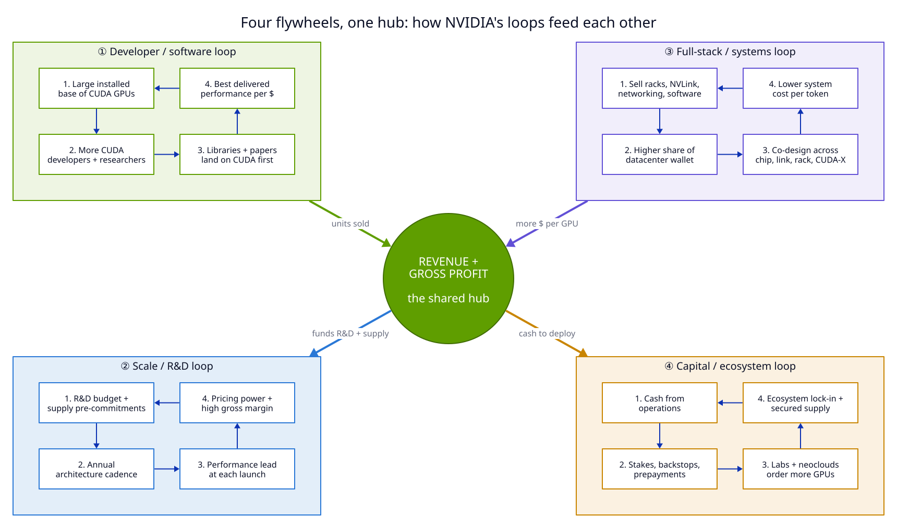

## 1. 什么是飞轮——以及为什么英伟达有四个

**类比。** 飞轮是一个沉重的轮子，难以启动，也难以停下。每推一次都会增加一点动量；推够了次数，
轮子自身的重量就会带着它转动。在商业战略中，“推动”是这样一种行动：其结果会使下一次行动更便宜
或更有效。单一循环可以被复制；而四个通过共享枢纽相互供能的循环要难复制得多，因为对手
必须同时启动所有循环。

整体图景，并标注每一步的最新数字：

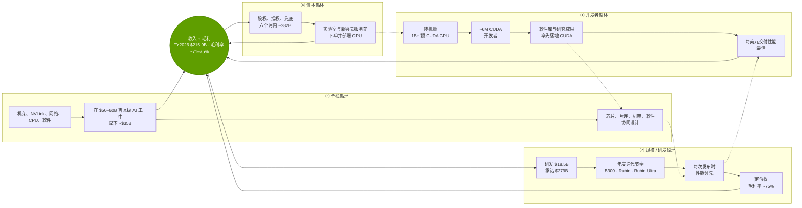

枢纽是实打实的钱。收入从 FY2016 的 $5.0B 增至 FY2026 的 $215.9B，几乎全部增量都
来自数据中心：

> [!TIP]
> **算例 —— FY2026 每一美元收入的去向。** 收入 $215.9B；GAAP 毛利率
> 71.1%（计入 $4.5B 的 H20 出口费用后）→ 毛利约 ~$153.5B [[S1]](../sources/bibliography.md#s1)[[S402]](../sources/bibliography.md#s402)[[S444]](../sources/bibliography.md#s444)。研发支出 $18.5B，
> 即**每美元 $0.09** [[S401]](../sources/bibliography.md#s401)；营业利润 $130.4B，**每美元 $0.60**；净利润
> $120.1B，**每美元 $0.56** [[S1]](../sources/bibliography.md#s1)[[S402]](../sources/bibliography.md#s402)。在随后六个月里，英伟达向客户、合作伙伴和供应商承诺了约 ~$82B
> （§5）——相当于把**约三分之二的年度净利润**回流到生态中，此外还在 Q1–Q2 FY2027 向股东返还了
> 约 ~$46B [[S403]](../sources/bibliography.md#s403)[[S405]](../sources/bibliography.md#s405)。
> 这种资金分配正是飞轮的可见形态：研发为循环 ② 供能，承诺为循环 ② 和 ④ 供能，
> 股权投资为循环 ④ 供能。

哪些循环在加速？一个简单的检验方法，是比较各循环“引擎指标”在同样两年内的
变化：

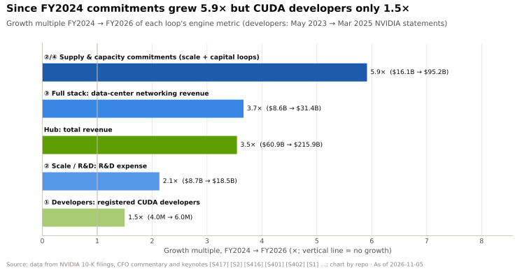

| 循环 | 引擎指标 | 过去 | 现在 | 解读 |
|---|---|---|---|---|
| ① 开发者 | 注册 CUDA 开发者 | 2M（2020）[[S529]](../sources/bibliography.md#s529) | ~6M（2026 年 3 月）[[S528]](../sources/bibliography.md#s528) | 规模大，增长趋平 |
| ② 规模 / 研发 | 研发支出 | $1.33B（FY2016）[[S400]](../sources/bibliography.md#s400) | $18.5B（FY2026）[[S401]](../sources/bibliography.md#s401) | ~14×，强度下降 |
| ② 规模 / 研发 | 供应与产能承诺 | $4.79B（Q2 FY2022）[[S420]](../sources/bibliography.md#s420) | $279B（Q2 FY2027）[[S407]](../sources/bibliography.md#s407) | ~58×（各年科目定义不同 [[S90092]](../sources/bibliography.md#s90092)），现已超过一年的收入 |
| ③ 全栈 | 网络收入 | $8.6B（FY2024）[[S416]](../sources/bibliography.md#s416) | $31.4B（FY2026）[[S402]](../sources/bibliography.md#s402) | ~3.7×，约占数据中心的 ~20% |
| ④ 资本 | 已承诺的股权投资与兜底 | 已披露约 ~$0.15B（2023）[[S481]](../sources/bibliography.md#s481)[[S482]](../sources/bibliography.md#s482) | ~$82B（2025 年 9 月–2026 年 2 月）[[S480]](../sources/bibliography.md#s480)[[S474]](../sources/bibliography.md#s474)[[S469]](../sources/bibliography.md#s469) | 新出现，争议最大 |

🔧 技术细节：用系统动力学的语言描述强化循环

用系统动力学的语言来说，每个循环都是一个*强化*（R）循环：某个变量的增加，经过一段延迟后，
会导致其自身进一步增加。每个真实系统也都有限制增长的*平衡*（B）循环——在这里就是电力与
封装供应、客户预算、反垄断关注以及竞争对手的成本优势。对投资者而言，有两个性质很重要。第一，
**延迟**：2018 年学会 CUDA 的开发者会在 2025 年的采购中带来回报，因此开发者循环无论向上还是
向下都反应缓慢。第二，**共享存量**：四个循环都从同一个存量（现金与毛利）中汲取资源，
因此对该存量的冲击会同时传导至每个循环。这就是为什么 §6 把相关性，而非任何单一循环，
视为主要风险。

## 2. 循环 ① —— 开发者与软件飞轮

**机制。** 运行同一套软件的 GPU [装机量](glossary.md#installed-base)会吸引开发者；开发者编写
以该软件为前提的软件库、模型与论文；这些软件库使下一代 GPU 的每美元效用高于缺少它们的
替代品；客户购买更多同类 GPU；装机量随之增长。英伟达在 2006–07 年凭借
[CUDA](glossary.md#cuda) 启动了这个飞轮——首个版本于 2007 年 6 月发布 [[S525]](../sources/bibliography.md#s525)——此后在每一代
产品间都保持了兼容。

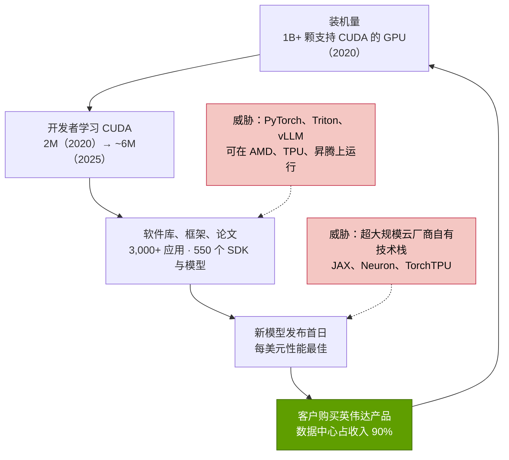

英伟达自己公布的数字同时显示了规模与放缓。2020 年，它报告在用的 CUDA GPU 超过
1B 颗，每月新增开发者注册 39,000 个、CUDA 下载 438,000 次
[[S529]](../sources/bibliography.md#s529)。到 2022 年初，CUDA 累计下载 33M 次，其中仅 2021 年就有 8M 次 [[S530]](../sources/bibliography.md#s530)；
到 2023 年年中约 ~40M 次，加速应用超过 3,000 个 [[S533]](../sources/bibliography.md#s533)。英伟达在 2022 年列出了 550 个 SDK 与 AI
模型 [[S532]](../sources/bibliography.md#s532)，以及在其平台上开发的 ~10,000 家初创公司 [[S531]](../sources/bibliography.md#s531)。

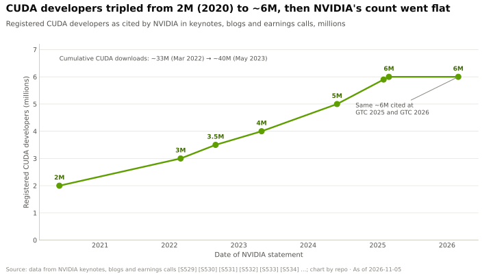

> [!TIP]
> **算例 —— 开发者循环造成的切换成本。** 一家实验室若已在英伟达的
> [TensorRT-LLM](glossary.md#tensorrt-llm)（仅能在英伟达 GPU 上运行 [[S589]](../sources/bibliography.md#s589)）上调优好推理服务，要迁移就必须重新验证内核、
> 量化方案和服务代码。如果 20 名工程师花 4 个月完成移植，按每人年全口径成本
> $400K 计算，人工成本约 ~$2.7M（🔴 示意性假设）——
> 相对于一台 $3M+ 的 GB200 [NVL72](glossary.md#nvl72) 机架 [[S326]](../sources/bibliography.md#s326) 微不足道，但对初创公司而言不容小觑，而且每一代模型都会*重复
> 发生*。这个循环真正的锁定效应不在于一次性移植，而在于新模型、新内核（FlashAttention 式
> 注意力、[NVFP4](glossary.md#nvfp4) 等新数值格式）和新论文往往
> 率先出现在 CUDA 上，因此非英伟达买家总是落后几个月。

**为何该循环在边缘处减弱。** 对 AI 而言重要的开发者群体，越来越多地是基于框架编写 Python 代码，
而不是直接编写 CUDA——而这些框架已经支持多家厂商：

| 框架 / 软件库（2026 年 11 月） | 英伟达 | AMD | 谷歌（Google）TPU | 其他加速器 | 来源 |
|---|---|---|---|---|---|
| PyTorch（训练 + eager 模式） | 🟩 主干内置 CUDA | 🟨 主干内置 ROCm | 🟦 通过 TorchTPU（PyTorch/XLA 已弃用） | 🟨 主干内置 Intel XPU | [[S587]](../sources/bibliography.md#s587)[[S595]](../sources/bibliography.md#s595) |
| JAX | 🟩 支持 | 🟨 AMD 维护的插件 | 🟩 原生 | 🟥 Intel 实验性支持 | [[S577]](../sources/bibliography.md#s577) |
| Triton（内核语言） | 🟩 CC 8.0+ | 🟨 ROCm 6.2+ | — | 🟨 Intel 主干外后端 | [[S578]](../sources/bibliography.md#s578)[[S597]](../sources/bibliography.md#s597) |
| vLLM（推理服务） | 🟩 主干内置 | 🟨 主干内置 ROCm | 🟨 插件 | 🟨 Gaudi、昇腾、Trainium 插件 | [[S580]](../sources/bibliography.md#s580)[[S581]](../sources/bibliography.md#s581) |
| SGLang（推理服务） | 🟩 B200/GB300 | 🟨 MI300X–MI355X | 🟨 TorchTPU / SGL-JAX | 🟨 昇腾、Intel | [[S582]](../sources/bibliography.md#s582) |
| TensorRT-LLM | 🟩 仅限英伟达 | 🟥 无 | 🟥 无 | 🟥 无 | [[S589]](../sources/bibliography.md#s589) |
| ONNX Runtime | 🟩 CUDA、TensorRT | 🟨 MIGraphX | — | 🟨 OpenVINO、高通（Qualcomm）QNN | [[S585]](../sources/bibliography.md#s585) |

🟩 一等支持 · 🟨 支持，通常由厂商维护或较新 · 🟦 路线不同 · 🟥 无或实验性（本资料库根据所引 README 作出的判断）。

> [!WARNING]
> **循环 ① 可能在哪里断裂。** 护城河会上移一层：如果开发者实际接触的框架
> （[PyTorch](glossary.md#pytorch)、vLLM、SGLang、[Triton](glossary.md#triton)）与硬件无关，切换成本就会缩小到
> 性能调优——而[超大规模云厂商](glossary.md#hyperscaler)有足够的工程师自己完成这项工作。谷歌与 Meta
> 于 2026 年 10 月开源了 TorchTPU [[S553]](../sources/bibliography.md#s553)；AMD 如今以快速节奏发布 [ROCm](glossary.md#rocm) 版本
> [[S586]](../sources/bibliography.md#s586)。英伟达自己的开发者数量在 GTC 2025 与 GTC 2026 之间持平于 ~6M [[S536]](../sources/bibliography.md#s536)[[S528]](../sources/bibliography.md#s528)，这是
> 需要关注的指标。深入阅读：[第 09 层 —— CUDA](layers/09-cuda-and-system-software/index.md)、
> [第 10 层 —— CUDA-X 软件库](layers/10-libraries-cuda-x/index.md)以及
> [CS2 —— CUDA：十五年的赌注](case-studies/CS2-cuda-the-15-year-bet.md)。

🔧 技术细节：CUDA 锁定效应究竟由什么构成

“CUDA”是四个层次的简称，它们被侵蚀的速度各不相同：

1. **编程模型与编译器**（CUDA C++、PTX 虚拟指令集）。PTX 让多年前编写的代码能在新 GPU
   上运行，这就是装机量能够复利增长的原因。竞争对手可以模仿该模型（AMD 的 HIP 有意设计得
   与 CUDA 相似），因此这一层最容易复制。
2. **软件库**——cuBLAS（矩阵运算）、cuDNN（神经网络内核）、[NCCL](glossary.md#nccl)（多 GPU
   通信）、TensorRT-LLM（推理）。这些凝聚了多年针对每一代硬件的调优；竞争对手
   必须逐个内核地追平。英伟达早在 2022 年就列出了 550 个 SDK 与模型 [[S532]](../sources/bibliography.md#s532)。
3. **工具**——性能分析器、调试器和容器镜像，让集群从第一天起就能投入使用。
4. **习惯**——研究界与开源社区的默认选择。新想法（新的注意力内核、新的
   数值格式）往往首先为 CUDA 编写，因为评审者和用户手里有的就是它。

编译器层面的抽象（PyTorch 编译器、Triton、JAX/XLA）通过为多种后端自动生成内核来攻击第 1–2 层
[[S578]](../sources/bibliography.md#s578)[[S577]](../sources/bibliography.md#s577)；这就是下文将开发者循环评为
“强但受到挑战”的原因。深入阅读见[第 09 层](layers/09-cuda-and-system-software/index.md)。

## 3. 循环 ② —— 规模与研发飞轮

**机制。** 收入为研发提供资金，并越来越多地用于**预先锁定供应**：提前数年预订晶圆、
[HBM](glossary.md#hbm)、CoWoS 封装与测试产能。这使英伟达能每年批量推出一款新架构，从而在每次发布时
保持性能领先，进而支撑定价与毛利率，再为下一轮提供资金。每转一圈也会抬高对手的门槛——
对手必须同时追平研发投入与供应预订。

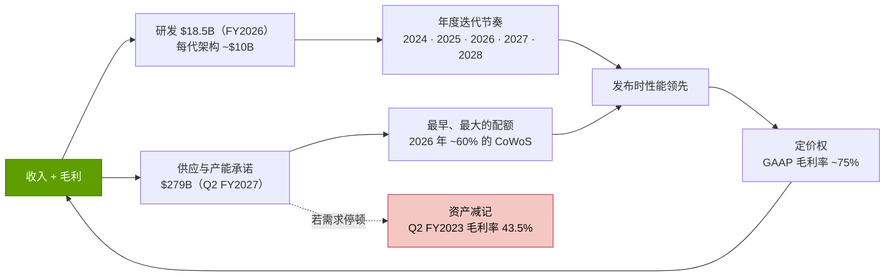

**研发：投入更多，强度更低。** 英伟达的研发支出从 FY2016 的 $1.33B 增至
FY2026 的 $18.5B（仅最近一年就增长 +43%）[[S400]](../sources/bibliography.md#s400)[[S401]](../sources/bibliography.md#s401)，而占收入的比重从 27% 降至 ~9%——
典型的[经营杠杆](glossary.md#operating-leverage)。黄仁勋（Jensen Huang）称 Blackwell 的
开发成本约为 ~$10B [[S35028]](../sources/bibliography.md#s35028)。作为对比，英伟达 2024 自然年 $12.9B 的研发支出已
超过 AMD 和博通（Broadcom），只有英特尔投入更多 [[S450]](../sources/bibliography.md#s450)[[S451]](../sources/bibliography.md#s451)[[S452]](../sources/bibliography.md#s452)。

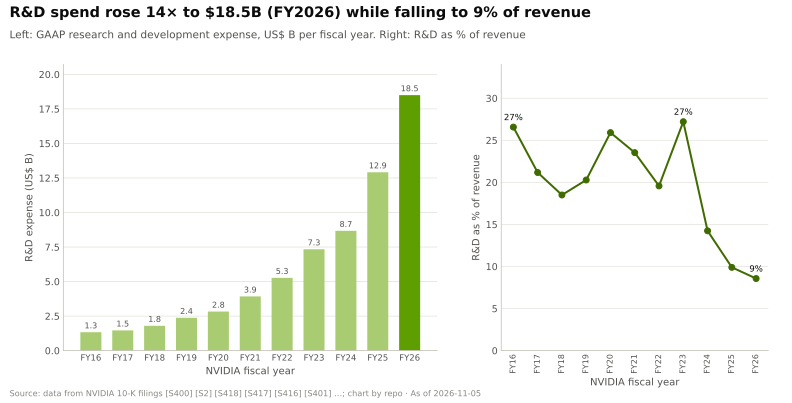

**节奏：从两年一代到一年一代。** 在 Blackwell 之前，英伟达大约每两年推出一代数据中心架构；
自 2024 年起转为年度节奏，并在周期中段推出“Ultra”
升级版：

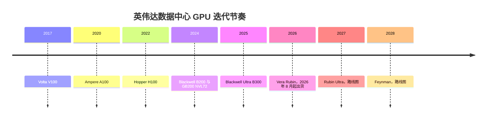

来源：V100 [[S126]](../sources/bibliography.md#s126)；A100 [[S127]](../sources/bibliography.md#s127)；H100 [[S33002]](../sources/bibliography.md#s33002)；Blackwell [[S396]](../sources/bibliography.md#s396)；Blackwell Ultra 与路线图 [[S33020]](../sources/bibliography.md#s33020)；Rubin 量产出货 [[S500]](../sources/bibliography.md#s500)；Rubin Ultra 与 Feynman [[S502]](../sources/bibliography.md#s502)。🟢 2026 年及以前均已确认；🟢 Rubin Ultra 与 Feynman 已发布，但 🟡 有报道称 Kyber 机架推迟至 2028 年 [[S507]](../sources/bibliography.md#s507)（英伟达表示其路线图未变 [[S508]](../sources/bibliography.md#s508)），另有报道称 Rubin Ultra 将采用双裸片设计 [[S509]](../sources/bibliography.md#s509)。

**供应预先承诺：最不显眼、却最有力的杠杆。** 英伟达的
[采购义务](glossary.md#purchase-obligations)——对晶圆、内存、封装与产能的有约束力
订单——从 Q2 FY2022 的 $4.79B [[S420]](../sources/bibliography.md#s420) 增至 FY2026 年末的 $95.2B [[S401]](../sources/bibliography.md#s401)、
Q1 FY2027 的 $119B [[S404]](../sources/bibliography.md#s404)，以及 Q2 FY2027 的 **$279B**，主要用于当前及未来架构所需的内存与
制造产能 [[S407]](../sources/bibliography.md#s407)。10-K 中的 $95.2B 与 10-Q 中的供应与产能承诺
是不同的科目，因此长期序列仅供参考；口径一致的跃升是单季从 $119B → $279B [[S90092]](../sources/bibliography.md#s90092)。

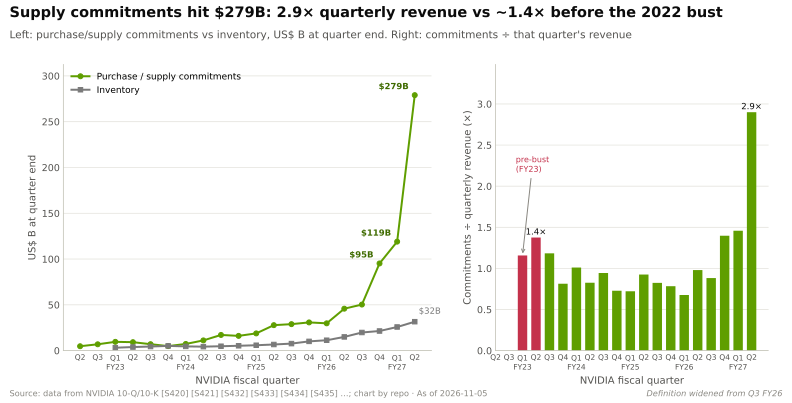

> [!TIP]
> **算例 —— 作为护城河的承诺。** $279B 的承诺 [[S407]](../sources/bibliography.md#s407) 约为台积电
> 2026 年全部资本开支预算 $52–56B 的 **5×** [[S35029]](../sources/bibliography.md#s35029)，媒体估计英伟达拿下了
> 台积电 2026 年 [CoWoS](glossary.md#cowos) 配额的 ~60%（~595K 片晶圆，博通约 ~150K，AMD 约 ~105K）（🟡）[[S379]](../sources/bibliography.md#s379)。
> 这些承诺跨越多年且包含内存，因此这一比较关乎规模，而非
> 同口径对比。关键在于机制：在供应受限的市场中，**谁为稀缺投入品预先付款，
> 谁就决定了谁能出货**。一个设计有竞争力、却没有 HBM 或 CoWoS
> 配额的对手，当年什么也卖不出去。参见 [P5 —— 芯片经济学入门](primers/P5-chip-economics-101.md)
> 与[第 03 层](layers/03-memory-packaging-supply-chain/index.md)。

**定价权是该循环的产出。** 毛利率从 FY2016 的 56.1% 升至
FY2025 的 75.0% [[S400]](../sources/bibliography.md#s400)[[S416]](../sources/bibliography.md#s416)，在 Blackwell 爬坡期间维持在 ~73–78%，Q2 FY2027 约为 ~75% [[S405]](../sources/bibliography.md#s405)。
分析师估计 B200 的制造成本约 ~$6,400，而售价为 $30–40K [[S35020]](../sources/bibliography.md#s35020)[[S35026]](../sources/bibliography.md#s35026)。

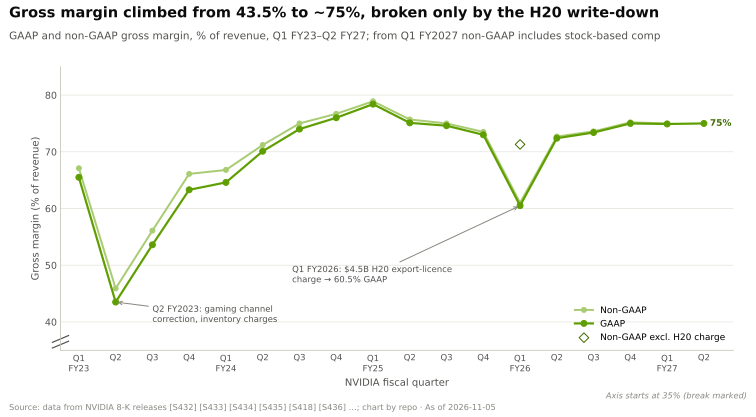

> [!WARNING]
> **循环 ② 可能在哪里断裂。** 把对手挡在门外的承诺，同样也把英伟达锁在门内。2022 年需求
> 停顿时，英伟达为库存以及超出需求的采购义务计提了费用
> （仅 Q3 FY2023 就约 ~$348M）[[S421]](../sources/bibliography.md#s421)，毛利率跌至 43.5% [[S433]](../sources/bibliography.md#s433)；Q1 FY2026 的 $4.5B H20 费用
> 表明，出口政策也会触发同样的机制 [[S444]](../sources/bibliography.md#s444)。如今的承诺约为
> Q2 FY2023 未履行承诺 $9.2B 的 ~30× [[S420]](../sources/bibliography.md#s420)[[S407]](../sources/bibliography.md#s407)。其他断裂点：某一代产品延期（有报道称的 Kyber 推迟 [[S507]](../sources/bibliography.md#s507)、Rubin 下调的
> [HBM4](glossary.md#hbm4) 带宽规格 [[S103]](../sources/bibliography.md#s103)[[S104]](../sources/bibliography.md#s104)），或对手追平迭代节奏——AMD 已承诺 Instinct 系列采用
> 年度节奏（2026 年 MI400、2027 年 MI500）[[S545]](../sources/bibliography.md#s545)。深入阅读：[第 02 层](layers/02-gpu-silicon/roadmap.md)、
> [17 —— 路线图](cross-cutting/17-roadmap-2025-2028.md)。

## 4. 循环 ③ —— 全栈与系统飞轮

**机制。** 销售整个机架——GPU、CPU、[NVLink](glossary.md#nvlink) 交换芯片、网卡、DPU、参考
设计与软件——提高了英伟达在每一美元客户支出中的[钱包份额](glossary.md#share-of-wallet)。
掌控每一层也让英伟达能够进行跨层优化（GPU 中的新数值格式、能完成
[全规约（all-reduce）](glossary.md#all-reduce)运算的交换机、了解网络拓扑的推理服务运行时），从而
使系统每美元的速度高于由各家最佳部件拼凑而成的组合，进而带动下一个机架的销售。

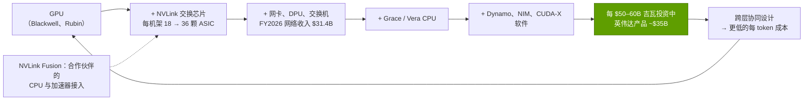

最好的单一衡量指标是网络。网络收入从 FY2024 的 $8.6B 增至 FY2026 的 $31.4B [[S416]](../sources/bibliography.md#s416)[[S402]](../sources/bibliography.md#s402)，
仅 Q1 FY2027 一个季度就达 $14.8B（同比 +199%）[[S409]](../sources/bibliography.md#s409)；Q2 FY2027 又环比增长 18%，
其中 [Spectrum-X](glossary.md#spectrum-x) 以太网收入同比增长 2.6× [[S408]](../sources/bibliography.md#s408)。这项业务主要来自 2019 年宣布的 $6.9B Mellanox 收购
[[S464]](../sources/bibliography.md#s464)（见 [CS1](case-studies/CS1-mellanox-the-best-deal.md)）。

> [!TIP]
> **算例 —— 一吉瓦中的钱包份额。** 英伟达 CEO 估计一座 1 GW AI 工厂的成本
> 约为 ~$50–60B，其中英伟达产品约 ~$35B [[S398]](../sources/bibliography.md#s398)：**占总额的 58–70%**，而分析师估计仅 GPU
> 就占机架物料成本的 ~51–65% [[S332]](../sources/bibliography.md#s332)。摩根士丹利的拆解显示了机架物料成本为何从
> GB300 NVL72（~$4.0M）到 Vera Rubin NVL72（~$7.8M）几乎翻倍：内存含量
> 大幅增加，NVLink 交换 ASIC 从 18 颗翻倍至 36 颗，而 ODM 的毛利率从 2.7% 降至
> 1.9% [[S332]](../sources/bibliography.md#s332)。价值归于芯片供应商——英伟达和内存厂商——而非
> 组装厂。一年的网络收入（$31.4B）约为 Mellanox 收购价的 ~4.5×。

英伟达如今正把循环 ③ 延伸到并非自己制造的芯片上。**[NVLink Fusion](glossary.md#nvlink-fusion)**
允许合作伙伴的 CPU 与加速器接入 NVLink 域；首批合作伙伴包括提供定制 CPU 的高通与
富士通，以及联发科、美满电子（Marvell）、世芯（Alchip）和 Astera Labs [[S517]](../sources/bibliography.md#s517)[[S131]](../sources/bibliography.md#s131)，AWS 也表示
Trainium4 将集成 NVLink Fusion [[S518]](../sources/bibliography.md#s518)[[S519]](../sources/bibliography.md#s519)。Groq 授权交易（§5）增加了一款推理芯片，
英伟达如今将其作为 Vera Rubin 平台的一部分销售 [[S307]](../sources/bibliography.md#s307)[[S506]](../sources/bibliography.md#s506)。

> [!WARNING]
> **循环 ③ 可能在哪里断裂。** 最大的买家正在围绕自研芯片构建自己的机架：
> 谷歌 TPU 8t/8i [[S550]](../sources/bibliography.md#s550)、AWS Trainium3 UltraServer [[S556]](../sources/bibliography.md#s556)、微软（Microsoft）Maia 200 [[S558]](../sources/bibliography.md#s558) 以及 Meta 的
> MTIA 路线图 [[S561]](../sources/bibliography.md#s561)。开放互连旨在将英伟达的互连技术商品化：[UALink](glossary.md#ualink) 1.0 与 2.0
> [[S573]](../sources/bibliography.md#s573)[[S574]](../sources/bibliography.md#s574)、支持[纵向扩展（scale-up）](glossary.md#scale-up)的超以太网（Ultra Ethernet）1.1 [[S575]](../sources/bibliography.md#s575) 以及 OCP [ESUN](glossary.md#esun) 纵向扩展规范
> [[S576]](../sources/bibliography.md#s576)。而且最大的 AI 实验室如今都采用双供应商：OpenAI 同时采用博通（10 GW）[[S174]](../sources/bibliography.md#s174) 和 AMD（最多
> 6 GW）[[S546]](../sources/bibliography.md#s546)；Anthropic 可使用多达 1M 颗谷歌 TPU [[S547]](../sources/bibliography.md#s547)。深入阅读：[第 05 层](layers/05-scale-up-nvlink-nvswitch/index.md)、
> [第 06 层](layers/06-scale-out-scale-across-networking/index.md)、
> [第 08 层](layers/08-systems-racks-ai-factories/index.md)、
> [15 —— 竞争格局](cross-cutting/15-competitive-landscape/index.md)。

🔧 技术细节：跨层协同设计的三个例子

- **数值格式 × 张量核心 × 软件。** NVFP4 以 4 位存储数值，每 16 个值的块配一个 [FP8](glossary.md#fp8) 缩放因子，
  另加一个张量级缩放因子 [[S32017]](../sources/bibliography.md#s32017)；GPU 的张量核心、TensorRT-LLM 内核
  与量化方案是一起设计的，因此客户无需自建工具链就能获得 4 位带来的加速
  （这对每 FLOP 成本的影响见 [P5 §8](primers/P5-chip-economics-101.md)）。
- **交换机 × 集合通信库。** NVLink 5 为每颗 Blackwell GPU 提供 1.8 TB/s、为一个 NVL72 机架提供
  130 TB/s 的纵向扩展带宽 [[S34014]](../sources/bibliography.md#s34014)；英伟达的 SHARP 网内规约让交换机完成
  全规约的运算，使穿越网络的数据量大约减半 [[S34024]](../sources/bibliography.md#s34024)。
  买家若将第三方交换机与英伟达 GPU 混用，就会失去这一优势。
- **机架 × 推理服务运行时。** [Dynamo](glossary.md#dynamo) 把推理拆分为在不同 GPU 上运行的[预填充（prefill）](glossary.md#prefill)与[解码（decode）](glossary.md#decode)，
  并按 KV 缓存位置路由请求；英伟达宣称在 GB200 NVL72 上 DeepSeek-R1 可处理的请求最多增加 30×
  （厂商说法）[[S32015]](../sources/bibliography.md#s32015)，该软件于 2026 年 3 月发布 1.0 版 [[S520]](../sources/bibliography.md#s520)。Groq 3
  LPX 机架作为专用解码引擎接入同一平台 [[S308]](../sources/bibliography.md#s308)。

每个例子单独来看都只是一点小优势；合在一起，就是英伟达宣称其系统即使在 ~75% 毛利率下
仍具有最低每 token 成本的原因（检验见
[14 —— 训练与推理经济学](cross-cutting/14-training-vs-inference-economics.md)）。

## 5. 循环 ④ —— 资本与生态飞轮，以及“循环融资”批评

**机制。** 英伟达用现金入股、为其提供资产负债表支持或为其担保产能的对象，是购买并部署其 GPU 的
公司——AI 实验室、[新兴云服务商（neocloud）](glossary.md#neocloud)
（CoreWeave、Lambda、Nebius 等专营 GPU 的云厂商）——以及它所依赖的供应商与平台合作伙伴。
这些公司利用这笔资金或由此获得的信誉募集更多资本、订购更多英伟达系统；英伟达的收入及其
持股价值随之上升；循环往复。

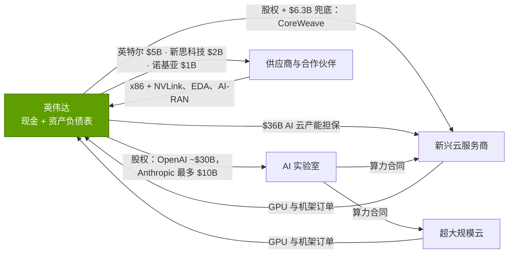

节奏在 2025 年底发生了变化。在大约六个月内，英伟达宣布了：

- **AI 实验室：** 一份意向书，计划随着 10 GW 英伟达系统的部署向 OpenAI 投资最多 $100B
  [[S467]](../sources/bibliography.md#s467)，据报道后被对 OpenAI 2026 年融资轮约 ~$30B 的投资取代（🟡）[[S480]](../sources/bibliography.md#s480)；
  与微软最多 $5B 的投资一起，向 Anthropic 投资最多 $10B，Anthropic 则承诺采购最多 1 GW
  的英伟达系统 [[S469]](../sources/bibliography.md#s469)；向 xAI 投资最多 $2B，向 Poolside 投资最多 $1B（🟡）[[S483]](../sources/bibliography.md#s483)。
- **新兴云服务商与产能：** 一份 $6.3B 的协议，使英伟达有义务在 2032 年 4 月前购买 CoreWeave
  未售出的产能 [[S473]](../sources/bibliography.md#s473)，以及对 CoreWeave 追加 $2B 的投资 [[S472]](../sources/bibliography.md#s472)；与 Lambda 约 ~$1.5B 的
  GPU 售后回租（🟡）[[S483]](../sources/bibliography.md#s483)；以及截至 Q2 FY2027，**$36B 的 AI 云协议**——据此英伟达购买
  合作伙伴无法转售的产能——外加 $29B 的多年期云服务承诺 [[S407]](../sources/bibliography.md#s407)。
- **供应商、合作伙伴与技术：** 向英特尔投资 $5B [[S468]](../sources/bibliography.md#s468)、诺基亚 $1B [[S470]](../sources/bibliography.md#s470)、
  新思科技（Synopsys）$2B [[S471]](../sources/bibliography.md#s471)，与 Groq 约 ~$20B 的授权加团队交易（据报道）[[S474]](../sources/bibliography.md#s474)，以及以超过 $900M
  获得 Enfabrica 的团队与技术 [[S475]](../sources/bibliography.md#s475)——这些是为规避并购审查而设计的
  [收购式招聘（acquihire）](glossary.md#acquihire)。

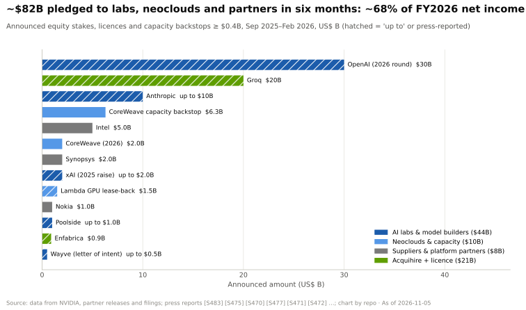

> [!TIP]
> **算例 —— 英伟达的一美元股权能走多远？** 以 Anthropic 为例：英伟达
> 承诺投资最多 $10B [[S469]](../sources/bibliography.md#s469)；Anthropic 承诺采购最多 1 GW 的英伟达系统 [[S469]](../sources/bibliography.md#s469)；按英伟达
> 自己估算的每吉瓦 ~$35B 产品价值 [[S398]](../sources/bibliography.md#s398)，这意味着**以 $10B 股权换来最多 ~$35B 的潜在英伟达
> 收入——约 ~3.5×**（🔴 本资料库测算；1 GW 是上限，且 Anthropic 也向
> 谷歌和 AWS 采购 [[S547]](../sources/bibliography.md#s547)）。最初的 OpenAI 意向书结构相同，规模是其 10×：随着 10 GW 中每 1 GW 的部署
> 逐步投资最多 $100B [[S467]](../sources/bibliography.md#s467)，对应约 ~$350B 的隐含英伟达产品价值
> （🔴）。看多者视之为附带股权上行空间的廉价获客；看空者则认为这是
> 英伟达在为自身相当一部分需求提供融资。

**以最强形式陈述“循环融资”批评。** (1) *需求质量：* 部分收入来自其支付能力依赖
英伟达资金或担保的公司，因此报告的增长高估了独立需求。(2) *隐性杠杆：* 兜底与产能担保
（CoreWeave $6.3B；$36B AI 云协议）属于或有负债，恰恰会在需求走弱时兑现 [[S473]](../sources/bibliography.md#s473)[[S407]](../sources/bibliography.md#s407)；
在 10-Q 中范围更广的承诺科目达到 $279B（另一个科目 [[S90092]](../sources/bibliography.md#s90092)）之前，迈克尔·伯里（Michael Burry）就称 $95B 的采购义务“令人不安” [[S431]](../sources/bibliography.md#s431)，
而对 Q2 FY2027 10-Q 的二手统计显示，未来承诺总额达 $366B [[S430]](../sources/bibliography.md#s430)[[S449]](../sources/bibliography.md#s449)。
(3) *盈利质量：* Q1 FY2027 净利润中包含约 ~$15.9B 的其他收益，主要是对英特尔等公司持股的
未实现收益 [[S403]](../sources/bibliography.md#s403)——英伟达生态消息向好时这些持股升值，
这会在繁荣期美化盈利，在萧条期则会反转。(4) *集中度：* 四家直接客户——
主要是为超大规模云厂商代工的 OEM 和 ODM——占 Q3 FY2026 收入的 61% [[S412]](../sources/bibliography.md#s412)。

> [!NOTE]
> **🐂 看多观点。** 各项承诺合计约 ~$82B，而 FY2026 净利润为 $120B [[S1]](../sources/bibliography.md#s1)，且分散
> 在整个生态中；大部分是对高速增长公司的股权投资，而非贷款。英伟达正在
> 培育客户、新兴云服务商与合作伙伴，使其*摆脱*对四家超大规模云厂商的依赖——而
> 与此同时，这些超大规模云厂商自身计划在 2026 年投入约 ~$558B 资本开支（高于其最初指引的 ~$505B）[[S12518]](../sources/bibliography.md#s12518)[[S12519]](../sources/bibliography.md#s12519) [[S460]](../sources/bibliography.md#s460)[[S461]](../sources/bibliography.md#s461)[[S462]](../sources/bibliography.md#s462)。一家
> 毛利率 ~75% 的供应商，完全负担得起像平台型公司历来所做的那样去补贴用户采用。

> [!WARNING]
> **🐻 看空观点。** 循环 ④ 是唯一一个把英伟达的*周期性*风险转化为*资产负债表*
> 风险的循环。在下行周期中，被投资的实验室和新兴云服务商会削减订单，产能担保会被触发，
> 股权投资会被减记，$279B 的供应承诺也会到期——一切同时发生。
> 2022 年的下行周期，风险敞口只有今天的一小部分，却让毛利率在一个季度内下降约 ~22 个百分点，从
> 65.5% 降至 43.5% [[S432]](../sources/bibliography.md#s432)[[S433]](../sources/bibliography.md#s433)。参见 [18 —— 弱点与看空情景](cross-cutting/18-vulnerabilities-and-bear-case.md)
> 与[第 13 层 —— 生态、市场进入与资本](layers/13-ecosystem-gtm-and-capital/index.md)。

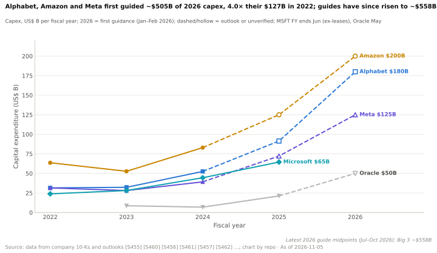

🔧 技术细节：股权投资与兜底如何体现在英伟达的财务报表中

- **对上市公司的股权投资**（英特尔、诺基亚、新思科技、CoreWeave 等出现在
  英伟达的 13F 文件中 [[S477]](../sources/bibliography.md#s477)）通过“其他收益”按市值计价，不计入毛利率
  与营业利润。这就是 Q1 FY2027 净利润（$58.3B）高于营业利润
  （$53.5B）的原因 [[S403]](../sources/bibliography.md#s403)。
- **产能兜底**属于或有采购承诺：根据 CoreWeave 协议，英伟达
  必须在 2032 年 4 月前购买剩余未售出的产能 [[S473]](../sources/bibliography.md#s473)；根据 Q2 FY2027 披露的 AI 云协议，
  英伟达购买合作伙伴无法转售的承诺产能 [[S407]](../sources/bibliography.md#s407)。只有在需求不足时它们才会
  成为费用——而这恰恰是它们伤害最大的情景。
- **多年期云服务协议**（Q2 FY2027 为 $29B [[S407]](../sources/bibliography.md#s407)）是英伟达回租产能，
  部分用于自身研究和 DGX Cloud——对云厂商是收入，对英伟达是成本。
- **意向书不是合同。** 英伟达的 10-Q 警示，无法保证 OpenAI
  意向书会形成最终条款 [[S412]](../sources/bibliography.md#s412)；据报道，它已被一笔规模较小的股权
  投资取代 [[S480]](../sources/bibliography.md#s480)。

## 6. 各循环如何相互咬合——以及各自可能在哪里断裂

各循环并非相互独立。循环 ②（迭代节奏）不断强化留在循环 ① 中的理由（新
功能率先落地 CUDA）；循环 ③（系统）放大了循环 ① 中每位客户的支出；
循环 ④（资本）为循环 ① 招募新客户，并预售循环 ② 中预订的供应。这种
耦合既是护城河——对手必须复制四个循环，而不是一个——也是风险所在。

| 循环 | 当前强度 | 主要威胁 | 威胁程度 | 需关注的领先指标 |
|---|---|---|---|---|
| ① 开发者 / 软件 | 🟩 ~6M 开发者、1B+ 颗 GPU、研究以 CUDA 为先 [[S528]](../sources/bibliography.md#s528)[[S529]](../sources/bibliography.md#s529) | 框架抽象（PyTorch、Triton、vLLM、TorchTPU）[[S580]](../sources/bibliography.md#s580)[[S553]](../sources/bibliography.md#s553) | 🟨 上升 | 开发者数量；vLLM/SGLang 流量中运行在非英伟达硬件上的比例 |
| ② 规模 / 研发 | 🟩 $18.5B 研发、$279B 承诺、年度迭代节奏 [[S401]](../sources/bibliography.md#s401)[[S407]](../sources/bibliography.md#s407) | 需求停顿 → 资产减记；迭代延期；AMD 追平节奏 [[S421]](../sources/bibliography.md#s421)[[S507]](../sources/bibliography.md#s507)[[S545]](../sources/bibliography.md#s545) | 🟨 中等，影响大 | 采购义务 ÷ 收入；库存；毛利率 |
| ③ 全栈 / 系统 | 🟩 网络收入 $31.4B；每 GW ~$35B [[S402]](../sources/bibliography.md#s402)[[S398]](../sources/bibliography.md#s398) | 定制 ASIC 机架；UALink、UEC、ESUN [[S550]](../sources/bibliography.md#s550)[[S556]](../sources/bibliography.md#s556)[[S573]](../sources/bibliography.md#s573)[[S576]](../sources/bibliography.md#s576) | 🟨 上升 | 网络占数据中心收入的比重；NVLink Fusion 采用者 |
| ④ 资本 / 生态 | 🟨 已承诺约 ~$82B；$36B 产能担保 [[S407]](../sources/bibliography.md#s407) | 循环融资退潮；客户集中度 61% [[S412]](../sources/bibliography.md#s412)[[S431]](../sources/bibliography.md#s431) | 🟥 高 | 兜底被触发；股权估值变动；被投公司的订单增长 |

🟩 强 · 🟨 中等 · 🟥 弱或威胁高（本资料库判断，按定义属 🔴 推测）。

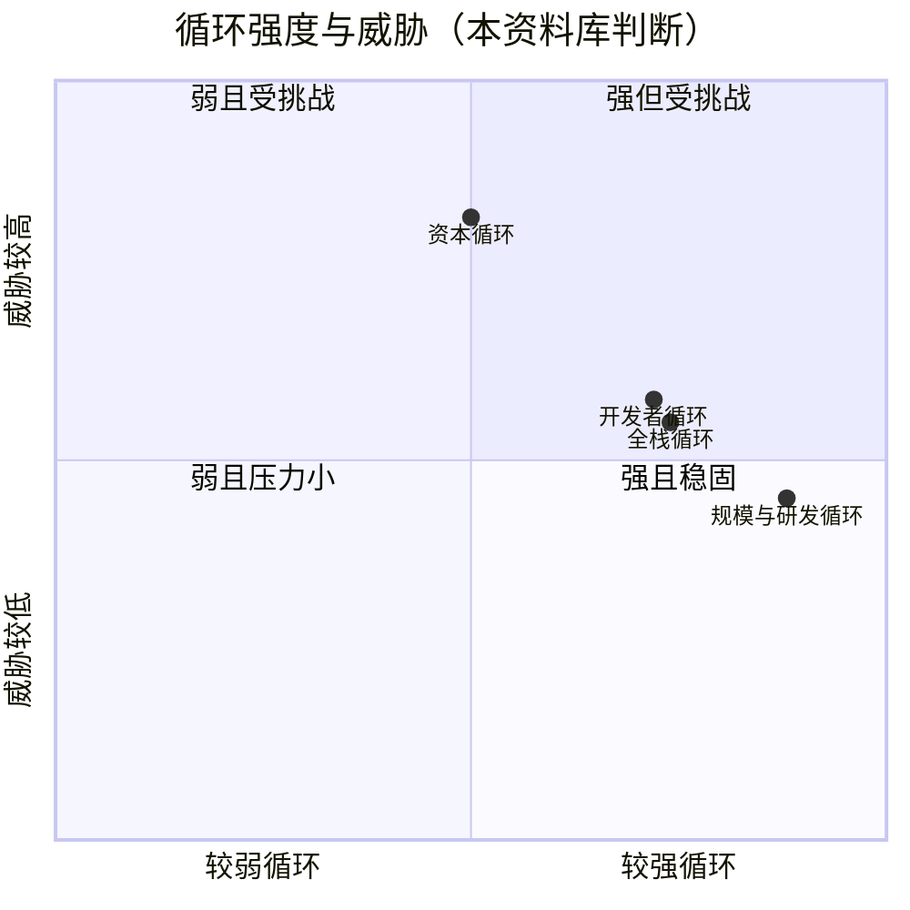

> [!IMPORTANT]
> **最需要记住的一点。** 英伟达的优势不在于任何单一循环——每个循环都可能遭到攻击——
> 而在于四个循环都流经同一个收入与 ~75% 毛利率的枢纽。这使
> 系统在繁荣期能够自我供血，而在萧条期则**高度相关**：看起来最新的循环（资本）
> 和看起来最强的循环（规模，借助 $279B 的承诺），恰恰是会放大
> 下行的两个。

🔧 技术细节：每个循环陷入停滞需要满足哪些条件

- **循环 ① 停滞的条件**：某种新的模型架构或训练方法率先出现在非 CUDA
  硬件上并赢得份额（例如，领先的开放权重模型在
  TPU 或 Trainium 上开发和调优），或者推理转向内核调优已自动化的、经过编译且与硬件无关的
  计算图。指标：框架发布说明将非英伟达目标列为一级支持。
- **循环 ② 停滞的条件**：超大规模云厂商的资本开支趋平（三家公司对 2026 年的指引约为 ~$505B
  [[S460]](../sources/bibliography.md#s460)[[S461]](../sources/bibliography.md#s461)[[S462]](../sources/bibliography.md#s462)，此后上调至 ~$558B [[S12518]](../sources/bibliography.md#s12518)），而承诺是固定的；或者某一代产品延期一年——
  客户会因此选择等待，而不是购买当前产品。
- **循环 ③ 停滞的条件**：基于以太网的纵向扩展（[UEC](glossary.md#ultra-ethernet) 1.1、ESUN）以更低成本
  达到 NVLink 级别的延迟，使买家能在同一网络中混用 GPU 与 ASIC；英伟达的反制是开放
  NVLink 本身（NVLink Fusion）。
- **循环 ④ 停滞的条件**：被投公司无法完成后续融资；若英伟达
  必须在租赁价格下跌的市场中履行产能担保，该循环就会反转——2023 年至 2024 年底，H100 的租赁价格已从
  每 [GPU 小时](glossary.md#gpu-hour) ~$8 降至 ~$2 以下 [[S393]](../sources/bibliography.md#s393)。

## 7. 复制这个飞轮需要什么

对手不必在每个方面都击败英伟达；它只需要在每个循环上做到足够好，让自己的飞轮
转起来。下表以英伟达的数字为基准，列出每个循环的入场门槛。

| 循环 | 对手必须建立什么 | 英伟达的基准 | 复制所需的估计时间 / 成本（🔴 本资料库判断） | 当前最接近的挑战者 |
|---|---|---|---|---|
| ① 开发者 | 编译器、调优过的软件库、工具，以及成为研究界的默认选择 | ~19 年的 CUDA 积累（2007 年 6 月至今）与 ~6M 开发者 [[S525]](../sources/bibliography.md#s525)[[S528]](../sources/bibliography.md#s528) | 5–10 年，除非框架将其抽象掉；每年数十亿美元的软件工程投入 | 谷歌（TPU 原生支持 JAX/XLA）[[S577]](../sources/bibliography.md#s577)；AMD ROCm [[S586]](../sources/bibliography.md#s586) |
| ② 规模 / 研发 | 年度架构迭代节奏加多年期供应预订 | 研发每年 $18.5B；每代架构 ~$10B；$279B 承诺 [[S401]](../sources/bibliography.md#s401)[[S35028]](../sources/bibliography.md#s35028)[[S407]](../sources/bibliography.md#s407) | 只有每年 $20B+ 的 AI 收入才能支撑 | AMD（年度节奏，2026 年 MI400、2027 年 MI500）[[S545]](../sources/bibliography.md#s545)；谷歌 TPU 8 [[S550]](../sources/bibliography.md#s550) |
| ③ 全栈 | 纵向扩展网络、网卡与交换机、机架设计、推理服务软件 | FY2026 网络收入 $31.4B；以 $6.9B 收购 Mellanox [[S402]](../sources/bibliography.md#s402)[[S464]](../sources/bibliography.md#s464) | 3–5 年；网络能力需通过收购或合作获得 | 搭配 Pensando 的 AMD Helios [[S538]](../sources/bibliography.md#s538)；博通 Tomahawk 6 加定制 XPU [[S570]](../sources/bibliography.md#s570)[[S174]](../sources/bibliography.md#s174) |
| ④ 资本 | 能够培育客户并担保产能的资产负债表 | 六个月内承诺约 ~$82B（§5） | 只有超大规模云厂商级别的资产负债表才能做到 | 微软与亚马逊（持股 Anthropic 和 OpenAI）[[S469]](../sources/bibliography.md#s469)[[S480]](../sources/bibliography.md#s480)；谷歌（为 Anthropic 提供 TPU）[[S547]](../sources/bibliography.md#s547) |

> [!TIP]
> **算例 —— 用 AMD 的尺度衡量研发差距。** AMD 2024 年的研发支出约 ~$6.5B，涵盖 CPU、GPU
> 及其他所有业务 [[S450]](../sources/bibliography.md#s450)；英伟达 FY2026 的研发支出为 $18.5B [[S401]](../sources/bibliography.md#s401)，约为其 ~2.8×。AMD 2026 年 Q3 的*总*
> 收入为 $13.4B [[S542]](../sources/bibliography.md#s542)，因此英伟达的年度研发预算约相当于 AMD 1.4 个季度的
> 全部销售额。AMD 仍然可以竞争——它追平了年度节奏 [[S545]](../sources/bibliography.md#s545)，并赢得了 OpenAI
> 最多 6 GW 的承诺 [[S546]](../sources/bibliography.md#s546)——但它的做法是把投入集中在更少的层级上，而这
> 正是任何挑战者（包括高通）都会面临的取舍。

## 各循环与技术栈的对应关系

| 循环 | 所在层级 | 案例研究 |
|---|---|---|
| ① 开发者 / 软件 | [09 CUDA](layers/09-cuda-and-system-software/index.md) · [10 CUDA-X](layers/10-libraries-cuda-x/index.md) · [11 推理软件](layers/11-inference-and-ai-software/index.md) | [CS2 CUDA](case-studies/CS2-cuda-the-15-year-bet.md) · [CS5 DeepSeek](case-studies/CS5-deepseek-moment-and-efficiency-shock.md) |
| ② 规模 / 研发 | [02 GPU 芯片](layers/02-gpu-silicon/index.md) · [03 内存、封装与供应链](layers/03-memory-packaging-supply-chain/index.md) · [04 CPU](layers/04-cpu-grace-vera/index.md) | [CS6 中国出口管制](case-studies/CS6-china-export-controls-h20-and-beyond.md) |
| ③ 全栈 / 系统 | [05 纵向扩展](layers/05-scale-up-nvlink-nvswitch/index.md) · [06 网络](layers/06-scale-out-scale-across-networking/index.md) · [07 DPU](layers/07-dpu-supernic-storage-security/index.md) · [08 系统](layers/08-systems-racks-ai-factories/index.md) · [12 云服务](layers/12-orchestration-and-cloud-services/index.md) | [CS1 Mellanox](case-studies/CS1-mellanox-the-best-deal.md) · [CS7 吉瓦级工厂](case-studies/CS7-gigawatt-ai-factories-xai-stargate-etc.md) |
| ④ 资本 / 生态 | [13 生态、市场进入与资本](layers/13-ecosystem-gtm-and-capital/index.md) | [CS4 AMD–OpenAI](case-studies/CS4-amd-openai-and-the-second-source.md) · [CS3 谷歌 TPU](case-studies/CS3-google-tpu-the-credible-alternative.md) |
| 全部四个（看空情景） | [18 弱点与看空情景](cross-cutting/18-vulnerabilities-and-bear-case.md) · [16 英伟达如何建成今日格局](cross-cutting/16-how-nvidia-built-it-timeline.md) · [17 路线图](cross-cutting/17-roadmap-2025-2028.md) | — |

## 🎯 企业发展视角

1. **挑战者能进入哪个循环，而不必同时与四个循环作战？** 在框架已支持多厂商的地方，
   开发者循环最弱（vLLM、SGLang、ONNX Runtime、llama.cpp 都列出了高通
   或其他非英伟达后端 [[S585]](../sources/bibliography.md#s585)[[S579]](../sources/bibliography.md#s579)[[S596]](../sources/bibliography.md#s596)）。推理服务是否正是软件
   锁定最低、能效最重要的领域？
2. **在循环 ③ 内部合作，还是与之竞争？** NVLink Fusion 将高通列为其定制 CPU
   合作伙伴之一 [[S517]](../sources/bibliography.md#s517)[[S131]](../sources/bibliography.md#s131)，而高通的 AI200/AI250 机架则在推理领域与之竞争 [[S569]](../sources/bibliography.md#s569)[[S173]](../sources/bibliography.md#s173)。每条
   路径各自要放弃什么——哪些与英伟达相关的标准（NVLink Fusion vs UALink/ESUN）能保留
   选择余地？
3. **循环 ④ 已使英伟达成为数据中心新进入者可能争取的大多数买家的战略投资者**
   （OpenAI、Anthropic、xAI、CoreWeave、Lambda、Nebius）[[S480]](../sources/bibliography.md#s480)[[S469]](../sources/bibliography.md#s469)[[S483]](../sources/bibliography.md#s483)[[S473]](../sources/bibliography.md#s473)。哪些
   大型 AI 买家*没有*与英伟达存在资金关联？与它们建立可信的第二供应商
   关系会是什么样子（参照 AMD–OpenAI，最多 6 GW [[S546]](../sources/bibliography.md#s546)）？
4. **供应是一种竞争武器。** 据报道 2026 年 ~60% 的 CoWoS 已分配给英伟达 [[S379]](../sources/bibliography.md#s379)，
   再加上 $279B 的承诺 [[S407]](../sources/bibliography.md#s407)，新进入者在 2027–2028 年实际能获得多少内存与封装
   产能？供应合作（HBM 厂商、OSAT、晶圆代工厂）是否比设计类
   收购更有价值？
5. **关注耦合指标，而不是新闻标题：** 采购义务 ÷ 收入、库存、
   被触发的产能担保以及毛利率。一次同时冲击四个循环的下行周期，正是
   英伟达的生态合作伙伴——以及相关资产——能以更优条件获得的情景。

## 📚 来源（Sources）

<!-- Auto-generated from the [S…] citations on this page by `make build`. Edit sources/registry/*.csv, not this list. -->

- [**S1**](../sources/bibliography.md#s1) NVIDIA Corporation via SEC EDGAR, *NVIDIA Announces Financial Results for Fourth Quarter and Fiscal 2026 (Form 8-K exhibit 99.1)*, 2026-02-25. [Link](https://www.sec.gov/Archives/edgar/data/1045810/000104581026000019/q4fy26pr.htm)
- [**S103**](../sources/bibliography.md#s103) VideoCardz, *NVIDIA quietly cuts Vera Rubin specs, HBM4 bandwidth and NVLink 6 speeds now lower*, 2026-10. [Link](https://videocardz.com/newz/nvidia-quietly-cuts-vera-rubin-specs-hbm4-bandwidth-and-nvlink-6-speeds-now-lower)
- [**S104**](../sources/bibliography.md#s104) Wccftech, *NVIDIA's Official Statement on Vera Rubin Spec Change*, 2026-10-29. [Link](https://wccftech.com/nvidia-official-statement-on-vera-rubin-spec-change/)
- [**S126**](../sources/bibliography.md#s126) NVIDIA, *NVIDIA Tesla V100 GPU Architecture Whitepaper*, 2017-08. [Link](https://images.nvidia.com/content/volta-architecture/pdf/volta-architecture-whitepaper.pdf)
- [**S127**](../sources/bibliography.md#s127) NVIDIA Technical Blog, *NVIDIA Ampere Architecture In-Depth*, 2020-05-14. [Link](https://developer.nvidia.com/blog/nvidia-ampere-architecture-in-depth/)
- [**S131**](../sources/bibliography.md#s131) NVIDIA Newsroom, *NVIDIA NVLink Fusion: semi-custom AI infrastructure partner ecosystem (Computex 2025)*, 2025-05-19. [Link](https://nvidianews.nvidia.com/news/nvidia-nvlink-fusion-semi-custom-ai-infrastructure-partner-ecosystem)
- [**S173**](../sources/bibliography.md#s173) Qualcomm, *Qualcomm Unveils AI200 and AI250 - Redefining Rack-Scale Data Center Inference*, 2025-10-27. [Link](https://www.qualcomm.com/news/releases/2025/10/qualcomm-unveils-ai200-and-ai250-redefining-rack-scale-data-cent)
- [**S174**](../sources/bibliography.md#s174) OpenAI, *OpenAI and Broadcom announce strategic collaboration to deploy 10 gigawatts of OpenAI-designed AI accelerators*, 2025-10-13. [Link](https://openai.com/index/openai-and-broadcom-announce-strategic-collaboration/)
- [**S307**](../sources/bibliography.md#s307) Exxact Corp, *NVIDIA GTC 2026 recap: era of tokens and inference*, 2026-03. [Link](https://www.exxactcorp.com/blog/news/nvidia-gtc-2026-recap-era-of-tokens-and-inference)
- [**S308**](../sources/bibliography.md#s308) The Decoder, *GTC 2026: with Groq 3 LPX Nvidia adds dedicated inference hardware to its platform for the first time*, 2026-03. [Link](https://the-decoder.com/gtc-2026-with-groq-3-lpx-nvidia-adds-dedicated-inference-hardware-to-its-platform-for-the-first-time/)
- [**S326**](../sources/bibliography.md#s326) TweakTown, *NVIDIA's new GB200 Superchip costs up to $70,000: full B200 NVL72 AI server costs $3 million*, 2024-05. [Link](https://www.tweaktown.com/news/98292/nvidias-new-gb200-superchip-costs-up-to-70-000-full-b200-nvl72-ai-server-3-million/index.html)
- [**S332**](../sources/bibliography.md#s332) Tiger Brokers (iTiger), *Morgan Stanley's BOM analysis of NVIDIA's Rubin: GPU share declines; PCB, MLCC and ABF substrate values soar*, 2026-05-20. [Link](https://www.itiger.com/news/1188068712)
- [**S379**](../sources/bibliography.md#s379) TrendForce News, *TSMC CoWoS capacity and customer allocation estimates (TrendForce / Morgan Stanley, as reported)*, 2025. [Link](https://www.trendforce.com/news/)
- [**S393**](../sources/bibliography.md#s393) Latent Space (Eugene Cheah), *$2 H100s: how the GPU bubble burst*, 2024-10. [Link](https://www.latent.space/p/gpu-bubble)
- [**S396**](../sources/bibliography.md#s396) NVIDIA Newsroom, *NVIDIA Blackwell platform arrives to power a new era of computing*, 2024-03-18. [Link](https://nvidianews.nvidia.com/news/nvidia-blackwell-platform-arrives-to-power-a-new-era-of-computing)
- [**S398**](../sources/bibliography.md#s398) NVIDIA Investor Relations, *NVIDIA Q2 FY2026 earnings call (2025-08-27): AI factory economics commentary*, 2025-08-27. [Link](https://investor.nvidia.com/events-and-presentations/events-and-presentations/default.aspx)
- [**S400**](../sources/bibliography.md#s400) U.S. Securities and Exchange Commission (EDGAR), *NVIDIA Corporation Form 10-K annual reports FY2001–FY2019 (EDGAR filing index)*, 2019-02-21. [Link](https://www.sec.gov/cgi-bin/browse-edgar?action=getcompany&CIK=0001045810&type=10-K&dateb=&owner=include&count=40)
- [**S401**](../sources/bibliography.md#s401) NVIDIA Corporation via SEC EDGAR, *NVIDIA Corporation Form 10-K for fiscal year ended January 25, 2026*, 2026-02-25. [Link](https://www.sec.gov/Archives/edgar/data/1045810/000104581026000021/nvda-20260125.htm)
- [**S402**](../sources/bibliography.md#s402) NVIDIA Corporation via SEC EDGAR (Colette Kress), *CFO Commentary on Fourth Quarter and Fiscal 2026 Results (Form 8-K exhibit 99.2)*, 2026-02-25. [Link](https://www.sec.gov/Archives/edgar/data/1045810/000104581026000019/q4fy26cfocommentary.htm)
- [**S403**](../sources/bibliography.md#s403) NVIDIA Corporation via SEC EDGAR, *NVIDIA Announces Financial Results for First Quarter Fiscal 2027 (Form 8-K exhibit 99.1)*, 2026-05-20. [Link](https://www.sec.gov/Archives/edgar/data/0001045810/000104581026000051/q1fy27pr.htm)
- [**S404**](../sources/bibliography.md#s404) NVIDIA Corporation via SEC EDGAR, *NVIDIA Corporation Form 10-Q for quarter ended April 26, 2026*, 2026-05-27. [Link](https://www.sec.gov/Archives/edgar/data/1045810/000104581026000052/nvda-20260426.htm)
- [**S405**](../sources/bibliography.md#s405) NVIDIA Corporation via SEC EDGAR, *NVIDIA Announces Financial Results for Second Quarter Fiscal 2027 (Form 8-K exhibit 99.1)*, 2026-08-26. [Link](https://www.sec.gov/Archives/edgar/data/0001045810/000104581026000073/q2fy27pr.htm)
- [**S407**](../sources/bibliography.md#s407) NVIDIA Corporation via SEC EDGAR, *NVIDIA Corporation Form 10-Q for quarter ended July 26, 2026*, 2026-08-28. [Link](https://www.sec.gov/Archives/edgar/data/1045810/000104581026000075/nvda-20260726.htm)
- [**S408**](../sources/bibliography.md#s408) NVIDIA Corporation, *NVIDIA Corp. (NVDA) Q2 Fiscal 2027 earnings call transcript (26 August 2026)*, 2026-08-26. [Link](https://s201.q4cdn.com/141608511/files/content_files/TRANSCRIPT_-NVIDIA-Corp-NVDA-US-Q2-2027-Earnings-Call-26-August-2026-5_00-PM-ET.pdf)
- [**S409**](../sources/bibliography.md#s409) NVIDIA Corporation, *NVIDIA Corp. (NVDA) Q1 Fiscal 2027 earnings call transcript (20 May 2026)*, 2026-05-20. [Link](https://s201.q4cdn.com/141608511/files/doc_financials/2027/q1/NVDA-Q1-2027-Earnings-Call-20-May-2026-5_00-PM-ET.pdf)
- [**S412**](../sources/bibliography.md#s412) NVIDIA Corporation via SEC EDGAR, *NVIDIA Corporation Form 10-Q for quarter ended October 26, 2025*, 2025-11-19. [Link](https://www.sec.gov/Archives/edgar/data/1045810/000104581025000230/nvda-20251026.htm)
- [**S416**](../sources/bibliography.md#s416) NVIDIA Corporation via SEC EDGAR, *NVIDIA Corporation Form 10-K for fiscal year ended January 26, 2025*, 2025-02-26. [Link](https://www.sec.gov/Archives/edgar/data/1045810/000104581025000023/nvda-20250126.htm)
- [**S420**](../sources/bibliography.md#s420) NVIDIA Corporation (via CapEdge mirror of Form 8-K) (Colette Kress), *CFO Commentary on Second Quarter Fiscal 2023 Results*, 2022-08-24. [Link](https://capedge.com/filing/1045810/0001045810-22-000136/NVDA-8K/file/3)
- [**S421**](../sources/bibliography.md#s421) NVIDIA Corporation (via CapEdge mirror of Form 8-K) (Colette Kress), *CFO Commentary on Third Quarter Fiscal 2023 Results*, 2022-11-16. [Link](https://capedge.com/filing/1045810/0001045810-22-000163/NVDA-8K/file/3)
- [**S430**](../sources/bibliography.md#s430) FourWeekMBA, *Nvidia's 10-Q Lists $530B in Commitments and Guarantees*, 2026-08. [Link](https://fourweekmba.com/ai-nvidia-10-q-lists-530b-in-commitments-and-guarantees/)
- [**S431**](../sources/bibliography.md#s431) Barchart, *Michael Burry called Nvidia's $95 billion in purchase obligations 'troubling' in February; six months later the filings show $279 billion*, 2026-09. [Link](https://www.barchart.com/story/news/4406785/michael-burry-called-nvidias-95-billion-in-purchase-obligations-troubling-in-february-six-months-later-the-filings-show-that-number-ballooned-to-279-billion)
- [**S432**](../sources/bibliography.md#s432) NVIDIA Corporation, *NVIDIA Announces Financial Results for First Quarter Fiscal 2023 (press release with CFO commentary)*, 2022-05-25. [Link](https://nvidianews.nvidia.com/news/nvidia-announces-financial-results-for-first-quarter-fiscal-2023)
- [**S433**](../sources/bibliography.md#s433) NVIDIA Corporation, *NVIDIA Announces Financial Results for Second Quarter Fiscal 2023 (press release with CFO commentary)*, 2022-08-24. [Link](https://nvidianews.nvidia.com/news/nvidia-announces-financial-results-for-second-quarter-fiscal-2023)
- [**S444**](../sources/bibliography.md#s444) NVIDIA Corporation, *NVIDIA Announces Financial Results for First Quarter Fiscal 2026 (press release with CFO commentary)*, 2025-05-28. [Link](https://nvidianews.nvidia.com/news/nvidia-announces-financial-results-for-first-quarter-fiscal-2026)
- [**S449**](../sources/bibliography.md#s449) Fortune, *Nvidia's massive future spending commitments 'make the company's risk profile more complex,' Saxo says*, 2026-08-28. [Link](https://fortune.com/2026/08/28/nvidia-cash-spending-commitments-risk-profile-more-complex-saxo/)
- [**S450**](../sources/bibliography.md#s450) U.S. Securities and Exchange Commission (EDGAR), *Advanced Micro Devices Form 10-K / 10-Q filings (EDGAR index)*, 2025-02-05. [Link](https://www.sec.gov/cgi-bin/browse-edgar?action=getcompany&CIK=0000002488&type=10-&dateb=&owner=include&count=40)
- [**S451**](../sources/bibliography.md#s451) U.S. Securities and Exchange Commission (EDGAR), *Broadcom Inc. Form 10-K / 8-K earnings filings (EDGAR index)*, 2025-12-11. [Link](https://www.sec.gov/cgi-bin/browse-edgar?action=getcompany&CIK=0001730168&type=8-K&dateb=&owner=include&count=40)
- [**S452**](../sources/bibliography.md#s452) U.S. Securities and Exchange Commission (EDGAR), *Intel Corporation Form 10-K filings (EDGAR index)*, 2025-01-31. [Link](https://www.sec.gov/cgi-bin/browse-edgar?action=getcompany&CIK=0000050863&type=10-K&dateb=&owner=include&count=40)
- [**S460**](../sources/bibliography.md#s460) Alphabet Investor Relations, *Alphabet Q4 and fiscal year 2025 results and 2026 capex outlook*, 2026-02. [Link](https://abc.xyz/investor/)
- [**S461**](../sources/bibliography.md#s461) Amazon Investor Relations, *Amazon.com Q4 2025 results and 2026 capex commentary*, 2026-02. [Link](https://ir.aboutamazon.com/)
- [**S462**](../sources/bibliography.md#s462) Meta Investor Relations, *Meta Q4 and full year 2025 results and 2026 capex outlook*, 2026-01. [Link](https://investor.atmeta.com/)
- [**S464**](../sources/bibliography.md#s464) NVIDIA Newsroom, *NVIDIA to Acquire Mellanox for $6.9 Billion*, 2019-03-11. [Link](https://nvidianews.nvidia.com/news/nvidia-to-acquire-mellanox-for-6-9-billion)
- [**S467**](../sources/bibliography.md#s467) NVIDIA Newsroom, *OpenAI and NVIDIA Announce Strategic Partnership to Deploy 10 Gigawatts of NVIDIA Systems*, 2025-09-22. [Link](https://nvidianews.nvidia.com/news/openai-and-nvidia-announce-strategic-partnership-to-deploy-10gw-of-nvidia-systems)
- [**S468**](../sources/bibliography.md#s468) NVIDIA Newsroom, *NVIDIA and Intel to Develop AI Infrastructure and Personal Computing Products*, 2025-09-18. [Link](https://nvidianews.nvidia.com/news/nvidia-and-intel-to-develop-ai-infrastructure-and-personal-computing-products)
- [**S469**](../sources/bibliography.md#s469) Microsoft Official Blog, *Microsoft, NVIDIA and Anthropic announce strategic partnerships*, 2025-11-18. [Link](https://blogs.microsoft.com/blog/2025/11/18/microsoft-nvidia-and-anthropic-announce-strategic-partnerships/)
- [**S470**](../sources/bibliography.md#s470) NVIDIA Newsroom, *NVIDIA and Nokia partnership on AI-RAN; NVIDIA $1B equity investment in Nokia*, 2025-10-28. [Link](https://nvidianews.nvidia.com/)
- [**S471**](../sources/bibliography.md#s471) NVIDIA Newsroom, *NVIDIA and Synopsys strategic partnership; NVIDIA $2B investment in Synopsys common stock*, 2025-12-01. [Link](https://nvidianews.nvidia.com/)
- [**S472**](../sources/bibliography.md#s472) CoreWeave Newsroom, *CoreWeave and NVIDIA expand partnership; NVIDIA invests $2B in CoreWeave Class A stock*, 2026-01-26. [Link](https://www.coreweave.com/news)
- [**S473**](../sources/bibliography.md#s473) U.S. Securities and Exchange Commission (EDGAR), *CoreWeave Inc. Form 8-K / S-1 filings (EDGAR index): NVIDIA capacity agreement and IPO participation*, 2025-09-15. [Link](https://www.sec.gov/cgi-bin/browse-edgar?action=getcompany&CIK=0001769628&type=8-K&dateb=&owner=include&count=40)
- [**S474**](../sources/bibliography.md#s474) Groq Newsroom, *Groq and NVIDIA enter non-exclusive inference technology licensing agreement*, 2025-12-24. [Link](https://groq.com/newsroom)
- [**S475**](../sources/bibliography.md#s475) CNBC, *Nvidia spends over $900 million on Enfabrica CEO, AI startup technology*, 2025-09-18. [Link](https://www.cnbc.com/technology/)
- [**S477**](../sources/bibliography.md#s477) U.S. Securities and Exchange Commission (EDGAR), *NVIDIA Corporation Form 13F-HR holdings reports (EDGAR index)*, 2026-08-14. [Link](https://www.sec.gov/cgi-bin/browse-edgar?action=getcompany&CIK=0001045810&type=13F-HR&dateb=&owner=include&count=40)
- [**S480**](../sources/bibliography.md#s480) Various (press), *Reporting on OpenAI's 2026 funding round with Amazon, NVIDIA and SoftBank (NVIDIA ~US$30B)*, 2026-02. [Link](https://openai.com/news/)
- [**S481**](../sources/bibliography.md#s481) Various (company announcements; Reuters, Bloomberg, TechCrunch), *Reporting on NVIDIA participation in AI-lab and neocloud funding rounds 2023–2025 (Inflection, Cohere, Hugging Face, Databricks, Mistral, xAI, Perplexity, Crusoe, Lambda, Nebius, Nscale, Together AI, Poolside, Reflection AI, Thinking Machines, Cursor)*, 2025-11. [Link](https://techcrunch.com/)
- [**S482**](../sources/bibliography.md#s482) Various (company announcements; Reuters, Bloomberg), *Reporting on NVIDIA participation in robotics, autonomy, photonics, storage and energy rounds (Figure AI, Wayve, Scale AI, Ayar Labs, Enfabrica, VAST Data, Sakana AI, TerraPower, Commonwealth Fusion Systems, Applied Digital, Recursion)*, 2025-09. [Link](https://www.reuters.com/technology/)
- [**S483**](../sources/bibliography.md#s483) Various (Bloomberg, The Information, Reuters), *Reporting on NVIDIA commitments to xAI (up to $2B in ~$20B raise), Poolside (up to $1B), Lambda (~$1.5B GPU lease-back) and Wayve ($500M LOI)*, 2025-10. [Link](https://www.bloomberg.com/technology)
- [**S500**](../sources/bibliography.md#s500) NVIDIA Corporation, *NVIDIA Q2 Fiscal 2027 Quarterly Presentation (CFO commentary deck)*, 2026-08-26. [Link](https://s201.q4cdn.com/141608511/files/doc_financials/2027/Q227/NVDA-F2Q27-Quarterly-Presentation-final-1.pdf)
- [**S502**](../sources/bibliography.md#s502) Tom's Hardware, *Nvidia updates data center roadmap with Rosa CPU and stacked Feynman GPUs; optical NVLink; Groq LPUs with NVFP4 and NVLink also on deck*, 2026-03-17. [Link](https://www.tomshardware.com/pc-components/gpus/nvidia-updates-data-center-roadmap-with-rosa-cpu-and-stacked-feynman-gpus-optical-nvlink-groq-lpus-with-nvfp4-and-nvlink-also-on-deck)
- [**S506**](../sources/bibliography.md#s506) SamMobile, *Samsung Foundry begins mass production of NVIDIA Groq 3 LPX chip*, 2026-08-25. [Link](https://www.sammobile.com/news/samsung-foundry-mass-production-nvidia-groq-3-lpx-chip/)
- [**S507**](../sources/bibliography.md#s507) Tom's Hardware, *Nvidia's Kyber rack for Rubin Ultra slips to 2028*, 2026-07-06. [Link](https://www.tomshardware.com/pc-components/gpus/nvidias-kyber-rack-for-rubin-ultra-slips-to-2028)
- [**S508**](../sources/bibliography.md#s508) Wccftech, *NVIDIA Quashes Rubin & Kyber Rack Delay Rumors, Says 'Chip Roadmap Is Intact'*, 2026-07. [Link](https://wccftech.com/nvidia-quashes-rubin-kyber-rack-delay-rumors-says-chip-roadmap-is-intact/)
- [**S509**](../sources/bibliography.md#s509) TrendForce, *NVIDIA Rubin Ultra four-die single-package design not adopted amid advanced-packaging constraints*, 2026-04-01. [Link](https://www.trendforce.com/news/?p=55442)
- [**S517**](../sources/bibliography.md#s517) Tom's Hardware, *Nvidia announces NVLink Fusion to allow custom CPUs and AI accelerators to work with its products*, 2025-05-19. [Link](https://www.tomshardware.com/pc-components/cpus/nvidia-announces-nvlink-fusion-to-allow-custom-cpus-and-ai-accelerators-to-work-with-its-products)
- [**S518**](../sources/bibliography.md#s518) ServeTheHome, *NVIDIA NVLink Fusion tapped for future AWS Trainium4 deployments*, 2025-12-02. [Link](https://www.servethehome.com/nvidia-nvlink-fusion-tapped-for-future-aws-trainium4-deployments/)
- [**S519**](../sources/bibliography.md#s519) South China Morning Post (Reuters) (Stephen Nellis; Greg Bensinger), *Amazon to use Nvidia tech in AI chips, roll out new servers (Reuters)*, 2025-12-02. [Link](https://www.scmp.com/tech/big-tech/article/3334985/amazon-use-nvidia-tech-ai-chips-roll-out-new-servers)
- [**S520**](../sources/bibliography.md#s520) NVIDIA via ResearchPool, *NVIDIA Enters Production With Dynamo, the Broadly Adopted Inference Operating System for AI Factories (press release mirror)*, 2026-03-16. [Link](https://app.researchpool.com/company/nvda-us67066g1040-nvidia-corp-e9VqYYGjs8/press/nvidia-corporation-nvda-nvidia-enters-production-with-dynamo-the-broadly-adopted-inference-ope-DxMC1Gq48d)
- [**S525**](../sources/bibliography.md#s525) NVIDIA Developer, *CUDA Toolkit Archive*, 2026. [Link](https://developer.nvidia.com/cuda-toolkit-archive)
- [**S528**](../sources/bibliography.md#s528) NVIDIA Developer Forums, *20 Years of CUDA: Honoring the Architects of the Accelerated Age*, 2026-03. [Link](https://forums.developer.nvidia.com/t/20-years-of-cuda-honoring-the-architects-of-the-accelerated-age/364654)
- [**S529**](../sources/bibliography.md#s529) NVIDIA Blog (Will Ramey), *2 Million Registered Developers, Countless Breakthroughs*, 2020. [Link](https://blogs.nvidia.com/blog/2-million-registered-developers-breakthroughs/)
- [**S530**](../sources/bibliography.md#s530) NVIDIA press release via Stockhouse, *NVIDIA Introduces 60 Updates to CUDA-X Libraries, Opening New Science and Industries to Accelerated Computing*, 2022-03-22. [Link](https://stockhouse.com/news/press-releases/2022/03/22/nvidia-introduces-60-updates-to-cuda-x-libraries-opening-new-science-and)
- [**S531**](../sources/bibliography.md#s531) TechRadar, *Nvidia GTC 2022 keynote: all the latest news, releases and more (live blog)*, 2022-03-22. [Link](https://www.techradar.com/news/live/nvidia-gtc-2022-keynote-all-the-latest-news-and-annoucnements)
- [**S532**](../sources/bibliography.md#s532) NVIDIA, *NVIDIA GTC 2022 Fall Highlights*, 2022-09-20. [Link](https://images.nvidia.com/nvimages/gtc/pdf/NVIDIA_GTC2022_Fall_Highlights.pdf)
- [**S533**](../sources/bibliography.md#s533) TechCrunch, *Jensen Huang at Nvidia's Computex 2023 keynote*, 2023-05-29. [Link](https://techcrunch.com/?p=2549988)
- [**S536**](../sources/bibliography.md#s536) TechRadar, *Nvidia GTC 2025 — all the news and updates from Jensen Huang's keynote (live blog)*, 2025-03-18. [Link](https://www.techradar.com/pro/live/nvidia-gtc-2025-all-the-news-and-updates-from-jensen-huang-keynote-as-it-happens)
- [**S538**](../sources/bibliography.md#s538) AMD Investor Relations, *AAI 2026: AMD Delivers Full-Stack Compute for the Agentic AI Era*, 2026-07-23. [Link](https://ir.amd.com/news-events/press-releases/detail/1294/aai-2026-amd-delivers-full-stack-compute-for-the-agentic-ai-era)
- [**S542**](../sources/bibliography.md#s542) AMD via SEC EDGAR, *AMD Reports Third Quarter 2026 Financial Results (Form 8-K Exhibit 99.1)*, 2026-11-03. [Link](https://www.sec.gov/Archives/edgar/data/0000002488/000000248826000188/q32026991.htm)
- [**S545**](../sources/bibliography.md#s545) Mashdigi, *AMD's data center GPUs are updated annually to compete with NVIDIA: MI400 in 2026, MI500 in 2027*, 2025-11-12. [Link](https://en.mashdigi.com/amds-data-center-gpus-are-updated-annually-to-compete-with-nvidia-the-instinct-mi400-series-will-debut-in-2026-and-the-mi500-is-expected-to-take-over-in-2027/)
- [**S546**](../sources/bibliography.md#s546) TechWire Asia, *AMD Advancing AI 2026: Helios, OpenAI, Meta, Anthropic*, 2026-07. [Link](https://techwireasia.com/2026/07/amd-advancing-ai-2026-helios-openai-meta-anthropic/)
- [**S547**](../sources/bibliography.md#s547) Google Cloud Blog, *Ironwood TPUs and new Axion-based VMs for your AI workloads*, 2025-11-06. [Link](https://cloud.google.com/blog/products/compute/ironwood-tpus-and-new-axion-based-vms-for-your-ai-workloads)
- [**S550**](../sources/bibliography.md#s550) SiliconANGLE, *Google Cloud unveils eighth-generation TPUs (TPU 8t and TPU 8i)*, 2026-04-22. [Link](https://siliconangle.com/?p=740999)
- [**S553**](../sources/bibliography.md#s553) Google Cloud Blog (Alex Barrett), *What's new in AI infrastructure and orchestration in October*, 2026-11. [Link](https://cloud.google.com/blog/topics/ai-infrastructure/whats-new-in-ai-infrastructure-this-month)
- [**S556**](../sources/bibliography.md#s556) HPCwire / AIwire, *AWS Trainium3 UltraServers now available*, 2025-12-02. [Link](https://www.hpcwire.com/aiwire/2025/12/02/aws-trainium3-ultraservers-now-available/)
- [**S558**](../sources/bibliography.md#s558) TechRadar, *Microsoft unveils Maia 200, its 'powerhouse' accelerator*, 2026-01-26. [Link](https://www.techradar.com/pro/microsoft-unveils-maia-200-its-powerhouse-accelerator-looking-to-unlock-the-power-of-large-scale-ai)
- [**S561**](../sources/bibliography.md#s561) DatacenterDynamics, *Meta unveils next four generations of its MTIA chip*, 2026-03-11. [Link](https://www.datacenterdynamics.com/en/news/meta-unveils-next-four-generations-of-its-mtia-chip/)
- [**S569**](../sources/bibliography.md#s569) HPCwire / AIwire, *Qualcomm debuts AI200 and AI250 chips as it moves into AI infrastructure*, 2025-10-27. [Link](https://www.hpcwire.com/aiwire/2025/10/27/qualcomm-debuts-ai200-and-ai250-chips-as-it-moves-into-ai-infrastructure/)
- [**S570**](../sources/bibliography.md#s570) TechPowerUp, *Broadcom ships Tomahawk 6 switch chip series with 102.4 Tbps*, 2025-06-03. [Link](https://techpowerup.com/337615/broadcom-ships-tomahawk-6-switch-chip-series-with-102-4-tbps)
- [**S573**](../sources/bibliography.md#s573) Business Wire, *UALink Consortium Releases the Ultra Accelerator Link 200G 1.0 Specification*, 2025-04-08. [Link](https://www.businesswire.com/news/home/20250408050548/en/UALink-Consortium-Releases-the-Ultra-Accelerator-Link-200G-1.0-Specification)
- [**S574**](../sources/bibliography.md#s574) HPCwire, *UALink Consortium Publishes 4 Specifications Defining In-Network Compute, Chiplets, Manageability and 200G Performance*, 2026-04-07. [Link](https://www.hpcwire.com/off-the-wire/ualink-consortium-publishes-4-specifications-defining-in-network-compute-chiplets-manageability-and-200g-performance/)
- [**S575**](../sources/bibliography.md#s575) Network World, *Ultra Ethernet 1.1 extends the specification to scale-up networks and adds programmable congestion control*, 2026-10. [Link](https://www.networkworld.com/article/4235340/ultra-ethernet-1-1-extends-the-specification-to-scale-up-networks-and-adds-programmable-congestion-control.html)
- [**S576**](../sources/bibliography.md#s576) Converge Digest, *OCP releases ESUN 1.0 spec for Ethernet-based scale-up AI fabrics*, 2026-03. [Link](https://convergedigest.com/ocp-releases-esun-1-0-spec-for-ethernet-based-scale-up-ai-fabrics/)
- [**S577**](../sources/bibliography.md#s577) JAX (GitHub: jax-ml/jax docs/installation.md), *JAX installation guide — supported platforms*, 2026-11. [Link](https://github.com/jax-ml/jax/blob/main/docs/installation.md)
- [**S578**](../sources/bibliography.md#s578) OpenAI Triton (GitHub), *Triton (triton-lang/triton) README — supported hardware*, 2026-11. [Link](https://github.com/triton-lang/triton/blob/main/README.md)
- [**S579**](../sources/bibliography.md#s579) ggml-org (GitHub), *llama.cpp README — supported backends*, 2026-11. [Link](https://github.com/ggml-org/llama.cpp/blob/master/README.md)
- [**S580**](../sources/bibliography.md#s580) vLLM project (GitHub), *vLLM README and installation docs — supported hardware*, 2026-11. [Link](https://github.com/vllm-project/vllm/blob/main/docs/getting_started/installation/README.md)
- [**S581**](../sources/bibliography.md#s581) vLLM project (GitHub), *vLLM hardware plugin repositories (tpu-inference/vLLM JAX, vllm-gaudi, vllm-ascend, vllm-neuron)*, 2026-11. [Link](https://github.com/vllm-project)
- [**S582**](../sources/bibliography.md#s582) SGLang project (GitHub: sgl-project/sglang), *SGLang README — supported hardware*, 2026-11. [Link](https://github.com/sgl-project/sglang/blob/main/README.md)
- [**S585**](../sources/bibliography.md#s585) Microsoft (GitHub: microsoft/onnxruntime gh-pages docs/execution-providers/index.md), *ONNX Runtime Execution Providers (summary table)*, 2026-11. [Link](https://github.com/microsoft/onnxruntime/blob/gh-pages/docs/execution-providers/index.md)
- [**S586**](../sources/bibliography.md#s586) AMD (GitHub: ROCm/ROCm docs), *ROCm documentation sources: release history, AI-ecosystem compatibility matrix, consolidated changelog*, 2026-08-26. [Link](https://github.com/ROCm/ROCm/blob/develop/docs/release/versions.rst)
- [**S587**](../sources/bibliography.md#s587) PyTorch (GitHub: pytorch/pytorch), *PyTorch README — building with CUDA, ROCm and Intel GPU support*, 2026-11. [Link](https://github.com/pytorch/pytorch/blob/main/README.md)
- [**S589**](../sources/bibliography.md#s589) NVIDIA (GitHub: NVIDIA/TensorRT-LLM), *TensorRT-LLM README*, 2026-11. [Link](https://github.com/NVIDIA/TensorRT-LLM/blob/main/README.md)
- [**S595**](../sources/bibliography.md#s595) PyTorch (GitHub: pytorch/xla), *PyTorch/XLA README (deprecation notice)*, 2026-11. [Link](https://github.com/pytorch/xla/blob/master/README.md)
- [**S596**](../sources/bibliography.md#s596) Qualcomm (GitHub: quic), *Qualcomm Cloud AI SDK and Efficient Transformers repositories*, 2026-11. [Link](https://github.com/quic/cloud-ai-sdk)
- [**S597**](../sources/bibliography.md#s597) Intel (GitHub: intel/intel-xpu-backend-for-triton), *Intel XPU backend for Triton*, 2026-11. [Link](https://github.com/intel/intel-xpu-backend-for-triton)
- [**S12518**](../sources/bibliography.md#s12518) Datacentres.com, *Hyperscaler capex trends: over $700 billion for 2026*, 2026-08. [Link](https://www.datacentres.com/guides/hyperscaler-capex-trends)
- [**S12519**](../sources/bibliography.md#s12519) Hargreaves Lansdown, *AI hyperscalers are expected to finish the year spending a whopping $828 billion on capex*, 2026-10. [Link](https://www.hl.co.uk/news/ai-hyperscalers-are-expected-to-finish-the-year-spending-a-whopping-828-billion-on-capex)
- [**S32015**](../sources/bibliography.md#s32015) NVIDIA Newsroom, *NVIDIA Dynamo open-source inference framework announcement (GTC 2025)*, 2025-03-18. [Link](https://nvidianews.nvidia.com/news/nvidia-dynamo-open-source-library-accelerates-and-scales-ai-reasoning-models)
- [**S32017**](../sources/bibliography.md#s32017) NVIDIA Technical Blog, *Introducing NVFP4 for Efficient and Accurate Low-Precision Inference*, 2025-06. [Link](https://developer.nvidia.com/blog/introducing-nvfp4-for-efficient-and-accurate-low-precision-inference/)
- [**S33002**](../sources/bibliography.md#s33002) NVIDIA, *NVIDIA H100 Tensor Core GPU (product page and datasheet)*, 2022-03-22. [Link](https://www.nvidia.com/en-us/data-center/h100/)
- [**S33020**](../sources/bibliography.md#s33020) NVIDIA (Jensen Huang), *NVIDIA GTC 2025 keynote (Jensen Huang)*, 2025-03-18. [Link](https://www.nvidia.com/gtc/keynote/)
- [**S34014**](../sources/bibliography.md#s34014) NVIDIA, *NVIDIA NVLink and NVLink Switch*, 2025. [Link](https://www.nvidia.com/en-us/data-center/nvlink/)
- [**S34024**](../sources/bibliography.md#s34024) NVIDIA Docs, *NVIDIA Scalable Hierarchical Aggregation and Reduction Protocol (SHARP) documentation*, 2024. [Link](https://docs.nvidia.com/networking/display/sharpv3)
- [**S35020**](../sources/bibliography.md#s35020) Epoch AI, *NVIDIA's B200 costs around $6,400 to produce, with memory accounting for half*, 2025-12. [Link](https://epoch.ai/data-insights/b200-cost-breakdown)
- [**S35026**](../sources/bibliography.md#s35026) Tom's Hardware, *Nvidia's Jensen Huang says Blackwell GPU to cost $30,000-$40,000, later clarifies that pricing will vary as they won't sell just the chip*, 2024-03-19. [Link](https://www.tomshardware.com/pc-components/gpus/nvidias-jensen-huang-says-blackwell-gpu-to-cost-dollar30000-dollar40000-later-clarifies-that-pricing-will-vary-as-they-wont-sell-just-the-chip)
- [**S35028**](../sources/bibliography.md#s35028) TweakTown, *NVIDIA spent $10 billion on developing its next-generation Blackwell GPU*, 2024-03. [Link](https://www.tweaktown.com/news/96987/nvidia-spent-10-billion-on-developing-its-next-generation-blackwell-gpu/index.html)
- [**S35029**](../sources/bibliography.md#s35029) Star Tribune (Associated Press), *Taiwan computer chip maker TSMC to expand investment as profit jumps 35%*, 2026-01-15. [Link](https://www.startribune.com/taiwan-computer-chip-maker-tsmcs-to-expand-investment-as-profit-jumps-35/601564518)
- [**S90092**](../sources/bibliography.md#s90092) Nasdaq (Motley Fool), *Nvidia's supply commitments more than doubled to $279 billion: here's what it does to the stock*, 2026-09. [Link](https://www.nasdaq.com/articles/nvidias-supply-commitments-more-doubled-279-billion-heres-what-it-does-stock)
