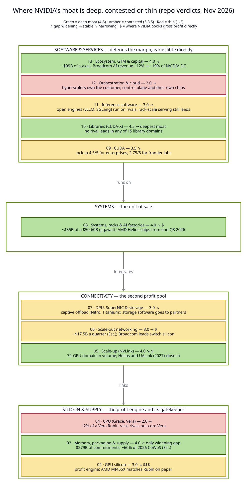
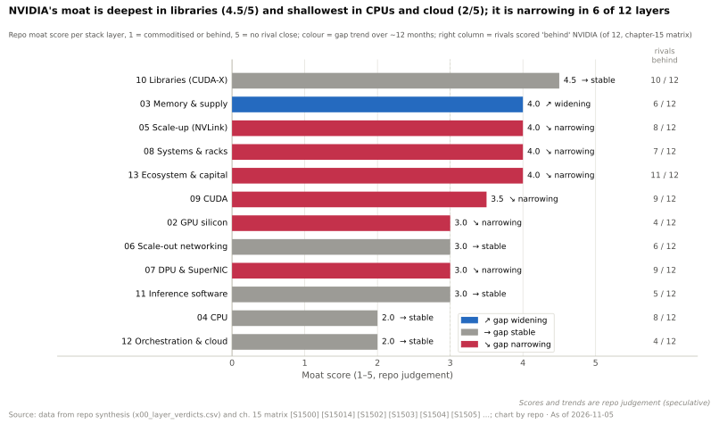
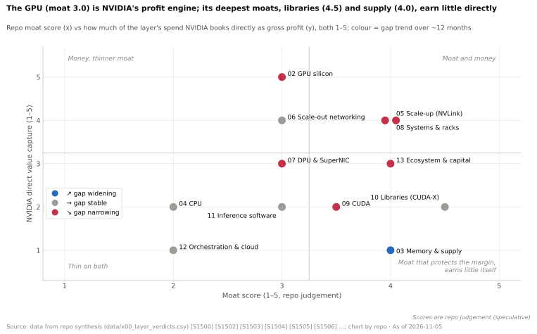
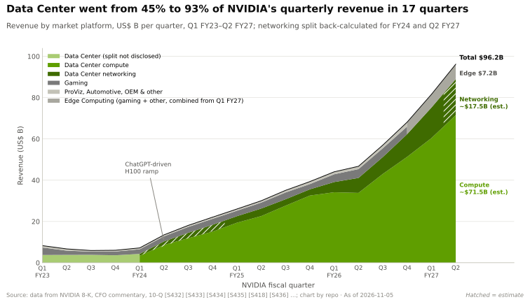
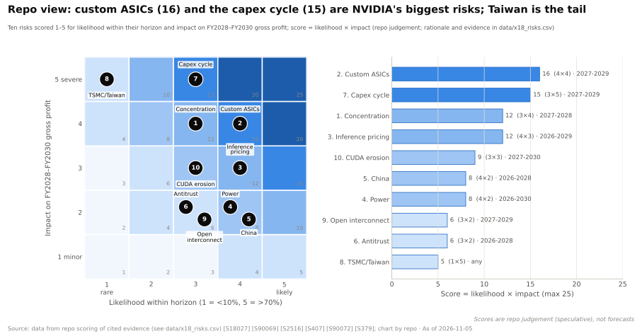

# 速查表 —— 每一层浓缩为一行

> [!NOTE]
> 本页为英文原文的简体中文参考译文，仅供参考；如有出入，以[英文原文](../CHEATSHEET.md "English original")为准。

综合篇 · 一页图表 · 阅读约 ~6 分钟 · 最后核实：2026-11-05 · 各项结论的说明见[执行摘要](00-executive-summary.md)

## ⚡ 要点速览

- **横向阅读一行**，可以看到一个层级的职能、英伟达（NVIDIA）现有产品 → 下一代、关键指标、优势来源、最强挑战者、
  趋势、[价值池](glossary.md#value-pool)以及企业发展（corp dev）角度。纵向阅读“护城河 · 趋势”一栏，即可了解全貌。
- **护城河最深：** 软件库（4.5 分，满分 5），其次是内存与供应、[纵向扩展（scale-up）](glossary.md#scale-up)、系统和生态（各 4.0）。🔴
  **最薄：** CPU 以及编排与云（2.0）[[S1500]](../sources/bibliography.md#s1500)。
- **12 层中有 6 层差距在收窄**，只有供应层在扩大，该层的承诺额已达 $279B [[S1500]](../sources/bibliography.md#s1500)[[S407]](../sources/bibliography.md#s407)。
- **利润集中在四个硬件层：** GPU、[NVLink](glossary.md#nvlink)、网络（FY2026 约 ~$31.4B）和机架（每吉瓦约 ~$35B 的
  英伟达产品）[[S402]](../sources/bibliography.md#s402)[[S398]](../sources/bibliography.md#s398)。软件层大多免费，用于守护这份毛利 [[S1510]](../sources/bibliography.md#s1510)。
- **各层最强挑战者：** 芯片和机架上是 AMD，系统和每 token 成本上是谷歌（Google）TPU，以太网和定制 ASIC 上是博通（Broadcom），
  云上是[超大规模云厂商](glossary.md#hyperscaler) [[S144]](../sources/bibliography.md#s144)[[S90021]](../sources/bibliography.md#s90021)[[S625]](../sources/bibliography.md#s625)[[S274]](../sources/bibliography.md#s274)[[S90026]](../sources/bibliography.md#s90026)。

## 每一层浓缩为一行

护城河 = 本资料库 1–5 分制的[护城河评分](glossary.md#moat-score)；箭头 = [差距趋势](glossary.md#gap-trend)（↗ 扩大 ·
→ 稳定 · ↘ 收窄）。二者均为 🔴 本资料库判断，记录于 `data/x00_layer_verdicts.csv` [[S1500]](../sources/bibliography.md#s1500)。

| 层级 | 职能 | 英伟达现在 → 下一代 | 关键指标 | 优势来源 | 最强挑战者 | 护城河 · 趋势 | 价值池 | 企业发展角度 |
|---|---|---|---|---|---|:---:|---|---|
| [**02 GPU 芯片**](layers/02-gpu-silicon/index.md) | 把电力转化为矩阵运算 | Blackwell Ultra → Rubin（2026 年 8 月起出货）→ 🟢 Rubin Ultra（2027 下半年）→ 🟢 Feynman（2028）[[S500]](../sources/bibliography.md#s500)[[S35018]](../sources/bibliography.md#s35018)[[S109]](../sources/bibliography.md#s109) | Rubin：35 PFLOPS 稠密 FP4；288 GB HBM4，带宽 19.2 TB/s [[S33005]](../sources/bibliography.md#s33005)[[S90006]](../sources/bibliography.md#s90006) | 年度迭代节奏、NVFP4、双裸片封装；每代投入 ~$10B [[S35028]](../sources/bibliography.md#s35028) | AMD MI455X：纸面上 432 GB、20 PFLOPS FP8 [[S144]](../sources/bibliography.md#s144) | **3.0 ↘** | 利润引擎：B200 制造成本 ~$6.4K，售价 $30–40K（估计）[[S35020]](../sources/bibliography.md#s35020)[[S35026]](../sources/bibliography.md#s35026) | 以 SRAM 优先或容量优先的推理架构作为切入点；Groq 授权交易 ~$20B 🟡 [[S90019]](../sources/bibliography.md#s90019) |
| [**03 内存与供应**](layers/03-memory-packaging-supply-chain/index.md) | 为张量核心供给数据；确保 HBM 与封装产能 | HBM3E → HBM4（Rubin）→ 🟡 采用定制基础裸片的 HBM4E（2027）[[S3007]](../sources/bibliography.md#s3007) | $279B 承诺；2026 年 ~60% 的 CoWoS（🟡 估计）[[S407]](../sources/bibliography.md#s407)[[S379]](../sources/bibliography.md#s379) | 最大的承诺采购方，每代 HBM 率先导入 | AMD 重容量的 HBM4（432 vs 288 GB）；HBM 厂商的定价权 [[S144]](../sources/bibliography.md#s144) | **4.0 ↗** | 成本转嫁：HBM 约占 B200 制造成本的 ~45%（估计）[[S35020]](../sources/bibliography.md#s35020) | HBM 基础裸片与控制器 IP；供应合作 vs 设计类收购 |
| [**04 CPU**](layers/04-cpu-grace-vera/index.md) | 主机：为 GPU 供数，运行推理服务与智能体工具 | Grace → Vera（88 个定制核心，也可独立销售）→ 🟡 Rosa（2028）[[S4000]](../sources/bibliography.md#s4000)[[S90004]](../sources/bibliography.md#s90004) | Vera Rubin 上每 GPU 的主机链路 ~900 GB/s，DGX H100 为 128 GB/s [[S128]](../sources/bibliography.md#s128)[[S4019]](../sources/bibliography.md#s4019)[[S100]](../sources/bibliography.md#s100) | 一致性 NVLink-C2C 与机架协同设计，而非更强的核心 | Helios 中的 AMD EPYC Venice（256 核）；超大规模云厂商的 Arm 芯片 [[S4028]](../sources/bibliography.md#s4028)[[S538]](../sources/bibliography.md#s538) | **2.0 →** | 规模小：约占 ~$7.8M Vera Rubin 机架的 ~2%（估计）[[S331]](../sources/bibliography.md#s331) | 随着 CPU:GPU 比例向 1:2–1:1 靠拢，智能体 CPU 插槽出现机会 [[S4012]](../sources/bibliography.md#s4012)[[S4013]](../sources/bibliography.md#s4013) |
| [**05 纵向扩展**](layers/05-scale-up-nvlink-nvswitch/index.md) | 让 72 颗 GPU 像一颗一样工作 | GB300 NVL72（130 TB/s）→ Vera Rubin NVL72（216 TB/s）→ Kyber NVL144（2027；🟡 有延期报道）[[S262]](../sources/bibliography.md#s262)[[S200]](../sources/bibliography.md#s200)[[S507]](../sources/bibliography.md#s507) | 每机架 216 TB/s，为该机架横向扩展带宽的 7.5× [[S200]](../sources/bibliography.md#s200)[[S33004]](../sources/bibliography.md#s33004) | 交换芯片、SerDes、铜缆背板与 NCCL 每年同步更新 [[S5000]](../sources/bibliography.md#s5000) | AMD Helios：基于 UALink-on-Ethernet 达 260 TB/s；TPU pod 达 9,216 颗芯片 [[S226]](../sources/bibliography.md#s226)[[S232]](../sources/bibliography.md#s232) | **4.0 ↘** | 每个机架都含 NVLink 交换托盘与背板；Fusion 授权收入 [[S131]](../sources/bibliography.md#s131) | NVLink Fusion（13 家合作伙伴 🟡）vs UALink/ESUN；UALink 产品 2027 年推出 [[S518]](../sources/bibliography.md#s518)[[S90051]](../sources/bibliography.md#s90051) |
| [**06 横向扩展**](layers/06-scale-out-scale-across-networking/index.md) | 把多个 NVLink 域连成一台机器 | ConnectX-8 800G、Spectrum-X → ConnectX-9 1.6T、CPO 交换机（2026）→ 🟡 ConnectX-10（2028）[[S264]](../sources/bibliography.md#s264)[[S6019]](../sources/bibliography.md#s6019)[[S90004]](../sources/bibliography.md#s90004) | Q2 FY2027 网络收入 ~$17.5B（估计），约占数据中心的 ~20% [[S408]](../sources/bibliography.md#s408) | Mellanox（$6.9B）加上网卡–交换机–NCCL 捆绑 [[S464]](../sources/bibliography.md#s464) | 博通 Tomahawk 6，早约 ~12 个月；以太网约占 AI 后端的 ~⅔ 🟡 [[S274]](../sources/bibliography.md#s274)[[S90054]](../sources/bibliography.md#s90054) | **3.0 →** | FY2026 ~$31.4B；光学器件每 GPU ~$6,000 [[S402]](../sources/bibliography.md#s402)[[S6016]](../sources/bibliography.md#s6016) | 随着共封装光学转移价值，光学器件、激光器与网卡 IP 值得关注 [[S90049]](../sources/bibliography.md#s90049) |
| [**07 DPU 与 SuperNIC**](layers/07-dpu-supernic-storage-security/index.md) | 安全地把每个字节送入、送出每颗 GPU | ConnectX-8、BlueField-3 → ConnectX-9、BlueField-4（2026）→ 🟡 ConnectX-10、BlueField-5（2028）[[S7001]](../sources/bibliography.md#s7001)[[S90004]](../sources/bibliography.md#s90004) | 每 GPU 网卡带宽：400 → 800 → 1,600 Gb/s（GB200 → GB300 → Vera Rubin）[[S266]](../sources/bibliography.md#s266)[[S264]](../sources/bibliography.md#s264)[[S33004]](../sources/bibliography.md#s33004) | Mellanox 的技术积淀，与 DOCA、NCCL 及 GPUDirect 协同设计 | 自研卸载方案（AWS Nitro、Google Titanium）；AMD Pensando 每 GPU 2.4 Tb/s [[S292]](../sources/bibliography.md#s292)[[S228]](../sources/bibliography.md#s228) | **3.0 ↘** | 网卡 + DPU 约占 NVL72 机架的 ~3–11%（估计）；存储软件利润归合作伙伴 [[S1507]](../sources/bibliography.md#s1507) | KV 缓存存储层（BlueField-4 STX）作为新插槽 [[S7511]](../sources/bibliography.md#s7511) |
| [**08 系统与机架**](layers/08-systems-racks-ai-factories/index.md) | 把芯片变成供电、散热完备的计算机 | GB300 NVL72（~132 kW）→ Vera Rubin NVL72（~190–230 kW 🟡）→ 🟢 Kyber（~600 kW，2027）[[S337]](../sources/bibliography.md#s337)[[S303]](../sources/bibliography.md#s303)[[S305]](../sources/bibliography.md#s305) | 每用户 50 tok/s 下，GB300 NVL72 每兆瓦 token 产出约为 H200 的 ~13×（估计）[[S621]](../sources/bibliography.md#s621)[[S622]](../sources/bibliography.md#s622) | 每年一款集成机架，由 ODM 制造（富士康约占 ~40%）[[S3014]](../sources/bibliography.md#s3014) | AMD Helios：31 TB HBM4，约自 2026 年 Q3 末出货 [[S90021]](../sources/bibliography.md#s90021)[[S90020]](../sources/bibliography.md#s90020) | **4.0 ↘** | 每 GW $50–60B 投资中英伟达产品约 ~$35B；ODM ~2–3% [[S398]](../sources/bibliography.md#s398)[[S332]](../sources/bibliography.md#s332) | 电源、散热与 800 V DC 供应商；AMD 收购 ZT（$4.9B）[[S90061]](../sources/bibliography.md#s90061)[[S8527]](../sources/bibliography.md#s8527) |
| [**09 CUDA**](layers/09-cuda-and-system-software/index.md) | 在发布首日就把模型运算转化为高速内核 | CUDA 13.x → cuTile Python、CuTe DSL [[S527]](../sources/bibliography.md#s527)[[S9007]](../sources/bibliography.md#s9007)[[S9030]](../sources/bibliography.md#s9030) | 原生支持 12 个主流框架中的 12 个（36/36）；ROCm 26，高通 4 [[S587]](../sources/bibliography.md#s587)[[S586]](../sources/bibliography.md#s586)[[S596]](../sources/bibliography.md#s596) | 二十年的复利积累；~6M 开发者 [[S528]](../sources/bibliography.md#s528) | PyTorch/Triton/vLLM 搭配 ROCm；TPU 上的 JAX/XLA [[S578]](../sources/bibliography.md#s578)[[S580]](../sources/bibliography.md#s580) | **3.5 ↘** | 免费；通过 GPU 毛利和授权（标价每 GPU 每年 $4,500）获利 [[S11013]](../sources/bibliography.md#s11013) | 可移植性资产：高通（Qualcomm）已完成收购 Modular（~$3.9B）[[S9511]](../sources/bibliography.md#s9511) |
| [**10 软件库**](layers/10-libraries-cuda-x/index.md) | 把规格表上的 FLOPS 变成实际交付的速度 | cuBLAS、cuDNN、CUTLASS、NCCL 2.32 → GPU 发起的 NCCL、CuTe DSL [[S10038]](../sources/bibliography.md#s10038)[[S10009]](../sources/bibliography.md#s10009) | 仅靠软件：B200 在 4 个月内从 ~2,000 提升到每 GPU 4,600 DeepSeek-R1 tok/s [[S646]](../sources/bibliography.md#s646) | 覆盖每一代 GPU 的调优；横跨 15 个领域的广度 [[S1510]](../sources/bibliography.md#s1510) | AMD ROCm（RCCL 基于 NCCL 的代码构建）[[S10002]](../sources/bibliography.md#s10002) | **4.5 →** | 免费；带动 GPU 与 AI Enterprise 销售 [[S1510]](../sources/bibliography.md#s1510) | 以推理为先的平台在第一天需要哪些软件库家族 [[S1510]](../sources/bibliography.md#s1510) |
| [**11 推理软件**](layers/11-inference-and-ai-software/index.md) | 在每个延迟档位上让每颗 GPU 产出最多 token | TensorRT-LLM、Dynamo 1.0（2026 年 3 月）→ Groq 3 LPX 机架；🟡 Hugging Face [[S90066]](../sources/bibliography.md#s90066)[[S506]](../sources/bibliography.md#s506)[[S11500]](../sources/bibliography.md#s11500) | 每用户 50 tok/s 下 GB300 NVL72 每 GPU ~6,261 tok/s，约为 H200 的 ~20× [[S621]](../sources/bibliography.md#s621) | 与机架协同设计的推理服务软件；逐模型调优 | 开源引擎（vLLM、SGLang）；TPU 在某一模型上每 token 成本低 ~18% [[S580]](../sources/bibliography.md#s580)[[S625]](../sources/bibliography.md#s625) | **3.0 →** | 直接软件收入每年约 ~$2B，不到数据中心收入的 1% [[S11011]](../sources/bibliography.md#s11011) | 模型分发：$12.9B 的 Hugging Face 交易面临欧盟与美国司法部关注 [[S11500]](../sources/bibliography.md#s11500)[[S11027]](../sources/bibliography.md#s11027)[[S11028]](../sources/bibliography.md#s11028) |
| [**12 编排与云**](layers/12-orchestration-and-cloud-services/index.md) | 把机架变成有效、付费的 GPU 小时 | Run:ai、Mission Control、Slurm → DSX OS（2026）；DGX Cloud Lepton [[S12513]](../sources/bibliography.md#s12513)[[S598]](../sources/bibliography.md#s598) | 利用率 30% vs 90% 时，每有效 GB300 GPU 小时 $5.00 vs $1.67（估计）[[S332]](../sources/bibliography.md#s332)[[S324]](../sources/bibliography.md#s324) | 集成能力加上配额与资本，而非软件授权 | 超大规模云厂商：掌握客户、控制平面与芯片 [[S90026]](../sources/bibliography.md#s90026)[[S90035]](../sources/bibliography.md#s90035)[[S90044]](../sources/bibliography.md#s90044) | **2.0 →** | 租赁利润归云厂商；英伟达持有 ~$65B 的云服务承诺 [[S407]](../sources/bibliography.md#s407) | 规模化路径：超大规模云厂商、新兴云服务商还是主权客户 [[S90071]](../sources/bibliography.md#s90071) |
| [**13 生态与资本**](layers/13-ecosystem-gtm-and-capital/index.md) | 把技术转化为获得融资的需求 | Inception、GTC、主权协议、~$99B 股权投资 → >$500B 的第三方融资平台（2026 年 8 月）[[S90073]](../sources/bibliography.md#s90073)[[S12528]](../sources/bibliography.md#s12528) | 非超大规模（ACIE）~$40.3B = Q2 FY2027 数据中心收入的 45%；主权 AI FY2026 >~$30B [[S406]](../sources/bibliography.md#s406)[[S90071]](../sources/bibliography.md#s90071) | 装机量生态加上竞争对手无法匹敌的资产负债表 | 超大规模云厂商 + 博通 ASIC 联盟；AMD 以股权换吉瓦 [[S2516]](../sources/bibliography.md#s2516)[[S13506]](../sources/bibliography.md#s13506) | **4.0 ↘** | 间接：H1 FY2027 股权净收益 $23.7B，主要为按市值计价 [[S90072]](../sources/bibliography.md#s90072) | 供应商融资姿态；主权客户多源采购（HUMAIN：英伟达、AMD、高通）[[S13003]](../sources/bibliography.md#s13003)[[S13517]](../sources/bibliography.md#s13517)[[S90030]](../sources/bibliography.md#s90030) |

## 四张图

| | |
|---|---|
|  **🔴 各层护城河：** 软件库最深，12 层中有 6 层在收窄 [[S1500]](../sources/bibliography.md#s1500) |  **🔴 护城河 vs 利润：** GPU 负责赚钱，免费软件负责设防 [[S1500]](../sources/bibliography.md#s1500) |
|  **收入结构：** 17 个季度内，数据中心占季度收入的比重从 45% 升至 93% [[S405]](../sources/bibliography.md#s405) · [01 飞轮](01-the-nvidia-flywheel.md) |  **🔴 风险图：** 定制 ASIC（16）与资本开支周期（15）居首 [[S18027]](../sources/bibliography.md#s18027) · [18 看空情景](cross-cutting/18-vulnerabilities-and-bear-case.md) |

> [!TIP]
> **算例 —— 读懂一行：[横向扩展（scale-out）](glossary.md#scale-out)网络。** 关键指标显示，网络业务在 Q2
> FY2027 收入 ~$17.5B（估计），约占数据中心收入的 ~20% [[S408]](../sources/bibliography.md#s408)。护城河一栏却只有 3.0 且趋势稳定，因为博通
> 比 Spectrum-6 早 ~12 个月交付了 102.4 Tb/s 交换机，且以太网拿下了 AI 后端交换机销售额的 ~⅔
> [[S274]](../sources/bibliography.md#s274)[[S6019]](../sources/bibliography.md#s6019)[[S90054]](../sources/bibliography.md#s90054)。两者同时成立：买家为经过调优的[网卡（NIC）](glossary.md#nic)–交换机–[NCCL](glossary.md#nccl) 捆绑方案向英伟达付费，而不是为
> 别人没有的芯片付费。**结论：** 一个受挑战的层级依然可以是巨大的价值池；企业发展要问的是，
> 下一步价值会流向哪一部分（光学器件、激光器、网卡 IP）[[S90049]](../sources/bibliography.md#s90049)。

🔧 技术细节：每一栏的数据来源

- **职能、现在 → 下一代、关键指标、优势来源、最强挑战者：** 来自各层的索引页及其
  八问表（Q1、Q2/Q3、Q4、Q5、Q7），通过该层自身的来源引用 [[S1502]](../sources/bibliography.md#s1502)[[S1513]](../sources/bibliography.md#s1513)。
- **护城河 · 趋势：** 本资料库的综合判断，依据各层的竞争结论与第 15 章的
  “对手 × 层级”矩阵构建。方法见[执行摘要](00-executive-summary.md) [[S1500]](../sources/bibliography.md#s1500)[[S15014]](../sources/bibliography.md#s15014)。
- **价值池：** 来自各层的价值链页面（Q8）。“免费”指英伟达通过硬件毛利而非该层自身的收入线
  实现变现。
- **企业发展角度：** 是一个问题而非建议，取自各层的“企业发展视角”。关于高通的具体角度（基于公开信息），
  见[第 19 章](cross-cutting/19-implications-for-qualcomm.md)。

## 🎯 企业发展视角

1. **箭头比分数更重要。** 六个 ↘ 箭头标出了竞争对手正在追赶的地方；每一处都是一个合作窗口，
   在位者日后未必还会提供 [[S1500]](../sources/bibliography.md#s1500)。
2. **利润与护城河相互背离。** 赚钱的四个层级（GPU、纵向扩展、网络、机架）由不赚钱的层级
   （[CUDA](glossary.md#cuda)、软件库、供应）守护。挑战者需要同时针对两者制定计划。
3. **单薄的层级是开放的插槽。** CPU 与云编排得分 2.0。英伟达对其采取收编而非争夺的策略
   （[NVLink Fusion](glossary.md#nvlink-fusion)、开源的 Run:ai），因此第三方仍可在此建立地位 [[S131]](../sources/bibliography.md#s131)[[S12510]](../sources/bibliography.md#s12510)。
4. **供应是唯一在扩大的差距。** 如果 2027–2028 年的 [HBM](glossary.md#hbm) 和 [CoWoS](glossary.md#cowos) 已被分配
   殆尽，表中所有合作问题都将无从谈起 [[S407]](../sources/bibliography.md#s407)[[S379]](../sources/bibliography.md#s379)。

## 📚 来源（Sources）

<!-- Auto-generated from the [S…] citations on this page by `make build`. Edit sources/registry/*.csv, not this list. -->

- [**S100**](../sources/bibliography.md#s100) NVIDIA Technical Blog, *Inside the NVIDIA Vera Rubin Platform: Six New Chips, One AI Supercomputer*, 2026-01-05. [Link](https://developer.nvidia.com/blog/inside-the-nvidia-rubin-platform-six-new-chips-one-ai-supercomputer/)
- [**S109**](../sources/bibliography.md#s109) NVIDIA Blog, *NVIDIA GTC 2026: Live Updates on What's Next in AI*, 2026-03-16. [Link](https://blogs.nvidia.com/blog/gtc-2026-news/)
- [**S128**](../sources/bibliography.md#s128) NVIDIA, *NVIDIA GH200 Grace Hopper Superchip*, 2023-08. [Link](https://www.nvidia.com/en-us/data-center/grace-hopper-superchip/)
- [**S131**](../sources/bibliography.md#s131) NVIDIA Newsroom, *NVIDIA NVLink Fusion: semi-custom AI infrastructure partner ecosystem (Computex 2025)*, 2025-05-19. [Link](https://nvidianews.nvidia.com/news/nvidia-nvlink-fusion-semi-custom-ai-infrastructure-partner-ecosystem)
- [**S144**](../sources/bibliography.md#s144) AMD Newsroom, *AMD Unveils Vision for an Open AI Ecosystem, Detailing New Silicon, Software and Systems at Advancing AI 2025*, 2025-06-12. [Link](https://www.amd.com/en/newsroom/press-releases/2025-6-12-amd-unveils-vision-for-an-open-ai-ecosystem-detai.html)
- [**S200**](../sources/bibliography.md#s200) NVIDIA, *NVIDIA NVLink and NVLink Switch (product page with NVLink and NVLink Switch specification tables)*, 2026-09. [Link](https://www.nvidia.com/en-us/data-center/nvlink/)
- [**S226**](../sources/bibliography.md#s226) AMD, *AMD Helios Rackscale Solution (product page)*, 2026. [Link](https://www.amd.com/en/products/rackscale-solutions/helios.html)
- [**S228**](../sources/bibliography.md#s228) Spheron, *AMD Helios rack-scale AI on GPU cloud: deploy MI455X inference with UALink and Ultra Ethernet (2026 guide)*, 2026. [Link](https://www.spheron.network/blog/amd-helios-rack-scale-mi455x-gpu-cloud/)
- [**S232**](../sources/bibliography.md#s232) Google Cloud, *TPU7x (Ironwood) - Cloud TPU documentation*, 2025-11. [Link](https://docs.cloud.google.com/tpu/docs/tpu7x)
- [**S262**](../sources/bibliography.md#s262) NVIDIA, *NVIDIA GB200 NVL72 (product page)*, 2024. [Link](https://www.nvidia.com/en-us/data-center/gb200-nvl72/)
- [**S264**](../sources/bibliography.md#s264) NVIDIA Newsroom, *NVIDIA Announces New Switches Optimized for Trillion-Parameter GPU Computing and AI Infrastructure (Quantum-X800, Spectrum-X800, ConnectX-8)*, 2024-03-18. [Link](https://nvidianews.nvidia.com/news/networking-switches-gpu-computing-ai)
- [**S266**](../sources/bibliography.md#s266) NVIDIA Newsroom, *NVIDIA Quantum-2 Takes Supercomputing to New Heights, Into the Cloud*, 2021-11-09. [Link](https://nvidianews.nvidia.com/news/nvidia-quantum-2-takes-supercomputing-to-new-heights-into-the-cloud)
- [**S274**](../sources/bibliography.md#s274) Broadcom, *Broadcom ships Tomahawk 6: world's first 102.4 Tbps switch*, 2025-06-03. [Link](https://investors.broadcom.com/news-releases/news-release-details/broadcom-ships-tomahawk-6-worlds-first-1024-tbps-switch)
- [**S292**](../sources/bibliography.md#s292) Amazon Web Services, *Elastic Fabric Adapter (EFA) and AWS Nitro System documentation*, 2025. [Link](https://aws.amazon.com/hpc/efa/)
- [**S303**](../sources/bibliography.md#s303) Commercial Times (ctee.com.tw), *Vera Rubin NVL72 Max-Q / Max-P rack power (Commercial Times report)*, 2026-01-07. [Link](https://www.ctee.com.tw/news/20260107701081-430704)
- [**S305**](../sources/bibliography.md#s305) DatacenterDynamics, *Nvidia's Rubin Ultra NVL576 rack expected to be 600kW, coming second half of 2027*, 2025-03-19. [Link](https://datacenterdynamics.com/en/news/nvidias-rubin-ultra-nvl576-rack-expected-to-be-600kw-coming-second-half-of-2027)
- [**S324**](../sources/bibliography.md#s324) fal.ai, *NVIDIA GB200 price in 2026: what a GPU, a tray and an NVL72 rack cost*, 2026. [Link](https://fal.ai/learn/serverless/nvidia-gb200-price)
- [**S331**](../sources/bibliography.md#s331) Wccftech, *NVIDIA's Vera Rubin rack hit with 435% memory price surge, pushing HBM4 & LPDDR5X bill to $2M of $7.8M total*, 2026-05. [Link](https://wccftech.com/nvidia-vera-rubin-rack-hit-with-memory-price-surge-pushing-hbm4-lpddr5x-bill-to-2m-of-7-8m-total/)
- [**S332**](../sources/bibliography.md#s332) Tiger Brokers (iTiger), *Morgan Stanley's BOM analysis of NVIDIA's Rubin: GPU share declines; PCB, MLCC and ABF substrate values soar*, 2026-05-20. [Link](https://www.itiger.com/news/1188068712)
- [**S337**](../sources/bibliography.md#s337) Spheron, *NVIDIA GB300 (rental and specifications)*, 2026. [Link](https://spheron.network/gpu-rental/gb300/)
- [**S379**](../sources/bibliography.md#s379) TrendForce News, *TSMC CoWoS capacity and customer allocation estimates (TrendForce / Morgan Stanley, as reported)*, 2025. [Link](https://www.trendforce.com/news/)
- [**S398**](../sources/bibliography.md#s398) NVIDIA Investor Relations, *NVIDIA Q2 FY2026 earnings call (2025-08-27): AI factory economics commentary*, 2025-08-27. [Link](https://investor.nvidia.com/events-and-presentations/events-and-presentations/default.aspx)
- [**S402**](../sources/bibliography.md#s402) NVIDIA Corporation via SEC EDGAR (Colette Kress), *CFO Commentary on Fourth Quarter and Fiscal 2026 Results (Form 8-K exhibit 99.2)*, 2026-02-25. [Link](https://www.sec.gov/Archives/edgar/data/1045810/000104581026000019/q4fy26cfocommentary.htm)
- [**S405**](../sources/bibliography.md#s405) NVIDIA Corporation via SEC EDGAR, *NVIDIA Announces Financial Results for Second Quarter Fiscal 2027 (Form 8-K exhibit 99.1)*, 2026-08-26. [Link](https://www.sec.gov/Archives/edgar/data/0001045810/000104581026000073/q2fy27pr.htm)
- [**S406**](../sources/bibliography.md#s406) NVIDIA Corporation (Colette Kress), *CFO Commentary on Second Quarter Fiscal 2027 Results*, 2026-08-26. [Link](https://s201.q4cdn.com/141608511/files/doc_financials/2027/Q227/Q2FY27-CFO-Commentary.pdf)
- [**S407**](../sources/bibliography.md#s407) NVIDIA Corporation via SEC EDGAR, *NVIDIA Corporation Form 10-Q for quarter ended July 26, 2026*, 2026-08-28. [Link](https://www.sec.gov/Archives/edgar/data/1045810/000104581026000075/nvda-20260726.htm)
- [**S408**](../sources/bibliography.md#s408) NVIDIA Corporation, *NVIDIA Corp. (NVDA) Q2 Fiscal 2027 earnings call transcript (26 August 2026)*, 2026-08-26. [Link](https://s201.q4cdn.com/141608511/files/content_files/TRANSCRIPT_-NVIDIA-Corp-NVDA-US-Q2-2027-Earnings-Call-26-August-2026-5_00-PM-ET.pdf)
- [**S464**](../sources/bibliography.md#s464) NVIDIA Newsroom, *NVIDIA to Acquire Mellanox for $6.9 Billion*, 2019-03-11. [Link](https://nvidianews.nvidia.com/news/nvidia-to-acquire-mellanox-for-6-9-billion)
- [**S500**](../sources/bibliography.md#s500) NVIDIA Corporation, *NVIDIA Q2 Fiscal 2027 Quarterly Presentation (CFO commentary deck)*, 2026-08-26. [Link](https://s201.q4cdn.com/141608511/files/doc_financials/2027/Q227/NVDA-F2Q27-Quarterly-Presentation-final-1.pdf)
- [**S506**](../sources/bibliography.md#s506) SamMobile, *Samsung Foundry begins mass production of NVIDIA Groq 3 LPX chip*, 2026-08-25. [Link](https://www.sammobile.com/news/samsung-foundry-mass-production-nvidia-groq-3-lpx-chip/)
- [**S507**](../sources/bibliography.md#s507) Tom's Hardware, *Nvidia's Kyber rack for Rubin Ultra slips to 2028*, 2026-07-06. [Link](https://www.tomshardware.com/pc-components/gpus/nvidias-kyber-rack-for-rubin-ultra-slips-to-2028)
- [**S518**](../sources/bibliography.md#s518) ServeTheHome, *NVIDIA NVLink Fusion tapped for future AWS Trainium4 deployments*, 2025-12-02. [Link](https://www.servethehome.com/nvidia-nvlink-fusion-tapped-for-future-aws-trainium4-deployments/)
- [**S527**](../sources/bibliography.md#s527) NVIDIA Docs, *CUDA Toolkit 13.2 Release Notes*, 2026-03-05. [Link](https://docs.nvidia.com/cuda/archive/13.2.0/cuda-toolkit-release-notes/index.html)
- [**S528**](../sources/bibliography.md#s528) NVIDIA Developer Forums, *20 Years of CUDA: Honoring the Architects of the Accelerated Age*, 2026-03. [Link](https://forums.developer.nvidia.com/t/20-years-of-cuda-honoring-the-architects-of-the-accelerated-age/364654)
- [**S538**](../sources/bibliography.md#s538) AMD Investor Relations, *AAI 2026: AMD Delivers Full-Stack Compute for the Agentic AI Era*, 2026-07-23. [Link](https://ir.amd.com/news-events/press-releases/detail/1294/aai-2026-amd-delivers-full-stack-compute-for-the-agentic-ai-era)
- [**S578**](../sources/bibliography.md#s578) OpenAI Triton (GitHub), *Triton (triton-lang/triton) README — supported hardware*, 2026-11. [Link](https://github.com/triton-lang/triton/blob/main/README.md)
- [**S580**](../sources/bibliography.md#s580) vLLM project (GitHub), *vLLM README and installation docs — supported hardware*, 2026-11. [Link](https://github.com/vllm-project/vllm/blob/main/docs/getting_started/installation/README.md)
- [**S586**](../sources/bibliography.md#s586) AMD (GitHub: ROCm/ROCm docs), *ROCm documentation sources: release history, AI-ecosystem compatibility matrix, consolidated changelog*, 2026-08-26. [Link](https://github.com/ROCm/ROCm/blob/develop/docs/release/versions.rst)
- [**S587**](../sources/bibliography.md#s587) PyTorch (GitHub: pytorch/pytorch), *PyTorch README — building with CUDA, ROCm and Intel GPU support*, 2026-11. [Link](https://github.com/pytorch/pytorch/blob/main/README.md)
- [**S596**](../sources/bibliography.md#s596) Qualcomm (GitHub: quic), *Qualcomm Cloud AI SDK and Efficient Transformers repositories*, 2026-11. [Link](https://github.com/quic/cloud-ai-sdk)
- [**S598**](../sources/bibliography.md#s598) NVIDIA Newsroom, *NVIDIA Announces DGX Cloud Lepton to Connect Developers to NVIDIA's Global Compute Ecosystem*, 2025-05-18. [Link](https://nvidianews.nvidia.com/news/nvidia-announces-dgx-cloud-lepton-to-connect-developers-to-nvidias-global-compute-ecosystem)
- [**S621**](../sources/bibliography.md#s621) SemiAnalysis (InferenceX-app repository), *InferenceX public API snapshot (benchmarks.json and benchmarks-history.json fixtures)*, 2026-10-17. [Link](https://github.com/SemiAnalysisAI/InferenceX-app/tree/main/packages/app/cypress/fixtures/api)
- [**S622**](../sources/bibliography.md#s622) SemiAnalysis (InferenceX-app repository), *InferenceX hardware registry: TCO per GPU-hour by SKU (SemiAnalysis July 2026 pricing surveys and AI Cloud TCO Model)*, 2026-07. [Link](https://github.com/SemiAnalysisAI/InferenceX-app/blob/main/packages/constants/src/gpu-keys.ts)
- [**S625**](../sources/bibliography.md#s625) SemiAnalysis, *TPU Inference Externalization Full Steam Ahead*, 2026-09-07. [Link](https://github.com/SemiAnalysisAI/InferenceX-app/blob/main/packages/app/content/blog/tpu-inferencex-full-steam.mdx)
- [**S646**](../sources/bibliography.md#s646) NVIDIA TensorRT-LLM team, *Optimizing DeepSeek R1 Throughput on NVIDIA Blackwell GPUs: A Deep Dive for Developers (TensorRT-LLM tech blog 3)*, 2025-05-30. [Link](https://github.com/NVIDIA/TensorRT-LLM/blob/main/docs/source/blogs/tech_blog/blog03_Optimizing_DeepSeek_R1_Throughput_on_NVIDIA_Blackwell_GPUs.md)
- [**S1500**](../sources/bibliography.md#s1500) nvidia_deep_dive_claude repository, *Repo analysis: synthesis verdicts by layer (moat score, gap trend, NVIDIA value capture) and thesis metrics*, 2026-11-05. [Link](https://github.com/FrankHuang94/nvidia_deep_dive_claude/blob/main/data/x00_layer_verdicts.csv)
- [**S1502**](../sources/bibliography.md#s1502) nvidia_deep_dive_claude repository, *Repo layer page: Layer 02, GPU silicon (index Executive Take, eight-question table, competition verdicts)*, 2026-11-05. [Link](https://github.com/FrankHuang94/nvidia_deep_dive_claude/blob/main/layers/02-gpu-silicon/index.md)
- [**S1507**](../sources/bibliography.md#s1507) nvidia_deep_dive_claude repository, *Repo layer page: Layer 07, DPU, SuperNIC, storage and security (index Executive Take, eight-question table, competition verdicts)*, 2026-11-05. [Link](https://github.com/FrankHuang94/nvidia_deep_dive_claude/blob/main/layers/07-dpu-supernic-storage-security/index.md)
- [**S1510**](../sources/bibliography.md#s1510) nvidia_deep_dive_claude repository, *Repo layer page: Layer 10, libraries (CUDA-X) (index Executive Take, eight-question table, competition verdicts)*, 2026-11-05. [Link](https://github.com/FrankHuang94/nvidia_deep_dive_claude/blob/main/layers/10-libraries-cuda-x/index.md)
- [**S1513**](../sources/bibliography.md#s1513) nvidia_deep_dive_claude repository, *Repo layer page: Layer 13, ecosystem, go-to-market and capital (index Executive Take, eight-question table, competition verdicts)*, 2026-11-05. [Link](https://github.com/FrankHuang94/nvidia_deep_dive_claude/blob/main/layers/13-ecosystem-gtm-and-capital/index.md)
- [**S2516**](../sources/bibliography.md#s2516) Broadcom Inc. via SEC EDGAR, *Broadcom Inc. Announces Third Quarter Fiscal Year 2026 Financial Results (Form 8-K exhibit 99.1)*, 2026-09. [Link](https://www.sec.gov/Archives/edgar/data/0001730168/000173016826000076/avgo-08022026x8kxex99.htm)
- [**S3007**](../sources/bibliography.md#s3007) Tom's Hardware, *Micron teams up with TSMC to deliver HBM4E, targeted for 2027*, 2025-09. [Link](https://www.tomshardware.com/micron-hands-tsmc-the-keys-to-hbm4e)
- [**S3014**](../sources/bibliography.md#s3014) Focus Taiwan (CNA), *Foxconn expects AI server rack shipments to double in 2026*, 2026-03-16. [Link](https://focustaiwan.tw/business/202603160022)
- [**S4000**](../sources/bibliography.md#s4000) NVIDIA Newsroom, *NVIDIA Launches Vera CPU, Purpose-Built for Agentic AI*, 2026-03-16. [Link](https://nvidianews.nvidia.com/news/nvidia-launches-vera-cpu-purpose-built-for-agentic-ai)
- [**S4012**](../sources/bibliography.md#s4012) Tom's Hardware, *CPUs are cool again: Intel and AMD reporting spikes in CPU demand due to agentic AI*, 2026-05. [Link](https://www.tomshardware.com/pc-components/cpus/cpus-are-cool-again-intel-and-amd-reporting-spikes-in-cpu-demand-due-to-agentic-ai-shortages-lisa-su-says-business-exceeded-expectations-while-intel-is-looking-at-long-term-agreements-with-potential-customers)
- [**S4013**](../sources/bibliography.md#s4013) TrendForce, *How agentic AI is reshaping the CPU-to-GPU ratio*, 2026-09-29. [Link](https://www.trendforce.com/insights/agentic-ai-cpu-gpu)
- [**S4019**](../sources/bibliography.md#s4019) heise online, *Blackwell: Nvidia unveils its next generation of AI accelerators*, 2024-03-19. [Link](https://heise.de/en/news/Blackwell-Nvidia-unveils-its-next-generation-of-AI-accelerators-9782399.html)
- [**S4028**](../sources/bibliography.md#s4028) Digital Citizen, *AMD EPYC Venice launches with up to 256 Zen 6 cores and strong agentic AI performance claims*, 2026-07-22. [Link](https://www.digitalcitizen.life/amd-epyc-venice-launches-with-up-to-256-zen-6-cores-and-strong-agentic-ai-performance-claims/)
- [**S5000**](../sources/bibliography.md#s5000) SemiAnalysis, *Nvidia's Optical Boogeyman - NVL72, InfiniBand Scale Out, 800G & 1.6T Ramp*, 2024-03. [Link](https://newsletter.semianalysis.com/p/nvidias-optical-boogeyman-nvl72-infiniband)
- [**S6016**](../sources/bibliography.md#s6016) optics.org, *NVIDIA reveals plan to scale AI factories with co-packaged optics*, 2025-03-19. [Link](https://www.optics.org/news/16/3/26)
- [**S6019**](../sources/bibliography.md#s6019) Focus Taiwan (CNA), *Nvidia starts shipping TSMC-backed CPO switches (GTC Taipei / Computex 2026)*, 2026-06-03. [Link](https://focustaiwan.tw/business/202606030020)
- [**S7001**](../sources/bibliography.md#s7001) NVIDIA, *NVIDIA BlueField-4 DPU datasheet*, 2026-05. [Link](https://dam-cdn.nvd.orangelogic.com/AssetLink/m8w7t64m2k40j51sx8xb4ok712b743ux.pdf)
- [**S7511**](../sources/bibliography.md#s7511) NVIDIA Newsroom, *NVIDIA Launches BlueField-4 STX Storage Architecture With Broad Industry Adoption*, 2026-03-16. [Link](https://nvidianews.nvidia.com/news/nvidia-launches-bluefield-4-stx-storage-architecture-with-broad-industry-adoption)
- [**S8527**](../sources/bibliography.md#s8527) AMD Investor Relations, *AMD completes acquisition of ZT Systems*, 2025-03-31. [Link](https://ir.amd.com/news-events/press-releases/detail/1240/amd-completes-acquisition-of-zt-systems)
- [**S9007**](../sources/bibliography.md#s9007) NVIDIA (GitHub: NVIDIA/cutile-python), *cuTile Python README*, 2026-11. [Link](https://github.com/NVIDIA/cutile-python/blob/main/README.md)
- [**S9030**](../sources/bibliography.md#s9030) NVIDIA (GitHub: NVIDIA/cutlass), *CUTLASS 4.8.1 README (CuTe DSL)*, 2026-10. [Link](https://github.com/NVIDIA/cutlass/blob/main/README.md)
- [**S9511**](../sources/bibliography.md#s9511) Nasdaq (Qualcomm press release), *Qualcomm Completes Acquisition of Modular*, 2026-07-29. [Link](https://www.nasdaq.com/press-release/qualcomm-completes-acquisition-modular-2026-07-29)
- [**S10002**](../sources/bibliography.md#s10002) AMD (GitHub: ROCm/rccl), *RCCL README and LICENSE (develop branch)*, 2026-11. [Link](https://github.com/ROCm/rccl/blob/develop/README.md)
- [**S10009**](../sources/bibliography.md#s10009) NVIDIA (GitHub: NVIDIA/cutlass), *CUTLASS README (4.8.1)*, 2026-10. [Link](https://github.com/NVIDIA/cutlass/blob/main/README.md)
- [**S10038**](../sources/bibliography.md#s10038) Python Package Index, *PyPI JSON release histories for NVIDIA library packages (nvidia-nccl-cu11/cu12/cu13, cudf-cu12, cudf-polars-cu12, cuml-cu12, cugraph-cu12, cuvs-cu12, warp-lang, cuquantum-python, cuda-quantum, cudaq, cuopt-cu12, nvidia-cutlass-dsl, earth2studio, nvmath-python, cuequivariance, nvidia-cudss-cu12, nvidia-modulus, nvidia-physicsnemo)*, 2026-11-05. [Link](https://pypi.org/)
- [**S11011**](../sources/bibliography.md#s11011) MarketBeat, *NVIDIA Q2 Fiscal 2025 earnings call transcript (28 August 2024)*, 2024-08-28. [Link](https://www.marketbeat.com/earnings/transcripts/110080/)
- [**S11013**](../sources/bibliography.md#s11013) NVIDIA (docs.api.nvidia.com), *NVIDIA NIM FAQ*, 2025. [Link](https://docs.api.nvidia.com/nim/docs/faq)
- [**S11027**](../sources/bibliography.md#s11027) MLex, *Nvidia may seek EU review of Hugging Face deal amid filing uncertainty*, 2026-09-23. [Link](https://www.mlex.com/mlex/articles/2528556/nvidia-may-seek-eu-review-of-hugging-face-deal-amid-european-filing-uncertainty)
- [**S11028**](../sources/bibliography.md#s11028) Stocktwits, *NVDA stock edges down on DOJ interest in $12.9 billion Hugging Face acquisition*, 2026-10-28. [Link](https://stocktwits.com/news-articles/markets/equity/nvda-stock-edges-down-on-doj-interest-in-12-9-billion-hugging-face-acquisition/cZU9MDeR9Go)
- [**S11500**](../sources/bibliography.md#s11500) TechRadar Pro, *'The planets aligned': Nvidia confirms $12.9bn Hugging Face deal in potentially huge AI shake-up*, 2026-09-03. [Link](https://techradar.com/pro/the-planets-aligned-nvidia-confirms-usd12-9bn-hugging-face-deal-in-potentially-huge-ai-shake-up)
- [**S12510**](../sources/bibliography.md#s12510) NVIDIA Technical Blog, *NVIDIA Run:ai is now open source as part of NVIDIA DSX AI Factory platform*, 2026-10. [Link](https://developer.nvidia.com/blog/nvidia-runai-is-now-open-source-as-part-of-nvidia-dsx-ai-factory-platform/)
- [**S12513**](../sources/bibliography.md#s12513) NVIDIA Newsroom, *NVIDIA DSX Gives Infrastructure Builders the Playbook for AI Factories*, 2026-05-31. [Link](https://nvidianews.nvidia.com/news/dsx-infrastructure-ai-factory)
- [**S12528**](../sources/bibliography.md#s12528) NVIDIA Newsroom, *NVIDIA Partners With Apollo, BlackRock, Blackstone, Brookfield, Goldman Sachs and KKR to Establish AI Compute Infrastructure Financing Platforms to Mobilize Over $500 Billion of Third-Party Capital*, 2026-08-10. [Link](https://nvidianews.nvidia.com/news/nvidia-partners-with-apollo-blackrock-blackstone-brookfield-goldman-sachs-and-kkr-to-establish-ai-compute-infrastructure-financing-platforms-to-mobilize-over-500-billion-of-third-party-capital)
- [**S13003**](../sources/bibliography.md#s13003) Middle East AI News, *HUMAIN to deploy 600,000 NVIDIA GPUs across KSA, USA*, 2025-11-19. [Link](https://www.middleeastainews.com/p/humain-to-deploy-600000-nvidia-gpus)
- [**S13506**](../sources/bibliography.md#s13506) Tom's Hardware, *OpenAI signs 6 GW AMD GPU deal*, 2025-10-06. [Link](https://www.tomshardware.com/pc-components/gpus/openai-signs-6gw-amd-gpu-deal)
- [**S13517**](../sources/bibliography.md#s13517) Futuriom, *NVIDIA and AMD score AI hub deals in Saudi Arabia*, 2025-05. [Link](https://www.futuriom.com/articles/news/nvidia-amd-score-deals-for-the-saudi-ai-hub/2025/05)
- [**S15014**](../sources/bibliography.md#s15014) nvidia_deep_dive_claude repository, *Repo analysis: Chapter 15A competitive-landscape calculations (gap-to-flagship ratios, implied AMD commitment value, hyperscaler wallet shares, breadth vs depth)*, 2026-11-05. [Link](https://github.com/FrankHuang94/nvidia_deep_dive_claude/blob/main/cross-cutting/15-competitive-landscape/index.md)
- [**S18027**](../sources/bibliography.md#s18027) nvidia_deep_dive_claude repository, *Repo analysis: chapter 18 risk scores, financing ratios and valuation scenarios*, 2026-11-05. [Link](https://github.com/FrankHuang94/nvidia_deep_dive_claude/blob/main/cross-cutting/18-vulnerabilities-and-bear-case.md)
- [**S33004**](../sources/bibliography.md#s33004) NVIDIA Newsroom, *NVIDIA Kicks Off the Next Generation of AI With Rubin — Six New Chips; One Incredible AI Supercomputer*, 2026-01-05. [Link](https://nvidianews.nvidia.com/news/rubin-platform-ai-supercomputer)
- [**S33005**](../sources/bibliography.md#s33005) NVIDIA, *NVIDIA Vera Rubin NVL72 (product page and specifications)*, 2026. [Link](https://www.nvidia.com/en-us/data-center/vera-rubin-nvl72/)
- [**S35018**](../sources/bibliography.md#s35018) Tom's Hardware, *Nvidia announces Rubin GPUs in 2026, Rubin Ultra in 2027, Feynman also added to roadmap*, 2025-03-18. [Link](https://www.tomshardware.com/pc-components/gpus/nvidia-announces-rubin-gpus-in-2026-rubin-ultra-in-2027-feynam-after)
- [**S35020**](../sources/bibliography.md#s35020) Epoch AI, *NVIDIA's B200 costs around $6,400 to produce, with memory accounting for half*, 2025-12. [Link](https://epoch.ai/data-insights/b200-cost-breakdown)
- [**S35026**](../sources/bibliography.md#s35026) Tom's Hardware, *Nvidia's Jensen Huang says Blackwell GPU to cost $30,000-$40,000, later clarifies that pricing will vary as they won't sell just the chip*, 2024-03-19. [Link](https://www.tomshardware.com/pc-components/gpus/nvidias-jensen-huang-says-blackwell-gpu-to-cost-dollar30000-dollar40000-later-clarifies-that-pricing-will-vary-as-they-wont-sell-just-the-chip)
- [**S35028**](../sources/bibliography.md#s35028) TweakTown, *NVIDIA spent $10 billion on developing its next-generation Blackwell GPU*, 2024-03. [Link](https://www.tweaktown.com/news/96987/nvidia-spent-10-billion-on-developing-its-next-generation-blackwell-gpu/index.html)
- [**S90004**](../sources/bibliography.md#s90004) TrendForce, *Key GTC takeaways: how Samsung, Micron, Intel and more power NVIDIA's Vera Rubin and Feynman*, 2026-03-17. [Link](https://www.trendforce.com/news/2026/03/17/news-key-gtc-takeaways-how-samsung-micron-intel-more-power-nvidias-vera-rubin-and-feynman/)
- [**S90006**](../sources/bibliography.md#s90006) TweakTown, *Nvidia cuts Vera Rubin's memory bandwidth by up to 26% and AMD's Helios now leads in memory bandwidth*, 2026-10. [Link](https://www.tweaktown.com/news/114304/nvidia-cuts-vera-rubins-memory-bandwidth-by-up-to-26-percent-and-amds-helios-now-leads-in-memory-bandwidth/index.html)
- [**S90019**](../sources/bibliography.md#s90019) TechSpot, *Nvidia's $20 billion Groq deal looks a lot like an acquisition*, 2025-12. [Link](https://www.techspot.com/news/110723-nvidia-20-billion-groq-deal-looks-lot-like.html)
- [**S90020**](../sources/bibliography.md#s90020) Shacknews, *AMD Helios AI rack system on track for initial shipments in Q3 2026*, 2026. [Link](https://www.shacknews.com/article/150249/amd-helios-ai-system-shipping-q3-2026)
- [**S90021**](../sources/bibliography.md#s90021) Igor's Lab, *AMD Helios in production: MI455X, EPYC Venice and OpenAI challenge Nvidia AI racks*, 2026. [Link](https://www.igorslab.de/en/amd-helios-in-production-mi455x-epyc-venice-openai-challenge-nvidia-ai-racks/)
- [**S90026**](../sources/bibliography.md#s90026) Maginative, *Anthropic secures 1M Google TPUs while keeping Amazon as primary training partner*, 2025-10. [Link](https://www.maginative.com/anthropic-secures-1m-google-tpus-while-keeping-amazon-as-primary-training-partner)
- [**S90030**](../sources/bibliography.md#s90030) Morningstar, *Qualcomm: Humain deal provides some AI upside*, 2025-10. [Link](https://www.morningstar.com/stocks/qualcomm-humain-deal-provides-some-ai-upside)
- [**S90035**](../sources/bibliography.md#s90035) Business Today ME, *Trainium3 UltraServers now available*, 2025-12. [Link](https://businesstoday.me/tech-news/trainium3-ultraservers-now-available-enabling-customers-to-train-and-deploy-ai-models-fasterat-lower-cost/)
- [**S90044**](../sources/bibliography.md#s90044) eWeek, *Microsoft introduces Maia 200, its most powerful AI chip yet*, 2026-01-27. [Link](https://www.eweek.com/news/microsoft-maia-200-ai-chip/)
- [**S90049**](../sources/bibliography.md#s90049) Tom's Hardware, *Nvidia outlines plans for using light for communication between AI GPUs by 2026*, 2025-03. [Link](https://www.tomshardware.com/networking/nvidia-outlines-plans-for-using-light-for-communication-between-ai-gpus-by-2026-silicon-photonics-and-co-packaged-optics-may-become-mandatory-for-next-gen-ai-data-centers)
- [**S90051**](../sources/bibliography.md#s90051) SDxCentral, *UALink Consortium takes another swing at Nvidia's NVLink supremacy with specification 2.0*, 2026-04. [Link](https://www.sdxcentral.com/news/ualink-consortium-takes-another-swing-at-nvidias-nvlink-supremacy-with-specification-20/)
- [**S90054**](../sources/bibliography.md#s90054) Dell'Oro Group, *Ethernet extends lead in AI scale-out networks despite strong InfiniBand rebound*, 2026. [Link](https://www.delloro.com/news/ethernet-extends-lead-in-ai-scale-out-networks-despite-strong-infiniband-rebound/)
- [**S90061**](../sources/bibliography.md#s90061) DatacenterDynamics, *NVIDIA prepares data center industry for 1MW racks and 800 volt DC power architectures*, 2025-10. [Link](https://www.datacenterdynamics.com/en/news/nvidia-prepares-data-center-industry-for-1mw-racks-and-800-volt-dc-power-architectures/)
- [**S90066**](../sources/bibliography.md#s90066) HPCwire (NVIDIA press release), *NVIDIA enters production with Dynamo, the broadly adopted inference operating system for AI factories*, 2026-03-17. [Link](https://www.hpcwire.com/aiwire/tag/dynamo-1-0/)
- [**S90071**](../sources/bibliography.md#s90071) Crypto Briefing, *Nvidia CFO emphasizes neutral partnership with AI customers as company diversifies beyond hyperscalers*, 2026. [Link](https://cryptobriefing.com/nvidia-cfo-neutral-ai-partnership/)
- [**S90072**](../sources/bibliography.md#s90072) Unite.AI, *Nvidia's AI sector equity stakes grow, SEC filing shows*, 2026-08. [Link](https://unite.ai/nvidias-ai-sector-equity-stakes-grow-sec-filing-shows)
- [**S90073**](../sources/bibliography.md#s90073) FourWeekMBA, *NVIDIA's $99 billion investment portfolio and the circular financing loop at the center of AI*, 2026-08. [Link](https://fourweekmba.com/ai-nvidia-99-billion-investment-portfolio-circular-financing-ai/)
