# 英伟达（NVIDIA）全栈深度解析

> [!NOTE]
> 本页为英文原文的简体中文参考译文，仅供参考；如有出入，以[英文原文](../README.md "English original")为准。

**关于本译本**：本文件夹（`zh-CN/`）是整个资料库的简体中文参考译文，页面结构与英文版逐页对应。图表（SVG）与各页末尾的来源列表保留英文原样；如译文与英文原文有任何出入，以英文原文为准。可直接打印的 PDF 版本位于 `zh-CN/pdf/`，说明见 [pdf/README.md](pdf/README.md)。

**英伟达如何以及为何成为 AI 训练与推理中不可或缺的一环——面向企业发展（corp dev）读者的逐层拆解。**

<sub>可视化研究资料库 · 12 个技术栈层级、5 篇入门、6 个跨层专题、7 个案例研究 · 仅使用公开信息 · **最后核实：2026-11-05**</sub>

## ⚡ 要点速览

用五条要点概括核心论点（[完整论证](00-executive-summary.md)）：

- **1 · 卖的是系统，而不是芯片。** 如今的销售单位是 72 颗 GPU 的 [NVL72](glossary.md#nvl72) 机架；英伟达估算，在一座 1 GW AI 工厂
  $50–60B 的总预算中，其自身产品约占 ~$35B [[S398]](../sources/bibliography.md#s398)。在每用户 50 tokens/s 的条件下，GB300 NVL72
  每颗 GPU 的 token（词元）产出约为 H200 的 ~20×，因此一家毛利率 ~75% 的供应商，在聊天速度下仍能提供最便宜的 token（估计
  每百万 token ~$0.16）[[S621]](../sources/bibliography.md#s621)[[S14000]](../sources/bibliography.md#s14000)[[S405]](../sources/bibliography.md#s405)。
- **2 · 软件在已售出的硬件上持续复利。** [CUDA](glossary.md#cuda) 已原生支持本资料库追踪的全部 12 个主流 AI
  框架 [[S587]](../sources/bibliography.md#s587)[[S580]](../sources/bibliography.md#s580)，新模型在发布首日（day 0）即可在其上运行 [[S633]](../sources/bibliography.md#s633)；仅靠软件优化，就在四个月内把 B200
  每颗 GPU 的 DeepSeek-R1 吞吐量从 ~2,000 提升到 4,600 tokens/s [[S646]](../sources/bibliography.md#s646)。
- **3 · 规模换来供应与迭代节奏。** $279B 的供应与产能承诺 [[S407]](../sources/bibliography.md#s407)，以及台积电（TSMC）2026 年 ~60% 的
  [CoWoS](glossary.md#cowos) 晶圆（🟡 估计）[[S379]](../sources/bibliography.md#s379)，支撑英伟达每年推出新一代 GPU、网卡、交换机、CPU 和机架，一直延续到 2028 年的 🟢
  Feynman [[S35018]](../sources/bibliography.md#s35018)[[S109]](../sources/bibliography.md#s109)。
- **4 · 资本与生态使其成为默认交易对手。** ~$99B 的股权投资 [[S90073]](../sources/bibliography.md#s90073)、FY2026 超过 ~$30B 的主权 AI
  收入 [[S90071]](../sources/bibliography.md#s90071)，以及占数据中心收入 45% 的非超大规模买家 [[S406]](../sources/bibliography.md#s406)，把需求分散到了最大的几家云厂商之外。
  批评者称这一循环为[循环融资](glossary.md#circular-financing) [[S18007]](../sources/bibliography.md#s18007)。
- **5 · 今日不可或缺，边际上可被挑战。** 2025 年英伟达保持了 AI 数据中心芯片收入的 ~87%，而该市场规模扩大了
  ~4.2×（估计）[[S416]](../sources/bibliography.md#s416)[[S1]](../sources/bibliography.md#s1)[[S660]](../sources/bibliography.md#s660)[[S661]](../sources/bibliography.md#s661)[[S663]](../sources/bibliography.md#s663)。但 AMD 在纸面参数上已持平或超越 Rubin [[S144]](../sources/bibliography.md#s144)[[S90093]](../sources/bibliography.md#s90093)，Anthropic 可使用多达
  1M 颗谷歌（Google）TPU [[S653]](../sources/bibliography.md#s653)，博通（Broadcom）的 AI 收入已达英伟达数据中心收入的 ~19% [[S2516]](../sources/bibliography.md#s2516)。🔴 竞争对手
  在削弱英伟达的出货量之前，会先在最大买家处压制其[定价权](glossary.md#pricing-power) [[S15014]](../sources/bibliography.md#s15014)。

最新季度：Q2 FY2027 收入 $96.2B（同比 +106%），毛利率 75.0%；Q3 指引 $108B。🟢 管理层将 FY2028 ~70% 的增长
定性为[受供应约束](glossary.md#supply-constrained)，毛利率将在 Q4 FY2027 触底于 71–72%
[[S405]](../sources/bibliography.md#s405)[[S3]](../sources/bibliography.md#s3)[[S90085]](../sources/bibliography.md#s90085)[[S90086]](../sources/bibliography.md#s90086)。

## 🍰 一图看懂技术栈

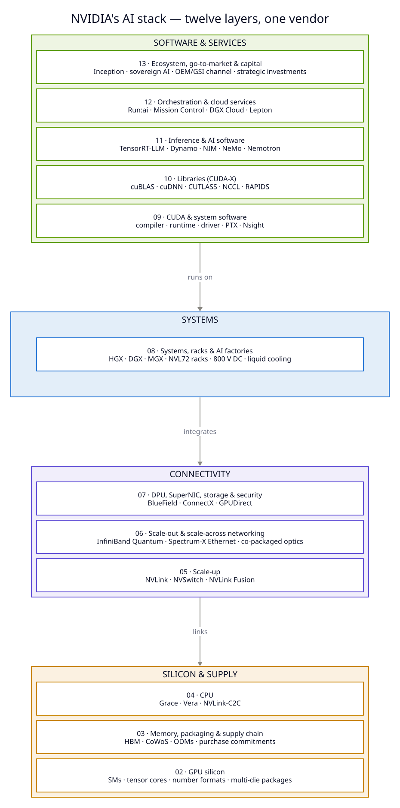

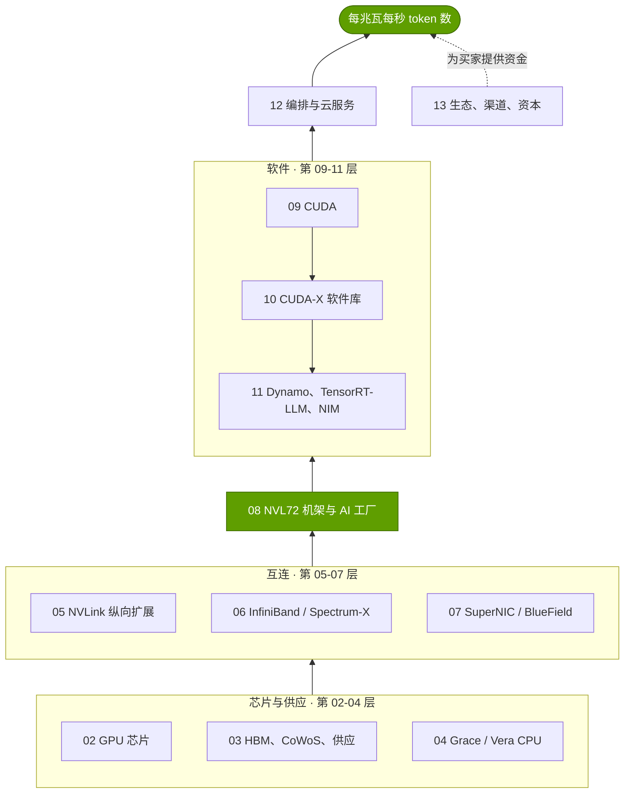

每一层都有独立文件夹，包含索引页、深度解析页，以及竞争、历史、路线图与价值链页面。
[速查表](CHEATSHEET.md)把每一层浓缩为一行；[执行摘要](00-executive-summary.md)
为每一层给出结论。

## 🧭 三条阅读路径

| 路径 | 时长 | 按以下顺序阅读 | 读完后你能够 |
|---|---|---|---|
| ⏱️ **30 分钟** | ~30 分钟 | 本 README（5 分钟）→ [00 执行摘要](00-executive-summary.md)：要点速览、核心论点与护城河部分（12 分钟）→ [速查表](CHEATSHEET.md)（5 分钟）→ [18 看空情景](cross-cutting/18-vulnerabilities-and-bear-case.md)：要点速览与风险热力图（8 分钟） | 用数据阐述核心论点、护城河地图与看空情景 |
| 🕑 **2 小时** | ~2 小时 | 30 分钟路径 → 入门篇 [P2 推理](primers/P2-how-ai-inference-works.md) 与 [P3 四大瓶颈](primers/P3-the-four-bottlenecks.md)（30 分钟）→ 十二个层级的索引页，从 [02](layers/02-gpu-silicon/index.md) 到 [13](layers/13-ecosystem-gtm-and-capital/index.md)（45 分钟）→ [14 经济学](cross-cutting/14-training-vs-inference-economics.md)（10 分钟）→ [15 竞争](cross-cutting/15-competitive-landscape/index.md)（10 分钟）→ [19 对高通的启示](cross-cutting/19-implications-for-qualcomm.md)（10 分钟） | 向工程师讲清其中的机制，并检验竞争对手的说法 |
| 📚 **完整** | ~15–20 小时 | README → [00](00-executive-summary.md) → [01 飞轮](01-the-nvidia-flywheel.md) → 入门篇 [P1](primers/P1-how-ai-training-works.md)–[P5](primers/P5-chip-economics-101.md) → 第 02–13 层（先读索引页，再读深度解析，然后是竞争、历史、路线图与价值链）→ [14](cross-cutting/14-training-vs-inference-economics.md) → [15](cross-cutting/15-competitive-landscape/index.md) 及其竞争对手页面 → [16](cross-cutting/16-how-nvidia-built-it-timeline.md) → [17](cross-cutting/17-roadmap-2025-2028.md) → [18](cross-cutting/18-vulnerabilities-and-bear-case.md) → 案例研究 [CS1](case-studies/CS1-mellanox-the-best-deal.md)–[CS7](case-studies/CS7-gigawatt-ai-factories-xai-stargate-etc.md) → [19](cross-cutting/19-implications-for-qualcomm.md)；全程把速查表放在手边 | 对任一层级、交易或竞争对手达到尽职调查级别的深度 |

完整路径的英文原文约 ~220,000 词，按每分钟 230 词计约需 16 小时，另加阅读图表的时间 [[S1501]](../sources/bibliography.md#s1501)。

## 🖼️ 可视化索引

点击缩略图查看全尺寸图表；缩略图下方的链接指向讨论该图表的页面。全部 350+ 张图表
列于[图表目录](../assets/charts/CATALOG.md)。

| | | |
|---|---|---|
| <a href="../assets/charts/00-annual-revenue-by-segment.svg"></a><br><sub>**FY2016–FY2026，数据中心占收入比重从 7% 升至 90%** [[S1]](../sources/bibliography.md#s1)[[S402]](../sources/bibliography.md#s402) · [00 执行摘要](00-executive-summary.md)</sub> | <a href="../assets/charts/00-quarterly-revenue-and-guidance.svg">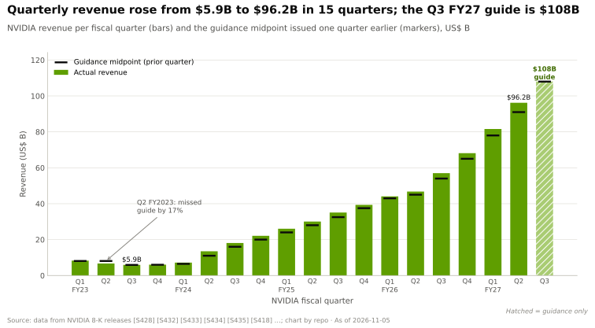</a><br><sub>**Q2 FY2027 收入 $96.2B；Q3 指引 $108B** [[S405]](../sources/bibliography.md#s405) · [00 执行摘要](00-executive-summary.md)</sub> | <a href="../assets/charts/00-gross-margin-path-and-guide.svg">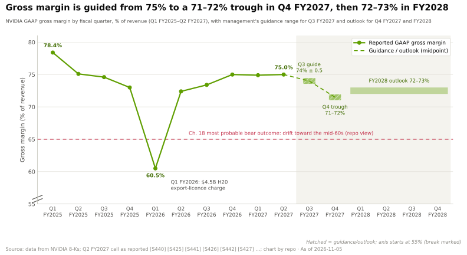</a><br><sub>**毛利率指引从 75% 降至 71–72% 的低点，之后回到 72–73%** [[S90085]](../sources/bibliography.md#s90085) · [00 执行摘要](00-executive-summary.md)</sub> |
| <a href="../assets/charts/00-thesis-in-five-numbers.svg">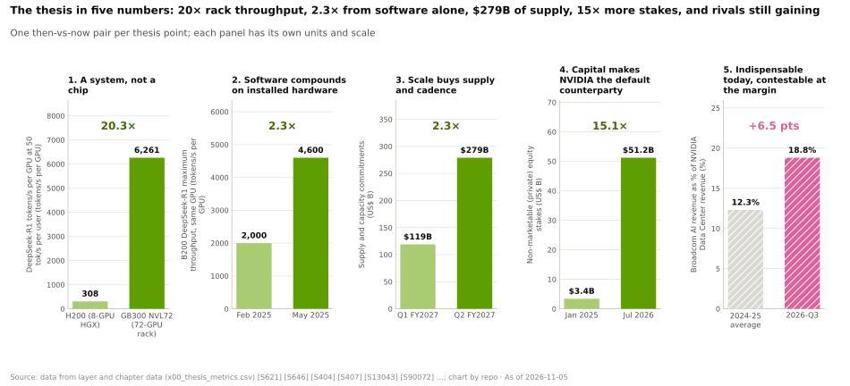</a><br><sub>**用五组“过去 vs 现在”的数字概括核心论点** [[S621]](../sources/bibliography.md#s621)[[S407]](../sources/bibliography.md#s407) · [00 执行摘要](00-executive-summary.md)</sub> | <a href="../assets/charts/00-moat-strength-by-layer.svg">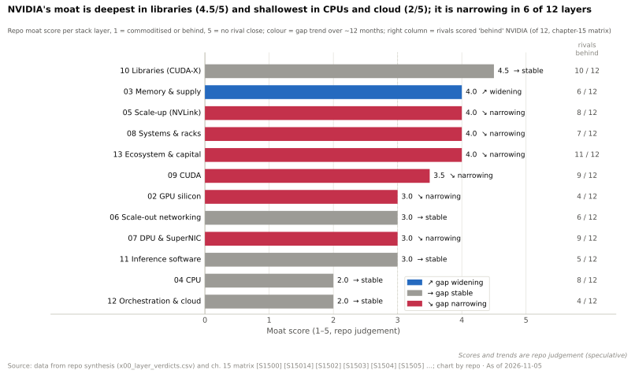</a><br><sub>**🔴 护城河在软件库最深（4.5/5），12 层中有 6 层在收窄** [[S1500]](../sources/bibliography.md#s1500) · [速查表](CHEATSHEET.md)</sub> | <a href="../assets/charts/15-layer-competitor-heatmap.svg"></a><br><sub>**最接近的对手谷歌 TPU 在 12 层中的 5 层持平或领先** [[S15014]](../sources/bibliography.md#s15014) · [15 竞争格局](cross-cutting/15-competitive-landscape/index.md)</sub> |
| <a href="../assets/charts/02-flops-by-precision-log.svg">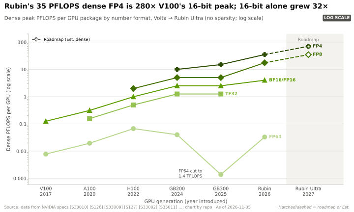</a><br><sub>**Rubin 的 35 PFLOPS FP4 约为 V100 16 位峰值的 ~280×** [[S33005]](../sources/bibliography.md#s33005)[[S33010]](../sources/bibliography.md#s33010) · [02 GPU 芯片](layers/02-gpu-silicon/index.md)</sub> | <a href="../assets/charts/03-compute-vs-memory-bandwidth-growth.svg">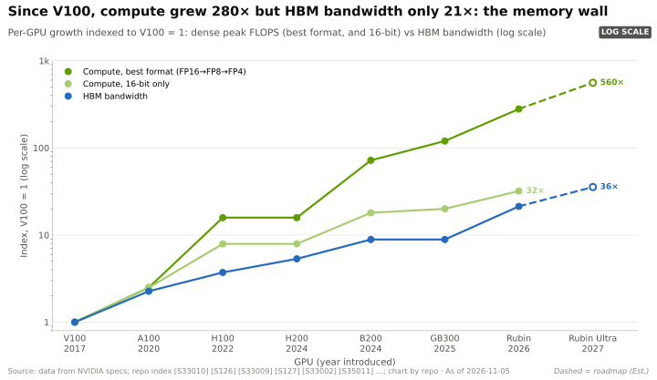</a><br><sub>**自 V100 以来算力提升 ~280×，HBM 带宽仅 ~21×** [[S33010]](../sources/bibliography.md#s33010)[[S33007]](../sources/bibliography.md#s33007) · [03 内存](layers/03-memory-packaging-supply-chain/index.md)</sub> | <a href="../assets/charts/03-cowos-capacity-and-nvidia-share.svg"></a><br><sub>**🟡 英伟达锁定 2026 年 ~60% 的 CoWoS 晶圆（估计）** [[S379]](../sources/bibliography.md#s379) · [03 内存](layers/03-memory-packaging-supply-chain/index.md)</sub> |
| <a href="../assets/charts/05-nvlink-domain-bandwidth-by-system.svg">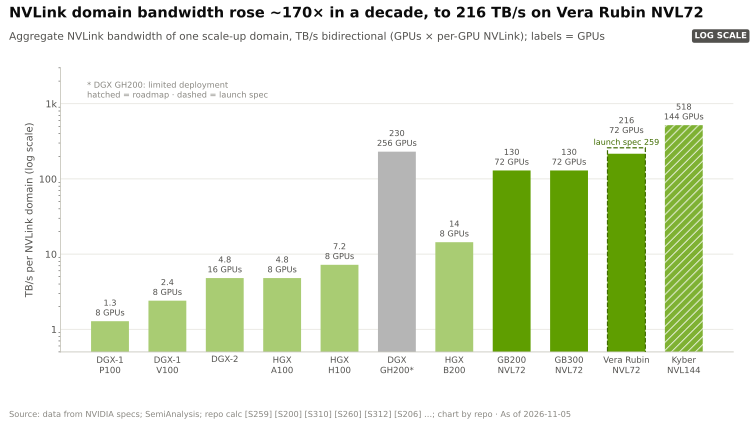</a><br><sub>**十年间 NVLink 域带宽提升 ~170×，达 216 TB/s** [[S200]](../sources/bibliography.md#s200) · [05 纵向扩展](layers/05-scale-up-nvlink-nvswitch/index.md)</sub> | <a href="../assets/charts/06-networking-revenue-and-share.svg"></a><br><sub>**两年间网络收入增长 ~5.5×，达每季度 ~$17.5B（估计）** [[S408]](../sources/bibliography.md#s408) · [06 网络](layers/06-scale-out-scale-across-networking/index.md)</sub> | <a href="../assets/charts/06-ib-vs-ethernet-ai-backend-share.svg">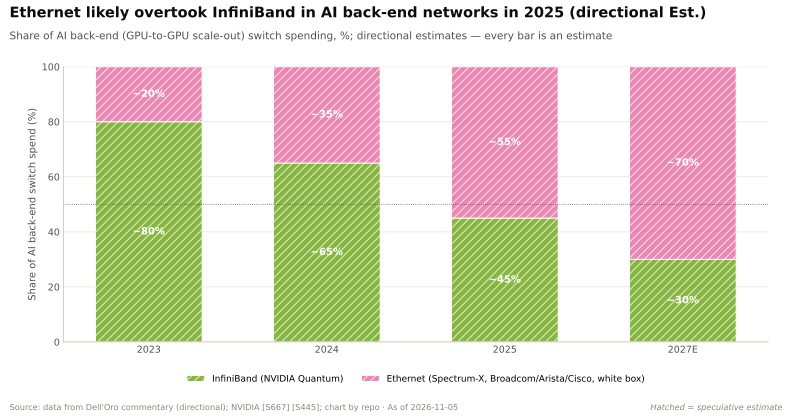</a><br><sub>**🟡 在 AI 后端交换领域，以太网已超越 InfiniBand** [[S90053]](../sources/bibliography.md#s90053)[[S90054]](../sources/bibliography.md#s90054) · [06 网络](layers/06-scale-out-scale-across-networking/index.md)</sub> |
| <a href="../assets/charts/08-kw-per-rack-by-generation.svg">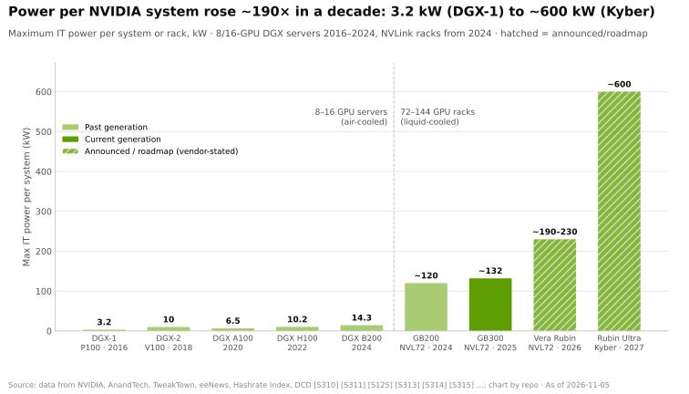</a><br><sub>**单系统功率：从 3.2 kW（DGX-1）到 ~600 kW（Kyber）** [[S310]](../sources/bibliography.md#s310)[[S305]](../sources/bibliography.md#s305) · [08 系统](layers/08-systems-racks-ai-factories/index.md)</sub> | <a href="../assets/charts/08-tokens-per-mw-by-system.svg">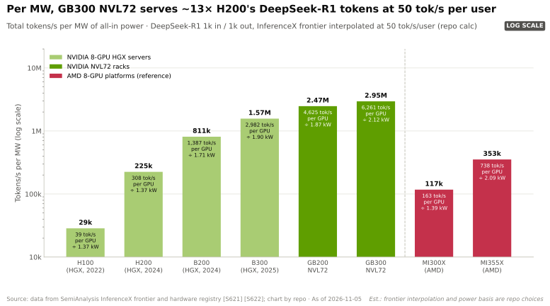</a><br><sub>**GB300 NVL72 每兆瓦 token 产出约为 H200 的 ~13×** [[S621]](../sources/bibliography.md#s621)[[S622]](../sources/bibliography.md#s622) · [08 系统](layers/08-systems-racks-ai-factories/index.md)</sub> | <a href="../assets/charts/14-tco-cost-per-million-tokens-ranges.svg"></a><br><sub>**聊天速度下 GB300 每百万 token 约 ~$0.16（估计）** [[S14000]](../sources/bibliography.md#s14000) · [14 经济学](cross-cutting/14-training-vs-inference-economics.md)</sub> |
| <a href="../assets/charts/09-dsv4-day0-readiness.svg">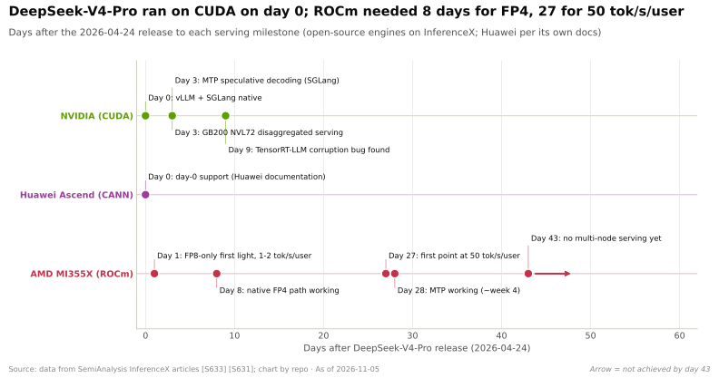</a><br><sub>**DeepSeek-V4 第 0 天即可在 CUDA 上运行；AMD 需要 8–27 天** [[S633]](../sources/bibliography.md#s633) · [09 CUDA](layers/09-cuda-and-system-software/index.md)</sub> | <a href="../assets/charts/10-cuda-x-library-timeline.svg">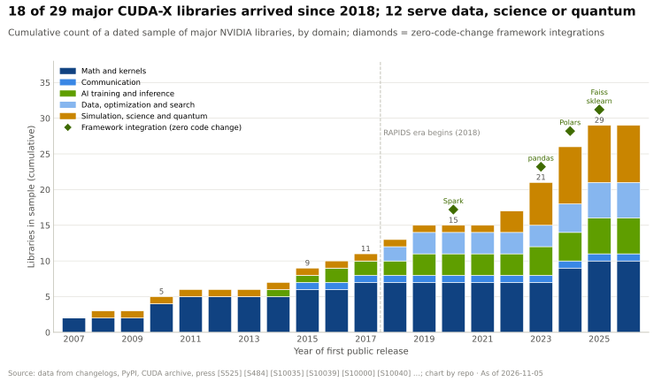</a><br><sub>**29 个主要 CUDA-X 软件库中有 18 个推出于 2018 年以后** [[S525]](../sources/bibliography.md#s525)[[S10035]](../sources/bibliography.md#s10035) · [10 软件库](layers/10-libraries-cuda-x/index.md)</sub> | <a href="../assets/charts/11-throughput-vs-interactivity-pareto.svg">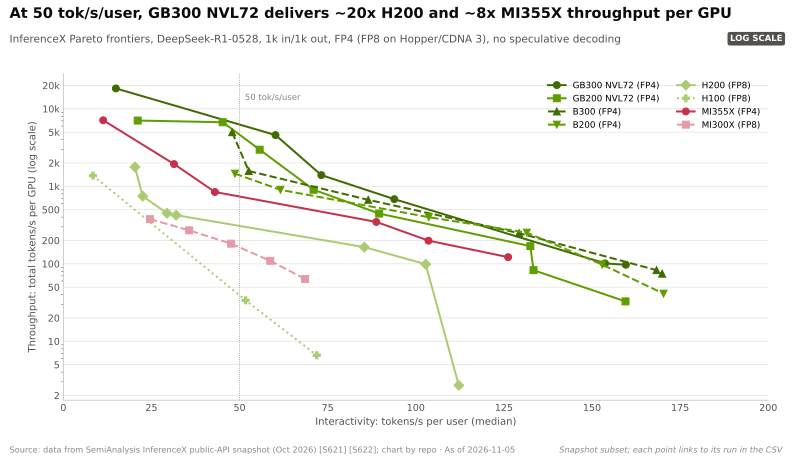</a><br><sub>**每用户 50 tok/s 时，GB300 NVL72 每 GPU 产出约为 H200 的 ~20×** [[S621]](../sources/bibliography.md#s621) · [11 推理](layers/11-inference-and-ai-software/index.md)</sub> |
| <a href="../assets/charts/12-cost-per-useful-gpu-hour.svg">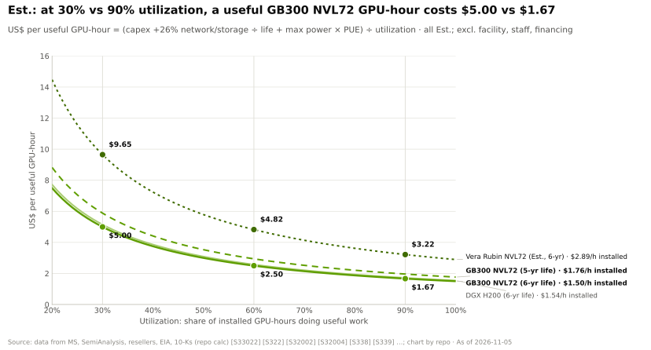</a><br><sub>**利用率 30% vs 90% 时，每有效 GPU 小时 $5.00 vs $1.67（估计）** [[S332]](../sources/bibliography.md#s332)[[S324]](../sources/bibliography.md#s324) · [12 云服务](layers/12-orchestration-and-cloud-services/index.md)</sub> | <a href="../assets/charts/13-dc-revenue-by-customer-type.svg">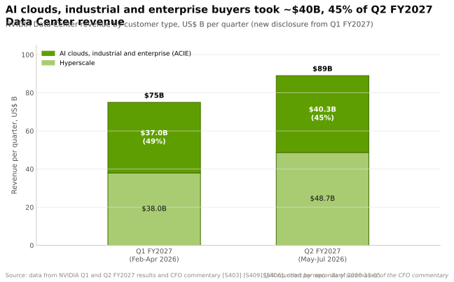</a><br><sub>**非超大规模买家：占 Q2 FY2027 数据中心收入的 ~45%** [[S406]](../sources/bibliography.md#s406) · [13 生态](layers/13-ecosystem-gtm-and-capital/index.md)</sub> | <a href="../assets/charts/15-ai-accelerator-market-share.svg">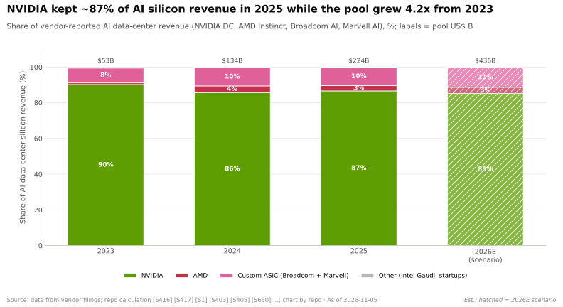</a><br><sub>**2025 年占 AI 芯片收入 ~87%，同期市场扩大 ~4.2×（估计）** [[S416]](../sources/bibliography.md#s416)[[S660]](../sources/bibliography.md#s660) · [15 竞争格局](cross-cutting/15-competitive-landscape/index.md)</sub> |
| <a href="../assets/charts/16-revenue-by-era-log.svg">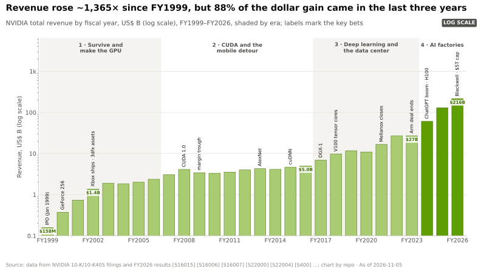</a><br><sub>**自 FY1999 以来收入增长 ~1,365×；88% 的增量来自最近三年** [[S16015]](../sources/bibliography.md#s16015)[[S1]](../sources/bibliography.md#s1) · [16 历史](cross-cutting/16-how-nvidia-built-it-timeline.md)</sub> | <a href="../assets/charts/17-roadmap-gantt-nvidia.svg">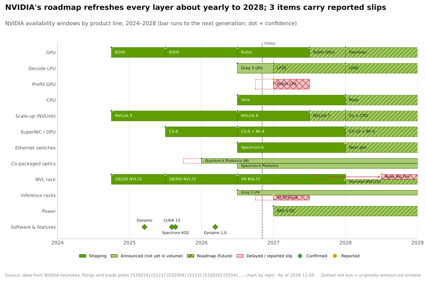</a><br><sub>**至 2028 年每一层约每年更新一次；3 项有延期报道** [[S502]](../sources/bibliography.md#s502)[[S507]](../sources/bibliography.md#s507) · [17 路线图](cross-cutting/17-roadmap-2025-2028.md)</sub> | <a href="../assets/charts/18-risk-heatmap.svg">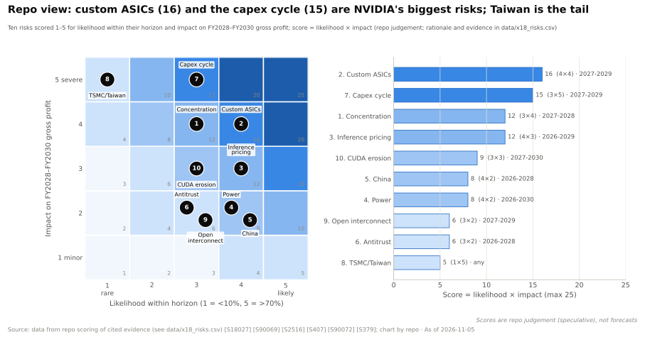</a><br><sub>**🔴 定制 ASIC（16）与资本开支周期（15）居风险图首位** [[S18027]](../sources/bibliography.md#s18027) · [18 看空情景](cross-cutting/18-vulnerabilities-and-bear-case.md)</sub> |

> [!TIP]
> **算例 —— 如何解读本资料库中的一个数字。** 以“GB300 每百万 token ~$0.16”为例。`~` 与“估计（Est.）”表明这是
> 估计值。引用标记 [[S14000]](../sources/bibliography.md#s14000) 在[参考文献](../sources/bibliography.md)中
> 指向第 14 章透明的[总拥有成本（TCO）](glossary.md#tco)模型，其每项输入均列于 `data/x14_tco_scenarios.csv` 并各自注明来源。
> 该章给出了区间（P10–P90 为 $0.13–0.23），并将模型推算的竞争对手数据标为 🔴 [[S14000]](../sources/bibliography.md#s14000)。**结论：** 引用
> 任何数字之前，先核对三点：限定词（~、估计）、可信度标签（🟢 公司确认、🟡 可信报道、🔴 推测或本资料库分析），
> 以及引用标记背后的来源。

## 🗺️ 资料库地图

| 部分 | 页面 | 回答的问题 |
|---|---|---|
| **综合篇** | [00 执行摘要](00-executive-summary.md) · [速查表](CHEATSHEET.md) · [01 英伟达的飞轮](01-the-nvidia-flywheel.md) | 答案、各层结论与四个相互强化的循环 |
| **入门篇** | [P1 训练](primers/P1-how-ai-training-works.md) · [P2 推理](primers/P2-how-ai-inference-works.md) · [P3 四大瓶颈](primers/P3-the-four-bottlenecks.md) · [P4 并行方式](primers/P4-parallelism-explained.md) · [P5 芯片经济学](primers/P5-chip-economics-101.md) | 从零开始掌握所需的工程知识 |
| **硬件层** | [02 GPU 芯片](layers/02-gpu-silicon/index.md) · [03 内存、封装与供应链](layers/03-memory-packaging-supply-chain/index.md) · [04 CPU（Grace、Vera）](layers/04-cpu-grace-vera/index.md) | 计算在哪里发生，谁控制供应 |
| **互连层** | [05 纵向扩展（NVLink）](layers/05-scale-up-nvlink-nvswitch/index.md) · [06 横向扩展与跨数据中心扩展](layers/06-scale-out-scale-across-networking/index.md) · [07 DPU、SuperNIC、存储与安全](layers/07-dpu-supernic-storage-security/index.md) | 数千颗 GPU 如何像一台机器一样工作 |
| **系统层** | [08 系统、机架与 AI 工厂](layers/08-systems-racks-ai-factories/index.md) | 为什么产品是机架而不是芯片 |
| **软件层** | [09 CUDA](layers/09-cuda-and-system-software/index.md) · [10 软件库（CUDA-X）](layers/10-libraries-cuda-x/index.md) · [11 推理与 AI 软件](layers/11-inference-and-ai-software/index.md) | 免费使用的护城河 |
| **云与生态层** | [12 编排与云服务](layers/12-orchestration-and-cloud-services/index.md) · [13 生态、市场进入与资本](layers/13-ecosystem-gtm-and-capital/index.md) | 芯片如何变成付费的 GPU 小时与获得融资的需求 |
| **跨层专题** | [14 训练与推理经济学](cross-cutting/14-training-vs-inference-economics.md) · [15 竞争格局](cross-cutting/15-competitive-landscape/index.md) · [16 英伟达如何建成今日格局](cross-cutting/16-how-nvidia-built-it-timeline.md) · [17 路线图 2025–2028](cross-cutting/17-roadmap-2025-2028.md) · [18 弱点与看空情景](cross-cutting/18-vulnerabilities-and-bear-case.md) · [19 对高通的启示](cross-cutting/19-implications-for-qualcomm.md) | 经济学、竞争对手、历史、路线图、风险与启示 |
| **竞争对手页面** | [AMD](cross-cutting/15-competitive-landscape/amd.md) · [谷歌 TPU](cross-cutting/15-competitive-landscape/google-tpu.md) · [AWS Trainium](cross-cutting/15-competitive-landscape/aws-trainium.md) · [微软 Maia](cross-cutting/15-competitive-landscape/microsoft-maia.md) · [Meta MTIA](cross-cutting/15-competitive-landscape/meta-mtia.md) · [ASIC 设计服务商](cross-cutting/15-competitive-landscape/custom-asic-houses.md) · [英特尔](cross-cutting/15-competitive-landscape/intel.md) · [高通](cross-cutting/15-competitive-landscape/qualcomm.md) · [初创公司](cross-cutting/15-competitive-landscape/inference-startups.md) · [中国](cross-cutting/15-competitive-landscape/china.md) | 每种挑战者策略各一页 |
| **案例研究** | [CS1 Mellanox](case-studies/CS1-mellanox-the-best-deal.md) · [CS2 CUDA](case-studies/CS2-cuda-the-15-year-bet.md) · [CS3 谷歌 TPU](case-studies/CS3-google-tpu-the-credible-alternative.md) · [CS4 AMD–OpenAI](case-studies/CS4-amd-openai-and-the-second-source.md) · [CS5 DeepSeek](case-studies/CS5-deepseek-moment-and-efficiency-shock.md) · [CS6 中国](case-studies/CS6-china-export-controls-h20-and-beyond.md) · [CS7 吉瓦级工厂](case-studies/CS7-gigawatt-ai-factories-xai-stargate-etc.md) | 决策、结果及对企业发展的启示 |
| **参考资料** | [术语表](glossary.md) · [参考文献](../sources/bibliography.md) · [数据字典](../data/README.md) · [图表目录](../assets/charts/CATALOG.md) · [TCO 模型](../scripts/tco/README.md) · [核实队列](../docs/VERIFY_QUEUE.md) · [QA 日志](../QA_LOG.md) · [进度](../PROGRESS.md) | 定义、来源、数据、图表与审计轨迹 |

## 🔬 本资料库的构建方式

| 项目 | 本次构建时的数量 | 存放位置 |
|---|---:|---|
| 分析文字 | 31 篇入门、层级、章节与案例研究共 ~213,000 词（英文），另有本综合篇 ~8,000 词 | [PROGRESS.md](../PROGRESS.md) |
| 登记来源 | ~1,750 条，每条含标题、发布方、日期、URL 与访问日期 | [参考文献](../sources/bibliography.md) |
| 数据文件 | ~180 个 CSV、~5,000 行，每行均标注可信度与来源编号 | [数据字典](../data/README.md) |
| 图表 | ~360 张，由 CSV 生成，每张均有结论式标题、替代文字与来源脚注 | [图表目录](../assets/charts/CATALOG.md) |
| 渲染图示 | 14 张 D2 与 Graphviz 图示（机架、托盘、封装与网络结构剖析，技术栈分层图） | `diagrams/src/` |
| 页面中计入的可视化元素 | ~1,080 个图表、图示、Mermaid 图与表格 | [PROGRESS.md](../PROGRESS.md) |
| 术语表词条 | ~680 个，首次出现时均加链接 | [术语表](glossary.md) |

<sub>数量来自 2026-11-05 运行的 `python3 scripts/validate/stats.py` 以及来源登记、数据与目录文件；
随章节编辑而变动 [[S1501]](../sources/bibliography.md#s1501)。</sub>

每一页都采用相同的方法。事实首先取自一手资料：英伟达及竞争对手的监管文件、财报电话会、产品页面与技术
博客，以及 MLCommons 和 InferenceX 数据；可信的分析师与媒体报道居其次。每个数字都带有引用标记，例如 [[S405]](../sources/bibliography.md#s405)，
可链接到参考文献；前瞻性或有争议的说法标注 🟢/🟡/🔴 标签。每张图表均由 `scripts/charts/` 从 `data/*.csv`
重新生成。校验脚本检查每个 Mermaid 图能否渲染、每个链接与图片能否解析、每张图片是否有替代文字、
每条引用是否已登记，以及每章是否达到可视化配额。

<details>
<summary>🔧 技术细节：一个数字如何从来源走到页面</summary>

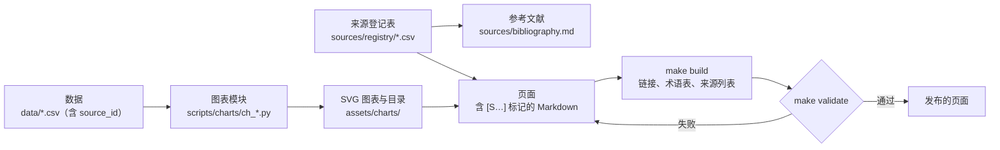

每个来源在登记表中占一行，编号取自所属章节的号段（例如本综合篇使用 S1500–S1999）。数据行在
`source_id` 列中引用这些编号，并在 `confidence` 列中标注 confirmed（已确认）、reported（有报道）、estimate（估计）
或 speculative（推测）。图表模块只读取 `data/`，并在每张图表的脚注中标注来源编号与数据截止日期。页面仅以
纯标记引用；`make build` 将其转为链接并重新生成每页的来源列表，因此页面无法引用未登记的来源。综合篇背后的
结论数据见 `data/x00_layer_verdicts.csv`，其图表见 `scripts/charts/ch_syn.py` [[S1500]](../sources/bibliography.md#s1500)。

</details>

> [!WARNING]
> **局限性——引用前请先阅读。**
> - **研究条件限制。** 构建环境阻断了对大多数一手来源（sec.gov、nvidia.com、amd.com 及多数分析师网站）的
>   直接页面抓取，并限制了网络搜索次数。因此许多事实是通过搜索摘要或监管文件的二手转载核对的。746 行数据
>   （26%）和 132 个来源已在 [docs/VERIFY_QUEUE.md](../docs/VERIFY_QUEUE.md) 中标记为待复核。
> - **判断均有标注。** 护城河评分、风险评分、TCO 输出与情景测算均为本资料库自身的分析（🔴 或“估计”），
>   而非公司数据 [[S1500]](../sources/bibliography.md#s1500)[[S18027]](../sources/bibliography.md#s18027)[[S14000]](../sources/bibliography.md#s14000)。
> - **仅使用公开信息。** 本资料库未使用任何英伟达、高通或客户的保密信息。涉及高通的内容依据公告与监管文件，
>   并以问题而非建议的形式呈现。
> - **时点性。** 数据截至 2026-11-05。Q3 FY2027 业绩（2026-11-17）与 GTC DC 主题演讲（2026-12-01）
>   均在此之后 [[S17005]](../sources/bibliography.md#s17005)[[S90047]](../sources/bibliography.md#s90047)。

## 🛠️ 构建与校验

```bash
make setup      # 安装 Python + Node 工具链（见 requirements.txt 与 package.json）
make charts     # 从 data/*.csv 重新生成全部图表，并重写图表目录
make diagrams   # 将 diagrams/src 中的 D2 / Graphviz / Mermaid 源文件渲染到 assets/diagrams
make tco        # 重新运行第 14 章 TCO 模型（scripts/tco/）
make build      # 参考文献、术语表、引用与链接规范化、PROGRESS 统计
make validate   # 引用、链接、替代文字、可视化配额与 Mermaid 渲染检查
```

规范：[风格指南](../docs/STYLE_GUIDE.md) · [撰稿人说明](../docs/AGENT_BRIEF.md) ·
[规格说明](../docs/MASTER_PROMPT.md) · [页面模板](../docs/TEMPLATES.md)。

## 🎯 企业发展视角

1. **从护城河地图而非规格表入手。** [速查表](CHEATSHEET.md)用一张表展示英伟达的领先在哪些层级深厚、受到挑战
   或单薄，以及差距是否在扩大；12 层中有 6 层差距在收窄 🔴
   [[S1500]](../sources/bibliography.md#s1500)。
2. **以英伟达降价后的价格为挑战者定价。** 英伟达可将 GB300 价格下调 ~20% 而仍保持 ~66% 的毛利率
   （🔴 第 14 章估计）[[S14000]](../sources/bibliography.md#s14000)。第二供应商的商业论证应能经受住这一步。
3. **价值池与护城河位于不同层级。** 英伟达在 GPU、[纵向扩展（scale-up）](glossary.md#scale-up)、网络和机架上赚钱，
   在软件与供应上设防。每一层的价值链页面都列出了该层的非上市公司。
4. **涉及高通（Qualcomm）的具体问题**（逐层看是合作、竞争还是互补，仅基于公开信息），请参阅
   [第 19 章](cross-cutting/19-implications-for-qualcomm.md)。

## 📚 来源（Sources）

<!-- Auto-generated from the [S…] citations on this page by `make build`. Edit sources/registry/*.csv, not this list. -->

- [**S1**](../sources/bibliography.md#s1) NVIDIA Corporation via SEC EDGAR, *NVIDIA Announces Financial Results for Fourth Quarter and Fiscal 2026 (Form 8-K exhibit 99.1)*, 2026-02-25. [Link](https://www.sec.gov/Archives/edgar/data/1045810/000104581026000019/q4fy26pr.htm)
- [**S3**](../sources/bibliography.md#s3) StorageNewsletter, *NVIDIA Q2 Fiscal 2027 results coverage: revenue $96.2B*, 2026-08-27. [Link](https://www.storagenewsletter.com/2026/08/27/nvidia-fiscal-2q27-financial-results/)
- [**S109**](../sources/bibliography.md#s109) NVIDIA Blog, *NVIDIA GTC 2026: Live Updates on What's Next in AI*, 2026-03-16. [Link](https://blogs.nvidia.com/blog/gtc-2026-news/)
- [**S144**](../sources/bibliography.md#s144) AMD Newsroom, *AMD Unveils Vision for an Open AI Ecosystem, Detailing New Silicon, Software and Systems at Advancing AI 2025*, 2025-06-12. [Link](https://www.amd.com/en/newsroom/press-releases/2025-6-12-amd-unveils-vision-for-an-open-ai-ecosystem-detai.html)
- [**S200**](../sources/bibliography.md#s200) NVIDIA, *NVIDIA NVLink and NVLink Switch (product page with NVLink and NVLink Switch specification tables)*, 2026-09. [Link](https://www.nvidia.com/en-us/data-center/nvlink/)
- [**S305**](../sources/bibliography.md#s305) DatacenterDynamics, *Nvidia's Rubin Ultra NVL576 rack expected to be 600kW, coming second half of 2027*, 2025-03-19. [Link](https://datacenterdynamics.com/en/news/nvidias-rubin-ultra-nvl576-rack-expected-to-be-600kw-coming-second-half-of-2027)
- [**S310**](../sources/bibliography.md#s310) AnandTech (Ryan Smith), *NVIDIA unveils the DGX-1 HPC server: 8 Teslas, 3U, Q2 2016*, 2016-04-05. [Link](https://www.anandtech.com/show/10229)
- [**S324**](../sources/bibliography.md#s324) fal.ai, *NVIDIA GB200 price in 2026: what a GPU, a tray and an NVL72 rack cost*, 2026. [Link](https://fal.ai/learn/serverless/nvidia-gb200-price)
- [**S332**](../sources/bibliography.md#s332) Tiger Brokers (iTiger), *Morgan Stanley's BOM analysis of NVIDIA's Rubin: GPU share declines; PCB, MLCC and ABF substrate values soar*, 2026-05-20. [Link](https://www.itiger.com/news/1188068712)
- [**S379**](../sources/bibliography.md#s379) TrendForce News, *TSMC CoWoS capacity and customer allocation estimates (TrendForce / Morgan Stanley, as reported)*, 2025. [Link](https://www.trendforce.com/news/)
- [**S398**](../sources/bibliography.md#s398) NVIDIA Investor Relations, *NVIDIA Q2 FY2026 earnings call (2025-08-27): AI factory economics commentary*, 2025-08-27. [Link](https://investor.nvidia.com/events-and-presentations/events-and-presentations/default.aspx)
- [**S402**](../sources/bibliography.md#s402) NVIDIA Corporation via SEC EDGAR (Colette Kress), *CFO Commentary on Fourth Quarter and Fiscal 2026 Results (Form 8-K exhibit 99.2)*, 2026-02-25. [Link](https://www.sec.gov/Archives/edgar/data/1045810/000104581026000019/q4fy26cfocommentary.htm)
- [**S405**](../sources/bibliography.md#s405) NVIDIA Corporation via SEC EDGAR, *NVIDIA Announces Financial Results for Second Quarter Fiscal 2027 (Form 8-K exhibit 99.1)*, 2026-08-26. [Link](https://www.sec.gov/Archives/edgar/data/0001045810/000104581026000073/q2fy27pr.htm)
- [**S406**](../sources/bibliography.md#s406) NVIDIA Corporation (Colette Kress), *CFO Commentary on Second Quarter Fiscal 2027 Results*, 2026-08-26. [Link](https://s201.q4cdn.com/141608511/files/doc_financials/2027/Q227/Q2FY27-CFO-Commentary.pdf)
- [**S407**](../sources/bibliography.md#s407) NVIDIA Corporation via SEC EDGAR, *NVIDIA Corporation Form 10-Q for quarter ended July 26, 2026*, 2026-08-28. [Link](https://www.sec.gov/Archives/edgar/data/1045810/000104581026000075/nvda-20260726.htm)
- [**S408**](../sources/bibliography.md#s408) NVIDIA Corporation, *NVIDIA Corp. (NVDA) Q2 Fiscal 2027 earnings call transcript (26 August 2026)*, 2026-08-26. [Link](https://s201.q4cdn.com/141608511/files/content_files/TRANSCRIPT_-NVIDIA-Corp-NVDA-US-Q2-2027-Earnings-Call-26-August-2026-5_00-PM-ET.pdf)
- [**S416**](../sources/bibliography.md#s416) NVIDIA Corporation via SEC EDGAR, *NVIDIA Corporation Form 10-K for fiscal year ended January 26, 2025*, 2025-02-26. [Link](https://www.sec.gov/Archives/edgar/data/1045810/000104581025000023/nvda-20250126.htm)
- [**S502**](../sources/bibliography.md#s502) Tom's Hardware, *Nvidia updates data center roadmap with Rosa CPU and stacked Feynman GPUs; optical NVLink; Groq LPUs with NVFP4 and NVLink also on deck*, 2026-03-17. [Link](https://www.tomshardware.com/pc-components/gpus/nvidia-updates-data-center-roadmap-with-rosa-cpu-and-stacked-feynman-gpus-optical-nvlink-groq-lpus-with-nvfp4-and-nvlink-also-on-deck)
- [**S507**](../sources/bibliography.md#s507) Tom's Hardware, *Nvidia's Kyber rack for Rubin Ultra slips to 2028*, 2026-07-06. [Link](https://www.tomshardware.com/pc-components/gpus/nvidias-kyber-rack-for-rubin-ultra-slips-to-2028)
- [**S525**](../sources/bibliography.md#s525) NVIDIA Developer, *CUDA Toolkit Archive*, 2026. [Link](https://developer.nvidia.com/cuda-toolkit-archive)
- [**S580**](../sources/bibliography.md#s580) vLLM project (GitHub), *vLLM README and installation docs — supported hardware*, 2026-11. [Link](https://github.com/vllm-project/vllm/blob/main/docs/getting_started/installation/README.md)
- [**S587**](../sources/bibliography.md#s587) PyTorch (GitHub: pytorch/pytorch), *PyTorch README — building with CUDA, ROCm and Intel GPU support*, 2026-11. [Link](https://github.com/pytorch/pytorch/blob/main/README.md)
- [**S621**](../sources/bibliography.md#s621) SemiAnalysis (InferenceX-app repository), *InferenceX public API snapshot (benchmarks.json and benchmarks-history.json fixtures)*, 2026-10-17. [Link](https://github.com/SemiAnalysisAI/InferenceX-app/tree/main/packages/app/cypress/fixtures/api)
- [**S622**](../sources/bibliography.md#s622) SemiAnalysis (InferenceX-app repository), *InferenceX hardware registry: TCO per GPU-hour by SKU (SemiAnalysis July 2026 pricing surveys and AI Cloud TCO Model)*, 2026-07. [Link](https://github.com/SemiAnalysisAI/InferenceX-app/blob/main/packages/constants/src/gpu-keys.ts)
- [**S633**](../sources/bibliography.md#s633) SemiAnalysis, *DeepSeekV4 1.6T Day 0 to Day 43 Performance Over Time — Huawei, GB300 NVL72, MI355X, B200*, 2026-06-09. [Link](https://github.com/SemiAnalysisAI/InferenceX-app/blob/main/packages/app/content/blog/deepseekv4-16t-day-0-to-day-43-performance.mdx)
- [**S646**](../sources/bibliography.md#s646) NVIDIA TensorRT-LLM team, *Optimizing DeepSeek R1 Throughput on NVIDIA Blackwell GPUs: A Deep Dive for Developers (TensorRT-LLM tech blog 3)*, 2025-05-30. [Link](https://github.com/NVIDIA/TensorRT-LLM/blob/main/docs/source/blogs/tech_blog/blog03_Optimizing_DeepSeek_R1_Throughput_on_NVIDIA_Blackwell_GPUs.md)
- [**S653**](../sources/bibliography.md#s653) Anthropic, *Expanding our use of Google Cloud TPUs and Services*, 2025-10-23. [Link](https://www.anthropic.com/news/expanding-our-use-of-google-cloud-tpus-and-services)
- [**S660**](../sources/bibliography.md#s660) Broadcom Inc., *Broadcom Inc. Announces Fourth Quarter and Fiscal Year 2024 Financial Results*, 2024-12-12. [Link](https://investors.broadcom.com/financial-information/quarterly-results)
- [**S661**](../sources/bibliography.md#s661) Broadcom Inc., *Broadcom Inc. Announces Fourth Quarter and Fiscal Year 2025 Financial Results*, 2025-12-11. [Link](https://investors.broadcom.com/financial-information/quarterly-results)
- [**S663**](../sources/bibliography.md#s663) AMD, *AMD Reports Fourth Quarter and Full Year 2024 Financial Results*, 2025-02-04. [Link](https://ir.amd.com/news-events/press-releases)
- [**S1500**](../sources/bibliography.md#s1500) nvidia_deep_dive_claude repository, *Repo analysis: synthesis verdicts by layer (moat score, gap trend, NVIDIA value capture) and thesis metrics*, 2026-11-05. [Link](https://github.com/FrankHuang94/nvidia_deep_dive_claude/blob/main/data/x00_layer_verdicts.csv)
- [**S1501**](../sources/bibliography.md#s1501) nvidia_deep_dive_claude repository, *Repo statistics: words, visuals, sources, data files and charts (scripts/validate/stats.py and file counts, 2026-11-05)*, 2026-11-05. [Link](https://github.com/FrankHuang94/nvidia_deep_dive_claude/blob/main/PROGRESS.md)
- [**S2516**](../sources/bibliography.md#s2516) Broadcom Inc. via SEC EDGAR, *Broadcom Inc. Announces Third Quarter Fiscal Year 2026 Financial Results (Form 8-K exhibit 99.1)*, 2026-09. [Link](https://www.sec.gov/Archives/edgar/data/0001730168/000173016826000076/avgo-08022026x8kxex99.htm)
- [**S10035**](../sources/bibliography.md#s10035) NVIDIA (GitHub: NVIDIA-Omniverse/PhysX), *NVIDIA PhysX SDK README*, 2025. [Link](https://github.com/NVIDIA-Omniverse/PhysX/blob/main/README.md)
- [**S14000**](../sources/bibliography.md#s14000) nvidia_deep_dive_claude repository, *Repo analysis: chapter 14 TCO model (scripts/tco/tco_model.py with data/x14_tco_scenarios.csv)*, 2026-11-05. [Link](https://github.com/FrankHuang94/nvidia_deep_dive_claude/blob/main/scripts/tco/README.md)
- [**S15014**](../sources/bibliography.md#s15014) nvidia_deep_dive_claude repository, *Repo analysis: Chapter 15A competitive-landscape calculations (gap-to-flagship ratios, implied AMD commitment value, hyperscaler wallet shares, breadth vs depth)*, 2026-11-05. [Link](https://github.com/FrankHuang94/nvidia_deep_dive_claude/blob/main/cross-cutting/15-competitive-landscape/index.md)
- [**S16015**](../sources/bibliography.md#s16015) NVIDIA Corporation via SEC EDGAR, *NVIDIA Corp Form 10-K405 for fiscal year 2001*, 2001-04. [Link](https://www.sec.gov/Archives/edgar/data/0001045810/000101287001500492/d10k405.txt)
- [**S17005**](../sources/bibliography.md#s17005) NVIDIA Newsroom, *NVIDIA Sets Conference Call for Third-Quarter Financial Results*, 2026-10-28. [Link](https://nvidianews.nvidia.com/news/nvidia-sets-conference-call-for-third-quarter-financial-results-6928873)
- [**S18007**](../sources/bibliography.md#s18007) tomtunguz.com (Tomasz Tunguz), *Circular financing: does Nvidia's $110B bet echo the telecom bubble?*, 2025-11. [Link](https://tomtunguz.com/nvidia_nortel_vendor_financing_comparison/)
- [**S18027**](../sources/bibliography.md#s18027) nvidia_deep_dive_claude repository, *Repo analysis: chapter 18 risk scores, financing ratios and valuation scenarios*, 2026-11-05. [Link](https://github.com/FrankHuang94/nvidia_deep_dive_claude/blob/main/cross-cutting/18-vulnerabilities-and-bear-case.md)
- [**S33005**](../sources/bibliography.md#s33005) NVIDIA, *NVIDIA Vera Rubin NVL72 (product page and specifications)*, 2026. [Link](https://www.nvidia.com/en-us/data-center/vera-rubin-nvl72/)
- [**S33007**](../sources/bibliography.md#s33007) Dataconomy, *Nvidia Quietly Cuts Vera Rubin HBM4 And NVLink Bandwidth Specs*, 2026-11-02. [Link](https://dataconomy.com/2026/11/02/nvidia-quietly-cuts-vera-rubin-hbm4-and-nvlink-bandwidth/)
- [**S33010**](../sources/bibliography.md#s33010) NVIDIA, *NVIDIA V100 Tensor Core GPU datasheet*, 2018. [Link](https://images.nvidia.com/content/technologies/volta/pdf/volta-v100-datasheet-update-us-1165301-r5.pdf)
- [**S35018**](../sources/bibliography.md#s35018) Tom's Hardware, *Nvidia announces Rubin GPUs in 2026, Rubin Ultra in 2027, Feynman also added to roadmap*, 2025-03-18. [Link](https://www.tomshardware.com/pc-components/gpus/nvidia-announces-rubin-gpus-in-2026-rubin-ultra-in-2027-feynam-after)
- [**S90047**](../sources/bibliography.md#s90047) NVIDIA, *NVIDIA GTC DC 2026 (November 30 – December 3, 2026)*, 2026. [Link](https://www.nvidia.com/en-us/gtc-dc/topics/ai-policy/)
- [**S90053**](../sources/bibliography.md#s90053) Dell'Oro Group, *Ethernet more than doubles size of InfiniBand as the leading fabric for AI scale-out networks in 2025*, 2026. [Link](https://www.delloro.com/news/ethernet-more-than-doubles-size-of-infiniband-as-the-leading-fabric-for-ai-scale-out-networks-in-2025/)
- [**S90054**](../sources/bibliography.md#s90054) Dell'Oro Group, *Ethernet extends lead in AI scale-out networks despite strong InfiniBand rebound*, 2026. [Link](https://www.delloro.com/news/ethernet-extends-lead-in-ai-scale-out-networks-despite-strong-infiniband-rebound/)
- [**S90071**](../sources/bibliography.md#s90071) Crypto Briefing, *Nvidia CFO emphasizes neutral partnership with AI customers as company diversifies beyond hyperscalers*, 2026. [Link](https://cryptobriefing.com/nvidia-cfo-neutral-ai-partnership/)
- [**S90073**](../sources/bibliography.md#s90073) FourWeekMBA, *NVIDIA's $99 billion investment portfolio and the circular financing loop at the center of AI*, 2026-08. [Link](https://fourweekmba.com/ai-nvidia-99-billion-investment-portfolio-circular-financing-ai/)
- [**S90085**](../sources/bibliography.md#s90085) Shacknews, *NVIDIA (NVDA) expects gross margin decrease over next two quarters*, 2026-08-26. [Link](https://www.shacknews.com/article/150499/nvidia-nvda-gross-margin-decrease-fy27)
- [**S90086**](../sources/bibliography.md#s90086) Implicator.ai, *Nvidia's 70 percent growth forecast and margin outlook*, 2026-08-27. [Link](https://www.implicator.ai/nvidia-70-percent-growth-forecast-margin-outlook.md)
- [**S90093**](../sources/bibliography.md#s90093) Tom's Hardware, *AMD takes the wraps off its Instinct MI455X AI accelerator: CDNA 5 and Helios rack-scale architecture*, 2026. [Link](https://www.tomshardware.com/pc-components/gpus/amd-takes-the-wraps-off-its-instinct-mi455x-ai-accelerator-cdna-5-and-helios-rack-scale-architecture-combine-to-take-the-fight-to-nvidia-in-the-data-center)
