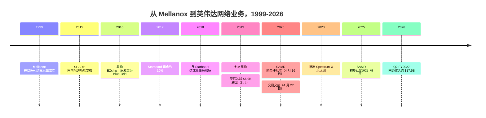
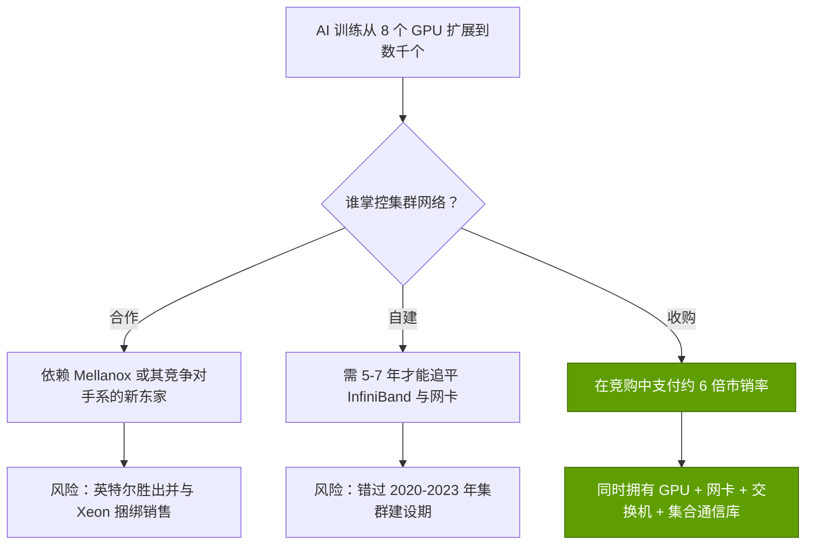
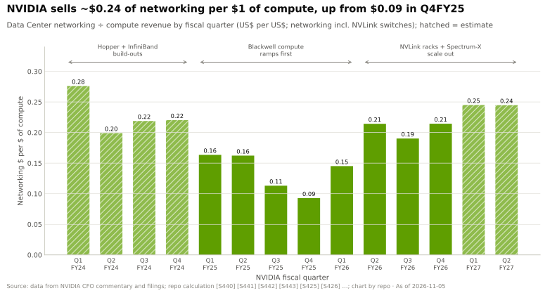
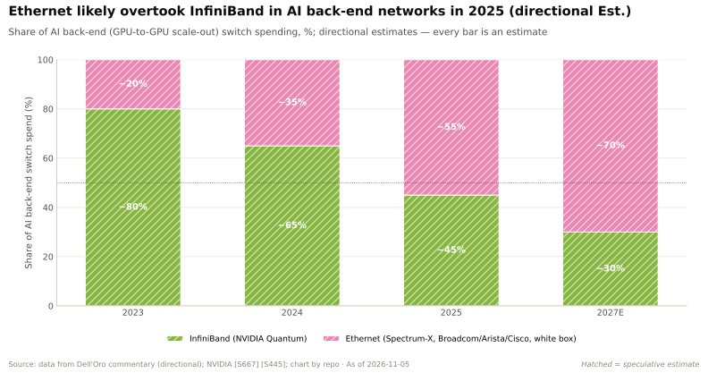
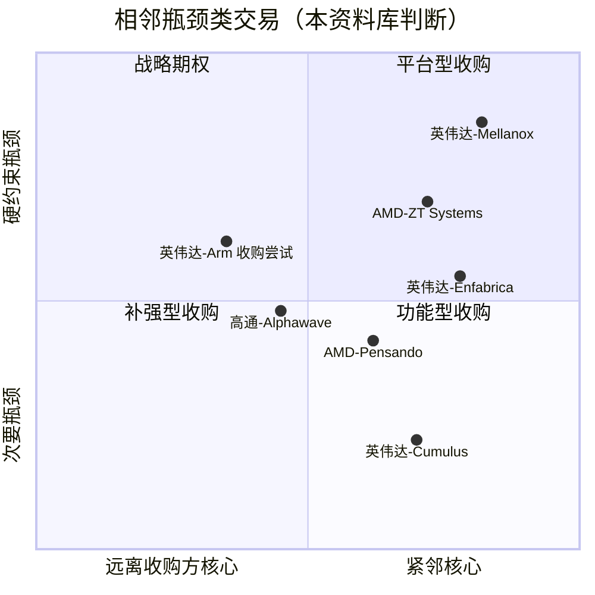

# CS1 · Mellanox：最佳交易

> [!NOTE]
> 本页为英文原文的简体中文参考译文，仅供参考；如有出入，以[英文原文](../../case-studies/CS1-mellanox-the-best-deal.md "English original")为准。

案例研究 · 阅读约 14 分钟 · 最后核实：2026-11-05

## ⚡ 要点速览

- **英伟达（NVIDIA）买下了紧邻自己的瓶颈。** Mellanox 是一家以色列 [InfiniBand](../glossary.md#infiniband) 与以太网芯片厂商，2019 年收入 $1.33B，毛利率 65.1% [[S21000]](../../sources/bibliography.md#s21000)。英伟达于 2019-03-11 宣布以全现金 $6.9B（每股 $125）收购 [[S464]](../../sources/bibliography.md#s464)。
- **这是一场激烈竞购的胜出。** [激进投资者](../glossary.md#activist-investor) Starboard 在 2018 年迫使董事会就范 [[S21006]](../../sources/bibliography.md#s21006)。随后共有七家竞购方参与，据报道英特尔（Intel）出价约 $6B [[S6508]](../../sources/bibliography.md#s6508)[[S6509]](../../sources/bibliography.md#s6509)。
- **中国险些让交易搁浅。** 中国[国家市场监督管理总局（SAMR）](../glossary.md#samr)于 2020-04-16 附条件批准后，交易于 2020-04-27 完成交割，距宣布已过去 413 天 [[S21002]](../../sources/bibliography.md#s21002)[[S21003]](../../sources/bibliography.md#s21003)[[S21005]](../../sources/bibliography.md#s21005)。
- **回报远超收购价。** 英伟达网络业务 FY2026 收入约 $31.4B，约为 Mellanox 2019 年收入的 24 倍；仅 Q2 FY2027 一个季度就达约 $17.5B [[S402]](../../sources/bibliography.md#s402)[[S21008]](../../sources/bibliography.md#s21008)[[S408]](../../sources/bibliography.md#s408)。该业务线目前还包括 Mellanox 从未销售过的 NVLink 交换机。
- **即便采用严苛假设，回本也很快。** 若只把一半网络业务归功于 Mellanox，并按其自身 65% 的毛利率计算，累计毛利在 FY2025 即超过收购价，到 2026 年年中达到约 $30B（🔴 本资料库模型）[[S21014]](../../sources/bibliography.md#s21014)。
- **风险真实存在，部分至今仍在。** 市场已从 InfiniBand 转向以太网（2026 年第一季度以太网约占 AI 后端交换机销售额的三分之二）[[S90054]](../../sources/bibliography.md#s90054)。英伟达在以色列有 5,000 余名员工，是其美国以外最大的研发基地 [[S21011]](../../sources/bibliography.md#s21011)。SAMR 于 2025 年 9 月初步认定英伟达违反了 2020 年的附加条件 [[S9505]](../../sources/bibliography.md#s9505)。

## 1. 背景

2019 年的 Mellanox 是一家盈利的细分市场供应商。它向超级计算机销售 InfiniBand 交换机和适配器，向云服务商销售以太网适配器（[ConnectX](../glossary.md#connectx)）。InfiniBand 是专为集群打造的网络：数据传输延迟极低且可预测，并允许一台机器直接写入另一台机器的内存。其交换机还能在网络内部执行运算（[SHARP](../glossary.md#sharp)，2015 年起）[[S273]](../../sources/bibliography.md#s273)[[S6013]](../../sources/bibliography.md#s6013)。2016 年，Mellanox 以约 $811M 收购 EZchip，后者发展成为 [BlueField](../glossary.md#bluefield) [数据处理器（DPU）](../glossary.md#dpu)产品线 [[S7507]](../../sources/bibliography.md#s7507)[[S7509]](../../sources/bibliography.md#s7509)。

股东们并不安分。Starboard Value 自 2017 年 11 月起建仓至约 10.5–10.7%，并于 2018 年 1 月提名了一整套董事候选人 [[S21007]](../../sources/bibliography.md#s21007)。2018 年 6 月达成的和解撤换了三名董事，其中两名由 Starboard 提名 [[S21006]](../../sources/bibliography.md#s21006)。出售流程随即启动。据报道，英特尔、赛灵思（Xilinx）和微软（Microsoft）都曾是潜在买家 [[S6509]](../../sources/bibliography.md#s6509)。

对英伟达而言，其逻辑在于 AI 训练的走向。训练正从单台 8-GPU 服务器扩展到数百乃至数千台服务器组成的集群。等待网络的 GPU 就是闲置的 GPU，而网络掌握在别人手中。英伟达已经掌控了服务器内部的互连（[NVLink](../glossary.md#nvlink)）；服务器之间的[横向扩展（scale-out）](../glossary.md#scale-out)网络是缺失的一块拼图。

就当时的英伟达而言，这是一笔大赌注。其数据中心业务 FY2020 收入约 $2.98B [[S2]](../../sources/bibliography.md#s2)。因此，$6.9B 的收购价约相当于 2.3 年的数据中心收入，且全部以现金支付，买下的业务主要面向超级计算机和云客户，而非 AI 实验室。2019 年 3 月的投资者完全有理由质疑：一家 GPU 公司为何要以约 6 倍市销率收购一家交换机公司？

> [!TIP]
> **算例 —— 英伟达支付了多少倍估值。** 宣布交易时，最近一个完整财年为 2018 年，收入约 $1.09B [[S21000]](../../sources/bibliography.md#s21000)。$6.9B ÷ $1.09B ≈ **6.3 倍历史市销率** [[S464]](../../sources/bibliography.md#s464)。按 2019 年 $1.33B 的收入计算，倍数降至 5.2 倍；按 2019 年 $866.5M 的毛利计算，约为 8.0 倍 [[S21000]](../../sources/bibliography.md#s21000)。对于一家增速 22%、毛利率 65% 的硬件公司，这是足额定价，而非捡便宜。回报来自英伟达对这项资产的运用，而不是低价买入。

## 2. 决策

英伟达选择了收购，而非自建或合作。它将自己的报价从 2019 年 2 月下旬的每股 $115 提高到 $125 才最终胜出 [[S6508]](../../sources/bibliography.md#s6508)[[S464]](../../sources/bibliography.md#s464)。

| 交易条款 | 数值 | 来源 |
|---|---|---|
| 价格 | 股权价值 $6.9B，全现金，每股 $125（含承接的股权激励约 $7.1B） | [[S464]](../../sources/bibliography.md#s464) |
| 竞争报价 | 英特尔约 $6B；另有报道称微软与赛灵思参与 | [[S6509]](../../sources/bibliography.md#s6509) |
| 宣布 → 交割 | 2019-03-11 → 2020-04-27（413 天） | [[S464]](../../sources/bibliography.md#s464)[[S21005]](../../sources/bibliography.md#s21005) |
| 最后一项审批 | 中国 SAMR，2020-04-16，附[行为性救济措施](../glossary.md#behavioural-remedy) | [[S21002]](../../sources/bibliography.md#s21002)[[S21003]](../../sources/bibliography.md#s21003) |
| 标的规模 | 2019 年收入 $1.33B；毛利率 65.1% | [[S21000]](../../sources/bibliography.md#s21000) |

真正的约束在中国。Mellanox 约在 2019 年 4 月向 SAMR 提交申报 [[S21004]](../../sources/bibliography.md#s21004)。直到 2020-04-10 提出救济措施后才获批准：不得捆绑销售，在华销售不得附加不合理条件 [[S21003]](../../sources/bibliography.md#s21003)。美国与欧盟的批准早已到手，中国是最后一关 [[S6510]](../../sources/bibliography.md#s6510)[[S21003]](../../sources/bibliography.md#s21003)。

🔧 技术细节：中国附加的条件，以及它们为何卷土重来

SAMR 的条件属于行为性而非结构性救济。英伟达保留了全部资产，但就其在华销售方式作出承诺。据报道，条件涵盖 GPU 与 Mellanox 设备的捆绑销售、持续供货以及与第三方加速器的互操作性 [[S21003]](../../sources/bibliography.md#s21003)[[S21004]](../../sources/bibliography.md#s21004)。审查期间曾有竞争对手提出反对 [[S21013]](../../sources/bibliography.md#s21013)。行为性救济会在监管机构手中留下一根杠杆。2024 年 12 月，SAMR 启动调查；2025-09-15，SAMR 发布初步认定，称英伟达违反了 2020 年的附加条件；罚款可达上一年度在华销售额的 1–10% [[S9505]](../../sources/bibliography.md#s9505)。这笔交易的监管风险并未随交割而终结。更宏观的中国形势参见 [CS6](CS6-china-export-controls-h20-and-beyond.md)。

## 3. 结果（用数据说话）

英伟达并不单独披露“Mellanox”业务线。公司表示，Mellanox 约占 FY2021 收入的 10%，即在被收购后的九个月内贡献约 $1.7B [[S418]](../../sources/bibliography.md#s418)[[S2]](../../sources/bibliography.md#s2)。英伟达未披露 FY2022–FY2023 的网络收入。从 FY2024 起，数据中心网络业务线开始可见：约 $8.6B（估计）、$13.0B，然后是 FY2026 的约 $31.4B [[S416]](../../sources/bibliography.md#s416)[[S402]](../../sources/bibliography.md#s402)。仅 FY2027 上半年就带来约 $32.3B [[S21009]](../../sources/bibliography.md#s21009)。

对任何回本测算而言，有一项保留意见最为关键。网络业务线包含 GB200 与 GB300 机架所用的 NVLink 交换托盘 [[S402]](../../sources/bibliography.md#s402)。这是英伟达自有的[纵向扩展（scale-up）](../glossary.md#scale-up)技术，而非 Mellanox 的技术。据 Calcalist 估计，英伟达约 70% 的互连业务依赖 Mellanox 及其以色列研发中心 [[S21009]](../../sources/bibliography.md#s21009)。因此，下文模型分别按 50%、70% 和 100% 将该业务线归功于 Mellanox。

> [!TIP]
> **算例 —— 交易回本，三种算法。** 以网络收入为起点：FY2021 约 $1.67B [[S418]](../../sources/bibliography.md#s418)；FY2022–FY2023 按每年 $2.2B 的下限设定（未披露，🔴）；随后为 $8.57B、$13.0B、$31.4B，以及 FY2027 上半年的 $32.3B [[S416]](../../sources/bibliography.md#s416)[[S402]](../../sources/bibliography.md#s402)[[S21009]](../../sources/bibliography.md#s21009)。
> - **看空情景（50% 源自 Mellanox × 65.1% 毛利率）：** 归于该交易的毛利在 FY2025 超过 $6.9B 的收购价，到 2026 年 7 月达到约 $30B，为收购价的 **4.3 倍**。
> - **基准情景（70% × 65.1%）：** 约 $42B，约 6 倍。
> - **看多情景（100% × 75%）：** 在 FY2024 超过收购价，达到约 $68B，约 10 倍。
>
> 若将收购价按每年 9% 复利计算，看空情景在 FY2026 越过这一门槛，约为交割后第六年（🔴 本资料库模型）[[S21014]](../../sources/bibliography.md#s21014)。毛利不等于现金流：网络业务的研发和销售费用未计入。即便如此，看空情景仅 FY2026 一年就计入约 $10B 毛利，超过英伟达 FY2026 全部研发预算 $18.5B 的一半 [[S401]](../../sources/bibliography.md#s401)。

| 交易经济性指标 | 数值 | 依据 |
|---|---|---|
| 收购价 ÷ 宣布时历史收入 | 约 6.3 倍（2018 年收入） | [[S464]](../../sources/bibliography.md#s464)[[S21000]](../../sources/bibliography.md#s21000) |
| 收购价 ÷ Mellanox 2019 年毛利 | 约 8.0 倍 | [[S21000]](../../sources/bibliography.md#s21000) |
| FY2026 网络收入 vs Mellanox 2019 年收入 | 约 $31.4B vs $1.33B，约 24 倍 | [[S402]](../../sources/bibliography.md#s402)[[S21000]](../../sources/bibliography.md#s21000) |
| [回收期](../glossary.md#payback-period)，看空情景（不折现 / 按 9% 折现） | FY2025 / FY2026 | 🔴 [[S21014]](../../sources/bibliography.md#s21014) |
| 收购价占单季网络收入（Q2 FY2027）的比例 | 约 $17.5B 的约 39% | [[S408]](../../sources/bibliography.md#s408) |

产品线的演变显示了这一业务在六年间走了多远。

| | 交易时的 Mellanox（2019） | 英伟达网络业务（2026） |
|---|---|---|
| 最快网卡 | ConnectX-6，200 Gb/s [[S273]](../../sources/bibliography.md#s273) | ConnectX-9，1.6 Tb/s，每个 Rubin GPU 配一块 [[S33004]](../../sources/bibliography.md#s33004) |
| InfiniBand 交换机 | Quantum HDR，200 Gb/s 端口 [[S273]](../../sources/bibliography.md#s273) | Quantum-X800，800 Gb/s 端口；另有硅光版本 [[S264]](../../sources/bibliography.md#s264)[[S90048]](../../sources/bibliography.md#s90048) |
| 以太网 | 面向云与企业的 Spectrum 交换机 [[S273]](../../sources/bibliography.md#s273) | 面向 AI 集群的 Spectrum-X，同比增长 2.6 倍 [[S408]](../../sources/bibliography.md#s408) |
| 主要客户 | 超级计算机、云服务器网卡插槽 | 超大规模云厂商、AI 实验室、新兴云服务商（xAI、Meta、甲骨文（Oracle））[[S6000]](../../sources/bibliography.md#s6000)[[S6009]](../../sources/bibliography.md#s6009) |
| 年收入 | $1.33B [[S21000]](../../sources/bibliography.md#s21000) | 约 $31.4B（FY2026），含 NVLink 交换机 [[S402]](../../sources/bibliography.md#s402) |

这笔交易还改变了英伟达的销售内容。网络与计算捆绑出货：Q2 FY2027 每 $1 计算收入约带动 $0.24 网络收入（估计）[[S408]](../../sources/bibliography.md#s408)[[S405]](../../sources/bibliography.md#s405)。

## 4. 为何奏效（或为何未能奏效）

**机制 1：由一家厂商调优整条数据通路。** 每个训练步骤都以一次[全规约（all-reduce）](../glossary.md#all-reduce)结束，所有 GPU 相互交换梯度。最慢的数据包决定整体节奏。英伟达如今同时设计 GPU、[网卡（NIC）](../glossary.md#nic)、交换机和集合通信库（[NCCL](../glossary.md#nccl)）[[S10000]](../../sources/bibliography.md#s10000)。SHARP 这类在交换机内部完成部分全规约运算的功能，需要这四个部分协同配合 [[S6013]](../../sources/bibliography.md#s6013)。可以将其想象为一场接力赛：同一位教练训练每一名选手，还亲自设计交接棒的方式。

**机制 2：[配套率（attach rate）](../glossary.md#attach-rate)。** 参考设计为每个 GPU 配一块 ConnectX 适配器，在 Rubin 一代已达 1.6 Tb/s [[S33004]](../../sources/bibliography.md#s33004)。购买 GPU 的客户往往也会购买适配器，并常常连带购买交换机。

**机制 3：转向以太网。** [超大规模云厂商](../glossary.md#hyperscaler)抵触 InfiniBand。英伟达在 2023 年 5 月以 [Spectrum-X](../glossary.md#spectrum-x) 作出回应——一款与 [SuperNIC](../glossary.md#supernic) 配套的以太网交换机 [[S271]](../../sources/bibliography.md#s271)。它赢得了 xAI 的 Colossus，随后又拿下 Meta 和甲骨文 [[S6000]](../../sources/bibliography.md#s6000)[[S6009]](../../sources/bibliography.md#s6009)，并在 Q2 FY2027 实现同比 2.6 倍的增长 [[S408]](../../sources/bibliography.md#s408)。若没有这次转向，Mellanox 的 InfiniBand 业务会随其份额一同萎缩。详见 [Spectrum-X 以太网](../layers/06-scale-out-scale-across-networking/spectrum-x-ethernet.md)与 [InfiniBand 与 SHARP](../layers/06-scale-out-scale-across-networking/infiniband-and-sharp.md)。

**机制 4：时机。** 交易于 2020 年 4 月交割。GPT-3 时代的集群以及 2023 年的 H100 建设潮，所需要的恰恰是 Mellanox 所销售的产品。运气与远见同样重要。

**反事实推演（🔴 分析）。** 假如英特尔以据报道的约 $6B 胜出 [[S6509]](../../sources/bibliography.md#s6509)，英伟达最大的集群将运行在其 CPU 竞争对手所拥有的网络上。英伟达很可能会进一步延伸 NVLink，并与博通（Broadcom）合作开发以太网。它仍会保有 GPU 业务，但会同时失去网络收入以及对整个集群进行协同设计的能力。

**哪些环节可能出错，且至今仍可能出错：**

- **协议转移。** 2025 年的两年前，InfiniBand 约占 AI 后端交换机销售额的 80%；到 2026 年第一季度，以太网已占约三分之二 [[S90053]](../../sources/bibliography.md#s90053)[[S90054]](../../sources/bibliography.md#s90054)。英伟达靠自建以太网产品保住了席位。博通率先出货 102.4 Tb/s 交换机，现又推出 800G AI 网卡 [[S274]](../../sources/bibliography.md#s274)[[S280]](../../sources/bibliography.md#s280)。
- **整合。** Spectrum-X 在交割三年后才问世 [[S271]](../../sources/bibliography.md#s271)。若整合更慢，以太网市场将拱手让给博通和 Arista。
- **对以色列的集中依赖。** 英伟达在以色列拥有 5,000 余名员工，是其美国以外最大的研发中心，并正在建设可容纳多达 10,000 人的园区 [[S21011]](../../sources/bibliography.md#s21011)[[S21012]](../../sources/bibliography.md#s21012)。
- **监管尾部风险。** 就目前所见来源而言，SAMR 2025 年 9 月的认定尚未了结 [[S9505]](../../sources/bibliography.md#s9505)。

> [!TIP]
> **算例 —— 多少收入依赖以色列的工程团队。** Calcalist 估计约 70% 的互连业务依赖 Mellanox 及其以色列研发中心 [[S21009]](../../sources/bibliography.md#s21009)。将其应用于 FY2026 约 $31.4B 的网络收入 [[S402]](../../sources/bibliography.md#s402)，即每年约 $22B，约占英伟达 $215.9B 总收入的 10% [[S1]](../../sources/bibliography.md#s1)。若某次中断使一代交换机或网卡延迟六个月，约有 $11B 收入的确认时点将面临风险（🔴 本资料库测算）。

> [!NOTE]
> **🐂 看多观点：** 这笔交易让英伟达从芯片供应商转型为系统供应商。网络业务目前约占数据中心收入的 20%，并推动了协同设计的产品（[NVLink Fusion](../glossary.md#nvlink-fusion)、共封装光学），竞争对手必须逐一对标 [[S408]](../../sources/bibliography.md#s408)[[S6511]](../../sources/bibliography.md#s6511)。

> [!WARNING]
> **🐻 看空观点：** 最好的回报期可能已经过去。以太网标准（Ultra Ethernet、[ESUN](../glossary.md#esun)）让买家可以混用多家厂商的产品，而博通在交换机带宽上领先。若配套率回落至 FY2025 每美元计算收入约 $0.09 的水平，网络业务增速将落后于 GPU 增速 [[S90052]](../../sources/bibliography.md#s90052)[[S274]](../../sources/bibliography.md#s274)[[S443]](../../sources/bibliography.md#s443)。

## 5. 对企业发展（corp dev）的启示

**启示 1：在相邻瓶颈显而易见之前将其买下。** 按收入衡量，2019 年的 Mellanox 并非 AI 的瓶颈；随着集群规模扩大，它才变成了瓶颈。下图按相邻程度和瓶颈的约束强度对可比交易进行定位（🔴 本资料库判断）。

**启示 2：监管风险是价格的一部分。** 同一家公司在两年内赢下了一笔交易，又输掉了另一笔。

| | Mellanox（2019–20） | Arm（2020–22） |
|---|---|---|
| 价格 | $6.9B 现金 [[S464]](../../sources/bibliography.md#s464) | $40B 现金加股票 [[S465]](../../sources/bibliography.md#s465) |
| 与竞争对手的关系 | 部分竞争对手的供应商 | 几乎所有竞争对手的授权方 |
| 结果 | 历经 413 天、附行为性救济措施后交割 [[S21002]](../../sources/bibliography.md#s21002) | 2022-02-08 终止 [[S466]](../../sources/bibliography.md#s466) |
| 失败成本 | 不适用；2025 年 SAMR 认定 [[S9505]](../../sources/bibliography.md#s9505) | $1.36B 预付款核销 [[S466]](../../sources/bibliography.md#s466)[[S418]](../../sources/bibliography.md#s418) |

> [!TIP]
> **算例 —— 为监管风险定价。** Arm 的核销金额为 $1.36B，约为 $40B 标价的 3.4% [[S466]](../../sources/bibliography.md#s466)[[S465]](../../sources/bibliography.md#s465)。Mellanox 等待了 13.5 个月，按 9% 的资本成本计算，时间价值损失约为 $6.9B × 9% × 1.1 年 ≈ $0.7B（🔴）。收购竞争对手供应商的买家应预设冗长的审查、行为性条件以及数年后的执法风险，并将其计入价格。

**启示 3：不要因为最后一点加价而错失战略资产。** 英伟达最后一次加价，从每股 $115 提高到 $125 [[S6508]](../../sources/bibliography.md#s6508)[[S464]](../../sources/bibliography.md#s464)，成本约为 $6.9B × 10/125 ≈ $0.55B，还不到如今一年网络收入的 2% [[S402]](../../sources/bibliography.md#s402)。在争夺瓶颈资产的竞购中，多付钱的损失是有限的；被竞争对手买走的损失则没有上限。

**启示 4：买下的既是产品，更是团队。** 此后每一步网络布局（Spectrum-X、共封装光学、约 $900M 的 Enfabrica 团队交易、$4B 的激光器企业入股）都建立在 Mellanox 工程师的基础之上 [[S271]](../../sources/bibliography.md#s271)[[S475]](../../sources/bibliography.md#s475)[[S6511]](../../sources/bibliography.md#s6511)。完整的分层叙述参见[第 06 层发展历程](../layers/06-scale-out-scale-across-networking/history-and-how-built.md)与[英伟达的资本配置](../layers/13-ecosystem-gtm-and-capital/history-and-how-built.md)。

## 🎯 企业发展视角

1. Mellanox 以约 6 倍市销率被收购时，AI 逻辑尚未体现在其财务数据中。今天哪个相邻层（光学、[SerDes](../glossary.md#serdes)、网卡固件、供电）具有同样的特征：盈利、规模不足，且即将成为硬约束？
2. 这笔回报依赖于收购方必须亲自执行的一次转向（InfiniBand → 以太网）。若一项资产的最佳用途需要标的尚未生产的产品，估值模型应如何为其定价？
3. 行为性救济措施在交割后延续了五年。对于涉及中国客户供应商的交易，应为执法风险敞口定价多少、定价多长时间？
4. 高通（Qualcomm）于 2025 年 12 月完成对 Alphawave（SerDes 与互连 IP）的收购 [[S4513]](../../sources/bibliography.md#s4513)。从 SerDes IP 走向网卡或交换机业务的“Mellanox 式”路径会是什么样子？应当自建、合作，还是进一步收购？
5. 英伟达网络业务目前每美元计算收入对应约 $0.24 的网络收入 [[S408]](../../sources/bibliography.md#s408)。如果挑战者的加速器赢得一个插槽，哪些网络收入会随之转移，哪些仍会留在英伟达或博通手中？

## 📚 来源（Sources）

<!-- Auto-generated from the [S…] citations on this page by `make build`. Edit sources/registry/*.csv, not this list. -->

- [**S1**](../../sources/bibliography.md#s1) NVIDIA Corporation via SEC EDGAR, *NVIDIA Announces Financial Results for Fourth Quarter and Fiscal 2026 (Form 8-K exhibit 99.1)*, 2026-02-25. [Link](https://www.sec.gov/Archives/edgar/data/1045810/000104581026000019/q4fy26pr.htm)
- [**S2**](../../sources/bibliography.md#s2) U.S. Securities and Exchange Commission (EDGAR), *NVIDIA Corporation Form 10-K annual reports FY2020–FY2025 (filing index)*, 2025-02-26. [Link](https://www.sec.gov/cgi-bin/browse-edgar?action=getcompany&CIK=0001045810&type=10-K&dateb=&owner=include&count=40)
- [**S264**](../../sources/bibliography.md#s264) NVIDIA Newsroom, *NVIDIA Announces New Switches Optimized for Trillion-Parameter GPU Computing and AI Infrastructure (Quantum-X800, Spectrum-X800, ConnectX-8)*, 2024-03-18. [Link](https://nvidianews.nvidia.com/news/networking-switches-gpu-computing-ai)
- [**S271**](../../sources/bibliography.md#s271) NVIDIA Newsroom, *NVIDIA Launches Accelerated Ethernet Platform for Hyperscale Generative AI (Spectrum-X)*, 2023-05-29. [Link](https://nvidianews.nvidia.com/news/nvidia-launches-accelerated-ethernet-platform-for-hyperscale-generative-ai)
- [**S273**](../../sources/bibliography.md#s273) NVIDIA Docs, *NVIDIA Networking documentation hub (ConnectX adapter, Quantum and Spectrum switch product briefs and user manuals)*, 2025. [Link](https://docs.nvidia.com/networking/)
- [**S274**](../../sources/bibliography.md#s274) Broadcom, *Broadcom ships Tomahawk 6: world's first 102.4 Tbps switch*, 2025-06-03. [Link](https://investors.broadcom.com/news-releases/news-release-details/broadcom-ships-tomahawk-6-worlds-first-1024-tbps-switch)
- [**S280**](../../sources/bibliography.md#s280) Broadcom, *Broadcom introduces Thor Ultra, the industry's first 800G AI Ethernet NIC*, 2025-10-14. [Link](https://investors.broadcom.com/news-releases/news-release-details/broadcom-introduces-industrys-first-800g-ai-ethernet-nic)
- [**S401**](../../sources/bibliography.md#s401) NVIDIA Corporation via SEC EDGAR, *NVIDIA Corporation Form 10-K for fiscal year ended January 25, 2026*, 2026-02-25. [Link](https://www.sec.gov/Archives/edgar/data/1045810/000104581026000021/nvda-20260125.htm)
- [**S402**](../../sources/bibliography.md#s402) NVIDIA Corporation via SEC EDGAR (Colette Kress), *CFO Commentary on Fourth Quarter and Fiscal 2026 Results (Form 8-K exhibit 99.2)*, 2026-02-25. [Link](https://www.sec.gov/Archives/edgar/data/1045810/000104581026000019/q4fy26cfocommentary.htm)
- [**S405**](../../sources/bibliography.md#s405) NVIDIA Corporation via SEC EDGAR, *NVIDIA Announces Financial Results for Second Quarter Fiscal 2027 (Form 8-K exhibit 99.1)*, 2026-08-26. [Link](https://www.sec.gov/Archives/edgar/data/0001045810/000104581026000073/q2fy27pr.htm)
- [**S408**](../../sources/bibliography.md#s408) NVIDIA Corporation, *NVIDIA Corp. (NVDA) Q2 Fiscal 2027 earnings call transcript (26 August 2026)*, 2026-08-26. [Link](https://s201.q4cdn.com/141608511/files/content_files/TRANSCRIPT_-NVIDIA-Corp-NVDA-US-Q2-2027-Earnings-Call-26-August-2026-5_00-PM-ET.pdf)
- [**S416**](../../sources/bibliography.md#s416) NVIDIA Corporation via SEC EDGAR, *NVIDIA Corporation Form 10-K for fiscal year ended January 26, 2025*, 2025-02-26. [Link](https://www.sec.gov/Archives/edgar/data/1045810/000104581025000023/nvda-20250126.htm)
- [**S418**](../../sources/bibliography.md#s418) NVIDIA Corporation via SEC EDGAR, *NVIDIA Corporation Form 10-K for fiscal year ended January 29, 2023*, 2023-02-24. [Link](https://www.sec.gov/Archives/edgar/data/1045810/000104581023000017/nvda-20230129.htm)
- [**S443**](../../sources/bibliography.md#s443) NVIDIA Corporation, *NVIDIA Announces Financial Results for Fourth Quarter and Fiscal 2025 (press release with CFO commentary)*, 2025-02-26. [Link](https://nvidianews.nvidia.com/news/nvidia-announces-financial-results-for-fourth-quarter-and-fiscal-2025)
- [**S464**](../../sources/bibliography.md#s464) NVIDIA Newsroom, *NVIDIA to Acquire Mellanox for $6.9 Billion*, 2019-03-11. [Link](https://nvidianews.nvidia.com/news/nvidia-to-acquire-mellanox-for-6-9-billion)
- [**S465**](../../sources/bibliography.md#s465) NVIDIA Newsroom, *NVIDIA to Acquire Arm for $40 Billion, Creating World's Premier Computing Company for the Age of AI*, 2020-09-13. [Link](https://nvidianews.nvidia.com/news/nvidia-to-acquire-arm-for-40-billion-creating-worlds-premier-computing-company-for-the-age-of-ai)
- [**S466**](../../sources/bibliography.md#s466) NVIDIA Newsroom, *NVIDIA and SoftBank Group Announce Termination of NVIDIA's Acquisition of Arm Limited*, 2022-02-08. [Link](https://nvidianews.nvidia.com/news/nvidia-and-softbank-group-announce-termination-of-nvidias-acquisition-of-arm-limited)
- [**S475**](../../sources/bibliography.md#s475) CNBC, *Nvidia spends over $900 million on Enfabrica CEO, AI startup technology*, 2025-09-18. [Link](https://www.cnbc.com/technology/)
- [**S4513**](../../sources/bibliography.md#s4513) I-Connect007, *Qualcomm completes acquisition of Alphawave Semi*, 2025-12-18. [Link](https://iconnect007.com/article/148161/qualcomm-completes-acquisition-of-alphawave-semi/148158/ein)
- [**S6000**](../../sources/bibliography.md#s6000) TechPowerUp (NVIDIA press release), *NVIDIA Ethernet Networking Accelerates World's Largest AI Supercomputer, Built by xAI*, 2024-10-29. [Link](https://techpowerup.com/328227/nvidia-ethernet-networking-accelerates-worlds-largest-ai-supercomputer-built-by-xai)
- [**S6009**](../../sources/bibliography.md#s6009) NVIDIA Investor Relations, *NVIDIA Spectrum-X Ethernet Switches Speed Up Networks for Meta and Oracle*, 2025-10-13. [Link](https://investor.nvidia.com/news/press-release-details/2025/NVIDIA-Spectrum-X-Ethernet-Switches-Speed-Up-Networks-for-Meta-and-Oracle/default.aspx)
- [**S6013**](../../sources/bibliography.md#s6013) HPCwire, *Accelerating HPC and AI workflows with Mellanox's Scalable Hierarchical Aggregation and Reduction Protocol (SHARP)*, 2019-05-06. [Link](https://www.hpcwire.com/2019/05/06/accelerating-hpc-and-ai-workflows-with-mellanoxs-scalable-hierarchical-aggregation-and-reduction-protocol-sharp/)
- [**S6508**](../../sources/bibliography.md#s6508) Globes, *Seven companies took part in bidding war for Mellanox*, 2019-03. [Link](https://en.globes.co.il/en/article-seven-companies-took-part-in-bidding-war-for-mellanox-1001283325)
- [**S6509**](../../sources/bibliography.md#s6509) Tom's Hardware, *Nvidia outbids Intel for Mellanox (Reuters via Calcalist)*, 2019-03. [Link](https://www.tomshardware.com/news/nvidia-intel-mellanox-acquisition-outbid,38778.html)
- [**S6510**](../../sources/bibliography.md#s6510) Wikipedia, *Mellanox Technologies*, 2026. [Link](https://en.wikipedia.org/wiki/Mellanox_Technologies)
- [**S6511**](../../sources/bibliography.md#s6511) SiliconANGLE, *Nvidia invests $4B in co-packaged optics suppliers Lumentum and Coherent*, 2026-03-02. [Link](https://siliconangle.com/2026/03/02/nvidia-invests-4b-co-packaged-optics-suppliers-lumentum-coherent/)
- [**S7507**](../../sources/bibliography.md#s7507) Mellanox Technologies via SEC EDGAR, *Mellanox Technologies Form 8-K exhibit 99.1: Mellanox completes acquisition of EZchip*, 2016-02-23. [Link](https://www.sec.gov/Archives/edgar/data/0001356104/000110465916099040/a16-5002_1ex99d1.htm)
- [**S7509**](../../sources/bibliography.md#s7509) HPCwire, *Mellanox spins EZchip acquisition into BlueField silicon*, 2016-06-01. [Link](https://www.hpcwire.com/2016/06/01/mellanox-spins-ezchip-acquisition-bluefield-silicon/)
- [**S9505**](../../sources/bibliography.md#s9505) JURIST, *China finds Nvidia violated antimonopoly law in preliminary probe*, 2025-09-15. [Link](https://www.jurist.org/news/2025/09/china-finds-nvidia-violated-antimonopoly-law-in-preliminary-probe/)
- [**S10000**](../../sources/bibliography.md#s10000) NVIDIA (GitHub: NVIDIA/nccl), *NCCL README and makefiles/version.mk (master)*, 2026-11. [Link](https://github.com/NVIDIA/nccl/blob/master/README.md)
- [**S21000**](../../sources/bibliography.md#s21000) Mellanox Technologies via SEC EDGAR, *Mellanox Technologies Ltd. Form 10-K for fiscal year 2019*, 2020-02. [Link](https://www.sec.gov/Archives/edgar/data/1356104/000135610420000008/a2019123110-k.htm)
- [**S21002**](../../sources/bibliography.md#s21002) NVIDIA Corporation via SEC EDGAR, *NVIDIA Form 8-K: Mellanox acquisition receives SAMR antitrust approval*, 2020-04-16. [Link](https://www.sec.gov/Archives/edgar/data/1045810/000104581020000048/mellanoxantitrustappro.htm)
- [**S21003**](../../sources/bibliography.md#s21003) Akin Gump, *Nvidia/Mellanox: China's close scrutiny of semiconductor deals continues*, 2020-04. [Link](https://www.akingump.com/en/insights/alerts/nvidiamellanox-chinas-close-scrutiny-of-semiconductor-deals-continues)
- [**S21004**](../../sources/bibliography.md#s21004) Caixin Global, *Beijing puts strings on approval for Nvidia's $6.9 billion deal for Israeli tech firm*, 2020-04-18. [Link](https://www.caixinglobal.com/2020-04-18/beijing-puts-strings-on-approval-for-nvidias-69-billion-deal-for-isreali-tech-firm-101544388.html)
- [**S21005**](../../sources/bibliography.md#s21005) Techzine, *Nvidia closes acquisition of Mellanox for 6.9 billion dollars*, 2020-04-27. [Link](https://www.techzine.eu/news/infrastructure/46408/nvidia-closes-acquisition-of-mellanox-for-6-9-billion-dollars/)
- [**S21006**](../../sources/bibliography.md#s21006) The Register, *Mellanox, Starboard declare peace (kind of)*, 2018-06-20. [Link](https://www.theregister.com/2018/06/20/mellanox_starboard_declare_peace_kind_of/)
- [**S21007**](../../sources/bibliography.md#s21007) Fox Business (Dow Jones), *Starboard Value to launch proxy fight for entire board at Mellanox*, 2018-01. [Link](https://www.foxbusiness.com/features/starboard-value-to-launch-proxy-fight-for-entire-board-at-mellanox-2nd-update)
- [**S21008**](../../sources/bibliography.md#s21008) SDxCentral, *Nvidia earnings soar as chip giant's networking segment continues to drive AI boom*, 2026-02. [Link](https://www.sdxcentral.com/news/nvidia-earnings-soar-as-chip-giants-networking-segment-continues-to-drive-ai-boom/)
- [**S21009**](../../sources/bibliography.md#s21009) Calcalist (CTech), *Nvidia networking revenue and its Israeli operations (Calcalist analysis)*, 2026-09. [Link](https://www.calcalistech.com/ctechnews/article/8o2q1br2v)
- [**S21011**](../../sources/bibliography.md#s21011) Ynet News, *Nvidia lands in Kiryat Tivon, turning pioneer hills into Israel's next tech battleground*, 2026. [Link](https://www.ynetnews.com/business/article/hks8pjwbwx)
- [**S21012**](../../sources/bibliography.md#s21012) i24NEWS, *Nvidia announces new Israeli campus, plans for 10,000 employees*, 2025. [Link](https://www.i24news.tv/en/news/israel/economy/artc-nvidia-announces-new-israeli-campus-plans-for-10-000-employees)
- [**S21013**](../../sources/bibliography.md#s21013) Bloomberg, *Nvidia's Mellanox deal won China OK in face of rival opposition*, 2020-04-27. [Link](https://www.bloomberg.com/news/articles/2020-04-27/nvidia-s-mellanox-deal-won-china-ok-in-face-of-rival-opposition)
- [**S21014**](../../sources/bibliography.md#s21014) nvidia_deep_dive_claude repository, *Repo analysis: CS1 Mellanox deal economics (multiples, cumulative networking gross profit, payback scenarios)*, 2026-11-05. [Link](https://github.com/FrankHuang94/nvidia_deep_dive_claude/blob/main/case-studies/CS1-mellanox-the-best-deal.md)
- [**S33004**](../../sources/bibliography.md#s33004) NVIDIA Newsroom, *NVIDIA Kicks Off the Next Generation of AI With Rubin — Six New Chips; One Incredible AI Supercomputer*, 2026-01-05. [Link](https://nvidianews.nvidia.com/news/rubin-platform-ai-supercomputer)
- [**S90048**](../../sources/bibliography.md#s90048) Converge Digest, *NVIDIA debuts Spectrum-X and Quantum-X Photonics switches*, 2025-03-18. [Link](https://convergedigest.com/nvidia-debuts-spectrum-x-and-quantum-x-photonics-switches/)
- [**S90052**](../../sources/bibliography.md#s90052) Synopsys, *Ethernet standards for scale-up AI: an overview of ESUN, SUE, and UALink*, 2025-11. [Link](https://www.synopsys.com/articles/ethernet-standards-scale-up-ai.html)
- [**S90053**](../../sources/bibliography.md#s90053) Dell'Oro Group, *Ethernet more than doubles size of InfiniBand as the leading fabric for AI scale-out networks in 2025*, 2026. [Link](https://www.delloro.com/news/ethernet-more-than-doubles-size-of-infiniband-as-the-leading-fabric-for-ai-scale-out-networks-in-2025/)
- [**S90054**](../../sources/bibliography.md#s90054) Dell'Oro Group, *Ethernet extends lead in AI scale-out networks despite strong InfiniBand rebound*, 2026. [Link](https://www.delloro.com/news/ethernet-extends-lead-in-ai-scale-out-networks-despite-strong-infiniband-rebound/)
