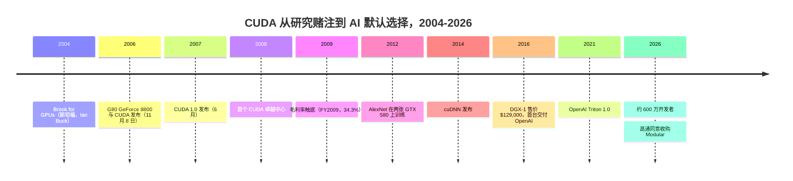
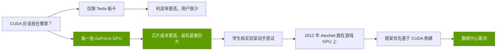
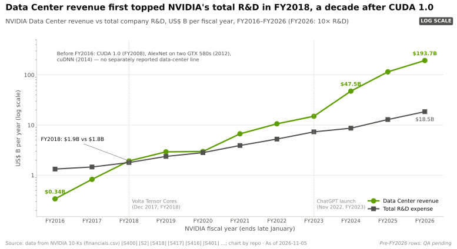
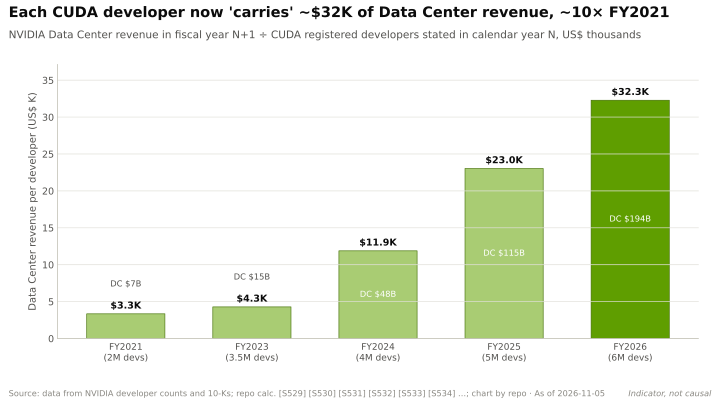
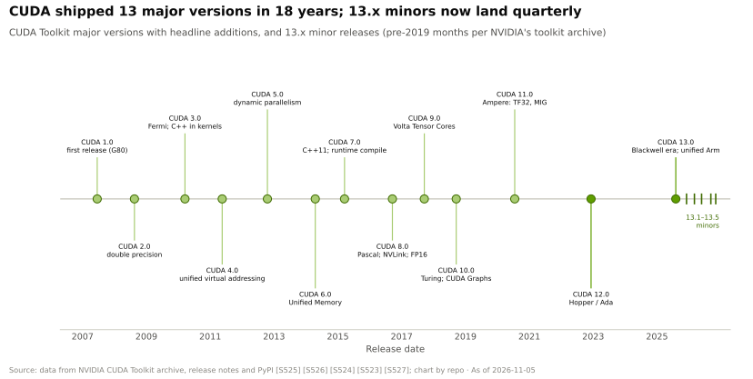
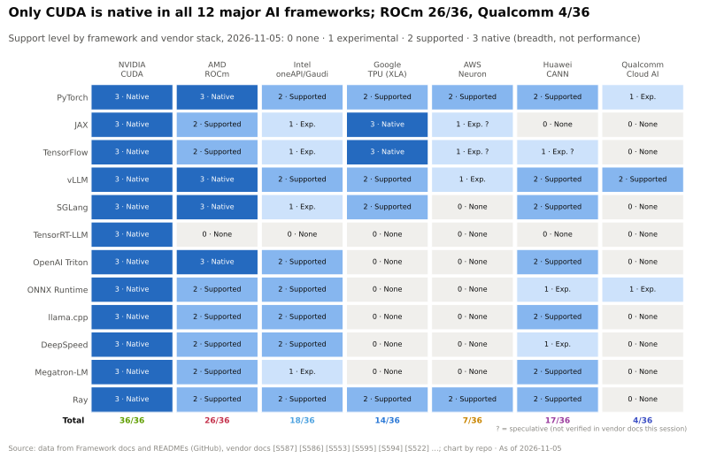
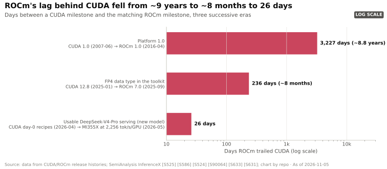

# CS2 · CUDA：十五年的赌注

> [!NOTE]
> 本页为英文原文的简体中文参考译文，仅供参考；如有出入，以[英文原文](../../case-studies/CS2-cuda-the-15-year-bet.md "English original")为准。

案例研究 · 阅读约 15 分钟 · 最后核实：2026-11-05

## ⚡ 要点速览

- **CUDA 是押注一个尚不存在的市场。** 英伟达（NVIDIA）于 2006-11-08 随 G80 GPU 发布 [CUDA](../glossary.md#cuda)，并于 2007 年 6 月推出 CUDA 1.0 [[S9528]](../../sources/bibliography.md#s9528)[[S525]](../../sources/bibliography.md#s525)。它把这项能力放进了每一张 GeForce 显卡，而不仅限于高端计算板卡。
- **这一赌注恰逢毛利率崩塌。** 毛利率从 FY2008 的 45.6% 降至 FY2009 的 34.3% 和 FY2010 的 35.4% [[S22000]](../../sources/bibliography.md#s22000)。一笔 $196M 的封装缺陷费用和 2008 年经济衰退可以解释其中一部分 [[S22000]](../../sources/bibliography.md#s22000)。黄仁勋曾回忆，在英伟达毛利率约 35% 时，CUDA 使成本上升约 50%（🟡 有报道）[[S22005]](../../sources/bibliography.md#s22005)[[S22006]](../../sources/bibliography.md#s22006)。
- **英伟达在低谷期持续投入。** 研发支出占收入的比重从 FY2008 的 17% 升至 FY2009–FY2015 的 24–32%，而同期收入一直停留在 $3.3–4.7B [[S22001]](../../sources/bibliography.md#s22001)[[S22003]](../../sources/bibliography.md#s22003)。
- **回报来自英伟达计划之外。** 2012 年，[AlexNet](../glossary.md#alexnet) 在两张 GTX 580 游戏显卡上完成训练 [[S9530]](../../sources/bibliography.md#s9530)。英伟达随后推出 cuDNN（2014）和 DGX-1（2016）[[S9531]](../../sources/bibliography.md#s9531)[[S310]](../../sources/bibliography.md#s310)。数据中心收入在 FY2018 首次超过研发总支出，直到 FY2022 才突破每年 $10B，距 CUDA 1.0 约 15 年 [[S400]](../../sources/bibliography.md#s400)[[S2]](../../sources/bibliography.md#s2)。
- **如今，生态就是护城河。** 英伟达称拥有约 600 万开发者 [[S528]](../../sources/bibliography.md#s528)；在本资料库的支持矩阵中，CUDA 是唯一在全部 12 个主流 AI 框架中均获原生支持的技术栈（36/36）[[S587]](../../sources/bibliography.md#s587)[[S577]](../../sources/bibliography.md#s577)[[S580]](../../sources/bibliography.md#s580)。每位开发者目前每年“承载”约 $32K 的数据中心收入，约为 FY2021 的 10 倍（🔴 本资料库指标）[[S22009]](../../sources/bibliography.md#s22009)。
- **护城河正在边缘处受到侵蚀。** [PyTorch](../glossary.md#pytorch) 编译器、[Triton](../glossary.md#triton)、JAX/XLA 以及 Modular 的 [Mojo](../glossary.md#mojo) 让代码可以面向多家厂商的硬件 [[S9021]](../../sources/bibliography.md#s9021)[[S578]](../../sources/bibliography.md#s578)[[S9023]](../../sources/bibliography.md#s9023)。AMD [ROCm](../glossary.md#rocm) 对新模型的支持滞后已缩短至 26 天 [[S633]](../../sources/bibliography.md#s633)。高通（Qualcomm）于 2026 年 6 月同意以 $3.9B 收购 Modular，并于 2026-07-29 完成交易 [[S90057]](../../sources/bibliography.md#s90057)[[S9511]](../../sources/bibliography.md#s9511)。

## 1. 背景

2000 年代中期，想利用 GPU 速度的研究人员必须把数学运算伪装成图形运算：矩阵变成纹理，乘法变成颜色混合。这就是 [GPGPU](../glossary.md#gpgpu) 编程，过程十分痛苦。在斯坦福大学，Ian Buck 开发的 [Brook](../glossary.md#brook) 语言（2004）用类 C 代码把这套技巧隐藏了起来 [[S9532]](../../sources/bibliography.md#s9532)。Buck 随后加入英伟达，领导后来成为 CUDA 的项目。

硬件层面的推动者是 G80，于 2006-11-08 以 GeForce 8800 之名发布 [[S2503]](../../sources/bibliography.md#s2503)。它以[统一着色器架构](../glossary.md#unified-shader-architecture)取代了固定的图形流水线阶段：由一组相同的可编程核心构成统一资源池。CUDA 补齐了通用代码所需的组件：C 编译器、线程调度器，以及线程间可协作使用的片上共享内存 [[S9528]](../../sources/bibliography.md#s9528)。

商业上的理由很单薄。英伟达当时是一家图形公司，FY2008 收入约 $4.1B [[S400]](../../sources/bibliography.md#s400)。通用 GPU 计算的买家只是几百名物理学家、油气建模人员和金融量化分析师。不久之后，一个厂商中立的替代方案 [OpenCL](../glossary.md#opencl) 在其他芯片厂商的支持下出现。短期内的理性做法，是把 CUDA 当作面向工作站和 Tesla 板卡的细分产品。

## 2. 决策

关键选择在于把 CUDA 放在哪里。英伟达本可以将其限定在 Tesla 计算板卡上，以保护消费级产品的利润率。但它选择了每一张 GeForce，这让尝试 CUDA 的成本极低：任何拥有游戏电脑的学生都有一台 CUDA 设备。到 2020 年，英伟达统计的支持 CUDA 的 GPU 已超过 10 亿个 [[S529]](../../sources/bibliography.md#s529)。

决策的另一半是培育需求。2008 年在伊利诺伊大学设立的首个 CUDA 卓越中心获得了 $500,000 捐款和一套价值约 $800,000 的集群；到 2008 年年中，已有 41 所大学开设 CUDA 课程 [[S9529]](../../sources/bibliography.md#s9529)。这一决策还需要耐心：在投资者质疑这一战略期间，英伟达仍持续为 CUDA 投入资金 [[S22007]](../../sources/bibliography.md#s22007)。

> [!TIP]
> **算例 —— 低谷期的代价。** 毛利从 FY2008 的约 $1.87B（$4.10B × 45.6%）降至 FY2010 的约 $1.18B（$3.33B × 35.4%），每年减少约 $0.69B [[S400]](../../sources/bibliography.md#s400)[[S22000]](../../sources/bibliography.md#s22000)[[S22002]](../../sources/bibliography.md#s22002)。同样这两年，研发支出从 $691.6M 增至约 $908.9M，增加约 $217M [[S22001]](../../sources/bibliography.md#s22001)[[S22000]](../../sources/bibliography.md#s22000)。这并非全部源于 CUDA：FY2009 包含一笔 $196M 的封装缺陷费用以及经济衰退的影响 [[S22000]](../../sources/bibliography.md#s22000)。但只要黄仁勋关于成本上升约 50% 的回忆在方向上大致正确 [[S22005]](../../sources/bibliography.md#s22005)，利润率缺口中的很大一部分就是在每张显卡里装进一台计算机的代价。

🔧 技术细节：为何“每张 GPU 都支持 CUDA”的维持成本始终很低

CUDA 代码被编译为 [PTX](../glossary.md#ptx)，一种虚拟指令集。驱动程序会将 PTX 翻译为每代新 GPU 的原生代码，因此为某一代编写的内核仍能在下一代上运行。这正是装机基数得以复利增长的原因：每卖出一张 GeForce，都在扩大同一个软件目标，而不是使其碎片化。英伟达淘汰旧架构的速度很慢。CUDA 13 才放弃了 2014–2017 年推出的 Maxwell、Pascal 和 Volta GPU [[S90065]](../../sources/bibliography.md#s90065)。自 2024 年起，许可协议禁止在竞争对手芯片上运行 CUDA 输出的[转译层](../glossary.md#translation-layer)，这提高了二进制兼容克隆方案的法律风险 [[S9500]](../../sources/bibliography.md#s9500)。

## 3. 结果（用数据说话）

**漫长的回报期。** 第一笔大回报来自英伟达并未付钱的人。2012 年，AlexNet 在两张 3 GB 的 GTX 580 上训练了五到六天后赢得 ImageNet 竞赛 [[S9530]](../../sources/bibliography.md#s9530)。英伟达随后将深度学习数学运算封装为软件库：cuDNN（2014）为各框架提供了调优好的卷积内核，框架不再需要自行编写；Caffe 是第一个集成它的框架 [[S9531]](../../sources/bibliography.md#s9531)。这为此后每个框架确立了模式：调用英伟达的库，继承英伟达的性能。2016 年 4 月，英伟达推出售价 $129,000 的 DGX-1 [[S310]](../../sources/bibliography.md#s310)，并于同年 8 月亲手将首台交付给 OpenAI [[S8522]](../../sources/bibliography.md#s8522)。

> [!TIP]
> **算例 —— 为什么是“15 年”。** FY2008 至 FY2016，英伟达在所有产品上的研发投入约 $9.5B [[S22001]](../../sources/bibliography.md#s22001)[[S22003]](../../sources/bibliography.md#s22003)[[S400]](../../sources/bibliography.md#s400)。FY2016 的数据中心收入仍仅为 $0.34B [[S400]](../../sources/bibliography.md#s400)。它在 FY2018 首次超过研发总支出（$1.93B 对 $1.80B），距 CUDA 1.0 约十年；在 FY2022 首次突破每年 $10B（$10.6B），距 CUDA 1.0 约 14.5 年 [[S400]](../../sources/bibliography.md#s400)[[S2]](../../sources/bibliography.md#s2)。到 FY2026 达到 $193.7B，约为 $18.5B 研发支出的 10 倍 [[S402]](../../sources/bibliography.md#s402)[[S401]](../../sources/bibliography.md#s401)。

**今天的生态。** 英伟达的[注册开发者](../glossary.md#registered-developer)数量从 2020 年的 200 万增至 2025 年的约 600 万，增长两倍，而在 GTC 2026 上仍引用约 600 万这一数字 [[S529]](../../sources/bibliography.md#s529)[[S528]](../../sources/bibliography.md#s528)。这一取整数字的停滞值得注意。

收入增速远超开发者增速。以数据中心收入除以开发者数量，可以粗略衡量有多少支出依附于该生态。

平台本身也在不断演进。CUDA 在 18 年间发布了 13 个主版本，每个版本都与张量核心（CUDA 9）等硬件特性绑定 [[S525]](../../sources/bibliography.md#s525)。

覆盖广度是最清晰的成果。在本资料库的支持矩阵中，CUDA 在全部 12 个框架中均获原生支持；AMD ROCm 得分为 36 分中的 26 分，谷歌（Google）TPU 技术栈 14 分，高通 Cloud AI 技术栈 4 分 [[S586]](../../sources/bibliography.md#s586)[[S580]](../../sources/bibliography.md#s580)[[S577]](../../sources/bibliography.md#s577)[[S596]](../../sources/bibliography.md#s596)。

| | 2007（CUDA 1.0） | 2026 |
|---|---|---|
| 开发者 | 一个研究社区 | 约 600 万注册开发者 [[S528]](../../sources/bibliography.md#s528) |
| 版本 | 1.0 | 13.x，小版本大约每季度发布一次 [[S523]](../../sources/bibliography.md#s523) |
| 框架支持 | 无 | 12 个中 12 个原生支持 [[S586]](../../sources/bibliography.md#s586) |
| 英伟达毛利率 | 45.6%（FY2008）[[S22000]](../../sources/bibliography.md#s22000) | 75.0%（FY2025），71.1%（FY2026，含 H20 费用）[[S416]](../../sources/bibliography.md#s416)[[S402]](../../sources/bibliography.md#s402) |
| 数据中心收入 | 未单独披露 | $193.7B（FY2026）[[S402]](../../sources/bibliography.md#s402) |

> [!TIP]
> **算例 —— 护城河在毛利率上值多少钱。** 英伟达毛利率在 FY2008 为 45.6%，在 FY2026 为 71.1%，后者已计入一笔 $4.5B 的 H20 费用 [[S22000]](../../sources/bibliography.md#s22000)[[S402]](../../sources/bibliography.md#s402)。以 FY2026 $215.9B 的收入计算 [[S1]](../../sources/bibliography.md#s1)，每个百分点的毛利率约对应 $2.2B 毛利，因此 25.5 个百分点的差距每年约值 $55B。这并非全部归功于 CUDA：稀缺性、[高带宽内存（HBM）](../glossary.md#hbm)供应和机架级系统同样支撑着定价。但如果买家可以自由切换，利润率就会被压向[商用芯片](../glossary.md#merchant-silicon)同业的水平。即使只把三分之一的差距归于软件锁定，每年也约有 $18B（🔴 本资料库测算）。

## 4. 为何奏效（或为何未能奏效）

1. **先有[装机基数](../glossary.md#installed-base)，后有需求。** 把 CUDA 放进消费级显卡，意味着 2012 年的 AI 研究人员手中早已有了硬件。没有任何竞争对手拥有这样的先发优势。
2. **软件库把一门语言变成了一个平台。** cuDNN 以及后来的 [CUDA-X](../glossary.md#cuda-x) 让框架作者直接调用英伟达调优好的内核 [[S9531]](../../sources/bibliography.md#s9531)。每一个新框架都免费继承了英伟达的性能优化成果。
3. **与每一代 GPU 协同设计。** 新的数值格式和张量核心特性在发布当天即获得 CUDA 支持 [[S525]](../../sources/bibliography.md#s525)。竞争对手只能事后移植，因此英伟达在每次模型发布时都能续写其[首日支持（day-0）](../glossary.md#day-zero-support)的领先优势。
4. **不断累积的[转换成本](../glossary.md#switching-cost)。** 将一个注意力内核移植到新芯片上，估计需要 1.8–5.5 人年（🔴 本资料库估计）[[S633]](../../sources/bibliography.md#s633)[[S631]](../../sources/bibliography.md#s631)。

**金钱之外，英伟达付出的代价。** 锁定会招致反制。2024 年针对转译层的许可条款 [[S9500]](../../sources/bibliography.md#s9500)，以及美国司法部同年启动、调查英伟达是否人为提高切换难度的调查 [[S9504]](../../sources/bibliography.md#s9504)[[S9503]](../../sources/bibliography.md#s9503)，都表明这条护城河如今既在建设，也在防守。每一家自研芯片的[超大规模云厂商](../glossary.md#hyperscaler)也都在出资开发摆脱 CUDA 的软件。

**反方论点与侵蚀。** 最有力的看空论点是：护城河已经上移了一层，而英伟达并不拥有那一层的代码。如今大多数开发者编写的是 PyTorch，而不是 CUDA。PyTorch 2 的编译器会自动生成 Triton 内核 [[S9021]](../../sources/bibliography.md#s9021)。Triton 于 2021 年推出时仅支持英伟达 [[S22008]](../../sources/bibliography.md#s22008)，如今已支持 AMD GPU [[S578]](../../sources/bibliography.md#s578)。谷歌通过 JAX/XLA 以及自 2026 年 10 月起的 TorchTPU 在 TPU 上部署前沿模型 [[S595]](../../sources/bibliography.md#s595)[[S553]](../../sources/bibliography.md#s553)。Modular 声称，同一套 Mojo 内核无需修改即可在英伟达、AMD 和苹果 GPU 上运行 [[S9023]](../../sources/bibliography.md#s9023)。高通于 2026 年 6 月宣布、2026-07-29 完成的 $3.9B Modular 收购，为这一可移植性论点标上了价格 [[S90057]](../../sources/bibliography.md#s90057)[[S4029]](../../sources/bibliography.md#s4029)[[S9511]](../../sources/bibliography.md#s9511)。其成效尚未在规模化场景中得到验证。

| 绕开 CUDA 的路径 | 抽象的层次 | CUDA 所处位置（2026） | 来源 |
|---|---|---|---|
| PyTorch eager | 内核层之上的模型代码 | 🟩 参考后端；其他后端以插件方式接入 | [[S587]](../../sources/bibliography.md#s587) |
| torch.compile + Triton | 内核生成 | 🟨 可移植到 AMD；最佳调优仍以英伟达优先 | [[S9021]](../../sources/bibliography.md#s9021)[[S578]](../../sources/bibliography.md#s578) |
| JAX/XLA、TorchTPU | 面向 TPU 的全图编译 | 🟦 谷歌与 Anthropic 规模下的独立技术栈 | [[S595]](../../sources/bibliography.md#s595)[[S553]](../../sources/bibliography.md#s553) |
| Mojo/MAX（Modular） | 可移植内核与推理服务 | 🟦 早期阶段；仅有厂商自测基准 | [[S9022]](../../sources/bibliography.md#s9022)[[S9023]](../../sources/bibliography.md#s9023) |
| ROCm/HIP | AMD 上的类 CUDA API | 头部模型 🟨（滞后 26 天）；覆盖广度 🟥（26/36） | [[S633]](../../sources/bibliography.md#s633)[[S586]](../../sources/bibliography.md#s586) |
| vLLM、SGLang 插件 | 按厂商适配的推理服务引擎 | 🟨 已支持 TPU、昇腾、Gaudi | [[S580]](../../sources/bibliography.md#s580)[[S582]](../../sources/bibliography.md#s582) |

> [!TIP]
> **算例 —— 差距缩小得有多快。** AMD 的平台比 CUDA 1.0 晚约 3,227 天；[FP4](../glossary.md#fp4) 支持比英伟达晚 236 天；DeepSeek-V4-Pro 的可用推理服务比 CUDA 的首日方案晚 26 天 [[S525]](../../sources/bibliography.md#s525)[[S586]](../../sources/bibliography.md#s586)[[S633]](../../sources/bibliography.md#s633)。每次差距大约缩短为前一次的十分之一。如果一个前沿模型的商业价值集中在发布后的前 3 个月，26 天的滞后仍会让挑战者损失这一窗口期的约 30%；若滞后缩短到 3 天，损失约为 3%（🔴 本资料库测算）。

> [!NOTE]
> **🐂 看多观点：** 各类抽象层仍以 CUDA 作为参考目标 [[S587]](../../sources/bibliography.md#s587)[[S578]](../../sources/bibliography.md#s578)。每位开发者对应约 $32K 的数据中心收入，说明客户仍在为默认路径付费 [[S22009]](../../sources/bibliography.md#s22009)。

> [!WARNING]
> **🐻 看空观点：** 自 2025 年以来，开发者数量一直停留在约 600 万 [[S528]](../../sources/bibliography.md#s528)。超大规模云厂商、AI 实验室以及归属高通的 Modular 都在为可移植性投入资金，美国和中国监管机构也在审查英伟达的行为 [[S9503]](../../sources/bibliography.md#s9503)[[S9505]](../../sources/bibliography.md#s9505)。护城河可能会从“只有 CUDA 能用”转变为“CUDA 最先能用”。

## 5. 对企业发展（corp dev）的启示

**耐心的平台投资，只有在别人找到用例时才会获得回报。** 英伟达并没有预见到深度学习；它只是让试验变得廉价，然后等待。这一赌注之所以能坚持下来，是因为英伟达的游戏业务为其提供了资金。规模更小的公司很难在七年（FY2009–FY2015）里承受 24–32% 的研发强度 [[S22001]](../../sources/bibliography.md#s22001)[[S22003]](../../sources/bibliography.md#s22003)。

> [!TIP]
> **算例 —— 期权费。** 假如英伟达将研发支出维持在 FY2008 约 16.9% 的收入占比，FY2009–FY2015 的研发支出约为 $4.6B（16.9% × $27.4B 收入）。而实际支出约为 $7.5B [[S22001]](../../sources/bibliography.md#s22001)[[S22003]](../../sources/bibliography.md#s22003)[[S400]](../../sources/bibliography.md#s400)。约 $2.8B 的差额可以合理地视为英伟达为维持平台存续所付出的代价，尽管这笔钱同时投向了 GPU、移动芯片和软件。若将其视为期权费，它换来的是一项 FY2026 销售额达 $193.7B 的业务 [[S402]](../../sources/bibliography.md#s402)。企业发展的估值模型很少会批准一笔行权日期未知的期权费，而这正是此类布局稀缺的原因。

**如何为开发者生态估值。** 开发者数量是累计注册数，而非活跃用户数。下表列出了尽职调查团队可以从公开数据中核查的信号。

| 信号 | CUDA 现状 | 说明什么 | 注意事项 |
|---|---|---|---|
| 注册开发者 | 约 600 万，自 2025 年以来持平 [[S528]](../../sources/bibliography.md#s528) | 覆盖面 | 累计数，企业自报 |
| 框架覆盖 | 本资料库矩阵中 36/36 [[S587]](../../sources/bibliography.md#s587)[[S580]](../../sources/bibliography.md#s580) | 默认路径的广度 | 衡量的是支持情况，而非速度 |
| 首日模型支持 | DeepSeek-V4 当天即有部署方案 [[S633]](../../sources/bibliography.md#s633) | 对研究的吸引力 | 一次只能看一个模型 |
| 每位开发者对应收入 | 每年约 $32K（🔴）[[S22009]](../../sources/bibliography.md#s22009) | 依附于生态的支出 | 指标，而非因果 |
| 竞争对手的滞后 | 新模型滞后 26 天 [[S633]](../../sources/bibliography.md#s633) | 侵蚀速度 | 因模型和格式而异 |

> [!TIP]
> **算例 —— 解读 Modular 的价格。** Modular 于 2025 年 9 月融资 $380M，估值 $1.6B [[S9510]](../../sources/bibliography.md#s9510)。高通于 2026 年 6 月同意支付约 $3.9B [[S90057]](../../sources/bibliography.md#s90057)：约为上一轮私募估值的 2.4 倍、累计融资额的约 10 倍。按英伟达每位开发者约 $32K 的数据中心收入计算（🔴）[[S22009]](../../sources/bibliography.md#s22009)，$3.9B 相当于约 120,000 名 CUDA 开发者一年所对应的收入，约为英伟达约 600 万开发者的 2%。对任何买家而言，问题在于这项资产能撬动多少开发者，以及多少硬件收入。

**软件领域的自建与收购。** 英伟达用 20 年时间自建 CUDA，并围绕它进行收购（PGI 编译器、约 $700M 收购 Run:ai）[[S484]](../../sources/bibliography.md#s484)[[S479]](../../sources/bibliography.md#s479)。挑战者则在用钱买时间：AMD 以 $665M 收购了 Silo AI [[S9506]](../../sources/bibliography.md#s9506)。完整的分层视角参见[第 09 层发展历程](../layers/09-cuda-and-system-software/history-and-how-built.md)与[第 09 层竞争格局](../layers/09-cuda-and-system-software/competition.md)。

## 🎯 企业发展视角

1. CUDA 之所以能回本，只是因为一项能产生现金的游戏业务支撑了它十年。对于挑战者的软件平台而言，与之对应的“承载”业务是什么？它能为亏损提供多长时间的资金？
2. 开发者生态估值应以哪个指标为锚：注册开发者、框架覆盖、首日模型支持，还是每位开发者对应收入？每个指标都会指向不同的价格。
3. 护城河正在向编译器（Triton、[XLA](../glossary.md#xla)、Mojo）转移。2028 年谁将掌握这些层？掌握其中一层能否转化为硬件份额，还是只能转化为惠及所有芯片厂商的可移植性？
4. 高通已达成协议收购 Modular，这是对可移植 AI 软件的一次公开押注 [[S90057]](../../sources/bibliography.md#s90057)。哪些整合里程碑（框架上游合并、首日支持、第三方采用）能够表明它是否改变了转换成本？
5. 英伟达在 2008 年以低成本培育了学术界 [[S9529]](../../sources/bibliography.md#s9529)。如今哪些渠道的培育成本较低：开源模型实验室、智能体框架，还是 AI 编程工具？

## 📚 来源（Sources）

<!-- Auto-generated from the [S…] citations on this page by `make build`. Edit sources/registry/*.csv, not this list. -->

- [**S1**](../../sources/bibliography.md#s1) NVIDIA Corporation via SEC EDGAR, *NVIDIA Announces Financial Results for Fourth Quarter and Fiscal 2026 (Form 8-K exhibit 99.1)*, 2026-02-25. [Link](https://www.sec.gov/Archives/edgar/data/1045810/000104581026000019/q4fy26pr.htm)
- [**S2**](../../sources/bibliography.md#s2) U.S. Securities and Exchange Commission (EDGAR), *NVIDIA Corporation Form 10-K annual reports FY2020–FY2025 (filing index)*, 2025-02-26. [Link](https://www.sec.gov/cgi-bin/browse-edgar?action=getcompany&CIK=0001045810&type=10-K&dateb=&owner=include&count=40)
- [**S310**](../../sources/bibliography.md#s310) AnandTech (Ryan Smith), *NVIDIA unveils the DGX-1 HPC server: 8 Teslas, 3U, Q2 2016*, 2016-04-05. [Link](https://www.anandtech.com/show/10229)
- [**S400**](../../sources/bibliography.md#s400) U.S. Securities and Exchange Commission (EDGAR), *NVIDIA Corporation Form 10-K annual reports FY2001–FY2019 (EDGAR filing index)*, 2019-02-21. [Link](https://www.sec.gov/cgi-bin/browse-edgar?action=getcompany&CIK=0001045810&type=10-K&dateb=&owner=include&count=40)
- [**S401**](../../sources/bibliography.md#s401) NVIDIA Corporation via SEC EDGAR, *NVIDIA Corporation Form 10-K for fiscal year ended January 25, 2026*, 2026-02-25. [Link](https://www.sec.gov/Archives/edgar/data/1045810/000104581026000021/nvda-20260125.htm)
- [**S402**](../../sources/bibliography.md#s402) NVIDIA Corporation via SEC EDGAR (Colette Kress), *CFO Commentary on Fourth Quarter and Fiscal 2026 Results (Form 8-K exhibit 99.2)*, 2026-02-25. [Link](https://www.sec.gov/Archives/edgar/data/1045810/000104581026000019/q4fy26cfocommentary.htm)
- [**S416**](../../sources/bibliography.md#s416) NVIDIA Corporation via SEC EDGAR, *NVIDIA Corporation Form 10-K for fiscal year ended January 26, 2025*, 2025-02-26. [Link](https://www.sec.gov/Archives/edgar/data/1045810/000104581025000023/nvda-20250126.htm)
- [**S479**](../../sources/bibliography.md#s479) Various (press), *Reporting on NVIDIA tuck-in acquisition prices (Run:ai, Deci, Shoreline, OctoAI, Gretel, Lepton, CentML) — The Information, Calcalist, Reuters, CNBC*, 2025-06. [Link](https://www.reuters.com/technology/)
- [**S484**](../../sources/bibliography.md#s484) NVIDIA press releases as summarised in NVIDIA 10-K filings and contemporaneous press, *History of NVIDIA acquisitions 2000–2013 (3dfx assets, MediaQ, ULi, Hybrid Graphics, PortalPlayer, mental images, Ageia, Icera, The Portland Group)*, 2013-07. [Link](https://en.wikipedia.org/wiki/Nvidia)
- [**S523**](../../sources/bibliography.md#s523) Python Package Index (NVIDIA), *nvidia-cuda-runtime (CUDA 13.x runtime wheels) release history*, 2026-11-04. [Link](https://pypi.org/project/nvidia-cuda-runtime/#history)
- [**S525**](../../sources/bibliography.md#s525) NVIDIA Developer, *CUDA Toolkit Archive*, 2026. [Link](https://developer.nvidia.com/cuda-toolkit-archive)
- [**S528**](../../sources/bibliography.md#s528) NVIDIA Developer Forums, *20 Years of CUDA: Honoring the Architects of the Accelerated Age*, 2026-03. [Link](https://forums.developer.nvidia.com/t/20-years-of-cuda-honoring-the-architects-of-the-accelerated-age/364654)
- [**S529**](../../sources/bibliography.md#s529) NVIDIA Blog (Will Ramey), *2 Million Registered Developers, Countless Breakthroughs*, 2020. [Link](https://blogs.nvidia.com/blog/2-million-registered-developers-breakthroughs/)
- [**S553**](../../sources/bibliography.md#s553) Google Cloud Blog (Alex Barrett), *What's new in AI infrastructure and orchestration in October*, 2026-11. [Link](https://cloud.google.com/blog/topics/ai-infrastructure/whats-new-in-ai-infrastructure-this-month)
- [**S577**](../../sources/bibliography.md#s577) JAX (GitHub: jax-ml/jax docs/installation.md), *JAX installation guide — supported platforms*, 2026-11. [Link](https://github.com/jax-ml/jax/blob/main/docs/installation.md)
- [**S578**](../../sources/bibliography.md#s578) OpenAI Triton (GitHub), *Triton (triton-lang/triton) README — supported hardware*, 2026-11. [Link](https://github.com/triton-lang/triton/blob/main/README.md)
- [**S580**](../../sources/bibliography.md#s580) vLLM project (GitHub), *vLLM README and installation docs — supported hardware*, 2026-11. [Link](https://github.com/vllm-project/vllm/blob/main/docs/getting_started/installation/README.md)
- [**S582**](../../sources/bibliography.md#s582) SGLang project (GitHub: sgl-project/sglang), *SGLang README — supported hardware*, 2026-11. [Link](https://github.com/sgl-project/sglang/blob/main/README.md)
- [**S586**](../../sources/bibliography.md#s586) AMD (GitHub: ROCm/ROCm docs), *ROCm documentation sources: release history, AI-ecosystem compatibility matrix, consolidated changelog*, 2026-08-26. [Link](https://github.com/ROCm/ROCm/blob/develop/docs/release/versions.rst)
- [**S587**](../../sources/bibliography.md#s587) PyTorch (GitHub: pytorch/pytorch), *PyTorch README — building with CUDA, ROCm and Intel GPU support*, 2026-11. [Link](https://github.com/pytorch/pytorch/blob/main/README.md)
- [**S595**](../../sources/bibliography.md#s595) PyTorch (GitHub: pytorch/xla), *PyTorch/XLA README (deprecation notice)*, 2026-11. [Link](https://github.com/pytorch/xla/blob/master/README.md)
- [**S596**](../../sources/bibliography.md#s596) Qualcomm (GitHub: quic), *Qualcomm Cloud AI SDK and Efficient Transformers repositories*, 2026-11. [Link](https://github.com/quic/cloud-ai-sdk)
- [**S631**](../../sources/bibliography.md#s631) SemiAnalysis, *MI355X DeepSeek-V4-Pro on SGLang: 110.5x Throughput per GPU in 26 Days*, 2026-05-26. [Link](https://github.com/SemiAnalysisAI/InferenceX-app/blob/main/packages/app/content/blog/mi355x-deepseek-v4-pro-sglang-110x-in-26-days.mdx)
- [**S633**](../../sources/bibliography.md#s633) SemiAnalysis, *DeepSeekV4 1.6T Day 0 to Day 43 Performance Over Time — Huawei, GB300 NVL72, MI355X, B200*, 2026-06-09. [Link](https://github.com/SemiAnalysisAI/InferenceX-app/blob/main/packages/app/content/blog/deepseekv4-16t-day-0-to-day-43-performance.mdx)
- [**S2503**](../../sources/bibliography.md#s2503) TechSpot, *TechSpot's History of the GPU, Part 4: the coming of general-purpose GPUs*, 2013. [Link](https://www.techspot.com/article/659-history-of-the-gpu-part-4/)
- [**S4029**](../../sources/bibliography.md#s4029) StorageReview, *Qualcomm unveils Dragonfly data center roadmap: C1000 CPU, AI300 accelerator*, 2026-06-24. [Link](https://www.storagereview.com/news/qualcomm-unveils-dragonfly-data-center-roadmap-c1000-cpu-ai300-accelerator-and-modular-acquisition)
- [**S8522**](../../sources/bibliography.md#s8522) TOP500, *NVIDIA delivers DGX-1 'supercomputer in a box' to OpenAI*, 2016-08-15. [Link](https://top500.org/news/nvidia-delivers-dgx-1-supercomputer-in-a-box-to-openai/)
- [**S9021**](../../sources/bibliography.md#s9021) ACM ASPLOS 2024 (PDF hosted by PyTorch) (Jason Ansel et al.), *PyTorch 2: Faster Machine Learning Through Dynamic Python Bytecode Transformation and Graph Compilation*, 2024-04. [Link](https://pytorch.org/assets/pytorch2-2.pdf)
- [**S9022**](../../sources/bibliography.md#s9022) Modular, *Achieving state-of-the-art performance on AMD MI355 in just 14 days*, 2025-10-17. [Link](https://www.modular.com/blog/achieving-state-of-the-art-performance-on-amd-mi355----in-just-14-days)
- [**S9023**](../../sources/bibliography.md#s9023) Modular, *Modular 25.6: unifying the latest GPUs from NVIDIA, AMD and Apple*, 2025-09. [Link](https://www.modular.com/blog/modular-25-6-unifying-the-latest-gpus-from-nvidia-amd-and-apple)
- [**S9500**](../../sources/bibliography.md#s9500) Tom's Hardware, *Nvidia bans using translation layers for CUDA software to run on other chips; new restriction apparently targets ZLUDA and some Chinese GPU makers*, 2024-03-05. [Link](https://www.tomshardware.com/pc-components/gpus/nvidia-bans-using-translation-layers-for-cuda-software-to-run-on-other-chips-new-restriction-apparently-targets-zluda-and-some-chinese-gpu-makers)
- [**S9503**](../../sources/bibliography.md#s9503) Business Standard (Bloomberg), *Nvidia gets subpoena from US Justice Dept as antitrust probe deepens*, 2024-09-04. [Link](https://www.business-standard.com/world-news/nvidia-gets-subpoena-from-us-justice-dept-as-antitrust-probe-deepens-124090400121_1.html)
- [**S9504**](../../sources/bibliography.md#s9504) Business Standard, *US launches antitrust investigation into Nvidia over sales practices*, 2024-08-02. [Link](https://www.business-standard.com/world-news/us-launches-antitrust-investigation-into-nvidia-over-sales-practices-124080201689_1.html)
- [**S9505**](../../sources/bibliography.md#s9505) JURIST, *China finds Nvidia violated antimonopoly law in preliminary probe*, 2025-09-15. [Link](https://www.jurist.org/news/2025/09/china-finds-nvidia-violated-antimonopoly-law-in-preliminary-probe/)
- [**S9506**](../../sources/bibliography.md#s9506) Converge Digest, *AMD completes $665 million acquisition of Silo AI*, 2024-08. [Link](https://convergedigest.com/amd-completes-665-million-acquisition-of-silo-ai/?amp=1)
- [**S9510**](../../sources/bibliography.md#s9510) SDxCentral, *Modular raises $250M for AI's unified compute layer at $1.6B valuation*, 2025-09-24. [Link](https://www.sdxcentral.com/news/modular-raises-250m-for-ais-unified-compute-layer-at-16b-valuation/)
- [**S9511**](../../sources/bibliography.md#s9511) Nasdaq (Qualcomm press release), *Qualcomm Completes Acquisition of Modular*, 2026-07-29. [Link](https://www.nasdaq.com/press-release/qualcomm-completes-acquisition-modular-2026-07-29)
- [**S9528**](../../sources/bibliography.md#s9528) Digital Engineering 24/7 (NVIDIA press release), *NVIDIA Unveils CUDA - The GPU Computing Revolution Begins*, 2006-11-08. [Link](https://www.digitalengineering247.com/article/nvidia-unveils-cuda)
- [**S9529**](../../sources/bibliography.md#s9529) TechPowerUp, *NVIDIA appoints first CUDA Center of Excellence*, 2008-07-01. [Link](https://techpowerup.com/64493/nvidia-appoints-first-cuda-center-of-excellence)
- [**S9530**](../../sources/bibliography.md#s9530) NeurIPS 2012 (Advances in Neural Information Processing Systems 25) (Alex Krizhevsky, Ilya Sutskever, Geoffrey E. Hinton), *ImageNet Classification with Deep Convolutional Neural Networks*, 2012-12. [Link](https://papers.nips.cc/paper/4824-imagenet-classification-with-deep-convolutional-neural-networks)
- [**S9531**](../../sources/bibliography.md#s9531) arXiv:1410.0759 (Sharan Chetlur, Cliff Woolley, Philippe Vandermersch, Jonathan Cohen, John Tran, Bryan Catanzaro, Evan Shelhamer), *cuDNN: Efficient Primitives for Deep Learning*, 2014-10-03. [Link](https://arxiv.org/abs/1410.0759)
- [**S9532**](../../sources/bibliography.md#s9532) Stanford Graphics Lab (SIGGRAPH 2004) (Ian Buck, Tim Foley, Daniel Horn, Jeremy Sugerman, Kayvon Fatahalian, Mike Houston, Pat Hanrahan), *Brook for GPUs: Stream Computing on Graphics Hardware*, 2004-08. [Link](https://graphics.stanford.edu/papers/brookgpu/)
- [**S22000**](../../sources/bibliography.md#s22000) NVIDIA Corporation via SEC EDGAR, *NVIDIA Corporation Form 10-K for fiscal year 2010*, 2010-03. [Link](https://www.sec.gov/Archives/edgar/data/0001045810/000104581010000006/fy2010form10k.htm)
- [**S22001**](../../sources/bibliography.md#s22001) NVIDIA Corporation via SEC EDGAR, *NVIDIA Corporation Form 10-K for fiscal year 2009*, 2009-03. [Link](https://www.sec.gov/Archives/edgar/data/0001045810/000104581009000013/fy2009form10k.htm)
- [**S22002**](../../sources/bibliography.md#s22002) NVIDIA Corporation via SEC EDGAR, *NVIDIA Reports Financial Results for Fourth Quarter and Fiscal Year 2010 (Form 8-K exhibit 99.1)*, 2010-02-17. [Link](https://www.sec.gov/Archives/edgar/data/1045810/000104581010000002/q410pressrelease.htm)
- [**S22003**](../../sources/bibliography.md#s22003) NVIDIA Corporation via SEC EDGAR, *NVIDIA Corporation Form 10-K for fiscal year 2013*, 2013-03. [Link](https://www.sec.gov/Archives/edgar/data/0001045810/000104581013000008/nvda-2013x10k.htm)
- [**S22005**](../../sources/bibliography.md#s22005) Shortform (summary of Lex Fridman Podcast), *Lex Fridman Podcast #494 - Jensen Huang: NVIDIA, the $4 trillion company and the AI revolution (episode summary)*, 2026-03-23. [Link](https://www.shortform.com/podcast/episode/lex-fridman-podcast-2026-03-23-episode-summary-494-jensen-huang-nvidia-the-4-trillion-company-the-ai-revolution)
- [**S22006**](../../sources/bibliography.md#s22006) Wccftech, *Nvidia CEO reveals how the company survived an existential threat after forcing CUDA on gaming GPUs*, 2026-03. [Link](https://wccftech.com/nvidia-ceo-reveals-how-the-company-survived-an-existential-threat-after-forcing-cuda-on-gaming-gpus/)
- [**S22007**](../../sources/bibliography.md#s22007) The Motley Fool, *Time to sell Nvidia?*, 2009-02-11. [Link](https://www.fool.com/investing/general/2009/02/11/time-to-sell-nvidia.aspx)
- [**S22008**](../../sources/bibliography.md#s22008) OpenAI (Philippe Tillet), *Introducing Triton: open-source GPU programming for neural networks*, 2021-07-28. [Link](https://openai.com/index/triton/)
- [**S22009**](../../sources/bibliography.md#s22009) nvidia_deep_dive_claude repository, *Repo analysis: CS2 CUDA payback (gross-margin trough, R&D intensity, Data Center revenue per registered CUDA developer)*, 2026-11-05. [Link](https://github.com/FrankHuang94/nvidia_deep_dive_claude/blob/main/case-studies/CS2-cuda-the-15-year-bet.md)
- [**S90057**](../../sources/bibliography.md#s90057) StorageReview, *Qualcomm unveils Dragonfly data center roadmap: C1000 CPU, AI300 accelerator and Modular acquisition*, 2026-06-24. [Link](https://www.storagereview.com/es/news/qualcomm-unveils-dragonfly-data-center-roadmap-c1000-cpu-ai300-accelerator-and-modular-acquisition)
- [**S90065**](../../sources/bibliography.md#s90065) Spheron, *CUDA news today: NVIDIA toolkit, AMD ROCm and AI frameworks 2026*, 2026. [Link](https://www.spheron.network/blog/cuda-news-today-nvidia-toolkit-amd-rocm-ai-frameworks-2026/)
