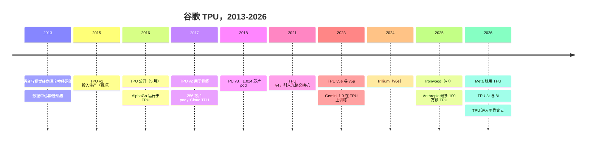
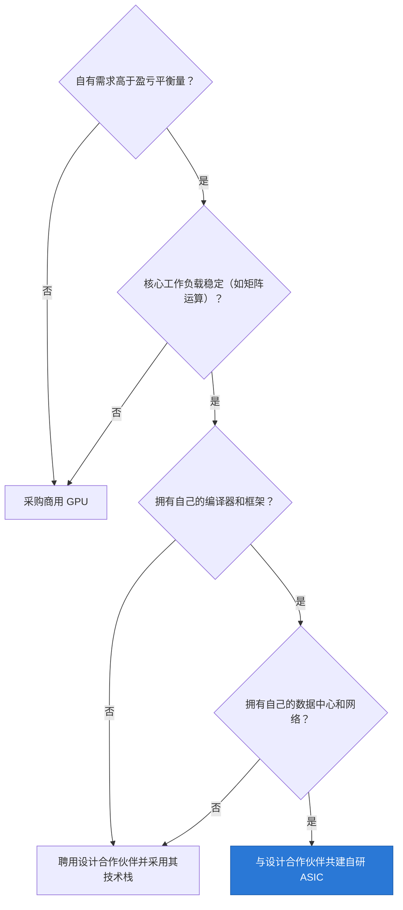

# CS3 · 谷歌 TPU：可信的替代方案

> [!NOTE]
> 本页为英文原文的简体中文参考译文，仅供参考；如有出入，以[英文原文](../../case-studies/CS3-google-tpu-the-credible-alternative.md "English original")为准。

案例研究 · 阅读约 15 分钟 · 最后核实：2026-11-05

## ⚡ 要点速览

- **TPU 起源于一项防御性的成本决策。** 谷歌（Google）预测，若每位用户每天在 CPU 上使用三分钟语音搜索，公司将不得不把数据中心规模翻倍 [[S23001]](../../sources/bibliography.md#s23001)。其第一代 [TPU](../glossary.md#tpu) 自 2015 年起投入生产，在谷歌的推理工作负载上，速度比当时的 CPU 和 GPU 快 15–30 倍，能效高 30–80 倍 [[S23001]](../../sources/bibliography.md#s23001)[[S23002]](../../sources/bibliography.md#s23002)。
- **谷歌负责设计，合作伙伴负责实现。** 谷歌掌握架构；博通（Broadcom）长期担任其 [ASIC 设计合作伙伴](../glossary.md#asic-design-partner)，据报道联发科（MediaTek）也已加入，负责 v7e 和 v8e 型号（🟡）[[S23007]](../../sources/bibliography.md#s23007)[[S23008]](../../sources/bibliography.md#s23008)。
- **七代产品持续复利。** Ironwood（v7，2025）单芯片提供 4,614 TFLOPS 的稠密 [FP8](../glossary.md#fp8) 算力和 192 GB [HBM3E](../glossary.md#hbm3e)，每个 pod 含 9,216 颗芯片（42.5 EF）[[S151]](../../sources/bibliography.md#s151)[[S650]](../../sources/bibliography.md#s650)。2026 年 4 月发布的 TPU 8t 达到 12.6 [PFLOPS](../glossary.md#flops) [FP4](../glossary.md#fp4)，每个 pod 含 9,600 颗芯片（🟢 已发布）[[S552]](../../sources/bibliography.md#s552)[[S239]](../../sources/bibliography.md#s239)。
- **如今它已对谷歌以外的客户销售。** Anthropic 可使用多达 100 万颗 TPU，2026 年远超 1 GW [[S653]](../../sources/bibliography.md#s653)，2027 年起还将再增加数 GW [[S655]](../../sources/bibliography.md#s655)。Meta 租用 Ironwood 算力，并曾商讨为自有数据中心采购 TPU（🟡）[[S90025]](../../sources/bibliography.md#s90025)。甲骨文（Oracle）将从 2027 年起托管 TPU [[S552]](../../sources/bibliography.md#s552)。
- **经济性才是威胁所在。** SemiAnalysis 估计，自有 Ironwood 每芯片小时成本约 $1.21，而 B200 约为 $1.73，GB300 约为 $2.31（估计）[[S622]](../../sources/bibliography.md#s622)。按每 token 计算差距较小：在某一 FP8 工作负载上比 B200 低约 18%（估计）[[S625]](../../sources/bibliography.md#s625)。
- **局限性同样真实。** TPU 很少作为商用芯片出售；在框架支持上，TPU 技术栈得分为 36 分中的 14 分，而 [CUDA](../glossary.md#cuda) 为 36 分 [[S580]](../../sources/bibliography.md#s580)[[S577]](../../sources/bibliography.md#s577)；此外，谷歌在芯片、封装和供应上依赖博通。
- **对英伟达而言，它限制的是定价权，而非出货量。** 本资料库估计，英伟达可以降价至与 TPU 每 token 成本持平，同时仍保持约 62% 的毛利率（🔴）[[S23010]](../../sources/bibliography.md#s23010)。

## 1. 背景

到 2013 年，谷歌的语音和视觉产品正在转向深度神经网络。模型效果很好，但计算账单不行。当年的一项预测显示，如果用户每天使用三分钟语音搜索，而神经网络运行在现有处理器上，谷歌将不得不把数据中心规模翻倍 [[S23002]](../../sources/bibliography.md#s23002)[[S23001]](../../sources/bibliography.md#s23001)。

答案是 [ASIC](../glossary.md#asic)，即只做一件事的芯片。TPU v1 是一张推理卡，核心是由 65,536 个 8 位乘加单元组成的[脉动阵列](../glossary.md#systolic-array)，峰值算力 92 TOPS，片上内存 28 MiB [[S23002]](../../sources/bibliography.md#s23002)。脉动阵列的工作方式就像传水桶的队伍：数字从一个单元传递给相邻单元，因此从内存取出的每个值都会被复用数百次。2015 年的 GPU 将大量硅面积和能耗花在 TPU 并不需要的灵活性上。

谷歌行动迅速。首批测试芯片到手后 22 天内，TPU 就已在其数据中心运行应用，支撑 RankBrain 搜索排序、街景（Street View）和 AlphaGo [[S23000]](../../sources/bibliography.md#s23000)。谷歌直到 2016 年 5 月才公开这款芯片，此时它已投产一年多 [[S23000]](../../sources/bibliography.md#s23000)。

> [!TIP]
> **算例 —— 30–80 倍每瓦性能意味着什么。** 假设一个推理集群在 2015 年代的 CPU 和 GPU 上需要 100 MW。按 TOPS/W 提升 30–80 倍计算 [[S23001]](../../sources/bibliography.md#s23001)，同样的工作只需约 1.3–3.3 MW 的 TPU。即使实际收益只有其十分之一，也能节省 10 MW：按约 $0.08/kWh 计算，仅电费每年就约 $7M，这还未计入省下的数据中心建设成本（🔴 本资料库测算）。

## 2. 决策

在核心 AI 工作负载上，谷歌选择自建芯片而非采购英伟达（NVIDIA）GPU，并选择与设计服务公司合作而非单打独斗。这种分工是[自用芯片（captive silicon）](../glossary.md#captive-silicon)的典型模式：谷歌的工程师定义架构、编译器和系统；设计合作伙伴将其转化为可量产的芯片，提供高速 [SerDes](../glossary.md#serdes) 与封装经验，并管理台积电（TSMC）和内存供应。博通在大多数代际中承担这一角色；据报道，联发科负责某一 v7 型号的 I/O，并获得了 v7e 和 v8e 的订单（🟡）[[S23007]](../../sources/bibliography.md#s23007)[[S23008]](../../sources/bibliography.md#s23008)。

> [!TIP]
> **算例 —— 自研 ASIC 何时能回本？** 一款先进制程芯片的设计成本约 $0.6–0.7B（IBS 对 3 nm 和 2 nm 的估计；业内人士认为偏高）[[S2501]](../../sources/bibliography.md#s2501)[[S2500]](../../sources/bibliography.md#s2500)。将其翻倍至 $1.4B，以涵盖软件和系统（🔴）。SemiAnalysis 认为 Ironwood 每 token 成本比 B200 低约 18%，B200 每小时约 $1.73 [[S625]](../../sources/bibliography.md#s625)[[S622]](../../sources/bibliography.md#s622)。每个 B200 等效芯片的节省约为 0.18 × $1.73 × 8,760 小时 ≈ **每年 $2,700**。盈亏平衡点约为 $1.4B ÷ $2,700 ≈ 520,000 芯片年，即在四年使用寿命内每代约需 130,000 颗芯片（🔴 本资料库测算）[[S23010]](../../sources/bibliography.md#s23010)。仅 Anthropic 最多 100 万颗 TPU 的使用权就已越过这一门槛 [[S653]](../../sources/bibliography.md#s653)。每年采购 20,000 颗加速器的买家则达不到。

## 3. 结果（用数据说话）

| 代际 | 年份 | 定位 | 单芯片峰值 | 单芯片内存 | 最大 pod | 来源 |
|---|---|---|---|---|---|---|
| v1 | 2015 | 推理 | 92 TOPS INT8 | 28 MiB 片上内存 | — | [[S23002]](../../sources/bibliography.md#s23002) |
| v2 | 2017 | 训练 | 45 TFLOPS BF16 | HBM | 256 | [[S23003]](../../sources/bibliography.md#s23003) |
| v3 | 2018 | 训练 | 123 TFLOPS BF16 | 32 GiB，0.9 TB/s | 1,024 | [[S23004]](../../sources/bibliography.md#s23004) |
| v4 | 2021 | 训练 | 275 TFLOPS BF16 | 32 GB，1.2 TB/s | 4,096 | [[S146]](../../sources/bibliography.md#s146)[[S147]](../../sources/bibliography.md#s147) |
| v5e | 2023 | 能效型 | 197 TFLOPS BF16 | 16 GB，0.82 TB/s | 256 | [[S148]](../../sources/bibliography.md#s148) |
| v5p | 2023 | 训练 | 459 TFLOPS BF16 | 95 GB，2.77 TB/s | 8,960 | [[S149]](../../sources/bibliography.md#s149) |
| v6e Trillium | 2024 | 能效型 | 918 TFLOPS BF16 | 32 GB，1.64 TB/s | 256 | [[S150]](../../sources/bibliography.md#s150)[[S549]](../../sources/bibliography.md#s549) |
| v7 Ironwood | 2025 | 推理优先 | 4,614 TFLOPS FP8 | 192 GB HBM3E，7.37 TB/s | 9,216 | [[S151]](../../sources/bibliography.md#s151)[[S650]](../../sources/bibliography.md#s650) |
| 8t | 2026（🟢 已发布） | 训练 | 12.6 PFLOPS FP4 | 不适用 | 9,600 | [[S552]](../../sources/bibliography.md#s552)[[S239]](../../sources/bibliography.md#s239) |
| 8i | 2026（🟢 已发布） | 推理 | SRAM 约为 Ironwood 的 3 倍 | 不适用 | 1,152（🟡） | [[S550]](../../sources/bibliography.md#s550)[[S239]](../../sources/bibliography.md#s239) |

Ironwood 标志着重心的转移。谷歌称其为第一款“面向推理时代”的 TPU [[S151]](../../sources/bibliography.md#s151)。谷歌宣称其峰值算力是 v5p 的 10 倍，单芯片性能是 Trillium 的 4 倍以上，每瓦性能是 Trillium 的 2 倍 [[S547]](../../sources/bibliography.md#s547)[[S650]](../../sources/bibliography.md#s650)。一个完整的 superpod 拥有 1.77 PB 的[高带宽内存（HBM）](../glossary.md#hbm) [[S650]](../../sources/bibliography.md#s650)。2026 年这一代将产品线拆分为训练芯片（8t）和推理芯片（8i），后者拥有更多片上内存以容纳 [KV 缓存](../glossary.md#kv-cache) [[S550]](../../sources/bibliography.md#s550)。

**内部成果。** 谷歌的前沿模型运行在 TPU 上。Gemini 1.0 技术报告描述了使用 [JAX](../glossary.md#jax) 在 TPU v4 和 v5e 集群上进行训练 [[S23005]](../../sources/bibliography.md#s23005)。据报道，Gemini 3（2025 年 11 月）也是在 TPU 上训练的（🟡）[[S23006]](../../sources/bibliography.md#s23006)。一周后，一则关于 Meta 正洽谈使用 TPU 的报道导致英伟达股价盘中最多下跌 7.1% [[S23009]](../../sources/bibliography.md#s23009)。

**外部成果。** 多年来，TPU 只能以谷歌云租赁的形式获得。这一点在 2025–26 年发生了变化。Anthropic 签约使用多达 100 万颗 TPU，算力价值数百亿美元 [[S653]](../../sources/bibliography.md#s653)。据 SemiAnalysis 报道，其中约 400,000 颗为采购、600,000 颗为租赁（🟡）[[S625]](../../sources/bibliography.md#s625)。Meta 租用 Ironwood，并曾商讨为自有数据中心采购 TPU（🟡）[[S90025]](../../sources/bibliography.md#s90025)；据报道谷歌已向客户自有站点销售 TPU [[S90027]](../../sources/bibliography.md#s90027)。甲骨文将从 2027 年起托管 TPU [[S552]](../../sources/bibliography.md#s552)。

合作伙伴同样受益。博通的 AI 收入（包括 TPU 等定制加速器以及 AI 以太网）从 2023 年的约 $3.8B 增长至 2025 财年的约 $20.2B（根据季报估计）[[S660]](../../sources/bibliography.md#s660)[[S661]](../../sources/bibliography.md#s661)。

## 4. 为何奏效（或为何未能奏效）

**[垂直整合](../glossary.md#vertical-integration)是其机制。** 谷歌拥有 AI 系统涉及的每一层：芯片、芯片间的 [ICI](../glossary.md#ici) 互连、可重新配置 pod 连接的[光路交换机](../glossary.md#optical-circuit-switch)、数据中心、[XLA](../glossary.md#xla) 编译器、JAX 框架以及模型本身 [[S650]](../../sources/bibliography.md#s650)[[S237]](../../sources/bibliography.md#s237)。每一层都可以针对其他层进行设计，层与层之间除设计合作伙伴外，无需向任何供应商支付利润。

**拓扑是一种有意的取舍。** TPU 芯片以 3D [环面（torus）](../glossary.md#torus-topology)连接：每颗芯片与六个相邻芯片直接通信，发往远处芯片的流量需经其他芯片多跳转发 [[S232]](../../sources/bibliography.md#s232)。这种方式扩展到 9,216 颗芯片的成本很低。英伟达的 [NVL72](../glossary.md#nvl72) 则通过交换机让每个 GPU 以全速与所有其他 GPU 互连，但仅限于 72 个 GPU。根据本资料库的模型，NVL72 内部每个 GPU 的全交换带宽约为 900 GB/s，而 64 芯片 TPU 立方体中每颗芯片约为 200 GB/s。

🔧 技术细节：矩阵单元、ICI 与光交换机

每一代 TPU 都在放大同一个思路。TPU v2 有两个 128 × 128 的脉动矩阵单元；Ironwood 有四个 256 × 256 的 [BF16](../glossary.md#bf16) 阵列，并新增 FP8 支持 [[S2016]](../../sources/bibliography.md#s2016)。阵列越大，取出的每个数被复用的次数越多，从而节省内存带宽；但在处理小型或形状不规则的矩阵时，浪费的硅面积也更多。这就是编译器至关重要的原因：XLA 会对整个模型计算图进行变形与融合，使阵列保持满载。

在芯片之间，Ironwood 使用六条 ICI 链路，每条 200 GB/s（双向），每颗芯片合计 1.2 TB/s [[S232]](../../sources/bibliography.md#s232)。64 颗芯片组成一个 4 × 4 × 4 的立方体，作为机架级构建单元。立方体之间通过光路交换机连接：这种交换机用镜面将光从一根光纤导向另一根，无需转换为电信号。TPU v4 使用 48 台此类交换机，将 64 个立方体连接成一台 4,096 芯片的机器 [[S237]](../../sources/bibliography.md#s237)。由于光路可以重新指向，谷歌能够把一个 pod 切分为多个切片、绕开故障立方体，并为特定任务重塑环面拓扑。谷歌的 Jupiter 数据中心网络也采用同样的光学方案 [[S293]](../../sources/bibliography.md#s293)。没有其他厂商销售这种组合，而且迄今为止它只在谷歌的数据中心中运行；2027 年起托管于甲骨文云的 TPU 将是第一个例外 [[S552]](../../sources/bibliography.md#s552)。

| 维度 | TPU（Ironwood / 8t）vs 英伟达（Rubin） | 来源 |
|---|---|---|
| 单芯片算力 | 🟥 4.6 PFLOPS FP8 vs 17.5 | [[S151]](../../sources/bibliography.md#s151)[[S33004]](../../sources/bibliography.md#s33004) |
| 单芯片内存带宽 | 🟥 7.37 TB/s vs 19.2 TB/s | [[S151]](../../sources/bibliography.md#s151)[[S90006]](../../sources/bibliography.md#s90006) |
| 纵向扩展域 | 🟦 9,216 芯片环面 vs 72 GPU 交换式 NVL72 | [[S650]](../../sources/bibliography.md#s650)[[S33004]](../../sources/bibliography.md#s33004) |
| 每 token 成本（单一工作负载） | 🟩 比 B200 低约 18%（估计） | [[S625]](../../sources/bibliography.md#s625) |
| 谷歌以外的软件生态 | 🟥 框架支持 14/36 vs 36/36 | [[S580]](../../sources/bibliography.md#s580)[[S577]](../../sources/bibliography.md#s577)[[S595]](../../sources/bibliography.md#s595) |
| 可获得性 | 🟥 云服务及部分直销交易 vs 商用芯片随处可得 | [[S653]](../../sources/bibliography.md#s653)[[S90027]](../../sources/bibliography.md#s90027) |
| 公开基准测试 | 🟥 Ironwood 未参加 MLPerf Inference 6.0 | [[S613]](../../sources/bibliography.md#s613) |

**局限性。** 其一，可获得性：大多数买家只能在谷歌云内租用 TPU，在那里训练的模型更难迁移。其二，谷歌以外的软件：[PyTorch](../glossary.md#pytorch) 在 TPU 上曾依赖 PyTorch/XLA，现已被弃用，转而采用 2026 年 10 月与 Meta 共同开源的 TorchTPU [[S595]](../../sources/bibliography.md#s595)[[S553]](../../sources/bibliography.md#s553)。其三，对博通的依赖：设计合作伙伴的利润包含在 TPU 成本之中，而博通同时也在为 OpenAI 打造定制加速器 [[S174]](../../sources/bibliography.md#s174)。其四，透明度：由于缺少 MLPerf 结果，买家只能依赖谷歌和分析师的数据 [[S613]](../../sources/bibliography.md#s613)。其五，时机（🔴 分析）：谷歌在十年间基本将 TPU 限于内部使用。对外推广直到 2025–26 年才开始，而此时 CUDA 已成为大多数买家的默认选择；更早推行商用芯片战略或许能建立更大的外部生态，但代价是要向竞争对手供货。

### 对英伟达定价权的影响

比较必须基于单位工作量，而非单颗芯片。芯片小时成本差距很大；由于不同芯片的吞吐量不同，每 token 成本差距则较小。

> [!WARNING]
> **请谨慎解读这些数字。** 两个面板使用的模型、精度和交互速度目标各不相同，因此不能合并比较。TPU 的对比仅限 FP8；英伟达在 FP4 和机架级系统（GB300 NVL72）上的优势并未体现。所有数据均为 SemiAnalysis 基于同一套基准测试框架的估计，且会随软件成熟度逐月变化 [[S625]](../../sources/bibliography.md#s625)[[S621]](../../sources/bibliography.md#s621)。

> [!TIP]
> **算例 —— 英伟达需要降价多少才能持平？** 要与 Ironwood 每百万 token $0.181 的成本持平，B200 所有者的成本必须从 $0.222 下降 18.5% [[S625]](../../sources/bibliography.md#s625)。假设英伟达的发票金额约占买家全口径小时成本的 55%（🔴：折旧是最大的成本项，而系统的大部分由英伟达销售）。那么英伟达的价格需要下降约 34%（18.5% ÷ 55%）。在 75% 的毛利率下，单位成本为原价格的 25%；降价 34% 后，毛利率为 (66 − 25) ÷ 66 ≈ **62%**（🔴 本资料库测算）[[S23010]](../../sources/bibliography.md#s23010)。英伟达能够打赢这样的价格战，但每一个拥有可信 TPU 选项的大买家，都能从这约 13 个百分点的利润缓冲中分走一部分。

> [!NOTE]
> **🐂 看多观点（对谷歌而言）：** TPU 是唯一一个拥有完整技术栈、十年量产经验、有前沿模型在其上训练，且拥有吉瓦级外部客户的替代方案 [[S653]](../../sources/bibliography.md#s653)[[S23005]](../../sources/bibliography.md#s23005)。

> [!WARNING]
> **🐻 看空观点（对谷歌而言）：** 按单芯片计算，Ironwood 的 FP8 算力约为 Rubin 的四分之一，内存带宽约为其 40% [[S151]](../../sources/bibliography.md#s151)[[S33004]](../../sources/bibliography.md#s33004)[[S90006]](../../sources/bibliography.md#s90006)。在谷歌之外，其软件路径尚不成熟，商用 GPU 仍是大多数买家的默认选择。

## 5. 对企业发展（corp dev）的启示

**自研 ASIC 何时能回本。** TPU 之所以成功，是因为谷歌满足了流程图中的全部四个条件：自有需求远高于盈亏平衡点、核心工作负载稳定、拥有自己的编译器和框架，以及拥有自己的数据中心。它还花了十年时间、历经七代产品。很少有公司能同时满足这四个条件，这也是大多数定制芯片项目规模有限，或依赖租用合作伙伴技术栈的原因。

**设计合作伙伴获取持久价值。** 博通在每一代产品上都能获得收入，却无需拥有架构或模型 [[S661]](../../sources/bibliography.md#s661)。联发科 2026 年 $2B 的 AI ASIC 收入目标表明，第二供应商角色同样有价值（🟡）[[S2518]](../../sources/bibliography.md#s2518)。对供应商而言，同时担任多家[超大规模云厂商](../glossary.md#hyperscaler)的设计服务方，可以将风险分散到多个客户身上。

**替代方案先改变价格，后改变份额。** 英伟达仍占据 AI 加速器收入的大部分，但对外销售的谷歌 TPU 为最大的买家提供了一个谈判锚点。更多内容参见[竞争格局](../cross-cutting/15-competitive-landscape/index.md)、[第 05 层竞争格局](../layers/05-scale-up-nvlink-nvswitch/competition.md)与[第 02 层竞争格局](../layers/02-gpu-silicon/competition.md)。

## 🎯 企业发展视角

1. 盈亏平衡测算表明，一个完整的自研项目每代约需 130,000 颗芯片（🔴）。哪些买家能越过这一门槛？哪些买家更愿意授权一套设计或与合作伙伴共同开发？
2. 设计服务公司（博通、联发科、美满电子、世芯（Alchip））无需拥有模型或云即可获取价值。哪些能力（SerDes、封装、HBM 供应）让设计服务公司不可或缺？其中哪些可以自建或收购？
3. 谷歌如今向 Anthropic 和 Meta 等竞争对手出售 TPU 算力 [[S653]](../../sources/bibliography.md#s653)[[S90025]](../../sources/bibliography.md#s90025)。商用 TPU 业务是否会改变超大规模云厂商对自有芯片项目的估值，以及它们与英伟达的议价方式？
4. 高通（Qualcomm）公开的 AI200/AI250 和 Dragonfly AI300 计划瞄准推理成本 [[S90028]](../../sources/bibliography.md#s90028)[[S90056]](../../sources/bibliography.md#s90056)。挑战者需要在框架支持、公开基准测试和锚定客户方面做到什么程度，其每 token 成本主张才能像如今的 TPU 一样被市场采信？
5. 如果 TPU 级替代方案压缩了英伟达在最大买家处的利润率，释放出的预算会流向哪里：更多算力、网络还是软件？

## 📚 来源（Sources）

<!-- Auto-generated from the [S…] citations on this page by `make build`. Edit sources/registry/*.csv, not this list. -->

- [**S146**](../../sources/bibliography.md#s146) Google Cloud, *Cloud TPU v4 documentation*, 2021. [Link](https://cloud.google.com/tpu/docs/v4)
- [**S147**](../../sources/bibliography.md#s147) ISCA 2023 (arXiv 2304.01433) (Norman P. Jouppi et al.), *TPU v4: An Optically Reconfigurable Supercomputer for Machine Learning with Hardware Support for Embeddings*, 2023-04-04. [Link](https://arxiv.org/abs/2304.01433)
- [**S148**](../../sources/bibliography.md#s148) Google Cloud, *Cloud TPU v5e documentation*, 2023-08. [Link](https://cloud.google.com/tpu/docs/v5e)
- [**S149**](../../sources/bibliography.md#s149) Google Cloud, *Cloud TPU v5p documentation*, 2023-12. [Link](https://cloud.google.com/tpu/docs/v5p)
- [**S150**](../../sources/bibliography.md#s150) Google Cloud, *Cloud TPU v6e (Trillium) documentation*, 2024-12. [Link](https://cloud.google.com/tpu/docs/v6e)
- [**S151**](../../sources/bibliography.md#s151) Google Blog (Amin Vahdat), *Ironwood: The first Google TPU for the age of inference*, 2025-04-09. [Link](https://blog.google/products/google-cloud/ironwood-tpu-age-of-inference/)
- [**S174**](../../sources/bibliography.md#s174) OpenAI, *OpenAI and Broadcom announce strategic collaboration to deploy 10 gigawatts of OpenAI-designed AI accelerators*, 2025-10-13. [Link](https://openai.com/index/openai-and-broadcom-announce-strategic-collaboration/)
- [**S232**](../../sources/bibliography.md#s232) Google Cloud, *TPU7x (Ironwood) - Cloud TPU documentation*, 2025-11. [Link](https://docs.cloud.google.com/tpu/docs/tpu7x)
- [**S237**](../../sources/bibliography.md#s237) arXiv (Norman P. Jouppi et al.), *TPU v4: An Optically Reconfigurable Supercomputer for Machine Learning with Hardware Support for Embeddings (ISCA 2023)*, 2023-04. [Link](https://arxiv.org/abs/2304.01433)
- [**S239**](../../sources/bibliography.md#s239) DatacenterDynamics, *Google unveils eighth-generation TPUs, two dedicated training and inference chips*, 2026-04-22. [Link](https://www.datacenterdynamics.com/en/news/google-unveils-eighth-generation-tpus-two-dedicated-training-and-inference-chips/)
- [**S293**](../../sources/bibliography.md#s293) ACM SIGCOMM / Google (Leon Poutievski et al.), *Jupiter Evolving: Transforming Google's Datacenter Network via Optical Circuit Switches and Software-Defined Networking (SIGCOMM 2022)*, 2022-08. [Link](https://research.google/pubs/jupiter-evolving-transforming-googles-datacenter-network-via-optical-circuit-switches-and-software-defined-networking/)
- [**S547**](../../sources/bibliography.md#s547) Google Cloud Blog, *Ironwood TPUs and new Axion-based VMs for your AI workloads*, 2025-11-06. [Link](https://cloud.google.com/blog/products/compute/ironwood-tpus-and-new-axion-based-vms-for-your-ai-workloads)
- [**S549**](../../sources/bibliography.md#s549) Google Cloud Blog, *Trillium TPU is GA*, 2024-12-11. [Link](https://cloud.google.com/blog/products/compute/trillium-tpu-is-ga)
- [**S550**](../../sources/bibliography.md#s550) SiliconANGLE, *Google Cloud unveils eighth-generation TPUs (TPU 8t and TPU 8i)*, 2026-04-22. [Link](https://siliconangle.com/?p=740999)
- [**S552**](../../sources/bibliography.md#s552) Google Cloud Blog (Karan Batta), *Bringing Google TPUs to Oracle Cloud Infrastructure*, 2026-10-27. [Link](https://cloud.google.com/blog/products/infrastructure/bringing-google-tpus-to-oracle-cloud-infrastructure)
- [**S553**](../../sources/bibliography.md#s553) Google Cloud Blog (Alex Barrett), *What's new in AI infrastructure and orchestration in October*, 2026-11. [Link](https://cloud.google.com/blog/topics/ai-infrastructure/whats-new-in-ai-infrastructure-this-month)
- [**S577**](../../sources/bibliography.md#s577) JAX (GitHub: jax-ml/jax docs/installation.md), *JAX installation guide — supported platforms*, 2026-11. [Link](https://github.com/jax-ml/jax/blob/main/docs/installation.md)
- [**S580**](../../sources/bibliography.md#s580) vLLM project (GitHub), *vLLM README and installation docs — supported hardware*, 2026-11. [Link](https://github.com/vllm-project/vllm/blob/main/docs/getting_started/installation/README.md)
- [**S595**](../../sources/bibliography.md#s595) PyTorch (GitHub: pytorch/xla), *PyTorch/XLA README (deprecation notice)*, 2026-11. [Link](https://github.com/pytorch/xla/blob/master/README.md)
- [**S613**](../../sources/bibliography.md#s613) NAND Research, *MLPerf Inference 6.0: Software Gains, Broadening Competition Shake Things Up*, 2026-04. [Link](https://nand-research.com/mlperf-inference-6-0-software-gains-broadening-competition-shake-things-up/)
- [**S621**](../../sources/bibliography.md#s621) SemiAnalysis (InferenceX-app repository), *InferenceX public API snapshot (benchmarks.json and benchmarks-history.json fixtures)*, 2026-10-17. [Link](https://github.com/SemiAnalysisAI/InferenceX-app/tree/main/packages/app/cypress/fixtures/api)
- [**S622**](../../sources/bibliography.md#s622) SemiAnalysis (InferenceX-app repository), *InferenceX hardware registry: TCO per GPU-hour by SKU (SemiAnalysis July 2026 pricing surveys and AI Cloud TCO Model)*, 2026-07. [Link](https://github.com/SemiAnalysisAI/InferenceX-app/blob/main/packages/constants/src/gpu-keys.ts)
- [**S625**](../../sources/bibliography.md#s625) SemiAnalysis, *TPU Inference Externalization Full Steam Ahead*, 2026-09-07. [Link](https://github.com/SemiAnalysisAI/InferenceX-app/blob/main/packages/app/content/blog/tpu-inferencex-full-steam.mdx)
- [**S650**](../../sources/bibliography.md#s650) Google Cloud Blog, *Inside the Ironwood TPU codesigned AI stack*, 2025-11-06. [Link](https://cloud.google.com/blog/products/compute/inside-the-ironwood-tpu-codesigned-ai-stack)
- [**S653**](../../sources/bibliography.md#s653) Anthropic, *Expanding our use of Google Cloud TPUs and Services*, 2025-10-23. [Link](https://www.anthropic.com/news/expanding-our-use-of-google-cloud-tpus-and-services)
- [**S655**](../../sources/bibliography.md#s655) Anthropic, *Anthropic expands partnership with Google and Broadcom for multiple gigawatts of next-generation compute*, 2026-04-06. [Link](https://www.anthropic.com/news/google-broadcom-partnership-compute)
- [**S660**](../../sources/bibliography.md#s660) Broadcom Inc., *Broadcom Inc. Announces Fourth Quarter and Fiscal Year 2024 Financial Results*, 2024-12-12. [Link](https://investors.broadcom.com/financial-information/quarterly-results)
- [**S661**](../../sources/bibliography.md#s661) Broadcom Inc., *Broadcom Inc. Announces Fourth Quarter and Fiscal Year 2025 Financial Results*, 2025-12-11. [Link](https://investors.broadcom.com/financial-information/quarterly-results)
- [**S2016**](../../sources/bibliography.md#s2016) arXiv (2606.15870), *Google's Training Supercomputers from TPU v2 to Ironwood: Architectural Stability, Scale, Resilience, Power Efficiency, and Sustainability Across Five Generations*, 2026-06. [Link](https://arxiv.org/abs/2606.15870)
- [**S2500**](../../sources/bibliography.md#s2500) Tom's Hardware, *Firm Estimates a 2nm Chip Now Costs $725 Million to Design*, 2023. [Link](https://www.tomshardware.com/news/firm-estimates-a-2nm-chip-now-costs-dollar725-million-to-design)
- [**S2501**](../../sources/bibliography.md#s2501) Silicon Analysts, *Chip Design & NRE Cost by Node — Historical Time Series Data*, 2026. [Link](https://siliconanalysts.com/market-data/nre-design-cost)
- [**S2518**](../../sources/bibliography.md#s2518) TrendForce, *MediaTek reportedly doubles 2026 AI ASIC revenue target to $2B*, 2026-04-30. [Link](https://www.trendforce.com/news/2026/04/30/news-MediaTek-reportedly-doubles-2026-ai-asic-revenue-target-to-2b-aims-10-15-market-share)
- [**S23000**](../../sources/bibliography.md#s23000) Google Cloud Blog (Norm Jouppi), *Google supercharges machine learning tasks with TPU custom chip*, 2016-05-18. [Link](https://cloud.google.com/blog/products/gcp/google-supercharges-machine-learning-tasks-with-custom-chip)
- [**S23001**](../../sources/bibliography.md#s23001) Google Cloud Blog (Norm Jouppi), *Quantifying the performance of the TPU, our first machine learning chip*, 2017-04-05. [Link](https://cloud.google.com/blog/products/gcp/quantifying-the-performance-of-the-tpu-our-first-machine-learning-chip)
- [**S23002**](../../sources/bibliography.md#s23002) Google Research (Norman P. Jouppi et al.), *In-Datacenter Performance Analysis of a Tensor Processing Unit (ISCA 2017)*, 2017-06. [Link](https://research.google/pubs/pub46078/)
- [**S23003**](../../sources/bibliography.md#s23003) Google (The Keyword), *Build and train machine learning models on our new Google Cloud TPUs*, 2017-05-17. [Link](https://blog.google/innovation-and-ai/infrastructure-and-cloud/google-cloud/google-cloud-offer-tpus-machine-learning/)
- [**S23004**](../../sources/bibliography.md#s23004) Google Cloud, *TPU v3 - Cloud TPU documentation*, 2024. [Link](https://cloud.google.com/tpu/docs/v3)
- [**S23005**](../../sources/bibliography.md#s23005) Google DeepMind (arXiv 2312.11805) (Gemini Team), *Gemini: A Family of Highly Capable Multimodal Models*, 2023-12. [Link](https://arxiv.org/abs/2312.11805)
- [**S23006**](../../sources/bibliography.md#s23006) Fortune, *Google's Gemini 3 vs ChatGPT and the market reaction behind the Nvidia sell-off*, 2025-11-25. [Link](https://fortune.com/2025/11/25/google-gemini-3-versus-chatgpt-market-reaction-nvidia-selloff/)
- [**S23007**](../../sources/bibliography.md#s23007) TechPowerUp, *Google teams up with MediaTek for next-generation TPU v7 design*, 2025-03-18. [Link](https://techpowerup.com/334245/google-teams-up-with-mediatek-for-next-generation-tpu-v7-design)
- [**S23008**](../../sources/bibliography.md#s23008) TrendForce, *MediaTek reportedly secures Google v7e and v8e TPU orders*, 2025-12-15. [Link](https://www.trendforce.com/news/2025/12/15/news-mediatek-reportedly-secures-google-v7e-v8e-tpu-orders-requests-7-fold-cowos-increase-from-tsmc/)
- [**S23009**](../../sources/bibliography.md#s23009) TMTPost (Chelsea Sun), *Nvidia shares slide on report that Meta is in talks to use Google TPUs*, 2025-11-26. [Link](https://en.tmtpost.com/post/7782052)
- [**S23010**](../../sources/bibliography.md#s23010) nvidia_deep_dive_claude repository, *Repo analysis: CS3 TPU economics (break-even fleet for an in-house ASIC, per-token gap vs B200, implied GPU price cut)*, 2026-11-05. [Link](https://github.com/FrankHuang94/nvidia_deep_dive_claude/blob/main/case-studies/CS3-google-tpu-the-credible-alternative.md)
- [**S33004**](../../sources/bibliography.md#s33004) NVIDIA Newsroom, *NVIDIA Kicks Off the Next Generation of AI With Rubin — Six New Chips; One Incredible AI Supercomputer*, 2026-01-05. [Link](https://nvidianews.nvidia.com/news/rubin-platform-ai-supercomputer)
- [**S90006**](../../sources/bibliography.md#s90006) TweakTown, *Nvidia cuts Vera Rubin's memory bandwidth by up to 26% and AMD's Helios now leads in memory bandwidth*, 2026-10. [Link](https://www.tweaktown.com/news/114304/nvidia-cuts-vera-rubins-memory-bandwidth-by-up-to-26-percent-and-amds-helios-now-leads-in-memory-bandwidth/index.html)
- [**S90025**](../../sources/bibliography.md#s90025) SiliconANGLE, *Google and Meta reportedly strike new multibillion-dollar AI chip deal*, 2026-02-26. [Link](https://siliconangle.com/2026/02/26/google-meta-reportedly-strike-new-multibillion-dollar-ai-chip-deal/)
- [**S90027**](../../sources/bibliography.md#s90027) The Next Web, *Google is building a four-partner chip supply chain to challenge Nvidia in AI inference*, 2026. [Link](https://thenextweb.com/news/google-inference-chips-nvidia-challenge-supply-chain)
- [**S90028**](../../sources/bibliography.md#s90028) TechRepublic, *Qualcomm unveils AI chips to rival Nvidia, AMD*, 2025-10-27. [Link](https://techrepublic.com/article/news-qualcomm-unveils-ai-chips-to-rival-nvidia-amd)
- [**S90056**](../../sources/bibliography.md#s90056) HPCwire (Qualcomm press release), *Qualcomm unveils data center roadmap for the agentic AI era with new Dragonfly portfolio*, 2026-06-24. [Link](https://www.hpcwire.com/off-the-wire/qualcomm-unveils-data-center-roadmap-for-the-agentic-ai-era-with-new-dragonfly-portfolio/)
