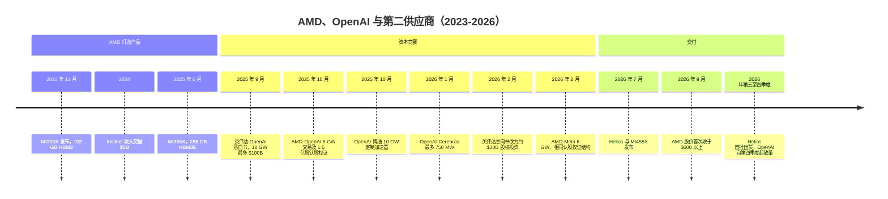
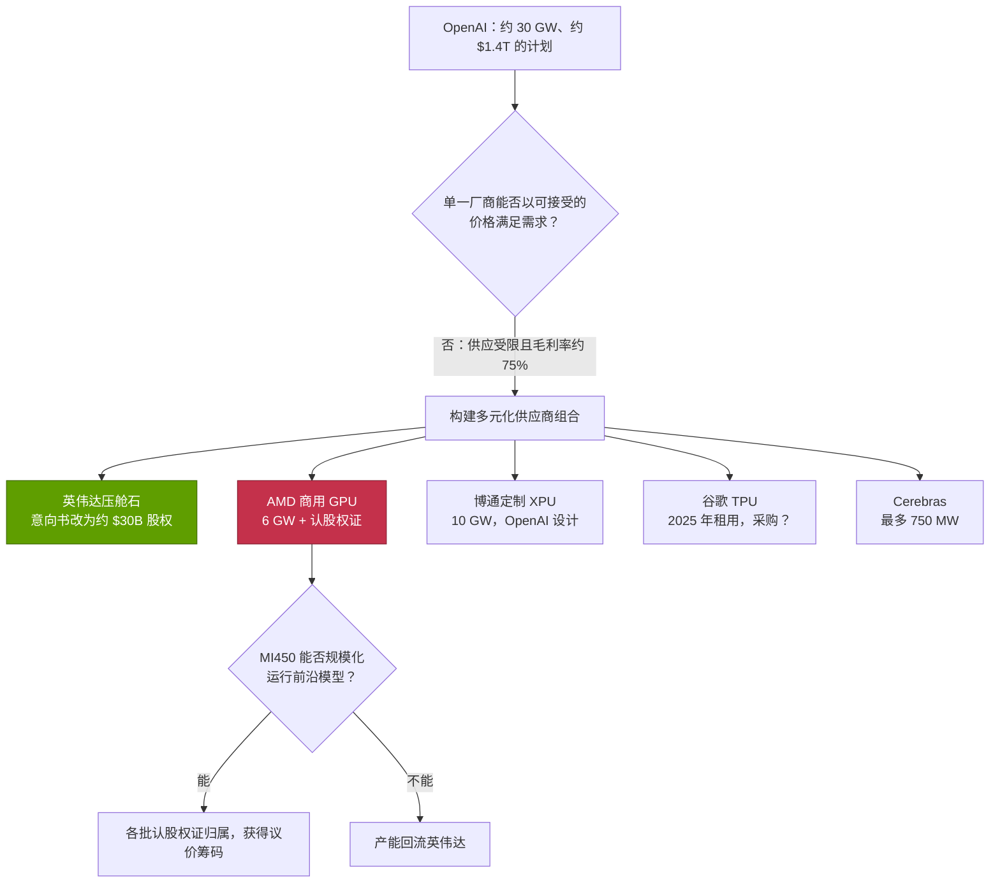
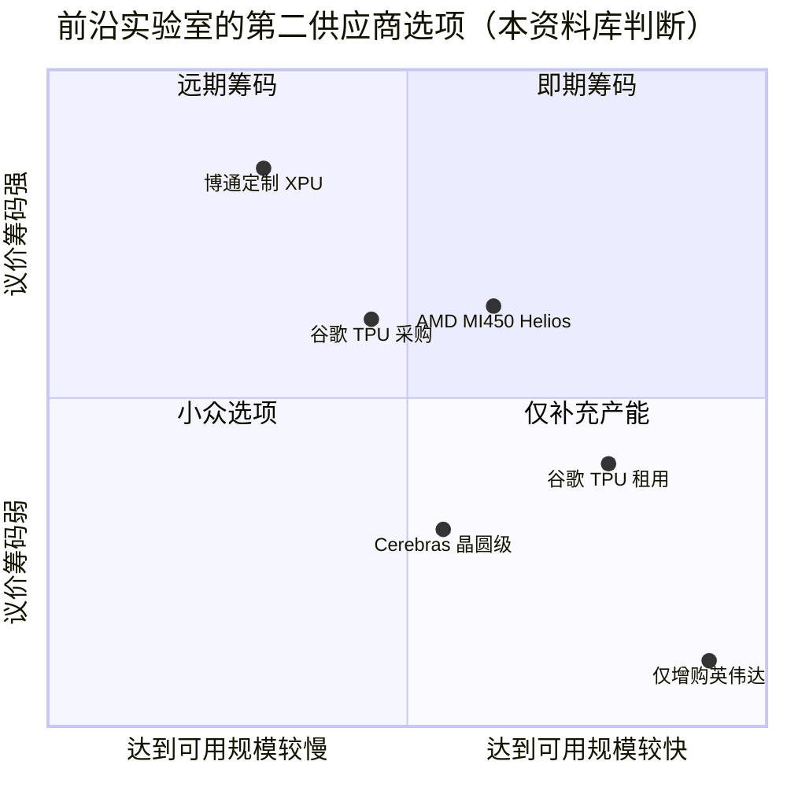

# CS4 · AMD、OpenAI 与第二供应商

> [!NOTE]
> 本页为英文原文的简体中文参考译文，仅供参考；如有出入，以[英文原文](../../case-studies/CS4-amd-openai-and-the-second-source.md "English original")为准。

案例研究 · 阅读约 14 分钟 · 最后核实：2026-11-05

## ⚡ 要点速览

- **交易内容：** 2025-10-06，OpenAI 同意部署最多 6 GW 的 AMD Instinct GPU，首批为 2026 年下半年的 1 GW MI450。AMD 以自身股票支付对价：一份可按 $0.01 认购最多 1.6 亿股 AMD 股票的[认股权证](../glossary.md#warrant)，随吉瓦级部署推进及 AMD 股价上涨分批归属 [[S24000]](../../sources/bibliography.md#s24000)[[S13506]](../../sources/bibliography.md#s13506)。
- **这是对英伟达资本攻势的回应：** 两周前，英伟达（NVIDIA）签署了一份[意向书（LOI）](../glossary.md#letter-of-intent)，拟随 OpenAI 部署 10 GW 英伟达系统而投资最多 $100B [[S467]](../../sources/bibliography.md#s467)。2026 年 2 月，这份意向书被搁置，改为一笔约 $30B、不附部署里程碑的直接股权投资 🟡 [[S90015]](../../sources/bibliography.md#s90015)[[S90016]](../../sources/bibliography.md#s90016)。
- **市场认为交易具有增值效应：** AMD 股价在公告当天收涨约 23.7 % [[S24002]](../../sources/bibliography.md#s24002)，在 $267B 市值基础上增加约 $63B（本资料库计算）。按交易前股价计算，该认股权证价值约 $26B，对应 AMD 约 9.9 % 的股份 [[S24001]](../../sources/bibliography.md#s24001)。
- **折扣是或有的，且具有反身性：** 按报道的最后一批 $600 股价门槛计算，全部归属的认股权证价值约 $96B，与 OpenAI 6 GW AMD 硬件账单的估计值大致相当（估计约 $90B，🔴 本资料库情景）。AMD 股价于 2026-09-21 首次收于 $600 以上 [[S24005]](../../sources/bibliography.md#s24005)[[S13507]](../../sources/bibliography.md#s13507)。
- **OpenAI 构建的是一个供应商组合，而非单一的第二供应商：** 与博通（Broadcom）合作的 10 GW 定制加速器 [[S174]](../../sources/bibliography.md#s174)、来自 Cerebras 的最多 750 MW [[S11523]](../../sources/bibliography.md#s11523)、自 2025 年起租用并据报道将采购的谷歌（Google）TPU 🟡 [[S24007]](../../sources/bibliography.md#s24007)[[S24008]](../../sources/bibliography.md#s24008)，而英伟达仍是压舱石。
- **已被证实的（2026 年 11 月）：** AMD 的 [Helios](../glossary.md#amd-helios) 机架已投产，首批出货约在 2026 年第三季度末 [[S90020]](../../sources/bibliography.md#s90020)。AMD 与 Meta 签订了相同结构的协议 [[S24004]](../../sources/bibliography.md#s24004)。AMD 数据中心收入在 2026 年第三季度同比增长 97 % [[S542]](../../sources/bibliography.md#s542)。
- **尚未被证实的：** OpenAI 的大规模 MI450 部署直到 2026 年第四季度才开始 🟢 [[S90021]](../../sources/bibliography.md#s90021)。没有任何一批认股权证公开归属 [[S24005]](../../sources/bibliography.md#s24005)。2023 年初至 2026 年年中，英伟达数据中心收入相对 AMD 的领先倍数从 3.3 倍扩大到 13 倍（本资料库根据财报计算）[[S450]](../../sources/bibliography.md#s450)[[S543]](../../sources/bibliography.md#s543)[[S405]](../../sources/bibliography.md#s405)。

## 1. 背景

**AMD Instinct 的放量。** AMD 进入 AI 加速器竞赛较晚。MI300X 于 2023-12-06 发布，配备 192 GB HBM3、带宽 5.3 TB/s，内存容量超过 H100 [[S141]](../../sources/bibliography.md#s141)。AMD 数据中心 GPU 收入从 2023 年第四季度的数亿美元增至 2024 年的 $5B 以上 [[S663]](../../sources/bibliography.md#s663)。MI355X（2025 年 6 月）配备 288 GB [HBM3E](../glossary.md#hbm3e)、带宽 8 TB/s，稠密 [FP4](../glossary.md#fp4) 算力 10.1 [PFLOPS](../glossary.md#flops) [[S143]](../../sources/bibliography.md#s143)。在 MLPerf Inference v6.0 中，其在 Llama 2 70B 上的单 GPU 性能与 B200 持平（12,935 对 12,994 tokens/s）[[S602]](../../sources/bibliography.md#s602)。AMD 缺少的是类似英伟达 [NVL72](../glossary.md#nvl72) 的机架级系统和成熟的软件栈（[ROCm](../glossary.md#rocm) 对 [CUDA](../glossary.md#cuda)）。最重要的是，它缺少一个愿意把前沿模型押在它身上的标杆客户。

**OpenAI 的胃口。** 截至 2025 年 10 月，OpenAI 已承诺约 30 GW 的算力，成本约 $1.4T，而其 2025 年底的年化收入预计仅约 $20B [[S24006]](../../sources/bibliography.md#s24006)。[吉瓦级算力](../glossary.md#gigawatt-of-compute)如今已成为这类交易的计量单位，因为电力和场地比芯片更早成为约束。

**英伟达抢先出手。** 2025-09-22，英伟达与 OpenAI 宣布一份意向书：英伟达投资最多 $100B，随 10 GW 中每 1 GW 上线逐步支付，首个吉瓦基于 Vera Rubin，于 2026 年下半年部署 [[S467]](../../sources/bibliography.md#s467)。2026 年 2 月，该意向书被搁置，改为在 OpenAI 融资轮中进行约 $30B 的股权投资，不附部署里程碑 🟡 [[S90015]](../../sources/bibliography.md#s90015)[[S90016]](../../sources/bibliography.md#s90016)[[S90017]](../../sources/bibliography.md#s90017)。

> [!TIP]
> **算例 —— 为何 30 GW 迫使买家引入第二供应商。** 英伟达 CEO 曾表示，每 GW AI 工厂中英伟达的价值量约为 $35B（2025 年 8 月）[[S398]](../../sources/bibliography.md#s398)。30 GW × $35B ≈ **$1.05T** 的英伟达价值量，约为英伟达 FY2026 全年收入 $215.9B 的 5 倍 [[S1]](../../sources/bibliography.md#s1)。没有任何买家会在缺少可用于比价的替代方案时，向单一供应商承诺如此大的金额。这笔账单上 5 % 的让步就价值约 $52B。🔴 本资料库基于厂商与媒体数据的测算。

## 2. 决策

**交易条款。** OpenAI 承诺在多代产品上部署最多 6 GW 的 AMD Instinct GPU，首批为 2026 年下半年的 1 GW MI450 [[S24000]](../../sources/bibliography.md#s24000)。作为回报，AMD 发行一份认股权证，可按每股 $0.01 认购最多 1.6 亿股 AMD 股票，期限五年 [[S24003]](../../sources/bibliography.md#s24003)。这约占 AMD 交易前约 16.23 亿股的 9.9 %（本资料库根据 $164.67 股价对应的 $267.23B 市值计算 [[S24001]](../../sources/bibliography.md#s24001)）。第一批随首个吉瓦部署而归属。后续各批需要更多吉瓦完成部署、AMD 股价达到逐级提高的目标（据报道最后一批为 $600），以及 OpenAI 的技术和商业里程碑 [[S13507]](../../sources/bibliography.md#s13507)[[S24003]](../../sources/bibliography.md#s24003)。AMD CFO 表示，该交易将带来“数百亿美元”的收入，并将显著增厚非 GAAP 每股收益 [[S24000]](../../sources/bibliography.md#s24000)。媒体估计在数年内最高可达 $100B [[S24010]](../../sources/bibliography.md#s24010)。就连英伟达 CEO 也称这一结构“很聪明” [[S24011]](../../sources/bibliography.md#s24011)。

这是一种[以股权换产能（equity-for-capacity）](../glossary.md#equity-for-capacity)的结构，而且与英伟达的结构正好相反。英伟达是*买入客户的股权*：它向 OpenAI 提供现金，而在批评者看来，这些现金又以 GPU 订单的形式回流（[循环融资](../glossary.md#circular-financing)）。AMD 则是*把自己的股权给客户*：OpenAI 按全价购买芯片，但若其大规模部署且 AMD 股价上涨，即可获得 AMD 股票。一周后宣布的博通 10 GW 项目则完全没有披露任何厂商出资。OpenAI 设计芯片，博通负责联合开发并供应机架 [[S174]](../../sources/bibliography.md#s174)。

| 交易（日期） | 产能 | 厂商出资 | 是否与部署挂钩？ | 状态（2026 年 11 月） |
|---|---|---|---|---|
| 英伟达意向书（2025-09-22） | 10 GW | 最多 $100B，逐步支付 | 是，按 GW | 🟡 2026 年 2 月搁置 [[S90016]](../../sources/bibliography.md#s90016) |
| 英伟达股权投资（2026 年 2 月） | — | 在 OpenAI 融资轮中投资约 $30B | 否 | 🟡 据报道已达成 [[S90015]](../../sources/bibliography.md#s90015)[[S13526]](../../sources/bibliography.md#s13526) |
| AMD 认股权证（2025-10-06） | 6 GW | 1.6 亿股 AMD 股票，行权价 $0.01 | 是，另附股价门槛 | 🟢 生效中；首个 GW 于 2026 年下半年 [[S24000]](../../sources/bibliography.md#s24000) |
| 博通（2025-10-13） | 10 GW | 未披露 | — | 🟢 2026 年下半年至 2029 年部署 [[S174]](../../sources/bibliography.md#s174) |
| Cerebras（2026-01-14） | 最多 750 MW | 无（约 $10B 采购） | — | 🟡 有报道 [[S11523]](../../sources/bibliography.md#s11523) |
| AMD 向 Meta 发行的认股权证（2026-02-24） | 6 GW | 1.6 亿股 AMD 股票，行权价 $0.01 | 是，另附 $600 门槛 | 🟢 首个 GW 于 2026 年下半年 [[S24004]](../../sources/bibliography.md#s24004) |

> [!TIP]
> **算例 —— 认股权证对 OpenAI 的价值与隐含的硬件折扣。** 假设（🔴 均为本资料库情景）：OpenAI 的 AMD 硬件支出为每 GW $15B，以媒体对 AMD 与 Meta 同类交易的估值（6 GW 对应 $60–100B 以上）为锚 [[S24004]](../../sources/bibliography.md#s24004)[[S24010]](../../sources/bibliography.md#s24010)。因此 6 GW ≈ **$90B**。全部归属时认股权证价值 = 1.6 亿股 × 股价。
>
> | AMD 股价 | 认股权证价值 | 相当于 $90B 账单的折扣 |
> |---|---|---|
> | $164.67（交易前收盘价）[[S24001]](../../sources/bibliography.md#s24001) | $26B | 29 % |
> | $400（示意） | $64B | 71 % |
> | $600（最后一批门槛）[[S13507]](../../sources/bibliography.md#s13507) | $96B | 107 % |
>
> 有三项修正会缩小这一标题数字。(1) **分批：** 若每吉瓦对应的批次相等（条款未公开），1 GW 可获得约 2,700 万股。按 $600 计算约为 $16B，对应约 $15B 的硬件。如果 OpenAI 止步于 3 GW，最后几批高门槛认股权证将永远不会归属。(2) **时间价值：** 最后几批要在数年后才归属，因此应按 OpenAI 的资本成本折现。(3) **反身性：** 很大一部分价值来自 AMD 股价*因为*此类交易而上涨。首日市场增加了约 $63B（23.7 % × $267B），约为认股权证当时约 $26B 价值的 2.4 倍 [[S24002]](../../sources/bibliography.md#s24002)[[S24001]](../../sources/bibliography.md#s24001)。对 AMD 的股东而言，这笔交易看起来是增值的。对 OpenAI 而言，这是一份押注 AMD 成功的免费期权，而且恰恰在 AMD 最不需要它的时候最值钱。

🔧 技术细节：一分钱认股权证如何像返利一样运作，以及它对 AMD 财务报表的影响

行权价为 $0.01 的认股权证在经济上相当于一笔或有的股票授予：行权价可以忽略不计，因此一旦归属，价值 ≈ 股数 × 股价。这使它成为一种**以股票支付的返利**，但有两点不同。其一，其规模随 AMD 股价而非硬件账单变动，因此实际折扣可能超过 100 %（如上所示），也可能缩小到微不足道。其二，股价门槛保护了 AMD 现有股东：稀释最严重的几批，只有在现有股东已经大幅获益后才会归属。

根据美国公认会计准则（US GAAP），授予客户的权益工具一般被视为应付客户对价。它们按公允价值计量，并在确认相关销售时记为*收入的减项*，而非经营费用。由此引出若干尽职调查问题：AMD 每吉瓦确认多少收入抵减、公允价值多久重新计量一次，以及非 GAAP 数据是否将其剔除。AMD 实际如何入账，应查阅其 10-K 和 10-Q 附注。🟡 本次未核实。

[股权稀释](../glossary.md#dilution)会叠加。OpenAI 和 Meta 的认股权证合计涵盖 3.2 亿股 [[S24003]](../../sources/bibliography.md#s24003)，约占交易前股本的 20 %（行权后约 17 %；本资料库计算）。

## 3. 结果（用数据说话）

截至 2026-11-05，即签约约 13 个月后，这个第二供应商**已经建成，但尚未在 OpenAI 的规模上得到验证**。

| 事项 | 状态 | 来源 |
|---|---|---|
| Helios（72 × MI455X、EPYC Venice、Pensando 网卡）于 2026-07-23 发布 | 🟢 已确认 | [[S538]](../../sources/bibliography.md#s538)[[S539]](../../sources/bibliography.md#s539) |
| Helios 已投产；首批出货约在 2026 年第三季度末 | 🟢/🟡 | [[S90020]](../../sources/bibliography.md#s90020)[[S90021]](../../sources/bibliography.md#s90021) |
| AMD 数据中心收入：2026 年第一季度 $5.8B（+57 %），第二季度 $6.7B（+107 %），第三季度同比 +97 % | 🟢 已确认 | [[S24009]](../../sources/bibliography.md#s24009)[[S543]](../../sources/bibliography.md#s543)[[S542]](../../sources/bibliography.md#s542) |
| 与 Meta 签订相同的认股权证结构（6 GW） | 🟢 已确认 | [[S24004]](../../sources/bibliography.md#s24004) |
| Anthropic：最多 2 GW 的 MI450 级 Helios；AMD 拟投资最多 $5B | 🟢/🟡 | [[S538]](../../sources/bibliography.md#s538)[[S9538]](../../sources/bibliography.md#s9538) |
| AMD 股价突破 $600 门槛（2026-09-21 收盘价 $612.46；市值超过 $1T） | 🟡 有报道 | [[S24005]](../../sources/bibliography.md#s24005) |
| OpenAI 大规模部署 MI450，2026 年第四季度延续至 2027 年 | 🟡 待定 | [[S90021]](../../sources/bibliography.md#s90021) |
| 任何一批认股权证已归属或行权 | 🔴 未披露 | [[S24005]](../../sources/bibliography.md#s24005) |
| Azure 成为首个大型 Helios 部署 | 🟡 有报道 | [[S90024]](../../sources/bibliography.md#s90024) |
| OpenAI 采购（而不仅是租用）谷歌 TPU | 🔴 单一来源报道 | [[S24008]](../../sources/bibliography.md#s24008) |

收入差距是一个令人清醒的数字。AMD 数据中心分部（包括 EPYC CPU）从 2023 年第一季度到 2026 年第三季度增长约 6.6 倍 [[S450]](../../sources/bibliography.md#s450)[[S542]](../../sources/bibliography.md#s542)。英伟达数据中心收入从 Q1 FY2024 到 Q2 FY2027 增长约 21 倍 [[S436]](../../sources/bibliography.md#s436)[[S405]](../../sources/bibliography.md#s405)。2025 年 AMD 约占 AI 数据中心芯片收入的 3 %（估计，本资料库在 `data/market_share.csv` 中的计算）[[S663]](../../sources/bibliography.md#s663)[[S416]](../../sources/bibliography.md#s416)。OpenAI 的这笔交易是 2027 年的收入事件，而非 2026 年的。

> [!TIP]
> **算例 —— OpenAI 的首个吉瓦对 AMD 意味着什么。** 按每 GW $15B 的基准情景（🔴），首个吉瓦约带来 $15B 收入。AMD 2026 年第三季度数据中心业务年化收入约为 $34B（估计约 $8.5B × 4）[[S542]](../../sources/bibliography.md#s542)。因此，单一客户的首个吉瓦约相当于 AMD 整个数据中心业务 5 个月的收入。这使 AMD 2027 年的业绩高度依赖 OpenAI 的部署节奏和融资情况。六个吉瓦按 $15B 计算为 $90B，约相当于 AMD 当前数据中心年化收入的 2.6 年。

## 4. 为何奏效（或为何未能奏效）

**买家为何需要第二供应商。** 原因有二：价格与供应。英伟达在 Q2 FY2027 实现了 75.0 % 的 GAAP 毛利率 [[S3]](../../sources/bibliography.md#s3)。可信的替代方案是买家影响这一利润率的唯一杠杆。另一个原因是供应：英伟达称其 FY2028 展望“受供应约束” [[S90012]](../../sources/bibliography.md#s90012)。拿不到足够 GPU 的实验室就无法交付产品。即使 AMD 永远拿不到一半的份额，一个*有能力*承接产能的[第二供应商](../glossary.md#second-source)也会影响英伟达的定价和配货决策。英伟达自身在四个月后从附里程碑的意向书转向约 $30B 的直接股权投资，与这种压力是吻合的 🔴（推断）。

> [!NOTE]
> **🐂 看多观点（AMD 与第二供应商）。** 从纸面参数看，Helios 在内存上领先 Vera Rubin NVL72：[HBM4](../glossary.md#hbm4) 容量 31 TB 对 20.7 TB [[S90021]](../../sources/bibliography.md#s90021)[[S102]](../../sources/bibliography.md#s102)。在机架级[高带宽内存（HBM）](../glossary.md#hbm)带宽上同样领先（约 1,678 对 1,400 TB/s，高出约 20%），而英伟达的规格修订还扩大了这一领先幅度 [[S90006]](../../sources/bibliography.md#s90006)[[S90093]](../../sources/bibliography.md#s90093)。每 GPU 的[纵向扩展（scale-up）](../glossary.md#scale-up)带宽为 3.6 对 3.0 TB/s [[S5522]](../../sources/bibliography.md#s5522)[[S90007]](../../sources/bibliography.md#s90007)。AMD 的 MI325X、MI355X 和 MI455X 均在英伟达旗舰产品推出后约一个季度内问世，因此代际节奏差距已基本消除 [[S142]](../../sources/bibliography.md#s142)[[S143]](../../sources/bibliography.md#s143)[[S539]](../../sources/bibliography.md#s539)。三家前沿买家（OpenAI、Meta、Anthropic）已承诺最多 14 GW [[S24000]](../../sources/bibliography.md#s24000)[[S24004]](../../sources/bibliography.md#s24004)[[S538]](../../sources/bibliography.md#s538)。

| 机架（2026） | AMD Helios | 英伟达 Vera Rubin NVL72 | 对 AMD 的评价 |
|---|---|---|---|
| 每个纵向扩展域的 GPU 数 | 72 个 MI455X | 72 个 Rubin | 🟨 规模相同 [[S344]](../../sources/bibliography.md#s344)[[S102]](../../sources/bibliography.md#s102) |
| HBM4 容量 | 约 31 TB | 20.7 TB | 🟩 约 1.5 倍 [[S90021]](../../sources/bibliography.md#s90021)[[S102]](../../sources/bibliography.md#s102) |
| HBM 带宽（机架） | 约 1,678 TB/s | 1,400 TB/s（修订后） | 🟩 约 1.2 倍；也高于发布时的 1,580 规格 [[S90093]](../../sources/bibliography.md#s90093)[[S90006]](../../sources/bibliography.md#s90006) |
| FP8 算力 | 1.4 EF | 约 1.26 EF 稠密 | 🟩 纸面领先 [[S90021]](../../sources/bibliography.md#s90021)[[S33006]](../../sources/bibliography.md#s33006) |
| 纵向扩展互连 | [基于以太网的 UALink（UALoE）](../glossary.md#ualoe)，每 GPU 3.6 TB/s（机架约 260 TB/s） | NVLink 6，每 GPU 3.0 TB/s（修订后） | 🟦 开放 vs 专有 [[S226]](../../sources/bibliography.md#s226)[[S5522]](../../sources/bibliography.md#s5522)[[S90007]](../../sources/bibliography.md#s90007) |
| 软件成熟度 | ROCm 7.x | CUDA | 🟥 落后（见下文）[[S90064]](../../sources/bibliography.md#s90064)[[S633]](../../sources/bibliography.md#s633) |
| 机架级交付记录 | 第一代 | 第三代（GB200、GB300、VR） | 🟥 落后 [[S8527]](../../sources/bibliography.md#s8527)[[S5501]](../../sources/bibliography.md#s5501) |

**为何可能行不通。** 共有三项风险，按权重排序：

1. **软件。** DeepSeek-V4-Pro 于 2026 年 4 月发布时，首日即可在 CUDA 上运行。在 MI355X 上，FP4 在第 8 天可用，每用户 50 tokens/s 在第 27 天实现。到第 43 天，多节点推理服务仍无法运行 [[S633]](../../sources/bibliography.md#s633)[[S631]](../../sources/bibliography.md#s631)。在一项[智能体（agentic）](../glossary.md#agentic-ai) GLM 5.3 测试中，在每用户 150 tokens/s 下，英伟达的每 token 成本最多低 5 倍 [[S636]](../../sources/bibliography.md#s636)。在一项 GLM-5 吞吐量测试中，MI355X 比 B200 最多便宜 29.6 % [[S637]](../../sources/bibliography.md#s637)。AMD 能在自己专门调优过的基准测试中胜出。实验室真正的风险在于大量尚未调优的新模型这一长尾。
2. **机架级可靠性。** Helios 是 AMD 的第一款机架级系统。它依赖随 ZT Systems（$4.9B，2025-03-31 完成交割）收购而来的设计团队 [[S8527]](../../sources/bibliography.md#s8527)，而 ZT Systems 的工厂已出售给 Sanmina [[S5528]](../../sources/bibliography.md#s5528)。英伟达自己的首款 NVL72 在放量期间也曾出现过热报道和客户反弹 [[S5501]](../../sources/bibliography.md#s5501)。2026 年 2 月一则关于 MI455X 延期的报道遭到 AMD 否认 [[S2521]](../../sources/bibliography.md#s2521)[[S2524]](../../sources/bibliography.md#s2524)。
3. **英伟达的[年度迭代节奏](../glossary.md#annual-cadence)。** Vera Rubin 于 2026 年第三季度开始出货，第四季度放量 [[S90009]](../../sources/bibliography.md#s90009)。Rubin Ultra（Kyber，144 个封装）将于 2027 年下半年推出，Feynman 将于 2028 年推出 [[S90003]](../../sources/bibliography.md#s90003)[[S90004]](../../sources/bibliography.md#s90004)。第二供应商每年都要追赶一个移动的目标，而其可用于投入的数据中心收入少了约 13 倍。

> [!TIP]
> **算例 —— 第二供应商的软件税。** 某实验室希望一个新的开源模型在发布时即可在 100,000 个 GPU 上提供服务。在 CUDA 上，DeepSeek-V4-Pro 首日即可运行。在 MI355X 上，达到每用户 50 tokens/s 用了 27 天 [[S633]](../../sources/bibliography.md#s633)。按示意性的每 [GPU 小时](../glossary.md#gpu-hour) $2 计算，100,000 个 GPU 利用不足 27 天的成本为 100,000 × 24 × 27 × $2 ≈ **$130M**，尚未计入任何收入损失。相对于一个 6 GW 项目（约 $90B，🔴 基准情景），这个数字很小，因此议价收益可能超过这笔税。但相对于前沿实验室的发布日程，这个数字很大：每个季度出现一次缓慢的发布，就会侵蚀硬件折扣。🔴 本资料库测算。

> [!WARNING]
> **🐻 看空观点。** 认股权证买到的是承诺，而不是竞争力。如果 MI450 延期或表现不及预期，OpenAI 几乎没有损失：它少买几个吉瓦，高门槛的几批认股权证作废即可。届时 AMD 就为一个随时可以离开的客户稀释了股东权益。这一结构还助长了 AI 资本开支循环。AI 情绪高涨时，AMD 的股权“货币”更值钱；一旦板块估值下调，认股权证的价值和 AMD 重复这一手法的能力都会同时缩水。

## 5. 对企业发展（corp dev）的启示

1. **以股权换产能有两种方向。** 厂商可以买入客户的股权（英伟达 → OpenAI、Anthropic），也可以把自己的股权给客户（AMD → OpenAI、Meta）。前者动用现金并增加资产负债表风险。后者以稀释为代价，且只有在发行方股票是一种强势“货币”时才奏效：AMD 股价在交易第一年内从约 $165 涨至约 $612 [[S24001]](../../sources/bibliography.md#s24001)[[S24005]](../../sources/bibliography.md#s24005)。股价门槛让发行方在其股东获益最多时付出最多。
2. **将价值与部署而非签约挂钩。** 英伟达最初的意向书和 AMD 的认股权证都按已部署的吉瓦付酬。这使激励保持一致，但也让标题数字（最多 $100B；最多 1.6 亿股）成为上限而非期望值。应为每一批次的概率建模。
3. **第二供应商的硬约束依次是软件、机架和迭代节奏。** AMD 的芯片在纸面上与英伟达旗鼓相当。其差距在于首日模型支持和机架级现场经验。能够弥补这些差距的资产，例如可移植编译器和运行时，或机架集成团队（ZT Systems，$4.9B [[S8527]](../../sources/bibliography.md#s8527)），对挑战者而言可能比再多一款芯片更有价值。
4. **客户集中是一把双刃剑。** OpenAI、Meta 和 Anthropic 合计可能吸收 AMD 最多 14 GW 的产能 [[S24000]](../../sources/bibliography.md#s24000)[[S24004]](../../sources/bibliography.md#s24004)[[S538]](../../sources/bibliography.md#s538)。这证明了 AMD 的实力，但也将 AMD 2027–2028 年的收入与三家买家的融资状况绑在一起。

## 🎯 企业发展视角

1. **支付“货币”：** AMD 的认股权证之所以奏效，是因为其股价正在上涨，且交易前市值约 $267B [[S24001]](../../sources/bibliography.md#s24001)。市值较小的挑战者能提供哪些以股权换产能的条款，而不造成不可接受的稀释？收入返利、预付款或共同投资数据中心场地能否作为替代？
2. **买家视角的第二供应商经济学：** 按每 GW 约 $35B 的英伟达价值量计算 [[S398]](../../sources/bibliography.md#s398)，一个可信的替代方案能换来英伟达多少个百分点的降价？谁能获得这部分价值：买家，还是永远达不到规模的挑战者？
3. **软件是打破护城河的关键：** 高通（Qualcomm）于 2026-07-29 完成的 $3.9B Modular（Mojo/MAX）收购，瞄准的是可跨硬件移植的 AI 软件 [[S90057]](../../sources/bibliography.md#s90057)[[S9511]](../../sources/bibliography.md#s9511)。非英伟达硬件上的首日模型支持，会在多大程度上改变实验室承诺吉瓦级采购的意愿？
4. **推理优先的第二供应商：** 高通的 AI200/AI250 机架和 HUMAIN 的 200 MW 计划已经公开 🟢/🔴 [[S90028]](../../sources/bibliography.md#s90028)[[S90030]](../../sources/bibliography.md#s90030)。相比 AMD 和博通已深度参与的前沿训练，受电力约束的推理细分市场是否是更现实的第二供应商切入点？
5. **结构风险：** 对于任何提供与股权挂钩产能的合作伙伴，收入抵减、重新计量和非 GAAP 处理是如何进行的？如果部署停滞，这一工具会怎样？

## 📚 来源（Sources）

<!-- Auto-generated from the [S…] citations on this page by `make build`. Edit sources/registry/*.csv, not this list. -->

- [**S1**](../../sources/bibliography.md#s1) NVIDIA Corporation via SEC EDGAR, *NVIDIA Announces Financial Results for Fourth Quarter and Fiscal 2026 (Form 8-K exhibit 99.1)*, 2026-02-25. [Link](https://www.sec.gov/Archives/edgar/data/1045810/000104581026000019/q4fy26pr.htm)
- [**S3**](../../sources/bibliography.md#s3) StorageNewsletter, *NVIDIA Q2 Fiscal 2027 results coverage: revenue $96.2B*, 2026-08-27. [Link](https://www.storagenewsletter.com/2026/08/27/nvidia-fiscal-2q27-financial-results/)
- [**S102**](../../sources/bibliography.md#s102) NVIDIA, *NVIDIA DGX Vera Rubin NVL72*, 2026. [Link](https://www.nvidia.com/en-us/data-center/dgx-vera-rubin-nvl72/)
- [**S141**](../../sources/bibliography.md#s141) AMD, *AMD Instinct MI300X Accelerator*, 2023-12-06. [Link](https://www.amd.com/en/products/accelerators/instinct/mi300/mi300x.html)
- [**S142**](../../sources/bibliography.md#s142) AMD, *AMD Instinct MI325X Accelerator*, 2024-10-10. [Link](https://www.amd.com/en/products/accelerators/instinct/mi300/mi325x.html)
- [**S143**](../../sources/bibliography.md#s143) AMD, *AMD Instinct MI350 Series (MI350X, MI355X)*, 2025-06-12. [Link](https://www.amd.com/en/products/accelerators/instinct/mi350.html)
- [**S174**](../../sources/bibliography.md#s174) OpenAI, *OpenAI and Broadcom announce strategic collaboration to deploy 10 gigawatts of OpenAI-designed AI accelerators*, 2025-10-13. [Link](https://openai.com/index/openai-and-broadcom-announce-strategic-collaboration/)
- [**S226**](../../sources/bibliography.md#s226) AMD, *AMD Helios Rackscale Solution (product page)*, 2026. [Link](https://www.amd.com/en/products/rackscale-solutions/helios.html)
- [**S344**](../../sources/bibliography.md#s344) AMD, *AMD Helios rack-scale AI infrastructure (product page)*, 2026. [Link](https://www.amd.com/ja/products/rackscale-solutions/helios.html)
- [**S398**](../../sources/bibliography.md#s398) NVIDIA Investor Relations, *NVIDIA Q2 FY2026 earnings call (2025-08-27): AI factory economics commentary*, 2025-08-27. [Link](https://investor.nvidia.com/events-and-presentations/events-and-presentations/default.aspx)
- [**S405**](../../sources/bibliography.md#s405) NVIDIA Corporation via SEC EDGAR, *NVIDIA Announces Financial Results for Second Quarter Fiscal 2027 (Form 8-K exhibit 99.1)*, 2026-08-26. [Link](https://www.sec.gov/Archives/edgar/data/0001045810/000104581026000073/q2fy27pr.htm)
- [**S416**](../../sources/bibliography.md#s416) NVIDIA Corporation via SEC EDGAR, *NVIDIA Corporation Form 10-K for fiscal year ended January 26, 2025*, 2025-02-26. [Link](https://www.sec.gov/Archives/edgar/data/1045810/000104581025000023/nvda-20250126.htm)
- [**S436**](../../sources/bibliography.md#s436) NVIDIA Corporation, *NVIDIA Announces Financial Results for First Quarter Fiscal 2024 (press release with CFO commentary)*, 2023-05-24. [Link](https://nvidianews.nvidia.com/news/nvidia-announces-financial-results-for-first-quarter-fiscal-2024)
- [**S450**](../../sources/bibliography.md#s450) U.S. Securities and Exchange Commission (EDGAR), *Advanced Micro Devices Form 10-K / 10-Q filings (EDGAR index)*, 2025-02-05. [Link](https://www.sec.gov/cgi-bin/browse-edgar?action=getcompany&CIK=0000002488&type=10-&dateb=&owner=include&count=40)
- [**S467**](../../sources/bibliography.md#s467) NVIDIA Newsroom, *OpenAI and NVIDIA Announce Strategic Partnership to Deploy 10 Gigawatts of NVIDIA Systems*, 2025-09-22. [Link](https://nvidianews.nvidia.com/news/openai-and-nvidia-announce-strategic-partnership-to-deploy-10gw-of-nvidia-systems)
- [**S538**](../../sources/bibliography.md#s538) AMD Investor Relations, *AAI 2026: AMD Delivers Full-Stack Compute for the Agentic AI Era*, 2026-07-23. [Link](https://ir.amd.com/news-events/press-releases/detail/1294/aai-2026-amd-delivers-full-stack-compute-for-the-agentic-ai-era)
- [**S539**](../../sources/bibliography.md#s539) Phoronix (Michael Larabel), *AMD Launches Instinct MI455X, Helios AI Rack*, 2026-07-23. [Link](https://www.phoronix.com/news/AMD-Instinct-MI455X-Helios)
- [**S542**](../../sources/bibliography.md#s542) AMD via SEC EDGAR, *AMD Reports Third Quarter 2026 Financial Results (Form 8-K Exhibit 99.1)*, 2026-11-03. [Link](https://www.sec.gov/Archives/edgar/data/0000002488/000000248826000188/q32026991.htm)
- [**S543**](../../sources/bibliography.md#s543) AMD via SEC EDGAR, *AMD Q2 2026 earnings slides (Form 8-K)*, 2026-08-04. [Link](https://www.sec.gov/Archives/edgar/data/0000002488/000000248826000121/amdq22026earningsslidesf.htm)
- [**S602**](../../sources/bibliography.md#s602) MLCommons, *MLPerf Inference v6.0 results (summary_results.json and per-submitter logs)*, 2026-04-01. [Link](https://github.com/mlcommons/inference_results_v6.0)
- [**S631**](../../sources/bibliography.md#s631) SemiAnalysis, *MI355X DeepSeek-V4-Pro on SGLang: 110.5x Throughput per GPU in 26 Days*, 2026-05-26. [Link](https://github.com/SemiAnalysisAI/InferenceX-app/blob/main/packages/app/content/blog/mi355x-deepseek-v4-pro-sglang-110x-in-26-days.mdx)
- [**S633**](../../sources/bibliography.md#s633) SemiAnalysis, *DeepSeekV4 1.6T Day 0 to Day 43 Performance Over Time — Huawei, GB300 NVL72, MI355X, B200*, 2026-06-09. [Link](https://github.com/SemiAnalysisAI/InferenceX-app/blob/main/packages/app/content/blog/deepseekv4-16t-day-0-to-day-43-performance.mdx)
- [**S636**](../../sources/bibliography.md#s636) SemiAnalysis, *GLM 5.3 on AgentX: NVIDIA Is Up to 5x Cheaper per Token at 150 tok/s/user*, 2026-08-25. [Link](https://github.com/SemiAnalysisAI/InferenceX-app/blob/main/packages/app/content/blog/glm-5-3-agentx-nvidia-vs-amd-sglang-150-toks.mdx)
- [**S637**](../../sources/bibliography.md#s637) SemiAnalysis, *AMD MI355X GLM-5 Inference: Up to 29.6% Lower Cost per Million Tokens than B200 on SGLang FP8*, 2026-05-25. [Link](https://github.com/SemiAnalysisAI/InferenceX-app/blob/main/packages/app/content/blog/mi355x-glm5-fp8-sglang-40-cheaper-than-b200.mdx)
- [**S663**](../../sources/bibliography.md#s663) AMD, *AMD Reports Fourth Quarter and Full Year 2024 Financial Results*, 2025-02-04. [Link](https://ir.amd.com/news-events/press-releases)
- [**S2521**](../../sources/bibliography.md#s2521) Tom's Hardware, *AMD denies report of MI455X delays as Nvidia VR200 systems are rumored to arrive early*, 2026-02. [Link](https://www.tomshardware.com/tech-industry/artificial-intelligence/amd-denies-report-of-mi455x-delays-as-nvidia-vr200-systems-are-rumored-to-arrive-early-company-says-helios-systems-on-target-for-2h-2026)
- [**S2524**](../../sources/bibliography.md#s2524) The Next Platform, *AMD says Helios racks and MI400 series GPUs on track for 2H 2026*, 2026-02-23. [Link](https://www.nextplatform.com/2026/02/23/amd-says-helios-racks-and-mi400-series-gpus-on-track-for-2h-2026/)
- [**S5501**](../../sources/bibliography.md#s5501) TechPowerUp, *NVIDIA's GB200 'Blackwell' racks face overheating issues*, 2025-01-14. [Link](https://techpowerup.com/331105/nvidias-gb200-blackwell-racks-face-overheating-issues)
- [**S5522**](../../sources/bibliography.md#s5522) Remio, *AMD Helios unites 72 GPUs but NVIDIA sets the test*, 2026. [Link](https://www.remio.ai/post/amd-helios-unites-72-gpus-but-nvidia-sets-the-test)
- [**S5528**](../../sources/bibliography.md#s5528) Sanmina, *Sanmina completes acquisition of ZT Systems data center infrastructure manufacturing business from AMD*, 2025-10-27. [Link](https://s201.q4cdn.com/209924174/files/doc_news/SANMINA-COMPLETES-ACQUISITION-OF-ZT-SYSTEMS-DATA-CENTER-INFRASTRUCTURE-MANUFACTURING-BUSINESS-FROM-AMD-2025.pdf)
- [**S8527**](../../sources/bibliography.md#s8527) AMD Investor Relations, *AMD completes acquisition of ZT Systems*, 2025-03-31. [Link](https://ir.amd.com/news-events/press-releases/detail/1240/amd-completes-acquisition-of-zt-systems)
- [**S9511**](../../sources/bibliography.md#s9511) Nasdaq (Qualcomm press release), *Qualcomm Completes Acquisition of Modular*, 2026-07-29. [Link](https://www.nasdaq.com/press-release/qualcomm-completes-acquisition-modular-2026-07-29)
- [**S9538**](../../sources/bibliography.md#s9538) The Next Web, *AMD is investing $5 billion in Anthropic and deploying 2 gigawatts of Helios GPUs to run Claude*, 2026. [Link](https://thenextweb.com/news/amd-anthropic-5-billion-investment-2gw-helios-mi450)
- [**S11523**](../../sources/bibliography.md#s11523) DatacenterDynamics, *OpenAI signs $10 billion deal with Cerebras with 750MW of big chip compute*, 2026-01-14. [Link](https://www.datacenterdynamics.com/en/news/openai-signs-10-billion-deal-with-cerebras-with-750mw-of-big-chip-compute/)
- [**S13506**](../../sources/bibliography.md#s13506) Tom's Hardware, *OpenAI signs 6 GW AMD GPU deal*, 2025-10-06. [Link](https://www.tomshardware.com/pc-components/gpus/openai-signs-6gw-amd-gpu-deal)
- [**S13507**](../../sources/bibliography.md#s13507) The Motley Fool, *AMD pays a high price for blockbuster OpenAI deal*, 2025-10-07. [Link](https://www.fool.com/investing/2025/10/07/amd-pays-a-high-price-for-blockbuster-openai-deal)
- [**S13526**](../../sources/bibliography.md#s13526) Storyboard18, *Nvidia CEO Jensen Huang hints no further investments in OpenAI, Anthropic*, 2026. [Link](https://www.storyboard18.com/brand-makers/nvidia-ceo-jensen-huang-hints-no-further-investments-in-openai-anthropic-heres-why-91280.htm)
- [**S24000**](../../sources/bibliography.md#s24000) AMD (press release PDF), *AMD and OpenAI Announce Strategic Partnership to Deploy 6 Gigawatts of AMD GPUs*, 2025-10-06. [Link](https://d1io3yog0oux5.cloudfront.net/_be34f20d01abfe28aeec9c2c12afe601/amd/news/2025-10-06_AMD_and_OpenAI_Announce_Strategic_Partnership_to_1260.pdf)
- [**S24001**](../../sources/bibliography.md#s24001) MarketBeat, *AMD (NASDAQ:AMD) stock price history and chart*, 2025-10-03. [Link](https://www.marketbeat.com/stocks/nasdaq/amd/chart)
- [**S24002**](../../sources/bibliography.md#s24002) Arabian Business, *AMD shares zoom 23.7% as OpenAI looks to take 10% stake in the company*, 2025-10-06. [Link](https://www.arabianbusiness.com/markets/equities/equity/amd-shares-zoom-23-7-as-openai-looks-to-take-10-stake-in-the-company)
- [**S24003**](../../sources/bibliography.md#s24003) Crypto Briefing, *AMD has promised OpenAI and Meta up to 320 million shares at a penny each*, 2026. [Link](https://cryptobriefing.com/amd-openai-meta-penny-share-warrants/)
- [**S24004**](../../sources/bibliography.md#s24004) The Register, *AMD copy-pastes 6 GW chips-for-stock deal in new Meta agreement*, 2026-02-24. [Link](https://www.theregister.com/2026/02/24/amd_copypastes_openai_6gw_chipsforstock/)
- [**S24005**](../../sources/bibliography.md#s24005) Vested Finance, *OpenAI can buy 160 million shares of trillion-dollar AMD at just 1 cent each. How?*, 2026-09-24. [Link](https://vestedfinance.com/blog/us-stocks/openai-can-buy-160-million-shares-of-trillion-dollar-amd-at-just-1-cent-each-how/)
- [**S24006**](../../sources/bibliography.md#s24006) StreetInsider (Reuters), *Altman touts trillion-dollar AI vision as OpenAI restructures to chase scale (Reuters)*, 2025-10-29. [Link](https://www.streetinsider.com/Reuters/Altman+touts+trillion-dollar+AI+vision+as+OpenAI+restructures+to+chase+scale/25515962.html)
- [**S24007**](../../sources/bibliography.md#s24007) The Star (Reuters), *OpenAI says it has no plan to use Google's in-house chip (Reuters)*, 2025-07-01. [Link](https://www.thestar.com.my/tech/tech-news/2025/07/01/openai-says-it-has-no-plan-to-use-google039s-in-house-chip-)
- [**S24008**](../../sources/bibliography.md#s24008) Decrypt, *OpenAI plans to buy Google's AI chips as it looks beyond Nvidia: report*, 2026-10-28. [Link](https://decrypt.co/382090/openai-plans-buy-google-ai-chips-looks-beyond-nvidia)
- [**S24009**](../../sources/bibliography.md#s24009) HPCwire (AMD press release), *AMD Reports First Quarter 2026 Financial Results*, 2026-05-05. [Link](https://www.hpcwire.com/off-the-wire/amd-reports-1st-quarter-2026-financial-results/)
- [**S24010**](../../sources/bibliography.md#s24010) ITPro, *OpenAI signs another chip deal, this time with AMD*, 2025-10-06. [Link](https://www.itpro.com/technology/artificial-intelligence/openai-signs-another-chip-deal-this-time-with-amd)
- [**S24011**](../../sources/bibliography.md#s24011) Stocktwits, *AMD hits all-time high after Nvidia CEO Jensen Huang calls offering 10% stake to OpenAI 'clever'*, 2025-10-08. [Link](https://stocktwits.com/news-articles/markets/equity/amd-hits-all-time-high-after-nvidia-ceo-jensen-huang-calls-offering-10-percent-stake-to-open-ai-clever/ch6EpkDR30b)
- [**S33006**](../../sources/bibliography.md#s33006) Tom's Hardware, *Nvidia launches Vera Rubin NVL72 AI supercomputer at CES*, 2026-01-05. [Link](https://www.tomshardware.com/pc-components/gpus/nvidia-launches-vera-rubin-nvl72-ai-supercomputer-at-ces-promises-up-to-5x-greater-inference-performance-and-10x-lower-cost-per-token-than-blackwell-coming-2h-2026)
- [**S90003**](../../sources/bibliography.md#s90003) eWeek, *Everything Nvidia Just Announced at GTC 2026: 7 Chips, 5 Racks, 1 Giant Bet on Agentic AI*, 2026-03-17. [Link](https://www.eweek.com/news/nvidia-gtc-2026-ai-inference-vera-rubin-neuron/)
- [**S90004**](../../sources/bibliography.md#s90004) TrendForce, *Key GTC takeaways: how Samsung, Micron, Intel and more power NVIDIA's Vera Rubin and Feynman*, 2026-03-17. [Link](https://www.trendforce.com/news/2026/03/17/news-key-gtc-takeaways-how-samsung-micron-intel-more-power-nvidias-vera-rubin-and-feynman/)
- [**S90006**](../../sources/bibliography.md#s90006) TweakTown, *Nvidia cuts Vera Rubin's memory bandwidth by up to 26% and AMD's Helios now leads in memory bandwidth*, 2026-10. [Link](https://www.tweaktown.com/news/114304/nvidia-cuts-vera-rubins-memory-bandwidth-by-up-to-26-percent-and-amds-helios-now-leads-in-memory-bandwidth/index.html)
- [**S90007**](../../sources/bibliography.md#s90007) TechRadar Pro, *Nvidia forced to dial back key bandwidth targets on Vera Rubin*, 2026-10. [Link](https://techradar.com/pro/nvidia-forced-to-dial-back-key-bandwidth-targets-on-vera-rubin-hardware-tweaks-will-affect-target-specifications-for-memory-and-interconnect-fabric)
- [**S90009**](../../sources/bibliography.md#s90009) GamesBeat, *Nvidia Vera Rubin ramps into full production for fall launch*, 2026. [Link](https://gamesbeat.com/nvidia-vera-rubin-ramps-into-full-production-for-fall-launch-again/)
- [**S90012**](../../sources/bibliography.md#s90012) Tomasz Tunguz (Tomasz Tunguz), *Nvidia Q2 FY27 earnings*, 2026-08. [Link](https://www.tomtunguz.com/nvidia-q2-fy27-earnings/index.md)
- [**S90015**](../../sources/bibliography.md#s90015) DatacenterDynamics, *Nvidia plans $30bn investment in upcoming OpenAI funding round*, 2026-02. [Link](https://www.datacenterdynamics.com/en/news/nvidia-plans-30bn-investment-in-upcoming-openai-funding-round/)
- [**S90016**](../../sources/bibliography.md#s90016) Storyboard18 (Financial Times), *Nvidia set for $30bn OpenAI deal as $100bn partnership shelved, report says (FT)*, 2026-02-20. [Link](https://www.storyboard18.com/digital/nvidia-set-for-30bn-openai-deal-as-100bn-partnership-shelved-report-says-90188.htm)
- [**S90017**](../../sources/bibliography.md#s90017) ITdaily, *Nvidia won't invest $100 billion in OpenAI after all*, 2026-02. [Link](https://itdaily.com/news/innovation/nvidia-openai-30-billion/)
- [**S90020**](../../sources/bibliography.md#s90020) Shacknews, *AMD Helios AI rack system on track for initial shipments in Q3 2026*, 2026. [Link](https://www.shacknews.com/article/150249/amd-helios-ai-system-shipping-q3-2026)
- [**S90021**](../../sources/bibliography.md#s90021) Igor's Lab, *AMD Helios in production: MI455X, EPYC Venice and OpenAI challenge Nvidia AI racks*, 2026. [Link](https://www.igorslab.de/en/amd-helios-in-production-mi455x-epyc-venice-openai-challenge-nvidia-ai-racks/)
- [**S90024**](../../sources/bibliography.md#s90024) Crypto Briefing, *AMD's Helios platform ships H2 2026 with Microsoft Azure as first major deployment*, 2026. [Link](https://cryptobriefing.com/amd-helios-platform-ships-h2-2026/)
- [**S90028**](../../sources/bibliography.md#s90028) TechRepublic, *Qualcomm unveils AI chips to rival Nvidia, AMD*, 2025-10-27. [Link](https://techrepublic.com/article/news-qualcomm-unveils-ai-chips-to-rival-nvidia-amd)
- [**S90030**](../../sources/bibliography.md#s90030) Morningstar, *Qualcomm: Humain deal provides some AI upside*, 2025-10. [Link](https://www.morningstar.com/stocks/qualcomm-humain-deal-provides-some-ai-upside)
- [**S90057**](../../sources/bibliography.md#s90057) StorageReview, *Qualcomm unveils Dragonfly data center roadmap: C1000 CPU, AI300 accelerator and Modular acquisition*, 2026-06-24. [Link](https://www.storagereview.com/es/news/qualcomm-unveils-dragonfly-data-center-roadmap-c1000-cpu-ai300-accelerator-and-modular-acquisition)
- [**S90064**](../../sources/bibliography.md#s90064) The Register, *ROCm 7: AMD tries to catch CUDA with performance-boosting software*, 2025-09-17. [Link](https://www.theregister.com/2025/09/17/amd_rocm_7_chases_nvidia_cuda/)
- [**S90093**](../../sources/bibliography.md#s90093) Tom's Hardware, *AMD takes the wraps off its Instinct MI455X AI accelerator: CDNA 5 and Helios rack-scale architecture*, 2026. [Link](https://www.tomshardware.com/pc-components/gpus/amd-takes-the-wraps-off-its-instinct-mi455x-ai-accelerator-cdna-5-and-helios-rack-scale-architecture-combine-to-take-the-fight-to-nvidia-in-the-data-center)
