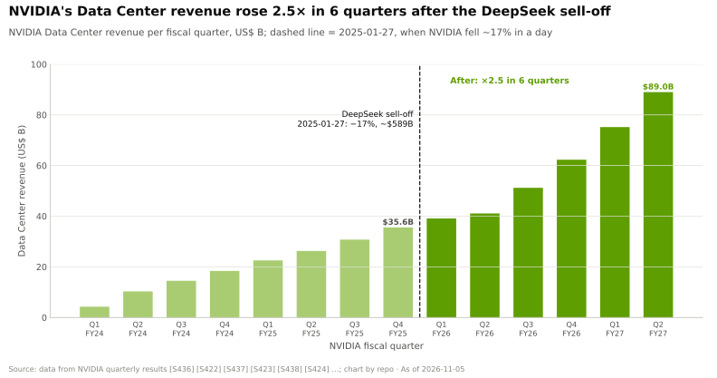
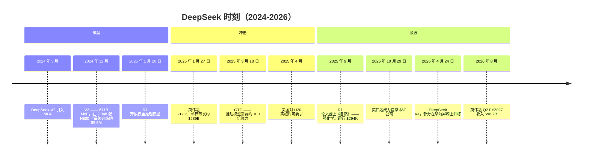
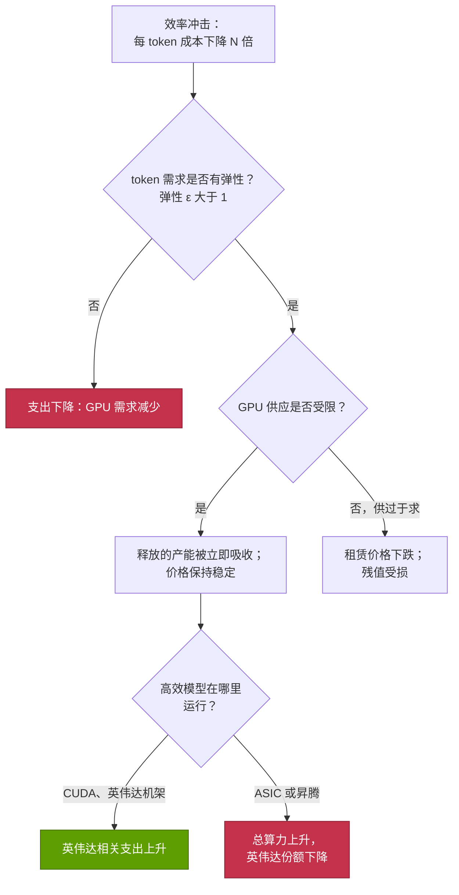
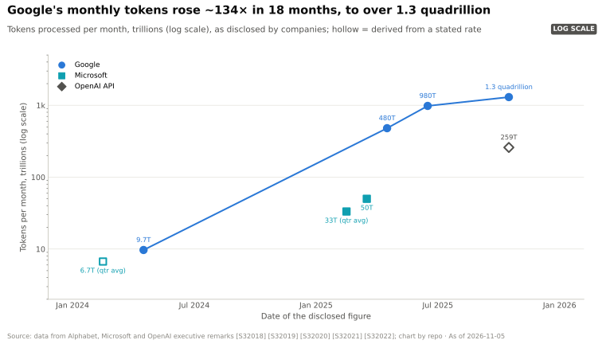
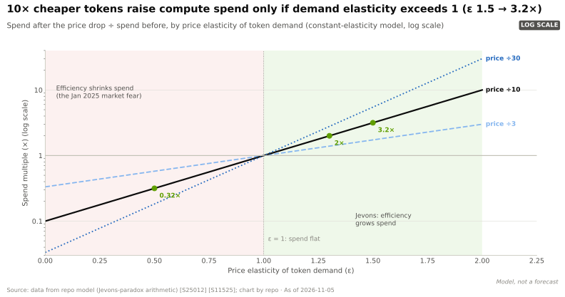

# CS5 · DeepSeek 时刻与效率冲击

> [!NOTE]
> 本页为英文原文的简体中文参考译文，仅供参考；如有出入，以[英文原文](../../case-studies/CS5-deepseek-moment-and-efficiency-shock.md "English original")为准。

案例研究 · 阅读约 14 分钟 · 最后核实：2026-11-05

## ⚡ 要点速览

- **导火索：** DeepSeek-V3（2024 年 12 月）披露，其最终训练运行耗用 278.8 万 H800 GPU 小时，按每 [GPU 小时](../glossary.md#gpu-hour) $2 计算约 $5.6M，训练对象是一个 671B 参数的[混合专家模型（MoE）](../glossary.md#mixture-of-experts) [[S34007]](../../sources/bibliography.md#s34007)。其推理模型兄弟版本 R1（2025-01-20）以开放权重形式发布 [[S25002]](../../sources/bibliography.md#s25002)，并登顶美国 App Store [[S25008]](../../sources/bibliography.md#s25008)。
- **冲击：** 2025-01-27，英伟达（NVIDIA）股价下跌约 17 %，市值蒸发约 $589B，创下有记录以来单一公司最大单日市值损失 [[S25000]](../../sources/bibliography.md#s25000)[[S25001]](../../sources/bibliography.md#s25001)。担忧很简单：如果前沿 AI 所需算力减少 10 倍，GPU 需求就会下降。
- **标题数字的口径很窄：** $5.6M 仅涵盖最后一次训练运行。SemiAnalysis 估计 DeepSeek 拥有约 50,000 个 Hopper GPU，服务器资本开支约 $1.6B [[S25006]](../../sources/bibliography.md#s25006)[[S31013]](../../sources/bibliography.md#s31013)。
- **英伟达的回应是[杰文斯悖论（Jevons paradox）](../glossary.md#jevons-paradox)：** 智能越便宜，用得越多。英伟达表示，推理“需要大量英伟达 GPU” [[S25003]](../../sources/bibliography.md#s25003)。其 CEO 表示，推理模型和[智能体（agentic）](../glossary.md#agentic-ai) AI 所需的算力比一年前的预期高约 100 倍 [[S25005]](../../sources/bibliography.md#s25005)。
- **迄今为止的结果对英伟达有利：** 数据中心收入从 $35.6B（Q4 FY2025）增至 $89.0B（Q2 FY2027），增长 2.5 倍 [[S443]](../../sources/bibliography.md#s443)[[S405]](../../sources/bibliography.md#s405)。2025-10-29，英伟达成为首家市值达 $5T 的公司 [[S25010]](../../sources/bibliography.md#s25010)。谷歌（Google）每月处理的 token 数在 18 个月内增长约 134 倍 [[S32018]](../../sources/bibliography.md#s32018)[[S32020]](../../sources/bibliography.md#s32020)。
- **但这一机制有其限度：** 只有当 token 需求的[价格弹性](../glossary.md#price-elasticity)大于 1 时，支出才会上升。token 便宜 10 倍，仅为维持支出不变就需要 ≥ 10 倍的 token 用量（🔴 本资料库模型）。
- **出口管制的转折：** H800 的限制迫使 DeepSeek 追求效率。DeepSeek V4（2026 年 4 月）部分在华为昇腾（Ascend）上训练，DeepSeek 也提及算力受限 🟢/🟡 [[S90079]](../../sources/bibliography.md#s90079)[[S90080]](../../sources/bibliography.md#s90080)。

## 1. 背景

**DeepSeek 是谁。** DeepSeek（深度求索）是一家位于杭州的 AI 实验室，与其母公司、量化对冲基金幻方量化（High-Flyer）共享 GPU 集群 [[S25006]](../../sources/bibliography.md#s25006)。其 2024 年发布的 DeepSeek-V2 引入了[多头潜在注意力](../glossary.md#multi-head-latent-attention)（MLA）。MLA 将模型在生成过程中为每个 token 保留的内存（[KV 缓存](../glossary.md#kv-cache)）压缩了 93.3 %，并将最大生成吞吐量提升了 5.76 倍 [[S32026]](../../sources/bibliography.md#s32026)。

**V3 的声明（2024-12-27）。** V3 拥有 671B 参数，但每个 token 仅激活 37B。每个 token 被路由到 256 个“专家”子网络中的 8 个，外加一个共享专家 [[S34007]](../../sources/bibliography.md#s34007)。它在 2,048 个 [H800](../glossary.md#h800) GPU 上以 [FP8](../glossary.md#fp8) 精度训练了 14.8T token，并使用手工调优的 [PTX](../glossary.md#ptx)（英伟达类似汇编的底层 GPU 代码）来压榨通信效率。最终训练运行耗用 278.8 万 GPU 小时，按假设的 $2 租赁价格计算约 $5.576M [[S34007]](../../sources/bibliography.md#s34007)。R1 随后加入大规模[强化学习](../glossary.md#reinforcement-learning)，形成一个[推理模型](../glossary.md#reasoning-model)，以开放许可发布，并附带更小的[蒸馏](../glossary.md#distillation)版本 [[S25002]](../../sources/bibliography.md#s25002)。其 API 定价比 OpenAI 的 o1 低约 90–95 % [[S25009]](../../sources/bibliography.md#s25009)。

> [!TIP]
> **算例 —— 为何混合专家模型让账单降低约 18 倍。** 训练算力 ≈ 6 × 激活参数 × token 数。V3：6 × 37B × 14.8T ≈ **3.3 × 10²⁴ FLOPs** [[S34007]](../../sources/bibliography.md#s34007)。一个 671B 的稠密模型在相同 token 上需要 6 × 671B × 14.8T ≈ 6.0 × 10²⁵，**约多 18 倍**。摊到 278.8 万 GPU 小时上，V3 每个 GPU 持续约 330 TFLOPS。这约为 Hopper GPU 1,979 TFLOPS 稠密 FP8 峰值的 17 %，或其 989 TFLOPS [BF16](../glossary.md#bf16) 峰值的约 33 % [[S33002]](../../sources/bibliography.md#s33002)。这些数字可圈可点，但并不神奇。节省主要来自架构，而非超越了英伟达硬件的极限。🔴 本资料库测算。

## 2. 决策

2025-01-27 那一周，有两类群体作出了决策，而他们的押注方向截然相反。

**投资者选择卖出。** 看空逻辑如下：如果一个前沿级模型的训练成本约为 $6M，实验室就需要更少的 GPU，[超大规模云厂商](../glossary.md#hyperscaler)的资本开支就是过度建设，英伟达的定价权也会被侵蚀。英伟达约 17 % 的跌幅是自 2020 年 3 月以来最大的一次；标普 500 指数下跌 1.46 % [[S25000]](../../sources/bibliography.md#s25000)。

**英伟达及其最大客户坚持原有路线。** 英伟达没有下调价格或业绩指引。其声明称 DeepSeek 是“一项出色的 AI 进展”，也是[测试时计算（test-time compute）](../glossary.md#test-time-compute)扩展的一个例证。声明指出，DeepSeek 使用的是符合出口管制的硬件，而部署此类模型需要大量 GPU [[S25003]](../../sources/bibliography.md#s25003)。一个月后，英伟达将下一季度指引定为 $43B，高于上一季度的 $39.3B [[S443]](../../sources/bibliography.md#s443)。微软（Microsoft）CEO 发帖称“杰文斯悖论再次应验” [[S25004]](../../sources/bibliography.md#s25004)。在 GTC 2025 上，英伟达发布了 [Dynamo](../glossary.md#dynamo)，宣称在 GB200 [NVL72](../glossary.md#nvl72) 上处理的 DeepSeek-R1 请求数最多可提升 30 倍（厂商宣称）[[S32015]](../../sources/bibliography.md#s32015)。

> [!TIP]
> **算例 —— 抛售实际计入了什么。** 约 17 % 的跌幅对应约 $589B 的损失，意味着英伟达前一天的市值约为 $3.5T（$589B ÷ 0.17；本资料库计算）[[S25000]](../../sources/bibliography.md#s25000)。假如看空逻辑成立、前沿算力需求下降约 10 倍，英伟达未来现金流的价值跌幅将远超 17 %。因此，市场定价的要么是需求大幅削减的小概率事件，要么是一次小幅的永久性削减，而非标题所暗示的崩塌。六个季度后，数据中心收入增长了 2.5 倍 [[S443]](../../sources/bibliography.md#s443)[[S405]](../../sources/bibliography.md#s405)，英伟达市值也突破了 $5T [[S25010]](../../sources/bibliography.md#s25010)。🔴 本资料库测算。

| 2025 年 1 月的说法 | 更完整的记录显示 |
|---|---|
| “约 $6M 训练出前沿模型” | 仅为最后一次运行；不含研究、消融实验和集群本身 [[S31013]](../../sources/bibliography.md#s31013)。集群约 5 万个 Hopper GPU，资本开支约 $1.6B（估计）[[S25006]](../../sources/bibliography.md#s25006) |
| “推理强化学习很便宜” | R1 的强化学习阶段在 512 张 H800 上花费约 $294K，且是*在* V3 基座模型*之上*；DeepSeek 还拥有 A100 [[S25007]](../../sources/bibliography.md#s25007) |
| “实验室将需要更少的 GPU” | 前沿实验室把节省下来的资源再投入到更大规模的训练和推理模型；谷歌每月 token 数在 18 个月内增长约 134 倍 [[S32018]](../../sources/bibliography.md#s32018)[[S32020]](../../sources/bibliography.md#s32020) |
| “出口管制失败了” | H800 在购买时是合法的 [[S25003]](../../sources/bibliography.md#s25003)[[S25011]](../../sources/bibliography.md#s25011)；到 2026 年，DeepSeek 提及算力受限，并将 V4 的部分训练转移到昇腾上 [[S90079]](../../sources/bibliography.md#s90079) |

## 3. 结果（用数据说话）

**英伟达的收入并未受挫。** 抛售后已披露的六个季度中，数据中心收入逐季增长，Q2 FY2027 达到 $89.0B [[S405]](../../sources/bibliography.md#s405)。总收入达到 $96.2B，Q3 FY2027 指引为 $108B [[S3]](../../sources/bibliography.md#s3)。超大规模云厂商 2026 年资本开支指引合计超过 $700B 🟡 [[S12518]](../../sources/bibliography.md#s12518)[[S12519]](../../sources/bibliography.md#s12519)。股价在数月内收复失地：2025-10-29，英伟达收于 $207.04，市值 $5.03T [[S25010]](../../sources/bibliography.md#s25010)。

**token 需求呈爆发式增长。** 谷歌每月处理的 token 从 9.7T（2024 年 4 月）增至超过 1.3 千万亿（2025 年 10 月）[[S32018]](../../sources/bibliography.md#s32018)[[S32020]](../../sources/bibliography.md#s32020)。

**每 token 价格持续下降。** GPT-3.5 级输出的成本从每百万 token $20（2022 年 11 月）降至 $0.07（2024 年 10 月），降幅超过 280 倍 [[S11526]](../../sources/bibliography.md#s11526)。Epoch AI 测算，在能力不变的条件下，价格每年下降 9–900 倍 [[S11525]](../../sources/bibliography.md#s11525)。仅凭英伟达自身的软件优化，GB300 NVL72 上每百万 DeepSeek-R1 token 的估计成本在一年内下降了 65 %，无需新硬件 [[S603]](../../sources/bibliography.md#s603)[[S622]](../../sources/bibliography.md#s622)。前沿模型价格则是例外：GPT-5.5 于 2026 年 4 月发布，价格是其前代的两倍 [[S11535]](../../sources/bibliography.md#s11535)。买家持续向最好的模型升级。

![对数坐标折线图：在英伟达硬件不变、仅软件改进的情况下每百万 token 的估计成本，各 GPU 的所有者 TCO 固定不变（SemiAnalysis：GB300 $2.31、GB200 $1.86、B200 $1.73、H100 $1.17 每 GPU 小时）。GB300 NVL72 · DeepSeek-R1（MLPerf Server）：$0.221 降至 $0.077（降低 65%，2025 年 9 月至 2026 年 9 月）；GB200 NVL72 · DeepSeek-R1（MLPerf Server）：$0.222 降至 $0.094（降低 58%，2025 年 9 月至 2026 年 9 月）；H100 · Llama 2 70B（MLPerf Server）：$0.126 降至 $0.084（降低 34%，2024 年 3 月至 2025 年 4 月）；B200 · DeepSeek-R1 最大吞吐量（TensorRT-LLM 博客）：$0.240 降至 $0.104（降低 57%，2025 年 2 月至 2025 年 5 月）；B200 · DeepSeek-R1，SGLang 并发 128（InferenceX）：$0.269 降至 $0.201（降低 25%，2025 年 12 月至 2026 年 5 月）。硬件账单不变，每 GPU 吞吐量提升，因此每 token 成本下降。](../../assets/charts/11-cost-per-m-tokens-software-releases.svg)

**DeepSeek V4（2026-04-24）**提供两种规格：V4-Pro（约 1.6T 参数）和 V4-Flash（284B），均为开放权重。Flash 的部分训练在华为昇腾上完成，昇腾超节点（SuperNode）也已适配推理 [[S90079]](../../sources/bibliography.md#s90079)。V4-Pro 的定价约为每百万输出 token $3.48。DeepSeek 表示，在昇腾 950 超节点于 2026 年下半年规模化出货之前，吞吐量将持续受限 [[S90080]](../../sources/bibliography.md#s90080)。V4 首日仍可在 [CUDA](../glossary.md#cuda) 上运行，而 AMD 的 MI355X 则需要数周 [[S633]](../../sources/bibliography.md#s633)。

> [!TIP]
> **算例 —— 每 token 成本下降 10 倍，以及支出上升所需的弹性。** 某买家每年在推理上支出 $1B，价格为每百万 token $1.00：即 1 千万亿 token。效率提升使价格降至 $0.10。在弹性恒定的需求下，token 用量增加 10^ε 倍，支出变化为 10^(ε−1) 倍。
>
> | 弹性 ε | 购买的 token | 支出 | 若每 token 算力下降 10 倍，算力（GPU）支出变化 |
> |---|---|---|---|
> | 0.5 | 3.2 千万亿 | $0.32B | −68 % |
> | 1.0 | 10 千万亿 | $1.00B | 持平 |
> | 1.3 | 20 千万亿 | $2.0B | 翻倍 |
> | 1.5 | 32 千万亿 | $3.2B | 3.2 倍 |
>
> 谷歌 18 个月内 134 倍的 token 增长 [[S32018]](../../sources/bibliography.md#s32018)[[S32020]](../../sources/bibliography.md#s32020) 远高于价格下降 10 倍时维持支出不变所需的 10 倍。但若以最陡峭的质量不变价格降幅（Epoch 的中位数约每年 50 倍 [[S11525]](../../sources/bibliography.md#s11525)）来衡量，隐含的 ε 小于 1。两者之所以能够吻合，只是因为买家转向了更昂贵的前沿模型和推理模型。即使每项能力都在变便宜，每次查询的支出仍在上升。🔴 本资料库模型；未考虑需求曲线的移动。

## 4. 为何奏效（或为何未能奏效）

**效率冲击为何反而推高了需求。** 杰文斯悖论可追溯至 1865 年：更高效的蒸汽机反而提高了英国的煤炭总消耗量，因为更便宜的动力找到了新的用途 [[S25012]](../../sources/bibliography.md#s25012)。在 AI 领域，有四个机制在起作用：

1. **需求富有弹性。** 更便宜的 token 解锁了此前不经济的用途，例如编程智能体、长文档分析和全天候助手。
2. **需求曲线外移。** 推理模型在回答前会先“思考”。这可能使每个回答生成的 token 增加约 21 倍，而一项智能体任务消耗的 token 可达一次聊天回复的约 1,100 倍（估计）[[S32025]](../../sources/bibliography.md#s32025)[[S32024]](../../sources/bibliography.md#s32024)。DeepSeek R1 本身就推广了这一模式，这也是英伟达将其定位为测试时扩展的原因 [[S25003]](../../sources/bibliography.md#s25003)。
3. **供应受限。** 英伟达至今仍称其 FY2028 展望受供应约束 [[S90012]](../../sources/bibliography.md#s90012)。在供不应求的市场中，效率提升释放的产能会被立即吸收，而不是闲置。
4. **英伟达获取了部分效率收益。** 在 MLPerf 上，仅软件优化就使 GB300 NVL72 的 DeepSeek-R1 吞吐量在一年内提升 2.9 倍 [[S601]](../../sources/bibliography.md#s601)[[S603]](../../sources/bibliography.md#s603)。更便宜的 token 运行在英伟达的机架上。

**效率冲击何时会压低需求。** 上方流程图展示了失败路径：

- **需求缺乏弹性或已饱和：** 如果企业采用停滞或投资回报令人失望，ε < 1，效率提升将导致支出收缩。
- **工作负载有上限：** 当买家服务的是固定任务（内部企业应用、既定的批处理流水线）时，效率提升只意味着完成同样工作所需的 GPU 更少。
- **供过于求：** 一旦供应追上需求，效率提升就会带来通缩。H100 租赁价格已从 2023 年的每 GPU 小时约 $8 降至[新兴云服务商（neocloud）](../glossary.md#neocloud)和算力交易市场上的约 $2–3 [[S393]](../../sources/bibliography.md#s393)[[S395]](../../sources/bibliography.md#s395)。
- **外溢：** 高效模型可能运行在其他平台上。DeepSeek 的 DeepEP 和 DeepGEMM 库现已推出华为昇腾版本 [[S9009]](../../sources/bibliography.md#s9009)[[S9010]](../../sources/bibliography.md#s9010)，TileLang 也有官方的昇腾 950 后端 [[S9011]](../../sources/bibliography.md#s9011)。

> [!TIP]
> **算例 —— 杰文斯悖论失效时：既定的建设计划。** 某云厂商计划采购 $10B 的推理 GPU 以满足其需求预测。一种新的模型架构使每 token 所需的 GPU 小时减少 3 倍。如果 token 需求仅增长 2 倍（相对于便宜 3 倍的 token，ε ≈ 0.63），该云厂商只需要计划中三分之二的 GPU：约 $6.7B，采购额下降约 33 %。如果需求增长 3 倍，采购额持平；增长 6 倍，采购额翻倍。效率提升本身并不决定结果，决定结果的是需求增长相对于效率提升的幅度。🔴 本资料库测算。

**出口管制的角度。** H800 是英伟达针对中国市场推出的 Hopper 版本，旨在符合 2022 年 10 月的规则；它本身又被 2023 年 10 月的规则所限制 [[S25011]](../../sources/bibliography.md#s25011)。[出口管制](../glossary.md#export-controls)塑造了 DeepSeek 的工程路线。DeepSeek 测得每张 H800 仅有约 160 GB/s 的 [NVLink](../glossary.md#nvlink) 带宽和约 50 GB/s 的 [InfiniBand](../glossary.md#infiniband) 带宽 [[S34007]](../../sources/bibliography.md#s34007)[[S5005]](../../sources/bibliography.md#s5005)。因此 V3 避免使用张量并行，并让通信与计算重叠（见下文）。随后推出的 [H20](../glossary.md#h20) 于 2025 年 4 月被纳入许可要求，英伟达为此计提约 $4.5B 费用 [[S90081]](../../sources/bibliography.md#s90081)[[S90082]](../../sources/bibliography.md#s90082)。H200 后来获准销售，但需将收入的 25 % 上缴美国政府；然而截至 2026 年年中，尚未确认任何 H200 收入 [[S90081]](../../sources/bibliography.md#s90081)[[S90032]](../../sources/bibliography.md#s90032)。管制减缓了 DeepSeek 获取算力的速度，也迫使其更加努力地优化，并在 2026 年前移植到昇腾：这是 CUDA [转换成本](../glossary.md#switching-cost)上的一处慢性渗漏。参见 [CS6](CS6-china-export-controls-h20-and-beyond.md)。

> [!WARNING]
> **🐻 看空观点。** 杰文斯式反弹之所以成立，是因为三个条件同时满足：买家资本充裕、供应紧张、高效模型运行在 CUDA 上。这三者都可能逆转。超大规模云厂商的资本开支如今越来越依赖债务和合作伙伴资本，例如据报道英伟达与私募资本机构合作的规模超过 $500B 的项目 [[S90074]](../../sources/bibliography.md#s90074)。随着 [CoWoS](../glossary.md#cowos) 产能扩张，GPU 供应正在快速增加 [[S90039]](../../sources/bibliography.md#s90039)。中国实验室正在构建昇腾工具链 [[S9009]](../../sources/bibliography.md#s9009)[[S9011]](../../sources/bibliography.md#s9011)。如果第二次效率冲击在供过于求的环境下到来，对这一论点的考验将远比 2025 年 1 月严峻。

> [!NOTE]
> **🐂 看多观点。** 2023 年以来的每一次效率提升，都被再投入到更大的模型、更长的推理和更多的用户上。在“DeepSeek 时刻”之后的六个季度里，英伟达数据中心收入增长了 2.5 倍 [[S443]](../../sources/bibliography.md#s443)[[S405]](../../sources/bibliography.md#s405)。2026 年最便宜的 token 正是在英伟达最新的机架上提供的。

🔧 技术细节：V3 中的 MoE、MLA、FP8、DualPipe 与 PTX

- **MoE 路由：** 1 个共享专家 + 256 个路由专家，每个 token 激活 8 个，且每个 token 最多只能路由到分布在 4 个节点上的专家。这限制了慢速 InfiniBand 链路上的跨节点流量 [[S34007]](../../sources/bibliography.md#s34007)。
- **MLA：** 每层每个 token 只存储 576 个值的压缩潜在向量，而非完整的键和值。这缩小了 KV 缓存，使长上下文和大批量推理服务的成本更低 [[S32009]](../../sources/bibliography.md#s32009)[[S32026]](../../sources/bibliography.md#s32026)。
- **FP8 训练：** 大多数矩阵乘法以 8 位浮点运行，采用细粒度缩放和更高精度累加。与 BF16 相比，内存流量大约减半 [[S34007]](../../sources/bibliography.md#s34007)。
- **[DualPipe](../glossary.md#dualpipe) 与并行方式：** 16 路流水线并行 × 64 路专家并行 × ZeRO-1 数据并行，不使用张量并行。DualPipe 将一个微批次的计算与另一个微批次的全交换（all-to-all）通信重叠，从而把慢速网络隐藏在计算之后 [[S34007]](../../sources/bibliography.md#s34007)。
- **PTX 级调优：** 自定义 PTX，并为通信分配专用的流式多处理器（SM）。DeepSeek 后来的 DeepEP 库在 H800 上实现了约 153–158 GB/s 的节点内带宽和约 43–58 GB/s 的节点间带宽 [[S5005]](../../sources/bibliography.md#s5005)。DeepGEMM 在 H800 上最高达到 1,550 TFLOPS 的 FP8 算力 [[S9010]](../../sources/bibliography.md#s9010)。
- **推理服务：** 生产环境中的[解码（decode）](../glossary.md#decode)在 18 个节点上以专家并行方式运行（EP144），每个 H800 节点约输出 14.8k tokens/s [[S5004]](../../sources/bibliography.md#s5004)。

这些技术都不需要非英伟达硬件。它们是软件和架构层面的选择，英伟达自己的团队后来也针对 Blackwell 对同样的 DeepSeek 模型进行了调优 [[S645]](../../sources/bibliography.md#s645)[[S646]](../../sources/bibliography.md#s646)。

## 5. 对企业发展（corp dev）的启示

如何针对效率冲击对 AI 基础设施投资论点进行压力测试：

| 步骤 | 问题 | DeepSeek 检验 |
|---|---|---|
| 1. 分解 | 收入 = token 数 × 每 token 算力 × 单位算力价格。冲击作用于哪一项？ | 每 token 算力下降；token 数增长更快 |
| 2. 弹性 | 在*该*细分市场（编程智能体、消费级聊天、批处理）中 ε 是否大于 1？ | 2025–26 年整体大于 1；分细分市场尚未得到证实 |
| 3. 供应状态 | 受限还是过剩？前者会吸收效率提升，后者会带来通缩 | 受限 [[S90012]](../../sources/bibliography.md#s90012) |
| 4. 价值获取 | 谁保留了节省：实验室、云厂商、芯片厂商还是用户？ | 实验室与用户；英伟达通过软件获取 |
| 5. 外溢 | 高效模型是否仍在你的平台上运行得最好？ | V4 首日即可运行；昇腾份额在增长 [[S633]](../../sources/bibliography.md#s633)[[S90079]](../../sources/bibliography.md#s90079) |
| 6. 解读标题数字 | 最终运行成本 vs 集群资本开支 vs 运营开支 | $5.6M vs 约 $1.6B 集群 [[S34007]](../../sources/bibliography.md#s34007)[[S25006]](../../sources/bibliography.md#s25006) |

1. **区分标题数字与成本基础。** 一个“$6M 的模型”背后是约 $1.6B 的硬件（估计）[[S25006]](../../sources/bibliography.md#s25006)。对任何“便宜 10 倍”的说法进行尽职调查时，都应追问哪些成本被排除在外。
2. **明确为弹性建模。** 假设所有领域 ε > 1 的投资论点是一种押注，而非基准情景。应在成熟细分市场中以 ε < 1 进行下行情景测算。
3. **效率提升会让价值在技术栈中转移。** 模型实验室和应用开发者获得了更高的利润率。英伟达则通过发布软件、让自家机架成为运行高效模型最便宜的平台，守住了自己的利润率。
4. **市场对效率消息的反应可能方向错误，但风险识别正确。** 约 $589B 的市值回撤在数月内即告逆转。但它所提示的外溢风险（模型脱离 CUDA 进行优化）依然真实存在。

## 🎯 企业发展视角

1. **投资论点的规范性：** 对于任何 AI 硬件投资，按细分市场假设的 token 需求价格弹性是多少？如果 10 倍的效率提升出现在供过于求而非短缺的环境中，计划会怎样？
2. **谁获取效率收益：** 如果算法进步持续降低每 token 算力，价值是否会流向让模型*推理服务*成本最低的一方？这可能是推理专用芯片、大内存设计或软件层。这应如何影响自建/收购/合作的筛选标准？
3. **端侧与蒸馏：** R1 的蒸馏小模型表明推理能力可以被压缩 [[S25002]](../../sources/bibliography.md#s25002)。这是否会将部分推理转移到手机和 PC 上——高通（Qualcomm）在这些设备中出货 NPU？还是测试时计算会让最繁重的工作留在数据中心？应将此视为一个开放问题，而非预测。
4. **软件可移植性作为一种期权：** DeepSeek 的库现已支持昇腾 [[S9009]](../../sources/bibliography.md#s9009)[[S9010]](../../sources/bibliography.md#s9010)。哪些可移植的内核与编译器项目（TileLang、[Triton](../glossary.md#triton)、Mojo）是预示高效开源模型能在 CUDA 之外良好运行的领先指标？
5. **信号与噪音：** 在市场裁决尘埃落定之前的最初 48 小时内，企业发展团队应如何区分真正的成本曲线断裂与被误读的标题？

## 📚 来源（Sources）

<!-- Auto-generated from the [S…] citations on this page by `make build`. Edit sources/registry/*.csv, not this list. -->

- [**S3**](../../sources/bibliography.md#s3) StorageNewsletter, *NVIDIA Q2 Fiscal 2027 results coverage: revenue $96.2B*, 2026-08-27. [Link](https://www.storagenewsletter.com/2026/08/27/nvidia-fiscal-2q27-financial-results/)
- [**S393**](../../sources/bibliography.md#s393) Latent Space (Eugene Cheah), *$2 H100s: how the GPU bubble burst*, 2024-10. [Link](https://www.latent.space/p/gpu-bubble)
- [**S395**](../../sources/bibliography.md#s395) Lambda, *Lambda GPU cloud pricing*, 2025. [Link](https://lambda.ai/pricing)
- [**S405**](../../sources/bibliography.md#s405) NVIDIA Corporation via SEC EDGAR, *NVIDIA Announces Financial Results for Second Quarter Fiscal 2027 (Form 8-K exhibit 99.1)*, 2026-08-26. [Link](https://www.sec.gov/Archives/edgar/data/0001045810/000104581026000073/q2fy27pr.htm)
- [**S443**](../../sources/bibliography.md#s443) NVIDIA Corporation, *NVIDIA Announces Financial Results for Fourth Quarter and Fiscal 2025 (press release with CFO commentary)*, 2025-02-26. [Link](https://nvidianews.nvidia.com/news/nvidia-announces-financial-results-for-fourth-quarter-and-fiscal-2025)
- [**S601**](../../sources/bibliography.md#s601) MLCommons, *MLPerf Inference v5.1 results (summary_results.json and per-submitter logs)*, 2025-09-09. [Link](https://github.com/mlcommons/inference_results_v5.1)
- [**S603**](../../sources/bibliography.md#s603) MLCommons, *MLPerf Inference v6.1 results (summary.csv and per-submitter logs)*, 2026-09. [Link](https://github.com/mlcommons/inference_results_v6.1)
- [**S622**](../../sources/bibliography.md#s622) SemiAnalysis (InferenceX-app repository), *InferenceX hardware registry: TCO per GPU-hour by SKU (SemiAnalysis July 2026 pricing surveys and AI Cloud TCO Model)*, 2026-07. [Link](https://github.com/SemiAnalysisAI/InferenceX-app/blob/main/packages/constants/src/gpu-keys.ts)
- [**S633**](../../sources/bibliography.md#s633) SemiAnalysis, *DeepSeekV4 1.6T Day 0 to Day 43 Performance Over Time — Huawei, GB300 NVL72, MI355X, B200*, 2026-06-09. [Link](https://github.com/SemiAnalysisAI/InferenceX-app/blob/main/packages/app/content/blog/deepseekv4-16t-day-0-to-day-43-performance.mdx)
- [**S645**](../../sources/bibliography.md#s645) NVIDIA TensorRT-LLM team, *Pushing Latency Boundaries: Optimizing DeepSeek-R1 Performance on NVIDIA B200 GPUs (TensorRT-LLM tech blog 1)*, 2025-05-16. [Link](https://github.com/NVIDIA/TensorRT-LLM/blob/main/docs/source/blogs/tech_blog/blog01_Pushing_Latency_Boundaries_Optimizing_DeepSeek-R1_Performance_on_NVIDIA_B200_GPUs.md)
- [**S646**](../../sources/bibliography.md#s646) NVIDIA TensorRT-LLM team, *Optimizing DeepSeek R1 Throughput on NVIDIA Blackwell GPUs: A Deep Dive for Developers (TensorRT-LLM tech blog 3)*, 2025-05-30. [Link](https://github.com/NVIDIA/TensorRT-LLM/blob/main/docs/source/blogs/tech_blog/blog03_Optimizing_DeepSeek_R1_Throughput_on_NVIDIA_Blackwell_GPUs.md)
- [**S5004**](../../sources/bibliography.md#s5004) DeepSeek-AI (GitHub open-infra-index) (DeepSeek-AI), *Day 6: One More Thing, DeepSeek-V3/R1 Inference System Overview*, 2025-03-01. [Link](https://github.com/deepseek-ai/open-infra-index/blob/main/202502OpenSourceWeek/day_6_one_more_thing_deepseekV3R1_inference_system_overview.md)
- [**S5005**](../../sources/bibliography.md#s5005) DeepSeek-AI (GitHub) (DeepSeek-AI), *DeepEP: an efficient expert-parallel communication library (README v1.2.1)*, 2025. [Link](https://github.com/deepseek-ai/DeepEP/blob/v1.2.1/README.md)
- [**S9009**](../../sources/bibliography.md#s9009) DeepSeek-AI (GitHub) (DeepSeek-AI), *DeepEP README (main branch: V2.5 and Ascend version)*, 2026-11. [Link](https://github.com/deepseek-ai/DeepEP/blob/main/README.md)
- [**S9010**](../../sources/bibliography.md#s9010) DeepSeek-AI (GitHub) (DeepSeek-AI), *DeepGEMM README*, 2026-09-30. [Link](https://github.com/deepseek-ai/DeepGEMM/blob/main/README.md)
- [**S9011**](../../sources/bibliography.md#s9011) tile-ai (GitHub), *TileLang README (news and backends)*, 2026-09-30. [Link](https://github.com/tile-ai/tilelang/blob/main/README.md)
- [**S11525**](../../sources/bibliography.md#s11525) Epoch AI, *LLM inference prices have fallen rapidly but unequally across tasks*, 2025-03. [Link](https://epoch.ai/data-insights/llm-inference-price-trends)
- [**S11526**](../../sources/bibliography.md#s11526) Stanford HAI, *The 2025 AI Index Report*, 2025-04. [Link](https://hai.stanford.edu/ai-index/2025-ai-index-report)
- [**S11535**](../../sources/bibliography.md#s11535) Doolpa, *OpenAI launches GPT-5.5 with state-of-the-art agentic coding and doubles API prices (April 2026)*, 2026-04. [Link](https://doolpa.com/news/openai-gpt-5-5-launch-agentic-coding-pricing-april-2026)
- [**S12518**](../../sources/bibliography.md#s12518) Datacentres.com, *Hyperscaler capex trends: over $700 billion for 2026*, 2026-08. [Link](https://www.datacentres.com/guides/hyperscaler-capex-trends)
- [**S12519**](../../sources/bibliography.md#s12519) Hargreaves Lansdown, *AI hyperscalers are expected to finish the year spending a whopping $828 billion on capex*, 2026-10. [Link](https://www.hl.co.uk/news/ai-hyperscalers-are-expected-to-finish-the-year-spending-a-whopping-828-billion-on-capex)
- [**S25000**](../../sources/bibliography.md#s25000) Bloomberg, *Nvidia's $589 Billion DeepSeek Rout Is Largest in Market History*, 2025-01-27. [Link](https://www.bloomberg.com/news/articles/2025-01-27/asml-sinks-as-china-ai-startup-triggers-panic-in-tech-stocks)
- [**S25001**](../../sources/bibliography.md#s25001) Tom's Hardware, *Nvidia loses $589 billion in market cap - broad stock plunge triggered by DeepSeek AI release*, 2025-01-27. [Link](https://www.tomshardware.com/tech-industry/artificial-intelligence/nvidia-loses-usd589-billion-in-market-cap-broad-stock-plunge-triggered-by-deepseek-ai-release)
- [**S25002**](../../sources/bibliography.md#s25002) DeepSeek-AI (arXiv 2501.12948) (DeepSeek-AI), *DeepSeek-R1: Incentivizing Reasoning Capability in LLMs via Reinforcement Learning*, 2025-01-22. [Link](https://arxiv.org/abs/2501.12948)
- [**S25003**](../../sources/bibliography.md#s25003) TechRadar, *Nvidia calls DeepSeek an 'excellent AI advancement' and praises the Chinese AI app's ingenuity*, 2025-01-28. [Link](https://www.techradar.com/computing/artificial-intelligence/nvidia-calls-deepseek-an-excellent-ai-advancement-and-praises-the-chinese-ai-apps-ingenuity)
- [**S25004**](../../sources/bibliography.md#s25004) Fortune, *Microsoft CEO Satya Nadella on DeepSeek optimism and the Jevons paradox*, 2025-01-27. [Link](https://fortune.com/2025/01/27/microsoft-ceo-satya-nadella-deepseek-optimism-jevons-paradox)
- [**S25005**](../../sources/bibliography.md#s25005) Fortune, *Jensen Huang at GTC 2025 (AI Super Bowl) answers the DeepSeek debate*, 2025-03-19. [Link](https://fortune.com/2025/03/19/nvidia-jensen-gtc-super-bowl-ai-deepseek)
- [**S25006**](../../sources/bibliography.md#s25006) Tom's Hardware, *DeepSeek might not be as disruptive as claimed: firm reportedly has 50,000 Nvidia GPUs and spent $1.6 billion on buildouts*, 2025-02. [Link](https://tomshardware.com/tech-industry/artificial-intelligence/deepseek-might-not-be-as-disruptive-as-claimed-firm-reportedly-has-50-000-nvidia-gpus-and-spent-usd1-6-billion-on-buildouts)
- [**S25007**](../../sources/bibliography.md#s25007) CTV News (Reuters), *China's DeepSeek says its hit AI model cost just US$294,000 to train (Reuters)*, 2025-09-18. [Link](https://www.ctvnews.ca/business/article/chinas-deepseek-says-its-hit-ai-model-cost-just-us294000-to-train/)
- [**S25008**](../../sources/bibliography.md#s25008) South China Morning Post, *Chinese AI disrupter DeepSeek claims top spot in US App Store, dethroning ChatGPT*, 2025-01-27. [Link](https://www.scmp.com/tech/tech-trends/article/3296406/chinese-ai-disrupter-deepseek-claims-top-spot-us-app-store-dethroning-chatgpt)
- [**S25009**](../../sources/bibliography.md#s25009) TweakTown, *DeepSeek's new AI assistant app is the top free app on the Apple App Store, ahead of ChatGPT*, 2025-01-27. [Link](https://www.tweaktown.com/news/102809/deepseeks-new-ai-assistant-app-is-the-top-free-on-apple-store-ahead-of-chatgpt/index.html)
- [**S25010**](../../sources/bibliography.md#s25010) Fox Business, *Nvidia becomes first company to hit $5 trillion market valuation as AI boom drives historic growth*, 2025-10-29. [Link](https://www.foxbusiness.com/markets/nvidia-becomes-first-company-hit-5-trillion-market-valuation-ai-boom-drives-historic-growth)
- [**S25011**](../../sources/bibliography.md#s25011) Wccftech, *US Government restricts exports of NVIDIA's China-exclusive H800 and A800 AI GPUs to China*, 2023-10-17. [Link](https://wccftech.com/us-government-restricts-exports-nvidia-china-exclusive-h800-a800-ai-gpus-to-china/)
- [**S25012**](../../sources/bibliography.md#s25012) NPR Planet Money, *AI, DeepSeek and the economics of the Jevons paradox (Planet Money)*, 2025-02-04. [Link](https://www.npr.org/sections/planet-money/2025/02/04/g-s1-46018/ai-deepseek-economics-jevons-paradox)
- [**S31013**](../../sources/bibliography.md#s31013) Interconnects (Nathan Lambert), *DeepSeek V3 and the actual cost of training frontier AI models*, 2025-01. [Link](https://www.interconnects.ai/p/deepseek-v3-and-the-actual-cost-of)
- [**S32009**](../../sources/bibliography.md#s32009) DeepSeek-AI via Hugging Face, *DeepSeek-V3 configuration (config.json)*, 2024-12-26. [Link](https://huggingface.co/deepseek-ai/DeepSeek-V3/blob/main/config.json)
- [**S32015**](../../sources/bibliography.md#s32015) NVIDIA Newsroom, *NVIDIA Dynamo open-source inference framework announcement (GTC 2025)*, 2025-03-18. [Link](https://nvidianews.nvidia.com/news/nvidia-dynamo-open-source-library-accelerates-and-scales-ai-reasoning-models)
- [**S32018**](../../sources/bibliography.md#s32018) Google (The Keyword) (Sundar Pichai), *Google I/O 2025 keynote remarks (Sundar Pichai)*, 2025-05-20. [Link](https://blog.google/technology/ai/io-2025-keynote/)
- [**S32020**](../../sources/bibliography.md#s32020) Alphabet / Google (The Keyword) (Sundar Pichai), *Alphabet CEO remarks on token volume (October 2025)*, 2025-10. [Link](https://blog.google/inside-google/message-ceo/alphabet-earnings-q3-2025/)
- [**S32024**](../../sources/bibliography.md#s32024) OpenAI, *Reasoning models guide (OpenAI API documentation)*, 2025. [Link](https://platform.openai.com/docs/guides/reasoning)
- [**S32025**](../../sources/bibliography.md#s32025) nvidia_deep_dive_claude repository, *Repo analysis: inference token-budget scenarios and roofline serving model (Primer P2)*, 2026-11-05. [Link](https://github.com/FrankHuang94/nvidia_deep_dive_claude/blob/main/primers/P2-how-ai-inference-works.md)
- [**S32026**](../../sources/bibliography.md#s32026) DeepSeek-AI (arXiv 2405.04434) (DeepSeek-AI), *DeepSeek-V2: A Strong, Economical, and Efficient Mixture-of-Experts Language Model*, 2024-05. [Link](https://arxiv.org/abs/2405.04434)
- [**S33002**](../../sources/bibliography.md#s33002) NVIDIA, *NVIDIA H100 Tensor Core GPU (product page and datasheet)*, 2022-03-22. [Link](https://www.nvidia.com/en-us/data-center/h100/)
- [**S34007**](../../sources/bibliography.md#s34007) arXiv:2412.19437 (DeepSeek-AI), *DeepSeek-V3 Technical Report*, 2024-12-27. [Link](https://arxiv.org/abs/2412.19437)
- [**S90012**](../../sources/bibliography.md#s90012) Tomasz Tunguz (Tomasz Tunguz), *Nvidia Q2 FY27 earnings*, 2026-08. [Link](https://www.tomtunguz.com/nvidia-q2-fy27-earnings/index.md)
- [**S90032**](../../sources/bibliography.md#s90032) Bloomberg Government, *Nvidia gets US license for small amount of H200 exports to China*, 2026-02. [Link](https://news.bgov.com/international-trade/nvidia-gets-us-license-for-small-amount-of-h200-exports-to-china)
- [**S90039**](../../sources/bibliography.md#s90039) TrendForce, *Samsung, SK hynix reportedly tapped as NVIDIA Rubin HBM4 suppliers; shipments could start in March*, 2026-03-09. [Link](https://www.trendforce.com/news/2026/03/09/news-samsung-sk%E2%80%AFhynix-reportedly-tapped-as-nvidia-rubin-hbm4-suppliers-shipments-could-start-in-march/)
- [**S90074**](../../sources/bibliography.md#s90074) Kavout, *Nvidia's AI dominance meets circular financing: a systemic risk underpriced?*, 2026. [Link](https://www.kavout.com/market-lens/nvidia-s-ai-dominance-meets-circular-financing-a-systemic-risk-underpriced)
- [**S90079**](../../sources/bibliography.md#s90079) TechRepublic, *DeepSeek V4 AI model backed by Huawei*, 2026-04-24. [Link](https://www.techrepublic.com/article/news-apac-deepseek-v4-ai-model-huawei-ascend-chips-support/)
- [**S90080**](../../sources/bibliography.md#s90080) Asia Financial, *China's DeepSeek says new V4 AI model can run on Huawei chips*, 2026-04. [Link](https://www.asiafinancial.com/chinas-deepseek-says-new-v4-ai-model-can-run-on-huawei-chips)
- [**S90081**](../../sources/bibliography.md#s90081) NVIDIA Corporation via SEC EDGAR, *NVIDIA Form 10-K for fiscal year 2026 (ended January 25, 2026)*, 2026-02. [Link](https://www.sec.gov/Archives/edgar/data/1045810/000104581026000021/nvda-20260125.htm)
- [**S90082**](../../sources/bibliography.md#s90082) Verdict, *Nvidia writedown on H20 chip*, 2025-04. [Link](https://www.verdict.co.uk/nvidia-writedown-h20-chip/)
