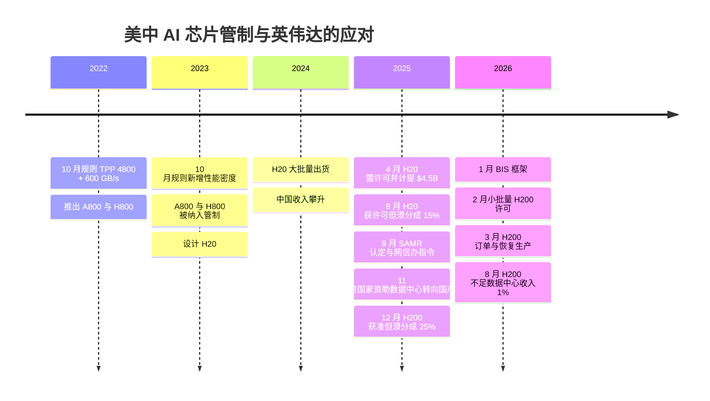
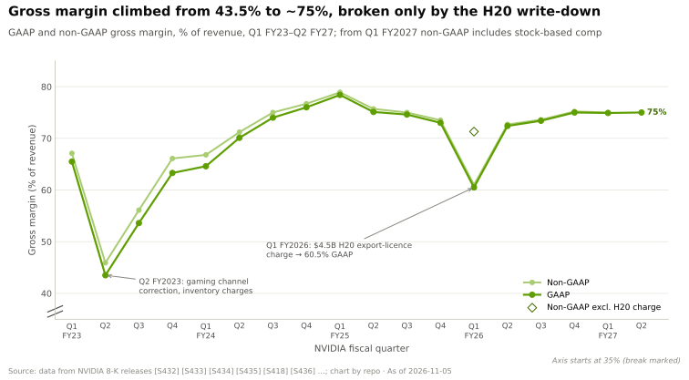
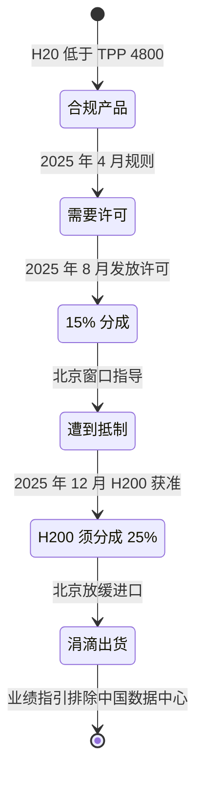
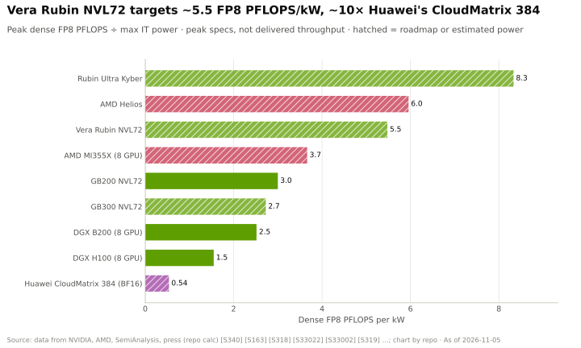
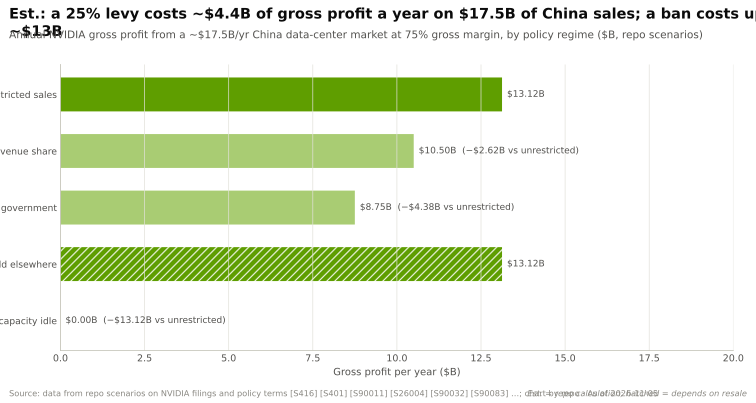
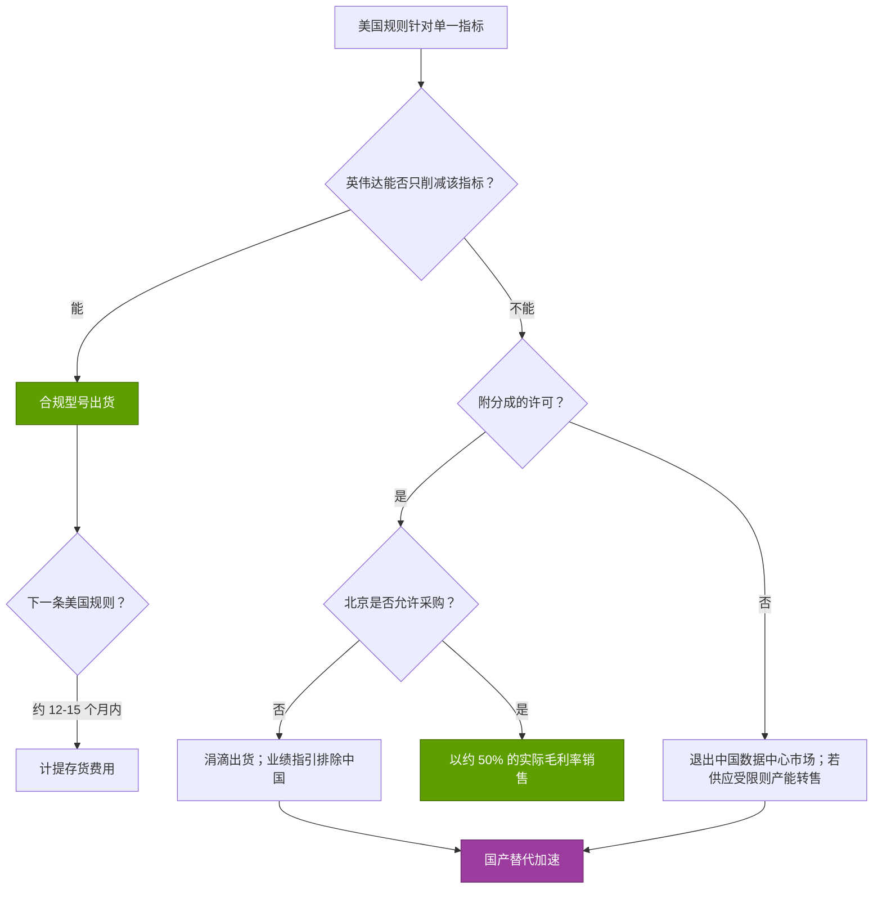

# CS6 · 中国出口管制：H20 及之后

> [!NOTE]
> 本页为英文原文的简体中文参考译文，仅供参考；如有出入，以[英文原文](../../case-studies/CS6-china-export-controls-h20-and-beyond.md "English original")为准。

案例研究 · 阅读约 14 分钟 · 最后核实：2026-11-05

## ⚡ 要点速览

- **中国曾占英伟达的四分之一。** 按旧的账单地口径，中国（含香港）在 FY2022 占收入的 26.4 % [[S2]](../../sources/bibliography.md#s2)；管理层也曾表示，在管制实施前，中国占数据中心收入的 20–25 % [[S26008]](../../sources/bibliography.md#s26008)。
- **英伟达一次次按规则重新设计产品。** 2022 年 10 月的规则要求，[TPP](../glossary.md#tpp) 超过 4,800 且芯片间带宽超过 600 GB/s 的芯片须获得许可；英伟达以 A800/H800 应对（NVLink 降至 400 GB/s）。2023 年 10 月的规则堵上了这一缺口，英伟达随即推出 TPP 约 2,400 的 H20，约为 H200 的 1/7 [[S26002]](../../sources/bibliography.md#s26002)[[S26001]](../../sources/bibliography.md#s26001)[[S26003]](../../sources/bibliography.md#s26003)。
- **合规芯片曾在一段时间内守住了收入金额。** 按客户总部口径，中国收入在 FY2025 达到 $25.0B 的峰值，尽管其占比已在下降 [[S401]](../../sources/bibliography.md#s401)。
- **2025 年 4 月的许可要求造成 $4.5B 损失。** 该要求“在可预见的未来”适用于 H20，迫使英伟达在 Q1 FY2026 计提 $4.5B 的存货及采购义务费用。GAAP 毛利率降至 60.5 % [[S90081]](../../sources/bibliography.md#s90081)[[S90082]](../../sources/bibliography.md#s90082)[[S444]](../../sources/bibliography.md#s444)。
- **许可附带分成恢复，北京却说不。** H20 许可于 2025 年 8 月恢复，条件是将收入的 15 % 上缴美国政府；H200 于 2025 年 12 月获准销售，分成比例为 25 % [[S26004]](../../sources/bibliography.md#s26004)[[S90032]](../../sources/bibliography.md#s90032)。北京随后要求买家避免采购英伟达产品，并引导国家资助的数据中心转用国产芯片 [[S26006]](../../sources/bibliography.md#s26006)[[S26007]](../../sources/bibliography.md#s26007)。英伟达的文件显示尚未确认任何 H200 收入；媒体报道称 Q2 FY2027 对华 H200 销售额不到数据中心收入的 1 %（🟡）。业绩指引仍将中国数据中心计算业务排除在外 [[S90081]](../../sources/bibliography.md#s90081)[[S26009]](../../sources/bibliography.md#s26009)[[S405]](../../sources/bibliography.md#s405)。
- **份额崩塌，但英伟达仍在增长。** 中国在 FY2026 收入中的占比降至 9.1 %，在 FY2027 各季度为 5.6–8.2 %，而总收入增长了 65 % [[S401]](../../sources/bibliography.md#s401)[[S90070]](../../sources/bibliography.md#s90070)[[S90069]](../../sources/bibliography.md#s90069)[[S1]](../../sources/bibliography.md#s1)。长期代价在于，一个本土竞争对手如今拥有了受保护的市场。华为昇腾路线图以及 DeepSeek V4 对昇腾的支持就是证据 [[S90042]](../../sources/bibliography.md#s90042)[[S90079]](../../sources/bibliography.md#s90079)。

## 1. 背景

**利害有多大。** 英伟达按地区披露收入。在 Q3 FY2026 之前，它按客户账单地址分配收入；此后改用[客户总部所在地](../glossary.md#revenue-by-customer-hq)，并对 FY2024–FY2025 进行了重述 [[S26013]](../../sources/bibliography.md#s26013)。无论采用哪种口径，中国都是英伟达最大的市场之一：FY2022 为 $7.1B、占 26.4 % [[S2]](../../sources/bibliography.md#s2)，按总部口径 FY2025 为 $25.0B [[S401]](../../sources/bibliography.md#s401)。这一市场包括正在构建与美国同行相同的大语言模型集群的[超大规模云厂商](../glossary.md#hyperscaler)（阿里巴巴、腾讯、字节跳动、百度）。

**规则如何运作。** 美国对 AI 芯片的[出口管制](../glossary.md#export-controls)由商务部下属的[工业与安全局（BIS）](../glossary.md#bis)制定。规则并不点名具体产品，而是设定性能阈值，任何超过阈值的芯片出口到中国都需要许可：

| 规则 | 触发许可要求的条件 | 英伟达的应对 | 来源 |
|---|---|---|---|
| 2022 年 10 月 7 日 | TPP ≥ 4,800 **且**芯片间聚合带宽 > 600 GB/s | A800 / H800：算力不变，NVLink 降至 400 GB/s | [[S26002]](../../sources/bibliography.md#s26002)[[S26001]](../../sources/bibliography.md#s26001) |
| 2023 年 10 月 17 日 | 取消带宽测试；TPP ≥ 4,800，或 TPP ≥ 1,600 且[性能密度](../glossary.md#performance-density) ≥ 5.92 | H20：算力削减约 85 %，保留内存和 NVLink | [[S26000]](../../sources/bibliography.md#s26000)[[S26003]](../../sources/bibliography.md#s26003) |
| 2025 年 4 月 | H20 及内存或互连带宽相当的产品：“在可预见的未来”需要许可 | 计提 $4.5B 费用；已无合规的数据中心产品 | [[S90081]](../../sources/bibliography.md#s90081) |
| 2025 年 12 月 – 2026 年 1 月 | H200 可向获批买家发放许可，收入的 25 % 上缴美国政府 | H200 恢复生产（2026 年 3 月） | [[S90032]](../../sources/bibliography.md#s90032)[[S90033]](../../sources/bibliography.md#s90033) |

机制至关重要。每条规则都针对一项物理属性，而每款[合规型号（compliant SKU）](../glossary.md#compliant-sku)恰好削减这一项属性，其余全部保留。2022 年的规则衡量互连，所以 A800 和 H800 保留了完整算力。2023 年的规则衡量算力，所以 H20 保留了 96 GB、约 4.0 TB/s 的[高带宽内存（HBM）](../glossary.md#hbm)以及 900 GB/s 的 [NVLink](../glossary.md#nvlink)。其内存带宽甚至高于 H100 [[S26003]](../../sources/bibliography.md#s26003)。对于以[解码（decode）](../glossary.md#decode)为主、受内存带宽而非算力限制的推理工作负载，H20 是一款比其 TPP 所显示的更好的产品。这正是中国云厂商大量采购它的原因。

🔧 技术细节：TPP 与性能密度如何计算

**TPP** = 2 ×（每秒乘加运算次数，以 tera 计）× 运算位宽，取得分最高的精度。一次乘加（MAC）等于两次运算，因此在实践中 TPP ≈ 稠密 TFLOPS（或 TOPS）× 位数。

- H100 / H200：1,979 稠密 [FP8](../glossary.md#fp8) TFLOPS × 8 = **15,832**（[BF16](../glossary.md#bf16) 结果相同：989 × 16）[[S33002]](../../sources/bibliography.md#s33002)。
- A100：312 BF16 TFLOPS × 16 = **4,992**，略高于 4,800 的阈值线 [[S33009]](../../sources/bibliography.md#s33009)。
- H20：约 296 FP8 TFLOPS × 8 = **约 2,368**（报道中取整为约 2,400–2,500）[[S26003]](../../sources/bibliography.md#s26003)。
- 华为昇腾 910C：800 FP16 TFLOPS × 16 = 纸面上**约 12,800**。昇腾 950PR：1 [PFLOPS](../glossary.md#flops) FP8 × 8 = **约 8,000** [[S163]](../../sources/bibliography.md#s163)。

**性能密度** = TPP ÷ 裸片面积（mm²）。2023 年的规则加入这一指标，是为了防止厂商把同样的算力分散到更多硅片上来规避 TPP 阈值。H20 恰好低于 2,400-TPP 档位，在约 814 mm² 的 Hopper 级裸片上，其密度约为 2,368 ÷ 814 ≈ 2.9。这低于 3.2 和 5.92 两个密度触发值，因此按泄露的规格，它通过了 2023 年规则的所有档位（本资料库计算）[[S26000]](../../sources/bibliography.md#s26000)[[S26002]](../../sources/bibliography.md#s26002)[[S33002]](../../sources/bibliography.md#s33002)。在 2025 年 4 月的行动之前，内存带宽**并不是**管制参数，而这正是 H20 所利用的缺口。

## 2. 决策

两组决策塑造了最终结果：英伟达的产品选择，以及两国政府的政策选择。

**英伟达的决策：每次都按阈值线设计。** 另一种选择是放弃四分之一的收入，把中国开发者拱手让给华为的软件。英伟达选择用阉割版硬件把 [CUDA](../glossary.md#cuda) 开发者留在中国。每款合规产品都使用相同的裸片和软件栈，因此工程成本不高。风险在于存货和采购承诺，而英伟达需要在销售前数月作出这些承诺 [[S414]](../../sources/bibliography.md#s414)。

**华盛顿的决策（2025 年 4 月）：堵上带宽漏洞。** H20 许可要求在季度中途出台。英伟达为 H20 存货和采购义务计提了 $4.5B 费用。Q1 FY2026 有 $2.5B 的订单无法发货，Q2 展望中约有 $8.0B 的 H20 收入被剔除 [[S444]](../../sources/bibliography.md#s444)[[S90082]](../../sources/bibliography.md#s90082)。GAAP 毛利率降至 60.5 %，剔除该费用后为 71.3 % [[S444]](../../sources/bibliography.md#s444)。

**华盛顿的第二项决策（2025 年 8–12 月）：可以卖，但要分成。** 部分 H20 出货的许可附带了一项不同寻常的[出口收入分成](../glossary.md#export-revenue-share)。美国总统表示，英伟达将把 H20 对华收入的 15 % 支付给美国政府（AMD 的 MI308 适用相同条款）[[S26004]](../../sources/bibliography.md#s26004)。2025 年 12 月，H200 获准向获批买家销售，收入的 25 % 上缴政府。BIS 于 2026 年 1 月发布许可框架，英伟达于 2 月获得一份小批量许可 [[S90032]](../../sources/bibliography.md#s90032)[[S90083]](../../sources/bibliography.md#s90083)。

**北京的决策：不买。** 2025 年 8 月，中国当局劝阻采购 H20，尤其是用于政府相关工作 [[S26005]](../../sources/bibliography.md#s26005)。2025-09-15，反垄断监管机构[国家市场监督管理总局（SAMR）](../glossary.md#samr)发布初步认定，称英伟达在其 Mellanox 承诺方面违反了反垄断法 [[S9505]](../../sources/bibliography.md#s9505)[[S90081]](../../sources/bibliography.md#s90081)。两天后，国家互联网信息办公室（CAC）要求字节跳动和阿里巴巴取消 RTX Pro 6000D 订单 [[S26006]](../../sources/bibliography.md#s26006)。11 月，新的国家资助数据中心被要求只使用国产芯片，完工不足 30 % 的项目被要求拆除外国芯片 [[S26007]](../../sources/bibliography.md#s26007)。

| 产品 | 面向中国推出 | 相对旗舰的削减 | 截至 2026 年底的状态 |
|---|---|---|---|
| A800 | 2022 | NVLink 600 → 400 GB/s | 被 2023 年 10 月规则纳入管制 [[S26001]](../../sources/bibliography.md#s26001) |
| H800 | 2023 | NVLink 900 → 400 GB/s；DeepSeek-V3 在 2,048 张该卡上训练 | 被 2023 年 10 月规则纳入管制 [[S26001]](../../sources/bibliography.md#s26001)[[S34007]](../../sources/bibliography.md#s34007) |
| H20 | 2024 | 算力约为 H100 的 15 %；保留 96 GB HBM3 | 需许可（2025 年 4 月）、15 % 分成（2025 年 8 月）、遭北京抵制 [[S90081]](../../sources/bibliography.md#s90081)[[S26004]](../../sources/bibliography.md#s26004)[[S26005]](../../sources/bibliography.md#s26005) |
| RTX Pro 6000D | 2025 | 工作站级产品 | 网信办要求买家取消订单（2025 年 9 月）[[S26006]](../../sources/bibliography.md#s26006) |
| H200 | 2025–26 | 完整 Hopper；141 GB HBM3E | 25 % 分成；据报道不到 Q2 FY2027 数据中心收入的 1 % [[S90032]](../../sources/bibliography.md#s90032)[[S26009]](../../sources/bibliography.md#s26009) |

## 3. 结果（用数据说话）

**收入。** 按总部口径，中国收入从 FY2025 的 $25.0B（19.2 %）降至 FY2026 的 $19.7B（9.1 %）[[S401]](../../sources/bibliography.md#s401)。Q1 FY2027 为 $4.55B（5.6 %）[[S90070]](../../sources/bibliography.md#s90070)，Q2 FY2027 约为 $7.9B（8.2 %）[[S90069]](../../sources/bibliography.md#s90069)[[S26014]](../../sources/bibliography.md#s26014)。该数据涵盖所有平台，包括游戏和汽车。数据中心部分接近于零：自 FY2026 起，英伟达的业绩指引已将中国数据中心计算业务排除在外 [[S405]](../../sources/bibliography.md#s405)。

**H200 迄今的情况。** 据报道，北京在黄仁勋 2026 年 1 月访华期间批准了第一批 H200 进口，但同时据报道海关人员被告知这些芯片不予放行（🟡）[[S26011]](../../sources/bibliography.md#s26011)。英伟达的文件称迄今尚未确认任何 H200 收入 [[S90081]](../../sources/bibliography.md#s90081)。而媒体对 Q2 FY2027 业绩的报道则称，对中国买家的 H200（Hopper）销售额不到数据中心收入的 1 %，并因中方反对而受阻（🟡）[[S90011]](../../sources/bibliography.md#s90011)[[S26009]](../../sources/bibliography.md#s26009)。另有报道称计提了约 $400M 的 H200 过剩存货准备（🟡）[[S26010]](../../sources/bibliography.md#s26010)，且英伟达据报道已将原本面向中国的 H200 产能转给 Vera Rubin（🟡）[[S26012]](../../sources/bibliography.md#s26012)。关于是否确认了任何 H200 收入，公司文件与媒体报道存在矛盾。无论如何，Q2 FY2027 只是涓滴出货，而非市场重新开放。

**英伟达整体。** 这一损失在总数中几乎看不出来。FY2026 收入为 $215.9B（+65 %），Q2 FY2027 为 $96.2B（同比 +106 %）[[S1]](../../sources/bibliography.md#s1)[[S405]](../../sources/bibliography.md#s405)。总部不在美国的客户在 Q1 FY2027 收入中的占比降至 22 %，一年前为 42 % [[S90070]](../../sources/bibliography.md#s90070)。毛利率恢复至约 75 % [[S90011]](../../sources/bibliography.md#s90011)。

**中国的 AI 技术栈。** 黄仁勋表示，英伟达在中国的市场份额“从 95 % 降到了 0 %”。同时引用的伯恩斯坦（Bernstein）估计显示，英伟达在中国 AI 芯片市场的份额从 2024 年的 66 % 降至约 8 % [[S26008]](../../sources/bibliography.md#s26008)。华为发布了[华为昇腾（Ascend）](../glossary.md#huawei-ascend) 950PR（2026 年第一季度）和 950DT（2026 年第四季度），以及 Atlas 950 [SuperPoD](../glossary.md#superpod)：8,192 颗芯片，8 EF FP8 [[S90042]](../../sources/bibliography.md#s90042)[[S341]](../../sources/bibliography.md#s341)。在华为全联接大会 2026 上，华为将昇腾 960DT 提前至 2027 年第一季度，并称 Atlas 950 SuperPoD 已大规模商用（公司宣称）[[S567]](../../sources/bibliography.md#s567)。DeepSeek 2026 年 4 月发布的 V4 预览版在 V4-Flash 的部分训练中使用了昇腾，并为推理适配了昇腾超节点，同时提及高端算力受限 [[S90079]](../../sources/bibliography.md#s90079)[[S90080]](../../sources/bibliography.md#s90080)。华为还开源了其 [CANN](../glossary.md#cann) 软件栈 [[S13521]](../../sources/bibliography.md#s13521)。

完成同样的工作，国产技术栈仍需消耗更多电力。华为通过使用更多芯片和更多瓦数来追平英伟达的机架吞吐量：

> [!TIP]
> **算例 —— 不同管制机制下中国对英伟达的价值。** 假设中国数据中心市场规模为**每年 $17.5B**，即 $15–20B 的中点。按账单地口径，FY2025 中国收入为 $17.1B [[S416]](../../sources/bibliography.md#s416)，而 2025 年 4 月的行动从单季展望中抹去了约 $8.0B [[S444]](../../sources/bibliography.md#s444)。毛利率为 **75 %** [[S90011]](../../sources/bibliography.md#s90011)。
> 1. **不受限制：** $17.5B × 75 % = 每年 **$13.1B** 毛利。
> 2. **H200 协议：** 25 % 的分成针对的是*收入*，因此直接从毛利中扣除：$17.5B × (75 % − 25 %) = **$8.75B**。即减少 $4.4B，实际毛利率为 50 %。15 % 的 H20 安排则对应 $10.5B。
> 3. **禁售，产能闲置：** **$0**，损失 $13.1B。这大致就是 2025 年 4 月的情形：需求存在，但产品无法发货。
> 4. **禁售，产能转售：** 在[供应受限](../glossary.md#supply-constrained)的年份，同样的晶圆、HBM 和 [CoWoS](../glossary.md#cowos) 会以相同的毛利率转售给美国或主权 AI 买家。短期损失**约为 $0**。英伟达 CFO 称 FY2028 展望受供应约束 [[S90012]](../../sources/bibliography.md#s90012)。
>
> **结论：** 分成会让英伟达损失三分之一的中国毛利。禁售是否会造成损失，取决于英伟达能否把其他所有产出都卖出去。而长期代价并未体现在这一计算中：华为获得了一个可以走向成熟的受保护本土市场。

## 4. 为何奏效（或为何未能奏效）

**奏效之处。**
- **合规型号赢得了时间。** 在约 2.5 年里（FY2023–FY2025），重新设计让中国收入金额持续增长，尽管其占比在下降。由于每款产品都复用现有裸片，工程成本很低。
- **多元化吸收了冲击。** 来自美国超大规模云厂商、主权 AI 买家和[新兴云服务商（neocloud）](../glossary.md#neocloud)的需求增长超过了失去的市场。在中国市场关闭的那一年，收入仍增长了 65 % [[S1]](../../sources/bibliography.md#s1)。

**未奏效之处。**
- **每款合规型号只能撑约一年。** A800/H800 撑了约 12 个月，H20 约 15 个月，随后便被新规则纳入管制。每一次重新设计都重新积累了存货风险敞口。结果就是 $4.5B 的 H20 费用，以及据报道约 $400M 的 H200 准备 [[S90082]](../../sources/bibliography.md#s90082)[[S26010]](../../sources/bibliography.md#s26010)。
- **分成让中国成为英伟达毛利率最低的市场。** 按 25 % 计算，中国每美元收入的价值比任何其他买家低三分之一（见算例）。
- **北京决定了结果。** 美国一旦允许销售，中国自己的监管机构（SAMR、网信办、国家资金规则）就加以阻止 [[S9505]](../../sources/bibliography.md#s9505)[[S26006]](../../sources/bibliography.md#s26006)[[S26007]](../../sources/bibliography.md#s26007)。政策风险如今来自双方。
- **生态锁定被侵蚀。** DeepSeek 的内核和框架现已有昇腾路径，CANN 也已开源 [[S90079]](../../sources/bibliography.md#s90079)[[S13521]](../../sources/bibliography.md#s13521)。在英伟达缺席的这些年里，中国市场脱离 CUDA 的转换成本下降了。

> [!WARNING]
> **误区与事实：“管制让中国落后约 2 年。”** 规则限制的是*芯片*性能，而非*系统*性能。华为的 CloudMatrix 384 将 384 颗昇腾 910C 芯片连接成一个[纵向扩展（scale-up）](../glossary.md#scale-up)域。其稠密 BF16 吞吐量超过 GB200 [NVL72](../glossary.md#nvl72)（约 300 对约 180 PFLOPS），但功耗约为后者的 3.9 倍 [[S340]](../../sources/bibliography.md#s340)。在增加电力比获得先进光刻更容易的地方，买瓦数可以替代买更好的芯片。管制提高了中国 AI 算力的成本，但并未给中国能够建设的规模设定硬上限。DeepSeek-V3 就是在 2,048 张符合出口管制的 H800 上训练的 [[S34007]](../../sources/bibliography.md#s34007)。如今的硬约束是产量（中芯国际（SMIC）产能、国产 HBM）和软件成熟度，而非单芯片峰值 FLOPS [[S164]](../../sources/bibliography.md#s164)[[S3516]](../../sources/bibliography.md#s3516)。

> [!NOTE]
> **🐂 看多观点。** 中国是一份看涨期权，而非基准情景中的窟窿。业绩指引已假设中国数据中心计算业务为零 [[S405]](../../sources/bibliography.md#s405)。任何 H200 出货量，即使实际毛利率只有 50 %，也是上行空间，而且其所占用的产能本来也可以卖给别人。华为芯片的每瓦性能落后，且受供应限制（中芯国际 7 nm 级工艺、自研 HBM）[[S164]](../../sources/bibliography.md#s164)[[S163]](../../sources/bibliography.md#s163)[[S340]](../../sources/bibliography.md#s340)。

> [!WARNING]
> **🐻 看空观点。** 管制催生了英伟达资金最雄厚的竞争对手，并把全球第二大 AI 市场拱手相让。即使华盛顿松口，国产采购规则也会让这一损失难以逆转 [[S26007]](../../sources/bibliography.md#s26007)。华为每年迭代的昇腾节奏以及 DeepSeek 的支持表明，替代技术栈正在走向成熟 [[S567]](../../sources/bibliography.md#s567)[[S90079]](../../sources/bibliography.md#s90079)。一项能对一个市场征收 25 % 分成的政策，也可以推广到其他市场。投资者应将这一风险永久性地计入定价。

## 5. 对企业发展（corp dev）的启示

1. **把地缘政治敞口视为投资组合因子，而非脚注。** 相关的敞口衡量标准是按客户总部而非账单地址划分的收入。英伟达自身的口径重述使 FY2025 中国占比从 13 % 变为 19 % [[S26013]](../../sources/bibliography.md#s26013)。任何尽职调查都应同时索取两种口径的数据。
2. **规则针对指标，因此产品设计应预留管制余量。** 恰好低于 TPP 或带宽阈值的产品，会被下一条规则纳入管制。关键在于，当新增下一个指标时，还能保留多少性能。
3. **将政策风险作为永久性折价来定价。** H200 协议表明，政府可以把收入的 25 % 作为许可条件拿走 [[S90032]](../../sources/bibliography.md#s90032)。对中国收入进行概率加权估值（见算例），比使用标题上的可服务市场总额（TAM）更站得住脚。
4. **预期另一方会报复。** SAMR 利用的正是英伟达自己的 Mellanox 并购附加条件 [[S9505]](../../sources/bibliography.md#s9505)。过去在中国获得的并购批准，日后会成为北京手中的筹码。
5. **与高通相关的背景（仅限公开信息）。** 高通（Qualcomm）FY2026 10-K 显示，按客户总部口径，中国（含香港）占收入的 42 %（$18.1B），FY2025 为 46 % [[S13503]](../../sources/bibliography.md#s13503)。其数据中心业务的推进依赖主权 AI 买家，而这些买家的订单取决于美国的出口审批，HUMAIN 采购英伟达产品的情况就是如此 [[S13515]](../../sources/bibliography.md#s13515)[[S90030]](../../sources/bibliography.md#s90030)。这些事实用于界定问题，而非得出结论（参见下文的企业发展视角及[第 19 章](../cross-cutting/19-implications-for-qualcomm.md)）。

🔧 技术细节：在估值中对中国收入进行折价

为政策风险定价的一个简单方法，是对不同的政策机制进行概率加权，而非使用单一折现率。以下概率**仅为示意（🔴 本资料库分析）**。沿用算例中 $17.5B 的市场：20 % 的概率不受限制销售（毛利 $13.1B），30 % 的概率适用 25 % 分成（$8.75B），50 % 的概率无法进入且产能闲置（$0）。期望毛利为 0.2 × 13.1 + 0.3 × 8.75 + 0.5 × 0 ≈ **$5.3B**，比不受限制情形**低约 60 %**。有两项修正很重要：

- **与其他业务的相关性。** 如果产能可以转售（供应受限情形），“无法进入”分支在短期内的价值接近基准情景。此时折价只适用于供应追上需求之后的年份。
- **终值。** 每缺席一年，国产供应商就更成熟一分。即使政策放松，重新夺回份额的概率也会随时间下降，北京的国产采购规则就说明了这一点 [[S26007]](../../sources/bibliography.md#s26007)。对中国采用逐年递减的终值权重，比使用固定权重更符合现实。

同样的框架适用于任何在单一政治敏感市场中收入占比较大的资产：列出各种机制，赋予毛利率和概率，然后对期望毛利进行估值。

相关内容：[CS5 · DeepSeek](CS5-deepseek-moment-and-efficiency-shock.md) · [第 18 章 · 看空情景](../cross-cutting/18-vulnerabilities-and-bear-case.md) · [第 13 层 · 资本与生态](../layers/13-ecosystem-gtm-and-capital/index.md) · [竞争格局](../cross-cutting/15-competitive-landscape/index.md)。

## 🎯 企业发展视角

1. **标的公司的哪些产品接近某项管制指标（TPP、性能密度、内存或互连带宽）？** 如果再增加一项指标，能保留多少性能？这是针对任何 AI 芯片或互连资产的尽职调查问题。
2. **征收分成后，中国收入价值几何？** 按算例中的各种机制（不受限制、15 %、25 %、禁售）结合概率进行测算。应基于期望毛利而非收入倍数来为中国收入估值。
3. **就高通自身的敞口而言（公开数据）：** FY2026 约 42 % 的收入来自总部位于中国的客户 [[S13503]](../../sources/bibliography.md#s13503)，如果“许可加分成”机制被扩展到具备 AI 能力的 SoC 或推理加速器，将意味着什么？哪些产品线的管制余量最大？
4. **对挑战者而言，供应受限这一对冲是否真实存在？** 英伟达的中国损失之所以有缓冲，是因为它可以把每一片晶圆卖到别处。没有这种积压订单的小厂商无法转售产能。一家对中国有敞口的 AI 芯片标的，在中国以外是否有足够需求来吸收其供应？
5. **谁将从国产替代中受益？** 华为、寒武纪以及中国的 HBM 与封装力量（长鑫存储（CXMT）[HBM3E](../glossary.md#hbm3e)）[[S26007]](../../sources/bibliography.md#s26007)[[S3516]](../../sources/bibliography.md#s3516) 处于一个受保护的市场中。与它们开展合作或授权的空间同样受到这些管制的限制。现实的问题是，这些厂商日后可能向哪些中国以外的市场出口。

## 📚 来源（Sources）

<!-- Auto-generated from the [S…] citations on this page by `make build`. Edit sources/registry/*.csv, not this list. -->

- [**S1**](../../sources/bibliography.md#s1) NVIDIA Corporation via SEC EDGAR, *NVIDIA Announces Financial Results for Fourth Quarter and Fiscal 2026 (Form 8-K exhibit 99.1)*, 2026-02-25. [Link](https://www.sec.gov/Archives/edgar/data/1045810/000104581026000019/q4fy26pr.htm)
- [**S2**](../../sources/bibliography.md#s2) U.S. Securities and Exchange Commission (EDGAR), *NVIDIA Corporation Form 10-K annual reports FY2020–FY2025 (filing index)*, 2025-02-26. [Link](https://www.sec.gov/cgi-bin/browse-edgar?action=getcompany&CIK=0001045810&type=10-K&dateb=&owner=include&count=40)
- [**S163**](../../sources/bibliography.md#s163) Huawei (Eric Xu), *Huawei Connect 2025 keynote: Ascend roadmap and SuperPoD interconnect (Eric Xu)*, 2025-09-18. [Link](https://www.huawei.com/en/news/2025/9/hc-xu-keynote-speech)
- [**S164**](../../sources/bibliography.md#s164) CSIS (Gregory C. Allen), *DeepSeek, Huawei, Export Controls, and the Future of the U.S.-China AI Race*, 2025-03-07. [Link](https://www.csis.org/analysis/deepseek-huawei-export-controls-and-future-us-china-ai-race)
- [**S340**](../../sources/bibliography.md#s340) SemiAnalysis (Dylan Patel et al.), *Huawei AI CloudMatrix 384 - China's answer to Nvidia GB200 NVL72*, 2025-04-16. [Link](https://newsletter.semianalysis.com/p/huawei-ai-cloudmatrix-384-chinas-answer-to-nvidia-gb200-nvl72)
- [**S341**](../../sources/bibliography.md#s341) Converge Digest, *Huawei unveils next-gen Ascend chips, SuperPoDs and UnifiedBus interconnect*, 2025-09-18. [Link](https://convergedigest.com/huawei-unveils-next-gen-ascend-chips-superpods-and-unifiedbus-interconnect/)
- [**S401**](../../sources/bibliography.md#s401) NVIDIA Corporation via SEC EDGAR, *NVIDIA Corporation Form 10-K for fiscal year ended January 25, 2026*, 2026-02-25. [Link](https://www.sec.gov/Archives/edgar/data/1045810/000104581026000021/nvda-20260125.htm)
- [**S405**](../../sources/bibliography.md#s405) NVIDIA Corporation via SEC EDGAR, *NVIDIA Announces Financial Results for Second Quarter Fiscal 2027 (Form 8-K exhibit 99.1)*, 2026-08-26. [Link](https://www.sec.gov/Archives/edgar/data/0001045810/000104581026000073/q2fy27pr.htm)
- [**S414**](../../sources/bibliography.md#s414) NVIDIA Corporation via SEC EDGAR, *NVIDIA Corporation Form 10-Q for quarter ended April 27, 2025*, 2025-05-28. [Link](https://www.sec.gov/Archives/edgar/data/1045810/000104581025000116/nvda-20250427.htm)
- [**S416**](../../sources/bibliography.md#s416) NVIDIA Corporation via SEC EDGAR, *NVIDIA Corporation Form 10-K for fiscal year ended January 26, 2025*, 2025-02-26. [Link](https://www.sec.gov/Archives/edgar/data/1045810/000104581025000023/nvda-20250126.htm)
- [**S444**](../../sources/bibliography.md#s444) NVIDIA Corporation, *NVIDIA Announces Financial Results for First Quarter Fiscal 2026 (press release with CFO commentary)*, 2025-05-28. [Link](https://nvidianews.nvidia.com/news/nvidia-announces-financial-results-for-first-quarter-fiscal-2026)
- [**S567**](../../sources/bibliography.md#s567) Huawei, *Huawei Connect 2026: Ascend 960 SuperNode*, 2026-09. [Link](https://www.huawei.com/br/news/2026/9/hc-ascend960-supernode)
- [**S3516**](../../sources/bibliography.md#s3516) Korea JoongAng Daily, *China's CXMT begins HBM3E production as chip battle with Korean powerhouses widens*, 2026-08. [Link](https://www.koreajoongangdaily.com/business/chinas-cxmt-begins-hbm3e-production-as-chip-battle-with-korean-powerhouses-widens/12854260)
- [**S9505**](../../sources/bibliography.md#s9505) JURIST, *China finds Nvidia violated antimonopoly law in preliminary probe*, 2025-09-15. [Link](https://www.jurist.org/news/2025/09/china-finds-nvidia-violated-antimonopoly-law-in-preliminary-probe/)
- [**S13503**](../../sources/bibliography.md#s13503) Qualcomm via SEC EDGAR, *Qualcomm Form 10-K for fiscal year ended September 27, 2026*, 2026-11. [Link](https://www.sec.gov/Archives/edgar/data/0000804328/000080432826000128/qcom-20260927.htm)
- [**S13515**](../../sources/bibliography.md#s13515) The Sun (Malaysia), *Saudi AI firm Humain signs major Nvidia chip deal after US approval*, 2025-11. [Link](https://thesun.my/news/world-news/saudi-ai-firm-humain-signs-major-nvidia-chip-deal-after-us-approval)
- [**S13521**](../../sources/bibliography.md#s13521) Huawei, *Huawei announces open-sourcing of CANN and Ascend ecosystem investments (HUAWEI CONNECT 2025)*, 2025-09. [Link](https://www.huawei.com/br/news/2025/9/hc-shengten-opensource)
- [**S26000**](../../sources/bibliography.md#s26000) U.S. Federal Register (Bureau of Industry and Security), *Implementation of Additional Export Controls: Certain Advanced Computing Items; Supercomputer and Semiconductor End Use (interim final rule, FR Doc 2023-22299)*, 2023-10. [Link](https://www.govinfo.gov/content/pkg/FR-2023-10-18/pdf/2023-22299.pdf)
- [**S26001**](../../sources/bibliography.md#s26001) Tom's Hardware, *US Prohibits Exports of Nvidia's A800 and H800 to China, Blacklists Chinese GPU Developers*, 2023-10. [Link](https://www.tomshardware.com/news/us-prohibits-exports-of-nvidias-a800-and-h800-to-china-blacklists-chinese-gpu-developers)
- [**S26002**](../../sources/bibliography.md#s26002) GPUSmith, *ECCN 3A090/4A090: TPP and performance density explained*, 2025. [Link](https://gpusmith.com/articles/en/eccn-3a090-4a090-tpp-performance-density-explained)
- [**S26003**](../../sources/bibliography.md#s26003) SemiAnalysis (Dylan Patel et al.), *Nvidia's New China AI Chips Circumvent US Restrictions / H20 Faster Than H100 / Huawei Ascend 910B*, 2023-11. [Link](https://www.semianalysis.com/p/nvidias-new-china-ai-chips-circumvent)
- [**S26004**](../../sources/bibliography.md#s26004) NPR, *Trump says Nvidia will hand the U.S. 15% of its H20 chip sales to China*, 2025-08-11. [Link](https://www.npr.org/2025/08/11/nx-s1-5498689/trump-nvidia-h20-chip-sales-china)
- [**S26005**](../../sources/bibliography.md#s26005) Tom's Hardware, *Nvidia responds to claim China is urging local companies to avoid Nvidia H20*, 2025-08. [Link](https://www.tomshardware.com/pc-components/gpus/nvidia-responds-to-claim-china-is-urging-local-companies-to-avoid-nvidia-h20-report-claims-authorities-have-sent-notices-discouraging-use-especially-for-government-related-purposes)
- [**S26006**](../../sources/bibliography.md#s26006) DatacenterDynamics, *China's internet regulator tells Chinese tech companies to stop buying Nvidia AI chips - report*, 2025-09-17. [Link](https://www.datacenterdynamics.com/en/news/chinas-internet-regulator-tells-chinese-tech-companies-to-stop-buying-nvidia-ai-chips-report/)
- [**S26007**](../../sources/bibliography.md#s26007) Tom's Hardware, *China bans foreign AI chips from state-funded data centers*, 2025-11. [Link](https://www.tomshardware.com/tech-industry/semiconductors/china-bans-foreign-ai-chips-from-state-funded-data-centers)
- [**S26008**](../../sources/bibliography.md#s26008) Tom's Hardware, *Jensen Huang says Nvidia China market share has fallen to zero*, 2025-10. [Link](https://www.tomshardware.com/tech-industry/jensen-huang-says-nvidia-china-market-share-has-fallen-to-zero)
- [**S26009**](../../sources/bibliography.md#s26009) South China Morning Post, *China freeze on H200 chip sales clouds Nvidia's record earnings*, 2026-08. [Link](https://www.scmp.com/tech/article/3344663/china-freeze-h200-chip-sales-clouds-nvidias-record-earnings)
- [**S26010**](../../sources/bibliography.md#s26010) Crypto Briefing, *Nvidia incurs $400M charge from excess H200 inventory as single customer drives 16% of revenue*, 2026-08. [Link](https://cryptobriefing.com/nvidia-400m-charge-h200-inventory/)
- [**S26011**](../../sources/bibliography.md#s26011) MarketScreener, *China clears first Nvidia H200 AI chips for import - sources (Reuters)*, 2026-01. [Link](https://www.marketscreener.com/news/china-clears-first-nvidia-h200-ai-chips-for-import-sources-ce7e5bd9da81f527)
- [**S26012**](../../sources/bibliography.md#s26012) DatacenterDynamics, *Nvidia reallocates China H200 manufacturing capacity for Vera Rubin chips - report*, 2026. [Link](https://www.datacenterdynamics.com/en/news/nvidia-reallocates-china-h200-manufacturing-capacity-for-vera-rubin-chips-report/)
- [**S26013**](../../sources/bibliography.md#s26013) FourWeekMBA, *Nvidia's China Revenue: 19% Under Its New Count, Not 13%*, 2026. [Link](https://fourweekmba.com/ai-nvidias-china-revenue-19-under-its-new-count-not-13/)
- [**S26014**](../../sources/bibliography.md#s26014) Crypto Briefing, *Nvidia proves reduced dependence on China amid global shifts*, 2026-08. [Link](https://cryptobriefing.com/nvidia-reduced-china-dependence-revenue/)
- [**S33002**](../../sources/bibliography.md#s33002) NVIDIA, *NVIDIA H100 Tensor Core GPU (product page and datasheet)*, 2022-03-22. [Link](https://www.nvidia.com/en-us/data-center/h100/)
- [**S33009**](../../sources/bibliography.md#s33009) NVIDIA, *NVIDIA A100 Tensor Core GPU datasheet*, 2021. [Link](https://www.nvidia.com/content/dam/en-zz/Solutions/Data-Center/a100/pdf/nvidia-a100-datasheet-us-nvidia-1758950-r4-web.pdf)
- [**S34007**](../../sources/bibliography.md#s34007) arXiv:2412.19437 (DeepSeek-AI), *DeepSeek-V3 Technical Report*, 2024-12-27. [Link](https://arxiv.org/abs/2412.19437)
- [**S90011**](../../sources/bibliography.md#s90011) Nasdaq (Zacks), *NVIDIA Q2 earnings beat on Blackwell Ultra and Data Center strength*, 2026-08-27. [Link](https://www.nasdaq.com/articles/nvidia-q2-earnings-beat-blackwell-ultra-data-center-strength)
- [**S90012**](../../sources/bibliography.md#s90012) Tomasz Tunguz (Tomasz Tunguz), *Nvidia Q2 FY27 earnings*, 2026-08. [Link](https://www.tomtunguz.com/nvidia-q2-fy27-earnings/index.md)
- [**S90030**](../../sources/bibliography.md#s90030) Morningstar, *Qualcomm: Humain deal provides some AI upside*, 2025-10. [Link](https://www.morningstar.com/stocks/qualcomm-humain-deal-provides-some-ai-upside)
- [**S90032**](../../sources/bibliography.md#s90032) Bloomberg Government, *Nvidia gets US license for small amount of H200 exports to China*, 2026-02. [Link](https://news.bgov.com/international-trade/nvidia-gets-us-license-for-small-amount-of-h200-exports-to-china)
- [**S90033**](../../sources/bibliography.md#s90033) Tom's Hardware, *Nvidia has received POs from Chinese customers*, 2026-03-17. [Link](https://tomshardware.com/tech-industry/nvidia-has-received-pos-from-chinese-customers)
- [**S90042**](../../sources/bibliography.md#s90042) TrendForce, *Huawei unveils Ascend 950 with in-house HBM in 2026, touts SuperPoD to rival NVIDIA*, 2025-09-18. [Link](https://www.trendforce.com/news/2025/09/18/news-huawei-unveils-ascend-950-with-in-house-hbm-in-2026-touts-superpod-to-rival-nvidia/)
- [**S90069**](../../sources/bibliography.md#s90069) NVIDIA Corporation via SEC EDGAR, *NVIDIA Form 10-Q for the quarter ended July 26, 2026 (Q2 FY2027)*, 2026-08. [Link](https://www.sec.gov/Archives/edgar/data/0001045810/000104581026000075/nvda-20260726.htm)
- [**S90070**](../../sources/bibliography.md#s90070) NVIDIA Corporation via SEC EDGAR, *NVIDIA Form 10-Q for the quarter ended April 26, 2026 (Q1 FY2027)*, 2026-05. [Link](https://www.sec.gov/Archives/edgar/data/0001045810/000104581026000052/nvda-20260426.htm)
- [**S90079**](../../sources/bibliography.md#s90079) TechRepublic, *DeepSeek V4 AI model backed by Huawei*, 2026-04-24. [Link](https://www.techrepublic.com/article/news-apac-deepseek-v4-ai-model-huawei-ascend-chips-support/)
- [**S90080**](../../sources/bibliography.md#s90080) Asia Financial, *China's DeepSeek says new V4 AI model can run on Huawei chips*, 2026-04. [Link](https://www.asiafinancial.com/chinas-deepseek-says-new-v4-ai-model-can-run-on-huawei-chips)
- [**S90081**](../../sources/bibliography.md#s90081) NVIDIA Corporation via SEC EDGAR, *NVIDIA Form 10-K for fiscal year 2026 (ended January 25, 2026)*, 2026-02. [Link](https://www.sec.gov/Archives/edgar/data/1045810/000104581026000021/nvda-20260125.htm)
- [**S90082**](../../sources/bibliography.md#s90082) Verdict, *Nvidia writedown on H20 chip*, 2025-04. [Link](https://www.verdict.co.uk/nvidia-writedown-h20-chip/)
- [**S90083**](../../sources/bibliography.md#s90083) Built In, *A guide to how America controls Nvidia chip exports to China*, 2026. [Link](https://builtin.com/articles/trump-lifts-ai-chip-ban-china)
