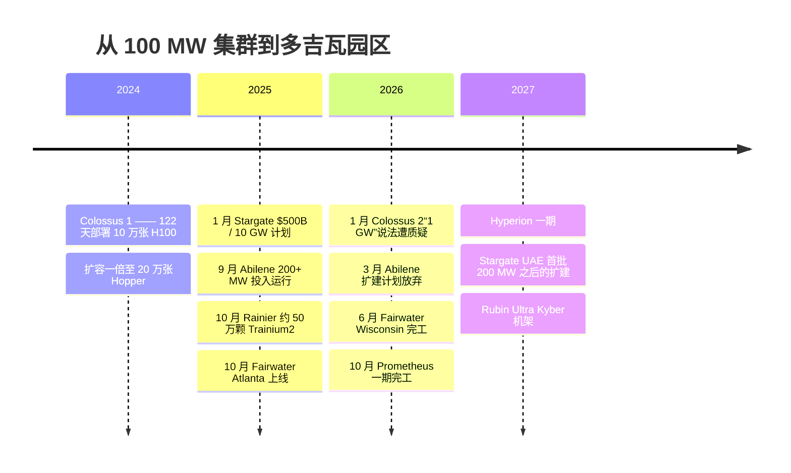
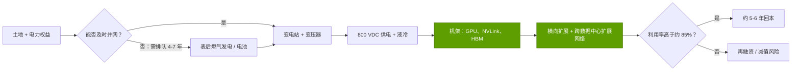
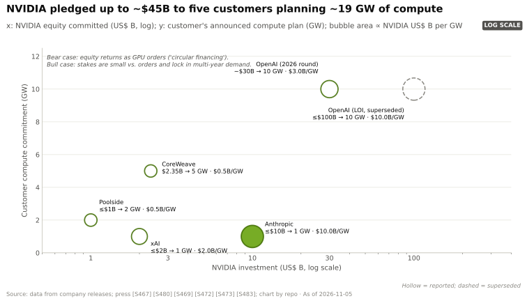
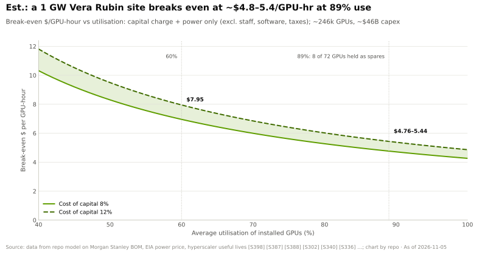
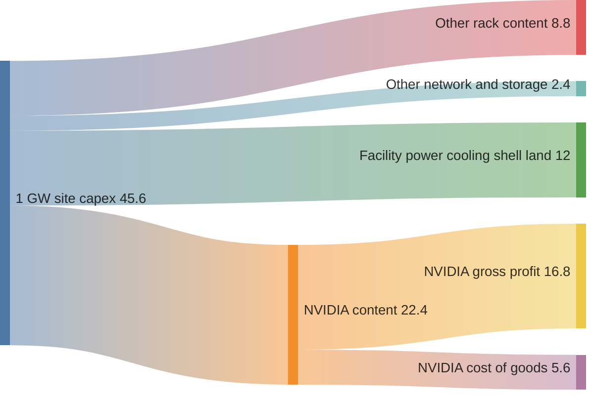

# CS7 · 吉瓦级 AI 工厂：xAI、Stargate 等

> [!NOTE]
> 本页为英文原文的简体中文参考译文，仅供参考；如有出入，以[英文原文](../../case-studies/CS7-gigawatt-ai-factories-xai-stargate-etc.md "English original")为准。

案例研究 · 阅读约 15 分钟 · 最后核实：2026-11-05

## ⚡ 要点速览

- **AI 基础设施的计量单位从集群变成了发电厂。** 2024 年，xAI 的 Colossus 1 在 122 天内让 100,000 张 H100 投入使用，功耗约 150 MW（根据 GPU 数量估计）[[S6000]](../../sources/bibliography.md#s6000)[[S318]](../../sources/bibliography.md#s318)。到 2026 年，单个站点的用电量达 0.35–0.74 GW，已宣布的园区规模达 1–5 GW [[S90077]](../../sources/bibliography.md#s90077)[[S27004]](../../sources/bibliography.md#s27004)[[S27007]](../../sources/bibliography.md#s27007)。
- **吉瓦级说法需要核实。** 马斯克在 2026 年 1 月称 Colossus 2 是首个吉瓦级训练集群。而当时的卫星分析只发现约 350 MW 的冷却能力（🔴 存在争议）[[S90076]](../../sources/bibliography.md#s90076)[[S90077]](../../sources/bibliography.md#s90077)。Stargate Abilene 在 2025 年 9 月已有 200+ MW 投入运行，规划为 1.2 GW；2026 年 3 月，超出这一规模的扩建计划被放弃，但甲骨文（Oracle）对此有异议 [[S8013]](../../sources/bibliography.md#s8013)[[S27001]](../../sources/bibliography.md#s27001)[[S27002]](../../sources/bibliography.md#s27002)。
- **一个吉瓦的成本约为 $30–60B。** 英伟达（NVIDIA）CEO 估计为 $50–60B，其中英伟达价值量约 $35B [[S398]](../../sources/bibliography.md#s398)。伯恩斯坦（Bernstein）估计约 $35B，巴克莱（Barclays）估计为 $32.5–42B [[S6025]](../../sources/bibliography.md#s6025)[[S27012]](../../sources/bibliography.md#s27012)。本资料库自下而上测算的 Vera Rubin 站点约为 **$46B（估计）**，其中英伟达价值量约 $22B。
- **决定时间表的是电力，而非 GPU。** 一个站点可以在 4–24 个月内建成，但新的电网供电需要 4–7 年 [[S8009]](../../sources/bibliography.md#s8009)[[S8010]](../../sources/bibliography.md#s8010)。仅 ERCOT 就追踪着约 410 GW 寻求并网的大型负荷 [[S8011]](../../sources/bibliography.md#s8011)。建设方的应对措施包括现场燃气发电、800 VDC 供电和液冷 [[S8015]](../../sources/bibliography.md#s8015)[[S90061]](../../sources/bibliography.md#s90061)。
- **利用率决定经济性。** 在 89 % 的利用率下（Meta 将 Prometheus 超过 11 % 的 GPU 作为备件），一个 Vera Rubin 吉瓦的盈亏平衡价格约为每 [GPU 小时](../glossary.md#gpu-hour) $4.8–5.4。在 60 % 的利用率下则需要约 $7–8（估计）[[S27010]](../../sources/bibliography.md#s27010)。
- **风险集中在融资环节。** Meta 将 Hyperion 移入与 Blue Owl 组建的约 $27–30B 合资企业 [[S27008]](../../sources/bibliography.md#s27008)；据报道，Abilene 的扩建因融资失败而告吹 [[S27001]](../../sources/bibliography.md#s27001)；而英伟达对自身客户的投资则加剧了关于循环融资的争论 [[S90015]](../../sources/bibliography.md#s90015)[[S12528]](../../sources/bibliography.md#s12528)。

## 1. 背景

**站点为何变得如此庞大。** 前沿训练是一项同步作业。数千个 GPU 在每一步都要交换梯度，因此必须位于同一个低延迟网络上。训练更大模型最快的方式，就是建设更大的单一站点。物理条件随之而变。一个 [NVL72](../glossary.md#nvl72) 机架的功耗从约 120 kW（GB200）增至 190–230 kW（Vera Rubin），据报道 Kyber 机架约为 600 kW [[S336]](../../sources/bibliography.md#s336)[[S302]](../../sources/bibliography.md#s302)[[S90061]](../../sources/bibliography.md#s90061)。机架数量、冷却和变电站同步扩张。

**“一个吉瓦”意味着什么。** 各类公告混用三种数字：电网或合同电力、计量表处的电力，以及 [IT 负载](../glossary.md#it-load)（服务器的实际用电）。三者之间的差距就是 [PUE](../glossary.md#pue)。在 PUE 为 1.15 时，1 GW 的计量电力可供应约 870 MW 的 IT 负载。因此，一个“1 GW 集群”能容纳的 GPU 可能比标题暗示的少 10–20 %。卫星统计冷水机组所衡量的又是另一回事：冷却能力 [[S90077]](../../sources/bibliography.md#s90077)。

## 2. 决策

每个建设方都下了同样的赌注：提前数年锁定电力和芯片，以应对未来需求。但各自的结构各不相同。

| 建设方 · 站点 | 芯片 | 规模（最佳证据 → 规划） | 独特选择 | 来源 |
|---|---|---|---|---|
| xAI · Colossus 1–2（孟菲斯） | 英伟达 H100 → GB200/GB300 | 约 150 MW（估计）→ 观测到 350 MW，宣称 1 GW，规划约 2 GW | 速度：改造既有建筑，现场燃气轮机发电 | [[S6000]](../../sources/bibliography.md#s6000)[[S90076]](../../sources/bibliography.md#s90076)[[S90077]](../../sources/bibliography.md#s90077)[[S8015]](../../sources/bibliography.md#s8015) |
| OpenAI / 甲骨文 / Crusoe · Stargate Abilene | 英伟达 GB200/GB300 | 200+ MW（2025 年 9 月）→ 1.2 GW | 开发商建设、甲骨文租赁；约 7 GW、超过 $400B 计划的一部分 | [[S8013]](../../sources/bibliography.md#s8013)[[S27000]](../../sources/bibliography.md#s27000)[[S27003]](../../sources/bibliography.md#s27003) |
| Meta · Prometheus（俄亥俄州）、Hyperion（路易斯安那州） | 英伟达 GB200/GB300（Prometheus） | 一期于 2026 年 10 月完工 → 1 GW；Hyperion 最高 5 GW | Hyperion 采用表外 [SPV 融资](../glossary.md#spv-financing) | [[S27007]](../../sources/bibliography.md#s27007)[[S27008]](../../sources/bibliography.md#s27008)[[S27009]](../../sources/bibliography.md#s27009) |
| 微软（Microsoft）· Fairwater（威斯康星州、亚特兰大） | 英伟达 GB200/GB300 | 威斯康星州约 737 MW IT 功率（Epoch 估计） | 各站点通过 AI 广域网（WAN）连接成一个“超级工厂” | [[S27004]](../../sources/bibliography.md#s27004)[[S27005]](../../sources/bibliography.md#s27005)[[S27006]](../../sources/bibliography.md#s27006) |
| Anthropic · 多供应商 | Trainium2、TPU、英伟达、AMD | 约 50 万颗 Trainium2（Rainier）；2026 年超过 1 GW TPU；最多 1 GW 英伟达；2 GW AMD | 将风险分散到四家芯片供应商 | [[S27011]](../../sources/bibliography.md#s27011)[[S653]](../../sources/bibliography.md#s653)[[S654]](../../sources/bibliography.md#s654)[[S9538]](../../sources/bibliography.md#s9538) |
| 主权 AI · HUMAIN、Stargate UAE | 英伟达 GB300 → Vera Rubin（HUMAIN 还采用 AMD、高通） | 84 MW 确定期 → 500 MW；阿联酋 200 MW → 1 GW | 国家支持的需求，与美国出口审批挂钩 | [[S13514]](../../sources/bibliography.md#s13514)[[S13516]](../../sources/bibliography.md#s13516)[[S13008]](../../sources/bibliography.md#s13008)[[S90030]](../../sources/bibliography.md#s90030) |

**xAI：以速度为战略。** Colossus 1 从第一个机架到开始训练仅用 19 天，采用 [Spectrum-X](../glossary.md#spectrum-x) 以太网网络 [[S6000]](../../sources/bibliography.md#s6000)，随后开始扩容一倍至 200,000 个 Hopper GPU [[S6001]](../../sources/bibliography.md#s6001)。Colossus 2 的目标是约 550,000 个 GB200/GB300 GPU，部分电力来自计量表后的现场天然气发电 [[S90076]](../../sources/bibliography.md#s90076)[[S8015]](../../sources/bibliography.md#s8015)。英伟达也是 xAI 的投资方，据报道投资额最高 $2B [[S483]](../../sources/bibliography.md#s483)。

**OpenAI 及其合作伙伴：站点组合。** 2025 年 1 月的承诺为 $500B 和 10 GW。到 2025 年 9 月，各合作方已在 Abilene、五个新的美国站点和 CoreWeave 产能上规划了约 7 GW，并承诺在三年内投入超过 $400B [[S27000]](../../sources/bibliography.md#s27000)。甲骨文为 Abilene 设计的 Zettascale10 方案目标是最多 800,000 个 GPU [[S6008]](../../sources/bibliography.md#s6008)。Epoch AI 将 Abilene 列为已运营，目前约相当于 50.9 万个 H100，预计将达到约 102 万个 [[S27003]](../../sources/bibliography.md#s27003)。

**Meta：自建，但在表外融资。** Prometheus 承诺于 2026 年投用，第一期已于 2026 年 10 月完工。Meta 正将其扩展至约 100 万个 GPU，[平均中断间隔时间（MTBI）](../glossary.md#mtbi)约为 47,000 GPU 小时 [[S27009]](../../sources/bibliography.md#s27009)。Hyperion 约 $27–30B 的融资安排中，Blue Owl 持有多数股权，Meta 约占 20 % [[S27008]](../../sources/bibliography.md#s27008)。

**Anthropic：多供应商对冲。** Anthropic 运行在 Project Rainier（约 500,000 颗 Trainium2）[[S27011]](../../sources/bibliography.md#s27011)、最多 100 万颗谷歌（Google）TPU（2026 年超过 1 GW）[[S653]](../../sources/bibliography.md#s653)、最多 1 GW 的英伟达系统（附带 $30B 的 Azure 承诺）[[S654]](../../sources/bibliography.md#s654)以及 2 GW 的 AMD Helios 上 [[S9538]](../../sources/bibliography.md#s9538)。这是英伟达未能锁定的吉瓦级买家中最清晰的例子。

## 3. 结果（用数据说话）

**一个吉瓦的成本。** 黄仁勋估计，1 GW AI 工厂的成本为 $50–60B，其中英伟达价值量约 $35B（2025 年 8 月）[[S398]](../../sources/bibliography.md#s398)。其他估计更低。伯恩斯坦估计约 $35B：GPU 约占 39 %，网络约 13 %，电气与机械设施约占三分之一 [[S6025]](../../sources/bibliography.md#s6025)[[S27013]](../../sources/bibliography.md#s27013)。巴克莱估计为 $32.5–42B [[S27012]](../../sources/bibliography.md#s27012)，彭博对 Abilene 一个吉瓦的估价约为 $30B，其中芯片 $17B（🟡）[[S27015]](../../sources/bibliography.md#s27015)。伯恩斯坦后来的一份报告将 Vera Rubin 置于 $34.6–39.5B 区间的上端 [[S27016]](../../sources/bibliography.md#s27016)。差异主要源于各项估计把哪些计入“芯片”（内存、CPU、交换机），以及是否包含土地和发电设施。

> [!TIP]
> **算例 —— 1 GW Vera Rubin 站点的 GPU、机架、MW 与资本开支（估计）。**
> 1. **从计量电力到 IT 负载：** 1,000 MW ÷ [PUE](../glossary.md#pue) 1.15 = **约 870 MW** IT 负载。
> 2. **每机架功耗：** 一个 Vera Rubin NVL72 的功耗为 190 kW（Max-Q）至 230 kW（Max-P）[[S302]](../../sources/bibliography.md#s302)。再加约 21 % 用于[横向扩展（scale-out）](../glossary.md#scale-out)交换机、存储和管理节点（GB200：全口径 145 kW 对 120 kW）[[S340]](../../sources/bibliography.md#s340)[[S336]](../../sources/bibliography.md#s336)。由此得出每机架 230–278 kW，中值约 254 kW。
> 3. **机架与 GPU：** 870 MW ÷ 254 kW ≈ **3,420 个机架**，× 72 = **约 246,000 个 GPU**（区间 22.5 万–27.2 万）。
> 4. **资本开支：** 机架数 × $7.8M（摩根士丹利物料清单）[[S330]](../../sources/bibliography.md#s330)[[S332]](../../sources/bibliography.md#s332) = **$26.7B**。网络和存储约增加机架支出的 26 % [[S324]](../../sources/bibliography.md#s324) = **$6.9B**。设施（电力设备、冷却、厂房、土地）为 $11–13B [[S6025]](../../sources/bibliography.md#s6025)。合计**约 $45.6B**（区间 $41.7–50.2B）。
> 5. **谁拿到钱：** 英伟达占 Vera Rubin 机架价值的 62–72 %（它转售 [HBM4](../glossary.md#hbm4)），外加网络部分的 50–80 % [[S332]](../../sources/bibliography.md#s332)[[S324]](../../sources/bibliography.md#s324)。即**约 $22.4B（约 49 %）**，按约 75 % 的毛利率计算，每吉瓦为英伟达带来约 $16.8B 毛利。
>
> **结论：** 一个 Vera Rubin 吉瓦约有一半流向英伟达，低于黄仁勋在 Blackwell 时代所引用的约 $35B。HBM4 将内存推高至机架物料清单的约 26 %，因此如今每一美元中有更多流向 SK 海力士、三星和美光（Micron）[[S330]](../../sources/bibliography.md#s330)。设施（电力设备、冷却、厂房、土地）约占四分之一。

🔧 技术细节：模型假设与敏感性

- **机架价格**是关键变量。若采用伯恩斯坦估计的每个 Vera Rubin 机架 $9.1M（HBM4 约 $53/GB）而非 $7.8M，机架资本开支将增加约 $4.4B。摩根士丹利 $6.7M 的直连 SOCAMM 情景则使其减少约 $3.8B（未计入对网络的连带影响）[[S333]](../../sources/bibliography.md#s333)[[S332]](../../sources/bibliography.md#s332)。
- **Max-Q 与 Max-P：** 机架以 190 kW 运行时，在同样 870 MW 内可比 230 kW 时多容纳约 21 % 的机架。资本开支随之上升，但每 MW 的 token 产出也会提高。本资料库的“高”情景（27.2 万个 GPU）即 Max-Q 情景。
- **设施成本**采用伯恩斯坦对约 $35B 中电气与机械约占三分之一的估计，约 $11.6B，再加上土地和厂房的余量 [[S6025]](../../sources/bibliography.md#s6025)。像 Colossus 2 那样的表后发电，会增加本模型未计入的电厂资本开支 [[S8015]](../../sources/bibliography.md#s8015)。
- **盈亏平衡模型：** 资本费用 = IT 资本开支 × CRF(r, 6 年) + 设施 × CRF(r, 20 年)，其中[资本回收系数](../glossary.md#capital-recovery-factor) CRF = r / (1 − (1 + r)^−n)。r = 8 % 时为每年 $8.5B；12 % 时为 $9.8B。电价按 $0.081/kWh 计，满负荷用电每年约 $0.71B [[S389]](../../sources/bibliography.md#s389)[[S382]](../../sources/bibliography.md#s382)。人员、软件、维护和税费未计入，因此实际盈亏平衡点更高。
- **输入数据**位于 `data/cs7_gw_build_inputs.csv`，公式位于 `scripts/charts/ch_cs7.py`。

**电力与电网。** 瓶颈已从 [CoWoS](../glossary.md#cowos) 转移到了电力。建设需要 4–24 个月，但电网供电要 4–7 年才能到位：

建设方通过三种方式绕开电网。一是自行发电（Colossus 2 的[表后（behind-the-meter）](../glossary.md#behind-the-meter)燃气发电 [[S8015]](../../sources/bibliography.md#s8015)）。二是将一项作业分散到通过广域网连接的多个站点（[跨数据中心扩展（scale-across）](../glossary.md#scale-across)，微软在各 Fairwater 站点之间就是这样做的 [[S27006]](../../sources/bibliography.md#s27006)）。三是重新设计供电方式：在 GTC DC 2025 上，约 20 家合作伙伴展示了 800 VDC 组件，800 VDC 行级电源中心（每行最高 2 MW）计划于 2027 年推出 [[S90061]](../../sources/bibliography.md#s90061)[[S90063]](../../sources/bibliography.md#s90063)。相关机制参见[第 08 层 · 系统、机架与 AI 工厂](../layers/08-systems-racks-ai-factories/index.md)及其[电力与冷却页面](../layers/08-systems-racks-ai-factories/power-and-cooling.md)。

**实际交付与宣称。** 截至 2026 年底，有独立证据的项目是 Abilene（已运营，Epoch）、Fairwater Wisconsin（已完工，按 Epoch 估计约 737 MW IT 功率）和 Prometheus 一期 [[S27003]](../../sources/bibliography.md#s27003)[[S27004]](../../sources/bibliography.md#s27004)[[S27005]](../../sources/bibliography.md#s27005)[[S27009]](../../sources/bibliography.md#s27009)。Colossus 2 的吉瓦规模仅基于公司自己的说法 [[S90076]](../../sources/bibliography.md#s90076)。Hyperion 和 Stargate UAE 仍在建设中，一期分别将于 2027 年和 2026 年完成 [[S27007]](../../sources/bibliography.md#s27007)[[S13008]](../../sources/bibliography.md#s13008)。

## 4. 为何奏效（或为何未能奏效）

**奏效之处。**
- **速度会复利。** xAI 证明，改造既有厂房、现场发电和单一供应商技术栈可以把数年缩短到数月 [[S6000]](../../sources/bibliography.md#s6000)。其他所有人都采纳了这套打法的部分内容。
- **英伟达的全栈方案适合吉瓦级建设。** 购买机架、[NVLink](../glossary.md#nvlink)、Spectrum-X 或 [InfiniBand](../glossary.md#infiniband) 以及参考设计（Omniverse DSX、800 VDC）的建设方，面临的集成风险更少。这就是吉瓦级项目储备大部分属于英伟达的原因（见上图）。
- **融资创新。** 合资企业（Hyperion）、开发商-出租方模式（Abilene 的 Crusoe/甲骨文）以及英伟达 2026 年 8 月推出的、旨在调动超过 $500B 第三方资本的平台，分摊了资本开支 [[S27008]](../../sources/bibliography.md#s27008)[[S12528]](../../sources/bibliography.md#s12528)。

**未奏效或尚未证实之处。**
- **融资可能在建设中途失败。** 据报道，Abilene 超出 1.2 GW 的扩建在融资谈判失败后搁浅（甲骨文对这一说法有异议）[[S27001]](../../sources/bibliography.md#s27001)[[S27002]](../../sources/bibliography.md#s27002)。截至 2026 年年中，CoreWeave 背负约 $35B 债务，季度净利息支出 $640M [[S12501]](../../sources/bibliography.md#s12501)。
- **利用率低于铭牌值。** Meta 将 Prometheus 超过 11 % 的 GPU 作为备件或故障单元，在中断次数降低 99 % 之前，早期每 8,000 个 GPU 每天约发生 1,000 次中断 [[S27010]](../../sources/bibliography.md#s27010)。[热备件](../glossary.md#hot-spare)本身不产生收入，但能保证训练作业持续运行。
- **循环性。** 英伟达已向多个吉瓦级买家（OpenAI、Anthropic、xAI、CoreWeave）承诺股权投资。它还以最多 $6.3B 为 CoreWeave 未售出的产能提供兜底 [[S90015]](../../sources/bibliography.md#s90015)[[S654]](../../sources/bibliography.md#s654)[[S483]](../../sources/bibliography.md#s483)[[S90067]](../../sources/bibliography.md#s90067)。

> [!TIP]
> **算例 —— 一个吉瓦的盈亏平衡租赁价格。** 以上文约 $45.6B、约 24.6 万个 GPU 的站点为例。在 8–12 % 的资本成本下，年度资本费用为 $8.5–9.8B，电费再加约 $0.7B。在 **89 %** 的利用率下（72 个 GPU 中有 8 个作为备件），站点需要**每 GPU 小时 $4.8–5.4** 才能盈亏平衡。在 **60 %** 的利用率下则需要 **$7.0–8.0**。利用率从 89 % 降至 60 %，盈亏平衡价格上升约 46 %。资本成本从 8 % 升至 12 %，盈亏平衡价格仅上升约 14 %。作为对比，某[新兴云服务商（neocloud）](../glossary.md#neocloud)对 B200 的挂牌价约为每 GPU 小时 $4.99 [[S395]](../../sources/bibliography.md#s395)。黄仁勋所称一个吉瓦“每年租金 $50B” [[S27014]](../../sources/bibliography.md#s27014)，按这一 GPU 数量满负荷计算，意味着约每 GPU 小时 $23。这只有作为高端模型的 token 收入才可信，作为 GPU 租金则不可信（🔴 本资料库分析）。

> [!NOTE]
> **🐂 看多观点。** 是需求在追赶站点，而不是相反。CFO 称 FY2028 受供应约束 [[S90012]](../../sources/bibliography.md#s90012)，每个吉瓦包含约 $22B 的英伟达价值量（估计），而电力稀缺保护了已经握有站点的现有玩家。像 Abilene 这样的延误只是推迟收入，而非取消收入；甲骨文也表示其与 OpenAI 的 4.5 GW 租约已经落实 [[S27002]](../../sources/bibliography.md#s27002)。

> [!WARNING]
> **🐻 看空观点。** 吉瓦级公告是期权，而非订单。OpenAI 与英伟达的 10 GW 意向书最终变成了一笔不附部署里程碑的 $30B 股权投资 [[S90015]](../../sources/bibliography.md#s90015)。卫星数据与一项旗舰级说法相矛盾 [[S90077]](../../sources/bibliography.md#s90077)。决定最终能建成多少吉瓦的，将是利用率和融资，而非芯片供应。如果 token 价格的下降速度快于成本，2026–2027 年建成的 $45B 级站点可能在 6 年折旧期内就面临减值，英伟达在客户中的股权投资也会随之缩水。

## 5. 对企业发展（corp dev）的启示

**吉瓦规模下价值流向何处。** 逐一追踪约 $46B（估计）的 Vera Rubin 吉瓦中的每一美元：

1. **芯片仍拿走最大份额，但每吉瓦的占比在下降。** 英伟达在 Vera Rubin 机架中的占比（62–72 %）低于 GB200 机架的 72–84 %，因为 HBM4 及其他组件的价值增加了 [[S326]](../../sources/bibliography.md#s326)[[S330]](../../sources/bibliography.md#s330)[[S332]](../../sources/bibliography.md#s332)。在整个站点中，英伟达的占比约为 49 %（估计）。存储厂商是主要受益者。
2. **电力设备和冷却是第二大价值池。** 站点资本开支的四分之一到三分之一流向电气与机械设施。变压器、开关柜和现场发电设备的交付周期决定了建设进度 [[S6025]](../../sources/bibliography.md#s6025)[[S90061]](../../sources/bibliography.md#s90061)。
3. **拥有电力权益的土地是最稀缺的资产。** 已并网的站点可以跳过 4–7 年的排队 [[S8009]](../../sources/bibliography.md#s8009)[[S8010]](../../sources/bibliography.md#s8010)，这就是开发商（Crusoe、Aligned、新兴云服务商）获得高估值的原因 [[S8521]](../../sources/bibliography.md#s8521)。
4. **利用率软件被低估了。** 利用率下降十个百分点（89 % → 79 %），盈亏平衡价格上升约 12 %，大致相当于资本成本上升四个百分点的影响（约 14 %），而利用率的波动幅度远大于融资成本（见算例）。调度、故障恢复和推理服务（第 11–12 层）守护着一个吉瓦的经济性。

## 🎯 企业发展视角

1. **哪个价值池的持有者不足？** 按每吉瓦约 $12B 的电力、冷却和厂房投入计算（估计），从 800 VDC 转换到液冷分配的电气链条是一个比网络更大的价值池。半导体公司可以在哪些环节增加价值量：功率转换芯片、传感器、控制器？
2. **高能效推理。** 能够在每兆瓦上交付更多 token 的挑战者，可以打入电力受限的站点——在那里，硬约束是电表而非预算。高通的 AI200/AI250 机架及其 200 MW 的 HUMAIN 计划是公开的参照点 [[S90028]](../../sources/bibliography.md#s90028)[[S90030]](../../sources/bibliography.md#s90030)。吉瓦级买家会要求哪些证明指标（tokens/MW、利用率、可维护性）？
3. **在尽职调查中如何核实吉瓦级说法？** 索取计量电力、PUE、机架数量和利用率数据，并与卫星或许可证数据交叉核对，就像对 Colossus 2 所做的那样 [[S90077]](../../sources/bibliography.md#s90077)。
4. **谁的资产负债表承担风险？** SPV 融资（Hyperion）、厂商兜底（CoreWeave）和厂商股权投资（英伟达 → OpenAI、Anthropic、xAI）只是转移风险，而非消除风险。当合作伙伴提出一项产能交易时，谁来承担利用率不足的后果？
5. **多供应商买家是突破口。** Anthropic 运行着四个芯片平台，HUMAIN 同时采购了英伟达、AMD 和高通的产品 [[S653]](../../sources/bibliography.md#s653)[[S9538]](../../sources/bibliography.md#s9538)[[S13517]](../../sources/bibliography.md#s13517)[[S90030]](../../sources/bibliography.md#s90030)。吉瓦级买家需要第二供应商来获得价格和供应上的筹码。成为一个可信的第二供应商，是挑战者现实的切入点；在训练上击败英伟达则不是。

相关内容：[CS4 · AMD、OpenAI 与第二供应商](CS4-amd-openai-and-the-second-source.md) · [第 13 层 · 资本配置](../layers/13-ecosystem-gtm-and-capital/capital-deployment.md) · [第 08 层 · AI 工厂](../layers/08-systems-racks-ai-factories/ai-factories.md) · [第 14 章 · 训练与推理经济学](../cross-cutting/14-training-vs-inference-economics.md)。

## 📚 来源（Sources）

<!-- Auto-generated from the [S…] citations on this page by `make build`. Edit sources/registry/*.csv, not this list. -->

- [**S302**](../../sources/bibliography.md#s302) Hashrate Index, *NVIDIA Vera Rubin NVL72 specs breakdown*, 2026. [Link](https://hashrateindex.com/blog/nvidia-vera-rubin-nvl72-specs-breakdown/)
- [**S318**](../../sources/bibliography.md#s318) NVIDIA (mirror hosted by MEGWARE), *NVIDIA DGX H100 datasheet*, 2023. [Link](https://www.MEGWARE.com/fileadmin/user_upload/LandingPage%20NVIDIA/nvidia-dgx-h100-datasheet.pdf)
- [**S324**](../../sources/bibliography.md#s324) fal.ai, *NVIDIA GB200 price in 2026: what a GPU, a tray and an NVL72 rack cost*, 2026. [Link](https://fal.ai/learn/serverless/nvidia-gb200-price)
- [**S326**](../../sources/bibliography.md#s326) TweakTown, *NVIDIA's new GB200 Superchip costs up to $70,000: full B200 NVL72 AI server costs $3 million*, 2024-05. [Link](https://www.tweaktown.com/news/98292/nvidias-new-gb200-superchip-costs-up-to-70-000-full-b200-nvl72-ai-server-3-million/index.html)
- [**S330**](../../sources/bibliography.md#s330) PC Gamer, *A single Nvidia Vera Rubin rack is estimated to cost $7,803,148 with over $2 million of that figure spent on memory alone*, 2026-05. [Link](https://pcgamer.com/hardware/a-single-nvidia-vera-rubin-rack-is-estimated-to-cost-usd7-803-148-with-over-usd2-million-of-that-figure-spent-on-memory-alone)
- [**S332**](../../sources/bibliography.md#s332) Tiger Brokers (iTiger), *Morgan Stanley's BOM analysis of NVIDIA's Rubin: GPU share declines; PCB, MLCC and ABF substrate values soar*, 2026-05-20. [Link](https://www.itiger.com/news/1188068712)
- [**S333**](../../sources/bibliography.md#s333) Wccftech, *Bernstein warns NVIDIA's Vera Rubin racks will hit $9.1 million as HBM4 prices triple to $53 per gigabyte*, 2026-07. [Link](https://wccftech.com/bernstein-warns-nvidias-vera-rubin-racks-will-hit-9-1-million-as-hbm4-prices-triple-to-53-per-gigabyte/)
- [**S336**](../../sources/bibliography.md#s336) eeNews Europe, *Nvidia offers 120kW liquid-cooled Blackwell rack as industry standard*, 2024-10. [Link](https://www.eenewseurope.com/en/nvidia-offers-120kw-liquid-cooled-blackwell-rack-as-industry-standard)
- [**S340**](../../sources/bibliography.md#s340) SemiAnalysis (Dylan Patel et al.), *Huawei AI CloudMatrix 384 - China's answer to Nvidia GB200 NVL72*, 2025-04-16. [Link](https://newsletter.semianalysis.com/p/huawei-ai-cloudmatrix-384-chinas-answer-to-nvidia-gb200-nvl72)
- [**S382**](../../sources/bibliography.md#s382) Microsoft via SEC EDGAR, *Microsoft Corporation Form 10-K filings (FY2021, FY2023) - property and equipment useful lives*, 2023-07-27. [Link](https://www.sec.gov/cgi-bin/browse-edgar?action=getcompany&CIK=0000789019&type=10-K&dateb=&owner=include&count=40)
- [**S389**](../../sources/bibliography.md#s389) U.S. Energy Information Administration, *EIA Electric Power Monthly, Table 5.6.A: average price of electricity to ultimate customers by end-use sector*, 2025. [Link](https://www.eia.gov/electricity/monthly/epm_table_grapher.php?t=epmt_5_6_a)
- [**S395**](../../sources/bibliography.md#s395) Lambda, *Lambda GPU cloud pricing*, 2025. [Link](https://lambda.ai/pricing)
- [**S398**](../../sources/bibliography.md#s398) NVIDIA Investor Relations, *NVIDIA Q2 FY2026 earnings call (2025-08-27): AI factory economics commentary*, 2025-08-27. [Link](https://investor.nvidia.com/events-and-presentations/events-and-presentations/default.aspx)
- [**S483**](../../sources/bibliography.md#s483) Various (Bloomberg, The Information, Reuters), *Reporting on NVIDIA commitments to xAI (up to $2B in ~$20B raise), Poolside (up to $1B), Lambda (~$1.5B GPU lease-back) and Wayve ($500M LOI)*, 2025-10. [Link](https://www.bloomberg.com/technology)
- [**S653**](../../sources/bibliography.md#s653) Anthropic, *Expanding our use of Google Cloud TPUs and Services*, 2025-10-23. [Link](https://www.anthropic.com/news/expanding-our-use-of-google-cloud-tpus-and-services)
- [**S654**](../../sources/bibliography.md#s654) Anthropic, *Microsoft, NVIDIA, and Anthropic announce strategic partnerships*, 2025-11-18. [Link](https://www.anthropic.com/news/microsoft-nvidia-anthropic-announce-strategic-partnerships)
- [**S6000**](../../sources/bibliography.md#s6000) TechPowerUp (NVIDIA press release), *NVIDIA Ethernet Networking Accelerates World's Largest AI Supercomputer, Built by xAI*, 2024-10-29. [Link](https://techpowerup.com/328227/nvidia-ethernet-networking-accelerates-worlds-largest-ai-supercomputer-built-by-xai)
- [**S6001**](../../sources/bibliography.md#s6001) DatacenterDynamics, *xAI to double Colossus compute capacity, reveals cluster uses Nvidia Spectrum-X Ethernet*, 2024-10. [Link](https://datacenterdynamics.com/en/news/xai-to-double-colossus-compute-capacity-reveals-cluster-uses-nvidia-spectrum-x-ethernet)
- [**S6008**](../../sources/bibliography.md#s6008) Oracle, *Oracle Unveils Next-Generation Oracle Cloud Infrastructure Zettascale10 Cluster for AI*, 2025-10-14. [Link](https://www.oracle.com/news/announcement/ai-world-oracle-unveils-next-generation-oci-zettascale10-cluster-for-ai-2025-10-14/)
- [**S6025**](../../sources/bibliography.md#s6025) Reuters (via Investing.com), *How much does a GW of data center capacity actually cost?*, 2025-10. [Link](https://ng.investing.com/news/stock-market-news/how-much-does-a-gw-of-data-center-capacity-actually-cost-2169144)
- [**S8009**](../../sources/bibliography.md#s8009) Lawrence Berkeley National Laboratory, *Queued Up: 2025 Edition, Characteristics of Power Plants Seeking Transmission Interconnection As of the End of 2024*, 2025-12-15. [Link](https://emp.lbl.gov/sites/default/files/2025-12/Queued%20Up%202025%20Edition%20-%2012.15.2025.pdf)
- [**S8010**](../../sources/bibliography.md#s8010) Bloomberg, *Data Centers Face Seven-Year Wait for Dominion Power Hookups*, 2024-08-29. [Link](https://www.bloomberg.com/news/articles/2024-08-29/data-centers-face-seven-year-wait-for-power-hookups-in-virginia)
- [**S8011**](../../sources/bibliography.md#s8011) ERCOT, *ERCOT Large Load Update (April 2026 hearing)*, 2026-04-01. [Link](https://www.ercot.com/files/docs/2026/04/01/ERCOT_LargeLoad_Update_April2026_B-C_-Hearing.pdf)
- [**S8013**](../../sources/bibliography.md#s8013) DatacenterDynamics, *Crusoe's Abilene data center officially live, serving Oracle and OpenAI's Stargate*, 2025-09. [Link](https://datacenterdynamics.com/en/news/crusoes-abilene-data-center-officially-live-serving-oracle-and-openais-stargate)
- [**S8015**](../../sources/bibliography.md#s8015) Cleanview, *Behind-the-meter data centers: Colossus (xAI) report*, 2026-05. [Link](https://cleanview.co/reports/behind-the-meter-data-centers/full-report/colossus)
- [**S8521**](../../sources/bibliography.md#s8521) DatacenterDynamics, *MGX, AIP and BlackRock's GIP complete $40bn acquisition of Aligned Data Centers*, 2026-07. [Link](https://www.datacenterdynamics.com/en/news/mgx-aip-and-blackrocks-gip-complete-40bn-acquisition-of-aligned-data-centers/)
- [**S9538**](../../sources/bibliography.md#s9538) The Next Web, *AMD is investing $5 billion in Anthropic and deploying 2 gigawatts of Helios GPUs to run Claude*, 2026. [Link](https://thenextweb.com/news/amd-anthropic-5-billion-investment-2gw-helios-mi450)
- [**S12501**](../../sources/bibliography.md#s12501) Runtime Wire, *CoreWeave reports $2.58 billion Q2 revenue with $35 billion in debt*, 2026-08. [Link](https://runtimewire.com/article/coreweave-q2-2026-revenue-debt-ai-cloud)
- [**S12528**](../../sources/bibliography.md#s12528) NVIDIA Newsroom, *NVIDIA Partners With Apollo, BlackRock, Blackstone, Brookfield, Goldman Sachs and KKR to Establish AI Compute Infrastructure Financing Platforms to Mobilize Over $500 Billion of Third-Party Capital*, 2026-08-10. [Link](https://nvidianews.nvidia.com/news/nvidia-partners-with-apollo-blackrock-blackstone-brookfield-goldman-sachs-and-kkr-to-establish-ai-compute-infrastructure-financing-platforms-to-mobilize-over-500-billion-of-third-party-capital)
- [**S13008**](../../sources/bibliography.md#s13008) Gulf News, *New update on Stargate UAE: first phase of 200MW to complete by 2026*, 2025-10. [Link](https://gulfnews.com/business/markets/stargate-uae-first-phase-of-200mw-to-complete-by-2026-1.500310364)
- [**S13514**](../../sources/bibliography.md#s13514) The Daily Star, *Saudi AI firm Humain inks Nvidia deal (Reuters)*, 2025-05-13. [Link](https://www.thedailystar.net/business/global-economy/news/saudi-ai-firm-humain-inks-nvidia-deal-4039841)
- [**S13516**](../../sources/bibliography.md#s13516) The National, *Saudi Arabia's Humain expands Nvidia deal with 84 MW AI computing plan*, 2026-10-22. [Link](https://www.thenationalnews.com/future/technology/2026/10/22/saudi-arabias-humain-expands-nvidia-deal-with-84mw-ai-computing-plan/)
- [**S13517**](../../sources/bibliography.md#s13517) Futuriom, *NVIDIA and AMD score AI hub deals in Saudi Arabia*, 2025-05. [Link](https://www.futuriom.com/articles/news/nvidia-amd-score-deals-for-the-saudi-ai-hub/2025/05)
- [**S27000**](../../sources/bibliography.md#s27000) OpenAI, *OpenAI, Oracle, and SoftBank expand Stargate with five new AI data center sites*, 2025-09-23. [Link](https://openai.com/index/five-new-stargate-sites/)
- [**S27001**](../../sources/bibliography.md#s27001) Tom's Hardware, *Oracle and OpenAI scrap planned 600MW Abilene expansion*, 2026-03. [Link](https://www.tomshardware.com/tech-industry/oracle-and-openai-scrap-planned-600mw-abilene-expansion)
- [**S27002**](../../sources/bibliography.md#s27002) Tom's Hardware, *Oracle hits back at Stargate data center cancellation reports — claims 4.5GW Oracle-OpenAI agreement still on track*, 2026-03. [Link](https://tomshardware.com/tech-industry/oracle-rebuts-incorrect-reporting-on-stargate-expansion)
- [**S27003**](../../sources/bibliography.md#s27003) Epoch AI, *Satellite explorer: OpenAI/Oracle Stargate Abilene (Texas)*, 2026-07-28. [Link](https://epoch.ai/data/data-centers/satellite-explorer/OpenAIOracleStargateAbileneTexas/)
- [**S27004**](../../sources/bibliography.md#s27004) Epoch AI, *AI data center directory: Microsoft Fairwater Wisconsin*, 2026-07-25. [Link](https://epoch.ai/data/ai-data-centers/directory/microsoft-fairwater-wisconsin)
- [**S27005**](../../sources/bibliography.md#s27005) Microsoft Source, *Microsoft completes construction on first datacenter facility in Mount Pleasant, Wisconsin*, 2026-06-23. [Link](https://news.microsoft.com/source/2026/06/23/microsoft-completes-construction-on-first-datacenter-facility-in-mount-pleasant-wisconsin/)
- [**S27006**](../../sources/bibliography.md#s27006) Microsoft Source, *From Wisconsin to Atlanta: Microsoft connects datacenters to build its first AI superfactory*, 2025-11-12. [Link](https://news.microsoft.com/source/features/ai/from-wisconsin-to-atlanta-microsoft-connects-datacenters-to-build-its-first-ai-superfactory/)
- [**S27007**](../../sources/bibliography.md#s27007) The Register, *Meta reveals plan for several multi-gigawatt datacenter clusters*, 2025-07-15. [Link](https://www.theregister.com/2025/07/15/meta_datacenter_build_plan/)
- [**S27008**](../../sources/bibliography.md#s27008) DatacenterDynamics, *Meta secures $30bn Blue Owl finance package for Louisiana data center - report*, 2025-10. [Link](https://www.datacenterdynamics.com/en/news/meta-secures-30bn-blue-owl-finance-package-for-louisiana-data-center-report/)
- [**S27009**](../../sources/bibliography.md#s27009) The Next Web, *Meta details Prometheus, the Ohio supercluster heading for 1 million GPUs*, 2026-10. [Link](https://thenextweb.com/news/meta-prometheus-supercluster-1-million-gpus-muse)
- [**S27010**](../../sources/bibliography.md#s27010) The Register, *Meta's Prometheus supercluster: more than 11 percent of GPUs dead or idle as hot spares*, 2026-10. [Link](https://www.theregister.com/a/5304269)
- [**S27011**](../../sources/bibliography.md#s27011) About Amazon, *AWS activates Project Rainier: one of the world's largest AI compute clusters*, 2025-10. [Link](https://www.aboutamazon.com/news/aws/aws-project-rainier-ai-trainium-chips-compute-cluster)
- [**S27012**](../../sources/bibliography.md#s27012) Benzinga, *Nvidia's 'Jensen math' of $50 billion revenue per GW gets a reality check: here's what Barclays analysts project*, 2025-09. [Link](https://benzinga.com/markets/equities/25/09/47935027/nvidias-jensen-math-of-50-billion-revenue-per-gw-gets-a-reality-check-heres-what-barclays-analysts-project-for-nvda)
- [**S27013**](../../sources/bibliography.md#s27013) Tiger Brokers (iTiger), *Is the soaring cost of NVIDIA's AI data centers still a viable investment for tech giants?*, 2025. [Link](https://www.itiger.com/news/1113387068)
- [**S27014**](../../sources/bibliography.md#s27014) 24/7 Wall St., *NVIDIA's CEO says a 1-gigawatt AI factory rents for $50 billion a year — as much as it costs to build*, 2026-09-24. [Link](https://247wallst.com/investing/2026/09/24/nvidias-ceo-says-a-1-gigawatt-ai-factory-rents-for-50-billion-a-year-as-much-as-it-costs-to-build/)
- [**S27015**](../../sources/bibliography.md#s27015) AI Weekly, *Bloomberg pegs Abilene 1GW AI data center at $30B, $17B on chips*, 2025. [Link](https://aiweekly.co/alerts/bloomberg-pegs-abilene-1gw-ai-data-center-at-30b-17b-on-chips)
- [**S27016**](../../sources/bibliography.md#s27016) Remio, *Bernstein: AI data center costs hit $39.5 billion per GW, but depreciation is the bigger issue*, 2026. [Link](https://www.remio.ai/post/bernstein-ai-data-center-costs-hit-39-5-billion-per-gw-but-depreciation-is-the-b)
- [**S90012**](../../sources/bibliography.md#s90012) Tomasz Tunguz (Tomasz Tunguz), *Nvidia Q2 FY27 earnings*, 2026-08. [Link](https://www.tomtunguz.com/nvidia-q2-fy27-earnings/index.md)
- [**S90015**](../../sources/bibliography.md#s90015) DatacenterDynamics, *Nvidia plans $30bn investment in upcoming OpenAI funding round*, 2026-02. [Link](https://www.datacenterdynamics.com/en/news/nvidia-plans-30bn-investment-in-upcoming-openai-funding-round/)
- [**S90028**](../../sources/bibliography.md#s90028) TechRepublic, *Qualcomm unveils AI chips to rival Nvidia, AMD*, 2025-10-27. [Link](https://techrepublic.com/article/news-qualcomm-unveils-ai-chips-to-rival-nvidia-amd)
- [**S90030**](../../sources/bibliography.md#s90030) Morningstar, *Qualcomm: Humain deal provides some AI upside*, 2025-10. [Link](https://www.morningstar.com/stocks/qualcomm-humain-deal-provides-some-ai-upside)
- [**S90061**](../../sources/bibliography.md#s90061) DatacenterDynamics, *NVIDIA prepares data center industry for 1MW racks and 800 volt DC power architectures*, 2025-10. [Link](https://www.datacenterdynamics.com/en/news/nvidia-prepares-data-center-industry-for-1mw-racks-and-800-volt-dc-power-architectures/)
- [**S90063**](../../sources/bibliography.md#s90063) Converge Digest, *The megawatt shift: NVIDIA's 800 VDC strategy*, 2026. [Link](https://convergedigest.com/the-megawatt-shift-nvidias-800-vdc-strategy/)
- [**S90067**](../../sources/bibliography.md#s90067) DatacenterDynamics, *Nvidia to purchase unsold compute capacity from CoreWeave for $6.3bn*, 2025-09-16. [Link](https://www.datacenterdynamics.com/en/news/nvidia-to-purchase-unsold-compute-capacity-from-coreweave-for-63bn/)
- [**S90076**](../../sources/bibliography.md#s90076) Introl, *xAI Colossus hits 2 GW: 555,000 GPUs, $18B, largest AI site*, 2026-01. [Link](https://introl.com/blog/xai-colossus-2-gigawatt-expansion-555k-gpus-january-2026)
- [**S90077**](../../sources/bibliography.md#s90077) Tom's Hardware (via 3DTested mirror), *Elon Musk's xAI Colossus 2 is nowhere near 1 gigawatt capacity, satellite imagery suggests*, 2026-01. [Link](https://www.3dtested.com/tech-industry/artificial-intelligence/elon-musks-xai-colossus-2-is-nowhere-near-1-gigawatt-capacity-satellite-imagery-suggests-despite-claims-site-only-has-350-megawatts-of-cooling-capacity)
