# 14 —— 训练与推理经济学

> [!NOTE]
> 本页为英文原文的简体中文参考译文，仅供参考；如有出入，以[英文原文](../../cross-cutting/14-training-vs-inference-economics.md "English original")为准。

跨层专题 14 · 总拥有成本（TCO）模型、每 token 成本与每兆瓦 token 产出 · 约 35 分钟阅读 · 最后核实：2026-11-05

## ⚡ 要点速览

- **训练是一项资本项目；推理是一座工厂。** 一次训练运行只为模型付费一次。推理则按小时出售 token（词元），对应某一速度档位，并取决于利用率。这使推理成为持续性且竞争更激烈的支出：英伟达（NVIDIA）最近一次给出的口径（2024 年年中）是推理占数据中心收入的 40% 以上 [[S11011]](../../sources/bibliography.md#s11011)（[P1](../primers/P1-how-ai-training-works.md)、[P2](../primers/P2-how-ai-inference-works.md)）。
- **拥有一块 GB300 GPU 的全口径成本约为每装机小时 $2.46（估计）。** 其中包括一台 $3.99M 的机架 [[S332]](../../sources/bibliography.md#s332)，外加网络、设施、电力与运维，按 8% 资金成本、六年期融资 [[S14000]](../../sources/bibliography.md#s14000)。SemiAnalysis 的测算为 $2.31 [[S622]](../../sources/bibliography.md#s622)。资本性费用占成本的 ~70%；电费仅占 ~6%。
- **在聊天速度下，GB300 NVL72 产出的 token 是所有已出货系统中最便宜的：** 在每用户 50 tokens/s 下，每百万 DeepSeek-R1 token 成本 ~$0.16（估计，P10–P90 区间 $0.13–0.23）[[S14000]](../../sources/bibliography.md#s14000)[[S621]](../../sources/bibliography.md#s621)。这比 TPU v7 低 ~3.4 倍，比 MI355X 低 ~6 倍（🔴 TPU 为模型推算）。原因在于吞吐量：在该速度下，其 72-GPU [NVLink](../glossary.md#nvlink) 域输出的 token 是 B200 的 ~4.5 倍。
- **英伟达 ~75% 的毛利率 [[S405]](../../sources/bibliography.md#s405) 仅占 GB300 每 token 成本的 ~24%**（若计入相应的融资成本则为 ~32%）（估计）[[S14000]](../../sources/bibliography.md#s14000)。不同平台的每兆瓦 token 产出相差最多 ~30 倍，因此吞吐量的影响远大于毛利率。在每用户 50 tokens/s 下，即便免费获得 MI355X、TPU v7 或 Trainium3，其 token 成本仍高于付费购买的 GB300（🔴 本资料库模型）。
- **领先是有条件的。** 在每用户 100 tokens/s 下，GB300（~$1.74/M）与 TPU v7（$1.46–1.72）和 Trainium3（$1.77）基本持平（🔴 模型推算）。仅推测解码（speculative decoding）一项就可使实测成本变动 2–20 倍 [[S621]](../../sources/bibliography.md#s621)[[S624]](../../sources/bibliography.md#s624)。要在该档位追平谷歌（Google）内部的 TPU 成本，GB300 需降价 ~20%，这将使英伟达毛利率降至 ~66%（🔴）。
- **训练对英伟达的有利程度不及推理。** 在同等效率下，一次 10²⁷ FLOP 的训练运行在 GB300 上成本 ~$515M，在 TPU v7 上为 ~$293M（估计）[[S14000]](../../sources/bibliography.md#s14000)[[S31007]](../../sources/bibliography.md#s31007)。英伟达在训练上的卖点是速度与实际交付的利用率：Vera Rubin 用 100,000 块 GPU ~26 天即可完成（🔴）。
- **看空观点：** 利用率、使用寿命和租赁价格对每 token 成本的影响大于芯片价格。H100 租金较 2023 年峰值下跌 ~75%，随后在 2026 年反弹 ~38% [[S393]](../../sources/bibliography.md#s393)[[S12516]](../../sources/bibliography.md#s12516)。若将 GB300 的寿命从六年缩短为四年，每个有效使用小时的成本将从 $3.51 升至 $4.49，逼近其 ~$5.00 的租赁价格（估计）[[S622]](../../sources/bibliography.md#s622)。

> [!IMPORTANT]
> **模型输出的所有数字均为估计值（标注“估计”）。** 吞吐量仅对 H200、B200、GB300 和 MI355X 为实测值（SemiAnalysis InferenceX）。Vera Rubin、AMD Helios、谷歌 TPU v7 和 AWS Trainium 均基于锚点与乘数**模型推算**，并标注 🔴。AMD、谷歌和 AWS 系统的价格均未公开。诚实的输出应是区间，而非点估计。模型、输入与输出见 [`scripts/tco/`](../scripts/tco/README.md)。

## 1. 同一芯片上的两门生意：训练与推理的经济学为何不同

不妨以石油公司作比。勘探是一项资本项目：一次性投入、时间紧迫，回报是一座油藏。炼油则是一座工厂：装置每小时都在运转，利润是每桶售价减去每桶成本。训练与推理使用同样的机架，但它们恰恰是这两门生意。

**训练**是一项庞大的同步作业（[P1](../primers/P1-how-ai-training-works.md)）。总计算量由模型和数据决定，约为 6 × 参数量 × token 数。Meta 的 Llama 3.1 405B 需要 3.8 × 10²⁵ FLOPs [[S34006]](../../sources/bibliography.md#s34006) 和 30.84M H100 GPU 小时 [[S31002]](../../sources/bibliography.md#s31002)。Epoch AI 估计 Grok 4 约需 ~5 × 10²⁶ FLOPs，合 ~246M H100 等效小时（估计）[[S31008]](../../sources/bibliography.md#s31008)。前沿算力每年增长 ~4–5 倍 [[S31007]](../../sources/bibliography.md#s31007)。买方关心的是每*有效* FLOP 的成本和完成训练所需的天数。有效 FLOPs 取决于 [MFU](../glossary.md#mfu)（Llama 3 为 38–41%）以及能否扛过故障（54 天内发生 419 次意外中断）[[S34006]](../../sources/bibliography.md#s34006)。产出是一个模型，只需付费一次。

**推理**是数以百万计的小型独立请求（[P2](../primers/P2-how-ai-inference-works.md)）。每个请求都包含计算受限的[预填充（prefill）](../glossary.md#prefill)和内存受限的[解码（decode）](../glossary.md#decode)。服务器需沿着[帕累托前沿](../glossary.md#pareto-frontier)在每用户速度（[交互速度](../glossary.md#interactivity)）与总吞吐量之间权衡。买方关心的是在指定[运行点](../glossary.md#operating-point)下的[每百万 token 成本](../glossary.md#cost-per-million-tokens)，以及能售出多少小时（[利用率](../glossary.md#utilization)）。产出是源源不断的 token，且需求呈复利增长：谷歌的月度 token 量在 18 个月内增长了 ~134 倍 [[S32018]](../../sources/bibliography.md#s32018)[[S32020]](../../sources/bibliography.md#s32020)。

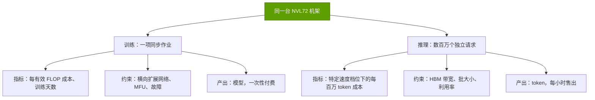

| 维度 | 训练 | 推理 |
|---|---|---|
| 价值单位 | 训练好的模型（一项资产） | 一百万 token（一种产品） |
| 成本驱动因素 | FLOPs ÷（峰值 × MFU × 有效产出率（goodput）） | 所有者每小时成本 ÷ 每小时 token 数 |
| 约束因素 | 横向扩展网络、可靠性、MFU | HBM 带宽、KV 缓存、批大小、利用率 |
| 买方优化目标 | 训练时长与每有效 FLOP 成本 | 特定延迟档位下的每 token 成本；每兆瓦 token 产出 |
| 可分割性 | 一项作业需同时占用整个集群 | 请求可发往任何空闲芯片 |
| 竞争者多寡 | 少：需要能在 10,000+ 芯片规模上运行的成熟软件 | 多：TPU、Trainium、AMD、推理 ASIC |

最后一行才是商业要点。一项训练作业若因网络薄弱或集合通信库存在缺陷而停滞，整个集群都会被浪费，因此买方愿为经过验证的技术栈付费。推理则可拆分到任何能以合适速度服务该模型的硬件上，因此它是挑战者最先发起进攻的领域（[第 11 层](../layers/11-inference-and-ai-software/the-inference-shift.md)）。

> [!TIP]
> **算例 —— 训练运行只付一次，推理集群年年要付。** 下文模型对一次假设的 10²⁷-FLOP 训练运行在 GB300 NVL72 上的定价为 ~$515M（估计）[[S14000]](../../sources/bibliography.md#s14000)。一个 100 MW 的 GB300 推理站点（~41,000 块 GPU）每年的持有与运营成本为 ~$0.88B，在其六年寿命内年年如此（估计）[[S14000]](../../sources/bibliography.md#s14000)。一次前沿训练运行约相当于一个中型推理站点一年成本的一半，及其六年总成本的十分之一。**结论：** 一旦模型大规模部署，持续性的推理支出将远超一次性的训练支出，而每 token 成本正是买方施压最狠的地方。

🔧 技术细节：为何运行点决定一切

解码时每生成一个新 token，都要从[高带宽内存（HBM）](../glossary.md#hbm)读取全部激活权重。服务器将这次读取摊销到一批用户上，因此批越大，每块 GPU 产出的 token 越多，但每用户获得 token 的速度越慢。混合专家模型（MoE）又增加了一层变化：其专家可分布在多块 GPU 上（[宽专家并行](../glossary.md#wide-ep)），从而腾出内存以支持更大的批，但需要高速的全交换（all-to-all）链路。[NVL72](../glossary.md#nvl72) 机架可在单个 72-GPU NVLink 域内完成这一点；8-GPU 服务器则做不到。这就是为什么根据 InferenceX 数据，在每用户 50 tokens/s 下，GB200 NVL72 的 DeepSeek-R1 吞吐量是 B200 的 ~3.3 倍 [[S621]](../../sources/bibliography.md#s621)，而在每用户 100 tokens/s、批很小时，差距收窄甚至反转。参见[为何域规模至关重要](../layers/05-scale-up-nvlink-nvswitch/why-domain-size-matters.md)。

## 2. 成本栈：一个加速器小时对所有者而言的成本

模型对每个平台只问一个问题：一个已装机加速器小时的全口径所有者成本是多少？这一[所有者 TCO](../glossary.md#owner-tco) 包含七项。四项为资本性：加速器系统、计入其售价的供应商毛利、[横向扩展](../glossary.md#scale-out)网络与存储，以及[资本成本](../glossary.md#wacc)。三项为运营性：[设施资本开支](../glossary.md#facility-capex)（建筑外壳、电气设备、冷却）、电费与运维。资本通过[资本回收系数](../glossary.md#capital-recovery-factor)转化为每年等额的费用，即类似按揭的还款额，在资产的[使用寿命](../glossary.md#useful-life)内偿还资产本身及其融资成本。除以小时数得到每小时美元成本；除以 token 数得到每百万 token 美元成本；将 token 数除以设施兆瓦数，则得到[每兆瓦 token 产出](../glossary.md#tokens-per-megawatt)。

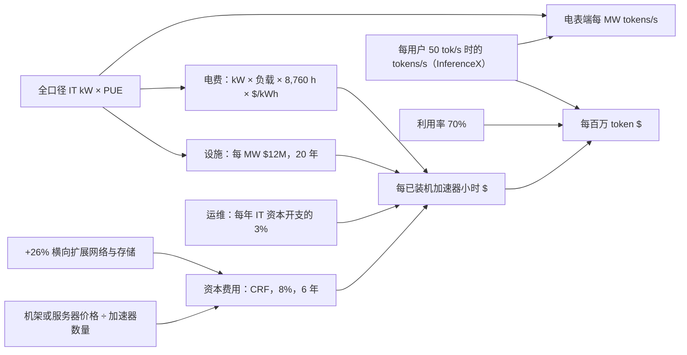

全局假设如下。每一项都是 `data/x14_tco_scenarios.csv` 中的一行，附有来源、置信度标签以及敏感性分析所用的高低区间。

| 假设 | 基准值 | 测试区间 | 依据 |
|---|---|---|---|
| 已装机小时利用率 | 70% | 40–90% | 阿里巴巴将分配率从 68% 提升至 93% [[S12015]](../../sources/bibliography.md#s12015)；Meta 为 ~89%（11% 为热备）[[S27010]](../../sources/bibliography.md#s27010) |
| 电价 | $0.081/kWh | $0.05–0.10 | 2024 年美国工业平均电价 [[S389]](../../sources/bibliography.md#s389)；购电协议（PPA）报价 [[S390]](../../sources/bibliography.md#s390) |
| [PUE](../glossary.md#pue) | 1.15 | 1.09–1.40 | 新建液冷机房；谷歌全机队 1.09 [[S388]](../../sources/bibliography.md#s388)；行业 ~1.54 [[S8007]](../../sources/bibliography.md#s8007) |
| 资本成本 | 8% | 0–12% | 超大规模云厂商与高杠杆新兴云服务商（neocloud）之对比（CoreWeave 的利息负担）[[S12501]](../../sources/bibliography.md#s12501) |
| IT 设备使用寿命 | 6 年 | 4–7 | 微软（Microsoft）、Alphabet、CoreWeave 的会计政策 [[S382]](../../sources/bibliography.md#s382)[[S383]](../../sources/bibliography.md#s383)[[S386]](../../sources/bibliography.md#s386) |
| 设施资本开支 | 每 MW $12M | $6.6–13M | 每 GW $11–13B（CS7）[[S6025]](../../sources/bibliography.md#s6025)；摩根士丹利已撤回的 100 MW 模型 [[S357]](../../sources/bibliography.md#s357) |
| 网络与存储 | 0.26 × 系统价格 | 0.20–0.32 | SemiAnalysis 的 GB200 全口径成本与机架价格之比 [[S324]](../../sources/bibliography.md#s324)；AMCompute [[S6026]](../../sources/bibliography.md#s6026) |
| 运维 | 每年 IT 资本开支的 3% | 2–5% | 本资料库假设 🔴 [[S14000]](../../sources/bibliography.md#s14000) |
| 参考工作负载 | DeepSeek-R1-0528，1k 输入 / 1k 输出，每用户 50 tokens/s | 35–100 | InferenceX 前沿，未使用推测解码 [[S621]](../../sources/bibliography.md#s621) |

> [!TIP]
> **算例 —— 拆解一个 GB300 [GPU 小时](../glossary.md#gpu-hour)。** 摩根士丹利估计一台 GB300 NVL72 机架为 $3.99M [[S332]](../../sources/bibliography.md#s332)，即每块 GPU $55.4K。加上 26% 的横向扩展网络与存储 [[S324]](../../sources/bibliography.md#s324)：$69.8K。按 8%、六年计算，资本回收系数为 0.216，因此资本成本为每年 $15.1K，其中 $11.6K 为直线折旧，$3.5K 为融资成本。每块 GPU 全口径功耗 2.12 kW [[S622]](../../sources/bibliography.md#s622)，按 PUE 1.15 折算到电表端为 2.44 kW。设施按每 MW $12M 计为每块 GPU $29.3K，按 20 年摊销即每年 $3.0K。电费为 2.44 kW × 0.79 平均负载 × 8,760 h × $0.081 = $1.4K。运维再加 $2.1K。合计**每年 $21.5K，即每装机小时 $2.46**（估计）[[S14000]](../../sources/bibliography.md#s14000)。SemiAnalysis 的所有者 [TCO](../glossary.md#tco) 为 $2.31 [[S622]](../../sources/bibliography.md#s622)。**结论：** 第 12 层中每小时 $1.50 的[底价](../layers/12-orchestration-and-cloud-services/the-utilization-problem.md)仅包括折旧与电力。加上融资（+$0.40）、设施（+$0.34）、运维（+$0.24）以及小幅的电力调整后，升至 $2.46。

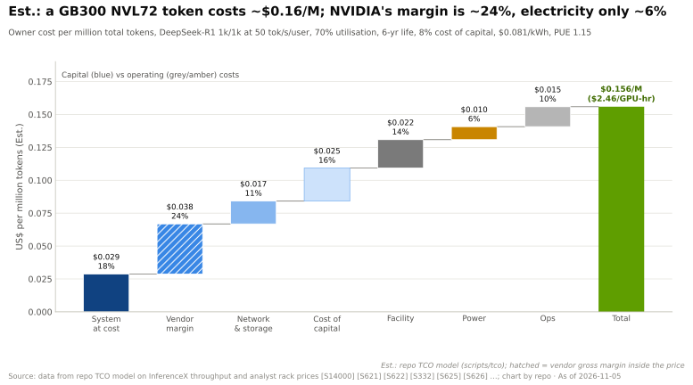

在 70% 利用率和每 GPU 6,261 tokens/s [[S621]](../../sources/bibliography.md#s621) 的条件下，一块 GB300 GPU 每年产出 ~138 billion（约 1,380 亿）个 token。$21.5K ÷ 138 billion = **每百万 token $0.156**。瀑布图将其拆分为七项。有两点值得注意：电费是最小的一项，仅占 ~6%，因此“廉价电力”是选址优势，而非每 token 成本优势；英伟达的毛利（图中阴影条）占成本的 ~24%。

机架价格本身存在不确定性。已公开的 GB300 估计在 $3.99M 至 $5.0M 之间，媒体报价最高达 $6.5M；Vera Rubin 的估计则在 $5.0M 至 $9.1M 之间 [[S332]](../../sources/bibliography.md#s332)[[S328]](../../sources/bibliography.md#s328)[[S327]](../../sources/bibliography.md#s327)[[S333]](../../sources/bibliography.md#s333)。本模型以摩根士丹利自下而上的测算为基准，与第 08 层和第 12 层保持一致，并对其余数值进行测试。

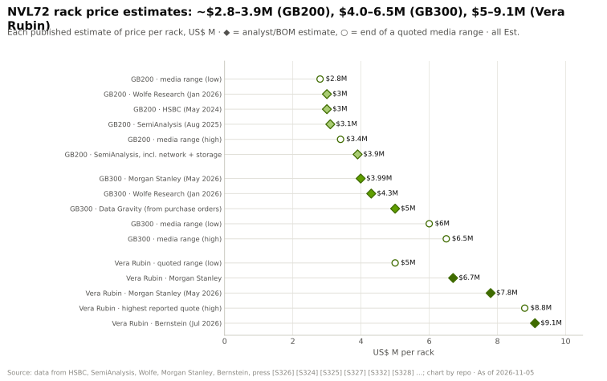

🔧 技术细节：公式及模型未涵盖的内容

每个加速器每年：资本 = (*C* + *N*) × CRF(*r*, life)，其中 *C* 为系统资本开支，*N* = 0.26 *C*，CRF(*r*, *n*) = *r* ÷ (1 − (1 + *r*)⁻ⁿ)。模型将直线折旧与超出部分的融资成本分别列示。“供应商毛利”是对折旧项的*拆分*（系统价格中属于加速器供应商毛利的份额），而非额外成本。设施 = kW × PUE × $/MW × CRF(*r*, 20)。电费 = kW × PUE × [floor + (1 − floor) × utilization] × 8,760 × $/kWh，其中空闲功耗下限（floor）为 30%（与 [CS7](../case-studies/CS7-gigawatt-ai-factories-xai-stargate-etc.md) 中相同的[负载系数](../glossary.md#load-factor)规则）。运维 = IT 资本开支的 3%。token 指总 token 数（输入 + 输出）；1k/1k 工作负载中一半为输出。

未涵盖：超出运维预算的软件许可（NVIDIA AI Enterprise 标价为每 GPU 每年 $4,500，大客户很少按此支付 [[S11013]](../../sources/bibliography.md#s11013)）、税费与保险、[残值](../glossary.md#residual-value)、批量折扣及与股权挂钩的交易。4,000 次抽样的[蒙特卡洛模拟](../glossary.md#monte-carlo-simulation)给出 P10–P90 区间；它显示的是合理区间的宽度，而非经过校准的概率。

## 3. 模型结果：每小时成本、每 token 成本与每兆瓦 token 产出

各系统的输入是比较的核心。实测吞吐量来自 InferenceX 在参考运行点的数据 [[S621]](../../sources/bibliography.md#s621)。若无实测数据，模型会对某个已实测的锚点进行缩放，表中注明了缩放方法。

| 系统 | 每加速器资本开支 | 全口径 IT kW | 每加速器 tokens/s | 吞吐量依据 | 置信度 |
|---|---|---|---|---|---|
| H200 HGX | $39.9K（OEM 标价）[[S322]](../../sources/bibliography.md#s322) | 1.37 [[S622]](../../sources/bibliography.md#s622) | 308 | 实测，FP8 [[S621]](../../sources/bibliography.md#s621) | 🟡 |
| B200 HGX | $46.3K（经销商价，估计）[[S320]](../../sources/bibliography.md#s320) | 1.71 [[S622]](../../sources/bibliography.md#s622) | 1,387 | 实测，FP4 [[S621]](../../sources/bibliography.md#s621) | 🟡 |
| GB300 NVL72 | $55.4K（摩根士丹利）[[S332]](../../sources/bibliography.md#s332) | 2.12 [[S622]](../../sources/bibliography.md#s622) | 6,261 | 实测，FP4 [[S621]](../../sources/bibliography.md#s621) | 🟡 |
| Vera Rubin NVL72 | $108.3K（摩根士丹利）[[S330]](../../sources/bibliography.md#s330) | 3.30 [[S622]](../../sources/bibliography.md#s622) | ~19,400 | GB300 × 3.1：每兆瓦 token 产出 ~2 倍 [[S626]](../../sources/bibliography.md#s626) | 🔴 |
| MI355X (8-GPU) | $37.5K（本资料库根据 ~$25K ASP 估计）[[S14001]](../../sources/bibliography.md#s14001) | 2.09 [[S622]](../../sources/bibliography.md#s622) | 738 | 实测，FP4 [[S621]](../../sources/bibliography.md#s621) | 🟡 |
| Helios (MI455X) | $72.9K（Futurum：机架 $5.0–5.5M）[[S14002]](../../sources/bibliography.md#s14002) | ~3.8（机架估计）[[S346]](../../sources/bibliography.md#s346) | ~10,700 | Vera Rubin × 0.55（0.3–0.9） | 🔴 |
| TPU v7 Ironwood | $28.4K（校准值）[[S622]](../../sources/bibliography.md#s622) | 1.21 [[S622]](../../sources/bibliography.md#s622) | ~960 | B200 × 0.95（同等精度）[[S625]](../../sources/bibliography.md#s625) × 0.73（FP8 对 FP4） | 🔴 |
| Trainium2 | $12K（本资料库估计） | ~0.75（估计）[[S14004]](../../sources/bibliography.md#s14004) | ~150 | H200 × 0.60（HBM 带宽）× 0.8 | 🔴 |
| Trainium3 | $20K（本资料库估计） | ~1.05（估计）[[S14005]](../../sources/bibliography.md#s14005) | ~620 | H200 × 2.0（1.0–3.4）[[S242]](../../sources/bibliography.md#s242) | 🔴 |

谷歌和 AWS 均未公布芯片价格，AWS 也未公布 Trainium 的功耗 [[S14003]](../../sources/bibliography.md#s14003)。因此 TPU 的资本开支为*校准值*：通过反推求解，使 TPU 相对于 GB300 的每小时成本与 SemiAnalysis 的所有者 TCO 比率一致（外部所有者为 $1.21 ÷ $2.31；谷歌自用为 $1.03 ÷ $2.31）[[S622]](../../sources/bibliography.md#s622)。Trainium 价格是在 Epoch AI 的 B200 成本拆解 [[S35020]](../../sources/bibliography.md#s35020) 基础上，加上设计合作伙伴利润与服务器分摊而得出的自下而上推测。Futurum 估计 Helios 每台机架 $5.0–5.5M；但同一报告中 Rubin 机架“$3.5–4M”的数字与所有基于物料清单（BOM）的估计相冲突，因此模型对 Rubin 仍沿用 $7.8M [[S14002]](../../sources/bibliography.md#s14002)[[S330]](../../sources/bibliography.md#s330)[[S333]](../../sources/bibliography.md#s333)。

按小时计，排名大致与价目表一致：Trainium 和 TPU 的小时成本最低，Rubin 最高。模型对 GB300 的结果与 SemiAnalysis 相差不到 6%，但对 8-GPU 服务器则高出 20–40%，这表明 SemiAnalysis 假设的服务器价格更低；应将 H200 和 MI355X 的小时成本视为上限。而按 token 计，排名发生反转：

| 系统 | 每装机小时 $ | 每百万 token $（P10–P90） | 电表端每 MW tokens/s | 供应商毛利占 token 成本比例 |
|---|---|---|---|---|
| Vera Rubin NVL72 🔴 | $4.61 | $0.094（$0.068–0.13） | 5.1M | 21% |
| Helios (MI455X) 🔴 | $3.47 | $0.13（$0.086–0.20） | 2.4M | 16% |
| GB300 NVL72 | $2.46 | $0.16（$0.13–0.23） | 2.6M | 24% |
| TPU v7（谷歌自用）🔴 | $1.10 | $0.45（$0.24–0.53） | 0.73M | 8% |
| TPU v7（外部所有者）🔴 | $1.29 | $0.53（$0.29–0.63） | 0.69M | 15% |
| B200 HGX | $2.04 | $0.58（$0.47–0.86） | 0.71M | 24% |
| Trainium3 🔴 | $0.95 | $0.61（$0.41–0.99） | 0.51M | 6% |
| MI355X (8-GPU) | $1.82 | $0.98（$0.77–1.41） | 0.31M | 13% |
| Trainium2 🔴 | $0.60 | $1.61（$1.13–2.35） | 0.17M | 6% |
| H200 HGX | $1.73 | $2.23（$2.01–3.61） | 0.20M | 20% |

所有数值均为估计 [[S14000]](../../sources/bibliography.md#s14000)；运行点为 DeepSeek-R1 1k/1k、每用户 50 tokens/s、未使用推测解码 [[S621]](../../sources/bibliography.md#s621)。

这些每兆瓦 token 数据按电表端计量，因此比[第 08 层](../layers/08-systems-racks-ai-factories/ai-factories.md)的图表（以 IT 功耗为分母）低 ~13%；排名相同。在蒙特卡洛模拟中，在该运行点上，GB300 在每一次抽样中的每 token 成本均低于 TPU v7、MI355X 和 Trainium3，而 Helios 在 ~86% 的抽样中低于 GB300（🔴，因为 Helios 吞吐量为模型推算）[[S14000]](../../sources/bibliography.md#s14000)。

> [!TIP]
> **算例 —— 更便宜的小时，更昂贵的 token。** MI355X 每小时成本 ~$1.82，比 GB300 的 $2.46 低 26%（估计）[[S14000]](../../sources/bibliography.md#s14000)。但在每用户 50 tokens/s 下，MI355X 每秒输出 738 个 DeepSeek-R1 token，GB300 则输出 6,261 个 [[S621]](../../sources/bibliography.md#s621)，是前者的 8.5 倍。每 token 成本 =（每小时成本 ÷ 每小时 token 数）：$1.82 ÷ 738 对比 $2.46 ÷ 6,261，因此 MI355X 的 token 成本**高出 ~6.3 倍**。**结论：** 26% 的小时折扣无法抵消 8.5 倍的吞吐量差距；只有在关键运行点上实现吞吐量持平，更便宜的加速器才真正更便宜。

> [!WARNING]
> **误区与事实：“定制芯片更便宜，因为没有英伟达的毛利。”** 毛利确实存在：在基准情景中，它占 GB300 每 token 成本的 ~24%，占 Trainium 的 ~6%（估计）[[S14000]](../../sources/bibliography.md#s14000)。但上述各成本栈的总额相差最多 ~24 倍，几乎完全是因为每加速器 token 产出不同。去掉 24% 的一块并不能弥合 3–6 倍的吞吐量差距；只有追平吞吐量才能做到。

🔧 技术细节：模型推算的吞吐量如何构建

- **Vera Rubin：** SemiAnalysis 发现，在 DeepSeek-R1 上、每用户 100 tokens/s 以内，其每兆瓦 token 产出约为 GB300 的 ~2 倍 [[S626]](../../sources/bibliography.md#s626)。考虑到每 GPU 功耗为 3.30 kW 对 2.12 kW [[S622]](../../sources/bibliography.md#s622)，折合每 GPU ~3.1 倍。低情景 2.3 倍（Rubin 的 HBM 带宽下调至 19.2 TB/s 后的带宽比 [[S90006]](../../sources/bibliography.md#s90006)）；高情景 4.0 倍，接近英伟达“最高 5 倍”的宣称 [[S33006]](../../sources/bibliography.md#s33006)。
- **Helios：** 纸面上 MI455X 胜过 Rubin（23.3 对 19.2 TB/s，~1.21 倍；[HBM4](../glossary.md#hbm4) 容量 432 对 288 GB）[[S144]](../../sources/bibliography.md#s144)[[S90093]](../../sources/bibliography.md#s90093)。低情景假设当前的软件差距持续存在：在同为 8 TB/s 带宽下，MI355X 的吞吐量仅为 B300 的 ~0.25 倍 [[S621]](../../sources/bibliography.md#s621)。高情景采用 AMD 的宣称：在机架价格低 ~33% 的情况下，每美元 token 产出比 Vera Rubin 最多高 30%，折合 ~0.87 倍 [[S14002]](../../sources/bibliography.md#s14002)。基准 0.55 倍。
- **TPU v7：** SemiAnalysis 实测 Ironwood 在每用户 20 tokens/s 下每芯片 token 产出为 B200 的 1.05 倍，在 100 tokens/s 下为 ~0.86 倍（推算），均为 [FP8](../glossary.md#fp8) [[S625]](../../sources/bibliography.md#s625)。Ironwood 不支持 [FP4](../glossary.md#fp4)，因此模型乘以 0.73（本资料库的 FP8 对 NVFP4 解码比率 [[S2021]](../../sources/bibliography.md#s2021)）。最高 2 倍的上行系数用于反映跨 9,216 芯片 pod 的宽专家并行。
- **Trainium：** 目前没有公开的 tokens/s 基准测试。Trainium2 = H200 × HBM 带宽比（2.9 对 4.8 TB/s）[[S154]](../../sources/bibliography.md#s154)[[S32002]](../../sources/bibliography.md#s32002) × 0.8（软件折扣）。Trainium3 = H200 × 2.0，介于带宽持平（1.0 倍）与 AWS 宣称的每兆瓦 token 产出超过 Trainium2 的 5 倍（3.4 倍）之间 [[S242]](../../sources/bibliography.md#s242)。

## 4. 运行点与软件决定排名

参考运行点（每用户 50 tokens/s）非常适合 NVL72：大批量分布在 72 块 GPU 上。改变运行点，排名就会变化。本资料库中的 InferenceX 前沿数据可直接用于观察已实测系统；TPU 曲线为模型推算。

| 系统 | 每用户 35 tok/s | 50 | 75 | 100 |
|---|---|---|---|---|
| GB300 NVL72 | $0.10 | $0.16 | $0.75 | $1.74 |
| Vera Rubin NVL72 🔴 | $0.06 | $0.09 | $0.45 | $1.05 |
| TPU v7（谷歌自用）🔴 | — | $0.45 | $0.90 | $1.46 |
| TPU v7（外部所有者）🔴 | — | $0.53 | $1.06 | $1.72 |
| Trainium3 🔴 | $0.47 | $0.61 | $0.96 | $1.77 |
| MI355X (8-GPU) | $0.48 | $0.98 | $1.59 | $3.17 |

单位为每百万 token 美元成本，估计 [[S14000]](../../sources/bibliography.md#s14000)[[S621]](../../sources/bibliography.md#s621)；“—”表示超出锚点系统的实测前沿范围。模型推算的系统在其他运行点沿用其在 50 tokens/s 下的乘数。

从每用户 50 到 100 tokens/s，GB300 的每 token 成本上升 ~11 倍，而 B200 仅上升 ~3 倍。NVL72 的优势来自分布在整个机架上的大批量；在每用户高速下，批会缩小，该优势随之消退。在每用户 100 tokens/s 下，TPU v7 和 Trainium3 与 GB300 在模型误差范围内持平。

软件对曲线的影响不亚于硬件。[多 token 预测](../glossary.md#multi-token-prediction)（MTP）是 DeepSeek 内置的一种[推测解码](../glossary.md#speculative-decoding)形式，每一步可草拟多个 token。SemiAnalysis 发现，它将 GB300 在每用户 150 tokens/s 下的成本从每百万 token ~$2.35 降至 ~$0.11 [[S624]](../../sources/bibliography.md#s624)。在 MTP 前沿上，B200 在每用户 50 tokens/s 下成本为 ~$0.09（估计），*低于*未使用 MTP 的 GB300。不考虑软件配置的排名，算不上排名。

> [!TIP]
> **算例 —— 同一台 GB300，三种价格。** 在每用户 50 tokens/s、未使用 MTP 时，GB300 每百万 token 成本为 ~$0.16。在 100 tokens/s 下升至 ~$1.74，上涨 11 倍，因为每 GPU 吞吐量从 6,261 降至 562 tokens/s [[S621]](../../sources/bibliography.md#s621)。在 100 tokens/s 下开启 MTP，吞吐量回升至 ~6,340，成本随之回落至 ~$0.15（估计）[[S14000]](../../sources/bibliography.md#s14000)。**结论：** 供应商宣称“每 token 成本降低 X 倍”，若不说明模型、每用户速度和服务配置，便毫无意义；三者都要问清楚。

SemiAnalysis 对 TPU 的直接测量从另一侧印证了同一观点。在 Qwen3.5 397B、FP8、每用户 100 tokens/s 下，Ironwood 每百万 token 成本为 $0.181，B200 为 $0.222，B300 为 $0.276，比 B200 低 ~18% [[S625]](../../sources/bibliography.md#s625)。该测试未包含 GB300 NVL72。

该图假设 100% 利用率并采用 SemiAnalysis 的小时成本，因此其 GB300 数值（$0.10）低于本模型在 70% 利用率下的 $0.16；但比率相近。

## 5. 敏感性分析：哪些假设至关重要

[龙卷风图](../glossary.md#tornado-chart)每次只在高低值之间变动一个输入，并按各输入对结果的影响幅度排序。

![GB300 NVL72 每百万 token 估计成本的龙卷风图，基准值 $0.156：利用率（%）40 至 90 对应 $0.268 至 $0.123；每 GPU tokens/s（× 实测值）0.75 至 1.25 对应 $0.208 至 $0.125；资本成本（%）0 至 12 对应 $0.120 至 $0.176；折旧年限（年）4 至 7 对应 $0.199 至 $0.144；机架价格（US$ M）3.6 至 5 对应 $0.144 至 $0.187；运维（占 IT 资本开支 %/年）2 至 5 对应 $0.151 至 $0.166；网络与存储（× 机架价格）0.2 至 0.32 对应 $0.150 至 $0.162；设施资本开支（US$ M/MW）6.6 至 13 对应 $0.146 至 $0.158；PUE 1.09 至 1.4 对应 $0.154 至 $0.163；电价（US$/kWh）0.05 至 0.1 对应 $0.152 至 $0.158；每 GPU 功耗（kW，全口径 IT）1.95 至 2.3 对应 $0.153 至 $0.159；空闲功耗下限（占比）0.2 至 0.4 对应 $0.156 至 $0.156。电价从每 kWh $0.05 升至 $0.10，对结果的影响不到每百万 token 一美分。](../../assets/charts/14-tco-gb300-tornado.svg)

三点发现。第一，利用率影响最大：40% 而非 70% 的利用率会使每 token 成本上升 ~72%。第二，吞吐量（软件）次之：tokens/s 变动 ±25%，成本变动 −20% 至 +33%。第三，人们最常争论的财务与物理输入——机架价格、电价和 PUE——影响最小。电价翻倍仅使 GB300 的成本变动不到每百万 token 一美分。

> [!TIP]
> **算例 —— 闲置的机架与昂贵的机架。** 在 70% 利用率下，GB300 每百万 token 成本为 ~$0.156。利用率降至 40% 则升至 ~$0.268（+72%）。而以 $5.0M 而非 $3.99M 购入机架，成本仅升至 ~$0.187（+20%）（估计）[[S14000]](../../sources/bibliography.md#s14000)。**结论：** 买方若谈下机架 20% 的折扣，但利用率只有 40% 而非 70%，仍然得不偿失；调度、故障恢复与需求填充的价值高于价格谈判（[第 12 层](../layers/12-orchestration-and-cloud-services/the-utilization-problem.md)）。

对竞争而言真正重要的比较是一个比率：TPU 的 token 比 GB300 的 token 贵多少？

财务假设对该比率的影响不到 0.02，因为它们对两个平台的作用相同。每一根有分量的条形都是吞吐量假设：即每款芯片以该速度服务该模型的能力。在每用户 50 tokens/s 下，没有任何单一输入能翻转排名，但将运行点移至 100 则可以。这才是对任何加速器开展尽职调查时真正要问的问题：*在买方运行点上实测的每秒 token 数*。

🔧 技术细节：敏感性网格与排名概率

`scripts/tco/outputs/x14_tco_sensitivity_grid.csv` 在利用率 30–90%、电价 $0.05–0.15/kWh、寿命 3–7 年、资本成本 0/8/12% 的组合下对每个系统重新运行（共 4,200 行）。`x14_tco_ranking_probability.csv` 报告在蒙特卡洛抽样中，一个平台的每 token 成本低于另一平台的频率。在每用户 50 tokens/s 下：Vera Rubin 在 ~91% 的抽样中胜过 Helios，Helios 在 ~86% 的抽样中胜过 GB300，Trainium3 与 B200 大致各半（~50/50），Trainium3 在 ~15% 的抽样中胜过 TPU v7（外部所有者）（均为 🔴，因为多个吞吐量为模型推算）[[S14000]](../../sources/bibliography.md#s14000)。

## 6. 关键洞见：~75% 的毛利率为何能与最低 TCO 并存

英伟达在 Q2 FY2027 实现了 75.0% 的 GAAP 毛利率 [[S405]](../../sources/bibliography.md#s405)。天真的解读是，其客户支付的价格是芯片成本的三到四倍。模型显示了为何许多客户仍能获得最低的每 token 成本。共有五种机制在起作用。

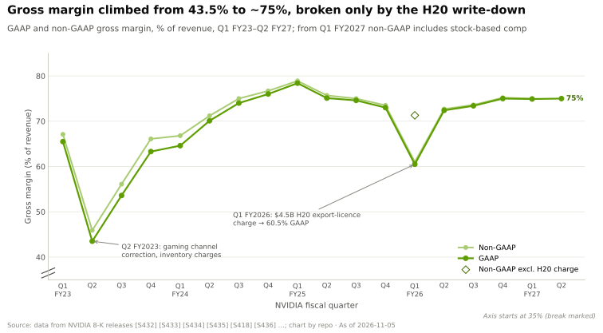

**1 · 毛利只占 token 成本的少数。** ~75% 的毛利率只适用于英伟达自身的内容。在 GB300 机架中，英伟达在 GPU 上获得的毛利约占机架价格的 ~57%（估计）[[S332]](../../sources/bibliography.md#s332)[[S35020]](../../sources/bibliography.md#s35020)。计入网络、设施、电力、运维和融资后，机架约占 token 成本的 ~60%。净结果：token 成本中 ~24% 为英伟达毛利（计入相应融资则为 ~32%）。即便英伟达将毛利减半，GB300 的每 token 成本也只会下降 ~18%（估计）[[S14000]](../../sources/bibliography.md#s14000)。

**2 · 每瓦与每机架性能。** 每 token 最大的几项成本（资本、设施、电力）都随加速器数量或兆瓦数线性增减。而每加速器与每兆瓦的 token 产出差异要大得多：在参考运行点上，GB300 每兆瓦每秒输出 ~2.6M token，TPU v7 为 ~0.7M，MI355X 为 ~0.3M（估计）[[S14000]](../../sources/bibliography.md#s14000)。一个在相同电力和占地面积下输出 3–8 倍 token 的系统，即便背负高毛利也照样胜出。

**3 · 已装机硬件上的软件增益。** 已装机硬件在购买后还会变得更快。在未作改动的 GB300 NVL72 上，MLPerf DeepSeek-R1 吞吐量一年内提升 2.9 倍，使每百万 token 估计成本下降 ~65% [[S601]](../../sources/bibliography.md#s601)[[S603]](../../sources/bibliography.md#s603)。[TensorRT-LLM](../glossary.md#tensorrt-llm) 在 2025 年的四个月内将 B200 从每 GPU ~2,000 tokens/s 提升至 4,600 tokens/s [[S646]](../../sources/bibliography.md#s646)。AMD 的提升同样陡峭，但起步更晚：MI355X 在 DeepSeek-V4-Pro 上 26 天内从每 GPU 20 tokens/s 提升至 2,256 tokens/s [[S631]](../../sources/bibliography.md#s631)。参见[同一硬件上的软件增益](../layers/11-inference-and-ai-software/software-gains-on-same-hardware.md)。

![对数刻度折线图：在英伟达硬件不变、各 GPU 所有者 TCO 保持不变（SemiAnalysis：GB300 $2.31，GB200 $1.86，B200 $1.73，H100 $1.17/GPU 小时）的情况下，随着软件改进，每百万 token 估计成本的变化。GB300 NVL72 · DeepSeek-R1（MLPerf Server）：$0.221 降至 $0.077（降低 65%，2025 年 9 月至 2026 年 9 月）；GB200 NVL72 · DeepSeek-R1（MLPerf Server）：$0.222 降至 $0.094（降低 58%，2025 年 9 月至 2026 年 9 月）；H100 · Llama 2 70B（MLPerf Server）：$0.126 降至 $0.084（降低 34%，2024 年 3 月至 2025 年 4 月）；B200 · DeepSeek-R1 最大吞吐量（TensorRT-LLM 博客）：$0.240 降至 $0.104（降低 57%，2025 年 2 月至 2025 年 5 月）；B200 · DeepSeek-R1，SGLang 并发 128（InferenceX）：$0.269 降至 $0.201（降低 25%，2025 年 12 月至 2026 年 5 月）。硬件支出没有变化，变化的是每 GPU 吞吐量，因此每 token 成本下降。](../../assets/charts/11-cost-per-m-tokens-software-releases.svg)

**4 · 利用率与部署时间。** 利用率是最大的单一杠杆（第 5 节），一个能以全速运行首日（day-0）模型的平台能更快填满其可售小时。部署时间同样重要：无论是否在提供服务，一块 GB300 GPU 每年的持有成本都在 ~$21.5K（估计）[[S14000]](../../sources/bibliography.md#s14000)，因此一台因软件或供应问题而空等六个月的机架会白白烧掉 ~$0.8M。AMD 的 Helios 约在 2026 年第三季度末开始出货，据报道将于 2027 年第二季度放量 [[S90020]](../../sources/bibliography.md#s90020)[[S624]](../../sources/bibliography.md#s624)；英伟达的机架如今已在批量出货。

**5 · 电力受限站点与时间的机会成本。** 当稀缺的投入是电网电力而非资金时，问题就变成了每兆瓦能赚多少钱。美国新增发电项目在并网排队中需等待四年以上 [[S8009]](../../sources/bibliography.md#s8009)。在一个固定站点上，年度成本几乎与平台无关，但 token 产出却与平台密切相关（见下方算例）。对前沿实验室而言，时间是另一项稀缺投入：早几个月发布的模型，其价值可能超过全部算力支出（第 8 节）。

> [!TIP]
> **算例 —— 一个 100 MW 站点，五个平台。** 按电表端计算，100 MW 可容纳 ~41,000 块 GB300 GPU、~72,000 颗 TPU v7 芯片或 ~41,600 块 MI355X GPU。年度所有者成本相近：分别为 ~$0.88B、~$0.81B 和 ~$0.66B。而在 70% 利用率下的年度 token 产出差异巨大：分别为 ~5.7、~1.5 和 ~0.7 quadrillion（千万亿）。Vera Rubin 将以 ~$1.06B 产出 ~11.3 quadrillion，Helios 以 ~$0.70B 产出 ~5.4 quadrillion（🔴 模型推算）（均为估计）[[S14000]](../../sources/bibliography.md#s14000)。按示例价格每百万 token $0.50 计算，GB300 站点每年收入 ~$2.8B，成本为 $0.88B，而 TPU 和 MI355X 站点则无法覆盖成本。**结论：** 在电力成为约束时，买方愿为更高的每兆瓦 token 产出支付高得多的单 GPU 价格，这正是英伟达定价权的来源。

这一论点最尖锐的版本来自英伟达自己。其 CEO 在 2024 年表示，英伟达的芯片好到“即使竞争对手的芯片免费，也不够便宜”[[S14006]](../../sources/bibliography.md#s14006)。模型可以通过[免费芯片测试](../glossary.md#free-chip-test)来检验这一说法：将竞争对手的加速器系统免费送出，但仍需支付网络、设施、电力和运维费用，然后进行比较。

在每用户 50 tokens/s 下，这一说法对模型中所有已出货的竞争对手都成立。在每用户 100 tokens/s 下，除 Trainium2 外，它对所有对手都不成立。当 72-GPU 域的吞吐量领先幅度较大时，该说法成立；反之则不成立。

| 买方情境 | 英伟达机架级方案 | AMD（MI355X / Helios） | 谷歌 TPU | AWS Trainium |
|---|---|---|---|---|
| 电力受限站点、聊天速度的 MoE 服务 | 🟩 领先：每 MW ~2.6M tokens/s，对手 ≤0.7M（估计） | 🟨 Helios 纸面上接近持平（🔴）；MI355X 落后 | 🟥 在该运行点每 MW ~0.7M tokens/s（🔴） | 🟥 ~0.5M（🔴） |
| 高交互速度服务（≥100 tok/s/用户） | 🟨 持平；MTP 与 Rubin 可恢复领先 | 🟨 Helios 具竞争力（🔴） | 🟨 持平，谷歌自用时更优（🔴） | 🟨 持平（🔴） |
| 前沿训练运行 | 🟨 Rubin 单芯片最快；每 FLOP 并非最便宜 | 🟨 FLOPs 便宜，但大规模验证较少 | 🟩 同等 MFU 下每 FLOP 最便宜（估计） | 🟥 单芯片慢；训练周期长 |
| 无编译器团队的企业或主权买方 | 🟩 首日（day-0）软件支持，支持面广 | 🟨 快速改善中 | 🟦 主要在谷歌云内租用 | 🟦 仅限 AWS 内部 |
| 拥有大规模自研芯片的超大规模云厂商 | 🟨 议价锚 | 🟨 第二供应商 | 🟦 自有经济性，无商用芯片毛利 | 🟦 自有经济性 |

评级为基于模型估计的本资料库分析（🔴）[[S14000]](../../sources/bibliography.md#s14000)。

🔧 技术细节：降价测试

对于每一个在某个运行点上每 token 成本低于 GB300 的竞争对手，模型求解能与之持平的 GB300 价格，假设英伟达承担全部降价，并重新计算英伟达在其内容上的毛利率（内容 = 毛利份额 ÷ 75%）。在每用户 100 tokens/s 下对比谷歌内部 TPU，GB300 需降价 ~20%，这将使英伟达毛利率降至 ~66%。在每用户 50 tokens/s 下对比 Helios（🔴），需降价 ~22%，毛利率 ~65%（估计）[[S14000]](../../sources/bibliography.md#s14000)。这与 [CS3](../case-studies/CS3-google-tpu-the-credible-alternative.md) 对 B200 与 TPU 价格战所估计的 ~62% 相符 [[S23010]](../../sources/bibliography.md#s23010)。英伟达有赢得价格战的空间；每一个拥有可信替代方案的大买家都能从这 ~10 个百分点的缓冲中分走一部分。

## 7. 当它不成立时：超大规模定制芯片与 TPU 的自有经济性

共存论点有其局限，而这些局限在商业上是本章最重要的部分。

**自有经济性。** 谷歌在自家 TPU 上既无需支付商用 GPU 的毛利，也无需支付云服务加价。SemiAnalysis 估计谷歌自用的成本为每芯片小时 ~$1.03，外部所有者为 $1.21，GB300 为 $2.31 [[S622]](../../sources/bibliography.md#s622)。在 TPU 吞吐量接近 Blackwell 的场景下，例如实测的 Qwen3.5 工作负载（比 B200 便宜 ~18% [[S625]](../../sources/bibliography.md#s625)），或本模型中每用户 100 tokens/s 的情形，谷歌的 token 更便宜。仅 Anthropic 一家就将使用 ~1M 颗芯片 [[S653]](../../sources/bibliography.md#s653)，节省额以每年数十亿美元计。

> [!TIP]
> **算例 —— 自有经济性在吉瓦规模下价值几何。** 在每用户 100 tokens/s 下，谷歌内部 TPU 生产每百万 token 的成本为 ~$1.46，GB300 为 ~$1.74，低 16%（🔴 估计）[[S14000]](../../sources/bibliography.md#s14000)。在模型中，一支 1 GW 的 TPU 集群每年的持有与运营成本为 ~$7.3B；在 GB300 上产出同样的 token 则需 ~$8.7B。即在该运行点上每吉瓦每年节省 **~$1.4B**。在每用户 50 tokens/s 下，结论反转：GB300 的 token 便宜 ~2.9 倍，除非 TPU pod 能像 NVL72 一样从宽专家并行中获益。**结论：** TPU 的优势在为针对 TPU 优化的模型提供延迟敏感型服务时最强，在为大型 [MoE](../glossary.md#mixture-of-experts) 模型提供大批量服务时最弱。

**超大规模定制 ASIC。** 设计合作伙伴模式（与 [ASIC 设计合作伙伴](../glossary.md#asic-design-partner)共同打造的[自用芯片](../glossary.md#captive-silicon)）在价格中包含的毛利更小：在模型中占 Trainium 每 token 成本的 ~6%，而 GB300 为 ~24%（🔴）。[CS3](../case-studies/CS3-google-tpu-the-credible-alternative.md) 估计，一个自研项目在每代 ~130,000 颗芯片时达到盈亏平衡（🔴）[[S23010]](../../sources/bibliography.md#s23010)。AWS 在 Rainier 项目（Project Rainier）中为 Anthropic 运行 ~500,000 颗 Trainium2 芯片 [[S27011]](../../sources/bibliography.md#s27011)。据报道，OpenAI 由博通（Broadcom）打造的推理芯片单颗裸片（die）可提供 13.4 [PFLOPS](../glossary.md#flops) MXFP4，而每颗 Rubin 裸片为 17.5 🟡 [[S628]](../../sources/bibliography.md#s628)。这些买家已跨过门槛，即便其芯片更慢，也获得了议价能力。

**无需机架级系统的工作负载。** 稠密模型、离线批处理作业以及长提示、短回答的服务，几乎无法从 72-GPU NVLink 域中获益。SemiAnalysis 发现，在每用户 225 tokens/s 以下，MI355X 在 gpt-oss-120b 上使用 [vLLM](../glossary.md#vllm) 的每 token 成本低于 B200 [[S623]](../../sources/bibliography.md#s623)；在一项[智能体](../glossary.md#agentic-ai)基准测试的部分场景中，搭载 AMD ATOM 服务引擎的 MI355X 在每美元性能上胜过运行 vLLM 的 GB300 [[S627]](../../sources/bibliography.md#s627)。在这些场景中，最便宜的小时往往胜出，而一块已折旧、一年期合约每小时 ~$2.35 [[S12516]](../../sources/bibliography.md#s12516) 的 H100 是难缠的竞争者。

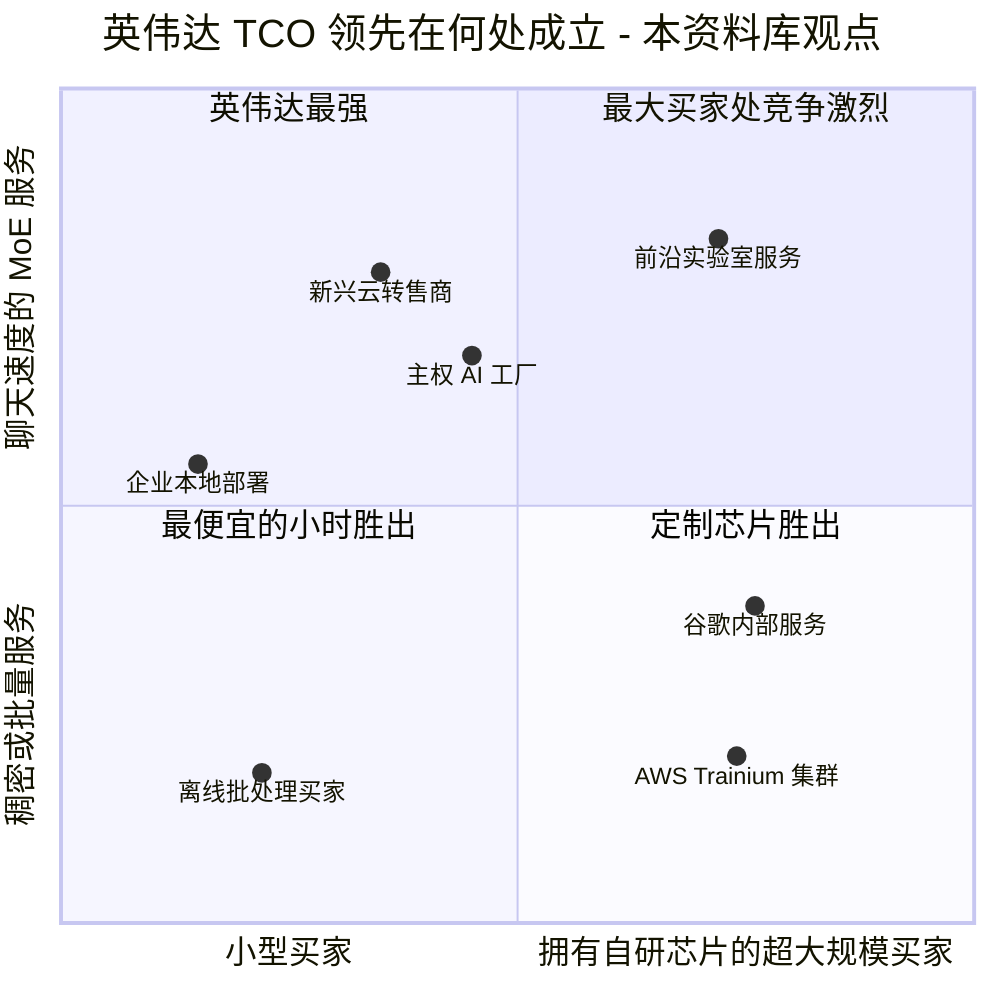

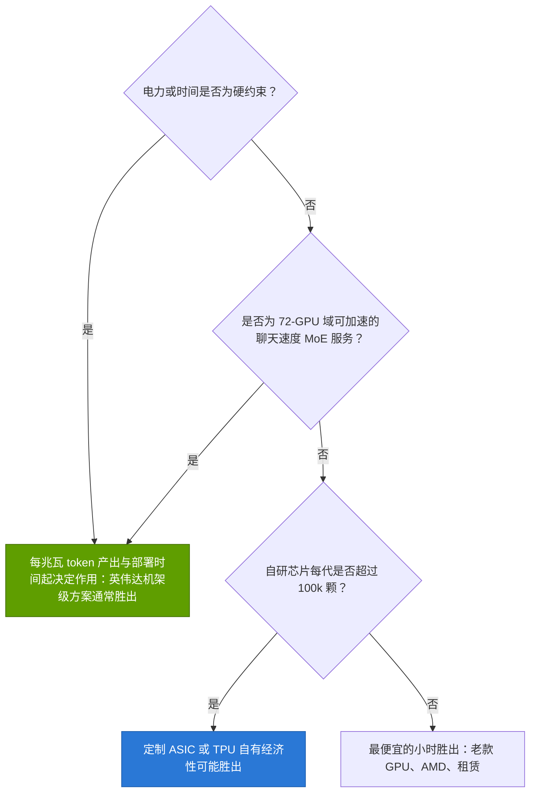

> [!NOTE]
> **🐂 看多观点（定制芯片）：** 最大的买家掌握着需求、模型和数据中心。英伟达每一代产品都会留下几个季度的窗口期，在此期间，一款针对单一模型系列、单一运行点调优的 [ASIC](../glossary.md#asic) 能在每 token 成本上胜过商用 GPU。它们只需赢下自己的工作负载，而非所有人的工作负载 [[S625]](../../sources/bibliography.md#s625)[[S653]](../../sources/bibliography.md#s653)。

> [!WARNING]
> **🐻 看空观点（定制芯片）：** 模型的区间恰恰在 TPU 和 Trainium 上最宽（P10–P90 跨度达 ~2 倍），因为没有人在公开基准测试上发布其吞吐量；Ironwood 缺席了 MLPerf Inference 6.0 [[S613]](../../sources/bibliography.md#s613)。在一个运行点上胜出的芯片会在另一个运行点上落败，而一次模型变更就可能使其沦为搁浅资产。参见[第 09 层的客观评估](../layers/09-cuda-and-system-software/honest-assessment.md)。

## 8. 训练经济学：一次前沿训练运行在各平台上的成本

对于训练，模型将 FLOPs 换算为加速器小时：FLOPs ÷（稠密 FP8 峰值 × MFU × 90% [有效产出率（goodput）](../glossary.md#goodput)）[[S34006]](../../sources/bibliography.md#s34006)，再按满功率对每小时计费。这次训练运行假设为 10²⁷ FLOPs，约为 Epoch AI 对 Grok 4 估计值的两倍（🔴 情景）[[S31007]](../../sources/bibliography.md#s31007)[[S31008]](../../sources/bibliography.md#s31008)。MFU 设定为：英伟达和谷歌为 FP8 峰值的 30%，新一代 Rubin 为 28%，AMD 和 AWS 为 22–24%，均为本资料库假设（🔴）。

训练的图景与推理恰恰相反。按每 FLOP 计，GB300 是较贵的平台之一。其 FP8 算力（5 PFLOPS）较 B200 的 4.5 几乎没有提升 [[S32004]](../../sources/bibliography.md#s32004)[[S33003]](../../sources/bibliography.md#s33003)，而机架成本却更高。TPU v7 完成同一训练运行的成本为 ~$293M，低 ~43%（估计）[[S14000]](../../sources/bibliography.md#s14000)。Helios 看起来最便宜，为 ~$249M，但 AMD 尚未说明其 20 PFLOPS FP8 数据是稠密还是稀疏算力 [[S144]](../../sources/bibliography.md#s144)；若为稀疏，其成本将翻倍。

> [!TIP]
> **算例 —— 在 GB300 上运行一次 10²⁷-FLOP 训练。** 每 GPU 有效算力 = 5.0 PFLOPS × 30% MFU × 90% goodput = 1.35 PFLOPS。10²⁷ ÷ 1.35 × 10¹⁵ ÷ 3,600 = **~206M GPU 小时**。按满功率下每小时 ~$2.50 计算，该训练运行成本 ~$515M（P10–P90 $435–669M）。在 100,000 块 GPU 上需 ~86 天，以及一个 ~244 MW 的站点（估计）[[S14000]](../../sources/bibliography.md#s14000)。Vera Rubin 可在 ~26 天内完成，成本 ~$294M，功耗 ~380 MW（🔴）。按每 100 MW 电力计，Rubin 需 ~100 天完成，TPU v7 需 ~129 天，GB300 需 ~209 天。**结论：** 英伟达在训练上的卖点不是每 FLOP 价格，而是[训练时长](../glossary.md#time-to-train)，以及训练运行能够达到预期 MFU 的确定性。

为何前沿实验室仍主要在英伟达平台上训练？第一，在 10,000+ 芯片规模上实际交付的 MFU 才是难点：[NCCL](../glossary.md#nccl)、网络和故障恢复决定了 30% 是否会变成 20%（[第 10 层](../layers/10-libraries-cuda-x/nccl-the-hidden-glue.md)）。第二，时间是有价格的。对于一个下一代模型可能带来数十亿美元收入的实验室而言，提早一个月完成的训练运行，其价值超过硬件上的节省。第三，同一集群随后可用于推理，第 6 节所述优势在此适用。反面证据也确实存在：谷歌在 TPU 上训练 Gemini [[S23005]](../../sources/bibliography.md#s23005)，Anthropic 则将工作负载分布在 TPU、Trainium 和英伟达 GPU 上 [[S653]](../../sources/bibliography.md#s653)。

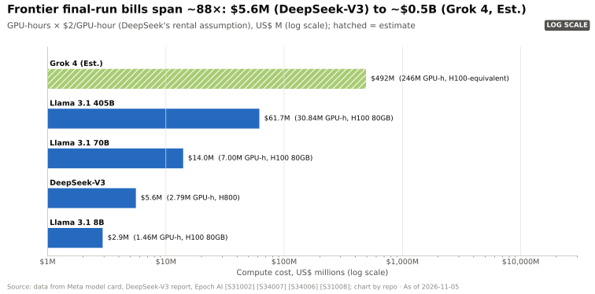

🔧 技术细节：为何同等 MFU 的假设有利于挑战者

英伟达 30% 的 MFU 源自 Meta 在 Llama 3 上实现的 38–41% [BF16](../glossary.md#bf16) MFU [[S34006]](../../sources/bibliography.md#s34006)，并针对 FP8 翻倍的峰值进行了调整。AMD 或 Trainium 几乎没有公开的大规模 MFU 数据，因此模型给它们设定 24%，并采用较宽区间（15–32%）。同等 MFU 的假设意味着它们的集合通信、编译器和故障处理同样能良好扩展，而公开证据尚未证明这一点。FP4 训练（[NVFP4](../glossary.md#nvfp4)）将使英伟达的峰值再翻一倍左右，模型并未计入这一点。应将训练图表理解为“若各平台都能像英伟达一样高效运行，其成本可能是多少”，而非预测。

## 9. 折旧年限假设改变了什么

加速器的大部分成本是资本费用，因此其分摊期限至关重要。2020 至 2025 年间，[超大规模云厂商](../glossary.md#hyperscaler)将服务器寿命从三或四年延长至五年半或六年 [[S382]](../../sources/bibliography.md#s382)[[S383]](../../sources/bibliography.md#s383)[[S384]](../../sources/bibliography.md#s384)[[S385]](../../sources/bibliography.md#s385)。仅微软 2022 年的那次延长，就被披露为对 FY2023 营业利润带来 ~$3.7B 的提振 [[S382]](../../sources/bibliography.md#s382)。亚马逊率先转向，于 2025 年以 AI 技术迭代速度为由，将部分服务器和网络设备的寿命缩回五年 [[S385]](../../sources/bibliography.md#s385)。这些日期所依据的申报文件信息系凭记忆录入，已排队等待重新核实。

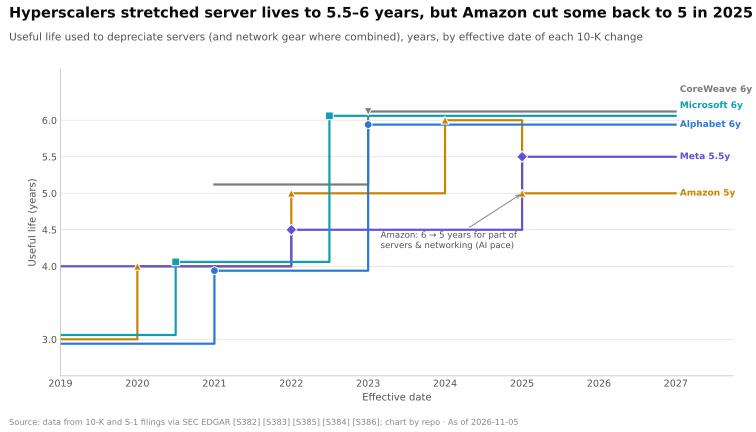

会计上的[使用寿命](../glossary.md#useful-life)与[经济寿命](../glossary.md#economic-life)是两回事。会计寿命是一项政策；经济寿命则是 GPU 收入高于其现金成本的持续时间。英伟达的年度迭代节奏缩短了经济寿命：英伟达宣称 Vera Rubin 将每 token 成本较 Blackwell 降低 10 倍 [[S33006]](../../sources/bibliography.md#s33006)（供应商宣称），而本模型显示，在参考运行点上 Rubin 的每 token 成本比 GB300 低 ~40%（🔴）。每一代新品都会压低旧算力小时的可售价格。

| GB300 使用寿命 | 每装机小时 $ | 每有效小时 $（70%） | 每百万 token $ |
|---|---|---|---|
| 3 年 | $3.83 | $5.47 | $0.24 |
| 4 年 | $3.14 | $4.49 | $0.20 |
| 5 年（亚马逊，部分） | $2.73 | $3.90 | $0.17 |
| 6 年（微软、Alphabet、CoreWeave） | $2.46 | $3.51 | $0.16 |
| 7 年 | $2.27 | $3.24 | $0.14 |

资本成本 8%；估计 [[S14000]](../../sources/bibliography.md#s14000)。

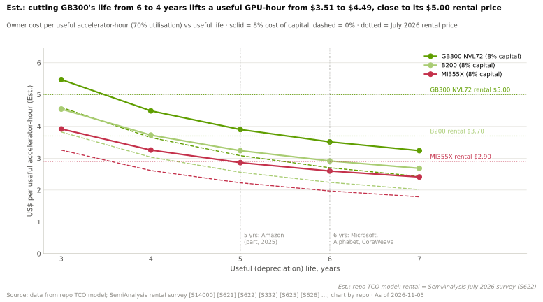

> [!TIP]
> **算例 —— 折旧年限从六年改为四年对 GPU 云意味着什么。** SemiAnalysis 2026 年 7 月的调查显示，GB300 租赁价格为每 GPU 小时 ~$5.00 [[S622]](../../sources/bibliography.md#s622)。按六年寿命、70% 利用率计算，所有者每售出小时成本为 ~$3.51，扣除间接费用前利润率 ~30%。按四年计算为 ~$4.49，利润率 ~10%；按三年计算为 ~$5.47，即出现亏损（估计）[[S14000]](../../sources/bibliography.md#s14000)。**结论：** 对[新兴云服务商](../glossary.md#neocloud)而言，折旧政策不是会计细节。它决定 GPU 租赁能否覆盖资本成本，并体现在[GPU 抵押贷款](../glossary.md#gpu-backed-loan)的贷款条款中。

对于使用自有 GPU 的超大规模云厂商，影响相同，只是体现在不同的科目上：寿命缩短会降低当期报告的营业利润；寿命延长则推迟成本确认，并增加日后若经济寿命被证明更短时需计提减值的风险。

## 10. 看空观点：GPU 租赁价格通缩

最有力的看空论点并不需要任何竞争对手胜出，只需要英伟达持续胜出。每一代产品都会降低每 token 成本，因此旧加速器小时的市场价格会向某一水平回落：在该水平上，其 token 成本与最新芯片相同，即其[token 平价租金](../glossary.md#token-parity-rent)。若价格下跌快于折旧计划的假设，所有者将面临亏损和减值，而建立在 GPU 抵押品之上的[循环融资](../glossary.md#circular-financing)也将被削弱（[第 18 章](18-vulnerabilities-and-bear-case.md)）。

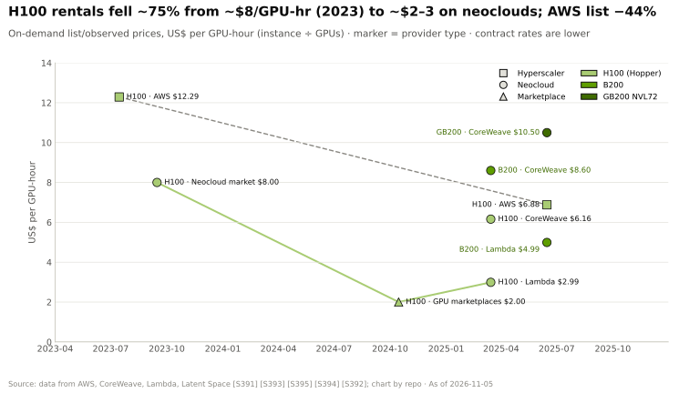

历史确有其事。H100 租金从 2023 年每小时 ~$8 跌至 2024 年末交易平台上的不足 $2 [[S393]](../../sources/bibliography.md#s393)，AWS 在 2025 年 6 月将 H100 标价下调 ~44% [[S392]](../../sources/bibliography.md#s392)。这些租赁数据同样系凭记忆录入，已排队等待重新核实。

> [!TIP]
> **算例 —— Vera Rubin 对一个 GB300 小时的冲击。** 在参考运行点上，一块 GB300 GPU 每个繁忙小时产出 ~22.5M token [[S621]](../../sources/bibliography.md#s621)。若 Vera Rubin 生产每百万 token 的成本为 ~$0.094（🔴 估计）[[S14000]](../../sources/bibliography.md#s14000)，那么一旦 Rubin 供应充足，买方最多只愿为一个 GB300 小时支付 ~22.5 × $0.094 ≈ **$2.12**。而 GB300 所有者每售出小时的成本为 ~$3.51。按同样的算法，在该工作负载上相对于 GB300，一个 H200 小时的价格不到 $0.20。**结论：** 在供应不受限的市场中，英伟达每一代产品令上一代贬值的速度都快于六年折旧的假设；只有在需求超过供应时，已装机存量才能保值。

迄今为止需求一直超过供应。H100 一年期合约价格在 2025 年 10 月触底于 ~$1.70，随后随着推理需求增长，到 2026 年 3 月上涨 ~38% 至 ~$2.35 [[S12516]](../../sources/bibliography.md#s12516)[[S12517]](../../sources/bibliography.md#s12517)。老款 GPU 在其“够用”的工作负载上仍能赚钱：较小的稠密模型、微调和批处理作业。SemiAnalysis 对 H100 的所有者 TCO 估计为每小时 ~$1.17 [[S622]](../../sources/bibliography.md#s622)，因此一块已完全折旧、以 $2.35 出租的 H100 仍然有利可图。

> [!NOTE]
> **🐂 看多观点：** token 需求的复合增长速度快于每 token 成本的下降速度（谷歌的 token 量在 18 个月内增长 ~134 倍 [[S32018]](../../sources/bibliography.md#s32018)[[S32020]](../../sources/bibliography.md#s32020)），因此每一代产品的产能都会被消化。软件持续提升老款 GPU 的吞吐量 [[S601]](../../sources/bibliography.md#s601)[[S603]](../../sources/bibliography.md#s603)，且英伟达为合作伙伴的部分未售出产能提供兜底，例如截至 2032 年在 CoreWeave 的 $6.3B [[S90067]](../../sources/bibliography.md#s90067)。

> [!WARNING]
> **🐻 看空观点：** 只有当 token 需求的[价格弹性](../glossary.md#price-elasticity)保持在 1 以上时，支出才会增长（[CS5](../case-studies/CS5-deepseek-moment-and-efficiency-shock.md)）。若供应追上需求——无论是通过吉瓦级扩建 [[S398]](../../sources/bibliography.md#s398) 还是高效模型——租赁价格将跌至 token 平价水平，六年寿命将变成减值。届时，支撑英伟达毛利率的同一吞吐量优势，反而会摧毁其自身已装机存量的残值。首当其冲的是贷款方、新兴云服务商以及英伟达的兜底安排。

## 🎯 企业发展视角

1. **制胜指标是在指定运行点下实测的每兆瓦每秒 token 数。** 更便宜的加速器小时并不足够：模型显示，26% 的小时折扣会输给 8.5 倍的吞吐量差距。对于任何推理挑战者，包括高通（Qualcomm）的 AI200/AI250 和 Dragonfly AI300（仅基于公开公告）[[S90028]](../../sources/bibliography.md#s90028)[[S90060]](../../sources/bibliography.md#s90060)，哪些运行点和模型（稠密、长提示、批处理、高交互速度）对 NVL72 最不利？什么样的公开证据能让每 token 成本的宣称具有可信度？
2. **英伟达的毛利率可守，但并非不可撼动。** ~20% 的降价即可追平最强的自有运营替代方案，且仍保留 ~66% 的毛利率（🔴）。预计英伟达将通过捆绑销售、融资和路线图时机来防守，而非下调标价。这给以价格取胜的第二供应商留下了多少空间？
3. **电力是稀缺投入，因此已通电的站点是战略资产。** 在一个固定的 100 MW 站点上，各平台的年度成本相近，而已出货系统之间的 token 产出相差最多 ~15 倍（估计）。与站点所有者、电力公司和 800 VDC 供应商的合作，其价值可能高于芯片性能的增量提升（[第 08 层](../layers/08-systems-racks-ai-factories/ai-factories.md)）。
4. **软件对每 token 成本的杠杆作用与硬件同样大。** MTP、宽专家并行和服务引擎可在硬件不变的情况下使成本变动 2–20 倍 [[S624]](../../sources/bibliography.md#s624)[[S631]](../../sources/bibliography.md#s631)。掌控或影响服务栈（[Dynamo](../glossary.md#dynamo)、vLLM、[SGLang](../glossary.md#sglang)，或高通的 Modular/Mojo [[S9511]](../../sources/bibliography.md#s9511)），每美元的价值可能高于芯片功能。在新模型上实现首日（day-0）性能的最低成本路径是什么？
5. **残值风险存在于融资链条中。** 折旧年限、利用率和 token 平价租金决定了 GPU 抵押贷款、新兴云租约和供应商兜底能否站得住。任何涉及 GPU 产能的合作或投资，都应围绕其假设的寿命、利用率和租金曲线开展尽职调查，而非着眼于芯片规格。

## 📚 来源（Sources）

<!-- Auto-generated from the [S…] citations on this page by `make build`. Edit sources/registry/*.csv, not this list. -->

- [**S144**](../../sources/bibliography.md#s144) AMD Newsroom, *AMD Unveils Vision for an Open AI Ecosystem, Detailing New Silicon, Software and Systems at Advancing AI 2025*, 2025-06-12. [Link](https://www.amd.com/en/newsroom/press-releases/2025-6-12-amd-unveils-vision-for-an-open-ai-ecosystem-detai.html)
- [**S154**](../../sources/bibliography.md#s154) AWS Neuron SDK docs, *AWS Neuron documentation: Trainium2 architecture*, 2024-12. [Link](https://awsdocs-neuron.readthedocs-hosted.com/en/latest/general/arch/neuron-hardware/trainium2.html)
- [**S242**](../../sources/bibliography.md#s242) Amazon Web Services, *Amazon EC2 Trn3 instances (product page)*, 2025-12-02. [Link](https://aws.amazon.com/ec2/instance-types/trn3/)
- [**S320**](../../sources/bibliography.md#s320) Hydra Host, *NVIDIA DGX B200 (configuration and pricing page)*, 2026. [Link](https://hydrahost.com/nvidia/dgx-b200)
- [**S322**](../../sources/bibliography.md#s322) GPUPerHour, *NVIDIA GPU prices (H100/H200 and DGX/HGX system listings)*, 2026-09. [Link](https://gpuperhour.com/blog/nvidia-gpu-prices)
- [**S324**](../../sources/bibliography.md#s324) fal.ai, *NVIDIA GB200 price in 2026: what a GPU, a tray and an NVL72 rack cost*, 2026. [Link](https://fal.ai/learn/serverless/nvidia-gb200-price)
- [**S327**](../../sources/bibliography.md#s327) Wing VC, *How much does an NVIDIA NVL72 cost?*, 2026. [Link](https://www.wing.vc/content/how-much-does-an-nvidia-nvl72-cost)
- [**S328**](../../sources/bibliography.md#s328) Data Gravity, *How much does an NVIDIA NVL72 cost?*, 2026. [Link](https://www.datagravity.dev/p/how-much-does-an-nvidia-nvl72-cost)
- [**S330**](../../sources/bibliography.md#s330) PC Gamer, *A single Nvidia Vera Rubin rack is estimated to cost $7,803,148 with over $2 million of that figure spent on memory alone*, 2026-05. [Link](https://pcgamer.com/hardware/a-single-nvidia-vera-rubin-rack-is-estimated-to-cost-usd7-803-148-with-over-usd2-million-of-that-figure-spent-on-memory-alone)
- [**S332**](../../sources/bibliography.md#s332) Tiger Brokers (iTiger), *Morgan Stanley's BOM analysis of NVIDIA's Rubin: GPU share declines; PCB, MLCC and ABF substrate values soar*, 2026-05-20. [Link](https://www.itiger.com/news/1188068712)
- [**S333**](../../sources/bibliography.md#s333) Wccftech, *Bernstein warns NVIDIA's Vera Rubin racks will hit $9.1 million as HBM4 prices triple to $53 per gigabyte*, 2026-07. [Link](https://wccftech.com/bernstein-warns-nvidias-vera-rubin-racks-will-hit-9-1-million-as-hbm4-prices-triple-to-53-per-gigabyte/)
- [**S346**](../../sources/bibliography.md#s346) Kad8, *AMD Helios AI rack: MI455X, Zen 6 EPYC and Pensando*, 2026. [Link](https://www.kad8.com/server/amd-helios-ai-rack-mi455x-zen-6-epyc-and-pensando/)
- [**S357**](../../sources/bibliography.md#s357) Wccftech, *Morgan Stanley: NVIDIA GB200 NVL72 racks deliver a profit margin of 77.6% vs AMD MI355X while entailing nearly the same TCO (report later retracted)*, 2025-08. [Link](https://wccftech.com/morgan-stanley-nvidia-gb200-nvl72-racks-deliver-a-profit-margin-of-77-6-vs-64-for-amd-mi355x-while-entailing-nearly-the-same-tco/)
- [**S382**](../../sources/bibliography.md#s382) Microsoft via SEC EDGAR, *Microsoft Corporation Form 10-K filings (FY2021, FY2023) - property and equipment useful lives*, 2023-07-27. [Link](https://www.sec.gov/cgi-bin/browse-edgar?action=getcompany&CIK=0000789019&type=10-K&dateb=&owner=include&count=40)
- [**S383**](../../sources/bibliography.md#s383) Alphabet via SEC EDGAR, *Alphabet Inc. Form 10-K filings (FY2020, FY2022) - useful lives of servers and network equipment*, 2023-02-03. [Link](https://www.sec.gov/cgi-bin/browse-edgar?action=getcompany&CIK=0001652044&type=10-K&dateb=&owner=include&count=40)
- [**S384**](../../sources/bibliography.md#s384) Meta via SEC EDGAR, *Meta Platforms Form 10-K filings (FY2022, FY2024) - useful lives of servers and network assets*, 2025-01-30. [Link](https://www.sec.gov/cgi-bin/browse-edgar?action=getcompany&CIK=0001326801&type=10-K&dateb=&owner=include&count=40)
- [**S385**](../../sources/bibliography.md#s385) Amazon via SEC EDGAR, *Amazon.com Form 10-K filings (FY2019-FY2024) - useful lives of servers*, 2025-02-07. [Link](https://www.sec.gov/cgi-bin/browse-edgar?action=getcompany&CIK=0001018724&type=10-K&dateb=&owner=include&count=40)
- [**S386**](../../sources/bibliography.md#s386) CoreWeave via SEC EDGAR, *CoreWeave Form S-1 registration statement (2025) - technology equipment useful life*, 2025-03-03. [Link](https://www.sec.gov/cgi-bin/browse-edgar?action=getcompany&company=coreweave&type=S-1&dateb=&owner=include&count=40)
- [**S388**](../../sources/bibliography.md#s388) Google, *Google data centers: efficiency (fleet-wide PUE)*, 2025. [Link](https://datacenters.google/efficiency/)
- [**S389**](../../sources/bibliography.md#s389) U.S. Energy Information Administration, *EIA Electric Power Monthly, Table 5.6.A: average price of electricity to ultimate customers by end-use sector*, 2025. [Link](https://www.eia.gov/electricity/monthly/epm_table_grapher.php?t=epmt_5_6_a)
- [**S390**](../../sources/bibliography.md#s390) LevelTen Energy, *LevelTen Energy PPA Price Index (North America)*, 2025. [Link](https://www.leveltenenergy.com/ppa)
- [**S392**](../../sources/bibliography.md#s392) AWS, *AWS announces up to 45% price reduction for Amazon EC2 NVIDIA GPU-accelerated instances (P4, P5)*, 2025-06. [Link](https://aws.amazon.com/about-aws/whats-new/2025/06/pricing-usage-model-ec2-instances-nvidia-gpus/)
- [**S393**](../../sources/bibliography.md#s393) Latent Space (Eugene Cheah), *$2 H100s: how the GPU bubble burst*, 2024-10. [Link](https://www.latent.space/p/gpu-bubble)
- [**S398**](../../sources/bibliography.md#s398) NVIDIA Investor Relations, *NVIDIA Q2 FY2026 earnings call (2025-08-27): AI factory economics commentary*, 2025-08-27. [Link](https://investor.nvidia.com/events-and-presentations/events-and-presentations/default.aspx)
- [**S405**](../../sources/bibliography.md#s405) NVIDIA Corporation via SEC EDGAR, *NVIDIA Announces Financial Results for Second Quarter Fiscal 2027 (Form 8-K exhibit 99.1)*, 2026-08-26. [Link](https://www.sec.gov/Archives/edgar/data/0001045810/000104581026000073/q2fy27pr.htm)
- [**S601**](../../sources/bibliography.md#s601) MLCommons, *MLPerf Inference v5.1 results (summary_results.json and per-submitter logs)*, 2025-09-09. [Link](https://github.com/mlcommons/inference_results_v5.1)
- [**S603**](../../sources/bibliography.md#s603) MLCommons, *MLPerf Inference v6.1 results (summary.csv and per-submitter logs)*, 2026-09. [Link](https://github.com/mlcommons/inference_results_v6.1)
- [**S613**](../../sources/bibliography.md#s613) NAND Research, *MLPerf Inference 6.0: Software Gains, Broadening Competition Shake Things Up*, 2026-04. [Link](https://nand-research.com/mlperf-inference-6-0-software-gains-broadening-competition-shake-things-up/)
- [**S621**](../../sources/bibliography.md#s621) SemiAnalysis (InferenceX-app repository), *InferenceX public API snapshot (benchmarks.json and benchmarks-history.json fixtures)*, 2026-10-17. [Link](https://github.com/SemiAnalysisAI/InferenceX-app/tree/main/packages/app/cypress/fixtures/api)
- [**S622**](../../sources/bibliography.md#s622) SemiAnalysis (InferenceX-app repository), *InferenceX hardware registry: TCO per GPU-hour by SKU (SemiAnalysis July 2026 pricing surveys and AI Cloud TCO Model)*, 2026-07. [Link](https://github.com/SemiAnalysisAI/InferenceX-app/blob/main/packages/constants/src/gpu-keys.ts)
- [**S623**](../../sources/bibliography.md#s623) SemiAnalysis, *InferenceMAX: Open Source Inference Benchmarking*, 2025-10-09. [Link](https://github.com/SemiAnalysisAI/InferenceX-app/blob/main/packages/app/content/blog/inferencemax-open-source-inference-benchmarking.mdx)
- [**S624**](../../sources/bibliography.md#s624) SemiAnalysis, *InferenceX v2: NVIDIA Blackwell Vs AMD vs Hopper - Formerly InferenceMAX*, 2026-02-16. [Link](https://github.com/SemiAnalysisAI/InferenceX-app/blob/main/packages/app/content/blog/inferencex-v2-nvidia-blackwell-vs-amd-vs-hopper.mdx)
- [**S625**](../../sources/bibliography.md#s625) SemiAnalysis, *TPU Inference Externalization Full Steam Ahead*, 2026-09-07. [Link](https://github.com/SemiAnalysisAI/InferenceX-app/blob/main/packages/app/content/blog/tpu-inferencex-full-steam.mdx)
- [**S626**](../../sources/bibliography.md#s626) SemiAnalysis, *Vera Rubin NVL72 vs GB200 NVL72? Inference TCO & Architecture Analysis*, 2026-07-23. [Link](https://github.com/SemiAnalysisAI/InferenceX-app/blob/main/packages/app/content/blog/vera-rubin-nvl72-vs-gb200-nvl72-inference.mdx)
- [**S627**](../../sources/bibliography.md#s627) SemiAnalysis, *AgentX - InferenceXv3: Does the CUDA Moat Hold Up in Agentic Inferencing?*, 2026-08-24. [Link](https://github.com/SemiAnalysisAI/InferenceX-app/blob/main/packages/app/content/blog/agentx-inferencexv3-does-cuda-moat.mdx)
- [**S628**](../../sources/bibliography.md#s628) SemiAnalysis, *OpenAI Jalapeño: Better Than Nvidia Blackwell*, 2026-08-25. [Link](https://github.com/SemiAnalysisAI/InferenceX-app/blob/main/packages/app/content/blog/openai-jalapeno-better-than-nvidia.mdx)
- [**S631**](../../sources/bibliography.md#s631) SemiAnalysis, *MI355X DeepSeek-V4-Pro on SGLang: 110.5x Throughput per GPU in 26 Days*, 2026-05-26. [Link](https://github.com/SemiAnalysisAI/InferenceX-app/blob/main/packages/app/content/blog/mi355x-deepseek-v4-pro-sglang-110x-in-26-days.mdx)
- [**S646**](../../sources/bibliography.md#s646) NVIDIA TensorRT-LLM team, *Optimizing DeepSeek R1 Throughput on NVIDIA Blackwell GPUs: A Deep Dive for Developers (TensorRT-LLM tech blog 3)*, 2025-05-30. [Link](https://github.com/NVIDIA/TensorRT-LLM/blob/main/docs/source/blogs/tech_blog/blog03_Optimizing_DeepSeek_R1_Throughput_on_NVIDIA_Blackwell_GPUs.md)
- [**S653**](../../sources/bibliography.md#s653) Anthropic, *Expanding our use of Google Cloud TPUs and Services*, 2025-10-23. [Link](https://www.anthropic.com/news/expanding-our-use-of-google-cloud-tpus-and-services)
- [**S2021**](../../sources/bibliography.md#s2021) nvidia_deep_dive_claude repository, *Repo analysis: Layer 02 GPU silicon models (memory-hierarchy estimates; multi-die silicon cost; decode throughput by precision)*, 2026-11-05. [Link](https://github.com/FrankHuang94/nvidia_deep_dive_claude/blob/main/layers/02-gpu-silicon/index.md)
- [**S6025**](../../sources/bibliography.md#s6025) Reuters (via Investing.com), *How much does a GW of data center capacity actually cost?*, 2025-10. [Link](https://ng.investing.com/news/stock-market-news/how-much-does-a-gw-of-data-center-capacity-actually-cost-2169144)
- [**S6026**](../../sources/bibliography.md#s6026) AMCompute (blog), *AI Cluster Cost Breakdown: CapEx (2026)*, 2026. [Link](https://www.amcompute.com/blog/ai-cluster-cost-breakdown-capex)
- [**S8007**](../../sources/bibliography.md#s8007) Uptime Institute, *Uptime Institute Global Data Center Survey 2025*, 2025-07. [Link](https://intelligence.uptimeinstitute.com/resource/uptime-institute-global-data-center-survey-2025)
- [**S8009**](../../sources/bibliography.md#s8009) Lawrence Berkeley National Laboratory, *Queued Up: 2025 Edition, Characteristics of Power Plants Seeking Transmission Interconnection As of the End of 2024*, 2025-12-15. [Link](https://emp.lbl.gov/sites/default/files/2025-12/Queued%20Up%202025%20Edition%20-%2012.15.2025.pdf)
- [**S9511**](../../sources/bibliography.md#s9511) Nasdaq (Qualcomm press release), *Qualcomm Completes Acquisition of Modular*, 2026-07-29. [Link](https://www.nasdaq.com/press-release/qualcomm-completes-acquisition-modular-2026-07-29)
- [**S11011**](../../sources/bibliography.md#s11011) MarketBeat, *NVIDIA Q2 Fiscal 2025 earnings call transcript (28 August 2024)*, 2024-08-28. [Link](https://www.marketbeat.com/earnings/transcripts/110080/)
- [**S11013**](../../sources/bibliography.md#s11013) NVIDIA (docs.api.nvidia.com), *NVIDIA NIM FAQ*, 2025. [Link](https://docs.api.nvidia.com/nim/docs/faq)
- [**S12015**](../../sources/bibliography.md#s12015) USENIX OSDI '26 (Li et al. (Alibaba / HKUST)), *Heterogeneity at Hyperscale: Characterization and Scheduling of Large Production AI Clusters at Alibaba*, 2026-07. [Link](https://www.usenix.org/conference/osdi26/presentation/li-suyi)
- [**S12501**](../../sources/bibliography.md#s12501) Runtime Wire, *CoreWeave reports $2.58 billion Q2 revenue with $35 billion in debt*, 2026-08. [Link](https://runtimewire.com/article/coreweave-q2-2026-revenue-debt-ai-cloud)
- [**S12516**](../../sources/bibliography.md#s12516) SemiAnalysis, *The Great GPU Shortage - Rental Capacity - Launching our H100 1 Year Rental Price Index*, 2026-03. [Link](https://newsletter.semianalysis.com/p/the-great-gpu-shortage-rental-capacity)
- [**S12517**](../../sources/bibliography.md#s12517) Silicon Data, *H100 price spike (Silicon Data H100 rental index)*, 2026-01. [Link](https://www.silicondata.com/blog/h100-price-spike)
- [**S14000**](../../sources/bibliography.md#s14000) nvidia_deep_dive_claude repository, *Repo analysis: chapter 14 TCO model (scripts/tco/tco_model.py with data/x14_tco_scenarios.csv)*, 2026-11-05. [Link](https://github.com/FrankHuang94/nvidia_deep_dive_claude/blob/main/scripts/tco/README.md)
- [**S14001**](../../sources/bibliography.md#s14001) Wccftech, *AMD hikes the price of its Instinct MI350 AI accelerator by 70 percent*, 2025-07. [Link](https://wccftech.com/amd-hikes-the-price-of-its-instinct-mi350-ai-accelerator-by-70-percent/)
- [**S14002**](../../sources/bibliography.md#s14002) Wccftech, *AMD is reportedly pricing its Helios rack 40% above NVIDIA's second-gen Rubin, confident that customers will pay the premium*, 2026-07. [Link](https://wccftech.com/amd-is-reportedly-pricing-its-helios-rack-40-above-nvidias-second-gen-rubin-confident-that-customers-will-pay-the-premium/)
- [**S14003**](../../sources/bibliography.md#s14003) The Next Platform, *With Trainium4, AWS will crank up everything but the clocks*, 2025-12-03. [Link](https://www.nextplatform.com/2025/12/03/with-trainium4-aws-will-crank-up-everything-but-the-clocks/)
- [**S14004**](../../sources/bibliography.md#s14004) EvoKernel Specs, *AWS Trainium 2 (hardware specification page)*, 2026. [Link](https://evokernel-specs.pages.dev/en/hardware/trainium-2/)
- [**S14005**](../../sources/bibliography.md#s14005) Datacentre Magazine, *AWS Trainium3 cuts AI data centre power consumption by 40%*, 2025-12. [Link](https://datacentremagazine.com/news/trainium3-new-aws-chip-promises-4x-performance-boost)
- [**S14006**](../../sources/bibliography.md#s14006) Tom's Hardware, *Jensen Huang says even free AI chips from his competitors can't beat Nvidia's GPUs*, 2024-03. [Link](https://www.tomshardware.com/pc-components/gpus/jensen-huang-says-even-free-ai-chips-from-his-competitors-cant-beat-nvidias-gpus)
- [**S23005**](../../sources/bibliography.md#s23005) Google DeepMind (arXiv 2312.11805) (Gemini Team), *Gemini: A Family of Highly Capable Multimodal Models*, 2023-12. [Link](https://arxiv.org/abs/2312.11805)
- [**S23010**](../../sources/bibliography.md#s23010) nvidia_deep_dive_claude repository, *Repo analysis: CS3 TPU economics (break-even fleet for an in-house ASIC, per-token gap vs B200, implied GPU price cut)*, 2026-11-05. [Link](https://github.com/FrankHuang94/nvidia_deep_dive_claude/blob/main/case-studies/CS3-google-tpu-the-credible-alternative.md)
- [**S27010**](../../sources/bibliography.md#s27010) The Register, *Meta's Prometheus supercluster: more than 11 percent of GPUs dead or idle as hot spares*, 2026-10. [Link](https://www.theregister.com/a/5304269)
- [**S27011**](../../sources/bibliography.md#s27011) About Amazon, *AWS activates Project Rainier: one of the world's largest AI compute clusters*, 2025-10. [Link](https://www.aboutamazon.com/news/aws/aws-project-rainier-ai-trainium-chips-compute-cluster)
- [**S31002**](../../sources/bibliography.md#s31002) Meta (GitHub meta-llama/llama-models), *Llama 3.1 model card (MODEL_CARD.md)*, 2024-07-23. [Link](https://github.com/meta-llama/llama-models/blob/main/models/llama3_1/MODEL_CARD.md)
- [**S31007**](../../sources/bibliography.md#s31007) Epoch AI (Sevilla, Roldán), *Training compute of frontier AI models grows by 4-5x per year*, 2024-05-28. [Link](https://epoch.ai/blog/training-compute-of-frontier-ai-models-grows-by-4-5x-per-year)
- [**S31008**](../../sources/bibliography.md#s31008) Epoch AI, *Grok 4 training resources (data insight)*, 2025. [Link](https://epoch.ai/data-insights/grok-4-training-resources)
- [**S32002**](../../sources/bibliography.md#s32002) NVIDIA, *NVIDIA H200 Tensor Core GPU (product page)*, 2023-11. [Link](https://www.nvidia.com/en-us/data-center/h200/)
- [**S32004**](../../sources/bibliography.md#s32004) NVIDIA, *NVIDIA GB300 NVL72 / Blackwell Ultra (product page)*, 2025-03. [Link](https://www.nvidia.com/en-us/data-center/gb300-nvl72/)
- [**S32018**](../../sources/bibliography.md#s32018) Google (The Keyword) (Sundar Pichai), *Google I/O 2025 keynote remarks (Sundar Pichai)*, 2025-05-20. [Link](https://blog.google/technology/ai/io-2025-keynote/)
- [**S32020**](../../sources/bibliography.md#s32020) Alphabet / Google (The Keyword) (Sundar Pichai), *Alphabet CEO remarks on token volume (October 2025)*, 2025-10. [Link](https://blog.google/inside-google/message-ceo/alphabet-earnings-q3-2025/)
- [**S33003**](../../sources/bibliography.md#s33003) Lenovo Press, *ThinkSystem NVIDIA B200 180GB 1000W GPU product guide*, 2025. [Link](https://lenovopress.lenovo.com/lp2226-thinksystem-nvidia-b200-180gb-1000w-gpu)
- [**S33006**](../../sources/bibliography.md#s33006) Tom's Hardware, *Nvidia launches Vera Rubin NVL72 AI supercomputer at CES*, 2026-01-05. [Link](https://www.tomshardware.com/pc-components/gpus/nvidia-launches-vera-rubin-nvl72-ai-supercomputer-at-ces-promises-up-to-5x-greater-inference-performance-and-10x-lower-cost-per-token-than-blackwell-coming-2h-2026)
- [**S34006**](../../sources/bibliography.md#s34006) arXiv:2407.21783 (Llama Team (AI @ Meta)), *The Llama 3 Herd of Models*, 2024-07-31. [Link](https://arxiv.org/abs/2407.21783)
- [**S35020**](../../sources/bibliography.md#s35020) Epoch AI, *NVIDIA's B200 costs around $6,400 to produce, with memory accounting for half*, 2025-12. [Link](https://epoch.ai/data-insights/b200-cost-breakdown)
- [**S90006**](../../sources/bibliography.md#s90006) TweakTown, *Nvidia cuts Vera Rubin's memory bandwidth by up to 26% and AMD's Helios now leads in memory bandwidth*, 2026-10. [Link](https://www.tweaktown.com/news/114304/nvidia-cuts-vera-rubins-memory-bandwidth-by-up-to-26-percent-and-amds-helios-now-leads-in-memory-bandwidth/index.html)
- [**S90020**](../../sources/bibliography.md#s90020) Shacknews, *AMD Helios AI rack system on track for initial shipments in Q3 2026*, 2026. [Link](https://www.shacknews.com/article/150249/amd-helios-ai-system-shipping-q3-2026)
- [**S90028**](../../sources/bibliography.md#s90028) TechRepublic, *Qualcomm unveils AI chips to rival Nvidia, AMD*, 2025-10-27. [Link](https://techrepublic.com/article/news-qualcomm-unveils-ai-chips-to-rival-nvidia-amd)
- [**S90060**](../../sources/bibliography.md#s90060) Qualcomm, *Qualcomm Dragonfly AI300 (product page)*, 2026-06. [Link](https://www.qualcomm.com/data-center/products/qualcomm-dragonfly-ai300)
- [**S90067**](../../sources/bibliography.md#s90067) DatacenterDynamics, *Nvidia to purchase unsold compute capacity from CoreWeave for $6.3bn*, 2025-09-16. [Link](https://www.datacenterdynamics.com/en/news/nvidia-to-purchase-unsold-compute-capacity-from-coreweave-for-63bn/)
- [**S90093**](../../sources/bibliography.md#s90093) Tom's Hardware, *AMD takes the wraps off its Instinct MI455X AI accelerator: CDNA 5 and Helios rack-scale architecture*, 2026. [Link](https://www.tomshardware.com/pc-components/gpus/amd-takes-the-wraps-off-its-instinct-mi455x-ai-accelerator-cdna-5-and-helios-rack-scale-architecture-combine-to-take-the-fight-to-nvidia-in-the-data-center)
