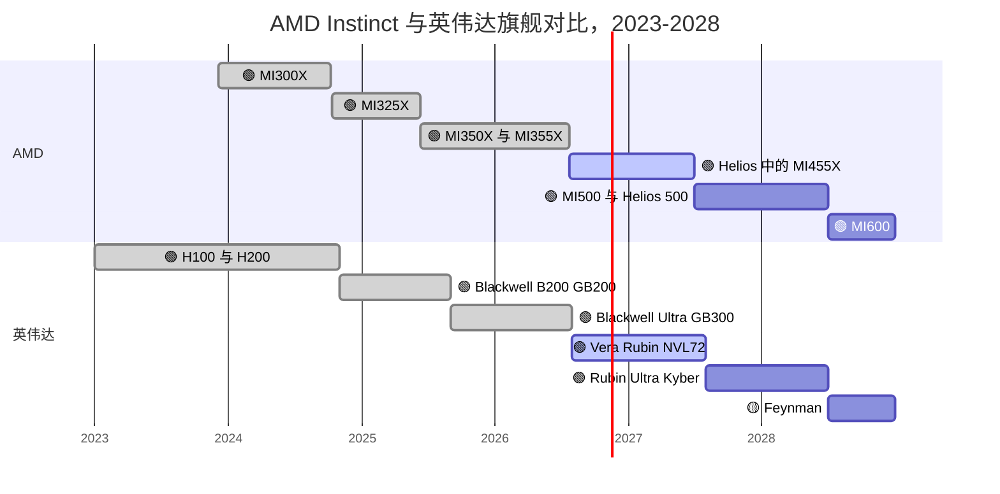
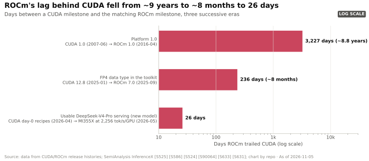
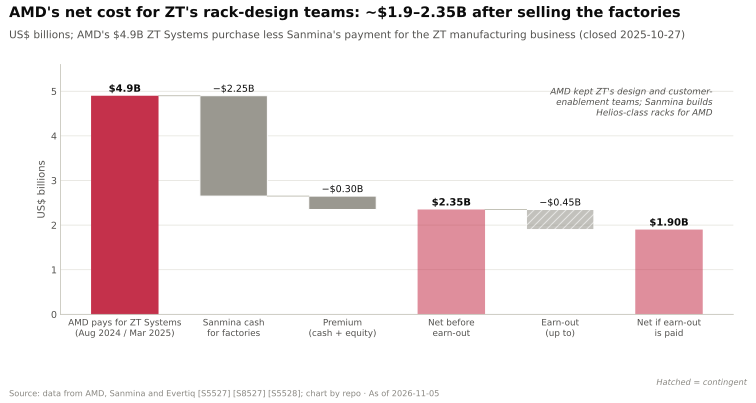
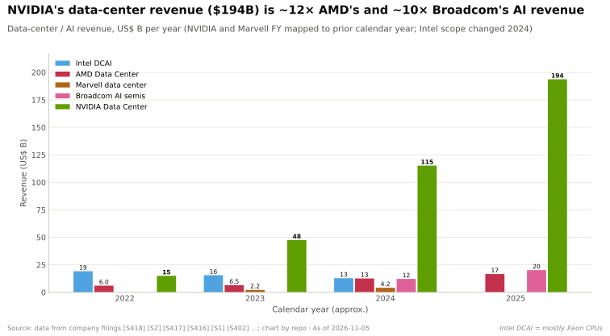
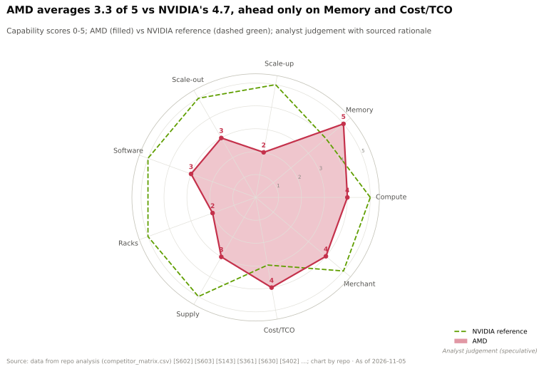

# AMD —— 商用挑战者

> [!NOTE]
> 本页为英文原文的简体中文参考译文，仅供参考；如有出入，以[英文原文](../../../cross-cutting/15-competitive-landscape/amd.md "English original")为准。

跨层专题 15 · 竞争格局 · AMD Instinct、ROCm、Helios · 约 16 分钟阅读 · 最后核实：2026-11-05

## ⚡ 要点速览

- **纸面上 AMD 已经追平。** 自 MI300X 以来，每款 Instinct GPU 在 [HBM](../../glossary.md#hbm) 容量和稠密 FP8 上都持平或超过英伟达（NVIDIA）的同年旗舰（本资料库对比）[[S15014]](../../../sources/bibliography.md#s15014)。MI455X 标称 432 GB [HBM4](../../glossary.md#hbm4)、23.3 TB/s 带宽和 20 [PFLOPS](../../glossary.md#flops) FP8（口径未说明），而 Rubin 为 288 GB、19.2 TB/s 和 17.5 PFLOPS [[S144]](../../../sources/bibliography.md#s144)[[S90093]](../../../sources/bibliography.md#s90093)[[S33005]](../../../sources/bibliography.md#s33005)[[S90006]](../../../sources/bibliography.md#s90006)。
- **AMD 如今卖的是机架，而不只是 GPU。** [Helios](../../glossary.md#amd-helios) 将 72 颗 MI455X 与 EPYC “Venice” CPU 和 Pensando 网卡整合在一起：2.9 EF [FP4](../../glossary.md#fp4)、1.4 EF FP8 和 31 TB HBM4。它已投入生产，首批出货约从 2026 年 Q3 末开始（🟢/🟡）[[S90021]](../../../sources/bibliography.md#s90021)[[S90020]](../../../sources/bibliography.md#s90020)。其设计团队来自 [ZT Systems](../../glossary.md#zt-systems)（$4.9B，2025 年 3 月完成交割）[[S8527]](../../../sources/bibliography.md#s8527)。
- **前沿买家承诺了最多 14 GW。** OpenAI（6 GW）和 Meta（6 GW）的部分对价以 AMD [认股权证](../../glossary.md#warrant)支付；Anthropic 追加了最多 2 GW [[S24000]](../../../sources/bibliography.md#s24000)[[S24004]](../../../sources/bibliography.md#s24004)[[S9538]](../../../sources/bibliography.md#s9538)。按每 GW $10–20B 的硬件计算，未来数年合计约 $140–280B（估计）[[S15014]](../../../sources/bibliography.md#s15014)。
- **收入增长迅速，但差距反而更大。** 数据中心收入在 2026 年 Q2 同比增长 107%，Q3 同比增长 97% [[S543]](../../../sources/bibliography.md#s543)[[S542]](../../../sources/bibliography.md#s542)。然而，英伟达的数据中心收入从 2023 年初为 AMD 的 3.3× 扩大到 2026 年年中的约 13×（本资料库测算）[[S450]](../../../sources/bibliography.md#s450)[[S405]](../../../sources/bibliography.md#s405)。
- **软件是关键约束。** [ROCm](../../glossary.md#rocm) 从 7.0（2025 年 9 月）升级到 10.0（2026 年 8 月）[[S586]](../../../sources/bibliography.md#s586)。即便如此，DeepSeek-V4-Pro 在 MI355X 上用了 27 天才能有效提供服务，而在 CUDA 上首日即可 [[S633]](../../../sources/bibliography.md#s633)。
- **最大弱点：** 缺乏机架级的实战记录。英伟达已推出第三代 NVL72；Helios 是 AMD 的第一代产品，有分析师预计 MI455X 机架要到 2027 年 Q2 才会产出首批生产级 token（🟡）[[S624]](../../../sources/bibliography.md#s624)。

## Instinct 路线图：MI300X → MI355X → MI450 → MI500

AMD 的数据中心 GPU 采用 [CDNA](../../glossary.md#cdna) 架构和[小芯片（chiplet）](../../glossary.md#chiplet)设计。计算裸片（XCD）堆叠在 I/O 裸片之上，因此 AMD 可以混用不同的制程节点和分档。MI355X 采用台积电（TSMC）N3P 计算裸片和 N6 I/O 裸片 [[S2020]](../../../sources/bibliography.md#s2020)。其迭代节奏现已变为一年一代 [[S545]](../../../sources/bibliography.md#s545)，最近三款 Instinct 旗舰均与英伟达旗舰在同一季度推出（见下图）[[S142]](../../../sources/bibliography.md#s142)[[S143]](../../../sources/bibliography.md#s143)[[S539]](../../../sources/bibliography.md#s539)。

| GPU | 发布时间 | HBM | 带宽 | 稠密 FP8 | 稠密 FP4 | 纵向扩展 | 状态 | 来源 |
|---|---|---|---|---|---|---|---|---|
| MI300X | 2023 年 12 月 | 192 GB HBM3 | 5.3 TB/s | 2.6 PF | — | 8 颗 GPU，Infinity Fabric | 🟢 已出货 | [[S141]](../../../sources/bibliography.md#s141) |
| MI325X | 2024 年 10 月 | 256 GB HBM3E | 6.0 TB/s | 2.6 PF | — | 8 颗 GPU | 🟢 已出货 | [[S142]](../../../sources/bibliography.md#s142) |
| MI355X | 2025 年 6 月 | 288 GB HBM3E | 8.0 TB/s | 5.0 PF | 10.1 PF | 8 颗 GPU，1,075 GB/s | 🟢 已出货 | [[S143]](../../../sources/bibliography.md#s143)[[S229]](../../../sources/bibliography.md#s229) |
| MI455X（MI450 系列） | 2026 年 7 月 | 432 GB HBM4 | 23.3 TB/s | 20 PF（口径未说明） | 40 PF | 72 颗 GPU，每颗 3.6 TB/s | 🟢 已量产 | [[S144]](../../../sources/bibliography.md#s144)[[S90093]](../../../sources/bibliography.md#s90093)[[S538]](../../../sources/bibliography.md#s538)[[S5522]](../../../sources/bibliography.md#s5522) |
| MI500（CDNA 6） | 2027 | HBM4E（有报道） | n/a | n/a | n/a | Helios 500 机架 | 🟢 已发布 | [[S541]](../../../sources/bibliography.md#s541)[[S538]](../../../sources/bibliography.md#s538) |
| MI600 | 2028 | n/a | n/a | n/a | n/a | Helios 600 机架 | 🟢 已发布 | [[S538]](../../../sources/bibliography.md#s538) |

MI450 系列包括 MI455X（Helios）、MI440X（8-GPU 服务器）和 MI430X（FP64 高性能计算）[[S544]](../../../sources/bibliography.md#s544)。Meta 的首个吉瓦采用一款基于 MI450 的定制部件 [[S24004]](../../../sources/bibliography.md#s24004)。AMD 宣称 MI500 的 AI 性能最高可达 MI300X 的 1,000× [[S544]](../../../sources/bibliography.md#s544)，这是一项混合了精度与系统层面增益的厂商说法。

来源：AMD 产品发布 [[S141]](../../../sources/bibliography.md#s141)[[S142]](../../../sources/bibliography.md#s142)[[S143]](../../../sources/bibliography.md#s143)[[S538]](../../../sources/bibliography.md#s538)[[S541]](../../../sources/bibliography.md#s541)；英伟达平台 [[S90009]](../../../sources/bibliography.md#s90009)[[S90003]](../../../sources/bibliography.md#s90003)[[S90004]](../../../sources/bibliography.md#s90004)。条形表示各部件作为当期旗舰的时间段，而非出货量。

> [!TIP]
> **算例 —— 432 GB 能带来什么。** 一个 4050 亿参数的 [FP8](../../glossary.md#fp8) 模型仅权重就需要约 405 GB。一颗 MI455X（432 GB）即可容纳，并为 [KV 缓存](../../glossary.md#kv-cache)留出约 27 GB [[S144]](../../../sources/bibliography.md#s144)。在 Rubin（288 GB）上，同一模型需要两颗 GPU（576 GB），可为 KV 缓存留出约 171 GB [[S33005]](../../../sources/bibliography.md#s33005)。按单 GPU 计，AMD 可容纳约 1 个模型副本，英伟达约 0.5 个，但英伟达这一对 GPU 可用于并发用户的空余内存约为前者的 6×。**结论：** 容量优势让 AMD 能用更少的 GPU 服务大模型，这在 8-GPU 服务器中是实实在在的优势。而在 72-GPU 的 [NVLink](../../glossary.md#nvlink) 域内，将模型拆分到多颗 GPU 上的代价很低，这一优势随之缩小。

🔧 技术细节：为什么 MI455X 的“口径未说明”很重要

AMD 通常将稀疏算力单列为 2× 的一行；上文的 MI355X 数据为稠密值 [[S143]](../../../sources/bibliography.md#s143)。对于 MI455X，AMD 2025 年 6 月公布的数据（40 PFLOPS FP4、20 PFLOPS FP8）并未说明是稠密还是稀疏 [[S144]](../../../sources/bibliography.md#s144)。Rubin 的 17.5 PFLOPS FP8 为稠密值，其 50 PFLOPS [NVFP4](../../glossary.md#nvfp4) “推理”数据依赖自适应压缩 [[S100]](../../../sources/bibliography.md#s100)。如果 AMD 的数据是稀疏值，MI455X 的稠密 FP8 将只有 Rubin 的一半左右；内存数据则毫无歧义。AMD 在一份不具约束力的谅解备忘录（MOU）下，指定三星为 MI455X 的主要 HBM4 供应商 [[S3511]](../../../sources/bibliography.md#s3511)。

## ROCm：逐个模型缩小软件差距

ROCm 是 AMD 对标 [CUDA](../../glossary.md#cuda) 的方案：包括编译器、[HIP](../../glossary.md#hip) 编程接口、数学库、[RCCL](../../glossary.md#rccl) 集合通信库以及框架插件。它比 CUDA 晚九年起步。此后，每个里程碑的发布滞后大约缩短了十倍：平台 1.0 滞后约 8.8 年，FP4 支持滞后约 8 个月，可用的 DeepSeek-V4-Pro 服务滞后约 26 天 [[S586]](../../../sources/bibliography.md#s586)[[S90064]](../../../sources/bibliography.md#s90064)[[S633]](../../../sources/bibliography.md#s633)。

剩余差距在于覆盖广度和首日支持。在本资料库的框架指数中，ROCm 得分 26/36（CUDA：36）[[S586]](../../../sources/bibliography.md#s586)[[S580]](../../../sources/bibliography.md#s580)。AMD 的 [AITER](../../glossary.md#aiter) 算子库现已成为 AMD 平台上 [vLLM](../../glossary.md#vllm) 的默认注意力后端 [[S10514]](../../../sources/bibliography.md#s10514)。ROCm.ai（2026 年 7 月）新增了一个 AI 助手，用于安装、调优和调试工作负载 [[S9518]](../../../sources/bibliography.md#s9518)。Anthropic 2026 年的交易包括使用 Claude 加速 ROCm 开发 [[S9538]](../../../sources/bibliography.md#s9538)。

> [!TIP]
> **算例 —— 27 天的代价。** 在 DeepSeek-V4-Pro 发布后的第 27 天，B200 的单 GPU token 产出仍约为 MI355X 的 5× [[S631]](../../../sources/bibliography.md#s631)。SemiAnalysis 估计自有成本为每 B200 小时约 $1.73、每 MI355X 小时约 $1.50 [[S622]](../../../sources/bibliography.md#s622)。因此当天 MI355X 的每 token 成本为 (1.50 ÷ 1) ÷ (1.73 ÷ 5) ≈ **B200 的 4.3×**。随后的内核优化在几周内将 MI355X 的每 token 成本降低了约 33× [[S631]](../../../sources/bibliography.md#s631)。**结论：** AMD 硬件一旦调优到位就具备成本竞争力。但每个新模型发布后的数周内，买家都要支付“软件税”，因此 AMD 更适合稳定、大规模的工作负载，而非最新的前沿模型。

## Helios 与 ZT Systems：AMD 的第一款机架

客户如今购买的是机架。英伟达的 [NVL72](../../glossary.md#nvl72) 证明，在[混合专家模型（MoE）](../../glossary.md#mixture-of-experts)推理中，72 颗 GPU 共享一个内存语义互连架构，胜过 8-GPU 服务器。Helios 是一款双宽 Open Rack 设计，通过基于博通（Broadcom）Tomahawk 6 的交换托盘，以 [UALink over Ethernet](../../glossary.md#ualoe) 连接 72 颗 MI455X GPU [[S226]](../../../sources/bibliography.md#s226)[[S5522]](../../../sources/bibliography.md#s5522)。

| 机架（2026） | AMD Helios | 英伟达 Vera Rubin NVL72 | 对 AMD 的判定 |
|---|---|---|---|
| 每个纵向扩展域的 GPU 数 | 72 颗 MI455X | 72 颗 Rubin | 🟨 规模相同 [[S344]](../../../sources/bibliography.md#s344)[[S102]](../../../sources/bibliography.md#s102) |
| HBM4 容量 | 约 31 TB | 20.7 TB | 🟩 约 1.5× [[S90021]](../../../sources/bibliography.md#s90021)[[S102]](../../../sources/bibliography.md#s102) |
| HBM 带宽 | 约 1,678 TB/s | 1,400 TB/s（修订后） | 🟩 约 1.2×；也高于 1,580 的发布规格 [[S90093]](../../../sources/bibliography.md#s90093)[[S90006]](../../../sources/bibliography.md#s90006) |
| 稠密 FP8 | 1.4 EF | 约 1.26 EF | 🟩 纸面领先 [[S90021]](../../../sources/bibliography.md#s90021)[[S33005]](../../../sources/bibliography.md#s33005) |
| 每 GPU 纵向扩展带宽 | 3.6 TB/s（开放的 UALink-over-Ethernet） | 3.0 TB/s NVLink 6（修订后） | 🟦 开放 vs 专有 [[S5522]](../../../sources/bibliography.md#s5522)[[S90007]](../../../sources/bibliography.md#s90007) |
| 每 GPU 横向扩展带宽 | 2.4 Tb/s（Pensando Vulcano） | 1.6 Tb/s（ConnectX-9） | 🟩 [[S228]](../../../sources/bibliography.md#s228)[[S7500]](../../../sources/bibliography.md#s7500)[[S33004]](../../../sources/bibliography.md#s33004) |
| 实战记录 | 第一代 | 第三代 NVL72 | 🟥 [[S8527]](../../../sources/bibliography.md#s8527)[[S5501]](../../../sources/bibliography.md#s5501) |

ZT Systems 提供了机架设计能力。AMD 支付 $4.9B，于 2025-03-31 完成交割，并保留了设计和客户赋能团队 [[S8527]](../../../sources/bibliography.md#s8527)。随后它以 $2.25B 现金加 $0.3B 溢价及最多 $0.45B 的或有对价（earn-out），将工厂出售给 Sanmina [[S5527]](../../../sources/bibliography.md#s5527)[[S5528]](../../../sources/bibliography.md#s5528)。

> [!TIP]
> **算例 —— AMD 为机架技术诀窍付出了多少。** 净成本 = $4.9B − $2.25B − $0.3B = **$2.35B**；若或有对价全额支付，则为 $1.9B [[S5527]](../../../sources/bibliography.md#s5527)。这约为 AMD 约 $34B 年化数据中心收入（2026 年 Q3，估计）的 7% [[S15014]](../../../sources/bibliography.md#s15014)。它支撑了最多 14 GW 的承诺，未来数年价值约 $140–280B（估计）[[S15014]](../../../sources/bibliography.md#s15014)。**结论：** 对挑战者而言，一支经过验证的机架集成团队的价值远超其资产价值——英伟达收购 Mellanox 时就确立了这一模式（[CS1](../../case-studies/CS1-mellanox-the-best-deal.md)）。

时间进度仍是悬而未决的问题。AMD 表示 Helios 已投入生产，约从 2026 年 Q3 末开始出货，OpenAI 的大规模部署自 2026 年 Q4 开始 [[S90020]](../../../sources/bibliography.md#s90020)[[S90021]](../../../sources/bibliography.md#s90021)。AMD 否认了 2026 年 2 月关于 MI455X 延期的报道 [[S2521]](../../../sources/bibliography.md#s2521)[[S2524]](../../../sources/bibliography.md#s2524)。SemiAnalysis 预计首批生产级 token 要到 2027 年 Q2 才会出现（🟡）[[S624]](../../../sources/bibliography.md#s624)。本资料库将 Helios 的规模化出货视为 2027 年的事件。

## OpenAI 与 Meta 的认股权证交易

AMD 的商业突破来自一种[股权换产能](../../glossary.md#equity-for-capacity)结构。OpenAI 承诺自 2026 年下半年起部署最多 6 GW 的 Instinct GPU，并获得以每股 $0.01 认购最多 160M 股 AMD 股票的认股权证，其归属与部署进度及股价门槛挂钩，据报道最高门槛为 $600 [[S24000]](../../../sources/bibliography.md#s24000)[[S13507]](../../../sources/bibliography.md#s13507)。Meta 于 2026 年 2 月以相同结构签署了另外 6 GW [[S24004]](../../../sources/bibliography.md#s24004)。两份认股权证合计覆盖 320M 股，约为交易前股本的 20% [[S24003]](../../../sources/bibliography.md#s24003)。AMD 股价于 2026-09-21 首次收于 $600 上方 [[S24005]](../../../sources/bibliography.md#s24005)。完整分析见 [CS4 · AMD、OpenAI 与第二供应商](../../case-studies/CS4-amd-openai-and-the-second-source.md)。

| 客户（日期） | 算力规模 | 对价 | 状态 | 来源 |
|---|---|---|---|---|
| OpenAI（2025-10-06） | 最多 6 GW，自 2026 年下半年起采用 MI450 | 认股权证，160M 股 | 🟢 自 2026 年 Q4 起爬坡 | [[S24000]](../../../sources/bibliography.md#s24000)[[S90021]](../../../sources/bibliography.md#s90021) |
| 甲骨文（Oracle）（2025-10） | 50,000 颗 MI450 | 采购 | 🟢 自 2026 年起 | [[S90022]](../../../sources/bibliography.md#s90022) |
| Meta（2026-02-24） | 最多 6 GW，首批为定制 MI450 | 认股权证，160M 股 | 🟢 首个 GW 在 2026 年下半年 | [[S24004]](../../../sources/bibliography.md#s24004) |
| Anthropic（2026） | 最多 2 GW 的 Helios | AMD 投资最多 $5B | 🟡 有报道 | [[S9538]](../../../sources/bibliography.md#s9538)[[S538]](../../../sources/bibliography.md#s538) |
| 微软（Microsoft）Azure | 首个大型 Helios 部署 | — | 🟡 有报道 | [[S90024]](../../../sources/bibliography.md#s90024) |

> [!TIP]
> **算例 —— 每吉瓦的厂商资本投入。** 在 $600 的股价门槛下，OpenAI 完全归属的认股权证价值为 160M × $600 = $96B，即每承诺 GW 约 $16B。英伟达的可比承诺约为每 GW $10B（向 OpenAI 承诺 10 GW 最多 $100B，后被约 $30B 的股权投资取代；向 Anthropic 承诺 1 GW 最多 $10B）[[S24005]](../../../sources/bibliography.md#s24005)[[S90015]](../../../sources/bibliography.md#s90015)[[S90075]](../../../sources/bibliography.md#s90075)。**结论：** 纸面上 AMD 的出价高于英伟达，但用的是自家股票，且只有在部署和股价双双兑现时才成立；成本以股权稀释的形式落在 AMD 现有股东身上。

## 财务：增长迅速，但美元差距进一步拉大

AMD 数据中心分部（包括 EPYC CPU 和 Pensando 网卡）的收入从 2023 年的 $6.5B 增至 2024 年的 $12.6B 和 2025 年的约 $16.7B [[S450]](../../../sources/bibliography.md#s450)。2026 年，Q1 为 $5.8B（+57%），Q2 为 $6.7B（+107%），Q3 增长 97%（约 $8.55B，本资料库根据增速估算）[[S24009]](../../../sources/bibliography.md#s24009)[[S543]](../../../sources/bibliography.md#s543)[[S542]](../../../sources/bibliography.md#s542)。AMD 不披露 Instinct 收入；它曾表示 2024 年数据中心 GPU 收入超过 $5B [[S663]](../../../sources/bibliography.md#s663)。

在 2025 年 11 月的金融分析师日上，AMD 设定了三到五年的目标：数据中心 AI 收入年增速超过 80%，数据中心收入年增速超过 60%，每股收益（EPS）超过 $20 [[S15012]](../../../sources/bibliography.md#s15012)。

> [!TIP]
> **算例 —— 80% 的年复合增长率意味着什么。** 以 2025 年约 $6.7B 的 Instinct 收入为起点（本资料库估计）[[S450]](../../../sources/bibliography.md#s450)。按每年 80% 增长，2028 年将达到 6.7 × 1.8³ ≈ **$39B**，2030 年将达到 6.7 × 1.8⁵ ≈ **$127B** [[S15012]](../../../sources/bibliography.md#s15012)。英伟达 FY2026 数据中心收入约为 $194B [[S1]](../../../sources/bibliography.md#s1)。**结论：** 即便按 AMD 自己的目标，在 2030 年前后之前它仍低于英伟达的*当前*规模。其押注在于 AI 市场持续扩大，使 AMD 无需英伟达收缩即可赢得份额。

## 分层级的优势与劣势

| 层级 | 相对英伟达的判定 | 理由 |
|---|---|---|
| 02 GPU 芯片 | 🟨 持平 | MI355X 在 MLPerf Llama 2 70B 上与 B200 持平（12,935 vs 12,994 tokens/s）[[S602]](../../../sources/bibliography.md#s602) |
| 03 内存、封装与供应 | 🟥 落后 | 单 GPU HBM 领先，但 CoWoS 和 HBM 配额小得多 [[S379]](../../../sources/bibliography.md#s379) |
| 04 CPU | 🟩 领先 | EPYC（Venice，最多 256 核）是最常见的 x86 AI 主机 CPU [[S4028]](../../../sources/bibliography.md#s4028) |
| 05 纵向扩展 | 🟥 目前落后（纸面上 🟦） | Helios 之前为 8-GPU Infinity Fabric；纸面上每 GPU 3.6 vs 3.0 TB/s [[S5522]](../../../sources/bibliography.md#s5522)[[S90007]](../../../sources/bibliography.md#s90007) |
| 06 横向扩展 | 🟥 落后 | 有 Pensando 网卡，但没有自研交换芯片 [[S7500]](../../../sources/bibliography.md#s7500) |
| 07 DPU、SuperNIC、存储 | 🟥 落后 | Salina DPU 的部署量远低于 BlueField 或 Nitro [[S289]](../../../sources/bibliography.md#s289) |
| 08 系统与机架 | 🟥 落后 | Helios 是第一代产品 [[S8527]](../../../sources/bibliography.md#s8527) |
| 09 系统软件 | 🟥 落后 | ROCm 框架指数 26/36；存在首日支持缺口 [[S586]](../../../sources/bibliography.md#s586)[[S633]](../../../sources/bibliography.md#s633) |
| 10 软件库 | 🟥 落后 | RCCL 落后 NCCL 约 3 个月；FP4 推理内核滞后 [[S10509]](../../../sources/bibliography.md#s10509)[[S624]](../../../sources/bibliography.md#s624) |
| 11 推理软件 | 🟥 落后 | 在部分每美元性能指标上胜出（GLM-5 比 B200 最多便宜 29.6%），但在每用户 150 tokens/s 下成本最高可达 5× [[S637]](../../../sources/bibliography.md#s637)[[S636]](../../../sources/bibliography.md#s636) |
| 12 编排与云 | 🟦 路线不同 | 没有自营云；通过甲骨文、Azure 和新兴云服务商销售 [[S90022]](../../../sources/bibliography.md#s90022)[[S90024]](../../../sources/bibliography.md#s90024) |
| 13 生态与资本 | 🟥 落后 | 认股权证赢得了 12 GW，但现金约 $15.8B，远低于英伟达 [[S13501]](../../../sources/bibliography.md#s13501) |

判定依据 `data/competitor_matrix.csv`（本资料库分析师判断，🔴）[[S15014]](../../../sources/bibliography.md#s15014)。本页将第 05 层标为“目前落后、纸面上路线不同”，比矩阵中单一的“落后”更为细分。

> [!TIP]
> **算例 —— AMD 能承受多少新模型流量。** 在调优后的基准测试中，MI355X 的每美元 token 数比 GB300 高约 27%，即每 token 成本约为后者的 0.73×（估计）[[S602]](../../../sources/bibliography.md#s602)[[S622]](../../../sources/bibliography.md#s622)。在新模型发布后的头几周，其成本可能高出约 4.3×（见上文 DeepSeek-V4 示例）。若某集群的 token 中有比例 *x* 来自此类新模型，则当 0.73 × (1 − *x*) + 4.3 × *x* = 1 时 AMD 达到盈亏平衡，即 *x* ≈ **8%**（🔴 本资料库测算）。**结论：** AMD 在稳定、成熟的工作负载上具有成本优势，但只要超过约 8% 的 token 来自刚发布的模型就会落败——这正是首日软件支持比峰值规格更重要的原因。

**其最有力的论据。** “相同规格、开放互连、第二供应商。”AMD 提供的商用 GPU 每年都在纸面上持平或超越英伟达。其机架基于开放的、以以太网为基础的 [UALink](../../glossary.md#ualink)，而非专有的 NVLink；买家借此获得针对英伟达约 75% 毛利率的议价筹码 [[S405]](../../../sources/bibliography.md#s405)。三家前沿实验室已为其押注了数吉瓦的算力。

**差距缩小了多少。**

| 指标 | 过去 | 现在（2026 年 11 月） | 来源 |
|---|---|---|---|
| 单 GPU HBM 对比英伟达旗舰 | 192 vs 80 GB（2023） | 432 vs 288 GB | [[S141]](../../../sources/bibliography.md#s141)[[S144]](../../../sources/bibliography.md#s144)[[S33005]](../../../sources/bibliography.md#s33005) |
| 单节点微调，8 颗 GPU | MI300X 约 28–29 分钟（2025）vs GB300 约 5.6 分钟 | MI355X 8.3 vs 5.6 分钟：1.5× | [[S609]](../../../sources/bibliography.md#s609) |
| 新模型的软件滞后 | 数年 | 26 天（DeepSeek-V4-Pro） | [[S633]](../../../sources/bibliography.md#s633) |
| 纵向扩展域 | 8 颗 GPU | 72 颗 GPU（Helios） | [[S226]](../../../sources/bibliography.md#s226) |
| AI 芯片收入份额 | 约 0.9%（2023，估计） | 约 3%（2025，估计） | [[S15014]](../../../sources/bibliography.md#s15014) |
| 英伟达 ÷ AMD 数据中心收入 | 3.3×（2023-Q1） | 约 13×（2026-Q2） | [[S450]](../../../sources/bibliography.md#s450)[[S405]](../../../sources/bibliography.md#s405) |

硬件差距已经弥合；软件差距已从数年缩短到数周；收入差距则在扩大。

> [!NOTE]
> **🐂 看多观点（对 AMD 而言）。** AMD 是唯一同时拥有商用 GPU、机架、CPU 和网卡的对手，且如今已跟上英伟达一年一代的节奏。凭借 14 GW 的承诺和 HBM 领先优势，它只需在约 $436B 的市场（2026E）中拿下几个百分点，即可让其 AI 业务翻倍：每个百分点约值 $4.4B（估计）[[S15014]](../../../sources/bibliography.md#s15014)。若实现其金融分析师日（FAD）提出的年增速 >80% 目标，Instinct 收入将在 2030 年前超过约 $100B（本资料库测算）[[S15012]](../../../sources/bibliography.md#s15012)。

> [!WARNING]
> **🐻 看空观点（对 AMD 而言）。** 规格不等于部署。Helios 尚未经过规模化验证，ROCm 在每个新模型上仍要落后数周，与英伟达的收入差距扩大到约 13× [[S633]](../../../sources/bibliography.md#s633)[[S405]](../../../sources/bibliography.md#s405)。认股权证交易将 2027–28 年的收入与两家客户的融资能力绑定，并使现有股东最多被稀释约 20% [[S24003]](../../../sources/bibliography.md#s24003)。如果 MI450 表现不及预期，OpenAI 和 Meta 完全可以少部署几个吉瓦。

## 🎯 企业发展视角

1. **机架集成作为一类资产。** AMD 为 ZT 的设计团队净付出约 $2B [[S5527]](../../../sources/bibliography.md#s5527)。挑战者还可以收购哪些机架级、液冷或供电团队？相对于它们所能撬动的吉瓦级承诺，这些团队价值几何？
2. **以开放的[纵向扩展（scale-up）](../../glossary.md#scale-up)作为切入点。** Helios 基于博通交换机上的 UALink over Ethernet [[S5522]](../../../sources/bibliography.md#s5522)。开放的纵向扩展生态，是否为第三方 CPU、网卡或加速器创造了 [NVLink Fusion](../../glossary.md#nvlink-fusion) 所不具备的空间？
3. **股权换产能具有反身性。** AMD 的认股权证之所以奏效，是因为其股价从约 $165 涨至约 $612 [[S24001]](../../../sources/bibliography.md#s24001)[[S24005]](../../../sources/bibliography.md#s24005)。哪些结构（预付款、返利、站点共同投资）能让市值较小的挑战者提供类似条件？
4. **首日软件支持是稀缺要素。** ROCm 的滞后已降至 26 天 [[S633]](../../../sources/bibliography.md#s633)。要将其降至零，需要在人员、工具或收购上投入什么？还有谁（Modular、[Triton](../../glossary.md#triton)、[PyTorch](../../glossary.md#pytorch) 编译器）可以为任何非英伟达芯片提供这种能力？
5. **客户集中度。** OpenAI 和 Meta 合计可能吸收最多 12 GW 的 AMD 产能 [[S24000]](../../../sources/bibliography.md#s24000)[[S24004]](../../../sources/bibliography.md#s24004)。合作伙伴应如何结合这种集中度，为 AMD 2027–28 年的执行风险定价？

## 📚 来源（Sources）

<!-- Auto-generated from the [S…] citations on this page by `make build`. Edit sources/registry/*.csv, not this list. -->

- [**S1**](../../../sources/bibliography.md#s1) NVIDIA Corporation via SEC EDGAR, *NVIDIA Announces Financial Results for Fourth Quarter and Fiscal 2026 (Form 8-K exhibit 99.1)*, 2026-02-25. [Link](https://www.sec.gov/Archives/edgar/data/1045810/000104581026000019/q4fy26pr.htm)
- [**S100**](../../../sources/bibliography.md#s100) NVIDIA Technical Blog, *Inside the NVIDIA Vera Rubin Platform: Six New Chips, One AI Supercomputer*, 2026-01-05. [Link](https://developer.nvidia.com/blog/inside-the-nvidia-rubin-platform-six-new-chips-one-ai-supercomputer/)
- [**S102**](../../../sources/bibliography.md#s102) NVIDIA, *NVIDIA DGX Vera Rubin NVL72*, 2026. [Link](https://www.nvidia.com/en-us/data-center/dgx-vera-rubin-nvl72/)
- [**S141**](../../../sources/bibliography.md#s141) AMD, *AMD Instinct MI300X Accelerator*, 2023-12-06. [Link](https://www.amd.com/en/products/accelerators/instinct/mi300/mi300x.html)
- [**S142**](../../../sources/bibliography.md#s142) AMD, *AMD Instinct MI325X Accelerator*, 2024-10-10. [Link](https://www.amd.com/en/products/accelerators/instinct/mi300/mi325x.html)
- [**S143**](../../../sources/bibliography.md#s143) AMD, *AMD Instinct MI350 Series (MI350X, MI355X)*, 2025-06-12. [Link](https://www.amd.com/en/products/accelerators/instinct/mi350.html)
- [**S144**](../../../sources/bibliography.md#s144) AMD Newsroom, *AMD Unveils Vision for an Open AI Ecosystem, Detailing New Silicon, Software and Systems at Advancing AI 2025*, 2025-06-12. [Link](https://www.amd.com/en/newsroom/press-releases/2025-6-12-amd-unveils-vision-for-an-open-ai-ecosystem-detai.html)
- [**S226**](../../../sources/bibliography.md#s226) AMD, *AMD Helios Rackscale Solution (product page)*, 2026. [Link](https://www.amd.com/en/products/rackscale-solutions/helios.html)
- [**S228**](../../../sources/bibliography.md#s228) Spheron, *AMD Helios rack-scale AI on GPU cloud: deploy MI455X inference with UALink and Ultra Ethernet (2026 guide)*, 2026. [Link](https://www.spheron.network/blog/amd-helios-rack-scale-mi455x-gpu-cloud/)
- [**S229**](../../../sources/bibliography.md#s229) AMD, *AMD Instinct MI355X (product page)*, 2025-06-12. [Link](https://www.amd.com/en/products/accelerators/instinct/mi350/mi355x.html)
- [**S289**](../../../sources/bibliography.md#s289) AMD, *AMD Advancing AI 2024: Pensando Pollara 400 AI NIC and Salina DPU*, 2024-10-10. [Link](https://www.amd.com/en/newsroom.html)
- [**S344**](../../../sources/bibliography.md#s344) AMD, *AMD Helios rack-scale AI infrastructure (product page)*, 2026. [Link](https://www.amd.com/ja/products/rackscale-solutions/helios.html)
- [**S379**](../../../sources/bibliography.md#s379) TrendForce News, *TSMC CoWoS capacity and customer allocation estimates (TrendForce / Morgan Stanley, as reported)*, 2025. [Link](https://www.trendforce.com/news/)
- [**S405**](../../../sources/bibliography.md#s405) NVIDIA Corporation via SEC EDGAR, *NVIDIA Announces Financial Results for Second Quarter Fiscal 2027 (Form 8-K exhibit 99.1)*, 2026-08-26. [Link](https://www.sec.gov/Archives/edgar/data/0001045810/000104581026000073/q2fy27pr.htm)
- [**S450**](../../../sources/bibliography.md#s450) U.S. Securities and Exchange Commission (EDGAR), *Advanced Micro Devices Form 10-K / 10-Q filings (EDGAR index)*, 2025-02-05. [Link](https://www.sec.gov/cgi-bin/browse-edgar?action=getcompany&CIK=0000002488&type=10-&dateb=&owner=include&count=40)
- [**S538**](../../../sources/bibliography.md#s538) AMD Investor Relations, *AAI 2026: AMD Delivers Full-Stack Compute for the Agentic AI Era*, 2026-07-23. [Link](https://ir.amd.com/news-events/press-releases/detail/1294/aai-2026-amd-delivers-full-stack-compute-for-the-agentic-ai-era)
- [**S539**](../../../sources/bibliography.md#s539) Phoronix (Michael Larabel), *AMD Launches Instinct MI455X, Helios AI Rack*, 2026-07-23. [Link](https://www.phoronix.com/news/AMD-Instinct-MI455X-Helios)
- [**S541**](../../../sources/bibliography.md#s541) PC Games Hardware, *CDNA 6 und CDNA Next: AMD kündigt Instinct MI500 für 2027 und MI600 für 2028 an*, 2026-07. [Link](https://www.pcgameshardware.de/Grafikkarten-Grafikkarte-97980/News/AMD-Instinct-MI500-MI600-Roadmap-CDNA-6-CDNA-Next-1549244/)
- [**S542**](../../../sources/bibliography.md#s542) AMD via SEC EDGAR, *AMD Reports Third Quarter 2026 Financial Results (Form 8-K Exhibit 99.1)*, 2026-11-03. [Link](https://www.sec.gov/Archives/edgar/data/0000002488/000000248826000188/q32026991.htm)
- [**S543**](../../../sources/bibliography.md#s543) AMD via SEC EDGAR, *AMD Q2 2026 earnings slides (Form 8-K)*, 2026-08-04. [Link](https://www.sec.gov/Archives/edgar/data/0000002488/000000248826000121/amdq22026earningsslidesf.htm)
- [**S544**](../../../sources/bibliography.md#s544) DatacenterDynamics, *AMD unveils full MI400 product lineup, claims MI500 chips will deliver 1000x increase in AI performance*, 2026-01. [Link](https://www.datacenterdynamics.com/en/news/amd-unveils-full-mi400-product-lineup-claims-mi500-chips-will-deliver-1000x-increase-in-ai-performance/)
- [**S545**](../../../sources/bibliography.md#s545) Mashdigi, *AMD's data center GPUs are updated annually to compete with NVIDIA: MI400 in 2026, MI500 in 2027*, 2025-11-12. [Link](https://en.mashdigi.com/amds-data-center-gpus-are-updated-annually-to-compete-with-nvidia-the-instinct-mi400-series-will-debut-in-2026-and-the-mi500-is-expected-to-take-over-in-2027/)
- [**S580**](../../../sources/bibliography.md#s580) vLLM project (GitHub), *vLLM README and installation docs — supported hardware*, 2026-11. [Link](https://github.com/vllm-project/vllm/blob/main/docs/getting_started/installation/README.md)
- [**S586**](../../../sources/bibliography.md#s586) AMD (GitHub: ROCm/ROCm docs), *ROCm documentation sources: release history, AI-ecosystem compatibility matrix, consolidated changelog*, 2026-08-26. [Link](https://github.com/ROCm/ROCm/blob/develop/docs/release/versions.rst)
- [**S602**](../../../sources/bibliography.md#s602) MLCommons, *MLPerf Inference v6.0 results (summary_results.json and per-submitter logs)*, 2026-04-01. [Link](https://github.com/mlcommons/inference_results_v6.0)
- [**S609**](../../../sources/bibliography.md#s609) MLCommons, *MLPerf Training v6.0 results (per-submitter logs and system descriptions)*, 2026-06. [Link](https://github.com/mlcommons/training_results_v6.0)
- [**S622**](../../../sources/bibliography.md#s622) SemiAnalysis (InferenceX-app repository), *InferenceX hardware registry: TCO per GPU-hour by SKU (SemiAnalysis July 2026 pricing surveys and AI Cloud TCO Model)*, 2026-07. [Link](https://github.com/SemiAnalysisAI/InferenceX-app/blob/main/packages/constants/src/gpu-keys.ts)
- [**S624**](../../../sources/bibliography.md#s624) SemiAnalysis, *InferenceX v2: NVIDIA Blackwell Vs AMD vs Hopper - Formerly InferenceMAX*, 2026-02-16. [Link](https://github.com/SemiAnalysisAI/InferenceX-app/blob/main/packages/app/content/blog/inferencex-v2-nvidia-blackwell-vs-amd-vs-hopper.mdx)
- [**S631**](../../../sources/bibliography.md#s631) SemiAnalysis, *MI355X DeepSeek-V4-Pro on SGLang: 110.5x Throughput per GPU in 26 Days*, 2026-05-26. [Link](https://github.com/SemiAnalysisAI/InferenceX-app/blob/main/packages/app/content/blog/mi355x-deepseek-v4-pro-sglang-110x-in-26-days.mdx)
- [**S633**](../../../sources/bibliography.md#s633) SemiAnalysis, *DeepSeekV4 1.6T Day 0 to Day 43 Performance Over Time — Huawei, GB300 NVL72, MI355X, B200*, 2026-06-09. [Link](https://github.com/SemiAnalysisAI/InferenceX-app/blob/main/packages/app/content/blog/deepseekv4-16t-day-0-to-day-43-performance.mdx)
- [**S636**](../../../sources/bibliography.md#s636) SemiAnalysis, *GLM 5.3 on AgentX: NVIDIA Is Up to 5x Cheaper per Token at 150 tok/s/user*, 2026-08-25. [Link](https://github.com/SemiAnalysisAI/InferenceX-app/blob/main/packages/app/content/blog/glm-5-3-agentx-nvidia-vs-amd-sglang-150-toks.mdx)
- [**S637**](../../../sources/bibliography.md#s637) SemiAnalysis, *AMD MI355X GLM-5 Inference: Up to 29.6% Lower Cost per Million Tokens than B200 on SGLang FP8*, 2026-05-25. [Link](https://github.com/SemiAnalysisAI/InferenceX-app/blob/main/packages/app/content/blog/mi355x-glm5-fp8-sglang-40-cheaper-than-b200.mdx)
- [**S663**](../../../sources/bibliography.md#s663) AMD, *AMD Reports Fourth Quarter and Full Year 2024 Financial Results*, 2025-02-04. [Link](https://ir.amd.com/news-events/press-releases)
- [**S2020**](../../../sources/bibliography.md#s2020) AMD ROCm documentation, *AMD Instinct MI350 Series microarchitecture*, 2025. [Link](https://rocm.docs.amd.com/en/develop/reference/gpu-arch/mi350.html)
- [**S2521**](../../../sources/bibliography.md#s2521) Tom's Hardware, *AMD denies report of MI455X delays as Nvidia VR200 systems are rumored to arrive early*, 2026-02. [Link](https://www.tomshardware.com/tech-industry/artificial-intelligence/amd-denies-report-of-mi455x-delays-as-nvidia-vr200-systems-are-rumored-to-arrive-early-company-says-helios-systems-on-target-for-2h-2026)
- [**S2524**](../../../sources/bibliography.md#s2524) The Next Platform, *AMD says Helios racks and MI400 series GPUs on track for 2H 2026*, 2026-02-23. [Link](https://www.nextplatform.com/2026/02/23/amd-says-helios-racks-and-mi400-series-gpus-on-track-for-2h-2026/)
- [**S3511**](../../../sources/bibliography.md#s3511) ITPro, *AMD and Samsung forge closer ties on AI memory, potential foundry deal*, 2026-03. [Link](https://itpro.com/hardware/amd-and-samsung-forge-closer-ties-on-ai-memory-potential-foundry-deal)
- [**S4028**](../../../sources/bibliography.md#s4028) Digital Citizen, *AMD EPYC Venice launches with up to 256 Zen 6 cores and strong agentic AI performance claims*, 2026-07-22. [Link](https://www.digitalcitizen.life/amd-epyc-venice-launches-with-up-to-256-zen-6-cores-and-strong-agentic-ai-performance-claims/)
- [**S5501**](../../../sources/bibliography.md#s5501) TechPowerUp, *NVIDIA's GB200 'Blackwell' racks face overheating issues*, 2025-01-14. [Link](https://techpowerup.com/331105/nvidias-gb200-blackwell-racks-face-overheating-issues)
- [**S5522**](../../../sources/bibliography.md#s5522) Remio, *AMD Helios unites 72 GPUs but NVIDIA sets the test*, 2026. [Link](https://www.remio.ai/post/amd-helios-unites-72-gpus-but-nvidia-sets-the-test)
- [**S5527**](../../../sources/bibliography.md#s5527) Evertiq, *AMD completes sale of ZT Systems manufacturing unit to Sanmina*, 2025-10-27. [Link](https://evertiq.com/design/2025-10-27-amd-completes-sale-of-zt-systems-manufacturing-unit-to-sanmina)
- [**S5528**](../../../sources/bibliography.md#s5528) Sanmina, *Sanmina completes acquisition of ZT Systems data center infrastructure manufacturing business from AMD*, 2025-10-27. [Link](https://s201.q4cdn.com/209924174/files/doc_news/SANMINA-COMPLETES-ACQUISITION-OF-ZT-SYSTEMS-DATA-CENTER-INFRASTRUCTURE-MANUFACTURING-BUSINESS-FROM-AMD-2025.pdf)
- [**S7500**](../../../sources/bibliography.md#s7500) AMD, *AMD Pensando Vulcano 800 AI NIC: Built to Scale-Out and Across*, 2026. [Link](https://www.amd.com/en/blogs/2026/amd-pensando-vulcano-800-ai-nic-scale-out-and-across.html)
- [**S8527**](../../../sources/bibliography.md#s8527) AMD Investor Relations, *AMD completes acquisition of ZT Systems*, 2025-03-31. [Link](https://ir.amd.com/news-events/press-releases/detail/1240/amd-completes-acquisition-of-zt-systems)
- [**S9518**](../../../sources/bibliography.md#s9518) StorageNewsletter, *AMD AAI 2026: AMD ROCm.ai accelerates AI development across AMD platforms*, 2026-07-27. [Link](https://storagenewsletter.com/2026/07/27/amd-aai-2026-amd-rocm-ai-accelerates-ai-development-across-amd-platforms)
- [**S9538**](../../../sources/bibliography.md#s9538) The Next Web, *AMD is investing $5 billion in Anthropic and deploying 2 gigawatts of Helios GPUs to run Claude*, 2026. [Link](https://thenextweb.com/news/amd-anthropic-5-billion-investment-2gw-helios-mi450)
- [**S10509**](../../../sources/bibliography.md#s10509) GitHub (ROCm/rccl), *RCCL CHANGELOG*, 2026. [Link](https://github.com/ROCm/rccl/blob/develop/CHANGELOG.md)
- [**S10514**](../../../sources/bibliography.md#s10514) GitHub (ROCm/aiter), *AITER README*, 2026-04. [Link](https://github.com/ROCm/aiter)
- [**S13501**](../../../sources/bibliography.md#s13501) Advanced Micro Devices via SEC EDGAR, *AMD Q3 2026 earnings slides (Form 8-K exhibit)*, 2026-11. [Link](https://www.sec.gov/Archives/edgar/data/0000002488/000000248826000188/amdq32026earningsslidesf.htm)
- [**S13507**](../../../sources/bibliography.md#s13507) The Motley Fool, *AMD pays a high price for blockbuster OpenAI deal*, 2025-10-07. [Link](https://www.fool.com/investing/2025/10/07/amd-pays-a-high-price-for-blockbuster-openai-deal)
- [**S15012**](../../../sources/bibliography.md#s15012) AMD Newsroom, *AMD unveils strategy to lead the $1 trillion compute market and accelerate next phase of growth (Financial Analyst Day)*, 2025-11-11. [Link](https://www.amd.com/en/newsroom/press-releases/2025-11-11-amd-unveils-strategy-to-lead-the-1-trillion-compu.html)
- [**S15014**](../../../sources/bibliography.md#s15014) nvidia_deep_dive_claude repository, *Repo analysis: Chapter 15A competitive-landscape calculations (gap-to-flagship ratios, implied AMD commitment value, hyperscaler wallet shares, breadth vs depth)*, 2026-11-05. [Link](https://github.com/FrankHuang94/nvidia_deep_dive_claude/blob/main/cross-cutting/15-competitive-landscape/index.md)
- [**S24000**](../../../sources/bibliography.md#s24000) AMD (press release PDF), *AMD and OpenAI Announce Strategic Partnership to Deploy 6 Gigawatts of AMD GPUs*, 2025-10-06. [Link](https://d1io3yog0oux5.cloudfront.net/_be34f20d01abfe28aeec9c2c12afe601/amd/news/2025-10-06_AMD_and_OpenAI_Announce_Strategic_Partnership_to_1260.pdf)
- [**S24001**](../../../sources/bibliography.md#s24001) MarketBeat, *AMD (NASDAQ:AMD) stock price history and chart*, 2025-10-03. [Link](https://www.marketbeat.com/stocks/nasdaq/amd/chart)
- [**S24003**](../../../sources/bibliography.md#s24003) Crypto Briefing, *AMD has promised OpenAI and Meta up to 320 million shares at a penny each*, 2026. [Link](https://cryptobriefing.com/amd-openai-meta-penny-share-warrants/)
- [**S24004**](../../../sources/bibliography.md#s24004) The Register, *AMD copy-pastes 6 GW chips-for-stock deal in new Meta agreement*, 2026-02-24. [Link](https://www.theregister.com/2026/02/24/amd_copypastes_openai_6gw_chipsforstock/)
- [**S24005**](../../../sources/bibliography.md#s24005) Vested Finance, *OpenAI can buy 160 million shares of trillion-dollar AMD at just 1 cent each. How?*, 2026-09-24. [Link](https://vestedfinance.com/blog/us-stocks/openai-can-buy-160-million-shares-of-trillion-dollar-amd-at-just-1-cent-each-how/)
- [**S24009**](../../../sources/bibliography.md#s24009) HPCwire (AMD press release), *AMD Reports First Quarter 2026 Financial Results*, 2026-05-05. [Link](https://www.hpcwire.com/off-the-wire/amd-reports-1st-quarter-2026-financial-results/)
- [**S33004**](../../../sources/bibliography.md#s33004) NVIDIA Newsroom, *NVIDIA Kicks Off the Next Generation of AI With Rubin — Six New Chips; One Incredible AI Supercomputer*, 2026-01-05. [Link](https://nvidianews.nvidia.com/news/rubin-platform-ai-supercomputer)
- [**S33005**](../../../sources/bibliography.md#s33005) NVIDIA, *NVIDIA Vera Rubin NVL72 (product page and specifications)*, 2026. [Link](https://www.nvidia.com/en-us/data-center/vera-rubin-nvl72/)
- [**S90003**](../../../sources/bibliography.md#s90003) eWeek, *Everything Nvidia Just Announced at GTC 2026: 7 Chips, 5 Racks, 1 Giant Bet on Agentic AI*, 2026-03-17. [Link](https://www.eweek.com/news/nvidia-gtc-2026-ai-inference-vera-rubin-neuron/)
- [**S90004**](../../../sources/bibliography.md#s90004) TrendForce, *Key GTC takeaways: how Samsung, Micron, Intel and more power NVIDIA's Vera Rubin and Feynman*, 2026-03-17. [Link](https://www.trendforce.com/news/2026/03/17/news-key-gtc-takeaways-how-samsung-micron-intel-more-power-nvidias-vera-rubin-and-feynman/)
- [**S90006**](../../../sources/bibliography.md#s90006) TweakTown, *Nvidia cuts Vera Rubin's memory bandwidth by up to 26% and AMD's Helios now leads in memory bandwidth*, 2026-10. [Link](https://www.tweaktown.com/news/114304/nvidia-cuts-vera-rubins-memory-bandwidth-by-up-to-26-percent-and-amds-helios-now-leads-in-memory-bandwidth/index.html)
- [**S90007**](../../../sources/bibliography.md#s90007) TechRadar Pro, *Nvidia forced to dial back key bandwidth targets on Vera Rubin*, 2026-10. [Link](https://techradar.com/pro/nvidia-forced-to-dial-back-key-bandwidth-targets-on-vera-rubin-hardware-tweaks-will-affect-target-specifications-for-memory-and-interconnect-fabric)
- [**S90009**](../../../sources/bibliography.md#s90009) GamesBeat, *Nvidia Vera Rubin ramps into full production for fall launch*, 2026. [Link](https://gamesbeat.com/nvidia-vera-rubin-ramps-into-full-production-for-fall-launch-again/)
- [**S90015**](../../../sources/bibliography.md#s90015) DatacenterDynamics, *Nvidia plans $30bn investment in upcoming OpenAI funding round*, 2026-02. [Link](https://www.datacenterdynamics.com/en/news/nvidia-plans-30bn-investment-in-upcoming-openai-funding-round/)
- [**S90020**](../../../sources/bibliography.md#s90020) Shacknews, *AMD Helios AI rack system on track for initial shipments in Q3 2026*, 2026. [Link](https://www.shacknews.com/article/150249/amd-helios-ai-system-shipping-q3-2026)
- [**S90021**](../../../sources/bibliography.md#s90021) Igor's Lab, *AMD Helios in production: MI455X, EPYC Venice and OpenAI challenge Nvidia AI racks*, 2026. [Link](https://www.igorslab.de/en/amd-helios-in-production-mi455x-epyc-venice-openai-challenge-nvidia-ai-racks/)
- [**S90022**](../../../sources/bibliography.md#s90022) Tom's Hardware, *AMD and Oracle partner to deploy 50,000 MI450 Instinct GPUs*, 2025-10. [Link](https://www.tomshardware.com/tech-industry/artificial-intelligence/amd-and-oracle-partner-to-deploy-50-000-mi450-instinct-gpus-in-new-ai-superclusters-deployment-of-expansion-set-for-2026-powered-by-amds-helios-rack)
- [**S90024**](../../../sources/bibliography.md#s90024) Crypto Briefing, *AMD's Helios platform ships H2 2026 with Microsoft Azure as first major deployment*, 2026. [Link](https://cryptobriefing.com/amd-helios-platform-ships-h2-2026/)
- [**S90064**](../../../sources/bibliography.md#s90064) The Register, *ROCm 7: AMD tries to catch CUDA with performance-boosting software*, 2025-09-17. [Link](https://www.theregister.com/2025/09/17/amd_rocm_7_chases_nvidia_cuda/)
- [**S90075**](../../../sources/bibliography.md#s90075) Windows Central, *NVIDIA joins Microsoft's push on Claude — piling billions into Anthropic's future*, 2025-11-18. [Link](https://www.windowscentral.com/microsoft/nvidia-joins-microsofts-push-on-claude-piling-billions-into-anthropics-future)
- [**S90093**](../../../sources/bibliography.md#s90093) Tom's Hardware, *AMD takes the wraps off its Instinct MI455X AI accelerator: CDNA 5 and Helios rack-scale architecture*, 2026. [Link](https://www.tomshardware.com/pc-components/gpus/amd-takes-the-wraps-off-its-instinct-mi455x-ai-accelerator-cdna-5-and-helios-rack-scale-architecture-combine-to-take-the-fight-to-nvidia-in-the-data-center)
