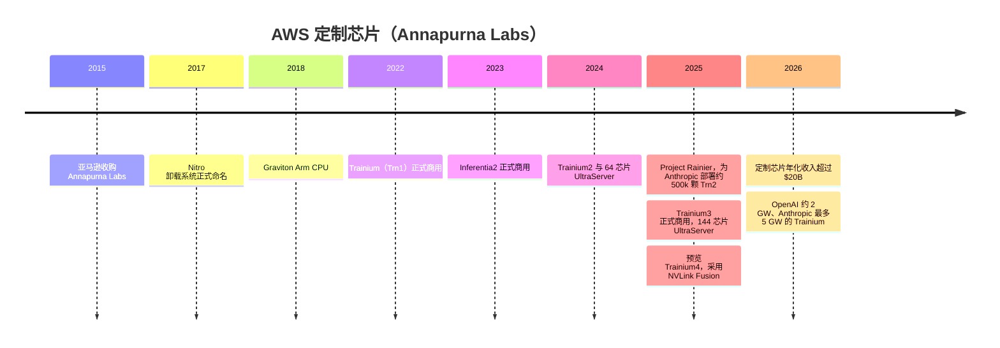
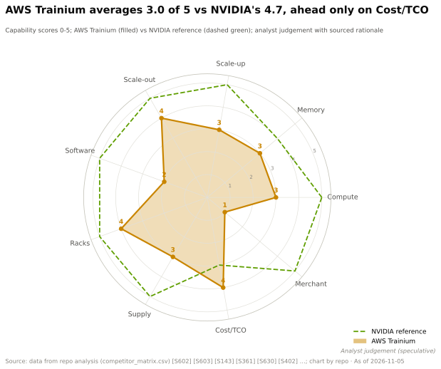

# AWS Trainium —— 最大云平台内部的成本优势

> [!NOTE]
> 本页为英文原文的简体中文参考译文，仅供参考；如有出入，以[英文原文](../../../cross-cutting/15-competitive-landscape/aws-trainium.md "English original")为准。

跨层专题 15 · 竞争格局 · Trainium1–4、Neuron SDK、UltraServer、Project Rainier、Annapurna Labs · 约 14 分钟阅读 · 最后核实：2026-11-05

## ⚡ 要点速览

- **四年四代。** [Trainium](../../glossary.md#trainium) 的单芯片稠密 [FP8](../../glossary.md#fp8) 算力从 0.19 [PFLOPS](../../glossary.md#flops)（Trn1，2022）提升到 2.52 PFLOPS（Trn3，2025 年 12 月正式商用），约 13× [[S152]](../../../sources/bibliography.md#s152)[[S353]](../../../sources/bibliography.md#s353)。AWS 表示 Trainium4 的 FP8 算力将至少为 Trn3 的 3×、[FP4](../../glossary.md#fp4) 为 6×、内存带宽为 4×，但未给出发布日期 [[S90034]](../../../sources/bibliography.md#s90034)。
- **AWS 追平的是英伟达的机架，而非芯片。** 一台 Trn3 [UltraServer](../../glossary.md#ultraserver) 连接 144 颗芯片，提供约 362 PFLOPS FP8 和 20.7 TB [HBM3E](../../glossary.md#hbm3e) [[S353]](../../../sources/bibliography.md#s353)，与一个 GB300 [NVL72](../../glossary.md#nvl72) 机架大致相当，但芯片数量是其两倍（本资料库对比）[[S15014]](../../../sources/bibliography.md#s15014)。
- **Trainium4 将接入英伟达的互连架构。** AWS 为 Trainium4 选择了 [NVLink Fusion](../../glossary.md#nvlink-fusion) 和英伟达（NVIDIA）的 MGX 机架设计，是迄今为止该计划中唯一的[超大规模云厂商](../../glossary.md#hyperscaler)加速器 [[S518]](../../../sources/bibliography.md#s518)[[S90034]](../../../sources/bibliography.md#s90034)。
- **两大锚定租户。** Project Rainier 于 2025 年为 Anthropic 投入了约 500,000 颗 Trainium2 芯片 [[S27011]](../../../sources/bibliography.md#s27011)。此后 Anthropic 承诺使用最多 5 GW 的 Trainium，OpenAI 自 2027 年起使用约 2 GW；AWS 称 Trainium 收入承诺超过 $225B [[S15000]](../../../sources/bibliography.md#s15000)[[S15001]](../../../sources/bibliography.md#s15001)。
- **它已经是一项大业务。** 亚马逊的定制芯片（Graviton、Trainium、Nitro）在 2026 年 Q1 的年化收入已超过 $20B；亚马逊 CEO 表示，若作为独立业务出售，其规模约为 $50B [[S15000]](../../../sources/bibliography.md#s15000)。
- **弱点：** 软件与透明度。Neuron SDK 在本资料库的框架指数中得分 7/36 [[S594]](../../../sources/bibliography.md#s594)，Trainium 没有 MLPerf 结果，且仅以 AWS 算力的形式出售。AWS 还签署了一项约 $38B 的协议，向 OpenAI 提供英伟达 GB200/GB300 算力 [[S15013]](../../../sources/bibliography.md#s15013)。

## 从 Annapurna Labs 到 Trainium4

AWS 的芯片来自 [Annapurna Labs](../../glossary.md#annapurna-labs)，这是一家以色列初创公司，亚马逊于 2015 年以据报道约 $350–370M 的价格将其收购 [[S4540]](../../../sources/bibliography.md#s4540)。Annapurna 先打造了 Nitro 卸载卡，随后推出 [Graviton](../../glossary.md#graviton) Arm CPU（2018）、Inferentia 推理芯片和 Trainium [[S4541]](../../../sources/bibliography.md#s4541)[[S7533]](../../../sources/bibliography.md#s7533)。Graviton5（2026）拥有 192 个核心 [[S4526]](../../../sources/bibliography.md#s4526)。外部设计合作伙伴协助完成物理设计；TrendForce 报道称世芯（Alchip）获得了 Trainium3 订单，自 2026 年 Q2 起量产 [[S2517]](../../../sources/bibliography.md#s2517)。

来源：[[S4540]](../../../sources/bibliography.md#s4540)[[S7533]](../../../sources/bibliography.md#s7533)[[S4541]](../../../sources/bibliography.md#s4541)[[S152]](../../../sources/bibliography.md#s152)[[S153]](../../../sources/bibliography.md#s153)[[S352]](../../../sources/bibliography.md#s352)[[S27011]](../../../sources/bibliography.md#s27011)[[S353]](../../../sources/bibliography.md#s353)[[S90034]](../../../sources/bibliography.md#s90034)[[S15000]](../../../sources/bibliography.md#s15000)。

| 代际 | 正式商用 | 单芯片稠密 FP8 | 单芯片 HBM | 纵向扩展域 | 来源 |
|---|---|---|---|---|---|
| Trainium（Trn1） | 2022 年 10 月 | 0.19 PF | 32 GB，0.82 TB/s | 每实例 16 颗芯片 | [[S152]](../../../sources/bibliography.md#s152) |
| Trainium2 | 2024 年 12 月 | 1.3 PF | 96 GB，2.9 TB/s | 64 芯片 UltraServer，3D 环面 | [[S154]](../../../sources/bibliography.md#s154)[[S352]](../../../sources/bibliography.md#s352)[[S245]](../../../sources/bibliography.md#s245) |
| Trainium3（3 nm） | 2025 年 12 月 | 2.52 PF | 144 GB HBM3E，4.9 TB/s | 144 芯片 UltraServer，NeuronSwitch | [[S353]](../../../sources/bibliography.md#s353)[[S242]](../../../sources/bibliography.md#s242) |
| Trainium4 | 未定档 | ≥ Trn3 的 3×（≥ 约 7.6 PF，估计） | 容量 2×、带宽 4×（估计约 288 GB、约 19.6 TB/s） | NVLink Fusion，MGX 机架 | [[S90034]](../../../sources/bibliography.md#s90034)[[S518]](../../../sources/bibliography.md#s518) |

> [!TIP]
> **算例 —— 同样的机架，两倍的芯片。** 一台 Trn3 UltraServer 提供 144 × 2.52 ≈ **362 PFLOPS** 稠密 FP8 和 144 × 144 GB ≈ **20.7 TB** HBM3E [[S353]](../../../sources/bibliography.md#s353)。一个 GB300 NVL72 机架提供 72 × 5.0 = **360 PFLOPS** 和 72 × 288 GB = **20.7 TB** [[S32004]](../../../sources/bibliography.md#s32004)[[S123]](../../../sources/bibliography.md#s123)。在 [HBM](../../glossary.md#hbm) 总带宽上 AWS 甚至略胜一筹：706 vs 576 TB/s。**结论：** AWS 需要两倍数量的芯片（以及芯片间的链路）才能达到同样的机架水平。其押注在于：由于无需支付商用厂商利润，每颗 Trn3 对 AWS 的成本远低于其采购 GB300 所需价格的一半。

🔧 技术细节：NeuronLink、NeuronSwitch 与转向 NVLink

Trainium2 UltraServer 将 64 颗芯片跨两个机架连接成 4 × 4 × 4 环面：实例内每芯片约 1 TB/s，实例间 256 GB/s [[S244]](../../../sources/bibliography.md#s244)[[S245]](../../../sources/bibliography.md#s245)。Trainium3 新增了 NeuronSwitch-v1，这是一种全交换式互连架构，配合 NeuronLink-v4，每芯片约 2 TB/s（有分析师称最高 2.5 TB/s）[[S242]](../../../sources/bibliography.md#s242)[[S247]](../../../sources/bibliography.md#s247)。这使 AWS 向英伟达的交换式 NVL72 设计靠拢，而远离谷歌（Google）的环面拓扑。Trainium4 转向 [NVLink](../../glossary.md#nvlink) Fusion 则更进一步：它采用英伟达的 NVLink 6 协议和 MGX 机架，而不是继续扩展 AWS 的自有方案 [[S518]](../../../sources/bibliography.md#s518)。据报道，NVLink Fusion 系统必须包含部分英伟达芯片，例如英伟达 CPU 或 NVLink 交换芯片（🟡）[[S5020]](../../../sources/bibliography.md#s5020)。

第二张图显示了一个相关的取舍：每颗 Trainium3 约分得 16 个主机 CPU 线程，而 Vera Rubin 中每颗 GPU 有 88 个。原因在于 AWS 让每台主机挂载大量加速器，而英伟达则按照依赖 CPU 的[智能体（agentic）](../../glossary.md#agentic-ai)工作负载来配置 Vera（见[第 04 层](../../layers/04-cpu-grace-vera/index.md)）[[S4021]](../../../sources/bibliography.md#s4021)[[S354]](../../../sources/bibliography.md#s354)。

## Neuron SDK：软件差距

[Neuron SDK](../../glossary.md#neuron-sdk) 为 Trainium 编译 [PyTorch](../../glossary.md#pytorch) 和 JAX 计算图 [[S9014]](../../../sources/bibliography.md#s9014)。自定义内核使用 Python 内核语言 [NKI](../../glossary.md#nki) 编写，AWS 也提供预构建的 NKI 内核 [[S9014]](../../../sources/bibliography.md#s9014)[[S10539]](../../../sources/bibliography.md#s10539)。2026 年，AWS 新增了 TorchNeuron——一个支持 eager 模式和 torch.compile 的原生 PyTorch 后端 [[S9525]](../../../sources/bibliography.md#s9525)——以及用于大模型并行的 NeuronX Distributed [[S594]](../../../sources/bibliography.md#s594)。

> [!TIP]
> **算例 —— 为何 7/36 对 AWS 来说仍然够用。** 在本资料库的框架指数中，Neuron 得分 7/36，[CUDA](../../glossary.md#cuda) 为 36 [[S594]](../../../sources/bibliography.md#s594)[[S580]](../../../sources/bibliography.md#s580)。一家使用十几种工具的企业将面临大量移植项目。而 Anthropic 只以超大规模运行少数几个模型系列，并有工程师参与共同开发 Trainium [[S656]](../../../sources/bibliography.md#s656)。若移植每年需要约 $100M 的工程投入（🔴 示意），而 Anthropic 的 Trainium 集群每年花费约 $10B，那么 10% 的成本优势足以十倍覆盖移植成本。**结论：** Trainium 的软件只需对少数巨型租户足够好即可，这正是它在覆盖广度上落后、却仍能赢得吉瓦级订单的原因。

## Project Rainier、Anthropic 与 OpenAI：需求侧

AWS 于 2025 年 10 月启用了 Project Rainier：在印第安纳州部署了近 500,000 颗 Trainium2 芯片，专为 Anthropic 打造 [[S27011]](../../../sources/bibliography.md#s27011)。亚马逊已向 Anthropic 投资 $8B，后者将 AWS 指定为其主要训练合作伙伴 [[S656]](../../../sources/bibliography.md#s656)。2026 年 4 月，亚马逊披露 Anthropic 将获得最多 5 GW 的当前及未来各代 Trainium，OpenAI 将自 2027 年起使用约 2 GW 的 Trainium [[S15000]](../../../sources/bibliography.md#s15000)。AWS 称 Trainium 收入承诺超过 $225B [[S15001]](../../../sources/bibliography.md#s15001)。

AWS 两头下注。2025 年 11 月，它签署了一项为期七年、约 $38B 的协议，为 OpenAI 托管英伟达 GB200 和 GB300 算力 [[S15013]](../../../sources/bibliography.md#s15013)。它在 2024 年估计采购了 196,000 颗 Hopper GPU [[S12014]](../../../sources/bibliography.md#s12014)。其 2026 年资本开支指引约为 $220B [[S12519]](../../../sources/bibliography.md#s12519)。

> [!TIP]
> **算例 —— $225B 对应 7 GW 意味着什么。** $225B ÷ (5 + 2) GW ≈ **每 GW 约 $32B 的 Trainium 收入承诺** [[S15000]](../../../sources/bibliography.md#s15000)[[S15001]](../../../sources/bibliography.md#s15001)。英伟达 CEO 称，在一座 1 GW 的 AI 工厂中英伟达的价值含量约为 $35B [[S398]](../../../sources/bibliography.md#s398)。两者口径并不完全可比（多年期云收入 vs 硬件销售，且为“最多”上限），但处于同一数量级。**结论：** 每一个 Trainium 吉瓦，大致就是一个流向别处的英伟达吉瓦；全部建成时，Trainium 的承诺约相当于英伟达 FY2026 一年的数据中心收入（约 $194B）[[S1]](../../../sources/bibliography.md#s1)。

## AWS 内部与英伟达的经济性对比

AWS 对 Trainium 的定价低于同类 GPU 实例，但未公布每 token 基准测试；Trainium 缺席 MLPerf 和 InferenceX [[S620]](../../../sources/bibliography.md#s620)。最清晰的公开信号是亚马逊自己对其芯片业务的表述。

> [!TIP]
> **算例 —— 解读 Jassy 的“$20B vs $50B”。** 亚马逊表示其定制芯片业务年化收入超过 $20B，若作为独立业务出售则约为每年 $50B [[S15000]](../../../sources/bibliography.md#s15000)。两者之比 20 ÷ 50 = **0.4**，表明 AWS 内部对其芯片的估值约为商用等价价格的 40%：其余约 60% 大致相当于商用厂商会收取的利润（🔴 本资料库对一个假设情形的解读）。英伟达约 75% 的毛利率意味着其成本约为售价的 25% [[S405]](../../../sources/bibliography.md#s405)。**结论：** 自研芯片收回了大部分（而非全部）商用厂商利润，因为 AWS 仍需按市场价向设计合作伙伴、台积电和 HBM 供应商付款。

🔧 技术细节：AWS 为何仍需要英伟达

许多 AWS 客户需要 CUDA，前沿实验室也会先在英伟达平台上训练新架构。因此 AWS 采取双轨策略：一边销售英伟达算力（包括与 OpenAI 的交易 [[S15013]](../../../sources/bibliography.md#s15013)），一边引导自家大租户使用 Trainium。借助 Trainium4 上的 NVLink Fusion [[S518]](../../../sources/bibliography.md#s518)，AWS 获得了英伟达成熟的互连架构和机架，同时保留自有计算裸片；英伟达则在每个机架中保有一份收入。

## 分层级判定

| 层级 | 相对英伟达的判定 | 理由 |
|---|---|---|
| 02 加速器芯片 | 🟥 落后 | Trn3 单芯片 2.52 PFLOPS FP8、144 GB，约为 GB300 的一半 [[S353]](../../../sources/bibliography.md#s353) |
| 03 内存、封装与供应 | 🟥 落后 | 设计合作伙伴争夺 CoWoS 产能时排在英伟达和谷歌之后 [[S2517]](../../../sources/bibliography.md#s2517) |
| 04 CPU | 🟨 持平 | Graviton5（192 核）是成熟的 Arm 服务器 CPU [[S4526]](../../../sources/bibliography.md#s4526) |
| 05 纵向扩展 | 🟥 落后 | 144 芯片 NeuronSwitch 域；Trainium4 转向 NVLink Fusion [[S242]](../../../sources/bibliography.md#s242)[[S518]](../../../sources/bibliography.md#s518) |
| 06 横向扩展 | 🟦 路线不同 | 基于自研以太网架构的 EFA，不对外销售 [[S352]](../../../sources/bibliography.md#s352) |
| 07 DPU 与卸载 | 🟦 路线不同 | Nitro，在 AWS 内部成熟且无处不在 [[S7533]](../../../sources/bibliography.md#s7533) |
| 08 系统与机架 | 🟥 落后 | UltraServer 已达到 Rainier 规模，但仅限 AWS 内部 [[S27011]](../../../sources/bibliography.md#s27011) |
| 09 系统软件 | 🟥 落后 | Neuron 在框架指数中得分 7/36 [[S594]](../../../sources/bibliography.md#s594) |
| 10 软件库 | 🟥 落后 | NKI 库覆盖面窄且尚不成熟 [[S10539]](../../../sources/bibliography.md#s10539) |
| 11 推理软件 | 🟥 落后 | 大规模为 Claude 提供服务；无 MLPerf 或 InferenceX 结果 [[S620]](../../../sources/bibliography.md#s620) |
| 12 编排与云 | 🟩 领先 | AWS 是最大的云平台；Trainium 仅以服务形式出售 [[S15000]](../../../sources/bibliography.md#s15000) |
| 13 生态与资本 | 🟥 落后 | 两大锚定租户，外部吸引力有限 [[S656]](../../../sources/bibliography.md#s656)[[S15000]](../../../sources/bibliography.md#s15000) |

本资料库分析师判断，依据 `data/competitor_matrix.csv`（🔴）[[S15014]](../../../sources/bibliography.md#s15014)。

> [!TIP]
> **算例 —— 纸面上的 Trainium4 与 Rubin 对比。** 将 AWS 公布的倍数应用于 Trainium3，可得单芯片 ≥ 约 7.6 PFLOPS FP8 和约 19.6 TB/s HBM 带宽（估计）[[S90034]](../../../sources/bibliography.md#s90034)[[S353]](../../../sources/bibliography.md#s353)。Rubin 标称 17.5 PFLOPS 和 19.2 TB/s [[S33005]](../../../sources/bibliography.md#s33005)[[S90006]](../../../sources/bibliography.md#s90006)。**结论：** Trainium4 将在内存带宽上与当前的 Rubin 持平（约 102%），算力约为其 43%——这是推理优先芯片的典型特征；但如果它在 2027 年出货，面对的将是 Rubin Ultra 而非 Rubin。

**其最有力的论据。** “够用、更便宜、已经在你的云里。”AWS 能以低于英伟达实例的价格出售 Trainium，因为它获取了商用厂商的利润，而且其两大 AI 租户已承诺了吉瓦级算力。它无需在单芯片上击败英伟达，只需让自家机架的每 token 成本更低。

**差距缩小了多少。**

| 指标 | 过去 | 现在（2026 年 11 月） | 来源 |
|---|---|---|---|
| 单芯片稠密 FP8 对比英伟达旗舰 | 10%（Trn1 vs H100，2022） | 50%（Trn3 vs GB300，2025） | [[S15014]](../../../sources/bibliography.md#s15014) |
| 内存带宽对比英伟达旗舰 | 24%（Trn1） | 61%（Trn3） | [[S15014]](../../../sources/bibliography.md#s15014) |
| 纵向扩展域 | 16 颗芯片 | 144 颗芯片（NVL72：72） | [[S152]](../../../sources/bibliography.md#s152)[[S353]](../../../sources/bibliography.md#s353) |
| 已承诺需求 | 内部及小型租户 | Anthropic 最多 5 GW，OpenAI 约 2 GW，超过 $225B | [[S15000]](../../../sources/bibliography.md#s15000)[[S15001]](../../../sources/bibliography.md#s15001) |
| 独立基准测试 | 无 | 无 | [[S613]](../../../sources/bibliography.md#s613)[[S620]](../../../sources/bibliography.md#s620) |

> [!NOTE]
> **🐂 看多观点（对 AWS 而言）。** 在所有超大规模云厂商芯片中，Trainium 拥有最大的已承诺外部需求，并享有掌控整个云平台的经济性。Trainium4 的 4× 带宽跃升将使其在纸面上接近 Rubin 的 19.2 TB/s，而 NVLink Fusion 则补上了 AWS 最薄弱的层级——[纵向扩展（scale-up）](../../glossary.md#scale-up) [[S90034]](../../../sources/bibliography.md#s90034)[[S518]](../../../sources/bibliography.md#s518)。

> [!WARNING]
> **🐻 看空观点（对 AWS 而言）。** 采用 NVLink Fusion 等于承认 AWS 自有的互连架构不够用，并让英伟达在每个 Trainium4 机架上收取“过路费”。Trainium 没有经过审计的基准测试。其需求依赖于两家同时采购英伟达、AMD 和 TPU 的实验室，而其软件得分仅为 7/36 [[S594]](../../../sources/bibliography.md#s594)。

## 🎯 企业发展视角

1. **NVLink Fusion 作为一种商业模式。** AWS 选择将 Trainium4 接入英伟达的互连架构，而不是自建或采用 [UALink](../../glossary.md#ualink) [[S518]](../../../sources/bibliography.md#s518)。这对构建有竞争力的纵向扩展互连所需的成本和时间释放了什么信号？还有谁可能跟进？
2. **锚定租户模式。** Trainium 的软件只需服务少数巨型租户。商用挑战者能否通过与一家实验室结盟来复制这一模式？这需要怎样的股权或算力条款（可对比 AMD 的认股权证）？
3. **设计合作伙伴的风险敞口。** 据报道，世芯和美满电子（Marvell）负责打造各代 Trainium [[S2517]](../../../sources/bibliography.md#s2517)。每家设计公司的收入对单一超大规模云厂商的集中度有多高？这种地位能否跨代延续？
4. **定制芯片作为一个可报告的业务分部。** 亚马逊如今像谈论一条产品线一样谈论其芯片业务（年化 $20B）[[S15000]](../../../sources/bibliography.md#s15000)。如果 AWS 像谷歌如今对待 TPU 那样在 AWS 之外销售 Trainium，商用加速器市场将如何变化？

## 📚 来源（Sources）

<!-- Auto-generated from the [S…] citations on this page by `make build`. Edit sources/registry/*.csv, not this list. -->

- [**S1**](../../../sources/bibliography.md#s1) NVIDIA Corporation via SEC EDGAR, *NVIDIA Announces Financial Results for Fourth Quarter and Fiscal 2026 (Form 8-K exhibit 99.1)*, 2026-02-25. [Link](https://www.sec.gov/Archives/edgar/data/1045810/000104581026000019/q4fy26pr.htm)
- [**S123**](../../../sources/bibliography.md#s123) Glenn K. Lockwood (blog) (Glenn K. Lockwood), *HGX B300 specifications compilation (B300 per-GPU figures)*, 2025. [Link](https://glennklockwood.com/garden/processors/B300)
- [**S152**](../../../sources/bibliography.md#s152) AWS Neuron SDK docs, *AWS Neuron documentation: Trainium (Trn1) architecture*, 2022. [Link](https://awsdocs-neuron.readthedocs-hosted.com/en/latest/general/arch/neuron-hardware/trainium.html)
- [**S153**](../../../sources/bibliography.md#s153) AWS Neuron SDK docs, *AWS Neuron documentation: Inferentia2 architecture*, 2023. [Link](https://awsdocs-neuron.readthedocs-hosted.com/en/latest/general/arch/neuron-hardware/inferentia2.html)
- [**S154**](../../../sources/bibliography.md#s154) AWS Neuron SDK docs, *AWS Neuron documentation: Trainium2 architecture*, 2024-12. [Link](https://awsdocs-neuron.readthedocs-hosted.com/en/latest/general/arch/neuron-hardware/trainium2.html)
- [**S242**](../../../sources/bibliography.md#s242) Amazon Web Services, *Amazon EC2 Trn3 instances (product page)*, 2025-12-02. [Link](https://aws.amazon.com/ec2/instance-types/trn3/)
- [**S244**](../../../sources/bibliography.md#s244) Amazon Web Services, *Trainium2 architecture (AWS Neuron documentation)*, 2024-12. [Link](https://awsdocs-neuron.readthedocs-hosted.com/en/latest/general/arch/neuron-hardware/trn2-arch.html)
- [**S245**](../../../sources/bibliography.md#s245) SemiAnalysis, *Amazon's AI self-sufficiency: Trainium2 architecture and networking*, 2024-12. [Link](https://newsletter.semianalysis.com/p/amazons-ai-self-sufficiency-trainium2-architecture-networking)
- [**S247**](../../../sources/bibliography.md#s247) NAND Research, *Research Note: AWS releases Trainium3, teases Trainium4*, 2025-12. [Link](https://nand-research.com/research-note-aws-releases-trainium3-teases-trainium4/)
- [**S352**](../../../sources/bibliography.md#s352) AWS News Blog, *Amazon EC2 Trn2 instances and Trn2 UltraServers for AI/ML training and inference are now available*, 2024-12-03. [Link](https://aws.amazon.com/blogs/aws/amazon-ec2-trn2-instances-and-trn2-ultraservers-for-aiml-training-and-inference-is-now-available)
- [**S353**](../../../sources/bibliography.md#s353) AWS, *Announcing Amazon EC2 Trn3 UltraServers for faster, lower-cost generative AI training*, 2025-12-02. [Link](https://aws.amazon.com/about-aws/whats-new/2025/12/amazon-ec2-trn3-ultraservers/)
- [**S354**](../../../sources/bibliography.md#s354) AWS, *Trn3 architecture (AWS Neuron documentation)*, 2026. [Link](https://awsdocs-neuron.readthedocs-hosted.com/en/v2.28.0/_sources/about-neuron/arch/neuron-hardware/trn3-arch.rst)
- [**S398**](../../../sources/bibliography.md#s398) NVIDIA Investor Relations, *NVIDIA Q2 FY2026 earnings call (2025-08-27): AI factory economics commentary*, 2025-08-27. [Link](https://investor.nvidia.com/events-and-presentations/events-and-presentations/default.aspx)
- [**S405**](../../../sources/bibliography.md#s405) NVIDIA Corporation via SEC EDGAR, *NVIDIA Announces Financial Results for Second Quarter Fiscal 2027 (Form 8-K exhibit 99.1)*, 2026-08-26. [Link](https://www.sec.gov/Archives/edgar/data/0001045810/000104581026000073/q2fy27pr.htm)
- [**S518**](../../../sources/bibliography.md#s518) ServeTheHome, *NVIDIA NVLink Fusion tapped for future AWS Trainium4 deployments*, 2025-12-02. [Link](https://www.servethehome.com/nvidia-nvlink-fusion-tapped-for-future-aws-trainium4-deployments/)
- [**S580**](../../../sources/bibliography.md#s580) vLLM project (GitHub), *vLLM README and installation docs — supported hardware*, 2026-11. [Link](https://github.com/vllm-project/vllm/blob/main/docs/getting_started/installation/README.md)
- [**S594**](../../../sources/bibliography.md#s594) AWS (GitHub: aws-neuron/neuronx-distributed), *NeuronX Distributed (NxD) README*, 2026-11. [Link](https://github.com/aws-neuron/neuronx-distributed)
- [**S613**](../../../sources/bibliography.md#s613) NAND Research, *MLPerf Inference 6.0: Software Gains, Broadening Competition Shake Things Up*, 2026-04. [Link](https://nand-research.com/mlperf-inference-6-0-software-gains-broadening-competition-shake-things-up/)
- [**S620**](../../../sources/bibliography.md#s620) SemiAnalysis, *SemiAnalysis InferenceX (formerly InferenceMAX) open-source benchmark repository*, 2026-11. [Link](https://github.com/SemiAnalysisAI/InferenceX)
- [**S656**](../../../sources/bibliography.md#s656) Anthropic, *Powering the next generation of AI development with AWS (expanded Amazon partnership and Trainium)*, 2024-11-22. [Link](https://www.anthropic.com/news/anthropic-amazon-trainium)
- [**S2517**](../../../sources/bibliography.md#s2517) TrendForce, *CSPs accelerate ASIC push in 2H26, challenging NVIDIA as MediaTek, GUC, Alchip benefit*, 2026-03-20. [Link](https://www.trendforce.com/news/2026/03/20/news-csps-accelerate-asic-push-in-2h26-challenging-nvidia-as-mediatek-guc-alchip-benefit/)
- [**S4021**](../../../sources/bibliography.md#s4021) Amazon Web Services (GitHub), *Trn2 architecture (AWS Neuron SDK documentation source)*, 2026. [Link](https://github.com/aws-neuron/aws-neuron-sdk/blob/master/about-neuron/arch/neuron-hardware/trn2-arch.rst)
- [**S4526**](../../../sources/bibliography.md#s4526) Amazon Web Services, *Amazon EC2 M9g and M9gd instances powered by AWS Graviton5 are now available*, 2026-06-10. [Link](https://aws.amazon.com/about-aws/whats-new/2026/06/ec2-m9g-m9gd-instances-graviton5-processors-available)
- [**S4540**](../../../sources/bibliography.md#s4540) Global Venturing, *Arm exits Annapurna Labs in $370m acquisition*, 2015-01-23. [Link](https://globalventuring.com/blog/2015/01/23/arm-exits-annapurna-labs-in-370m-acquisition/)
- [**S4541**](../../../sources/bibliography.md#s4541) The Register, *Amazon AWS puts custom Arm server chip (Graviton) into the cloud: A1 instances*, 2018-11-27. [Link](https://www.theregister.com/2018/11/27/amazon_aws_a1/)
- [**S5020**](../../../sources/bibliography.md#s5020) PC Watch (Impress), *Computex 2025: NVIDIA NVLink Fusion report*, 2025-05. [Link](https://pc.watch.impress.co.jp/docs/news/event/2015077.html)
- [**S7533**](../../../sources/bibliography.md#s7533) hidekazu-konishi.com (Hidekazu Konishi), *AWS custom silicon history and timeline: Nitro System, Graviton, Inferentia, Trainium*, 2025. [Link](https://hidekazu-konishi.com/entry/aws_history_and_timeline_aws_silicon.html)
- [**S9014**](../../../sources/bibliography.md#s9014) AWS (GitHub: aws-neuron/nki-samples), *Neuron Kernel Interface (NKI) samples README*, 2026-11. [Link](https://github.com/aws-neuron/nki-samples/blob/main/README.md)
- [**S9525**](../../../sources/bibliography.md#s9525) AWS Neuron SDK docs, *AWS Neuron documentation: PyTorch on Neuron (TorchNeuron) and NKI*, 2026. [Link](https://awsdocs-neuron.readthedocs-hosted.com/en/latest/_sources/torch/index.rst)
- [**S10539**](../../../sources/bibliography.md#s10539) AWS Neuron Documentation, *About the NKI Library*, 2026. [Link](https://awsdocs-neuron.readthedocs-hosted.com/en/latest/nki/library/about/index.html)
- [**S12014**](../../../sources/bibliography.md#s12014) DatacenterDynamics, *Microsoft bought twice as many Nvidia Hopper GPUs as other big tech companies - report*, 2024-12. [Link](https://www.datacenterdynamics.com/en/news/microsoft-bought-twice-as-many-nvidia-hopper-gpus-as-other-big-tech-companies-report)
- [**S12519**](../../../sources/bibliography.md#s12519) Hargreaves Lansdown, *AI hyperscalers are expected to finish the year spending a whopping $828 billion on capex*, 2026-10. [Link](https://www.hl.co.uk/news/ai-hyperscalers-are-expected-to-finish-the-year-spending-a-whopping-828-billion-on-capex)
- [**S15000**](../../../sources/bibliography.md#s15000) About Amazon (Andy Jassy), *Amazon CEO Andy Jassy on Amazon's chips business (Q1 2026 earnings)*, 2026-04-29. [Link](https://www.aboutamazon.com/news/company-news/amazon-ceo-andy-jassy-amazon-chips-business-q1-2026-earnings)
- [**S15001**](../../../sources/bibliography.md#s15001) Nasdaq, *Andy Jassy says Amazon's chip business already has $225 billion in commitments*, 2026-05. [Link](https://www.nasdaq.com/articles/andy-jassy-says-amazons-chip-business-already-has-225-billion-commitments)
- [**S15013**](../../../sources/bibliography.md#s15013) Built In, *OpenAI enters $38B partnership with AWS to scale compute capacity*, 2025-11-04. [Link](https://builtin.com/articles/openai-38b-aws-partnership-20251104)
- [**S15014**](../../../sources/bibliography.md#s15014) nvidia_deep_dive_claude repository, *Repo analysis: Chapter 15A competitive-landscape calculations (gap-to-flagship ratios, implied AMD commitment value, hyperscaler wallet shares, breadth vs depth)*, 2026-11-05. [Link](https://github.com/FrankHuang94/nvidia_deep_dive_claude/blob/main/cross-cutting/15-competitive-landscape/index.md)
- [**S27011**](../../../sources/bibliography.md#s27011) About Amazon, *AWS activates Project Rainier: one of the world's largest AI compute clusters*, 2025-10. [Link](https://www.aboutamazon.com/news/aws/aws-project-rainier-ai-trainium-chips-compute-cluster)
- [**S32004**](../../../sources/bibliography.md#s32004) NVIDIA, *NVIDIA GB300 NVL72 / Blackwell Ultra (product page)*, 2025-03. [Link](https://www.nvidia.com/en-us/data-center/gb300-nvl72/)
- [**S33005**](../../../sources/bibliography.md#s33005) NVIDIA, *NVIDIA Vera Rubin NVL72 (product page and specifications)*, 2026. [Link](https://www.nvidia.com/en-us/data-center/vera-rubin-nvl72/)
- [**S90006**](../../../sources/bibliography.md#s90006) TweakTown, *Nvidia cuts Vera Rubin's memory bandwidth by up to 26% and AMD's Helios now leads in memory bandwidth*, 2026-10. [Link](https://www.tweaktown.com/news/114304/nvidia-cuts-vera-rubins-memory-bandwidth-by-up-to-26-percent-and-amds-helios-now-leads-in-memory-bandwidth/index.html)
- [**S90034**](../../../sources/bibliography.md#s90034) NAND Research, *AWS releases Trainium3, teases Trainium4*, 2025-12. [Link](https://nand-research.com/research-note-aws-releases-trainium3-teases-trainium4/4/)
