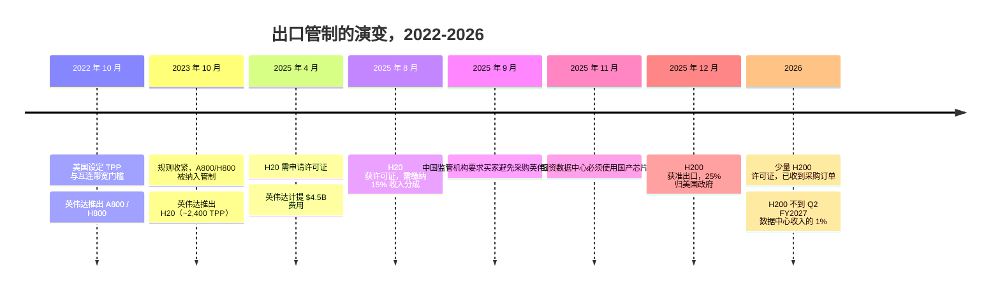
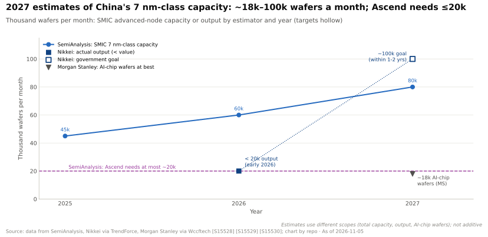
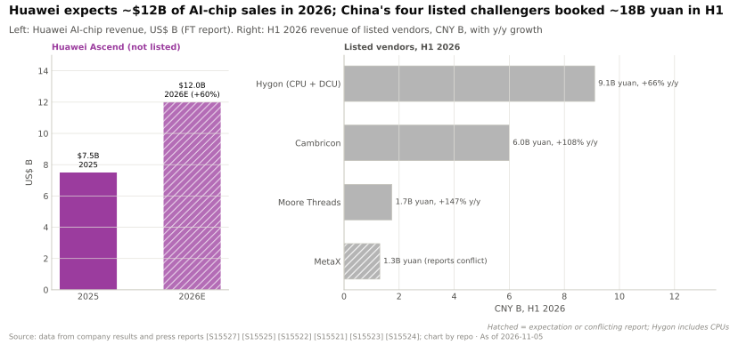

# 中国：华为昇腾、寒武纪与受保护的国内市场

> [!NOTE]
> 本页为英文原文的简体中文参考译文，仅供参考；如有出入，以[英文原文](../../../cross-cutting/15-competitive-landscape/china.md "English original")为准。

跨层专题 15 · 竞争格局 · 阅读约 16 分钟 · 最后核实：2026-11-05

## ⚡ 要点速览

- **对英伟达（NVIDIA）而言，中国如今已是一个独立的市场。** 中国占英伟达收入的比重从 FY2022 的 26.4% 降至 FY2026 的 9.1%，
  FY2027 各季度为 5.6–8.2%；公司指引已剔除中国数据中心计算业务，而据报道，在缴纳 25% 分成的许可证下销售的 H200
  不到 Q2 FY2027 数据中心收入的 1% 🟡 [[S2]](../../../sources/bibliography.md#s2)[[S401]](../../../sources/bibliography.md#s401)[[S90070]](../../../sources/bibliography.md#s90070)[[S90069]](../../../sources/bibliography.md#s90069)[[S90032]](../../../sources/bibliography.md#s90032)[[S26009]](../../../sources/bibliography.md#s26009)。
- **华为是主要受益者。** 华为预计 2026 年 AI 芯片收入 ~$12B，较 2025 年的 ~$7.5B 增长 ~60%，
  并计划今年出货 ~750k 颗昇腾（Ascend）950PR 芯片 🟡 [[S15527]](../../../sources/bibliography.md#s15527)。
- **按单芯片计，华为仍然落后。** 昇腾 950 标称 1 [PFLOPS](../../glossary.md#flops) [FP8](../../glossary.md#fp8)，是中国此前可采购的 H20 的 ~3.4 倍，但只有
  获许可的 H200 的一半左右；即便是 2028 年的昇腾 970（4 PFLOPS），也仍落后于 2026 年的 Rubin（17.5）~4.4 倍 [[S163]](../../../sources/bibliography.md#s163)[[S26003]](../../../sources/bibliography.md#s26003)[[S90006]](../../../sources/bibliography.md#s90006)。
- **华为以规模和电力作为应对。** CloudMatrix 384 提供 ~300 PF 稠密 [BF16](../../glossary.md#bf16) 算力，而 GB200 [NVL72](../../glossary.md#nvl72) 为 ~180 PF，但功耗为
  559 kW 对 145 kW（估计，SemiAnalysis）[[S340]](../../../sources/bibliography.md#s340)；8,192 芯片的 Atlas 950 SuperPoD（8 EF FP8）计划于 2026 年第四季度推出，华为
  称其已大规模商用；但缺乏独立证实 🔴 [[S341]](../../../sources/bibliography.md#s341)[[S567]](../../../sources/bibliography.md#s567)[[S90042]](../../../sources/bibliography.md#s90042)。
- **供应是硬约束。** 据估计，中芯国际（SMIC）7 nm 级产能为每月 ~45–60k 片晶圆（SemiAnalysis），
  实际产出不足 20k 片（日经），而国产[高带宽内存（HBM）](../../glossary.md#hbm)（长鑫存储 CXMT 的 [HBM3E](../../glossary.md#hbm3e)）仅处于小规模阶段，目标在 2027 年上量
  [[S15528]](../../../sources/bibliography.md#s15528)[[S15529]](../../../sources/bibliography.md#s15529)[[S3516]](../../../sources/bibliography.md#s3516)。
- **国内上市阵营正快速成长。** 2026 年上半年，寒武纪（Cambricon）收入增长 108% 至 6.0B 元，摩尔线程（Moore Threads）增长 147%
  至 1.7B 元，海光（Hygon）增长 67% 至 9.1B 元（含 CPU）；壁仞（Biren）、沐曦（MetaX）和摩尔线程已于 2025–26 年上市，
  百度旗下的昆仑芯（Kunlunxin）正在筹备 IPO [[S15522]](../../../sources/bibliography.md#s15522)[[S15523]](../../../sources/bibliography.md#s15523)[[S15525]](../../../sources/bibliography.md#s15525)[[S15541]](../../../sources/bibliography.md#s15541)[[S15540]](../../../sources/bibliography.md#s15540)[[S15537]](../../../sources/bibliography.md#s15537)。
- **围绕昇腾的软件生态正在成形：** DeepSeek V4（2026 年 4 月）在 V4-Flash 的部分训练中使用了昇腾，并针对推理适配了
  昇腾超节点（SuperNode）[[S90079]](../../../sources/bibliography.md#s90079)[[S90080]](../../../sources/bibliography.md#s90080)；华为于 2025 年 8 月开源了 [CANN](../../glossary.md#cann) [[S10537]](../../../sources/bibliography.md#s10537)。

## 为何中国是一个独立的市场

这堵墙是两国政府共同筑起的。华盛顿设定了 [TPP](../../glossary.md#tpp) 门槛，限制了英伟达可销售的产品；而当这些受限产品
进入市场后，北京又引导买家转向国产芯片。完整的历史以及对英伟达收入的
影响，见 [CS6 · 中国出口管制：H20 及之后](../../case-studies/CS6-china-export-controls-h20-and-beyond.md)。

> [!TIP]
> **算例 —— 2026 年一位中国买家的选择。** 获许可的 H200 拥有 1,979 TFLOPS 稠密 FP8 算力和 4.8 TB/s 的
> HBM3E [[S32002]](../../../sources/bibliography.md#s32002)；昇腾 950PR 拥有 ~1,000 TFLOPS FP8 算力（未说明是稠密还是稀疏）和 1.6 TB/s 带宽 [[S163]](../../../sources/bibliography.md#s163)。按单芯片计，
> H200 的算力约为其 ~2 倍，带宽约为其 ~3 倍。但 H200 需向美国政府缴纳 25% 的收入分成 [[S90032]](../../../sources/bibliography.md#s90032)，
> 国资项目必须使用国产芯片 [[S26007]](../../../sources/bibliography.md#s26007)，而且供应随时可能被任一方再次切断。对于一位
> 更看重连续性而非峰值速度的买家而言，用两颗昇腾芯片替代一颗 H200 可能是理性选择，而华为的 SuperPoD 让
> “更多芯片”成为一种架构，而非一种惩罚。

## 华为昇腾：芯片、超节点与“蛮力”规模

华为的策略是接受较弱的单芯片，并在系统层面加以弥补：更多芯片、基于光互连（[灵衢（UnifiedBus）](../../glossary.md#unifiedbus)）的更大
[纵向扩展（scale-up）](../../glossary.md#scale-up)域，以及更多电力。它掌控
整个技术栈：[NPU](../../glossary.md#npu)、鲲鹏（Kunpeng）CPU、自研 HBM、交换机、CANN 软件和华为云 [[S163]](../../../sources/bibliography.md#s163)[[S4031]](../../../sources/bibliography.md#s4031)。

| 系统或芯片 | 时间 | 规模 | 算力 | 内存 | 互连 | 状态 | 来源 |
|---|---|---|---|---|---|---|---|
| 昇腾 910B | 2023 | 芯片 | ~320 TFLOPS FP16 | 64 GB HBM2e，1.6 TB/s | HCCS，每节点 8 颗 | 已出货 | [[S164]](../../../sources/bibliography.md#s164) |
| 昇腾 910C | 2025 | 芯片（2 颗裸片） | ~800 TFLOPS FP16 | 128 GB，3.2 TB/s | UB（CloudMatrix） | 已出货 | [[S163]](../../../sources/bibliography.md#s163)[[S164]](../../../sources/bibliography.md#s164) |
| CloudMatrix 384 | 2025 年 4 月 | 384 × 910C | ~300 PF BF16 | 49.2 TB HBM | 光互连 UB | 已出货 | [[S340]](../../../sources/bibliography.md#s340)[[S248]](../../../sources/bibliography.md#s248) |
| 昇腾 950PR | 2026 年第一季度 | 芯片 | 1 PF FP8，2 PF FP4 | 128 GB HiBL 1.0，1.6 TB/s | UB，2 TB/s | 据报道已量产 🟡 | [[S163]](../../../sources/bibliography.md#s163)[[S15527]](../../../sources/bibliography.md#s15527) |
| 昇腾 950DT | 2026 年第四季度 | 芯片 | 1 PF FP8 | 144 GB HiZQ 2.0，4.0 TB/s | UB，2 TB/s | 已发布 | [[S163]](../../../sources/bibliography.md#s163)[[S90042]](../../../sources/bibliography.md#s90042) |
| Atlas 950 SuperPoD | 2026 年第四季度 | 8,192 × 950DT | 8 EF FP8 / 16 EF FP4 | — | 全光互连 UB 2.0 | 🔴 出货未经证实 | [[S341]](../../../sources/bibliography.md#s341)[[S250]](../../../sources/bibliography.md#s250)[[S567]](../../../sources/bibliography.md#s567) |
| 昇腾 960 / 960DT | 2027 年第四季度 → 2027 年第一季度 | 芯片 | 2 PF FP8 | 288 GB，9.6 TB/s | UB，2.2 TB/s | 提前 3 个季度 🟡 | [[S163]](../../../sources/bibliography.md#s163)[[S567]](../../../sources/bibliography.md#s567) |
| Atlas 960 SuperPoD | 2027 年第四季度 | 15,488 颗芯片 | 30 EF FP8 / 60 EF FP4 | 4,460 TB | UB | 路线图 | [[S342]](../../../sources/bibliography.md#s342) |
| 昇腾 970 | 2028 年第四季度 | 芯片 | 4 PF FP8 | 288 GB，14.4 TB/s | UB，4 TB/s | 路线图 | [[S163]](../../../sources/bibliography.md#s163) |
| *NVIDIA Vera Rubin NVL72（参照）* | 2026 | 72 个封装 | 3.6 EF NVFP4（推理） | 每 GPU 288 GB HBM4 | NVLink 6 | 爬坡中 | [[S90003]](../../../sources/bibliography.md#s90003)[[S90006]](../../../sources/bibliography.md#s90006) |

> [!TIP]
> **算例 —— “蛮力”的代价。** SemiAnalysis 估计 CloudMatrix 384 的稠密 BF16 算力为 ~300 PF，而
> GB200 NVL72 为 ~180 PF，算力为其 1.7 倍，但功耗为 559 kW 对 ~145 kW，是其 3.9 倍 [[S340]](../../../sources/bibliography.md#s340)。按每千瓦计，分别为 ~0.54 PF 和
> ~1.24 PF，因此华为每单位算力需要 ~2.3 倍的能耗。以示意性的每 kWh $0.08 计（🔴），额外的
> ~414 kW 全年运行，每套系统每年成本 ~$0.29M：不可忽视，但与硬件成本相比很小。电力是
> 华为最便宜的投入；尖端晶圆和 HBM 才是其最稀缺的资源。

🔧 技术细节：没有 EUV 如何制造 7 nm 级芯片

中芯国际无法购买 EUV 光刻机，因此它使用深紫外光刻设备，对每一层进行多次曝光来制造 7 nm 级图层
（[DUV 多重图形化](../../glossary.md#duv-multipatterning)）。每增加一次曝光都会增加工序、生产周期和缺陷风险，因此大尺寸 AI 裸片的
良率落后于台积电（TSMC）[[S15531]](../../../sources/bibliography.md#s15531)。据报道，昇腾 950PR 采用中芯国际的 N+3 工艺 [[S15531]](../../../sources/bibliography.md#s15531)，而摩根士丹利
因良率问题大幅下调了其对中芯国际来自华为 AI 业务收入的估计 [[S15530]](../../../sources/bibliography.md#s15530)。华为的自研 HBM（HiBL 1.0、HiZQ 2.0）
替代了其已无法进口的 HBM 堆栈 [[S163]](../../../sources/bibliography.md#s163)；中国的长鑫存储于 2026 年开始小规模生产 HBM3E [[S3516]](../../../sources/bibliography.md#s3516)。华为、
中芯国际和若干 GPU 设计公司已被列入美国[实体清单](../../glossary.md#entity-list)，无法获得美国的设备和 IP；
2023 年 10 月的规则还将多家中国 GPU 开发商列入其中 [[S26001]](../../../sources/bibliography.md#s26001)。

## 供应：中芯国际产能与国产 HBM

> [!TIP]
> **算例 —— 受约束条件下的每片晶圆裸片数。** 据报道，华为 2026 年的目标是最多生产 ~1.6M 颗昇腾裸片
> [[S15532]](../../../sources/bibliography.md#s15532)。SemiAnalysis 称昇腾最多需要每月 ~20k 片晶圆 [[S15528]](../../../sources/bibliography.md#s15528)，即每年 ≤240k 片。1.6M 颗裸片 ÷
> 240k 片晶圆 ≈ 在该上限下每片晶圆 7 颗良品裸片（🔴 本资料库测算）：对于大尺寸裸片、良率一般的情况而言是合理的，
> 这也说明晶圆本身并不是昇腾的上限。真正的上限是 HBM：每颗 950DT 需要 144 GB HBM [[S163]](../../../sources/bibliography.md#s163)，而国产 HBM3E
> 仍处于小规模阶段 [[S3516]](../../../sources/bibliography.md#s3516)。作为对比，2026 年第二季度中芯国际占全球晶圆代工收入的 5.4%，而台积电为 72.5% [[S35035]](../../../sources/bibliography.md#s35035)。

## 其余阵营：寒武纪、海光、摩尔线程、沐曦、壁仞、平头哥、昆仑芯

| 公司 | 产品 | 2026 年数据点 | 资本市场 | 来源 |
|---|---|---|---|---|
| 寒武纪 | 思元（MLU）训练与推理加速器 | 上半年收入 6.0B 元（+108%），净利润 2.3B 元；存货 8.25B 元 | 科创板上市 | [[S15522]](../../../sources/bibliography.md#s15522)[[S15521]](../../../sources/bibliography.md#s15521)[[S165]](../../../sources/bibliography.md#s165) |
| 海光 | x86 授权 CPU 和 DCU 加速器 | 上半年收入 9.1B 元（+67%） | 科创板上市；与中科曙光（Sugon）的合并于 2025 年 12 月终止 | [[S15525]](../../../sources/bibliography.md#s15525)[[S15526]](../../../sources/bibliography.md#s15526) |
| 摩尔线程 | GPU（图形 + AI） | 上半年收入 1.7B 元（+147%） | 2025 年 12 月科创板 IPO（募资 ~$1.1B） | [[S15523]](../../../sources/bibliography.md#s15523)[[S15539]](../../../sources/bibliography.md#s15539) |
| 沐曦 | 面向 AI 和 HPC 的 GPU | 上半年盈利；收入报道不一 | 2025 年 12 月科创板 IPO（募资 ~4.2B 元） | [[S15524]](../../../sources/bibliography.md#s15524)[[S15540]](../../../sources/bibliography.md#s15540) |
| 壁仞 | 面向 AI 的 GPU | — | 2026-01-02 于香港上市 | [[S15541]](../../../sources/bibliography.md#s15541) |
| 阿里巴巴平头哥（T-Head） | PPU / 真武 810E（96 GB HBM2e，400 W） | 出货 >560k 颗（公司口径，有报道）；中国联通西宁部署 16,384 颗 | 内部自用，有分拆报道 | [[S15533]](../../../sources/bibliography.md#s15533)[[S15534]](../../../sources/bibliography.md#s15534)[[S15535]](../../../sources/bibliography.md#s15535) |
| 百度昆仑芯 | 昆仑 AI 芯片 | 估值 ~21B 元（2025 年 12 月）；据报道 IPO 目标估值 $14.7B–$50B 🟡 | 自 2026 年 5 月起推进港股 + 科创板上市程序 | [[S15536]](../../../sources/bibliography.md#s15536)[[S15537]](../../../sources/bibliography.md#s15537)[[S15538]](../../../sources/bibliography.md#s15538) |

> [!TIP]
> **算例 —— 仅华为一家就能替代英伟达多少原有的中国业务。** 英伟达在中国的收入于 FY2025 达到峰值
> $25.0B（客户总部口径，全部平台）[[S401]](../../../sources/bibliography.md#s401)。华为预计 2026 年 AI 芯片收入 ~$12B
> [[S15527]](../../../sources/bibliography.md#s15527)，相当于该峰值的 ~48%，这还未计入寒武纪、海光和 GPU 初创公司（2026 年上半年 ~18B 元，按
> ~7.1 元兑 1 美元计约合 $2.5B，🔴 汇率假设）[[S15522]](../../../sources/bibliography.md#s15522)[[S15525]](../../../sources/bibliography.md#s15525)[[S15523]](../../../sources/bibliography.md#s15523)。国内阵营有望在 H20 许可证要求出台后的两年内
> 填补大部分缺口。

## DeepSeek V4 在昇腾上运行与软件问题

DeepSeek 的 V4 预览版（2026-04-24）以开放权重形式发布了 V4-Pro（~1.6T 参数）和 V4-Flash（284B）；V4-Flash 的部分训练
使用了华为昇腾，并针对推理适配了昇腾超节点 [[S90079]](../../../sources/bibliography.md#s90079)。V4-Pro 的
定价为每百万输出 token ~$3.48，DeepSeek 表示，在 950PR 超节点于 2026 年下半年大规模出货之前，吞吐量
仍将受限 [[S90080]](../../../sources/bibliography.md#s90080)。SemiAnalysis 从第 0 天起就跟踪了 V4 在华为硬件上与 GB300 NVL72 上的服务表现 [[S633]](../../../sources/bibliography.md#s633)
（[CS5 · DeepSeek 时刻与效率冲击](../../case-studies/CS5-deepseek-moment-and-efficiency-shock.md)）。

软件栈虽较单薄，但是开放的：CANN 已于 2025 年 8 月开源 [[S10537]](../../../sources/bibliography.md#s10537)；华为称外部开发者
占 CANN 社区的 61%（公司口径）[[S13523]](../../../sources/bibliography.md#s13523)；[PyTorch](../../glossary.md#pytorch)（torch_npu）、[vLLM](../../glossary.md#vllm)（vllm-ascend）和 llama.cpp 均支持
昇腾 [[S592]](../../../sources/bibliography.md#s592)[[S581]](../../../sources/bibliography.md#s581)[[S579]](../../../sources/bibliography.md#s579)。

> [!TIP]
> **算例 —— V4 的定价与服务成本。** DeepSeek 对 V4-Pro 的定价为每百万输出 token ~$3.48 [[S90080]](../../../sources/bibliography.md#s90080)。
> 在对 V4 从第 0 天到第 43 天的跟踪中，SemiAnalysis 测得运行 [SGLang](../../glossary.md#sglang) 的 GB300 NVL72 在每用户 50 tokens/s 下，
> 每百万输出 token 成本为 ~$0.156 [[S633]](../../../sources/bibliography.md#s633)。标价为该服务成本的 ~22 倍，因此中国服务商即便在昇腾上承受较大的硬件
> 效率差距，仍可盈利地提供 V4 服务。DeepSeek 所提及的约束是产能，而非单位成本
> [[S90080]](../../../sources/bibliography.md#s90080)。

## 分层评判：华为 vs 英伟达

| 层 | 评判 | 理由 |
|---|---|---|
| 02 加速器芯片 | 🟥 落后 | 950：1 PF FP8，Rubin 为 17.5 [[S163]](../../../sources/bibliography.md#s163)[[S90006]](../../../sources/bibliography.md#s90006) |
| 03 内存、封装与供应 | 🟥 落后 | 中芯国际 DUV 工艺；自研 HBM 产量低 [[S15528]](../../../sources/bibliography.md#s15528)[[S3516]](../../../sources/bibliography.md#s3516) |
| 04 CPU | 🟥 落后 | 鲲鹏 950（192 核，2026 年），缺乏 NVLink-C2C 级别的紧耦合 [[S4031]](../../../sources/bibliography.md#s4031) |
| 05 纵向扩展互连 | 🟦 路线不同 | 384 至 8,192 芯片的光互连 UB 域，对比 72 封装的 NVLink [[S340]](../../../sources/bibliography.md#s340)[[S341]](../../../sources/bibliography.md#s341) |
| 06 横向扩展网络 | 🟨 持平 | 在中国境内采用自研交换与光学器件 [[S341]](../../../sources/bibliography.md#s341) |
| 08 系统与机架 | 🟦 路线不同 | 超节点以电力换规模 [[S340]](../../../sources/bibliography.md#s340) |
| 09–11 软件 | 🟥 落后 | CANN/MindSpore 开放但较单薄；V4 可在昇腾上运行 [[S10537]](../../../sources/bibliography.md#s10537)[[S90079]](../../../sources/bibliography.md#s90079) |
| 12–13 云与生态 | 🟦 路线不同 | 华为云加上受保护的本土市场 [[S26007]](../../../sources/bibliography.md#s26007) |

## 它们最有力的论据，以及差距缩小了多少

**最有力的论据：** 在中国，华为无需击败 Rubin。它只需要做到可获得、有政策支持、在系统层面
够用——而在这三点上它都领先于英伟达：英伟达获准销售的最佳产品需缴纳 25% 的分成，且其
买家被要求避免采购 [[S90032]](../../../sources/bibliography.md#s90032)[[S26006]](../../../sources/bibliography.md#s26006)[[S26007]](../../../sources/bibliography.md#s26007)。

**差距缩小了多少：** 在中国市场，已缩小了大半（华为 2026 年的预期约为英伟达
FY2025 中国收入峰值的一半）[[S15527]](../../../sources/bibliography.md#s15527)[[S401]](../../../sources/bibliography.md#s401)。在中国以外，几乎没有缩小：华为芯片并未在海外大规模销售，且
单芯片 FP8 算力与 Rubin 相差 ~17 倍 [[S163]](../../../sources/bibliography.md#s163)[[S90006]](../../../sources/bibliography.md#s90006)。本资料库的评估矩阵给华为的评分为 2.7（满分 5），英伟达为 4.7
（[索引](index.md)）。

> [!NOTE]
> **🐂 看多观点（对英伟达而言）。** 中国占比已降至收入的十分之一以下，而 FY2026 总收入增长了 65% [[S401]](../../../sources/bibliography.md#s401)[[S1]](../../../sources/bibliography.md#s1)；
> 在供应受限的市场中，中国腾出的产能已流向其他买家（见 CS6 情景分析）。华为面临的
> 约束（晶圆、HBM、良率）使其局限于中国境内 [[S15528]](../../../sources/bibliography.md#s15528)[[S15530]](../../../sources/bibliography.md#s15530)。

> [!WARNING]
> **🐻 看空观点（对英伟达而言）。** 出口管制催生了一个资金充裕、受到保护、拥有完整技术栈的对手，有针对其硬件调优的前沿模型
> （DeepSeek V4），还有五家正在融资的上市同业；如果中芯国际实现每月 ~100k 片晶圆的目标、
> 国产 HBM 在 2027 年上量，同样的超节点就可以出口到英伟达所服务的市场 [[S15529]](../../../sources/bibliography.md#s15529)[[S3516]](../../../sources/bibliography.md#s3516)[[S90079]](../../../sources/bibliography.md#s90079)。

## 🎯 企业发展视角

1. 中国国内 AI 芯片收入（华为预计 ~$12B，上市同业上半年 ~$2.5B）如今是英伟达无法触及的市场。
   华为或寒武纪最先可能出口到哪些中国以外的市场？时间表如何？
2. 华为证明了较弱的芯片加上大规模光互连纵向扩展域可以在系统层面参与竞争。竞争者
   应如何相对于单芯片 FLOPS 来评估纵向扩展互连和光学器件的价值？
3. 与中国 AI 芯片公司的合作受到同样的管制（实体清单）约束。对于非美国企业而言，还有哪些合作
   （如果有的话）仍然可行？规则变化的速度有多快？
4. 中国上市 AI 芯片公司的估值（摩尔线程、沐曦）意味着投资者预期国产替代将持续。
   哪些政策变化（无分成的 H200 级许可证，或北京放松其指导意见）会对此构成检验？
5. HBM 是中国的硬约束。长鑫存储能以多快速度扩大 HBM3E 产能？国产 HBM 是否会为世界其他地区
   提供一个新的、非韩国、非美国的供应商？

## 📚 来源（Sources）

<!-- Auto-generated from the [S…] citations on this page by `make build`. Edit sources/registry/*.csv, not this list. -->

- [**S1**](../../../sources/bibliography.md#s1) NVIDIA Corporation via SEC EDGAR, *NVIDIA Announces Financial Results for Fourth Quarter and Fiscal 2026 (Form 8-K exhibit 99.1)*, 2026-02-25. [Link](https://www.sec.gov/Archives/edgar/data/1045810/000104581026000019/q4fy26pr.htm)
- [**S2**](../../../sources/bibliography.md#s2) U.S. Securities and Exchange Commission (EDGAR), *NVIDIA Corporation Form 10-K annual reports FY2020–FY2025 (filing index)*, 2025-02-26. [Link](https://www.sec.gov/cgi-bin/browse-edgar?action=getcompany&CIK=0001045810&type=10-K&dateb=&owner=include&count=40)
- [**S163**](../../../sources/bibliography.md#s163) Huawei (Eric Xu), *Huawei Connect 2025 keynote: Ascend roadmap and SuperPoD interconnect (Eric Xu)*, 2025-09-18. [Link](https://www.huawei.com/en/news/2025/9/hc-xu-keynote-speech)
- [**S164**](../../../sources/bibliography.md#s164) CSIS (Gregory C. Allen), *DeepSeek, Huawei, Export Controls, and the Future of the U.S.-China AI Race*, 2025-03-07. [Link](https://www.csis.org/analysis/deepseek-huawei-export-controls-and-future-us-china-ai-race)
- [**S165**](../../../sources/bibliography.md#s165) Cambricon, *Cambricon Technologies (corporate site; Siyuan/MLU product line)*, 2025. [Link](https://www.cambricon.com/)
- [**S248**](../../../sources/bibliography.md#s248) arXiv (Huawei) (Huawei Cloud et al.), *Serving Large Language Models on Huawei CloudMatrix384*, 2025-06. [Link](https://arxiv.org/abs/2506.12708)
- [**S250**](../../../sources/bibliography.md#s250) LightCounting, *July 2026 Atlas 950 SuperPoD: achieves all-optical interconnection with superior cost and power efficiency*, 2026-07. [Link](https://www.lightcounting.com/research-note/july-2026-atlas-950-superpod-achieves-all-optical-interconnection-with-superior-cost-and-power-efficiency-450)
- [**S340**](../../../sources/bibliography.md#s340) SemiAnalysis (Dylan Patel et al.), *Huawei AI CloudMatrix 384 - China's answer to Nvidia GB200 NVL72*, 2025-04-16. [Link](https://newsletter.semianalysis.com/p/huawei-ai-cloudmatrix-384-chinas-answer-to-nvidia-gb200-nvl72)
- [**S341**](../../../sources/bibliography.md#s341) Converge Digest, *Huawei unveils next-gen Ascend chips, SuperPoDs and UnifiedBus interconnect*, 2025-09-18. [Link](https://convergedigest.com/huawei-unveils-next-gen-ascend-chips-superpods-and-unifiedbus-interconnect/)
- [**S342**](../../../sources/bibliography.md#s342) Mobile World Live, *Huawei Atlas 950/960 SuperPoD announcement coverage*, 2025-09. [Link](https://www.mobileworldlive.com/?p=444645)
- [**S401**](../../../sources/bibliography.md#s401) NVIDIA Corporation via SEC EDGAR, *NVIDIA Corporation Form 10-K for fiscal year ended January 25, 2026*, 2026-02-25. [Link](https://www.sec.gov/Archives/edgar/data/1045810/000104581026000021/nvda-20260125.htm)
- [**S567**](../../../sources/bibliography.md#s567) Huawei, *Huawei Connect 2026: Ascend 960 SuperNode*, 2026-09. [Link](https://www.huawei.com/br/news/2026/9/hc-ascend960-supernode)
- [**S579**](../../../sources/bibliography.md#s579) ggml-org (GitHub), *llama.cpp README — supported backends*, 2026-11. [Link](https://github.com/ggml-org/llama.cpp/blob/master/README.md)
- [**S581**](../../../sources/bibliography.md#s581) vLLM project (GitHub), *vLLM hardware plugin repositories (tpu-inference/vLLM JAX, vllm-gaudi, vllm-ascend, vllm-neuron)*, 2026-11. [Link](https://github.com/vllm-project)
- [**S592**](../../../sources/bibliography.md#s592) Huawei Ascend (GitHub: Ascend org), *Huawei Ascend open-source adapters: torch_npu, MindSpeed, triton-ascend*, 2026-11. [Link](https://github.com/Ascend/pytorch)
- [**S633**](../../../sources/bibliography.md#s633) SemiAnalysis, *DeepSeekV4 1.6T Day 0 to Day 43 Performance Over Time — Huawei, GB300 NVL72, MI355X, B200*, 2026-06-09. [Link](https://github.com/SemiAnalysisAI/InferenceX-app/blob/main/packages/app/content/blog/deepseekv4-16t-day-0-to-day-43-performance.mdx)
- [**S3516**](../../../sources/bibliography.md#s3516) Korea JoongAng Daily, *China's CXMT begins HBM3E production as chip battle with Korean powerhouses widens*, 2026-08. [Link](https://www.koreajoongangdaily.com/business/chinas-cxmt-begins-hbm3e-production-as-chip-battle-with-korean-powerhouses-widens/12854260)
- [**S4031**](../../../sources/bibliography.md#s4031) Wccftech, *Huawei next-gen Kunpeng chips: 950 series up to 192 cores, 960 series over 256 cores*, 2025-09. [Link](https://wccftech.com/huawei-next-gen-kungpeng-chips-950-series-up-to-192-cores-q4-2026-960-series-over-256-cores-q1-2028/)
- [**S10537**](../../../sources/bibliography.md#s10537) TrendForce, *Huawei Open-Sources CANN Toolkit for Ascend AI GPUs, Taking Aim at NVIDIA's CUDA*, 2025-08-07. [Link](https://www.trendforce.com/news/2025/08/07/news-huawei-open-sources-cann-toolkit-for-ascend-ai-gpus-taking-aim-at-nvidias-cuda/)
- [**S13523**](../../../sources/bibliography.md#s13523) Emerce (Industry Wire), *Huawei industry release on the Ascend/CANN open-source community (Dutch)*, 2026-09-23. [Link](https://www.emerce.nl/?p=7100764)
- [**S15521**](../../../sources/bibliography.md#s15521) Caixin Global, *Tech brief, March 13: Cambricon annual results*, 2026-03-13. [Link](https://www.caixinglobal.com/2026-03-13/tech-brief-march-13-china-plans-to-accelerate-ai-legislation-102422473.html)
- [**S15522**](../../../sources/bibliography.md#s15522) Yicai Global, *Cambricon slides even as Chinese AI chipmaker's first-half earnings double*, 2026-08. [Link](https://www2.yicaiglobal.com/news/chinese-ai-chipmaker-cambricon-sinks-despite-profit-revenue-doubling-in-first-half)
- [**S15523**](../../../sources/bibliography.md#s15523) Shanghai Stock Exchange (Global Times), *China's 'Nvidia alternative' Moore Threads posts 147.42% growth in H1 revenue (Global Times)*, 2026-08-11. [Link](https://english.sse.com.cn/news/newsrelease/voice/c/c_20260811_10828576.shtml)
- [**S15524**](../../../sources/bibliography.md#s15524) South China Morning Post, *MetaX swings to profit as Chinese AI chipmakers report diverging first-half results*, 2026-08. [Link](https://scmp.com/tech/big-tech/article/3365812/metax-swings-profit-chinese-ai-chipmakers-report-diverging-first-half-results)
- [**S15525**](../../../sources/bibliography.md#s15525) Quartr, *Hygon Information Technology (688041) Q2 2026 earnings summary*, 2026-08. [Link](https://quartr.com/events/hygon-information-technology-688041-q2-2026_FgT7HZSd)
- [**S15526**](../../../sources/bibliography.md#s15526) The Register, *Chinese tech giants Hygon and Sugon call off merger*, 2025-12-11. [Link](https://www.theregister.com/2025/12/11/hygon_sugon_merger_cancelled/)
- [**S15527**](../../../sources/bibliography.md#s15527) Tom's Hardware, *Huawei expects $12 billion in AI chip revenue this year as Nvidia's China market share hits zero*, 2026. [Link](https://www.tomshardware.com/tech-industry/huawei-expects-12-billion-in-ai-chip-revenue-this-year-as-nvidias-china-market-share-hits-zero)
- [**S15528**](../../../sources/bibliography.md#s15528) SemiAnalysis (Dylan Patel et al.), *Huawei Ascend production ramp*, 2025-09. [Link](https://newsletter.semianalysis.com/p/huawei-ascend-production-ramp)
- [**S15529**](../../../sources/bibliography.md#s15529) TrendForce, *China reportedly aims to boost 7nm/5nm output fivefold*, 2026-02-25. [Link](https://www.trendforce.com/news/2026/02/25/news-china-reportedly-aims-to-boost-7nm-5nm-output-fivefold)
- [**S15530**](../../../sources/bibliography.md#s15530) Wccftech, *Morgan Stanley cuts SMIC's Huawei AI GPU revenue estimate by more than 50% on yields*, 2025. [Link](https://wccftech.com/morgan-stanley-guts-smics-huawei-ai-gpu-revenue-by-more-than-50-due-to-abysmal-yields)
- [**S15531**](../../../sources/bibliography.md#s15531) Tom's Hardware, *China's chip champions ramp up production of AI accelerators at domestic fabs, but HBM and fab capacity are towering bottlenecks*, 2025. [Link](https://www.tomshardware.com/tech-industry/artificial-intelligence/chinas-chip-champions-ramp-up-production-of-ai-accelerators-at-domestic-fabs-but-hbm-and-fab-production-capacity-are-towering-bottlenecks)
- [**S15532**](../../../sources/bibliography.md#s15532) Invezz (Bloomberg), *Huawei to double AI chip output in 2026, targeting 1.6 million dies*, 2025-09-29. [Link](https://invezz.com/news/2025/09/29/huawei-to-double-ai-chip-output-in-2026-targeting-1-6-million-dies/)
- [**S15533**](../../../sources/bibliography.md#s15533) Tom's Hardware, *Alibaba's AI chip goes head-to-head with Nvidia H20 in state-backed benchmark demo*, 2025-09. [Link](https://www.tomshardware.com/pc-components/gpus/alibaba-ai-chip-goes-head-to-head-with-nvidia-h20)
- [**S15534**](../../../sources/bibliography.md#s15534) Caixin Global, *Tech brief, Jan. 30: Alibaba unveils new AI chip to rival Nvidia's China offerings*, 2026-01-30. [Link](https://www.caixinglobal.com/2026-01-30/tech-brief-jan-30-alibaba-unveils-new-ai-chip-to-rival-nvidias-china-offerings-102409538.html)
- [**S15535**](../../../sources/bibliography.md#s15535) Geopolitechs, *Zhenwu AI chip and Alibaba's three-pillar AI stack: chips, cloud and models*, 2026. [Link](https://www.geopolitechs.org/p/zhenwu-ai-chip-and-alibabas-three)
- [**S15536**](../../../sources/bibliography.md#s15536) MarketScreener (Reuters), *Baidu's Kunlunxin valued at close to $3 billion, eyes Hong Kong IPO - sources (Reuters)*, 2025-12. [Link](https://www.marketscreener.com/news/baidu-s-kunlunxin-valued-at-close-to-3-billion-eyes-hong-kong-ipo-sources-say-ce7d51dcd88bf423)
- [**S15537**](../../../sources/bibliography.md#s15537) TrendForce, *Baidu chip unit Kunlunxin reportedly launches STAR Market IPO process; HK listing valuation seen near HK$100B*, 2026-05-08. [Link](https://www.trendforce.com/news/2026/05/08/news-baidu-chip-unit-kunlunxin-reportedly-launches-star-market-ipo-process-hk-listing-valuation-seen-near-hk100b/)
- [**S15538**](../../../sources/bibliography.md#s15538) The Next Web, *Baidu's chip unit Kunlunxin is targeting a $50 billion Hong Kong IPO*, 2026-06. [Link](https://thenextweb.com/news/baidu-kunlunxin-ipo-50-billion-investors-buy-chips)
- [**S15539**](../../../sources/bibliography.md#s15539) NewsBytes, *China's AI chipmaker Moore Threads smashes IPO records on STAR Market*, 2025-12. [Link](https://www.newsbytesapp.com/news/business/chinas-ai-chipmaker-moore-threads-smashes-ipo-records-on-star-market/tldr)
- [**S15540**](../../../sources/bibliography.md#s15540) Tiger Brokers (Dow Jones Newswires), *Chinese AI chip startup MetaX leaps in trading debut (Dow Jones)*, 2025-12. [Link](https://www.itiger.com/news/2592964275)
- [**S15541**](../../../sources/bibliography.md#s15541) Tom's Hardware, *Biren kicks off Hong Kong IPO*, 2025-12. [Link](https://www.tomshardware.com/tech-industry/biren-kicks-off-hong-kong-ipo)
- [**S26001**](../../../sources/bibliography.md#s26001) Tom's Hardware, *US Prohibits Exports of Nvidia's A800 and H800 to China, Blacklists Chinese GPU Developers*, 2023-10. [Link](https://www.tomshardware.com/news/us-prohibits-exports-of-nvidias-a800-and-h800-to-china-blacklists-chinese-gpu-developers)
- [**S26003**](../../../sources/bibliography.md#s26003) SemiAnalysis (Dylan Patel et al.), *Nvidia's New China AI Chips Circumvent US Restrictions / H20 Faster Than H100 / Huawei Ascend 910B*, 2023-11. [Link](https://www.semianalysis.com/p/nvidias-new-china-ai-chips-circumvent)
- [**S26006**](../../../sources/bibliography.md#s26006) DatacenterDynamics, *China's internet regulator tells Chinese tech companies to stop buying Nvidia AI chips - report*, 2025-09-17. [Link](https://www.datacenterdynamics.com/en/news/chinas-internet-regulator-tells-chinese-tech-companies-to-stop-buying-nvidia-ai-chips-report/)
- [**S26007**](../../../sources/bibliography.md#s26007) Tom's Hardware, *China bans foreign AI chips from state-funded data centers*, 2025-11. [Link](https://www.tomshardware.com/tech-industry/semiconductors/china-bans-foreign-ai-chips-from-state-funded-data-centers)
- [**S26009**](../../../sources/bibliography.md#s26009) South China Morning Post, *China freeze on H200 chip sales clouds Nvidia's record earnings*, 2026-08. [Link](https://www.scmp.com/tech/article/3344663/china-freeze-h200-chip-sales-clouds-nvidias-record-earnings)
- [**S32002**](../../../sources/bibliography.md#s32002) NVIDIA, *NVIDIA H200 Tensor Core GPU (product page)*, 2023-11. [Link](https://www.nvidia.com/en-us/data-center/h200/)
- [**S35035**](../../../sources/bibliography.md#s35035) TrendForce, *TrendForce: global top-10 foundry revenue and ranking 2Q26*, 2026-09-09. [Link](https://www.trendforce.com/presscenter/news/20260909-13225.html)
- [**S90003**](../../../sources/bibliography.md#s90003) eWeek, *Everything Nvidia Just Announced at GTC 2026: 7 Chips, 5 Racks, 1 Giant Bet on Agentic AI*, 2026-03-17. [Link](https://www.eweek.com/news/nvidia-gtc-2026-ai-inference-vera-rubin-neuron/)
- [**S90006**](../../../sources/bibliography.md#s90006) TweakTown, *Nvidia cuts Vera Rubin's memory bandwidth by up to 26% and AMD's Helios now leads in memory bandwidth*, 2026-10. [Link](https://www.tweaktown.com/news/114304/nvidia-cuts-vera-rubins-memory-bandwidth-by-up-to-26-percent-and-amds-helios-now-leads-in-memory-bandwidth/index.html)
- [**S90032**](../../../sources/bibliography.md#s90032) Bloomberg Government, *Nvidia gets US license for small amount of H200 exports to China*, 2026-02. [Link](https://news.bgov.com/international-trade/nvidia-gets-us-license-for-small-amount-of-h200-exports-to-china)
- [**S90042**](../../../sources/bibliography.md#s90042) TrendForce, *Huawei unveils Ascend 950 with in-house HBM in 2026, touts SuperPoD to rival NVIDIA*, 2025-09-18. [Link](https://www.trendforce.com/news/2025/09/18/news-huawei-unveils-ascend-950-with-in-house-hbm-in-2026-touts-superpod-to-rival-nvidia/)
- [**S90069**](../../../sources/bibliography.md#s90069) NVIDIA Corporation via SEC EDGAR, *NVIDIA Form 10-Q for the quarter ended July 26, 2026 (Q2 FY2027)*, 2026-08. [Link](https://www.sec.gov/Archives/edgar/data/0001045810/000104581026000075/nvda-20260726.htm)
- [**S90070**](../../../sources/bibliography.md#s90070) NVIDIA Corporation via SEC EDGAR, *NVIDIA Form 10-Q for the quarter ended April 26, 2026 (Q1 FY2027)*, 2026-05. [Link](https://www.sec.gov/Archives/edgar/data/0001045810/000104581026000052/nvda-20260426.htm)
- [**S90079**](../../../sources/bibliography.md#s90079) TechRepublic, *DeepSeek V4 AI model backed by Huawei*, 2026-04-24. [Link](https://www.techrepublic.com/article/news-apac-deepseek-v4-ai-model-huawei-ascend-chips-support/)
- [**S90080**](../../../sources/bibliography.md#s90080) Asia Financial, *China's DeepSeek says new V4 AI model can run on Huawei chips*, 2026-04. [Link](https://www.asiafinancial.com/chinas-deepseek-says-new-v4-ai-model-can-run-on-huawei-chips)
