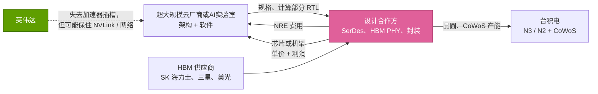
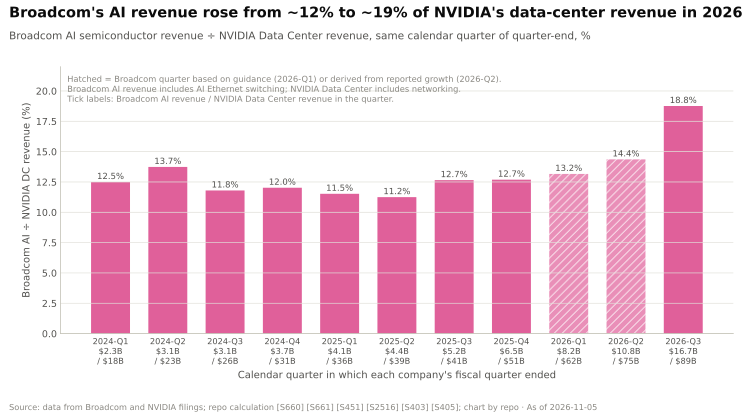
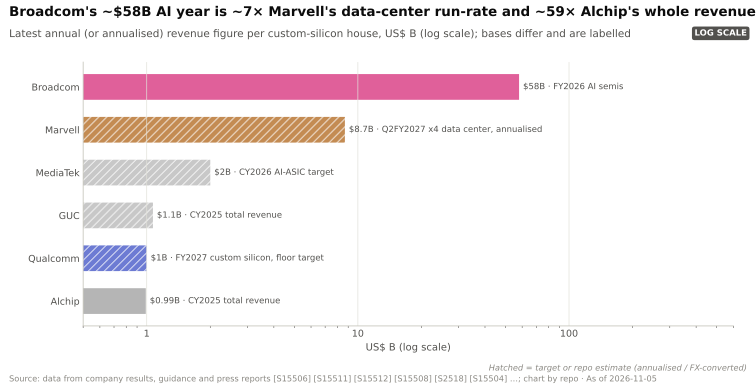
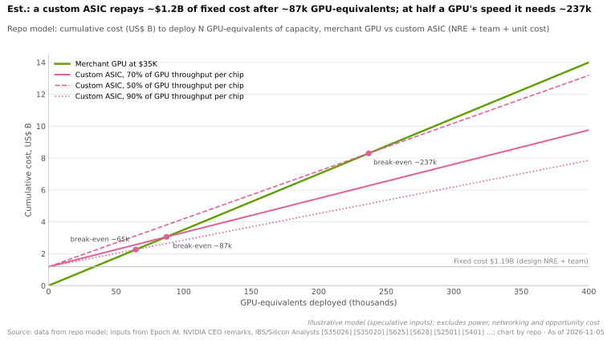
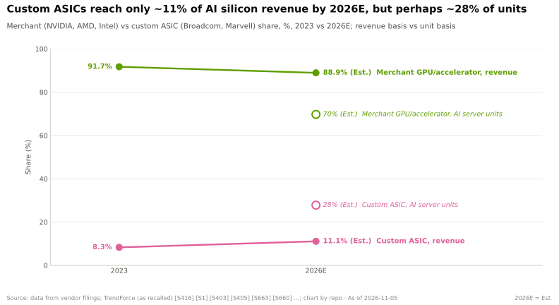

# 定制 ASIC 设计服务商：博通、美满电子、世芯、创意电子与联发科

> [!NOTE]
> 本页为英文原文的简体中文参考译文，仅供参考；如有出入，以[英文原文](../../../cross-cutting/15-competitive-landscape/custom-asic-houses.md "English original")为准。

跨层专题 15 · 竞争格局 · 阅读约 16 分钟 · 最后核实：2026-11-05

## ⚡ 要点速览

- **博通（Broadcom）已成为仅次于英伟达（NVIDIA）的第二大 AI 芯片供应商。** 截至 2026-08-02 的季度，其 AI 半导体收入达 $16.7B（同比 +221%），约相当于英伟达当季 $89.0B 数据中心收入的 19% [[S2516]](../../../sources/bibliography.md#s2516)[[S405]](../../../sources/bibliography.md#s405)。管理层预计 FY2026
  为 ~$58B，高于 FY2025 的 $20.2B [[S15501]](../../../sources/bibliography.md#s15501)[[S661]](../../../sources/bibliography.md#s661)。
- **前瞻表述更为激进。** 博通称已锁定足以支撑 FY2027 ~$115B AI 收入的供应，并对 FY2028 ~$230B 具备“清晰可见度”（line of sight）（🟡 管理层目标，并非已签约收入）[[S15501]](../../../sources/bibliography.md#s15501)。
- **客户名单即前沿阵营。** 谷歌（Google）的 TPU、Meta 的 MTIA、OpenAI 的 10 GW 项目（2026 年下半年至 2029 年）以及 Anthropic
  （$10B 订单，其后又追加 $11B 基于 TPU 的机架）均经由博通实现 [[S15552]](../../../sources/bibliography.md#s15552)[[S174]](../../../sources/bibliography.md#s174)[[S15500]](../../../sources/bibliography.md#s15500)。预计 Anthropic 将在 2027 年
  成为其最大的 [XPU](../../../glossary.md#xpu) 客户 🟡 [[S15501]](../../../sources/bibliography.md#s15501)。
- **美满电子（Marvell）是远远落后的第二名。** 其 Q2 FY2027 季度数据中心收入为 $2.17B（+46%），约为
  博通 AI 收入年化水平的七分之一 [[S15504]](../../../sources/bibliography.md#s15504)。据报道，英伟达于 2026 年 3 月向美满电子投资 $2B，以将其绑定于
  [NVLink Fusion](../../../glossary.md#nvlink-fusion) 🟡 [[S90037]](../../../sources/bibliography.md#s90037)。
- **围绕台积电（TSMC）的台湾第二梯队正在成长。** 世芯电子（Alchip，承接 3 nm 的 AWS Trainium3）、创意电子（GUC）和联发科（MediaTek，2026 年
  AI ASIC 目标 $2B；有报道称承接谷歌 TPU 相关工作）的年收入各在 $1–2B 左右 [[S2517]](../../../sources/bibliography.md#s2517)[[S15506]](../../../sources/bibliography.md#s15506)[[S15508]](../../../sources/bibliography.md#s15508)[[S2518]](../../../sources/bibliography.md#s2518)[[S23008]](../../../sources/bibliography.md#s23008)。
- **其经济性只在超大规模下成立。** 本资料库模型测算，每个项目的盈亏平衡点为 ~87k 个 GPU 等效算力单位；
  若该芯片只能完成 GPU 一半的有效工作量，则升至 ~237k（🔴 估计）[[S2501]](../../../sources/bibliography.md#s2501)[[S35026]](../../../sources/bibliography.md#s35026)。
- **对英伟达意味着什么：** 按设计合作方价格计，2025 年定制芯片约占 AI 加速器*收入*的 ~10%（估计）[[S416]](../../../sources/bibliography.md#s416)[[S661]](../../../sources/bibliography.md#s661)，但
  TrendForce 预计 2026 年基于 ASIC 的服务器将占 AI 服务器*出货量*的 27.8% [[S2517]](../../../sources/bibliography.md#s2517)。金额份额低估了
  出货量的迁移，而且正在转向的恰恰是最大的买家。

## 定制 ASIC 业务如何运作

想要自有加速器的[超大规模云厂商](../../../glossary.md#hyperscaler)很少会独立完成整颗芯片。其架构师决定计算引擎的形态
（矩阵单元、数值格式、片上存储），因为这正是其工作负载知识所在。[ASIC 设计合作方](../../../glossary.md#asic-design-partner)则提供其余一切：用于芯片间互连的高速 [SerDes](../../../glossary.md#serdes)、
[HBM](../../../glossary.md#hbm) 接口、封装、物理设计，以及在台积电产能队列中的位置。不妨以盖楼作比：
业主的建筑师画平面图，总承包商负责打地基、布线并办理各项许可。

合作方有两笔收入。第一笔是设计阶段的 [NRE](../../../glossary.md#nre)（一次性工程费用）。第二笔规模大得多：
每颗出货芯片的单价，其中包含合作方对其代为采购的晶圆、HBM 和封装所赚取的利润。合同形式有两种。在[交钥匙 ASIC](../../../glossary.md#turnkey-asic)（turnkey ASIC）模式下，合作方出售成品芯片；在
[客户自有工具](../../../glossary.md#customer-owned-tooling)（COT）模式下，客户购买服务或 IP，并自行与晶圆代工厂签约，
从而压缩合作方的单颗收入。博通与 Anthropic 的交易属于交钥匙模式的极端情形：其 CEO
称之为整系统销售，由博通对机架负责 [[S15500]](../../../sources/bibliography.md#s15500)。

时间维度对交易分析很重要。OpenAI 于 2025 年 10 月宣布与博通的合作项目，部署期为
2026 年下半年至 2029 年 [[S174]](../../../sources/bibliography.md#s174)；据报道，其首款芯片（代号 Jalapeño）已在博通 Q3 FY2026 季度出货 🟡
[[S15552]](../../../sources/bibliography.md#s15552)。因此，一个项目从架构设计到最后一批量产出货大约跨越 3–5 年（🔴 本资料库分析），而
买家如今会同时推进多代重叠的产品：Meta 规划了截至 2027 年的四代 MTIA，节奏约为每 ~6 个月一代 [[S561]](../../../sources/bibliography.md#s561)。

> [!TIP]
> **算例 —— 从博通单季业绩推算出货量。** 博通 Q3 FY2026 确认 AI 收入 $16.7B，并
> 表示其中 73% 来自 XPU，即单季定制加速器收入 ~$12.2B（本资料库测算）[[S2516]](../../../sources/bibliography.md#s2516)[[S15501]](../../../sources/bibliography.md#s15501)。若
> 每颗 XPU 售价 ~$10–15K（🔴 假设，低于商用 GPU 的 $30–40K [[S35026]](../../../sources/bibliography.md#s35026)），则每季 ~0.8–1.2M 颗芯片。
> 作为参照，仅 Anthropic 一家就计划使用多达 1M 颗 TPU [[S653]](../../../sources/bibliography.md#s653)。定制芯片是一门以较低单价换取大规模出货的生意，
> 这正是收入份额低估出货份额的原因。

🔧 技术细节：为何 SerDes 与封装是设计合作方的护城河

2026 年的加速器每秒需在芯片外传输数 TB 数据：据报道，Jalapeño 的 [HBM4](../../../glossary.md#hbm4) 带宽达 15.4 TB/s [[S628]](../../../sources/bibliography.md#s628)，而
[纵向扩展（scale-up）](../../../glossary.md#scale-up)链路采用 200G 级通道。要设计出在功耗预算内实现每通道 200 Gb/s 的
[SerDes](../../../glossary.md#serdes)，以及能通过内存厂商认证的 HBM PHY，需要多年的芯片迭代。博通还销售
这些链路所接入的交换机（Tomahawk），因此能够对两端进行协同设计；本资料库评估博通在
[横向扩展（scale-out）](../../../glossary.md#scale-out)以太网交换领域领先英伟达 [[S274]](../../../sources/bibliography.md#s274)。封装则构成另一道供应护城河：TrendForce 一类的估计显示，在
2026 年 ~1,000k 片 [CoWoS](../../../glossary.md#cowos) 晶圆中，博通占 ~150k，仅次于英伟达的 ~595k（估计）[[S379]](../../../sources/bibliography.md#s379)。超大规模云厂商可以招聘计算架构师，
却很难“招聘”到十年积累的 SerDes 测试芯片和 CoWoS 产能配额。

## 谁为谁设计

下表梳理了已公开的客户–合作方配对关系。其中若干为报道而非确认；设计合作方很少公开点名
客户。

| 客户项目 | 主要设计合作方 | 其他合作方（有报道） | 状态 | 来源 |
|---|---|---|---|---|
| 谷歌 TPU（Ironwood、TPU 8） | 博通 | 联发科负责 v7e/v8e 变体 🟡 | 已出货；Anthropic 采购，Meta 租用 | [[S15552]](../../../sources/bibliography.md#s15552)[[S23008]](../../../sources/bibliography.md#s23008)[[S90025]](../../../sources/bibliography.md#s90025) |
| Meta MTIA | 博通 | — | 已出货；规划至 2027 年共 4 代 | [[S15551]](../../../sources/bibliography.md#s15551)[[S561]](../../../sources/bibliography.md#s561) |
| OpenAI “Jalapeño”（10 GW） | 博通（芯片 + 以太网机架） | — | Q3 FY2026 首批出货 🟡 | [[S174]](../../../sources/bibliography.md#s174)[[S15552]](../../../sources/bibliography.md#s15552) |
| Anthropic（TPU 机架） | 博通（系统销售） | 谷歌（TPU 设计） | $10B + $11B 订单 | [[S15500]](../../../sources/bibliography.md#s15500)[[S655]](../../../sources/bibliography.md#s655) |
| AWS Trainium | 自研（Annapurna） | 美满电子（早期代次）、世芯（Trainium3）🟡 | Trn3 自 2026 年第二季度起量产 | [[S2517]](../../../sources/bibliography.md#s2517)[[S90034]](../../../sources/bibliography.md#s90034) |
| 微软（Microsoft）Maia | 自研 | 美满电子 🟡；可使用 OpenAI 由博通打造芯片的 IP | Maia 200 已部署；Maia 300 于 2027 年推出 | [[S15008]](../../../sources/bibliography.md#s15008)[[S662]](../../../sources/bibliography.md#s662)[[S90044]](../../../sources/bibliography.md#s90044)[[S90046]](../../../sources/bibliography.md#s90046) |
| AWS 定制推理芯片 + 1.6T 光学器件 | 高通（Qualcomm） | — | 多代合作；自 2027 财年第一季度起贡献收入 🟢 | [[S15510]](../../../sources/bibliography.md#s15510)[[S15509]](../../../sources/bibliography.md#s15509) |

[AWS Trainium](../../../cross-cutting/15-competitive-landscape/aws-trainium.md)、
[谷歌 TPU](../../../cross-cutting/15-competitive-landscape/google-tpu.md)、
[微软 Maia](../../../cross-cutting/15-competitive-landscape/microsoft-maia.md) 与
[Meta MTIA](../../../cross-cutting/15-competitive-landscape/meta-mtia.md) 各页从客户角度介绍了上述各项目。

## 博通：规模型玩家

博通的论据建立在三个数字之上。收入：FY2026 AI 半导体收入 ~$58B；此前 Q3 总收入为 $29.6B
（+86%），其中 AI 占 $16.7B [[S15501]](../../../sources/bibliography.md#s15501)[[S15502]](../../../sources/bibliography.md#s15502)。前沿客户集中度：
谷歌、Meta、OpenAI 与 Anthropic 均为其公开点名的客户，其 XPU 客户总数为六家 [[S15551]](../../../sources/bibliography.md#s15551)[[S15552]](../../../sources/bibliography.md#s15552)。
在手订单：陈福阳（Hock Tan）表示，FY2027 翻倍至 ~$115B 已有供应保障，并预计 OpenAI 将部署超过 5 GW 的
Jalapeño 及其后继产品 🟡 [[S15501]](../../../sources/bibliography.md#s15501)。

该图中的比率是衡量定制芯片相对英伟达态势最简洁的单一指标。它在两年间稳定于 11–14%，
并在 2026 年第三日历季度跃升至 19% [[S2516]](../../../sources/bibliography.md#s2516)[[S405]](../../../sources/bibliography.md#s405)。本资料库此前对博通 FY2026 ~$45B 的情景假设被证明过于保守：指引加上已公布的
各季度数据，目前合计 ~$57B（下图即采用此数），而博通 CEO 引用的数字为 ~$58B [[S2516]](../../../sources/bibliography.md#s2516)[[S15501]](../../../sources/bibliography.md#s15501)
（[GPU 芯片竞争](../../../layers/02-gpu-silicon/competition.md)）。

> [!TIP]
> **算例 —— 将 FY2027 目标与英伟达对照。** 博通 FY2027 ~$115B 的目标约为英伟达
> FY2026 数据中心收入 $193.7B 的 ~59% [[S15501]](../../../sources/bibliography.md#s15501)[[S1]](../../../sources/bibliography.md#s1)。但英伟达仅在 FY2027 上半年就确认了 $164.2B 的数据中心收入
> [[S403]](../../../sources/bibliography.md#s403)[[S405]](../../../sources/bibliography.md#s405)，年化 ~$330B。以这一速度衡量，博通的目标仅 ~35%。方向已很清晰；
> 但“定制芯片超越商用芯片”的叙事尚未体现在数字中。

## 美满电子、世芯、创意电子与联发科：第二梯队

**美满电子**销售定制 XPU、光通信 DSP 和交换机。其 Q2 FY2027 季度收入为 $2.739B（+37%），
其中数据中心占 ~79%；公司预计定制业务收入将在 FY2028 增长一倍以上，另据报道其 FY2027 指引为 ~$12B
[[S15504]](../../../sources/bibliography.md#s15504)[[S15505]](../../../sources/bibliography.md#s15505)。其弱点在于客户集中：AWS 看来对 Trainium 采取双供应商策略，而世芯拿下了 3 nm 的 Trainium3
[[S2517]](../../../sources/bibliography.md#s2517)。据报道英伟达持有的 $2B 股份（2026 年 3 月）使美满电子成为与英伟达关系最紧密的设计服务商：它是 NVLink Fusion
设计合作方，因此由美满电子打造的 XPU 可以置于英伟达机架之内 [[S90037]](../../../sources/bibliography.md#s90037)[[S131]](../../../sources/bibliography.md#s131)。美满电子还于 2026 年 2 月以 $3.25B 预付对价收购了 Celestial AI
（光子内存互连架构）[[S2513]](../../../sources/bibliography.md#s2513)。

**世芯与创意电子**是隶属台积电生态的台湾设计服务公司。随着 5 nm 项目退坡，世芯 2025 年收入从 ~$1.6B 降至 ~$992M；
2026 年第二季度起量产的 Trainium3 是其反弹的契机 [[S15506]](../../../sources/bibliography.md#s15506)[[S15507]](../../../sources/bibliography.md#s15507)[[S2517]](../../../sources/bibliography.md#s2517)。创意电子
作为台积电的关联企业，2025 年收入为 NT$34.1B（~$1.07B）[[S15508]](../../../sources/bibliography.md#s15508)。它们的模式更接近 COT：单颗芯片利润率更低，
客户锁定程度也更弱。

**联发科**带来了手机 SoC 公司的能力（能效、SerDes、大规模量产执行力）。公司将 2026 年
AI ASIC 目标从 $1B 上调至 $2B，据报道还拿下了谷歌 TPU v7e/v8e 的相关工作，可能负责的是 [I/O 裸片](../../../glossary.md#io-die)
而非计算裸片 🟡 [[S15503]](../../../sources/bibliography.md#s15503)[[S2518]](../../../sources/bibliography.md#s2518)[[S23008]](../../../sources/bibliography.md#s23008)。它也是 [NVLink](../../../glossary.md#nvlink) Fusion 的首发合作伙伴 [[S90031]](../../../sources/bibliography.md#s90031)。

> [!TIP]
> **算例 —— 定制芯片市场内部的差距。** 博通 FY2026 ~$58B 的 AI 收入约为美满电子年化
> $8.7B 数据中心收入的 ~6.7 倍，世芯 2025 年收入的 ~59 倍 [[S15501]](../../../sources/bibliography.md#s15501)[[S15504]](../../../sources/bibliography.md#s15504)[[S15506]](../../../sources/bibliography.md#s15506)。即使联发科的谷歌业务
> 在其 $2B 目标基础上增长十倍，也仍只有博通 FY2026 的三分之一。定制芯片并非一个碎片化的
> 市场；它是博通加上一条长尾。

## 超大规模云厂商为何选择它们，代价几何

动机在于利润率。英伟达 Q2 FY2027 公司整体毛利率为 75.0% [[S405]](../../../sources/bibliography.md#s405)；Epoch AI 估计一颗 B200 的制造成本约
~$6.4K，而售价为 $30–40K [[S35020]](../../../sources/bibliography.md#s35020)[[S35026]](../../../sources/bibliography.md#s35026)。部署数十万颗加速器的买家即便支付了合作方的利润
和自身的工程费用，只要芯片完成足够多的有效工作，仍然可以胜出。

> [!TIP]
> **算例 —— 盈亏平衡点。** 固定成本：3 nm 设计 ~$0.59B [[S2501]](../../../sources/bibliography.md#s2501)，加上一支 500 人的
> 软件与系统团队三年 ~$0.6B（按每人年 ~$0.4M 计，🔴 假设）[[S10535]](../../../sources/bibliography.md#s10535)：合计 ~$1.19B。单位成本：
> 每颗定制芯片 $15K（🔴），而每颗 GPU 为 $35K [[S35026]](../../../sources/bibliography.md#s35026)。若吞吐量为 GPU 的 70%，则定制芯片折合每个 GPU 等效单位的成本为 $15K ÷ 0.7 ≈
> $21.4K，每个节省 ~$13.6K。$1.19B ÷ $13.6K ≈ 87k 个 GPU 等效单位。一个 1 GW 的项目需要
> 数十万颗加速器，因此前沿实验室能够越过门槛；一家部署 20k 颗 GPU 的企业则不能。

该模型遗漏了实际决策中最困难的部分：软件。谷歌 TPU 之所以具备经济性，是因为 [XLA](../../../glossary.md#xla) 和 JAX
已经存在；SemiAnalysis 在某一工作负载上测得 Ironwood 的单 token 成本比 B200 低 ~18%，主要源于更便宜的
芯片时租价格，而非更快的芯片 [[S625]](../../../sources/bibliography.md#s625)。缺乏这套软件栈的新 XPU 可能需要数年才能达到其纸面吞吐量
（参见 [CUDA 竞争](../../layers/09-cuda-and-system-software/competition.md)）。

## 分层评判：博通类定制芯片 vs 英伟达

| 层 | 评判 | 理由 |
|---|---|---|
| 02 加速器芯片 | 🟦 路线不同 | 客户自定义 XPU；Jalapeño 每裸片 ~13.4 PFLOPS MXFP4（SemiAnalysis）[[S628]](../../../sources/bibliography.md#s628) |
| 03 内存、封装与供应 | 🟥 落后 | 2026 年 CoWoS 晶圆 ~150k，英伟达 ~595k（估计）[[S379]](../../../sources/bibliography.md#s379) |
| 04 CPU | 🟥 落后 | 无 CPU；客户自带 Arm 或 x86 主机 |
| 05 纵向扩展互连 | 🟥 落后 | 以太网纵向扩展（SUE、ESUN）在已部署域规模上落后于 NVLink [[S90052]](../../../sources/bibliography.md#s90052)[[S576]](../../../sources/bibliography.md#s576) |
| 06 横向扩展网络 | 🟩 领先 | Tomahawk 6 率先达到 102.4 Tb/s；以太网约占 AI 后端交换的三分之二 [[S274]](../../../sources/bibliography.md#s274)[[S90054]](../../../sources/bibliography.md#s90054) |
| 08 系统与机架 | 🟦 路线不同 | 仅为特定客户（OpenAI、Anthropic）提供机架 [[S174]](../../../sources/bibliography.md#s174)[[S15500]](../../../sources/bibliography.md#s15500) |
| 09–11 软件 | 🟦 路线不同 | 客户自有软件栈（JAX/XLA、PyTorch 后端） |
| 13 生态与资本 | 🟥 落后 | 六家 XPU 客户，对比英伟达的广泛渠道；未披露供应商融资 [[S15551]](../../../sources/bibliography.md#s15551) |

本资料库的全局评分见[竞争格局索引](../../../cross-cutting/15-competitive-landscape/index.md)。

## 它们最有力的论据，以及差距缩小了多少

**最有力的论据：** 四家最大的 AI 支出方已经决定自有部分芯片，而博通以远低于英伟达向买家收取的毛利率
承接了这一决定。每一个转向定制芯片的 GW 都是英伟达卖不出去的 GW，各家的 GW 规划也印证了这一点：在 OpenAI 已宣布的 26 GW 中，10 GW 为博通定制加速器，另有 10 GW 归英伟达（一份此后已重组的意向书）、6 GW 归 AMD [[S174]](../../../sources/bibliography.md#s174)[[S90016]](../../../sources/bibliography.md#s90016)[[S13506]](../../../sources/bibliography.md#s13506)。

**差距缩小了多少：** 按收入计，定制芯片从 2023 年约占 AI 芯片总盘子的 ~8% 升至本资料库 2026 年估计的 ~11%
（鉴于博通的收入增速，该估计可能偏低）[[S660]](../../../sources/bibliography.md#s660)[[S661]](../../../sources/bibliography.md#s661)；按博通对英伟达数据中心收入之比计，单季从 ~12% 升至 ~19%
[[S2516]](../../../sources/bibliography.md#s2516)[[S405]](../../../sources/bibliography.md#s405)；按出货量计，差距缩小得更多（占 2026 年 AI 服务器的 27.8%）[[S2517]](../../../sources/bibliography.md#s2517)。

> [!NOTE]
> **🐂 看多观点（对英伟达而言）。** 定制芯片项目仍让英伟达留在机架之中：Trainium4 将采用 NVLink Fusion 和 MGX，
> 而美满电子、联发科和世芯都是 Fusion 合作伙伴，因此即便英伟达丢掉了加速器，仍能销售交换机和 CPU
> [[S518]](../../../sources/bibliography.md#s518)[[S90031]](../../../sources/bibliography.md#s90031)。FY2027 上半年，英伟达自身数据中心收入的美元增量超过了博通整条 AI 业务线
> [[S403]](../../../sources/bibliography.md#s403)[[S405]](../../../sources/bibliography.md#s405)。

> [!WARNING]
> **🐻 看空观点（对英伟达而言）。** 仅博通 FY2027 的目标就为 ~$115B [[S15501]](../../../sources/bibliography.md#s15501)，而其最大客户正是
> 英伟达同样倚重的实验室。若 Anthropic、OpenAI、谷歌和 Meta 将其 2027–28 年增量中哪怕一半转向定制芯片，
> 英伟达的超大规模云业务板块（每季 ~$49B）将在需求见顶之前很早就碰到出货量天花板 [[S90011]](../../../sources/bibliography.md#s90011)。

## 对英伟达份额意味着什么

英伟达的防御有三重：年度迭代节奏（2024 年设计的定制芯片在 2026 年要面对 Rubin）、设计合作方只向少数客户销售的
机架级系统，以及通过 NVLink Fusion 进行的收编（[NVLink Fusion](../../layers/05-scale-up-nvlink-nvswitch/nvlink-fusion.md)）。
风险高度集中：能够越过上述盈亏平衡门槛的买家，恰恰是英伟达最大的直接客户，
其中三家分别占 FY2027 上半年收入的 16%、15% 和 13% [[S90069]](../../../sources/bibliography.md#s90069)。

> [!TIP]
> **算例 —— 前三大客户转移意味着什么。** 三家直接客户分别占 FY2027 上半年收入的 16%、15% 和 13%，
> 合计 44% [[S90069]](../../../sources/bibliography.md#s90069)。若这三家将其英伟达支出中的十个百分点转向定制
> 芯片，英伟达将损失 ~4.4% 的收入（🔴 本资料库测算）——还不到 Q2
> FY2027 单季环比增幅（环比 +18%）[[S405]](../../../sources/bibliography.md#s405)。威胁针对的是增长率与定价权，而非 2026 年的收入基数。

## 🎯 企业发展视角

1. 博通的护城河在于 SerDes、封装产能配额和系统集成，而非计算架构。其中哪些是
   新进入者可以买到的（IP 授权、OSAT 产能、收购 Alphawave 一类的标的），哪些需要十年才能建成？
2. 第二梯队（世芯、创意电子、联发科）凭借成本和贴近台积电胜出，却缺乏客户锁定。对于一家已具备 SerDes 和封装
   能力的买家而言，一项设计服务资产价值几何？在博通的六家客户之外，还有哪些锚定客户
   尚未落定？
3. 英伟达对美满电子的 $2B 投资以及 Fusion 授权，把竞争对手变成了供应商。“英伟达机架内的定制加速器”
   是一个可持续的中间形态，还是 [UALink](../../../glossary.md#ualink)/ESUN 机架于 2027 年成熟之前的过渡状态？
4. 收入份额（~11%）与出货份额（~28%）讲述的是不同的故事。企业发展模型应采用哪一指标来测算
   定制芯片市场规模？该测算对 XPU 定价的敏感度如何？
5. 盈亏平衡点有利于数十万颗量级的买家。是否存在“轻定制”（custom-lite，共享基础裸片、
   客户专属小芯片）的市场，从而为二线云厂商和主权买家降低门槛？

## 📚 来源（Sources）

<!-- Auto-generated from the [S…] citations on this page by `make build`. Edit sources/registry/*.csv, not this list. -->

- [**S1**](../../../sources/bibliography.md#s1) NVIDIA Corporation via SEC EDGAR, *NVIDIA Announces Financial Results for Fourth Quarter and Fiscal 2026 (Form 8-K exhibit 99.1)*, 2026-02-25. [Link](https://www.sec.gov/Archives/edgar/data/1045810/000104581026000019/q4fy26pr.htm)
- [**S131**](../../../sources/bibliography.md#s131) NVIDIA Newsroom, *NVIDIA NVLink Fusion: semi-custom AI infrastructure partner ecosystem (Computex 2025)*, 2025-05-19. [Link](https://nvidianews.nvidia.com/news/nvidia-nvlink-fusion-semi-custom-ai-infrastructure-partner-ecosystem)
- [**S174**](../../../sources/bibliography.md#s174) OpenAI, *OpenAI and Broadcom announce strategic collaboration to deploy 10 gigawatts of OpenAI-designed AI accelerators*, 2025-10-13. [Link](https://openai.com/index/openai-and-broadcom-announce-strategic-collaboration/)
- [**S274**](../../../sources/bibliography.md#s274) Broadcom, *Broadcom ships Tomahawk 6: world's first 102.4 Tbps switch*, 2025-06-03. [Link](https://investors.broadcom.com/news-releases/news-release-details/broadcom-ships-tomahawk-6-worlds-first-1024-tbps-switch)
- [**S379**](../../../sources/bibliography.md#s379) TrendForce News, *TSMC CoWoS capacity and customer allocation estimates (TrendForce / Morgan Stanley, as reported)*, 2025. [Link](https://www.trendforce.com/news/)
- [**S403**](../../../sources/bibliography.md#s403) NVIDIA Corporation via SEC EDGAR, *NVIDIA Announces Financial Results for First Quarter Fiscal 2027 (Form 8-K exhibit 99.1)*, 2026-05-20. [Link](https://www.sec.gov/Archives/edgar/data/0001045810/000104581026000051/q1fy27pr.htm)
- [**S405**](../../../sources/bibliography.md#s405) NVIDIA Corporation via SEC EDGAR, *NVIDIA Announces Financial Results for Second Quarter Fiscal 2027 (Form 8-K exhibit 99.1)*, 2026-08-26. [Link](https://www.sec.gov/Archives/edgar/data/0001045810/000104581026000073/q2fy27pr.htm)
- [**S416**](../../../sources/bibliography.md#s416) NVIDIA Corporation via SEC EDGAR, *NVIDIA Corporation Form 10-K for fiscal year ended January 26, 2025*, 2025-02-26. [Link](https://www.sec.gov/Archives/edgar/data/1045810/000104581025000023/nvda-20250126.htm)
- [**S518**](../../../sources/bibliography.md#s518) ServeTheHome, *NVIDIA NVLink Fusion tapped for future AWS Trainium4 deployments*, 2025-12-02. [Link](https://www.servethehome.com/nvidia-nvlink-fusion-tapped-for-future-aws-trainium4-deployments/)
- [**S561**](../../../sources/bibliography.md#s561) DatacenterDynamics, *Meta unveils next four generations of its MTIA chip*, 2026-03-11. [Link](https://www.datacenterdynamics.com/en/news/meta-unveils-next-four-generations-of-its-mtia-chip/)
- [**S576**](../../../sources/bibliography.md#s576) Converge Digest, *OCP releases ESUN 1.0 spec for Ethernet-based scale-up AI fabrics*, 2026-03. [Link](https://convergedigest.com/ocp-releases-esun-1-0-spec-for-ethernet-based-scale-up-ai-fabrics/)
- [**S625**](../../../sources/bibliography.md#s625) SemiAnalysis, *TPU Inference Externalization Full Steam Ahead*, 2026-09-07. [Link](https://github.com/SemiAnalysisAI/InferenceX-app/blob/main/packages/app/content/blog/tpu-inferencex-full-steam.mdx)
- [**S628**](../../../sources/bibliography.md#s628) SemiAnalysis, *OpenAI Jalapeño: Better Than Nvidia Blackwell*, 2026-08-25. [Link](https://github.com/SemiAnalysisAI/InferenceX-app/blob/main/packages/app/content/blog/openai-jalapeno-better-than-nvidia.mdx)
- [**S653**](../../../sources/bibliography.md#s653) Anthropic, *Expanding our use of Google Cloud TPUs and Services*, 2025-10-23. [Link](https://www.anthropic.com/news/expanding-our-use-of-google-cloud-tpus-and-services)
- [**S655**](../../../sources/bibliography.md#s655) Anthropic, *Anthropic expands partnership with Google and Broadcom for multiple gigawatts of next-generation compute*, 2026-04-06. [Link](https://www.anthropic.com/news/google-broadcom-partnership-compute)
- [**S660**](../../../sources/bibliography.md#s660) Broadcom Inc., *Broadcom Inc. Announces Fourth Quarter and Fiscal Year 2024 Financial Results*, 2024-12-12. [Link](https://investors.broadcom.com/financial-information/quarterly-results)
- [**S661**](../../../sources/bibliography.md#s661) Broadcom Inc., *Broadcom Inc. Announces Fourth Quarter and Fiscal Year 2025 Financial Results*, 2025-12-11. [Link](https://investors.broadcom.com/financial-information/quarterly-results)
- [**S662**](../../../sources/bibliography.md#s662) Marvell Technology, *Marvell Technology fourth quarter and fiscal 2025 results and AI revenue commentary*, 2025-03-04. [Link](https://investor.marvell.com/news-events/press-releases)
- [**S2501**](../../../sources/bibliography.md#s2501) Silicon Analysts, *Chip Design & NRE Cost by Node — Historical Time Series Data*, 2026. [Link](https://siliconanalysts.com/market-data/nre-design-cost)
- [**S2513**](../../../sources/bibliography.md#s2513) Business Wire (Marvell), *Marvell Completes Acquisition of Celestial AI*, 2026-02-02. [Link](https://www.businesswire.com/news/home/20260201331090/en/marvell-completes-acquisition-of-celestial-ai)
- [**S2516**](../../../sources/bibliography.md#s2516) Broadcom Inc. via SEC EDGAR, *Broadcom Inc. Announces Third Quarter Fiscal Year 2026 Financial Results (Form 8-K exhibit 99.1)*, 2026-09. [Link](https://www.sec.gov/Archives/edgar/data/0001730168/000173016826000076/avgo-08022026x8kxex99.htm)
- [**S2517**](../../../sources/bibliography.md#s2517) TrendForce, *CSPs accelerate ASIC push in 2H26, challenging NVIDIA as MediaTek, GUC, Alchip benefit*, 2026-03-20. [Link](https://www.trendforce.com/news/2026/03/20/news-csps-accelerate-asic-push-in-2h26-challenging-nvidia-as-mediatek-guc-alchip-benefit/)
- [**S2518**](../../../sources/bibliography.md#s2518) TrendForce, *MediaTek reportedly doubles 2026 AI ASIC revenue target to $2B*, 2026-04-30. [Link](https://www.trendforce.com/news/2026/04/30/news-MediaTek-reportedly-doubles-2026-ai-asic-revenue-target-to-2b-aims-10-15-market-share)
- [**S10535**](../../../sources/bibliography.md#s10535) SemiAnalysis, *AMD 2.0 – New Sense of Urgency / MI450X Chance to Beat Nvidia / Nvidia's New Moat*, 2025-04. [Link](https://newsletter.semianalysis.com/p/amd-2-0-new-sense-of-urgency-mi450x-chance-to-beat-nvidia-nvidias-new-moat)
- [**S13506**](../../../sources/bibliography.md#s13506) Tom's Hardware, *OpenAI signs 6 GW AMD GPU deal*, 2025-10-06. [Link](https://www.tomshardware.com/pc-components/gpus/openai-signs-6gw-amd-gpu-deal)
- [**S15008**](../../../sources/bibliography.md#s15008) DatacenterDynamics, *Microsoft says it has access to the IP of OpenAI's custom AI chips*, 2025-11. [Link](https://www.datacenterdynamics.com/en/news/microsoft-says-it-has-access-to-the-ip-of-openais-custom-ai-chips/)
- [**S15500**](../../../sources/bibliography.md#s15500) DatacenterDynamics, *Broadcom bulges with Anthropic AI orders*, 2025-12. [Link](https://www.datacenterdynamics.com/en/news/broadcom-bulges-with-anthropic-ai-orders/)
- [**S15501**](../../../sources/bibliography.md#s15501) DatacenterDynamics, *Broadcom slams AI silicon-fuelled Q3, promises double-double on the way*, 2026-09-03. [Link](https://www.datacenterdynamics.com/en/news/broadcom-slams-ai-silicon-fueled-q3-promises-double-double-on-the-way/)
- [**S15502**](../../../sources/bibliography.md#s15502) ChannelWeb (CRN UK), *Broadcom Q3 results: CEO Tan forecasts surging AI infrastructure buildout*, 2026-09. [Link](https://www.channelweb.co.uk/news-network/2026/broadcom-q3-results-ceo-tan-forecasts-surging-ai-infrastructure-buildout)
- [**S15503**](../../../sources/bibliography.md#s15503) TrendForce, *MediaTek forecasts $1B in ASIC sales for 2026; custom AI chips set for 20% revenue share in 2027*, 2026-02-05. [Link](https://www.trendforce.com/news/2026/02/05/news-mediatek-forecasts-1b-in-asic-sales-for-2026-custom-ai-chips-set-for-20-revenue-share-in-2027/)
- [**S15504**](../../../sources/bibliography.md#s15504) Futurum Group, *Marvell Q2 FY 2027: connectivity and custom silicon fuel AI growth*, 2026-08. [Link](https://futurumgroup.com/insights/marvell-q2-fy-2027-connectivity-and-custom-silicon-fuel-ai-growth/)
- [**S15505**](../../../sources/bibliography.md#s15505) Zacks, *MRVL Q2 earnings beat on data center strength, outlook raised*, 2026-08. [Link](https://www.zacks.com/stock/news/2981826/mrvl-q2-earnings-beat-on-data-center-strength-outlook-raised)
- [**S15506**](../../../sources/bibliography.md#s15506) Alchip Technologies (syndicated press release), *Alchip Technologies reports Q4 and 2025 FY financial results*, 2026-02. [Link](https://lifestyle.kbew98country.com/story/121222/alchip-technologies-reports-q4-and-2025-fy-financial-results/)
- [**S15507**](../../../sources/bibliography.md#s15507) S&P Global Market Intelligence, *Alchip faces sharp 2025 decline; analysts forecast strong 2026 recovery*, 2026-02. [Link](https://www.spglobal.com/market-intelligence/en/news-insights/research/2026/02/aichip-faces-sharp-2025-decline-analysts-forecast-strong-2026-recovery)
- [**S15508**](../../../sources/bibliography.md#s15508) DIGITIMES Asia, *Alchip, Faraday and GUC 2026 revenue outlook*, 2026-02-02. [Link](https://apps.digitimes.com/news/a20260202PD232/alchip-faraday-guc-2026-revenue.html)
- [**S15509**](../../../sources/bibliography.md#s15509) Mobile World Live, *Qualcomm lands custom AI chip deal with Amazon*, 2026-09. [Link](https://www.mobileworldlive.com/ai-cloud/qualcomm-lands-custom-ai-chip-deal-with-amazon/)
- [**S15510**](../../../sources/bibliography.md#s15510) Manufacturing Dive, *Qualcomm makes custom chips for Amazon in $4B partnership*, 2026-09. [Link](https://www.manufacturingdive.com/news/qualcomm-custom-chips-amazon-4b-partnership/829914/)
- [**S15551**](../../../sources/bibliography.md#s15551) The Register, *Broadcom Q1 2026: custom accelerator business across five, then six, customers*, 2026-03-05. [Link](https://theregister.com/2026/03/05/broadcom_q1_2026/)
- [**S15552**](../../../sources/bibliography.md#s15552) Channel Insider, *Broadcom AI chip revenue jumps 221% as custom silicon challenges Nvidia*, 2026-09. [Link](https://www.channelinsider.com/ai/news-broadcom-ai-chip-revenue-custom-silicon-nvidia/)
- [**S23008**](../../../sources/bibliography.md#s23008) TrendForce, *MediaTek reportedly secures Google v7e and v8e TPU orders*, 2025-12-15. [Link](https://www.trendforce.com/news/2025/12/15/news-mediatek-reportedly-secures-google-v7e-v8e-tpu-orders-requests-7-fold-cowos-increase-from-tsmc/)
- [**S35020**](../../../sources/bibliography.md#s35020) Epoch AI, *NVIDIA's B200 costs around $6,400 to produce, with memory accounting for half*, 2025-12. [Link](https://epoch.ai/data-insights/b200-cost-breakdown)
- [**S35026**](../../../sources/bibliography.md#s35026) Tom's Hardware, *Nvidia's Jensen Huang says Blackwell GPU to cost $30,000-$40,000, later clarifies that pricing will vary as they won't sell just the chip*, 2024-03-19. [Link](https://www.tomshardware.com/pc-components/gpus/nvidias-jensen-huang-says-blackwell-gpu-to-cost-dollar30000-dollar40000-later-clarifies-that-pricing-will-vary-as-they-wont-sell-just-the-chip)
- [**S90011**](../../../sources/bibliography.md#s90011) Nasdaq (Zacks), *NVIDIA Q2 earnings beat on Blackwell Ultra and Data Center strength*, 2026-08-27. [Link](https://www.nasdaq.com/articles/nvidia-q2-earnings-beat-blackwell-ultra-data-center-strength)
- [**S90016**](../../../sources/bibliography.md#s90016) Storyboard18 (Financial Times), *Nvidia set for $30bn OpenAI deal as $100bn partnership shelved, report says (FT)*, 2026-02-20. [Link](https://www.storyboard18.com/digital/nvidia-set-for-30bn-openai-deal-as-100bn-partnership-shelved-report-says-90188.htm)
- [**S90025**](../../../sources/bibliography.md#s90025) SiliconANGLE, *Google and Meta reportedly strike new multibillion-dollar AI chip deal*, 2026-02-26. [Link](https://siliconangle.com/2026/02/26/google-meta-reportedly-strike-new-multibillion-dollar-ai-chip-deal/)
- [**S90031**](../../../sources/bibliography.md#s90031) ServeTheHome, *NVIDIA announces NVLink Fusion bringing NVLink to third-party CPUs and accelerators*, 2025-05-19. [Link](https://www.servethehome.com/nvidia-announces-nvlink-fusion-bringing-nvlink-to-third-party-cpus-and-accelerators/nvlink-fusion-partners/)
- [**S90034**](../../../sources/bibliography.md#s90034) NAND Research, *AWS releases Trainium3, teases Trainium4*, 2025-12. [Link](https://nand-research.com/research-note-aws-releases-trainium3-teases-trainium4/4/)
- [**S90037**](../../../sources/bibliography.md#s90037) Converge Digest, *NVIDIA invests $2B in Marvell to extend NVLink Fusion AI ecosystem*, 2026-03. [Link](https://convergedigest.com/nvidia-invests-2b-in-marvell-to-extend-nvlink-fusion-ai-ecosystem/)
- [**S90044**](../../../sources/bibliography.md#s90044) eWeek, *Microsoft introduces Maia 200, its most powerful AI chip yet*, 2026-01-27. [Link](https://www.eweek.com/news/microsoft-maia-200-ai-chip/)
- [**S90046**](../../../sources/bibliography.md#s90046) IT Brief UK, *Microsoft unveils Maia 300 for 2027 AI deployments*, 2026-10. [Link](https://itbrief.co.uk/story/microsoft-unveils-maia-300-for-2027-ai-deployments)
- [**S90052**](../../../sources/bibliography.md#s90052) Synopsys, *Ethernet standards for scale-up AI: an overview of ESUN, SUE, and UALink*, 2025-11. [Link](https://www.synopsys.com/articles/ethernet-standards-scale-up-ai.html)
- [**S90054**](../../../sources/bibliography.md#s90054) Dell'Oro Group, *Ethernet extends lead in AI scale-out networks despite strong InfiniBand rebound*, 2026. [Link](https://www.delloro.com/news/ethernet-extends-lead-in-ai-scale-out-networks-despite-strong-infiniband-rebound/)
- [**S90069**](../../../sources/bibliography.md#s90069) NVIDIA Corporation via SEC EDGAR, *NVIDIA Form 10-Q for the quarter ended July 26, 2026 (Q2 FY2027)*, 2026-08. [Link](https://www.sec.gov/Archives/edgar/data/0001045810/000104581026000075/nvda-20260726.htm)
