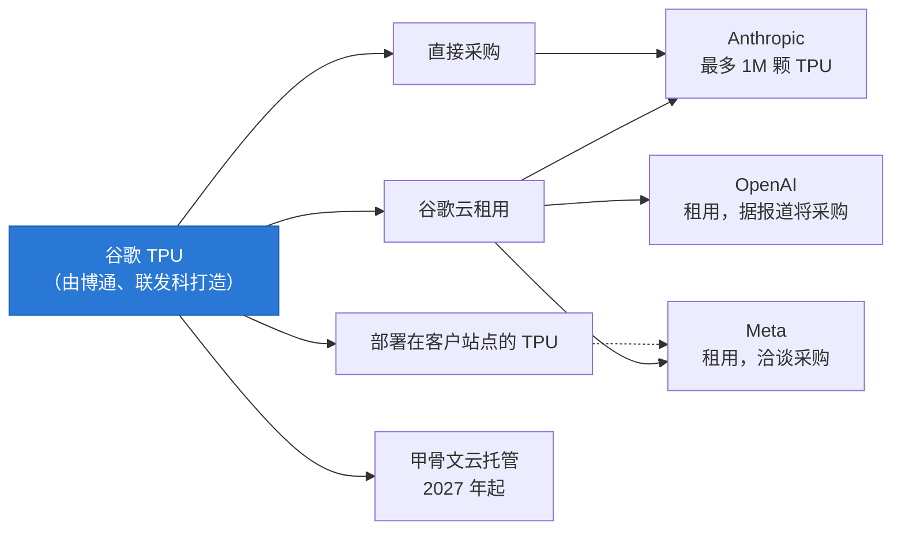
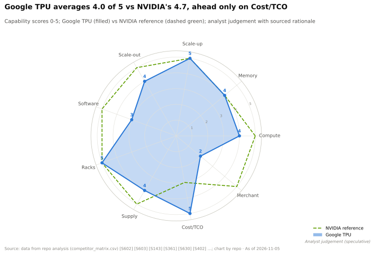

# 谷歌 TPU —— 可信的替代方案，如今已对外销售

> [!NOTE]
> 本页为英文原文的简体中文参考译文，仅供参考；如有出入，以[英文原文](../../../cross-cutting/15-competitive-landscape/google-tpu.md "English original")为准。

跨层专题 15 · 竞争格局 · 从 TPU v1 到 TPU 8t/8i、ICI 与光交换机、JAX/XLA、对外销售 · 约 15 分钟阅读 · 最后核实：2026-11-05

## ⚡ 要点速览

- **十年，八代。** 第一代 [TPU](../../glossary.md#tpu) 于 2015 年承担谷歌（Google）的推理任务，速度是同期 CPU 和 GPU 的 15–30× [[S23001]](../../../sources/bibliography.md#s23001)。[Ironwood](../../glossary.md#ironwood)（v7，2025 年 11 月正式商用）每颗芯片提供 4,614 TFLOPS 稠密 [FP8](../../glossary.md#fp8) 算力和 192 GB [HBM3E](../../glossary.md#hbm3e)，pod 规模为 9,216 颗芯片 [[S151]](../../../sources/bibliography.md#s151)[[S547]](../../../sources/bibliography.md#s547)。
- **2026 年产品线一分为二。** TPU 8t（训练）宣称在 9,600 芯片的 pod 中提供 12.6 [PFLOPS](../../glossary.md#flops) 的 [FP4](../../glossary.md#fp4) 算力；TPU 8i（推理）则将 10.1 PFLOPS 与 288 GB [HBM](../../glossary.md#hbm) 及 384 MB 片上 [SRAM](../../glossary.md#sram) 相结合（🟢 已发布；内存数据 🟡 来自媒体报道）[[S552]](../../../sources/bibliography.md#s552)[[S239]](../../../sources/bibliography.md#s239)[[S15010]](../../../sources/bibliography.md#s15010)。
- **[纵向扩展（scale-up）](../../glossary.md#scale-up)是谷歌的招牌。** [ICI](../../glossary.md#ici) 链路构成 3D [环面（torus）](../../glossary.md#torus-topology)拓扑，并由[光路交换机](../../glossary.md#optical-circuit-switch)重新布线，使一个 pod 的规模达到 [NVL72](../../glossary.md#nvl72) 机架的 128×，尽管单芯片带宽较低 [[S232]](../../../sources/bibliography.md#s232)[[S237]](../../../sources/bibliography.md#s237)。
- **TPU 如今已对谷歌以外的客户销售。** Anthropic 可使用最多 1M 颗 TPU（2026 年超过 1 GW）[[S653]](../../../sources/bibliography.md#s653)；Meta 租用 Ironwood，并已讨论为自有数据中心采购 TPU（🟡）[[S90025]](../../../sources/bibliography.md#s90025)；甲骨文（Oracle）将自 2027 年起托管 TPU [[S552]](../../../sources/bibliography.md#s552)。
- **经济性才是威胁所在。** SemiAnalysis 估计自有 Ironwood 的每芯片小时成本约为 $1.21，而 B200 约为 $1.73、GB300 约为 $2.31；在一项 FP8 工作负载上，其每 token 成本比 B200 低约 18%（估计）[[S622]](../../../sources/bibliography.md#s622)[[S625]](../../../sources/bibliography.md#s625)。
- **弱点：** 在谷歌之外，其软件生态尚不成熟（本资料库框架指数得分 14/36，[CUDA](../../glossary.md#cuda) 为 36），且自 v5.0 以来 TPU 一直缺席 MLPerf [[S580]](../../../sources/bibliography.md#s580)[[S613]](../../../sources/bibliography.md#s613)。Rubin 的 [HBM4](../../glossary.md#hbm4) 也重新拉开了硬件差距：TPU 8i 的内存带宽约为 Rubin 的 45% [[S15014]](../../../sources/bibliography.md#s15014)。

## 历代产品：从推理卡到双芯片家族

谷歌负责架构、编译器和系统设计；博通（Broadcom）一直是其长期的 [ASIC 设计合作伙伴](../../glossary.md#asic-design-partner)，联发科（MediaTek）则加入负责部分型号（🟡）[[S23007]](../../../sources/bibliography.md#s23007)[[S23008]](../../../sources/bibliography.md#s23008)。媒体深度报道称，8t 裸片由博通设计，8i 由联发科设计 [[S15010]](../../../sources/bibliography.md#s15010)。

| 代际 | 年份 | 定位 | 单芯片峰值 | 单芯片 HBM | 最大 pod | 来源 |
|---|---|---|---|---|---|---|
| v1 | 2015 | 推理 | 92 TOPS INT8 | 28 MiB 片上 + DDR3 | — | [[S23002]](../../../sources/bibliography.md#s23002) |
| v4 | 2021 | 训练 | 275 TFLOPS BF16 | 32 GB，1.2 TB/s | 4,096 | [[S146]](../../../sources/bibliography.md#s146)[[S237]](../../../sources/bibliography.md#s237) |
| v5p | 2023 | 训练 | 459 TFLOPS BF16 | 95 GB，2.77 TB/s | 8,960 | [[S149]](../../../sources/bibliography.md#s149) |
| v6e Trillium | 2024 | 能效 | 918 TFLOPS BF16 | 32 GB，1.64 TB/s | 256 | [[S150]](../../../sources/bibliography.md#s150) |
| v7 Ironwood | 2025 | 推理优先 | 4,614 TFLOPS FP8 | 192 GB，7.37 TB/s | 9,216 | [[S151]](../../../sources/bibliography.md#s151)[[S650]](../../../sources/bibliography.md#s650) |
| 8t | 2026（🟢 已发布） | 训练 | 12.6 PFLOPS FP4 | 216 GB，约 6.5 TB/s（🟡） | 9,600 | [[S552]](../../../sources/bibliography.md#s552)[[S15010]](../../../sources/bibliography.md#s15010) |
| 8i | 2026（🟢 预览） | 推理 | 10.1 PFLOPS FP4 | 288 GB，约 8.6 TB/s（🟡） | 1,152（🟡） | [[S15011]](../../../sources/bibliography.md#s15011)[[S239]](../../../sources/bibliography.md#s239) |

这种拆分与英伟达（NVIDIA）自身的方向如出一辙：Vera Rubin 用于通用工作负载，旁边配以 Groq 3 LPX 推理机架 [[S90003]](../../../sources/bibliography.md#s90003)。训练需要原始 FLOPS 和尽可能大的互连规模；推理需要内存容量以及用于 [KV 缓存](../../glossary.md#kv-cache)的片上 SRAM。据报道，8t 以比 Ironwood 低约 11.5% 的带宽，换取 12.5% 的容量提升和更低的成本，目的是提高良率 [[S15010]](../../../sources/bibliography.md#s15010)。

> [!TIP]
> **算例 —— 一个 TPU 8t pod 有多大？** 9,600 颗芯片 × 12.6 PFLOPS = **约 121 EF 的 FP4** [[S239]](../../../sources/bibliography.md#s239)[[S550]](../../../sources/bibliography.md#s550)。一个 Vera Rubin NVL72 机架的训练 [NVFP4](../../glossary.md#nvfp4) 算力标称 2.52 EF [[S102]](../../../sources/bibliography.md#s102)。一个 8t pod 相当于约 48 个 NVL72 机架的峰值训练算力，而且处于同一个纵向扩展域内，而不是 48 个通过网络连接的机架。**结论：** 谷歌在域规模上竞争，英伟达则在单芯片速度和全交换（all-to-all）带宽上竞争。

🔧 技术细节：脉动阵列，以及编译器为何重要

TPU 的矩阵单元是[脉动阵列（systolic array）](../../glossary.md#systolic-array)：由乘累加单元组成的网格，将操作数传递给相邻单元，因此从内存取出的每个数都会被复用数百次。Ironwood 拥有四个 256 × 256 阵列，并新增了原生 FP8 支持 [[S2016]](../../../sources/bibliography.md#s2016)。更大的阵列能节省带宽，但在处理小型或形状不规则的矩阵时会闲置，因此 [XLA](../../glossary.md#xla) 编译器会对整个计算图进行融合和重塑，以保持阵列满载。因此，与 GPU 相比，TPU 的性能更依赖于编译器的成熟度。

设计合作伙伴也分享了上行收益：博通的 AI 收入（包括 TPU 和 AI 以太网）在其 Q3 FY2026 达到 $16.7B [[S2516]](../../../sources/bibliography.md#s2516)，而 Anthropic 自 2027 年起的下一批数吉瓦 TPU 订单正是与博通联合宣布的 [[S655]](../../../sources/bibliography.md#s655)。完整的历史和经济性分析见 [CS3 · 谷歌 TPU：可信的替代方案](../../case-studies/CS3-google-tpu-the-credible-alternative.md)；设计公司相关内容见[定制 ASIC 设计公司](custom-asic-houses.md)。

## ICI 与光交换机：为何 pod 能容纳 9,216 颗芯片

每颗 Ironwood 芯片有六条 200 GB/s 的 ICI 链路（合计 1.2 TB/s），分别连接 3D 环面中的每个相邻芯片 [[S232]](../../../sources/bibliography.md#s232)。64 颗芯片在一个机架中组成 4 × 4 × 4 的立方体；立方体之间通过光路交换机相连——这种交换机用镜面在光纤之间引导光信号，而无需将其转换为电信号。TPU v4 使用了 48 台光路交换机，将 64 个立方体连接成一台 4,096 芯片的机器 [[S237]](../../../sources/bibliography.md#s237)。通过重新调整光路指向，谷歌可以灵活划分切片，并绕开故障立方体。其 Jupiter 数据中心网络也基于同样的理念 [[S293]](../../../sources/bibliography.md#s293)。

> [!TIP]
> **算例 —— 混合专家层中的环面与交换架构对比。** 在[混合专家模型（MoE）](../../glossary.md#mixture-of-experts)中，每个 token 都会被发送到其他芯片上的少数几个专家：这是一次[全交换（all-to-all）](../../glossary.md#all-to-all)。在 NVL72 内部，每颗 GPU 以约 900 GB/s 的速度访问其他每颗 GPU；在 64 芯片的 TPU 立方体中，多跳路由使每颗芯片仅剩约 200 GB/s（本资料库模型）[[S232]](../../../sources/bibliography.md#s232)。对于 64 颗芯片的专家组，英伟达传输同样流量的速度约快 4.5×。超过 72 颗 GPU 后，英伟达回落到通过 800G 网卡每 GPU 约 100 GB/s，而环面在约 500 颗芯片以内仍能提供约 100–200 GB/s。**结论：** NVL72 在机架内胜出；对于必须把一个紧耦合步骤分散到数百颗芯片上的任务，TPU pod 胜出。

## JAX、XLA 与 PyTorch 桥接

在谷歌内部，模型用 [JAX](../../glossary.md#jax) 编写并由 XLA 编译；Gemini 1.0 即以这种方式在 TPU v4 和 v5e 集群上训练 [[S23005]](../../../sources/bibliography.md#s23005)，据报道 Gemini 3 也是在 TPU 上训练的（🟡）[[S23006]](../../../sources/bibliography.md#s23006)。在谷歌之外，大多数开发者使用 [PyTorch](../../glossary.md#pytorch)，而这条路径一直较弱。PyTorch/XLA 现已被弃用，取而代之的是 2026 年 10 月与 Meta 联合开源的 [TorchTPU](../../glossary.md#torchtpu) [[S595]](../../../sources/bibliography.md#s595)[[S553]](../../../sources/bibliography.md#s553)。[vLLM](../../glossary.md#vllm) 的 TPU 后端已迁移至 JAX 实现，PyTorch 原生的 TPU 推理服务则由一个独立插件提供 [[S581]](../../../sources/bibliography.md#s581)。

> [!TIP]
> **算例 —— 14/36 对买家意味着什么。** 本资料库的框架指数检查 12 个主要框架和推理服务引擎，看其是原生支持、插件支持还是不支持 [[S580]](../../../sources/bibliography.md#s580)[[S577]](../../../sources/bibliography.md#s577)。TPU 得分 14/36；CUDA 为 36。一个用 JAX 训练、用谷歌自有技术栈提供服务的实验室，可能只会用到这十二个中的三个左右，因此差距几乎无关紧要。而一家使用 PyTorch、vLLM、[SGLang](../../glossary.md#sglang) 和 TensorRT 类工具的企业会用到八个或更多，每个不受支持的工具都意味着一个移植项目。**结论：** TPU 适合少数技术实力雄厚的买家（Anthropic、Meta、谷歌自身）；对于长尾客户，软件仍是壁垒。

## 对外供应：从云租用到商用芯片

十年来，TPU 只能通过谷歌云租用。2025–26 年，谷歌同时开放了多个渠道。

Anthropic [[S653]](../../../sources/bibliography.md#s653)[[S625]](../../../sources/bibliography.md#s625)；Meta（🟡）[[S90025]](../../../sources/bibliography.md#s90025)；客户站点销售 [[S90027]](../../../sources/bibliography.md#s90027)；甲骨文 [[S552]](../../../sources/bibliography.md#s552)；OpenAI 采购洽谈（🔴 单一来源）[[S24008]](../../../sources/bibliography.md#s24008)。

| 客户 | 内容 | 状态 | 来源 |
|---|---|---|---|
| Anthropic | 最多 1M 颗 TPU，2026 年超过 1 GW，“数百亿美元”；约 400k 颗采购、约 600k 颗租用（估计） | 🟢 / 🟡 分项 | [[S653]](../../../sources/bibliography.md#s653)[[S625]](../../../sources/bibliography.md#s625) |
| Anthropic | 自 2027 年起数吉瓦的下一代 TPU 算力，与博通合作 | 🟢 | [[S655]](../../../sources/bibliography.md#s655) |
| Meta | 数十亿美元的 Ironwood 租用；洽谈为自有数据中心采购 TPU | 🟡 | [[S90025]](../../../sources/bibliography.md#s90025) |
| 甲骨文（OCI） | 自 2027 年起托管 TPU 算力 | 🟢 | [[S552]](../../../sources/bibliography.md#s552) |
| OpenAI | 自 2025 年起租用；据报道计划采购 | 🔴 单一来源 | [[S24008]](../../../sources/bibliography.md#s24008) |

市场已经注意到这一点。2025 年 11 月一则关于 Meta 正洽谈使用 TPU 的报道，令英伟达股价盘中一度下跌多达 7.1% [[S23009]](../../../sources/bibliography.md#s23009)。

> [!TIP]
> **算例 —— Anthropic 的 TPU 能节省多少。** 一百万颗 Ironwood 级芯片，按每芯片小时约 $1.21 计算，每年的持有和运营成本约为 1,000,000 × $1.21 × 8,760 ≈ **$10.6B**（估计）[[S622]](../../../sources/bibliography.md#s622)。如果 TPU 的每 token 成本比 B200 低约 18% [[S625]](../../../sources/bibliography.md#s625)，那么在 B200 上产出同样的 token 将花费约 $10.6B ÷ 0.82 ≈ $12.9B：**每年节省约 $2.3B**。**结论：** 节省是真实的，但它是约 18% 的每 token 折扣，而非芯片小时价格所暗示的约 45%，因为 B200 每小时完成的工作更多。这一差距正是买家如今对英伟达握有的价格筹码。

## 分层级判定

| 层级 | 相对英伟达的判定 | 理由 |
|---|---|---|
| 02 加速器芯片 | 🟨 持平 | Ironwood 单芯片约 4.6 PFLOPS FP8，与 B200/B300 的稠密 FP8 相当；TPU 8t 为 12.6 PFLOPS FP4 [[S151]](../../../sources/bibliography.md#s151)[[S552]](../../../sources/bibliography.md#s552) |
| 03 内存、封装与供应 | 🟥 落后 | 通过博通成为 CoWoS 第二大用户，仅次于英伟达；数吉瓦订单令供应吃紧 [[S379]](../../../sources/bibliography.md#s379)[[S655]](../../../sources/bibliography.md#s655) |
| 04 CPU | 🟨 持平 | 有 Axion Arm CPU，但没有类似 NVLink-C2C 的一致性 CPU-TPU 链路 [[S547]](../../../sources/bibliography.md#s547) |
| 05 纵向扩展 | 🟦 路线不同 | 9,216 芯片环面 vs 72-GPU 交换域 [[S232]](../../../sources/bibliography.md#s232)[[S650]](../../../sources/bibliography.md#s650) |
| 06 横向扩展 | 🟦 路线不同 | Jupiter 光网络，仅限内部使用 [[S293]](../../../sources/bibliography.md#s293) |
| 07 DPU 与卸载 | 🟦 路线不同 | Titanium 卸载，内部使用 [[S547]](../../../sources/bibliography.md#s547) |
| 08 系统与机架 | 🟨 持平 | 从液冷立方体到 9,216 芯片超级 pod，配备 1.77 PB HBM [[S650]](../../../sources/bibliography.md#s650) |
| 09 系统软件 | 🟥 落后 | JAX/XLA 在谷歌内部已成熟；TorchTPU 仅推出数月 [[S553]](../../../sources/bibliography.md#s553)[[S595]](../../../sources/bibliography.md#s595) |
| 10 软件库 | 🟥 落后 | XLA、Pallas 和 MaxText 覆盖大语言模型；长尾覆盖弱于 CUDA-X [[S650]](../../../sources/bibliography.md#s650) |
| 11 推理软件 | 🟩 领先 | 在 Qwen3.5 FP8 上每 token 成本比 B200 低约 18%（估计）[[S625]](../../../sources/bibliography.md#s625) |
| 12 编排与云 | 🟩 领先 | 谷歌云分发渠道；自 2027 年起 TPU 上线 OCI [[S552]](../../../sources/bibliography.md#s552) |
| 13 生态与资本 | 🟥 落后 | 赢得 Anthropic 和 Meta，但合作伙伴基础仅为英伟达的一小部分 [[S653]](../../../sources/bibliography.md#s653)[[S90025]](../../../sources/bibliography.md#s90025) |

本资料库分析师判断，依据 `data/competitor_matrix.csv`（🔴）[[S15014]](../../../sources/bibliography.md#s15014)。

> [!TIP]
> **算例 —— 英伟达要追平 TPU 需付出什么代价。** 要追平 Ironwood 约 18% 的每 token 成本优势，B200 持有者的成本须下降 18.5% [[S625]](../../../sources/bibliography.md#s625)。若英伟达的发票金额约占该持有成本的 55%（🔴），英伟达的价格须下降约 34%。在 75% 的毛利率下，单位成本为原价的 25%，因此新的毛利率为 (66 − 25) ÷ 66 ≈ **62%**（🔴 本资料库测算，来自 CS3）[[S23010]](../../../sources/bibliography.md#s23010)。**结论：** 英伟达可以赢得与 TPU 的价格战，但每个手握 TPU 报价的买家都能分走约 13 个百分点毛利率缓冲中的一部分。

**其最有力的论据。** “以最大规模提供最便宜的 token，并已在前沿模型上得到验证。”TPU 是唯一一个拥有完整技术栈、量产十年、已训练出前沿模型并拥有吉瓦级外部客户的替代方案 [[S653]](../../../sources/bibliography.md#s653)[[S23005]](../../../sources/bibliography.md#s23005)。

**差距缩小了多少。**

| 指标 | 过去 | 现在（2026 年 11 月） | 来源 |
|---|---|---|---|
| 内存带宽对比英伟达旗舰 | 59%（v4 vs A100，2021） | 92%（Ironwood vs GB300，2025）→ 约 45%（8i vs Rubin，2026） | [[S15014]](../../../sources/bibliography.md#s15014) |
| HBM 容量对比英伟达旗舰 | 40%（v4 vs A100） | 100%（8i 288 GB vs Rubin 288 GB） | [[S15010]](../../../sources/bibliography.md#s15010)[[S33005]](../../../sources/bibliography.md#s33005) |
| 每芯片小时自有成本对比 GB300 | n/a | 约 52%（$1.21 vs $2.31，估计） | [[S622]](../../../sources/bibliography.md#s622) |
| 外部客户 | 仅谷歌云租户 | Anthropic、Meta、甲骨文、OpenAI（有报道） | [[S653]](../../../sources/bibliography.md#s653)[[S90025]](../../../sources/bibliography.md#s90025)[[S552]](../../../sources/bibliography.md#s552)[[S24008]](../../../sources/bibliography.md#s24008) |
| 框架支持指数 | n/a | 14/36，CUDA 为 36 | [[S580]](../../../sources/bibliography.md#s580) |

> [!NOTE]
> **🐂 看多观点（对谷歌而言）。** TPU 兼具实测最低的每 token 成本、最大的纵向扩展域，以及 AI 领域两家要求最严苛的客户。谷歌通过自有云、客户站点以及如今的甲骨文销售 TPU，因此单笔吉瓦级交易不再需要谷歌云合同 [[S552]](../../../sources/bibliography.md#s552)[[S90027]](../../../sources/bibliography.md#s90027)。

> [!WARNING]
> **🐻 看空观点（对谷歌而言）。** 按单芯片计，Ironwood 的稠密 FP8 约为 Rubin 的四分之一，TPU 8i 的内存带宽约为 Rubin 的 45% [[S151]](../../../sources/bibliography.md#s151)[[S15014]](../../../sources/bibliography.md#s15014)。PyTorch 路径才推出数月，MLPerf 结果在 v5.0 之后中断，而且每颗芯片中都包含博通的利润。向 Meta 等对手销售 TPU，也是在武装谷歌在 AI 领域的竞争者。

## 🎯 企业发展视角

1. **商用 TPU 的经济性。** 如果谷歌将 TPU 销售到客户站点 [[S90027]](../../../sources/bibliography.md#s90027)，它就成为一家以博通和联发科为合同设计方的商用厂商。这将如何改变设计公司以及 HBM 和 [CoWoS](../../glossary.md#cowos) 供应商的议价能力？
2. **价格，而非份额。** 在一项工作负载上，每 token 节省约 18% [[S625]](../../../sources/bibliography.md#s625)。一份可信的 TPU 报价能为吉瓦级买家换来英伟达几个百分点的价格让步？这部分价值由谁获取？
3. **PyTorch 桥接。** TorchTPU（与 Meta 合作）和 vLLM 的 JAX 后端是外部用户的入口 [[S553]](../../../sources/bibliography.md#s553)[[S581]](../../../sources/bibliography.md#s581)。可移植编译器和推理服务运行时资产（开源或可收购的）是否是任何非英伟达加速器的关键赋能因素？
4. **推理专用芯片。** TPU 8i 的 384 MB SRAM 和 288 GB HBM 瞄准的是 KV 缓存密集型的推理服务 [[S15011]](../../../sources/bibliography.md#s15011)。8t/8i 的拆分是否验证了纯推理加速器市场的存在？内存与算力的配比应为多少？

## 📚 来源（Sources）

<!-- Auto-generated from the [S…] citations on this page by `make build`. Edit sources/registry/*.csv, not this list. -->

- [**S102**](../../../sources/bibliography.md#s102) NVIDIA, *NVIDIA DGX Vera Rubin NVL72*, 2026. [Link](https://www.nvidia.com/en-us/data-center/dgx-vera-rubin-nvl72/)
- [**S146**](../../../sources/bibliography.md#s146) Google Cloud, *Cloud TPU v4 documentation*, 2021. [Link](https://cloud.google.com/tpu/docs/v4)
- [**S149**](../../../sources/bibliography.md#s149) Google Cloud, *Cloud TPU v5p documentation*, 2023-12. [Link](https://cloud.google.com/tpu/docs/v5p)
- [**S150**](../../../sources/bibliography.md#s150) Google Cloud, *Cloud TPU v6e (Trillium) documentation*, 2024-12. [Link](https://cloud.google.com/tpu/docs/v6e)
- [**S151**](../../../sources/bibliography.md#s151) Google Blog (Amin Vahdat), *Ironwood: The first Google TPU for the age of inference*, 2025-04-09. [Link](https://blog.google/products/google-cloud/ironwood-tpu-age-of-inference/)
- [**S232**](../../../sources/bibliography.md#s232) Google Cloud, *TPU7x (Ironwood) - Cloud TPU documentation*, 2025-11. [Link](https://docs.cloud.google.com/tpu/docs/tpu7x)
- [**S237**](../../../sources/bibliography.md#s237) arXiv (Norman P. Jouppi et al.), *TPU v4: An Optically Reconfigurable Supercomputer for Machine Learning with Hardware Support for Embeddings (ISCA 2023)*, 2023-04. [Link](https://arxiv.org/abs/2304.01433)
- [**S239**](../../../sources/bibliography.md#s239) DatacenterDynamics, *Google unveils eighth-generation TPUs, two dedicated training and inference chips*, 2026-04-22. [Link](https://www.datacenterdynamics.com/en/news/google-unveils-eighth-generation-tpus-two-dedicated-training-and-inference-chips/)
- [**S293**](../../../sources/bibliography.md#s293) ACM SIGCOMM / Google (Leon Poutievski et al.), *Jupiter Evolving: Transforming Google's Datacenter Network via Optical Circuit Switches and Software-Defined Networking (SIGCOMM 2022)*, 2022-08. [Link](https://research.google/pubs/jupiter-evolving-transforming-googles-datacenter-network-via-optical-circuit-switches-and-software-defined-networking/)
- [**S379**](../../../sources/bibliography.md#s379) TrendForce News, *TSMC CoWoS capacity and customer allocation estimates (TrendForce / Morgan Stanley, as reported)*, 2025. [Link](https://www.trendforce.com/news/)
- [**S547**](../../../sources/bibliography.md#s547) Google Cloud Blog, *Ironwood TPUs and new Axion-based VMs for your AI workloads*, 2025-11-06. [Link](https://cloud.google.com/blog/products/compute/ironwood-tpus-and-new-axion-based-vms-for-your-ai-workloads)
- [**S550**](../../../sources/bibliography.md#s550) SiliconANGLE, *Google Cloud unveils eighth-generation TPUs (TPU 8t and TPU 8i)*, 2026-04-22. [Link](https://siliconangle.com/?p=740999)
- [**S552**](../../../sources/bibliography.md#s552) Google Cloud Blog (Karan Batta), *Bringing Google TPUs to Oracle Cloud Infrastructure*, 2026-10-27. [Link](https://cloud.google.com/blog/products/infrastructure/bringing-google-tpus-to-oracle-cloud-infrastructure)
- [**S553**](../../../sources/bibliography.md#s553) Google Cloud Blog (Alex Barrett), *What's new in AI infrastructure and orchestration in October*, 2026-11. [Link](https://cloud.google.com/blog/topics/ai-infrastructure/whats-new-in-ai-infrastructure-this-month)
- [**S577**](../../../sources/bibliography.md#s577) JAX (GitHub: jax-ml/jax docs/installation.md), *JAX installation guide — supported platforms*, 2026-11. [Link](https://github.com/jax-ml/jax/blob/main/docs/installation.md)
- [**S580**](../../../sources/bibliography.md#s580) vLLM project (GitHub), *vLLM README and installation docs — supported hardware*, 2026-11. [Link](https://github.com/vllm-project/vllm/blob/main/docs/getting_started/installation/README.md)
- [**S581**](../../../sources/bibliography.md#s581) vLLM project (GitHub), *vLLM hardware plugin repositories (tpu-inference/vLLM JAX, vllm-gaudi, vllm-ascend, vllm-neuron)*, 2026-11. [Link](https://github.com/vllm-project)
- [**S595**](../../../sources/bibliography.md#s595) PyTorch (GitHub: pytorch/xla), *PyTorch/XLA README (deprecation notice)*, 2026-11. [Link](https://github.com/pytorch/xla/blob/master/README.md)
- [**S613**](../../../sources/bibliography.md#s613) NAND Research, *MLPerf Inference 6.0: Software Gains, Broadening Competition Shake Things Up*, 2026-04. [Link](https://nand-research.com/mlperf-inference-6-0-software-gains-broadening-competition-shake-things-up/)
- [**S622**](../../../sources/bibliography.md#s622) SemiAnalysis (InferenceX-app repository), *InferenceX hardware registry: TCO per GPU-hour by SKU (SemiAnalysis July 2026 pricing surveys and AI Cloud TCO Model)*, 2026-07. [Link](https://github.com/SemiAnalysisAI/InferenceX-app/blob/main/packages/constants/src/gpu-keys.ts)
- [**S625**](../../../sources/bibliography.md#s625) SemiAnalysis, *TPU Inference Externalization Full Steam Ahead*, 2026-09-07. [Link](https://github.com/SemiAnalysisAI/InferenceX-app/blob/main/packages/app/content/blog/tpu-inferencex-full-steam.mdx)
- [**S650**](../../../sources/bibliography.md#s650) Google Cloud Blog, *Inside the Ironwood TPU codesigned AI stack*, 2025-11-06. [Link](https://cloud.google.com/blog/products/compute/inside-the-ironwood-tpu-codesigned-ai-stack)
- [**S653**](../../../sources/bibliography.md#s653) Anthropic, *Expanding our use of Google Cloud TPUs and Services*, 2025-10-23. [Link](https://www.anthropic.com/news/expanding-our-use-of-google-cloud-tpus-and-services)
- [**S655**](../../../sources/bibliography.md#s655) Anthropic, *Anthropic expands partnership with Google and Broadcom for multiple gigawatts of next-generation compute*, 2026-04-06. [Link](https://www.anthropic.com/news/google-broadcom-partnership-compute)
- [**S2016**](../../../sources/bibliography.md#s2016) arXiv (2606.15870), *Google's Training Supercomputers from TPU v2 to Ironwood: Architectural Stability, Scale, Resilience, Power Efficiency, and Sustainability Across Five Generations*, 2026-06. [Link](https://arxiv.org/abs/2606.15870)
- [**S2516**](../../../sources/bibliography.md#s2516) Broadcom Inc. via SEC EDGAR, *Broadcom Inc. Announces Third Quarter Fiscal Year 2026 Financial Results (Form 8-K exhibit 99.1)*, 2026-09. [Link](https://www.sec.gov/Archives/edgar/data/0001730168/000173016826000076/avgo-08022026x8kxex99.htm)
- [**S15010**](../../../sources/bibliography.md#s15010) StorageReview, *Google announces TPU 8t (Sunfish) and TPU 8i (Zebrafish)*, 2026-04. [Link](https://www.storagereview.com/news/google-announces-tpu-8t-sunfish-and-tpu-8i-zebrafish)
- [**S15011**](../../../sources/bibliography.md#s15011) Tom's Hardware, *Google splits its TPU into two chips for the first time with training and inference variants*, 2026-04. [Link](https://www.tomshardware.com/tech-industry/semiconductors/google-splits-its-tpu-into-two-chips-for-the-first-time-with-training-and-inference-variants)
- [**S15014**](../../../sources/bibliography.md#s15014) nvidia_deep_dive_claude repository, *Repo analysis: Chapter 15A competitive-landscape calculations (gap-to-flagship ratios, implied AMD commitment value, hyperscaler wallet shares, breadth vs depth)*, 2026-11-05. [Link](https://github.com/FrankHuang94/nvidia_deep_dive_claude/blob/main/cross-cutting/15-competitive-landscape/index.md)
- [**S23001**](../../../sources/bibliography.md#s23001) Google Cloud Blog (Norm Jouppi), *Quantifying the performance of the TPU, our first machine learning chip*, 2017-04-05. [Link](https://cloud.google.com/blog/products/gcp/quantifying-the-performance-of-the-tpu-our-first-machine-learning-chip)
- [**S23002**](../../../sources/bibliography.md#s23002) Google Research (Norman P. Jouppi et al.), *In-Datacenter Performance Analysis of a Tensor Processing Unit (ISCA 2017)*, 2017-06. [Link](https://research.google/pubs/pub46078/)
- [**S23005**](../../../sources/bibliography.md#s23005) Google DeepMind (arXiv 2312.11805) (Gemini Team), *Gemini: A Family of Highly Capable Multimodal Models*, 2023-12. [Link](https://arxiv.org/abs/2312.11805)
- [**S23006**](../../../sources/bibliography.md#s23006) Fortune, *Google's Gemini 3 vs ChatGPT and the market reaction behind the Nvidia sell-off*, 2025-11-25. [Link](https://fortune.com/2025/11/25/google-gemini-3-versus-chatgpt-market-reaction-nvidia-selloff/)
- [**S23007**](../../../sources/bibliography.md#s23007) TechPowerUp, *Google teams up with MediaTek for next-generation TPU v7 design*, 2025-03-18. [Link](https://techpowerup.com/334245/google-teams-up-with-mediatek-for-next-generation-tpu-v7-design)
- [**S23008**](../../../sources/bibliography.md#s23008) TrendForce, *MediaTek reportedly secures Google v7e and v8e TPU orders*, 2025-12-15. [Link](https://www.trendforce.com/news/2025/12/15/news-mediatek-reportedly-secures-google-v7e-v8e-tpu-orders-requests-7-fold-cowos-increase-from-tsmc/)
- [**S23009**](../../../sources/bibliography.md#s23009) TMTPost (Chelsea Sun), *Nvidia shares slide on report that Meta is in talks to use Google TPUs*, 2025-11-26. [Link](https://en.tmtpost.com/post/7782052)
- [**S23010**](../../../sources/bibliography.md#s23010) nvidia_deep_dive_claude repository, *Repo analysis: CS3 TPU economics (break-even fleet for an in-house ASIC, per-token gap vs B200, implied GPU price cut)*, 2026-11-05. [Link](https://github.com/FrankHuang94/nvidia_deep_dive_claude/blob/main/case-studies/CS3-google-tpu-the-credible-alternative.md)
- [**S24008**](../../../sources/bibliography.md#s24008) Decrypt, *OpenAI plans to buy Google's AI chips as it looks beyond Nvidia: report*, 2026-10-28. [Link](https://decrypt.co/382090/openai-plans-buy-google-ai-chips-looks-beyond-nvidia)
- [**S33005**](../../../sources/bibliography.md#s33005) NVIDIA, *NVIDIA Vera Rubin NVL72 (product page and specifications)*, 2026. [Link](https://www.nvidia.com/en-us/data-center/vera-rubin-nvl72/)
- [**S90003**](../../../sources/bibliography.md#s90003) eWeek, *Everything Nvidia Just Announced at GTC 2026: 7 Chips, 5 Racks, 1 Giant Bet on Agentic AI*, 2026-03-17. [Link](https://www.eweek.com/news/nvidia-gtc-2026-ai-inference-vera-rubin-neuron/)
- [**S90025**](../../../sources/bibliography.md#s90025) SiliconANGLE, *Google and Meta reportedly strike new multibillion-dollar AI chip deal*, 2026-02-26. [Link](https://siliconangle.com/2026/02/26/google-meta-reportedly-strike-new-multibillion-dollar-ai-chip-deal/)
- [**S90027**](../../../sources/bibliography.md#s90027) The Next Web, *Google is building a four-partner chip supply chain to challenge Nvidia in AI inference*, 2026. [Link](https://thenextweb.com/news/google-inference-chips-nvidia-challenge-supply-chain)
